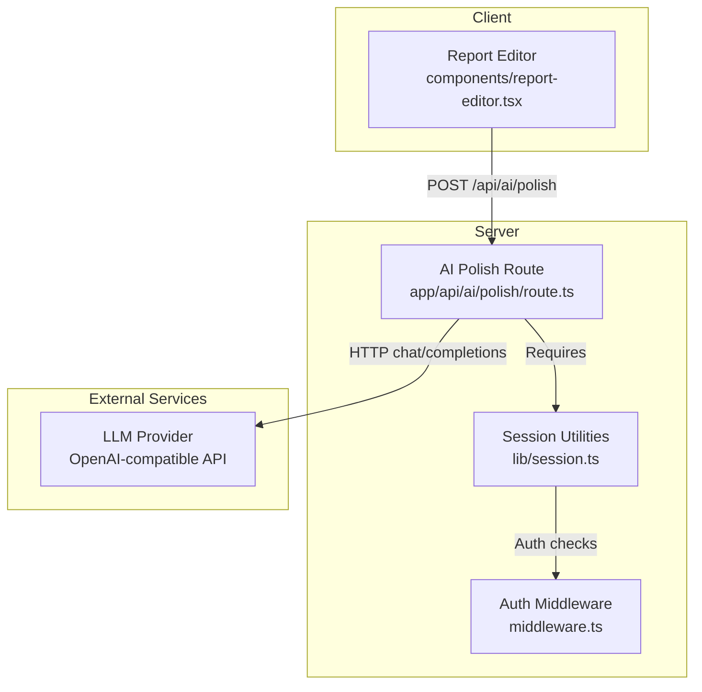
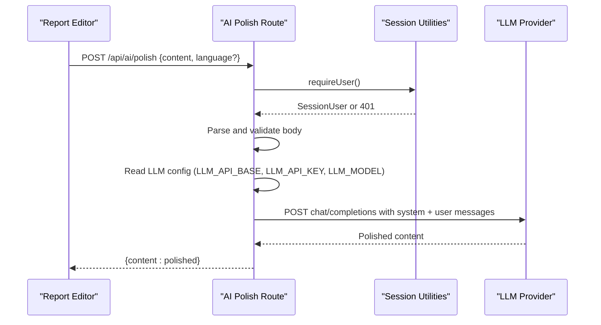
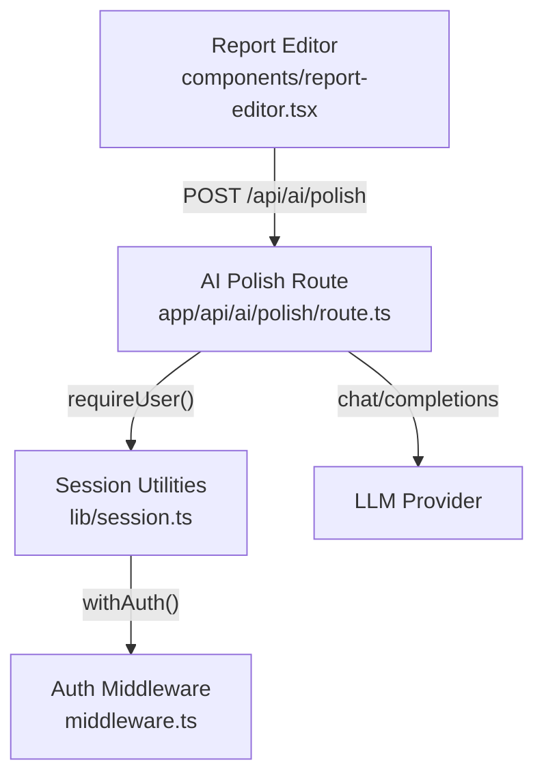

# AI Enhancement Endpoints

<cite>
**Referenced Files in This Document**
- [route.ts](file://app/api/ai/polish/route.ts)
- [report-editor.tsx](file://components/report-editor.tsx)
- [README.md](file://README.md)
- [session.ts](file://lib/session.ts)
- [middleware.ts](file://middleware.ts)
- [docker-compose.yml](file://docker-compose.yml)
- [gitlab.ts](file://lib/gitlab.ts)
</cite>

## Table of Contents
1. [Introduction](#introduction)
2. [Project Structure](#project-structure)
3. [Core Components](#core-components)
4. [Architecture Overview](#architecture-overview)
5. [Detailed Component Analysis](#detailed-component-analysis)
6. [Dependency Analysis](#dependency-analysis)
7. [Performance Considerations](#performance-considerations)
8. [Troubleshooting Guide](#troubleshooting-guide)
9. [Conclusion](#conclusion)

## Introduction
This document provides comprehensive API documentation for the AI enhancement endpoints, focusing on the AI polish endpoint that improves report content using OpenAI-compatible Large Language Model (LLM) services. It covers request/response schemas, integration patterns with LLM providers, configuration requirements, cost considerations, optional features, fallback mechanisms, quality control measures, and privacy considerations.

## Project Structure
The AI polish functionality is implemented as a Next.js App Router API route that integrates with the report editor component. The system enforces authentication and wraps route handlers with error conversion utilities.

**Diagram sources**
- [report-editor.tsx:142-164](file://components/report-editor.tsx#L142-L164)
- [route.ts:10-62](file://app/api/ai/polish/route.ts#L10-L62)
- [session.ts:22-55](file://lib/session.ts#L22-L55)
- [middleware.ts:1-10](file://middleware.ts#L1-L10)

**Section sources**
- [README.md:72-86](file://README.md#L72-L86)
- [report-editor.tsx:19-284](file://components/report-editor.tsx#L19-L284)
- [route.ts:1-63](file://app/api/ai/polish/route.ts#L1-L63)
- [session.ts:1-56](file://lib/session.ts#L1-L56)
- [middleware.ts:1-10](file://middleware.ts#L1-L10)

## Core Components
- AI Polish API Route: Validates requests, authenticates users, constructs system prompts, forwards requests to the configured LLM provider, and returns polished content.
- Report Editor: Provides a UI for users to trigger AI polishing on report content and displays results.
- Authentication and Error Handling: Ensures only authenticated users can access the endpoint and converts exceptions into standardized responses.

Key responsibilities:
- Input validation and sanitization
- LLM provider configuration and request forwarding
- Response formatting and error propagation
- Integration with the report editor workflow

**Section sources**
- [route.ts:5-8](file://app/api/ai/polish/route.ts#L5-L8)
- [report-editor.tsx:142-164](file://components/report-editor.tsx#L142-L164)
- [session.ts:22-55](file://lib/session.ts#L22-L55)

## Architecture Overview
The AI polish endpoint follows a straightforward flow: the client sends a request to the server, the server validates the user session, constructs a system prompt, forwards the request to the LLM provider, and returns the polished content to the client.

**Diagram sources**
- [report-editor.tsx:142-164](file://components/report-editor.tsx#L142-L164)
- [route.ts:10-62](file://app/api/ai/polish/route.ts#L10-L62)
- [session.ts:22-29](file://lib/session.ts#L22-L29)

## Detailed Component Analysis

### AI Polish Endpoint
The AI polish endpoint accepts a request containing content to be improved and an optional language parameter. It validates the request, ensures the user is authenticated, reads LLM configuration from environment variables, constructs a system prompt tailored to report generation, and forwards the request to the LLM provider. The endpoint returns the polished content or an error response.

Request schema:
- content: string (required, min length 1, max length 20000)
- language: string (optional)

Response schema:
- content: string (polished markdown content)

Behavior:
- Authentication: Requires a valid user session; unauthorized requests receive a 401 response.
- Configuration: Requires LLM_API_BASE and LLM_API_KEY; missing configuration results in a 400 error.
- Prompt construction: Uses the provided language to tailor the system prompt for report generation.
- Forwarding: Sends a POST request to the LLM provider's chat/completions endpoint with model, temperature, and messages.
- Error handling: Propagates non-2xx responses from the LLM provider as 502 errors with the provider's status and message.

Integration with OpenAI-compatible providers:
- The endpoint uses the standard OpenAI chat/completions interface, making it compatible with providers that support this endpoint.
- Environment variables LLM_API_BASE, LLM_API_KEY, and LLM_MODEL control the provider base URL, API key, and model selection.

Quality control measures:
- Temperature is set to a low value to encourage deterministic and concise outputs suitable for report generation.
- The system prompt enforces constraints on content summarization, grouping by project, and markdown preservation.

Fallback mechanisms:
- If the LLM provider returns an empty response, the endpoint returns a 502 error indicating an empty response.
- If the LLM provider returns a non-2xx status, the endpoint returns a 502 error with the provider's status and message.

Privacy considerations:
- The endpoint does not store or log the content sent to the LLM provider; it only forwards the request and returns the response.
- Authentication is enforced server-side; sensitive tokens are not exposed to the client.

Cost considerations:
- The endpoint does not implement rate limiting or cost tracking; costs depend on the LLM provider's pricing model and the volume of requests.

**Section sources**
- [route.ts:5-8](file://app/api/ai/polish/route.ts#L5-L8)
- [route.ts:10-62](file://app/api/ai/polish/route.ts#L10-L62)
- [session.ts:22-29](file://lib/session.ts#L22-L29)
- [README.md:62](file://README.md#L62)

### Report Editor Integration
The report editor component provides a user interface for triggering AI polishing on the current report content. It includes a dedicated button that sends a request to the AI polish endpoint and updates the editor content with the polished result.

Workflow:
- User clicks the "AI 润色" button.
- The editor validates that content is present and sends a POST request to /api/ai/polish with the current content.
- On success, the editor replaces the content with the polished result and shows a success notification.
- On failure, the editor displays an error notification.

UI controls:
- Date selector, template dropdown, project toggles, and action buttons for generate, polish, copy, and save.
- Real-time markdown preview using a third-party editor component.

**Section sources**
- [report-editor.tsx:142-164](file://components/report-editor.tsx#L142-L164)
- [report-editor.tsx:172-282](file://components/report-editor.tsx#L172-L282)

### Authentication and Authorization
The AI polish endpoint requires a valid user session. The session utilities enforce authentication and convert exceptions into standardized responses. The middleware protects routes by requiring authentication for protected pages.

Key behaviors:
- requireUser throws a 401 response if no valid session is found.
- withErrors wraps route handlers to convert thrown NextResponse instances into HTTP responses and logs unexpected errors.

**Section sources**
- [session.ts:22-55](file://lib/session.ts#L22-L55)
- [middleware.ts:1-10](file://middleware.ts#L1-L10)

### Configuration and Deployment
The AI polish endpoint relies on environment variables for LLM provider configuration. These variables are defined in the Docker Compose configuration and documented in the README.

Environment variables:
- LLM_API_BASE: Base URL of the LLM provider (required for AI polish)
- LLM_API_KEY: API key for the LLM provider (required for AI polish)
- LLM_MODEL: Model identifier (defaults to a common model if not provided)

Deployment:
- The Docker Compose configuration sets default values for LLM-related environment variables.
- The README documents the API surface and highlights the AI polish endpoint.

**Section sources**
- [route.ts:14-16](file://app/api/ai/polish/route.ts#L14-L16)
- [docker-compose.yml:15-17](file://docker-compose.yml#L15-L17)
- [README.md:62](file://README.md#L62)

## Dependency Analysis
The AI polish endpoint depends on several components for authentication, error handling, and LLM integration.

**Diagram sources**
- [route.ts:10-62](file://app/api/ai/polish/route.ts#L10-L62)
- [session.ts:22-55](file://lib/session.ts#L22-L55)
- [middleware.ts:1-10](file://middleware.ts#L1-L10)
- [report-editor.tsx:142-164](file://components/report-editor.tsx#L142-L164)

**Section sources**
- [route.ts:10-62](file://app/api/ai/polish/route.ts#L10-L62)
- [session.ts:22-55](file://lib/session.ts#L22-L55)
- [middleware.ts:1-10](file://middleware.ts#L1-L10)
- [report-editor.tsx:142-164](file://components/report-editor.tsx#L142-L164)

## Performance Considerations
- Request size limits: The endpoint enforces a maximum content length to prevent excessive payload sizes.
- Timeout handling: While the endpoint itself does not set timeouts, the underlying fetch operation inherits default browser/Node.js behavior. Consider adding explicit timeout handling if needed.
- Rate limiting: The endpoint does not implement rate limiting; implement provider-side quotas or application-level throttling as needed.
- Caching: No caching is implemented for LLM responses; consider caching strategies for repeated content to reduce costs and latency.

## Troubleshooting Guide
Common issues and resolutions:
- Unauthorized access: Ensure the user is authenticated; the endpoint returns a 401 error if no valid session is found.
- Missing configuration: Verify that LLM_API_BASE and LLM_API_KEY are set; the endpoint returns a 400 error if either is missing.
- LLM provider errors: Non-2xx responses from the LLM provider are returned as 502 errors with the provider's status and message.
- Empty response: If the LLM provider returns an empty response, the endpoint returns a 502 error indicating an empty response.
- Content validation: Ensure the content length is within the allowed range; the endpoint validates minimum and maximum lengths.

Operational tips:
- Monitor LLM provider quotas and adjust usage accordingly.
- Consider implementing retry logic for transient provider errors.
- Log and track endpoint usage for cost analysis and performance monitoring.

**Section sources**
- [route.ts:17-22](file://app/api/ai/polish/route.ts#L17-L22)
- [route.ts:48-60](file://app/api/ai/polish/route.ts#L48-L60)
- [session.ts:22-29](file://lib/session.ts#L22-L29)

## Conclusion
The AI polish endpoint provides a streamlined mechanism for enhancing report content using OpenAI-compatible LLM providers. It enforces authentication, validates inputs, constructs targeted system prompts, and forwards requests to the configured provider. The report editor integrates seamlessly with this endpoint, enabling users to improve their daily reports with minimal friction. Proper configuration of environment variables and awareness of provider limitations are essential for reliable operation and cost control.