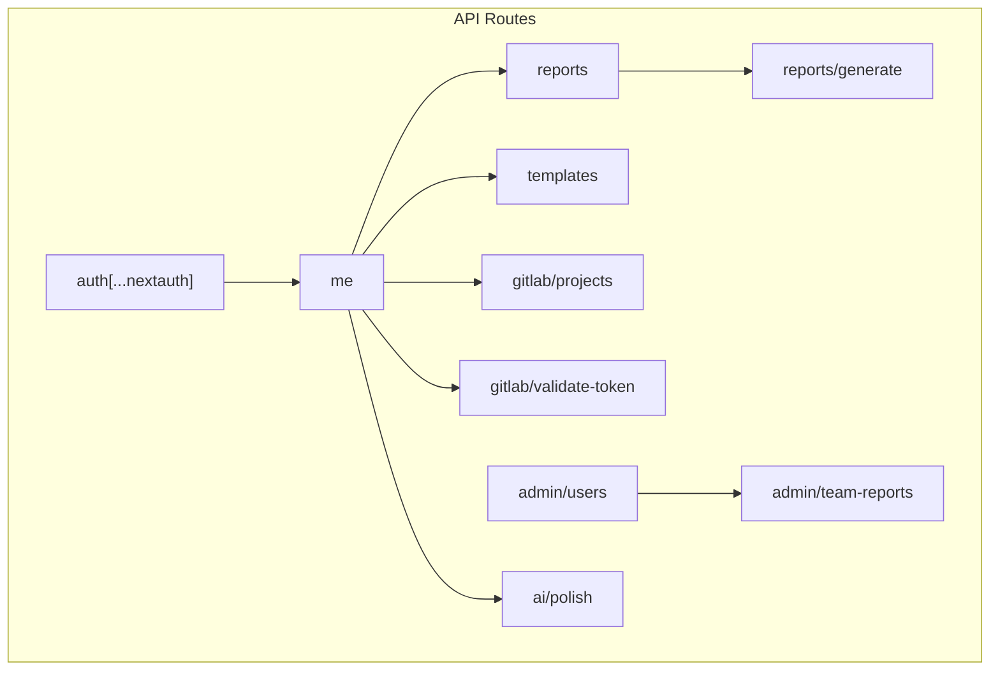
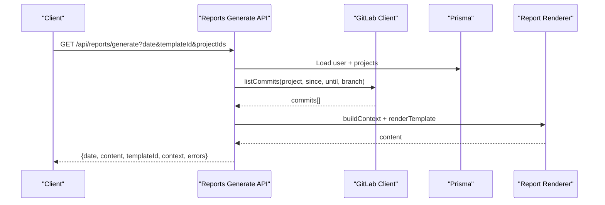
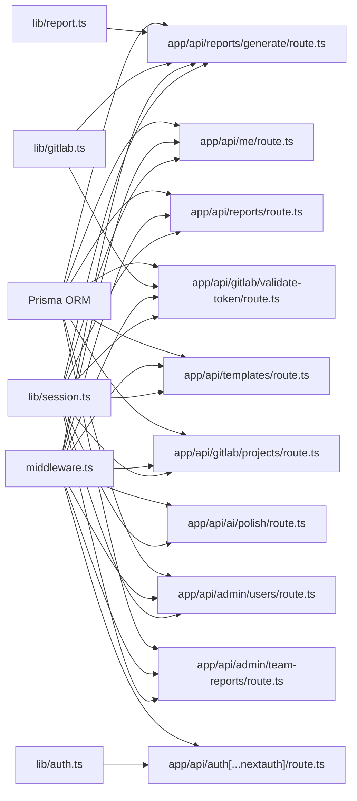

# API Reference

<cite>
**Referenced Files in This Document**
- [app/api/admin/team-reports/route.ts](file://app/api/admin/team-reports/route.ts)
- [app/api/admin/users/route.ts](file://app/api/admin/users/route.ts)
- [app/api/ai/polish/route.ts](file://app/api/ai/polish/route.ts)
- [app/api/auth[...nextauth]/route.ts](file://app/api/auth[...nextauth]/route.ts)
- [app/api/gitlab/projects/route.ts](file://app/api/gitlab/projects/route.ts)
- [app/api/gitlab/validate-token/route.ts](file://app/api/gitlab/validate-token/route.ts)
- [app/api/me/route.ts](file://app/api/me/route.ts)
- [app/api/reports/generate/route.ts](file://app/api/reports/generate/route.ts)
- [app/api/reports/route.ts](file://app/api/reports/route.ts)
- [app/api/templates/route.ts](file://app/api/templates/route.ts)
- [lib/auth.ts](file://lib/auth.ts)
- [lib/session.ts](file://lib/session.ts)
- [lib/gitlab.ts](file://lib/gitlab.ts)
- [lib/report.ts](file://lib/report.ts)
- [middleware.ts](file://middleware.ts)
</cite>

## Table of Contents
1. [Introduction](#introduction)
2. [Project Structure](#project-structure)
3. [Core Components](#core-components)
4. [Architecture Overview](#architecture-overview)
5. [Detailed Component Analysis](#detailed-component-analysis)
6. [Dependency Analysis](#dependency-analysis)
7. [Performance Considerations](#performance-considerations)
8. [Troubleshooting Guide](#troubleshooting-guide)
9. [Conclusion](#conclusion)
10. [Appendices](#appendices)

## Introduction
This document describes the Pingyun Report REST API surface implemented under the Next.js app router. It covers authentication via NextAuth.js, user self-service endpoints, admin-only endpoints, report CRUD and generation, GitLab integration, template management, and the AI polish endpoint for LLM-assisted report polishing. For each endpoint, we specify HTTP methods, URL patterns, request/response schemas, validation rules, error responses, and security requirements. Practical examples and integration guidelines are included.

## Project Structure
The API is organized under app/api with feature-based grouping:
- Authentication: NextAuth.js integration under app/api/auth[...nextauth]
- User self-service: app/api/me, app/api/reports, app/api/templates
- Admin: app/api/admin/{team-reports, users}
- GitLab integration: app/api/gitlab/{projects, validate-token}
- AI polish: app/api/ai/polish

**Diagram sources**
- [app/api/auth[...nextauth]/route.ts](file://app/api/auth[...nextauth]/route.ts)
- [app/api/me/route.ts](file://app/api/me/route.ts)
- [app/api/reports/route.ts](file://app/api/reports/route.ts)
- [app/api/reports/generate/route.ts](file://app/api/reports/generate/route.ts)
- [app/api/templates/route.ts](file://app/api/templates/route.ts)
- [app/api/gitlab/projects/route.ts](file://app/api/gitlab/projects/route.ts)
- [app/api/gitlab/validate-token/route.ts](file://app/api/gitlab/validate-token/route.ts)
- [app/api/admin/users/route.ts](file://app/api/admin/users/route.ts)
- [app/api/admin/team-reports/route.ts](file://app/api/admin/team-reports/route.ts)
- [app/api/ai/polish/route.ts](file://app/api/ai/polish/route.ts)

**Section sources**
- [app/api/me/route.ts](file://app/api/me/route.ts)
- [app/api/reports/route.ts](file://app/api/reports/route.ts)
- [app/api/reports/generate/route.ts](file://app/api/reports/generate/route.ts)
- [app/api/templates/route.ts](file://app/api/templates/route.ts)
- [app/api/gitlab/projects/route.ts](file://app/api/gitlab/projects/route.ts)
- [app/api/gitlab/validate-token/route.ts](file://app/api/gitlab/validate-token/route.ts)
- [app/api/admin/users/route.ts](file://app/api/admin/users/route.ts)
- [app/api/admin/team-reports/route.ts](file://app/api/admin/team-reports/route.ts)
- [app/api/ai/polish/route.ts](file://app/api/ai/polish/route.ts)
- [lib/auth.ts](file://lib/auth.ts)
- [lib/session.ts](file://lib/session.ts)
- [lib/gitlab.ts](file://lib/gitlab.ts)
- [lib/report.ts](file://lib/report.ts)
- [middleware.ts](file://middleware.ts)

## Core Components
- Authentication and session: NextAuth.js with JWT strategy; server-side session retrieval and enforcement helpers.
- Middleware: protects routes under "/", "/history/:path*", "/settings/:path*", "/admin/:path*".
- Data validation: Zod schemas for request bodies and query parameters.
- Persistence: Prisma ORM for user, report, template, and project entities.
- GitLab integration: server-only client for validating tokens, listing projects, and fetching commits.
- Report rendering: Handlebars templating with conventional commit parsing and deduplication.

**Section sources**
- [lib/auth.ts](file://lib/auth.ts)
- [lib/session.ts](file://lib/session.ts)
- [middleware.ts](file://middleware.ts)
- [lib/gitlab.ts](file://lib/gitlab.ts)
- [lib/report.ts](file://lib/report.ts)

## Architecture Overview
High-level flow for report generation and GitLab integration:

**Diagram sources**
- [app/api/reports/generate/route.ts](file://app/api/reports/generate/route.ts)
- [lib/gitlab.ts](file://lib/gitlab.ts)
- [lib/report.ts](file://lib/report.ts)

## Detailed Component Analysis

### Authentication Endpoints (NextAuth.js)
- Path: app/api/auth[...nextauth]
- Behavior: Implements NextAuth.js credentials provider with bcrypt verification. Session strategy is JWT. Exposes NextAuth routes for sign-in/sign-out flows.
- Authentication requirements:
  - Client cookies/session managed by NextAuth.
  - Server enforces session via middleware and helper functions.
- Security considerations:
  - Passwords stored as bcrypt hashes.
  - Session uses JWT; ensure HTTPS in production.
- Example usage:
  - Use NextAuth client SDK to sign in; subsequent requests carry session cookie.

**Section sources**
- [app/api/auth[...nextauth]/route.ts](file://app/api/auth[...nextauth]/route.ts)
- [lib/auth.ts](file://lib/auth.ts)
- [lib/session.ts](file://lib/session.ts)
- [middleware.ts](file://middleware.ts)

### User Self-Service Endpoints

#### GET /api/me
- Description: Retrieve current user profile and masked GitLab token indicator.
- Authentication: Required (MEMBER/ADMIN).
- Response fields:
  - user.id, username, displayName, role, gitlabBaseUrl, gitlabUserId, gitlabEmail, noiseRegex, hasToken, tokenMask.
- Notes: Token is never returned in plaintext; masked preview is provided.

**Section sources**
- [app/api/me/route.ts](file://app/api/me/route.ts)

#### PATCH /api/me
- Description: Update personal settings (displayName, noiseRegex).
- Authentication: Required.
- Request body:
  - displayName: string, optional.
  - noiseRegex: string|null, optional.
- Response: { ok: true }.

**Section sources**
- [app/api/me/route.ts](file://app/api/me/route.ts)

#### GET /api/reports
- Description: List reports for the current user.
- Query parameters:
  - date: YYYY-MM-DD (returns single report).
  - month: YYYY-MM (returns reports for the month).
  - If neither provided: returns latest 60 reports.
- Authentication: Required.
- Response fields:
  - reports: array of { id, date, updatedAt } (when listing).
  - report: object (when querying a specific date).

**Section sources**
- [app/api/reports/route.ts](file://app/api/reports/route.ts)

#### POST /api/reports
- Description: Upsert a report for a given date.
- Authentication: Required.
- Request body:
  - date: YYYY-MM-DD.
  - content: string.
  - templateId: string|null, optional.
  - rawCommits: any, optional.
- Response fields:
  - report: created/updated report object.

**Section sources**
- [app/api/reports/route.ts](file://app/api/reports/route.ts)

#### DELETE /api/reports
- Description: Delete a report by date.
- Authentication: Required.
- Query parameters:
  - date: YYYY-MM-DD (required).
- Response: { ok: true }.

**Section sources**
- [app/api/reports/route.ts](file://app/api/reports/route.ts)

#### GET /api/reports/generate
- Description: Generate a report for a given date using configured GitLab projects and template.
- Authentication: Required.
- Query parameters:
  - date: YYYY-MM-DD, optional (defaults to today).
  - templateId: string, optional.
  - projectIds: comma-separated project IDs, optional.
- Validation:
  - Requires user to have gitlabBaseUrl and gitlabToken set.
  - Filters merges, deduplicates, applies noiseRegex, and renders template.
- Response fields:
  - date, content, templateId, context, errors (array of { project, error }).
- Notes:
  - Uses decrypted GitLab token from user record.
  - Projects considered are enabled and optionally filtered by projectIds.

**Section sources**
- [app/api/reports/generate/route.ts](file://app/api/reports/generate/route.ts)
- [lib/gitlab.ts](file://lib/gitlab.ts)
- [lib/report.ts](file://lib/report.ts)

#### GET /api/templates
- Description: List templates; creates default template if none exist.
- Authentication: Required.
- Response fields:
  - templates: array of { id, name, body, isDefault, updatedAt }.

**Section sources**
- [app/api/templates/route.ts](file://app/api/templates/route.ts)

#### POST /api/templates
- Description: Create a new template; toggles previous default if isDefault is true.
- Authentication: Required.
- Request body:
  - name: string (1–50).
  - body: string (min length 1).
  - isDefault: boolean, optional.
- Response fields:
  - template: created template object.

**Section sources**
- [app/api/templates/route.ts](file://app/api/templates/route.ts)

#### PATCH /api/templates
- Description: Update template; toggles previous default if isDefault is true.
- Authentication: Required.
- Request body:
  - id: string.
  - name: string (1–50), optional.
  - body: string (min length 1), optional.
  - isDefault: boolean, optional.
- Response: { template: updated }.

**Section sources**
- [app/api/templates/route.ts](file://app/api/templates/route.ts)

#### DELETE /api/templates
- Description: Delete a template by id.
- Authentication: Required.
- Query parameters:
  - id: string (required).
- Response: { ok: true }.

**Section sources**
- [app/api/templates/route.ts](file://app/api/templates/route.ts)

#### GET /api/gitlab/projects
- Description: List projects associated with the current user.
- Authentication: Required.
- Response fields:
  - projects: array of { id, nameWithNamespace, webUrl, defaultBranch, enabled }.

**Section sources**
- [app/api/gitlab/projects/route.ts](file://app/api/gitlab/projects/route.ts)

#### PATCH /api/gitlab/projects
- Description: Update project settings (enabled, defaultBranch).
- Authentication: Required.
- Request body:
  - id: string.
  - enabled: boolean, optional.
  - defaultBranch: string|null, optional.
- Response: { project: updated }.
- Notes: Only updates projects owned by the current user.

**Section sources**
- [app/api/gitlab/projects/route.ts](file://app/api/gitlab/projects/route.ts)

#### POST /api/gitlab/validate-token
- Description: Validate GitLab token, persist user info, and optionally cache projects.
- Authentication: Required.
- Request body:
  - baseUrl: string (URL).
  - token: string (min length 8), optional if user already has a token stored.
- Response:
  - ok: boolean.
  - user: { id, name, email }.
  - warning: string, present if project caching fails.
- Notes:
  - Stores encrypted token and persists user GitLab metadata.
  - Attempts to upsert project cache for the user.

**Section sources**
- [app/api/gitlab/validate-token/route.ts](file://app/api/gitlab/validate-token/route.ts)
- [lib/gitlab.ts](file://lib/gitlab.ts)

#### POST /api/ai/polish
- Description: Polish raw commit content into concise, readable markdown using an LLM.
- Authentication: Required (any role).
- Environment variables:
  - LLM_API_BASE: LLM base URL.
  - LLM_API_KEY: LLM API key.
  - LLM_MODEL: Model identifier (default: gpt-4o-mini).
- Request body:
  - content: string (1–20000).
  - language: string, optional (default: 中文).
- Response:
  - content: polished markdown string.
- Error handling:
  - Returns 400 if required environment variables are missing.
  - Returns 502 if upstream LLM request fails or returns empty content.

**Section sources**
- [app/api/ai/polish/route.ts](file://app/api/ai/polish/route.ts)

### Admin-Only Endpoints

#### GET /api/admin/team-reports
- Description: Fetch team reports for a given date (admin-only).
- Authentication: ADMIN required.
- Query parameters:
  - date: YYYY-MM-DD, optional (defaults to today).
- Response fields:
  - date: string.
  - rows: array of { user, report? } where report may be null if not submitted.

**Section sources**
- [app/api/admin/team-reports/route.ts](file://app/api/admin/team-reports/route.ts)

#### GET /api/admin/users
- Description: List all users (admin-only).
- Authentication: ADMIN required.
- Response fields:
  - users: array of { id, username, displayName, role, gitlabBaseUrl, gitlabEmail, createdAt }.

**Section sources**
- [app/api/admin/users/route.ts](file://app/api/admin/users/route.ts)

#### POST /api/admin/users
- Description: Create a new user (admin-only).
- Authentication: ADMIN required.
- Request body:
  - username: string (2–50).
  - password: string (6–200).
  - displayName: string (1–50).
  - role: "MEMBER"|"ADMIN", optional (defaults to MEMBER).
- Response fields:
  - user: created user object.

**Section sources**
- [app/api/admin/users/route.ts](file://app/api/admin/users/route.ts)

#### PATCH /api/admin/users
- Description: Update user (admin-only).
- Authentication: ADMIN required.
- Request body:
  - id: string.
  - password: string (6–200), optional.
  - displayName: string (1–50), optional.
  - role: "MEMBER"|"ADMIN", optional.
- Response: { user: updated }.

**Section sources**
- [app/api/admin/users/route.ts](file://app/api/admin/users/route.ts)

#### DELETE /api/admin/users
- Description: Delete a user (admin-only).
- Authentication: ADMIN required.
- Query parameters:
  - id: string (required).
- Response: { ok: true }.

**Section sources**
- [app/api/admin/users/route.ts](file://app/api/admin/users/route.ts)

## Dependency Analysis
Key internal dependencies and relationships:

**Diagram sources**
- [lib/session.ts](file://lib/session.ts)
- [lib/auth.ts](file://lib/auth.ts)
- [middleware.ts](file://middleware.ts)
- [lib/gitlab.ts](file://lib/gitlab.ts)
- [lib/report.ts](file://lib/report.ts)
- [app/api/me/route.ts](file://app/api/me/route.ts)
- [app/api/reports/route.ts](file://app/api/reports/route.ts)
- [app/api/reports/generate/route.ts](file://app/api/reports/generate/route.ts)
- [app/api/templates/route.ts](file://app/api/templates/route.ts)
- [app/api/gitlab/projects/route.ts](file://app/api/gitlab/projects/route.ts)
- [app/api/gitlab/validate-token/route.ts](file://app/api/gitlab/validate-token/route.ts)
- [app/api/ai/polish/route.ts](file://app/api/ai/polish/route.ts)
- [app/api/admin/users/route.ts](file://app/api/admin/users/route.ts)
- [app/api/admin/team-reports/route.ts](file://app/api/admin/team-reports/route.ts)

**Section sources**
- [lib/session.ts](file://lib/session.ts)
- [lib/auth.ts](file://lib/auth.ts)
- [middleware.ts](file://middleware.ts)
- [lib/gitlab.ts](file://lib/gitlab.ts)
- [lib/report.ts](file://lib/report.ts)
- [app/api/me/route.ts](file://app/api/me/route.ts)
- [app/api/reports/route.ts](file://app/api/reports/route.ts)
- [app/api/reports/generate/route.ts](file://app/api/reports/generate/route.ts)
- [app/api/templates/route.ts](file://app/api/templates/route.ts)
- [app/api/gitlab/projects/route.ts](file://app/api/gitlab/projects/route.ts)
- [app/api/gitlab/validate-token/route.ts](file://app/api/gitlab/validate-token/route.ts)
- [app/api/ai/polish/route.ts](file://app/api/ai/polish/route.ts)
- [app/api/admin/users/route.ts](file://app/api/admin/users/route.ts)
- [app/api/admin/team-reports/route.ts](file://app/api/admin/team-reports/route.ts)

## Performance Considerations
- Rate limiting: Not implemented in code; consider deploying a reverse proxy or platform-level rate limiting in front of the API.
- Concurrency and retries:
  - GitLab client enforces a 20-second timeout and paginates with safety caps to avoid excessive load.
  - Report generation performs concurrent project commit fetching; ensure GitLab API quotas are considered.
- Caching:
  - Project cache is refreshed during token validation; consider adding CDN or server-side caching for repeated reads.
- Rendering:
  - Template compilation occurs per request; consider caching compiled templates per user/template if needed.

[No sources needed since this section provides general guidance]

## Troubleshooting Guide
- Authentication failures:
  - 401 Unauthorized: No active session; ensure NextAuth cookies are present.
  - 403 Forbidden: Admin-required endpoint accessed by non-admin user.
- Validation errors:
  - 400 Bad Request: Malformed date, missing id, invalid field lengths/types.
- GitLab integration:
  - 404 Not Found: Project not found under current user.
  - 502 Bad Gateway: Upstream GitLab or LLM service failure; check baseUrl/token/environment variables.
- Internal errors:
  - 500 Internal Server Error: Unexpected server-side exceptions; check logs.

**Section sources**
- [lib/session.ts](file://lib/session.ts)
- [app/api/admin/team-reports/route.ts](file://app/api/admin/team-reports/route.ts)
- [app/api/admin/users/route.ts](file://app/api/admin/users/route.ts)
- [app/api/gitlab/projects/route.ts](file://app/api/gitlab/projects/route.ts)
- [app/api/gitlab/validate-token/route.ts](file://app/api/gitlab/validate-token/route.ts)
- [app/api/ai/polish/route.ts](file://app/api/ai/polish/route.ts)

## Conclusion
The Pingyun Report API provides a cohesive set of endpoints for user self-service, admin oversight, GitLab integration, and AI-assisted report polishing. Authentication is handled centrally via NextAuth.js with JWT sessions, and strict validation ensures robust request handling. For production deployments, consider adding rate limiting, monitoring, and secure transport.

[No sources needed since this section summarizes without analyzing specific files]

## Appendices

### Authentication and Authorization
- Authentication method: NextAuth.js credentials provider with JWT session.
- Authorization roles: MEMBER and ADMIN; admin endpoints guarded by requireAdmin.
- Session enforcement: requireUser/requireAdmin wrappers and middleware protect routes.

**Section sources**
- [lib/auth.ts](file://lib/auth.ts)
- [lib/session.ts](file://lib/session.ts)
- [middleware.ts](file://middleware.ts)

### Data Models and Schemas
Representative request/response shapes and validation rules:

- Reports
  - GET /api/reports: query params date (YYYY-MM-DD) or month (YYYY-MM); returns reports[] or report.
  - POST /api/reports: body { date, content, templateId?, rawCommits? }; returns report.
  - DELETE /api/reports: query param date (YYYY-MM-DD); returns { ok: true }.

- Templates
  - GET /api/templates: returns templates[].
  - POST /api/templates: body { name, body, isDefault? }; returns template.
  - PATCH /api/templates: body { id, name?, body?, isDefault? }; returns template.
  - DELETE /api/templates: query param id; returns { ok: true }.

- GitLab
  - GET /api/gitlab/projects: returns projects[].
  - PATCH /api/gitlab/projects: body { id, enabled?, defaultBranch? }; returns project.
  - POST /api/gitlab/validate-token: body { baseUrl, token? }; returns ok/user/warning.

- AI Polish
  - POST /api/ai/polish: body { content (1–20000), language? }; returns content.

- Admin
  - GET /api/admin/team-reports: query param date; returns { date, rows }.
  - GET /api/admin/users: returns users[].
  - POST /api/admin/users: body { username, password, displayName, role? }; returns user.
  - PATCH /api/admin/users: body { id, password?, displayName?, role? }; returns user.
  - DELETE /api/admin/users: query param id; returns { ok: true }.

**Section sources**
- [app/api/reports/route.ts](file://app/api/reports/route.ts)
- [app/api/reports/generate/route.ts](file://app/api/reports/generate/route.ts)
- [app/api/templates/route.ts](file://app/api/templates/route.ts)
- [app/api/gitlab/projects/route.ts](file://app/api/gitlab/projects/route.ts)
- [app/api/gitlab/validate-token/route.ts](file://app/api/gitlab/validate-token/route.ts)
- [app/api/ai/polish/route.ts](file://app/api/ai/polish/route.ts)
- [app/api/admin/team-reports/route.ts](file://app/api/admin/team-reports/route.ts)
- [app/api/admin/users/route.ts](file://app/api/admin/users/route.ts)

### Versioning and Stability
- No explicit API versioning header or URL segment is used in the current implementation.
- Backward compatibility is not enforced; breaking changes may occur without notice.

[No sources needed since this section provides general guidance]