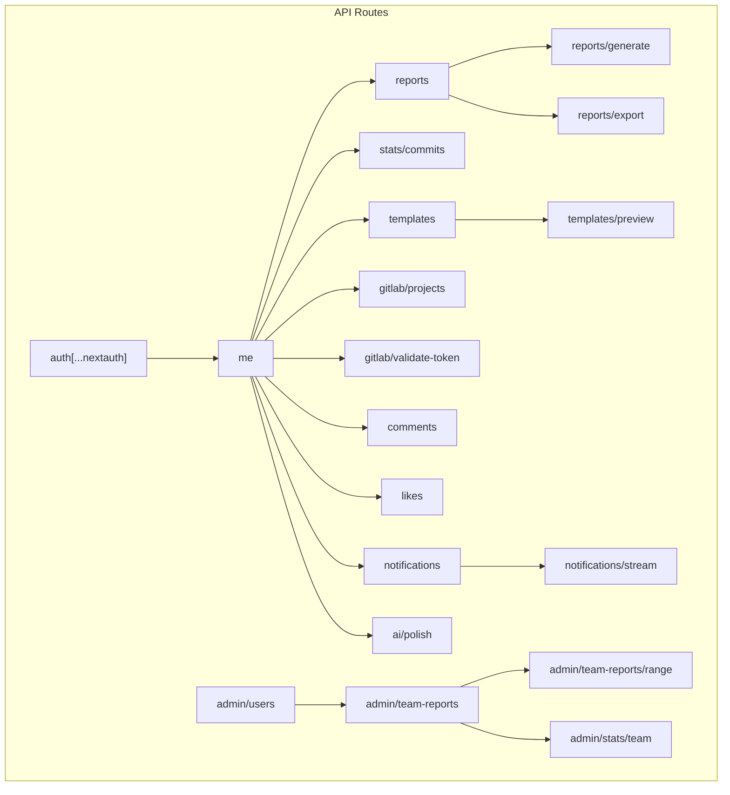
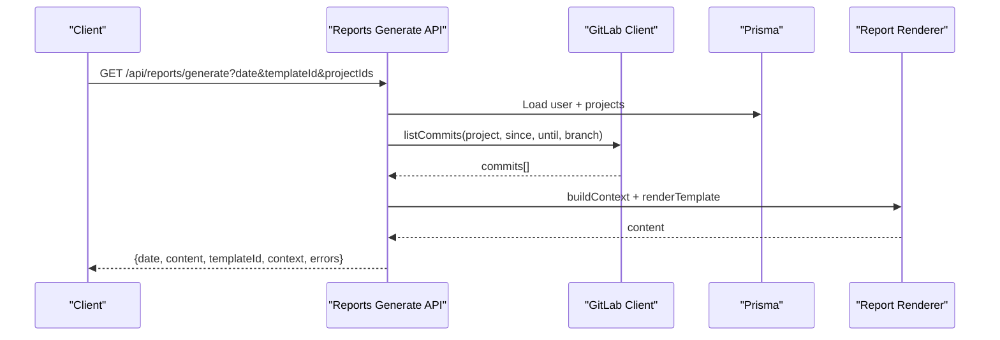

# API Reference

<cite>
**Referenced Files in This Document**
- [app/api/admin/team-reports/range/route.ts](file://app/api/admin/team-reports/range/route.ts)
- [app/api/admin/stats/team/route.ts](file://app/api/admin/stats/team/route.ts)
- [app/api/admin/team-reports/route.ts](file://app/api/admin/team-reports/route.ts)
- [app/api/admin/users/route.ts](file://app/api/admin/users/route.ts)
- [app/api/ai/polish/route.ts](file://app/api/ai/polish/route.ts)
- [app/api/auth[...nextauth]/route.ts](file://app/api/auth[...nextauth]/route.ts)
- [app/api/comments/route.ts](file://app/api/comments/route.ts)
- [app/api/gitlab/projects/route.ts](file://app/api/gitlab/projects/route.ts)
- [app/api/gitlab/validate-token/route.ts](file://app/api/gitlab/validate-token/route.ts)
- [app/api/likes/route.ts](file://app/api/likes/route.ts)
- [app/api/me/route.ts](file://app/api/me/route.ts)
- [app/api/notifications/route.ts](file://app/api/notifications/route.ts)
- [app/api/notifications/stream/route.ts](file://app/api/notifications/stream/route.ts)
- [app/api/reports/export/route.ts](file://app/api/reports/export/route.ts)
- [app/api/reports/generate/route.ts](file://app/api/reports/generate/route.ts)
- [app/api/reports/route.ts](file://app/api/reports/route.ts)
- [app/api/stats/commits/route.ts](file://app/api/stats/commits/route.ts)
- [app/api/templates/preview/route.ts](file://app/api/templates/preview/route.ts)
- [app/api/templates/route.ts](file://app/api/templates/route.ts)
- [lib/auth.ts](file://lib/auth.ts)
- [lib/session.ts](file://lib/session.ts)
- [lib/gitlab.ts](file://lib/gitlab.ts)
- [lib/report.ts](file://lib/report.ts)
- [lib/stats.ts](file://lib/stats.ts)
- [lib/notify.ts](file://lib/notify.ts)
- [lib/redis.ts](file://lib/redis.ts)
- [middleware.ts](file://middleware.ts)
- [prisma/schema.prisma](file://prisma/schema.prisma)
</cite>

## Update Summary
**Changes Made**
- Added new Social Interaction category with three new API endpoints:
  - Comments endpoint for report commenting system
  - Likes endpoint for report liking/unliking with real-time notifications
  - Notifications endpoint with SSE streaming for real-time user notifications
- Enhanced notification system with Redis-based publish-subscribe for instant delivery
- Added comprehensive access control for comments and likes (report owners and admins only)
- Implemented real-time notification streaming via Server-Sent Events (SSE)
- Added notification creation and delivery pipeline with Redis pub/sub integration

## Table of Contents
1. [Introduction](#introduction)
2. [Project Structure](#project-structure)
3. [Core Components](#core-components)
4. [Architecture Overview](#architecture-overview)
5. [Detailed Component Analysis](#detailed-component-analysis)
6. [Dependency Analysis](#dependency-analysis)
7. [Performance Considerations](#performance-considerations)
8. [Troubleshooting Guide](#troubleshooting-guide)
9. [Conclusion](#conclusion)
10. [Appendices](#appendices)

## Introduction
This document describes the Pingyun Report REST API surface implemented under the Next.js app router. It covers authentication via NextAuth.js, user self-service endpoints, admin-only endpoints, report CRUD and generation, GitLab integration, template management, statistics dashboard, social interaction features (comments, likes, notifications), and the AI polish endpoint for LLM-assisted report polishing. For each endpoint, we specify HTTP methods, URL patterns, request/response schemas, validation rules, error responses, and security requirements. Practical examples and integration guidelines are included.

## Project Structure
The API is organized under app/api with feature-based grouping:
- Authentication: NextAuth.js integration under app/api/auth[...nextauth]
- User self-service: app/api/me, app/api/reports, app/api/templates, app/api/stats
- Social Interaction: app/api/comments, app/api/likes, app/api/notifications
- Admin: app/api/admin/{team-reports, users, stats}
- GitLab integration: app/api/gitlab/{projects, validate-token}
- AI polish: app/api/ai/polish

**Diagram sources**
- [app/api/auth[...nextauth]/route.ts](file://app/api/auth[...nextauth]/route.ts)
- [app/api/me/route.ts](file://app/api/me/route.ts)
- [app/api/reports/route.ts](file://app/api/reports/route.ts)
- [app/api/reports/generate/route.ts](file://app/api/reports/generate/route.ts)
- [app/api/reports/export/route.ts](file://app/api/reports/export/route.ts)
- [app/api/stats/commits/route.ts](file://app/api/stats/commits/route.ts)
- [app/api/templates/route.ts](file://app/api/templates/route.ts)
- [app/api/templates/preview/route.ts](file://app/api/templates/preview/route.ts)
- [app/api/gitlab/projects/route.ts](file://app/api/gitlab/projects/route.ts)
- [app/api/gitlab/validate-token/route.ts](file://app/api/gitlab/validate-token/route.ts)
- [app/api/comments/route.ts](file://app/api/comments/route.ts)
- [app/api/likes/route.ts](file://app/api/likes/route.ts)
- [app/api/notifications/route.ts](file://app/api/notifications/route.ts)
- [app/api/notifications/stream/route.ts](file://app/api/notifications/stream/route.ts)
- [app/api/admin/users/route.ts](file://app/api/admin/users/route.ts)
- [app/api/admin/team-reports/route.ts](file://app/api/admin/team-reports/route.ts)
- [app/api/admin/team-reports/range/route.ts](file://app/api/admin/team-reports/range/route.ts)
- [app/api/admin/stats/team/route.ts](file://app/api/admin/stats/team/route.ts)
- [app/api/ai/polish/route.ts](file://app/api/ai/polish/route.ts)

**Section sources**
- [app/api/me/route.ts](file://app/api/me/route.ts)
- [app/api/reports/route.ts](file://app/api/reports/route.ts)
- [app/api/reports/generate/route.ts](file://app/api/reports/generate/route.ts)
- [app/api/reports/export/route.ts](file://app/api/reports/export/route.ts)
- [app/api/stats/commits/route.ts](file://app/api/stats/commits/route.ts)
- [app/api/templates/route.ts](file://app/api/templates/route.ts)
- [app/api/templates/preview/route.ts](file://app/api/templates/preview/route.ts)
- [app/api/gitlab/projects/route.ts](file://app/api/gitlab/projects/route.ts)
- [app/api/gitlab/validate-token/route.ts](file://app/api/gitlab/validate-token/route.ts)
- [app/api/comments/route.ts](file://app/api/comments/route.ts)
- [app/api/likes/route.ts](file://app/api/likes/route.ts)
- [app/api/notifications/route.ts](file://app/api/notifications/route.ts)
- [app/api/notifications/stream/route.ts](file://app/api/notifications/stream/route.ts)
- [app/api/admin/users/route.ts](file://app/api/admin/users/route.ts)
- [app/api/admin/team-reports/route.ts](file://app/api/admin/team-reports/route.ts)
- [app/api/admin/team-reports/range/route.ts](file://app/api/admin/team-reports/range/route.ts)
- [app/api/admin/stats/team/route.ts](file://app/api/admin/stats/team/route.ts)
- [app/api/ai/polish/route.ts](file://app/api/ai/polish/route.ts)
- [lib/auth.ts](file://lib/auth.ts)
- [lib/session.ts](file://lib/session.ts)
- [lib/gitlab.ts](file://lib/gitlab.ts)
- [lib/report.ts](file://lib/report.ts)
- [lib/stats.ts](file://lib/stats.ts)
- [lib/notify.ts](file://lib/notify.ts)
- [lib/redis.ts](file://lib/redis.ts)
- [middleware.ts](file://middleware.ts)

## Core Components
- Authentication and session: NextAuth.js with JWT strategy; server-side session retrieval and enforcement helpers.
- Middleware: protects routes under "/", "/history/:path*", "/settings/:path*", "/admin/:path*".
- Data validation: Zod schemas for request bodies and query parameters.
- Persistence: Prisma ORM for user, report, template, project, comment, like, and notification entities.
- GitLab integration: server-only client for validating tokens, listing projects, and fetching commits.
- Report rendering: Handlebars templating with conventional commit parsing and deduplication.
- Statistics processing: Commit categorization and aggregation for dashboard visualization with enhanced error handling.
- Social interaction system: Comments, likes, and notifications with real-time delivery via Redis pub/sub.
- Real-time notifications: Server-Sent Events (SSE) streaming for instant notification delivery.

**Section sources**
- [lib/auth.ts](file://lib/auth.ts)
- [lib/session.ts](file://lib/session.ts)
- [middleware.ts](file://middleware.ts)
- [lib/gitlab.ts](file://lib/gitlab.ts)
- [lib/report.ts](file://lib/report.ts)
- [lib/stats.ts](file://lib/stats.ts)
- [lib/notify.ts](file://lib/notify.ts)
- [lib/redis.ts](file://lib/redis.ts)

## Architecture Overview
High-level flow for report generation and GitLab integration:

**Diagram sources**
- [app/api/reports/generate/route.ts](file://app/api/reports/generate/route.ts)
- [lib/gitlab.ts](file://lib/gitlab.ts)
- [lib/report.ts](file://lib/report.ts)

## Detailed Component Analysis

### Authentication Endpoints (NextAuth.js)
- Path: app/api/auth[...nextauth]
- Behavior: Implements NextAuth.js credentials provider with bcrypt verification. Session strategy is JWT. Exposes NextAuth routes for sign-in/sign-out flows.
- Authentication requirements:
  - Client cookies/session managed by NextAuth.
  - Server enforces session via middleware and helper functions.
- Security considerations:
  - Passwords stored as bcrypt hashes.
  - Session uses JWT; ensure HTTPS in production.
- Example usage:
  - Use NextAuth client SDK to sign in; subsequent requests carry session cookie.

**Section sources**
- [app/api/auth[...nextauth]/route.ts](file://app/api/auth[...nextauth]/route.ts)
- [lib/auth.ts](file://lib/auth.ts)
- [lib/session.ts](file://lib/session.ts)
- [middleware.ts](file://middleware.ts)

### User Self-Service Endpoints

#### GET /api/me
- Description: Retrieve current user profile and masked GitLab token indicator.
- Authentication: Required (MEMBER/ADMIN).
- Response fields:
  - user.id, username, displayName, role, gitlabBaseUrl, gitlabUserId, gitlabEmail, noiseRegex, hasToken, tokenMask.
- Notes: Token is never returned in plaintext; masked preview is provided.

**Section sources**
- [app/api/me/route.ts](file://app/api/me/route.ts)

#### PATCH /api/me
- Description: Update personal settings (displayName, noiseRegex).
- Authentication: Required.
- Request body:
  - displayName: string, optional.
  - noiseRegex: string|null, optional.
- Response: { ok: true }.

**Section sources**
- [app/api/me/route.ts](file://app/api/me/route.ts)

#### GET /api/reports
- Description: List reports for the current user.
- Query parameters:
  - date: YYYY-MM-DD (returns single report).
  - month: YYYY-MM (returns reports for the month).
  - If neither provided: returns latest 60 reports.
- Authentication: Required.
- Response fields:
  - reports: array of { id, date, updatedAt } (when listing).
  - report: object (when querying a specific date).

**Section sources**
- [app/api/reports/route.ts](file://app/api/reports/route.ts)

#### POST /api/reports
- Description: Upsert a report for a given date.
- Authentication: Required.
- Request body:
  - date: YYYY-MM-DD.
  - content: string.
  - templateId: string|null, optional.
  - rawCommits: any, optional.
- Response fields:
  - report: created/updated report object.

**Section sources**
- [app/api/reports/route.ts](file://app/api/reports/route.ts)

#### DELETE /api/reports
- Description: Delete a report by date.
- Authentication: Required.
- Query parameters:
  - date: YYYY-MM-DD (required).
- Response: { ok: true }.

**Section sources**
- [app/api/reports/route.ts](file://app/api/reports/route.ts)

#### GET /api/reports/export
- Description: Export a report in various formats (PDF, HTML, Markdown).
- Authentication: Required.
- Query parameters:
  - date: YYYY-MM-DD (required).
  - format: "pdf"|"html"|"markdown" (default: pdf).
- Response: Binary content of the exported report.
- Notes: Returns appropriate Content-Type header based on format.

**Section sources**
- [app/api/reports/export/route.ts](file://app/api/reports/export/route.ts)

#### GET /api/reports/generate
- Description: Generate a report for a given date using configured GitLab projects and template.
- Authentication: Required.
- Query parameters:
  - date: YYYY-MM-DD, optional (defaults to today).
  - templateId: string, optional.
  - projectIds: comma-separated project IDs, optional.
- Validation:
  - Requires user to have gitlabBaseUrl and gitlabToken set.
  - Filters merges, deduplicates, applies noiseRegex, and renders template.
- Response fields:
  - date, content, templateId, context, errors (array of { project, error }).
- Notes:
  - Uses decrypted GitLab token from user record.
  - Projects considered are enabled and optionally filtered by projectIds.

**Section sources**
- [app/api/reports/generate/route.ts](file://app/api/reports/generate/route.ts)
- [lib/gitlab.ts](file://lib/gitlab.ts)
- [lib/report.ts](file://lib/report.ts)

#### GET /api/stats/commits
- Description: Generate statistics dashboard data for a date range with admin override functionality.
- Authentication: Required.
- Query parameters:
  - startDate: YYYY-MM-DD (required).
  - endDate: YYYY-MM-DD (required).
  - userId: string, optional (admin override for other users).
- Validation:
  - Requires user to have gitlabBaseUrl and gitlabToken set.
  - Filters merges, deduplicates, applies noiseRegex, and categorizes commits by type.
  - Admins can query other users' statistics via userId parameter.
- Response fields:
  - total: number (total commits across all projects).
  - breakdown: object (commit counts by type: feat, fix, refactor, docs, style, test, chore, perf, ci, build, other).
  - byProject: array of { name, total, breakdown } (statistics per project).
- Error handling:
  - Returns 403 Forbidden when non-admin tries to access another user's data.
  - Returns 404 User not found when target user doesn't exist.
  - Returns 400 when GitLab credentials are missing.
- Notes:
  - Uses decrypted GitLab token from user record.
  - Projects considered are enabled.
  - Commit types are categorized using conventional commit parsing.
  - Admin override requires ADMIN role for accessing other users' data.

**Updated** Enhanced with admin override functionality allowing administrators to query other users' commit statistics.

**Section sources**
- [app/api/stats/commits/route.ts](file://app/api/stats/commits/route.ts)
- [lib/gitlab.ts](file://lib/gitlab.ts)
- [lib/report.ts](file://lib/report.ts)
- [lib/stats.ts](file://lib/stats.ts)

#### GET /api/templates
- Description: List templates; creates default template if none exist.
- Authentication: Required.
- Response fields:
  - templates: array of { id, name, body, isDefault, updatedAt }.

**Section sources**
- [app/api/templates/route.ts](file://app/api/templates/route.ts)

#### POST /api/templates
- Description: Create a new template; toggles previous default if isDefault is true.
- Authentication: Required.
- Request body:
  - name: string (1–50).
  - body: string (min length 1).
  - isDefault: boolean, optional.
- Response fields:
  - template: created template object.

**Section sources**
- [app/api/templates/route.ts](file://app/api/templates/route.ts)

#### PATCH /api/templates
- Description: Update template; toggles previous default if isDefault is true.
- Authentication: Required.
- Request body:
  - id: string.
  - name: string (1–50), optional.
  - body: string (min length 1), optional.
  - isDefault: boolean, optional.
- Response: { template: updated }.

**Section sources**
- [app/api/templates/route.ts](file://app/api/templates/route.ts)

#### DELETE /api/templates
- Description: Delete a template by id.
- Authentication: Required.
- Query parameters:
  - id: string (required).
- Response: { ok: true }.

**Section sources**
- [app/api/templates/route.ts](file://app/api/templates/route.ts)

#### POST /api/templates/preview
- Description: Preview template rendering with sample data.
- Authentication: Required.
- Request body:
  - body: string (template content, min length 1).
- Response fields:
  - content: string (rendered template output).
  - error: string (error message if template rendering fails).
- Notes:
  - Uses sample commit data and current date for rendering.
  - Returns empty content with error field on template rendering failure.

**Section sources**
- [app/api/templates/preview/route.ts](file://app/api/templates/preview/route.ts)
- [lib/report.ts](file://lib/report.ts)

#### GET /api/gitlab/projects
- Description: List projects associated with the current user.
- Authentication: Required.
- Response fields:
  - projects: array of { id, nameWithNamespace, webUrl, defaultBranch, enabled, alias }.

**Section sources**
- [app/api/gitlab/projects/route.ts](file://app/api/gitlab/projects/route.ts)

#### PATCH /api/gitlab/projects
- Description: Update project settings (enabled, defaultBranch, alias).
- Authentication: Required.
- Request body:
  - id: string.
  - enabled: boolean, optional.
  - defaultBranch: string|null, optional.
  - alias: string|null, optional.
- Response: { project: updated }.
- Notes: Only updates projects owned by the current user.

**Section sources**
- [app/api/gitlab/projects/route.ts](file://app/api/gitlab/projects/route.ts)

#### POST /api/gitlab/projects
- Description: Add a new project or refresh all projects.
- Authentication: Required.
- Request body:
  - idOrPath: string (numeric GitLab project id or full path like "group/subgroup/repo"), optional.
  - refreshAll: boolean (when true, re-fetches the full membership project list), optional.
- Response fields:
  - ok: boolean.
  - count: number (number of projects added when refreshAll is true).
  - project: object (added project details when adding single project).
- Notes:
  - When refreshAll is true, up to 500 projects are processed.
  - When adding single project, validates project existence and upserts into database.
  - Projects are initially disabled when added individually.

**Section sources**
- [app/api/gitlab/projects/route.ts](file://app/api/gitlab/projects/route.ts)

#### DELETE /api/gitlab/projects
- Description: Delete a project by id.
- Authentication: Required.
- Query parameters:
  - id: string (required).
- Response: { ok: true }.
- Notes: Only deletes projects owned by the current user.

**Section sources**
- [app/api/gitlab/projects/route.ts](file://app/api/gitlab/projects/route.ts)

#### POST /api/gitlab/validate-token
- Description: Validate GitLab token, persist user info, and optionally cache projects.
- Authentication: Required.
- Request body:
  - baseUrl: string (URL).
  - token: string (min length 8), optional if user already has a token stored.
- Response:
  - ok: boolean.
  - user: { id, name, email }.
  - warning: string, present if project caching fails.
- Notes:
  - Stores encrypted token and persists user GitLab metadata.
  - Attempts to upsert project cache for the user.

**Section sources**
- [app/api/gitlab/validate-token/route.ts](file://app/api/gitlab/validate-token/route.ts)
- [lib/gitlab.ts](file://lib/gitlab.ts)

#### POST /api/ai/polish
- Description: Polish raw commit content into concise, readable markdown using an LLM.
- Authentication: Required (any role).
- Environment variables:
  - LLM_API_BASE: LLM base URL.
  - LLM_API_KEY: LLM API key.
  - LLM_MODEL: Model identifier (default: gpt-4o-mini).
- Request body:
  - content: string (1–20000).
  - language: string, optional (default: 中文).
- Response:
  - content: polished markdown string.
- Error handling:
  - Returns 400 if required environment variables are missing.
  - Returns 502 if upstream LLM request fails or returns empty content.

**Section sources**
- [app/api/ai/polish/route.ts](file://app/api/ai/polish/route.ts)

### Social Interaction Endpoints

#### GET /api/comments
- Description: List comments for a specific report with access control.
- Authentication: Required.
- Query parameters:
  - reportId: string (required).
- Access control:
  - Report owner can view comments.
  - Admin users can view comments for any report.
- Response fields:
  - comments: array of { id, content, createdAt, author: { id, username, displayName } }.
- Error handling:
  - Returns 400 if reportId is missing.
  - Returns 403 Forbidden if user lacks permission.
  - Returns 404 if report doesn't exist.

**New** Added comprehensive comments endpoint with proper access control ensuring only authorized users can view report comments.

**Section sources**
- [app/api/comments/route.ts](file://app/api/comments/route.ts)
- [prisma/schema.prisma](file://prisma/schema.prisma)

#### POST /api/comments
- Description: Create a new comment on a report with notification support.
- Authentication: Required.
- Request body:
  - reportId: string (required).
  - content: string (1–2000 characters).
- Access control:
  - Report owner can comment.
  - Admin users can comment on any report.
- Response fields:
  - comment: { id, content, createdAt, author: { id, username, displayName } }.
- Notification behavior:
  - Creates notification for report owner when someone comments (excluding self-comments).
  - Notification type: "comment" with formatted title including reporter username and date.
- Error handling:
  - Returns 400 if reportId or content is missing/invalid.
  - Returns 403 Forbidden if user lacks permission.
  - Returns 404 if report doesn't exist.

**New** Added comments creation endpoint with automatic notification system for report owners.

**Section sources**
- [app/api/comments/route.ts](file://app/api/comments/route.ts)
- [lib/notify.ts](file://lib/notify.ts)
- [prisma/schema.prisma](file://prisma/schema.prisma)

#### DELETE /api/comments
- Description: Delete a comment with ownership verification.
- Authentication: Required.
- Query parameters:
  - id: string (required).
- Ownership verification:
  - Comment author can delete their own comment.
  - Admin users can delete any comment.
- Response: { ok: true }.
- Error handling:
  - Returns 400 if id is missing.
  - Returns 403 Forbidden if user lacks permission.
  - Returns 404 if comment doesn't exist.

**New** Added comments deletion endpoint with strict ownership verification and admin override capability.

**Section sources**
- [app/api/comments/route.ts](file://app/api/comments/route.ts)
- [prisma/schema.prisma](file://prisma/schema.prisma)

#### GET /api/likes
- Description: Get like count and user's like status for a report.
- Authentication: Required.
- Query parameters:
  - reportId: string (required).
- Response fields:
  - count: number (total likes for the report).
  - liked: boolean (true if current user liked the report).
- Error handling:
  - Returns 400 if reportId is missing.
  - Returns 404 if report doesn't exist.

**New** Added likes retrieval endpoint providing both like count and user-specific like status.

**Section sources**
- [app/api/likes/route.ts](file://app/api/likes/route.ts)
- [prisma/schema.prisma](file://prisma/schema.prisma)

#### POST /api/likes
- Description: Toggle like status for a report with notification support.
- Authentication: Required.
- Request body:
  - reportId: string (required).
- Like/unlike logic:
  - If user previously liked: removes like.
  - If user hasn't liked: creates like.
- Notification behavior:
  - Creates notification for report owner when someone likes their report (excluding self-likes).
  - Notification type: "like" with formatted title including liker username and date.
- Response fields:
  - count: number (updated like count).
  - liked: boolean (updated like status).
- Error handling:
  - Returns 400 if reportId is missing.
  - Returns 403 Forbidden if user lacks permission.
  - Returns 404 if report doesn't exist.

**New** Added likes creation/deletion endpoint with automatic notification system for report owners.

**Section sources**
- [app/api/likes/route.ts](file://app/api/likes/route.ts)
- [lib/notify.ts](file://lib/notify.ts)
- [prisma/schema.prisma](file://prisma/schema.prisma)

#### GET /api/notifications
- Description: List user's notifications with unread count.
- Authentication: Required.
- Response fields:
  - notifications: array of { id, type, title, body, read, relatedId, createdAt } (latest 30).
  - unreadCount: number (count of unread notifications).
- Notes:
  - Results are ordered by creation time (newest first).
  - Only returns user's own notifications.

**New** Added notifications retrieval endpoint with pagination and unread count support.

**Section sources**
- [app/api/notifications/route.ts](file://app/api/notifications/route.ts)
- [prisma/schema.prisma](file://prisma/schema.prisma)

#### PATCH /api/notifications
- Description: Mark notifications as read (single or all).
- Authentication: Required.
- Request body:
  - Either:
    - ids: array of notification IDs to mark as read.
    - Or: all: true to mark all unread notifications as read.
- Response: { ok: true }.
- Notes:
  - Only affects user's own notifications.
  - Ignores non-existent or foreign notifications.

**New** Added notifications marking endpoint supporting both individual and bulk read operations.

**Section sources**
- [app/api/notifications/route.ts](file://app/api/notifications/route.ts)
- [prisma/schema.prisma](file://prisma/schema.prisma)

#### GET /api/notifications/stream
- Description: Server-Sent Events (SSE) stream for real-time notifications.
- Authentication: Required.
- Response: Server-Sent Events stream with JSON payloads containing:
  - unreadCount: updated unread notification count.
  - latest: array with single notification object.
- Stream behavior:
  - Initial heartbeat message establishes connection.
  - Automatically subscribes to user-specific Redis channel.
  - Maintains connection until client disconnects.
  - Cleans up Redis subscription on disconnect.
- Connection headers:
  - Content-Type: text/event-stream
  - Cache-Control: no-cache, no-transform
  - Connection: keep-alive
- Error handling:
  - Returns 401 Unauthorized if no active session.
  - Handles connection aborts gracefully.

**New** Added real-time notifications streaming endpoint using Server-Sent Events with Redis pub/sub integration.

**Section sources**
- [app/api/notifications/stream/route.ts](file://app/api/notifications/stream/route.ts)
- [lib/redis.ts](file://lib/redis.ts)
- [lib/notify.ts](file://lib/notify.ts)

### Admin-Only Endpoints

#### GET /api/admin/team-reports
- Description: Fetch team reports for a given date (admin-only).
- Authentication: ADMIN required.
- Query parameters:
  - date: YYYY-MM-DD, optional (defaults to today).
- Response fields:
  - date: string.
  - rows: array of { user, report? } where report may be null if not submitted.

**Section sources**
- [app/api/admin/team-reports/route.ts](file://app/api/admin/team-reports/route.ts)

#### GET /api/admin/team-reports/range
- Description: Fetch team submission heatmaps for a date range (admin-only).
- Authentication: ADMIN required.
- Query parameters:
  - startDate: YYYY-MM-DD (required).
  - endDate: YYYY-MM-DD (required).
- Validation:
  - Date format validation: YYYY-MM-DD required.
  - startDate must be before or equal to endDate.
  - Maximum range: 92 days.
- Response fields:
  - days: array of date strings in the range.
  - rows: array of { user, submitted } where submitted is an array of dates when reports were submitted.
- Error handling:
  - Returns 400 for bad date format or invalid range.
  - Returns 403 Forbidden for non-admin access.
- Notes:
  - Used by team overview dashboard for submission heatmaps.
  - Maximum 92-day range prevents excessive data loads.

**Updated** Enhanced with admin override functionality allowing administrators to query other users' commit statistics.

**Section sources**
- [app/api/admin/team-reports/range/route.ts](file://app/api/admin/team-reports/range/route.ts)

#### GET /api/admin/stats/team
- Description: Fetch aggregated team statistics for a date range (admin-only).
- Authentication: ADMIN required.
- Query parameters:
  - startDate: YYYY-MM-DD (required).
  - endDate: YYYY-MM-DD (required).
- Validation:
  - Date format validation: YYYY-MM-DD required.
  - startDate must be before or equal to endDate.
- Response fields:
  - total: number (total commits across all team members).
  - breakdown: object (aggregate commit counts by type: feat, fix, refactor, docs, style, test, chore, perf, ci, build, other).
  - byUser: array of { user, total, breakdown } sorted by total commits descending.
- Error handling:
  - Returns 400 for bad date format or invalid range.
  - Returns 403 Forbidden for non-admin access.
- Notes:
  - Aggregates statistics across all team members.
  - Individual project statistics are not returned; only aggregate totals.
  - Failed user statistics are skipped gracefully.

**Updated** Enhanced with admin override functionality allowing administrators to query other users' commit statistics.

**Section sources**
- [app/api/admin/stats/team/route.ts](file://app/api/admin/stats/team/route.ts)
- [lib/stats.ts](file://lib/stats.ts)

#### GET /api/admin/users
- Description: List all users (admin-only).
- Authentication: ADMIN required.
- Response fields:
  - users: array of { id, username, displayName, role, gitlabBaseUrl, gitlabEmail, createdAt }.

**Section sources**
- [app/api/admin/users/route.ts](file://app/api/admin/users/route.ts)

#### POST /api/admin/users
- Description: Create a new user (admin-only).
- Authentication: ADMIN required.
- Request body:
  - username: string (2–50).
  - password: string (6–200).
  - displayName: string (1–50).
  - role: "MEMBER"|"ADMIN", optional (defaults to MEMBER).
- Response fields:
  - user: created user object.

**Section sources**
- [app/api/admin/users/route.ts](file://app/api/admin/users/route.ts)

#### PATCH /api/admin/users
- Description: Update user (admin-only).
- Authentication: ADMIN required.
- Request body:
  - id: string.
  - password: string (6–200), optional.
  - displayName: string (1–50), optional.
  - role: "MEMBER"|"ADMIN", optional.
- Response: { user: updated }.

**Section sources**
- [app/api/admin/users/route.ts](file://app/api/admin/users/route.ts)

#### DELETE /api/admin/users
- Description: Delete a user (admin-only).
- Authentication: ADMIN required.
- Query parameters:
  - id: string (required).
- Response: { ok: true }.

**Section sources**
- [app/api/admin/users/route.ts](file://app/api/admin/users/route.ts)

## Dependency Analysis
Key internal dependencies and relationships:

```mermaid
graph LR
SESSION["lib/session.ts"] --> ROUTE_ME["app/api/me/route.ts"]
SESSION --> ROUTE_REPORTS["app/api/reports/route.ts"]
SESSION --> ROUTE_REPORTS_GEN["app/api/reports/generate/route.ts"]
SESSION --> ROUTE_REPORTS_EXPORT["app/api/reports/export/route.ts"]
SESSION --> ROUTE_STATS_COMMITS["app/api/stats/commits/route.ts"]
SESSION --> ROUTE_TEMPLATES["app/api/templates/route.ts"]
SESSION --> ROUTE_TEMPLATES_PREVIEW["app/api/templates/preview/route.ts"]
SESSION --> ROUTE_GITLAB_PROJ["app/api/gitlab/projects/route.ts"]
SESSION --> ROUTE_GITLAB_VALIDATE["app/api/gitlab/validate-token/route.ts"]
SESSION --> ROUTE_AI["app/api/ai/polish/route.ts"]
SESSION --> ROUTE_COMMENTS["app/api/comments/route.ts"]
SESSION --> ROUTE_LIKES["app/api/likes/route.ts"]
SESSION --> ROUTE_NOTIF["app/api/notifications/route.ts"]
SESSION --> ROUTE_NOTIF_STREAM["app/api/notifications/stream/route.ts"]
SESSION --> ROUTE_ADMIN_USERS["app/api/admin/users/route.ts"]
SESSION --> ROUTE_ADMIN_TEAM["app/api/admin/team-reports/route.ts"]
SESSION --> ROUTE_ADMIN_TEAM_RANGE["app/api/admin/team-reports/range/route.ts"]
SESSION --> ROUTE_ADMIN_TEAM_STATS["app/api/admin/stats/team/route.ts"]
AUTH["lib/auth.ts"] --> ROUTE_AUTH["app/api/auth[...nextauth]/route.ts"]
MWARE["middleware.ts"] --> ROUTE_AUTH
MWARE --> ROUTE_ME
MWARE --> ROUTE_REPORTS
MWARE --> ROUTE_REPORTS_GEN
MWARE --> ROUTE_REPORTS_EXPORT
MWARE --> ROUTE_STATS_COMMITS
MWARE --> ROUTE_TEMPLATES
MWARE --> ROUTE_TEMPLATES_PREVIEW
MWARE --> ROUTE_GITLAB_PROJ
MWARE --> ROUTE_GITLAB_VALIDATE
MWARE --> ROUTE_AI
MWARE --> ROUTE_COMMENTS
MWARE --> ROUTE_LIKES
MWARE --> ROUTE_NOTIF
MWARE --> ROUTE_NOTIF_STREAM
MWARE --> ROUTE_ADMIN_USERS
MWARE --> ROUTE_ADMIN_TEAM
MWARE --> ROUTE_ADMIN_TEAM_RANGE
MWARE --> ROUTE_ADMIN_TEAM_STATS
GITLAB["lib/gitlab.ts"] --> ROUTE_REPORTS_GEN
GITLAB --> ROUTE_STATS_COMMITS
GITLAB --> ROUTE_GITLAB_VALIDATE
REPORT["lib/report.ts"] --> ROUTE_REPORTS_GEN
REPORT --> ROUTE_STATS_COMMITS
REPORT --> ROUTE_TEMPLATES_PREVIEW
NOTIFY["lib/notify.ts"] --> ROUTE_COMMENTS
NOTIFY --> ROUTE_LIKES
NOTIFY --> ROUTE_NOTIF
REDIS["lib/redis.ts"] --> ROUTE_NOTIF_STREAM
STATS["lib/stats.ts"] --> ROUTE_STATS_COMMITS
STATS --> ROUTE_ADMIN_TEAM_STATS
PRISMA["Prisma ORM"] --> ROUTE_ME
PRISMA --> ROUTE_REPORTS
PRISMA --> ROUTE_REPORTS_GEN
PRISMA --> ROUTE_REPORTS_EXPORT
PRISMA --> ROUTE_STATS_COMMITS
PRISMA --> ROUTE_TEMPLATES
PRISMA --> ROUTE_TEMPLATES_PREVIEW
PRISMA --> ROUTE_GITLAB_PROJ
PRISMA --> ROUTE_GITLAB_VALIDATE
PRISMA --> ROUTE_ADMIN_USERS
PRISMA --> ROUTE_ADMIN_TEAM
PRISMA --> ROUTE_ADMIN_TEAM_RANGE
PRISMA --> ROUTE_ADMIN_TEAM_STATS
PRISMA --> ROUTE_COMMENTS
PRISMA --> ROUTE_LIKES
PRISMA --> ROUTE_NOTIF
```

**Diagram sources**
- [lib/session.ts](file://lib/session.ts)
- [lib/auth.ts](file://lib/auth.ts)
- [middleware.ts](file://middleware.ts)
- [lib/gitlab.ts](file://lib/gitlab.ts)
- [lib/report.ts](file://lib/report.ts)
- [lib/stats.ts](file://lib/stats.ts)
- [lib/notify.ts](file://lib/notify.ts)
- [lib/redis.ts](file://lib/redis.ts)
- [app/api/me/route.ts](file://app/api/me/route.ts)
- [app/api/reports/route.ts](file://app/api/reports/route.ts)
- [app/api/reports/generate/route.ts](file://app/api/reports/generate/route.ts)
- [app/api/reports/export/route.ts](file://app/api/reports/export/route.ts)
- [app/api/stats/commits/route.ts](file://app/api/stats/commits/route.ts)
- [app/api/templates/route.ts](file://app/api/templates/route.ts)
- [app/api/templates/preview/route.ts](file://app/api/templates/preview/route.ts)
- [app/api/gitlab/projects/route.ts](file://app/api/gitlab/projects/route.ts)
- [app/api/gitlab/validate-token/route.ts](file://app/api/gitlab/validate-token/route.ts)
- [app/api/ai/polish/route.ts](file://app/api/ai/polish/route.ts)
- [app/api/comments/route.ts](file://app/api/comments/route.ts)
- [app/api/likes/route.ts](file://app/api/likes/route.ts)
- [app/api/notifications/route.ts](file://app/api/notifications/route.ts)
- [app/api/notifications/stream/route.ts](file://app/api/notifications/stream/route.ts)
- [app/api/admin/users/route.ts](file://app/api/admin/users/route.ts)
- [app/api/admin/team-reports/route.ts](file://app/api/admin/team-reports/route.ts)
- [app/api/admin/team-reports/range/route.ts](file://app/api/admin/team-reports/range/route.ts)
- [app/api/admin/stats/team/route.ts](file://app/api/admin/stats/team/route.ts)

**Section sources**
- [lib/session.ts](file://lib/session.ts)
- [lib/auth.ts](file://lib/auth.ts)
- [middleware.ts](file://middleware.ts)
- [lib/gitlab.ts](file://lib/gitlab.ts)
- [lib/report.ts](file://lib/report.ts)
- [lib/stats.ts](file://lib/stats.ts)
- [lib/notify.ts](file://lib/notify.ts)
- [lib/redis.ts](file://lib/redis.ts)
- [app/api/me/route.ts](file://app/api/me/route.ts)
- [app/api/reports/route.ts](file://app/api/reports/route.ts)
- [app/api/reports/generate/route.ts](file://app/api/reports/generate/route.ts)
- [app/api/reports/export/route.ts](file://app/api/reports/export/route.ts)
- [app/api/stats/commits/route.ts](file://app/api/stats/commits/route.ts)
- [app/api/templates/route.ts](file://app/api/templates/route.ts)
- [app/api/templates/preview/route.ts](file://app/api/templates/preview/route.ts)
- [app/api/gitlab/projects/route.ts](file://app/api/gitlab/projects/route.ts)
- [app/api/gitlab/validate-token/route.ts](file://app/api/gitlab/validate-token/route.ts)
- [app/api/ai/polish/route.ts](file://app/api/ai/polish/route.ts)
- [app/api/comments/route.ts](file://app/api/comments/route.ts)
- [app/api/likes/route.ts](file://app/api/likes/route.ts)
- [app/api/notifications/route.ts](file://app/api/notifications/route.ts)
- [app/api/notifications/stream/route.ts](file://app/api/notifications/stream/route.ts)
- [app/api/admin/users/route.ts](file://app/api/admin/users/route.ts)
- [app/api/admin/team-reports/route.ts](file://app/api/admin/team-reports/route.ts)
- [app/api/admin/team-reports/range/route.ts](file://app/api/admin/team-reports/range/route.ts)
- [app/api/admin/stats/team/route.ts](file://app/api/admin/stats/team/route.ts)

## Performance Considerations
- Rate limiting: Not implemented in code; consider deploying a reverse proxy or platform-level rate limiting in front of the API.
- Concurrency and retries:
  - GitLab client enforces a 20-second timeout and paginates with safety caps to avoid excessive load.
  - Report generation performs concurrent project commit fetching; ensure GitLab API quotas are considered.
  - Statistics endpoint processes projects concurrently with graceful error handling for individual project failures.
  - Team statistics endpoint processes all users concurrently with individual user failures skipped silently.
  - Social interaction endpoints use efficient database queries with proper indexing on reportId and userId.
- Caching:
  - Project cache is refreshed during token validation; consider adding CDN or server-side caching for repeated reads.
  - Template preview responses are computed per request; consider caching compiled templates per user/template if needed.
  - Team statistics are computed on-demand; consider implementing caching for frequently accessed date ranges.
  - Notification streaming maintains persistent Redis subscriptions; ensure proper cleanup on client disconnect.
- Real-time notifications:
  - Redis pub/sub provides efficient real-time delivery with minimal latency.
  - SSE stream supports up to 30 notifications per request with automatic heartbeat maintenance.
  - Notification count is calculated on-demand to ensure accuracy.
- Rendering:
  - Template compilation occurs per request; consider caching compiled templates per user/template if needed.
  - Team reports range endpoint limits maximum 92-day range to prevent excessive data processing.

## Troubleshooting Guide
- Authentication failures:
  - 401 Unauthorized: No active session; ensure NextAuth cookies are present.
  - 403 Forbidden: Admin-required endpoint accessed by non-admin user.
  - 403 Forbidden: Non-admin trying to access another user's statistics via userId parameter.
  - 403 Forbidden: Attempting to access comments/likes without proper authorization.
- Validation errors:
  - 400 Bad Request: Malformed date, invalid date range, or exceeded maximum range (92 days).
  - Date format validation: YYYY-MM-DD format required for startDate and endDate parameters.
  - Range validation: startDate must be before or equal to endDate.
  - Missing required parameters: reportId required for comments/likes endpoints.
  - Content validation: Comments must be 1-2000 characters, reports must be valid.
- GitLab integration:
  - 404 Not Found: Project not found under current user.
  - 502 Bad Gateway: Upstream GitLab or LLM service failure; check baseUrl/token/environment variables.
- Social interaction issues:
  - 404 Not Found: Report or comment not found when accessing social features.
  - Notification streaming: 401 Unauthorized if no active session when connecting to SSE stream.
  - Redis connectivity: Ensure REDIS_URL environment variable is properly configured.
- Internal errors:
  - 500 Internal Server Error: Unexpected server-side exceptions; check logs.
- Statistics endpoint:
  - Individual project failures are handled gracefully; statistics continue processing other projects.
  - Commit categorization handles unknown types as "other" category.
  - Team statistics gracefully skip failed users and continue processing remaining users.
- Team reports range endpoint:
  - Returns 400 for invalid date ranges or exceeding maximum 92-day limit.
  - Team submission heatmaps are computed efficiently using set-based lookups.

**Section sources**
- [lib/session.ts](file://lib/session.ts)
- [app/api/admin/team-reports/range/route.ts](file://app/api/admin/team-reports/range/route.ts)
- [app/api/admin/stats/team/route.ts](file://app/api/admin/stats/team/route.ts)
- [app/api/admin/team-reports/route.ts](file://app/api/admin/team-reports/route.ts)
- [app/api/admin/users/route.ts](file://app/api/admin/users/route.ts)
- [app/api/gitlab/projects/route.ts](file://app/api/gitlab/projects/route.ts)
- [app/api/gitlab/validate-token/route.ts](file://app/api/gitlab/validate-token/route.ts)
- [app/api/ai/polish/route.ts](file://app/api/ai/polish/route.ts)
- [app/api/stats/commits/route.ts](file://app/api/stats/commits/route.ts)
- [app/api/comments/route.ts](file://app/api/comments/route.ts)
- [app/api/likes/route.ts](file://app/api/likes/route.ts)
- [app/api/notifications/route.ts](file://app/api/notifications/route.ts)
- [app/api/notifications/stream/route.ts](file://app/api/notifications/stream/route.ts)

## Conclusion
The Pingyun Report API provides a comprehensive set of endpoints for user self-service, admin oversight, GitLab integration, statistics dashboard, social interaction features, template management, and AI-assisted report polishing. Authentication is handled centrally via NextAuth.js with JWT sessions, and strict validation ensures robust request handling. The addition of social interaction endpoints (comments, likes, notifications) significantly enhances user engagement and community features. The real-time notification system using Redis pub/sub and Server-Sent Events provides instant feedback for user interactions. For production deployments, consider adding rate limiting, monitoring, and secure transport.

## Appendices

### Authentication and Authorization
- Authentication method: NextAuth.js credentials provider with JWT session.
- Authorization roles: MEMBER and ADMIN; admin endpoints guarded by requireAdmin.
- Session enforcement: requireUser/requireAdmin wrappers and middleware protect routes.
- Admin override: Admins can access other users' statistics via userId parameter in stats/commits endpoint.
- Social interaction access control: Report owners and admins have elevated permissions for comments and likes.

**Section sources**
- [lib/auth.ts](file://lib/auth.ts)
- [lib/session.ts](file://lib/session.ts)
- [middleware.ts](file://middleware.ts)

### Data Models and Schemas
Representative request/response shapes and validation rules:

- Reports
  - GET /api/reports: query params date (YYYY-MM-DD) or month (YYYY-MM-DD); returns reports[] or report.
  - POST /api/reports: body { date, content, templateId?, rawCommits? }; returns report.
  - DELETE /api/reports: query param date (YYYY-MM-DD); returns { ok: true }.
  - GET /api/reports/export: query param date, format; returns binary content.

- Social Interaction
  - GET /api/comments: query param reportId; returns { comments: Comment[] }.
  - POST /api/comments: body { reportId, content }; returns { comment: Comment }.
  - DELETE /api/comments: query param id; returns { ok: true }.
  - GET /api/likes: query param reportId; returns { count, liked }.
  - POST /api/likes: body { reportId }; returns { count, liked }.
  - GET /api/notifications: returns { notifications, unreadCount }.
  - PATCH /api/notifications: body { ids[] } or { all: true }; returns { ok: true }.
  - GET /api/notifications/stream: SSE stream with JSON payloads.

- Statistics
  - GET /api/stats/commits: query params startDate (YYYY-MM-DD), endDate (YYYY-MM-DD), userId (optional); returns { total, breakdown, byProject }.
  - GET /api/admin/stats/team: query params startDate (YYYY-MM-DD), endDate (YYYY-MM-DD); returns { total, breakdown, byUser }.

- Templates
  - GET /api/templates: returns templates[].
  - POST /api/templates: body { name, body, isDefault? }; returns template.
  - PATCH /api/templates: body { id, name?, body?, isDefault? }; returns template.
  - DELETE /api/templates: query param id; returns { ok: true }.
  - POST /api/templates/preview: body { body }; returns { content, error? }.

- GitLab
  - GET /api/gitlab/projects: returns projects[] with alias field.
  - PATCH /api/gitlab/projects: body { id, enabled?, defaultBranch?, alias? }; returns project.
  - POST /api/gitlab/projects: body { idOrPath?, refreshAll? }; returns ok/count/project.
  - DELETE /api/gitlab/projects: query param id; returns { ok: true }.
  - POST /api/gitlab/validate-token: body { baseUrl, token? }; returns ok/user/warning.

- AI Polish
  - POST /api/ai/polish: body { content (1–20000), language? }; returns content.

- Admin
  - GET /api/admin/team-reports: query param date; returns { date, rows }.
  - GET /api/admin/team-reports/range: query params startDate, endDate; returns { days, rows }.
  - GET /api/admin/users: returns users[].
  - POST /api/admin/users: body { username, password, displayName, role? }; returns user.
  - PATCH /api/admin/users: body { id, password?, displayName?, role? }; returns user.
  - DELETE /api/admin/users: query param id; returns { ok: true }.

**Section sources**
- [app/api/reports/route.ts](file://app/api/reports/route.ts)
- [app/api/reports/generate/route.ts](file://app/api/reports/generate/route.ts)
- [app/api/reports/export/route.ts](file://app/api/reports/export/route.ts)
- [app/api/comments/route.ts](file://app/api/comments/route.ts)
- [app/api/likes/route.ts](file://app/api/likes/route.ts)
- [app/api/notifications/route.ts](file://app/api/notifications/route.ts)
- [app/api/notifications/stream/route.ts](file://app/api/notifications/stream/route.ts)
- [app/api/stats/commits/route.ts](file://app/api/stats/commits/route.ts)
- [app/api/admin/stats/team/route.ts](file://app/api/admin/stats/team/route.ts)
- [app/api/templates/route.ts](file://app/api/templates/route.ts)
- [app/api/templates/preview/route.ts](file://app/api/templates/preview/route.ts)
- [app/api/gitlab/projects/route.ts](file://app/api/gitlab/projects/route.ts)
- [app/api/gitlab/validate-token/route.ts](file://app/api/gitlab/validate-token/route.ts)
- [app/api/ai/polish/route.ts](file://app/api/ai/polish/route.ts)
- [app/api/admin/team-reports/route.ts](file://app/api/admin/team-reports/route.ts)
- [app/api/admin/team-reports/range/route.ts](file://app/api/admin/team-reports/range/route.ts)
- [app/api/admin/users/route.ts](file://app/api/admin/users/route.ts)

### Versioning and Stability
- No explicit API versioning header or URL segment is used in the current implementation.
- Backward compatibility is not enforced; breaking changes may occur without notice.

### Social Interaction Features
- Comments system: Full CRUD operations with access control, notification integration, and author verification.
- Likes system: Toggle functionality with real-time notifications and user-specific status tracking.
- Notifications: Complete notification lifecycle with read/unread tracking, bulk operations, and real-time streaming.
- Access control: Strict permissions ensuring report owners and admins have appropriate privileges.
- Real-time delivery: Redis pub/sub integration with Server-Sent Events for instant notification updates.
- Data integrity: Proper foreign key constraints and cascading deletes for related entities.

**Section sources**
- [app/api/comments/route.ts](file://app/api/comments/route.ts)
- [app/api/likes/route.ts](file://app/api/likes/route.ts)
- [app/api/notifications/route.ts](file://app/api/notifications/route.ts)
- [app/api/notifications/stream/route.ts](file://app/api/notifications/stream/route.ts)
- [lib/notify.ts](file://lib/notify.ts)
- [lib/redis.ts](file://lib/redis.ts)
- [prisma/schema.prisma](file://prisma/schema.prisma)

### Enhanced Error Handling
- Centralized error handling via withErrors wrapper converts thrown errors to standardized JSON responses.
- Validation errors return 400 with descriptive error messages.
- Authentication errors return 401 or 403 with standardized error fields.
- Graceful degradation: Individual project/user failures don't prevent overall endpoint completion.
- Social interaction endpoints implement comprehensive access control with proper error responses.

**Section sources**
- [lib/session.ts](file://lib/session.ts)
- [app/api/admin/team-reports/range/route.ts](file://app/api/admin/team-reports/range/route.ts)
- [app/api/admin/stats/team/route.ts](file://app/api/admin/stats/team/route.ts)
- [app/api/stats/commits/route.ts](file://app/api/stats/commits/route.ts)
- [app/api/comments/route.ts](file://app/api/comments/route.ts)
- [app/api/likes/route.ts](file://app/api/likes/route.ts)
- [app/api/notifications/route.ts](file://app/api/notifications/route.ts)
- [app/api/notifications/stream/route.ts](file://app/api/notifications/stream/route.ts)

### Real-Time Notification Architecture
- Redis pub/sub integration: Efficient publish-subscribe pattern for instant notification delivery.
- Server-Sent Events (SSE): Persistent connections for real-time updates without polling overhead.
- Channel isolation: User-specific channels prevent cross-user notification leakage.
- Connection management: Proper cleanup on client disconnect with Redis subscription unsubscribe.
- Heartbeat mechanism: Initial heartbeat message establishes and maintains SSE connections.
- Scalability: Each SSE connection maintains its own Redis subscriber instance for thread safety.

**Section sources**
- [lib/notify.ts](file://lib/notify.ts)
- [lib/redis.ts](file://lib/redis.ts)
- [app/api/notifications/stream/route.ts](file://app/api/notifications/stream/route.ts)