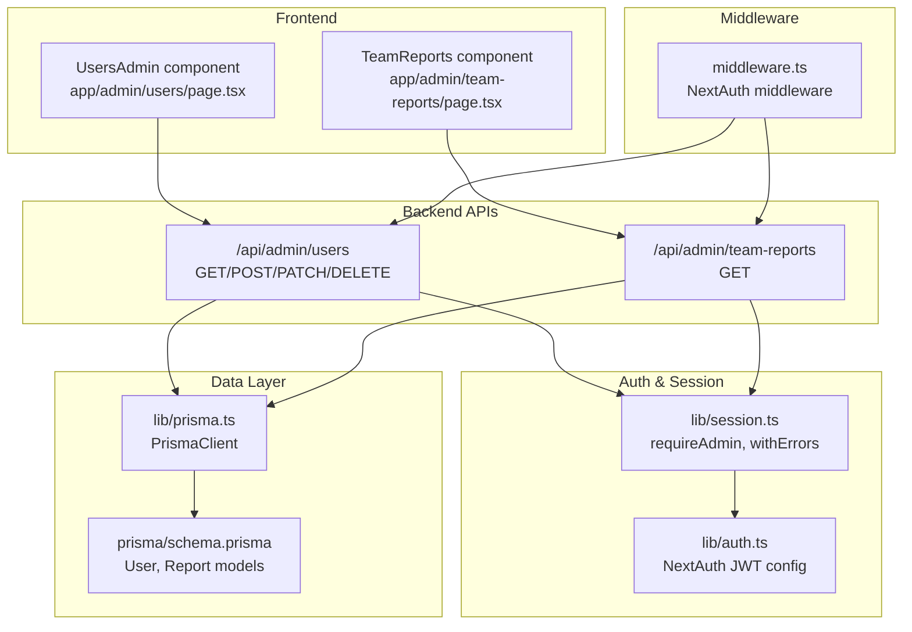
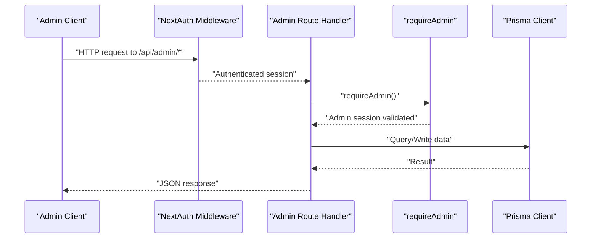
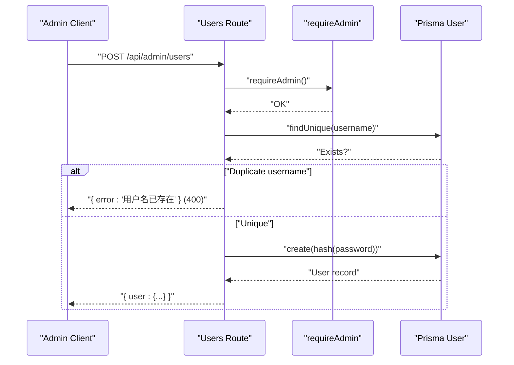
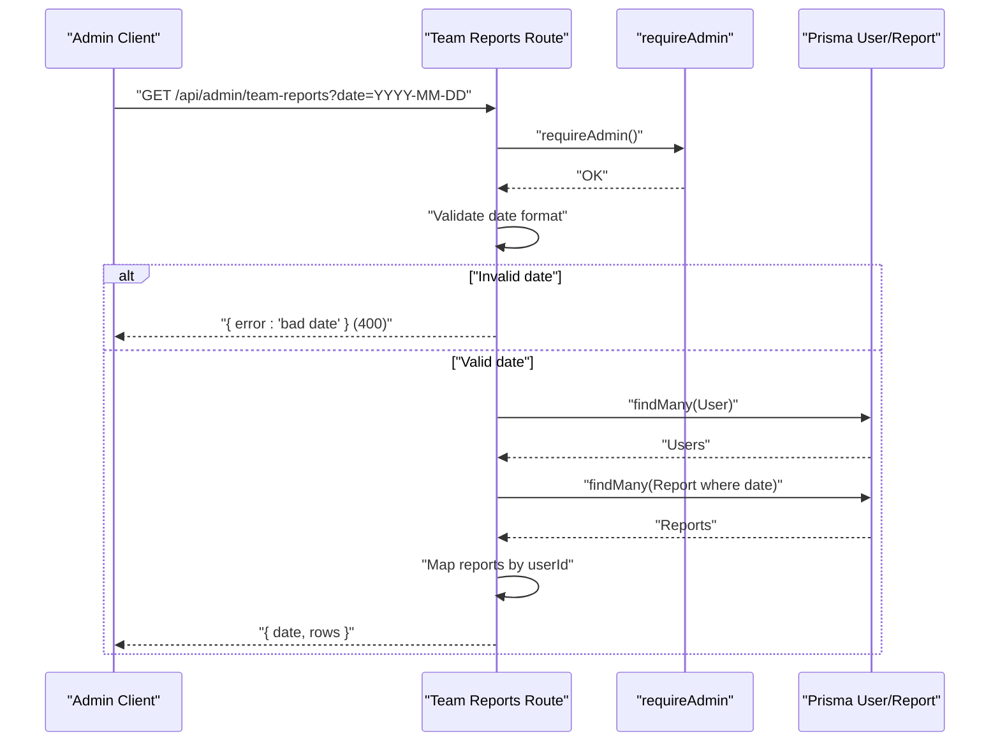
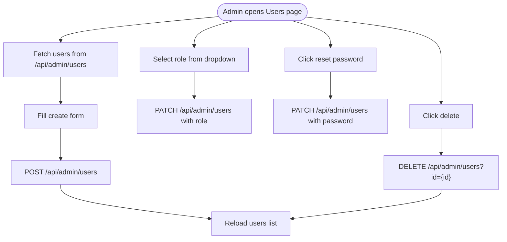
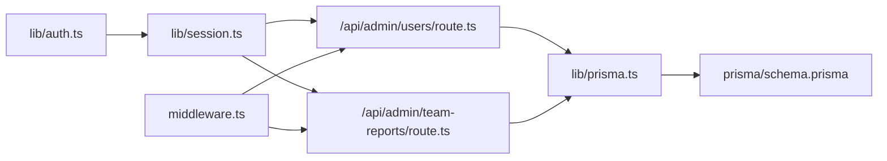

# Admin Endpoints

<cite>
**Referenced Files in This Document**
- [app/api/admin/users/route.ts](file://app/api/admin/users/route.ts)
- [app/api/admin/team-reports/route.ts](file://app/api/admin/team-reports/route.ts)
- [lib/session.ts](file://lib/session.ts)
- [lib/auth.ts](file://lib/auth.ts)
- [lib/prisma.ts](file://lib/prisma.ts)
- [middleware.ts](file://middleware.ts)
- [prisma/schema.prisma](file://prisma/schema.prisma)
- [components/users-admin.tsx](file://components/users-admin.tsx)
- [components/team-reports.tsx](file://components/team-reports.tsx)
- [app/admin/users/page.tsx](file://app/admin/users/page.tsx)
- [app/admin/team-reports/page.tsx](file://app/admin/team-reports/page.tsx)
- [components/nav.tsx](file://components/nav.tsx)
</cite>

## Table of Contents
1. [Introduction](#introduction)
2. [Project Structure](#project-structure)
3. [Core Components](#core-components)
4. [Architecture Overview](#architecture-overview)
5. [Detailed Component Analysis](#detailed-component-analysis)
6. [Dependency Analysis](#dependency-analysis)
7. [Performance Considerations](#performance-considerations)
8. [Troubleshooting Guide](#troubleshooting-guide)
9. [Conclusion](#conclusion)

## Introduction
This document describes the admin-only endpoints for managing users and monitoring team reports. It covers authentication requirements, role-based authorization, request/response schemas, and operational workflows. The system uses NextAuth.js for session-based authentication with JWT strategy and enforces admin-only access to sensitive routes.

## Project Structure
The admin functionality is organized around two primary API endpoints:
- User management endpoint: GET, POST, PATCH, DELETE for users
- Team reports endpoint: GET for aggregated daily reports across users

Frontend components provide admin UIs that call these endpoints and render aggregated data.

**Diagram sources**
- [app/admin/users/page.tsx:1-22](file://app/admin/users/page.tsx#L1-L22)
- [app/admin/team-reports/page.tsx:1-22](file://app/admin/team-reports/page.tsx#L1-L22)
- [middleware.ts:1-10](file://middleware.ts#L1-L10)
- [app/api/admin/users/route.ts:1-88](file://app/api/admin/users/route.ts#L1-L88)
- [app/api/admin/team-reports/route.ts:1-34](file://app/api/admin/team-reports/route.ts#L1-L34)
- [lib/session.ts:1-56](file://lib/session.ts#L1-L56)
- [lib/auth.ts:1-77](file://lib/auth.ts#L1-L77)
- [lib/prisma.ts:1-14](file://lib/prisma.ts#L1-L14)
- [prisma/schema.prisma:1-80](file://prisma/schema.prisma#L1-L80)

**Section sources**
- [app/admin/users/page.tsx:1-22](file://app/admin/users/page.tsx#L1-L22)
- [app/admin/team-reports/page.tsx:1-22](file://app/admin/team-reports/page.tsx#L1-L22)
- [middleware.ts:1-10](file://middleware.ts#L1-L10)
- [lib/session.ts:1-56](file://lib/session.ts#L1-L56)
- [lib/auth.ts:1-77](file://lib/auth.ts#L1-L77)
- [lib/prisma.ts:1-14](file://lib/prisma.ts#L1-L14)
- [prisma/schema.prisma:1-80](file://prisma/schema.prisma#L1-L80)

## Core Components
- Authentication and Authorization:
  - NextAuth.js with JWT strategy manages sessions and roles.
  - Middleware enforces protected routes for admin pages.
  - Server-side guards enforce admin-only access to admin APIs.

- Data Access:
  - Prisma client connects to MySQL database.
  - User and Report models define the data schema.

- Admin UI:
  - UsersAdmin component provides CRUD operations for users.
  - TeamReports component displays aggregated team reports by date.

**Section sources**
- [lib/auth.ts:30-77](file://lib/auth.ts#L30-L77)
- [middleware.ts:1-10](file://middleware.ts#L1-L10)
- [lib/session.ts:31-37](file://lib/session.ts#L31-L37)
- [lib/prisma.ts:1-14](file://lib/prisma.ts#L1-L14)
- [prisma/schema.prisma:16-65](file://prisma/schema.prisma#L16-L65)
- [components/users-admin.tsx:1-187](file://components/users-admin.tsx#L1-L187)
- [components/team-reports.tsx:1-114](file://components/team-reports.tsx#L1-L114)

## Architecture Overview
The admin APIs are server-side handlers protected by middleware and session guards. Requests flow through NextAuth middleware, then to route handlers that validate admin privileges, parse and validate requests, and interact with the database via Prisma.

**Diagram sources**
- [middleware.ts:1-10](file://middleware.ts#L1-L10)
- [app/api/admin/users/route.ts:7-22](file://app/api/admin/users/route.ts#L7-L22)
- [app/api/admin/team-reports/route.ts:6-12](file://app/api/admin/team-reports/route.ts#L6-L12)
- [lib/session.ts:31-37](file://lib/session.ts#L31-L37)
- [lib/prisma.ts:1-14](file://lib/prisma.ts#L1-L14)

## Detailed Component Analysis

### User Management Endpoints
These endpoints support listing, creating, updating, and deleting users. All endpoints require admin privileges.

- Endpoint: GET /api/admin/users
  - Purpose: List all users with selected fields.
  - Authentication: Admin required.
  - Response: Array of user objects with id, username, displayName, role, gitlabBaseUrl, gitlabEmail, createdAt.
  - Notes: Results ordered by creation time descending.

- Endpoint: POST /api/admin/users
  - Purpose: Create a new user.
  - Authentication: Admin required.
  - Request Body Schema:
    - username: string (min 2, max 50)
    - password: string (min 6, max 200)
    - displayName: string (min 1, max 50)
    - role: enum "MEMBER" | "ADMIN" (optional, defaults to "MEMBER")
  - Response: Created user object with id, username, displayName, role, createdAt.
  - Validation:
    - Rejects duplicate usernames.
    - Hashes password before storage.

- Endpoint: PATCH /api/admin/users
  - Purpose: Update user attributes (password, displayName, role).
  - Authentication: Admin required.
  - Request Body Schema:
    - id: string (user identifier)
    - password?: string (min 6, max 200)
    - displayName?: string (min 1, max 50)
    - role?: enum "MEMBER" | "ADMIN"
  - Response: Updated user object with id, username, displayName, role.
  - Validation:
    - Updates only provided fields.
    - Hashes new password if supplied.

- Endpoint: DELETE /api/admin/users?id={id}
  - Purpose: Delete a user by ID.
  - Authentication: Admin required.
  - Query Parameter: id (required).
  - Response: { ok: true } on success.

**Diagram sources**
- [app/api/admin/users/route.ts:31-56](file://app/api/admin/users/route.ts#L31-L56)
- [lib/session.ts:31-37](file://lib/session.ts#L31-L37)
- [lib/prisma.ts:1-14](file://lib/prisma.ts#L1-L14)

**Section sources**
- [app/api/admin/users/route.ts:7-22](file://app/api/admin/users/route.ts#L7-L22)
- [app/api/admin/users/route.ts:31-56](file://app/api/admin/users/route.ts#L31-L56)
- [app/api/admin/users/route.ts:65-78](file://app/api/admin/users/route.ts#L65-L78)
- [app/api/admin/users/route.ts:80-87](file://app/api/admin/users/route.ts#L80-L87)
- [lib/session.ts:31-37](file://lib/session.ts#L31-L37)
- [prisma/schema.prisma:16-33](file://prisma/schema.prisma#L16-L33)

### Team Reports Monitoring Endpoint
- Endpoint: GET /api/admin/team-reports?date={YYYY-MM-DD}
  - Purpose: Retrieve aggregated team reports for a given date.
  - Authentication: Admin required.
  - Query Parameter: date (optional, defaults to today).
  - Validation: Date must match YYYY-MM-DD format.
  - Response: { date: string, rows: Array<{ user, report }> }
    - user: id, username, displayName, role
    - report: id, userId, content, updatedAt (null if not submitted)
  - Behavior:
    - Lists all users ordered by role ascending, then username ascending.
    - For each user, includes either their report for the date or null.

**Diagram sources**
- [app/api/admin/team-reports/route.ts:6-33](file://app/api/admin/team-reports/route.ts#L6-L33)
- [lib/session.ts:31-37](file://lib/session.ts#L31-L37)
- [lib/prisma.ts:1-14](file://lib/prisma.ts#L1-L14)

**Section sources**
- [app/api/admin/team-reports/route.ts:6-33](file://app/api/admin/team-reports/route.ts#L6-L33)
- [lib/session.ts:31-37](file://lib/session.ts#L31-L37)
- [prisma/schema.prisma:16-33](file://prisma/schema.prisma#L16-L33)
- [prisma/schema.prisma:51-65](file://prisma/schema.prisma#L51-L65)

### Frontend Components and Workflows
- UsersAdmin component:
  - Fetches users via GET /api/admin/users.
  - Creates users via POST /api/admin/users.
  - Updates user role/password via PATCH /api/admin/users.
  - Deletes users via DELETE /api/admin/users?id={id}.
  - Provides inline editing for role and password reset.

- TeamReports component:
  - Loads reports via GET /api/admin/team-reports?date={YYYY-MM-DD}.
  - Displays submission statistics and allows selecting users to view their reports.

**Diagram sources**
- [components/users-admin.tsx:23-87](file://components/users-admin.tsx#L23-L87)
- [app/api/admin/users/route.ts:31-56](file://app/api/admin/users/route.ts#L31-L56)
- [app/api/admin/users/route.ts:65-78](file://app/api/admin/users/route.ts#L65-L78)
- [app/api/admin/users/route.ts:80-87](file://app/api/admin/users/route.ts#L80-L87)

**Section sources**
- [components/users-admin.tsx:1-187](file://components/users-admin.tsx#L1-L187)
- [components/team-reports.tsx:1-114](file://components/team-reports.tsx#L1-L114)
- [app/admin/users/page.tsx:1-22](file://app/admin/users/page.tsx#L1-L22)
- [app/admin/team-reports/page.tsx:1-22](file://app/admin/team-reports/page.tsx#L1-L22)

## Dependency Analysis
- Authentication and Authorization:
  - NextAuth.js handles session creation and role propagation.
  - Middleware protects admin routes.
  - Server-side guards validate admin role before processing requests.

- Data Model:
  - User model includes role, password hash, and GitLab integration fields.
  - Report model stores daily content linked to users.

- API Dependencies:
  - Admin routes depend on Prisma client for database operations.
  - Session guards depend on NextAuth session retrieval.

**Diagram sources**
- [lib/auth.ts:30-77](file://lib/auth.ts#L30-L77)
- [lib/session.ts:1-56](file://lib/session.ts#L1-L56)
- [app/api/admin/users/route.ts:1-88](file://app/api/admin/users/route.ts#L1-L88)
- [app/api/admin/team-reports/route.ts:1-34](file://app/api/admin/team-reports/route.ts#L1-L34)
- [lib/prisma.ts:1-14](file://lib/prisma.ts#L1-L14)
- [prisma/schema.prisma:16-65](file://prisma/schema.prisma#L16-L65)
- [middleware.ts:1-10](file://middleware.ts#L1-L10)

**Section sources**
- [lib/auth.ts:30-77](file://lib/auth.ts#L30-L77)
- [lib/session.ts:1-56](file://lib/session.ts#L1-L56)
- [lib/prisma.ts:1-14](file://lib/prisma.ts#L1-L14)
- [prisma/schema.prisma:16-65](file://prisma/schema.prisma#L16-L65)
- [middleware.ts:1-10](file://middleware.ts#L1-L10)

## Performance Considerations
- Database Queries:
  - User listing uses ordering by creation time; consider indexing if lists grow large.
  - Team reports endpoint performs two queries (users and reports) and a map operation; acceptable for moderate team sizes.

- Authentication:
  - JWT strategy reduces session lookups; ensure token expiration aligns with security policy.

- Frontend:
  - Client-side caching of user lists avoids repeated network calls.
  - Debounce or batch operations for frequent updates.

[No sources needed since this section provides general guidance]

## Troubleshooting Guide
- Authentication Failures:
  - Ensure the user is logged in and has a valid session.
  - Verify NextAuth middleware is active for admin routes.

- Authorization Errors:
  - Admin-only endpoints return 403 if the session user role is not ADMIN.
  - Confirm the guard is applied consistently across all admin routes.

- Request Validation Errors:
  - User creation/update requires valid schema; invalid fields return 400 with error message.
  - Team reports date must match YYYY-MM-DD format.

- Database Issues:
  - Duplicate usernames during creation cause a 400 error.
  - Ensure Prisma client is initialized and connected to the database.

**Section sources**
- [lib/session.ts:22-37](file://lib/session.ts#L22-L37)
- [app/api/admin/users/route.ts:37-38](file://app/api/admin/users/route.ts#L37-L38)
- [app/api/admin/team-reports/route.ts:10-12](file://app/api/admin/team-reports/route.ts#L10-L12)
- [lib/prisma.ts:1-14](file://lib/prisma.ts#L1-L14)

## Conclusion
The admin endpoints provide a secure, role-based interface for managing users and monitoring team reports. Authentication is enforced at both middleware and route levels, while request validation ensures data integrity. The frontend components offer practical workflows for admin tasks, including user creation, updates, deletion, and team analytics queries.