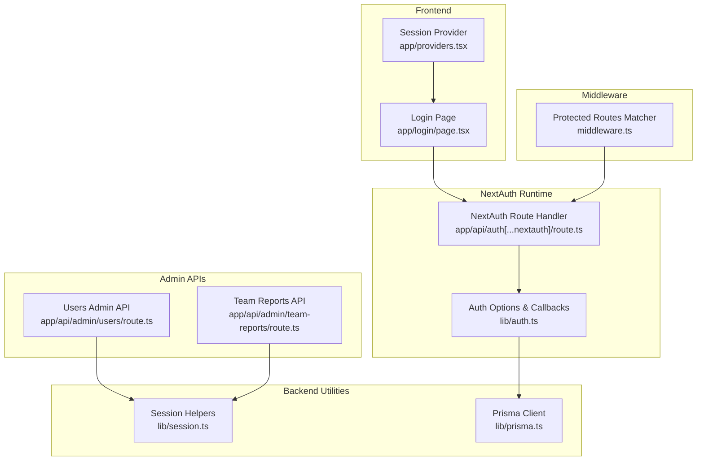
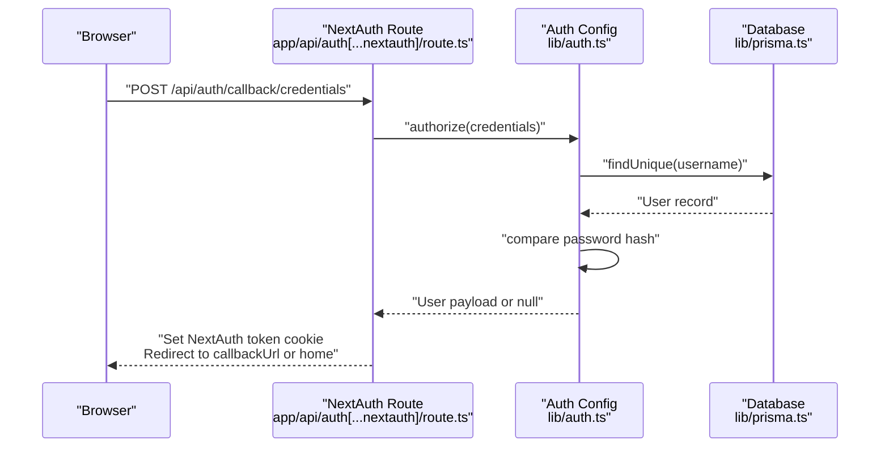
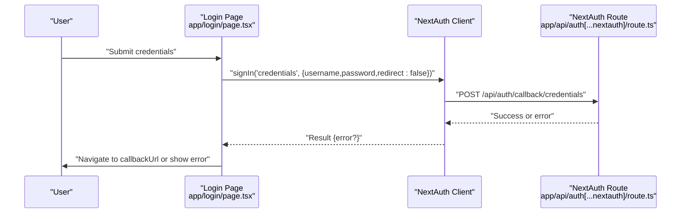
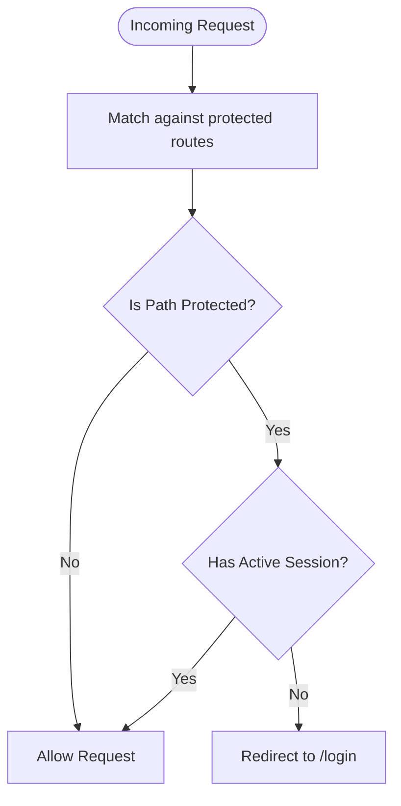
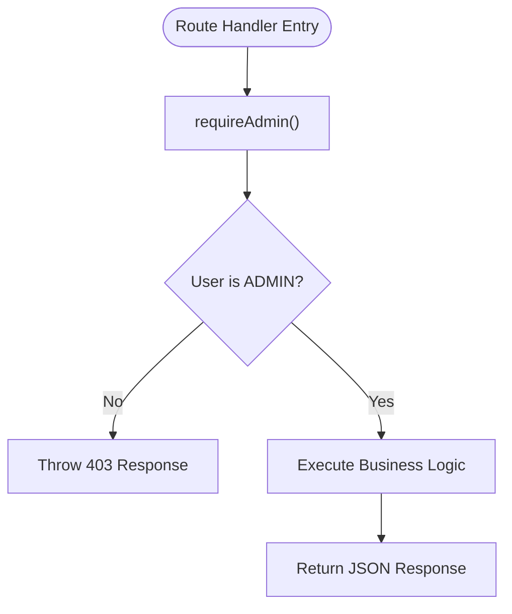
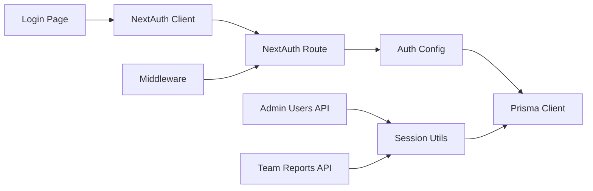

# Authentication Endpoints

<cite>
**Referenced Files in This Document**
- [lib/auth.ts](file://lib/auth.ts)
- [lib/session.ts](file://lib/session.ts)
- [middleware.ts](file://middleware.ts)
- [app/api/auth[...nextauth]/route.ts](file://app/api/auth[...nextauth]/route.ts)
- [app/login/page.tsx](file://app/login/page.tsx)
- [app/providers.tsx](file://app/providers.tsx)
- [lib/prisma.ts](file://lib/prisma.ts)
- [app/api/admin/users/route.ts](file://app/api/admin/users/route.ts)
- [app/api/admin/team-reports/route.ts](file://app/api/admin/team-reports/route.ts)
- [package.json](file://package.json)
</cite>

## Table of Contents
1. [Introduction](#introduction)
2. [Project Structure](#project-structure)
3. [Core Components](#core-components)
4. [Architecture Overview](#architecture-overview)
5. [Detailed Component Analysis](#detailed-component-analysis)
6. [Dependency Analysis](#dependency-analysis)
7. [Performance Considerations](#performance-considerations)
8. [Troubleshooting Guide](#troubleshooting-guide)
9. [Conclusion](#conclusion)

## Introduction
This document describes the authentication endpoints and mechanisms powered by NextAuth.js in the application. It focuses on the automatic NextAuth.js route handlers for authentication, the authentication flow, session management via JWT, role-based access control, supported providers, callback URLs, and security considerations. It also covers integration patterns with the frontend and common troubleshooting steps.

## Project Structure
The authentication system centers around:
- NextAuth.js configuration and runtime route handler
- Frontend login page and session provider
- Middleware enforcing protected routes
- Backend utilities for session retrieval and role checks
- Example admin endpoints demonstrating role-based access control



**Diagram sources**
- [app/login/page.tsx:1-72](file://app/login/page.tsx#L1-L72)
- [app/providers.tsx:1-8](file://app/providers.tsx#L1-L8)
- [app/api/auth[...nextauth]/route.ts](file://app/api/auth[...nextauth]/route.ts)
- [lib/auth.ts:1-77](file://lib/auth.ts#L1-L77)
- [middleware.ts:1-10](file://middleware.ts#L1-L10)
- [lib/session.ts:1-56](file://lib/session.ts#L1-L56)
- [lib/prisma.ts:1-14](file://lib/prisma.ts#L1-L14)
- [app/api/admin/users/route.ts:1-88](file://app/api/admin/users/route.ts#L1-L88)
- [app/api/admin/team-reports/route.ts:1-34](file://app/api/admin/team-reports/route.ts#L1-L34)

**Section sources**
- [app/login/page.tsx:1-72](file://app/login/page.tsx#L1-L72)
- [app/providers.tsx:1-8](file://app/providers.tsx#L1-L8)
- [middleware.ts:1-10](file://middleware.ts#L1-L10)
- [lib/auth.ts:1-77](file://lib/auth.ts#L1-L77)
- [lib/session.ts:1-56](file://lib/session.ts#L1-L56)
- [lib/prisma.ts:1-14](file://lib/prisma.ts#L1-L14)
- [app/api/admin/users/route.ts:1-88](file://app/api/admin/users/route.ts#L1-L88)
- [app/api/admin/team-reports/route.ts:1-34](file://app/api/admin/team-reports/route.ts#L1-L34)

## Core Components
- NextAuth.js configuration defines the session strategy, providers, pages, and callbacks for JWT token population and session augmentation.
- The automatic NextAuth route handler exposes endpoints for authentication flows.
- Frontend login uses client-side sign-in with credentials provider.
- Middleware enforces protected routes and redirects unauthenticated users to the login page.
- Backend helpers provide session retrieval and role-based guards for API routes.
- Example admin endpoints demonstrate requiring admin privileges and returning JSON responses.

Key capabilities:
- Session strategy: JWT
- Provider: Credentials (username/password)
- Pages: Custom sign-in page mapped to "/login"
- Role model: MEMBER and ADMIN roles propagated in JWT and session
- Protected routes: Matched by middleware for home and admin paths

**Section sources**
- [lib/auth.ts:30-77](file://lib/auth.ts#L30-L77)
- [middleware.ts:3-10](file://middleware.ts#L3-L10)
- [lib/session.ts:11-37](file://lib/session.ts#L11-L37)
- [app/api/admin/users/route.ts:7-22](file://app/api/admin/users/route.ts#L7-L22)
- [app/api/admin/team-reports/route.ts:6-33](file://app/api/admin/team-reports/route.ts#L6-L33)

## Architecture Overview
The authentication architecture integrates NextAuth.js with a custom credentials provider, JWT-based sessions, and role-aware backend enforcement.



**Diagram sources**
- [lib/auth.ts:40-56](file://lib/auth.ts#L40-L56)
- [lib/prisma.ts:1-14](file://lib/prisma.ts#L1-L14)

## Detailed Component Analysis

### NextAuth.js Configuration and Callbacks
- Session strategy: JWT
- Provider: Credentials with username and password fields
- Authorization: Queries database by username, compares hashed password, returns user payload
- JWT callback: Stores id, username, and role into token
- Session callback: Augments session with id, username, and role
- Sign-in page: Redirects unauthenticated users to "/login"

```mermaid
classDiagram
class AuthOptions {
+session_strategy : "jwt"
+pages_signIn : "/login"
+providers : [CredentialsProvider]
+callbacks_jwt(token,user)
+callbacks_session(session,token)
}
class CredentialsProvider {
+name : "credentials"
+credentials : {username,password}
+authorize(creds) User|null
}
class JWT {
+uid : string
+username : string
+role : "MEMBER"|"ADMIN"
}
class Session {
+user : {
+id : string
+username : string
+role : "MEMBER"|"ADMIN"
}
}
AuthOptions --> CredentialsProvider : "uses"
AuthOptions --> JWT : "populates"
AuthOptions --> Session : "augments"
```

**Diagram sources**
- [lib/auth.ts:30-77](file://lib/auth.ts#L30-L77)

**Section sources**
- [lib/auth.ts:30-77](file://lib/auth.ts#L30-L77)

### Automatic NextAuth Route Handlers (GET/POST)
- Endpoint: app/api/auth[...nextauth]/route.ts
- Methods: Handles NextAuth internal flows including credentials provider callbacks
- Behavior: Accepts POST to "/api/auth/callback/credentials"; redirects on success; sets NextAuth token cookie; respects callbackUrl
- No manual GET endpoint is exposed; NextAuth manages provider-specific flows automatically

Note: The route file path indicates NextAuth’s automatic route handler pattern. The implementation delegates to NextAuth runtime.

**Section sources**
- [app/api/auth[...nextauth]/route.ts](file://app/api/auth[...nextauth]/route.ts)

### Frontend Login Integration
- Component: app/login/page.tsx
- Uses next-auth/react signIn with credentials provider
- Reads callbackUrl from query param or defaults to "/"
- On success, redirects to callbackUrl; on failure, shows user-visible error
- Wrapped in SessionProvider for client-side session awareness



**Diagram sources**
- [app/login/page.tsx:17-32](file://app/login/page.tsx#L17-L32)
- [app/api/auth[...nextauth]/route.ts](file://app/api/auth[...nextauth]/route.ts)

**Section sources**
- [app/login/page.tsx:1-72](file://app/login/page.tsx#L1-L72)
- [app/providers.tsx:1-8](file://app/providers.tsx#L1-L8)

### Middleware and Protected Routes
- Enforces authentication for matched paths: "/", "/history/:path*", "/settings/:path*", "/admin/:path*"
- Redirects to "/login" when unauthenticated
- Integrates with NextAuth middleware



**Diagram sources**
- [middleware.ts:3-10](file://middleware.ts#L3-L10)

**Section sources**
- [middleware.ts:1-10](file://middleware.ts#L1-L10)

### Session Management and Role-Based Access Control
- Session helpers:
  - getSessionUser: returns current user or null
  - requireUser: throws 401 if no session
  - requireAdmin: throws 403 if not ADMIN
  - withErrors: wraps route handlers to convert thrown Responses into JSON responses
- Admin endpoints:
  - Users admin endpoint: requires ADMIN, lists users, creates, updates, deletes users
  - Team reports endpoint: requires ADMIN, fetches aggregated report data for a given date



**Diagram sources**
- [lib/session.ts:31-37](file://lib/session.ts#L31-L37)
- [app/api/admin/users/route.ts:31-56](file://app/api/admin/users/route.ts#L31-L56)
- [app/api/admin/team-reports/route.ts:6-33](file://app/api/admin/team-reports/route.ts#L6-L33)

**Section sources**
- [lib/session.ts:11-56](file://lib/session.ts#L11-L56)
- [app/api/admin/users/route.ts:1-88](file://app/api/admin/users/route.ts#L1-L88)
- [app/api/admin/team-reports/route.ts:1-34](file://app/api/admin/team-reports/route.ts#L1-L34)

### Supported Authentication Providers and Configuration
- Provider: Credentials (username/password)
- Additional providers are not configured in the current setup
- Pages.signIn is set to "/login"

**Section sources**
- [lib/auth.ts:33-39](file://lib/auth.ts#L33-L39)
- [lib/auth.ts:32](file://lib/auth.ts#L32)

### Callback URLs and Session Duration
- Callback URL:
  - Frontend reads callbackUrl from query param or defaults to "/"
  - NextAuth redirects to callbackUrl after successful sign-in
- Session duration:
  - JWT strategy is configured; expiration is not explicitly set in code
  - Default NextAuth JWT expiration applies unless configured otherwise

**Section sources**
- [app/login/page.tsx:10-32](file://app/login/page.tsx#L10-L32)
- [lib/auth.ts:31](file://lib/auth.ts#L31)

## Dependency Analysis
- NextAuth runtime depends on:
  - Credentials provider configuration
  - Database client for user lookup
- Frontend depends on:
  - NextAuth client for sign-in
  - SessionProvider for session context
- Middleware depends on:
  - NextAuth middleware wrapper
- Backend routes depend on:
  - Session helpers for authorization
  - Prisma client for persistence



**Diagram sources**
- [lib/auth.ts:30-77](file://lib/auth.ts#L30-L77)
- [lib/prisma.ts:1-14](file://lib/prisma.ts#L1-L14)
- [app/login/page.tsx:1-72](file://app/login/page.tsx#L1-L72)
- [middleware.ts:1-10](file://middleware.ts#L1-L10)
- [lib/session.ts:1-56](file://lib/session.ts#L1-L56)
- [app/api/admin/users/route.ts:1-88](file://app/api/admin/users/route.ts#L1-L88)
- [app/api/admin/team-reports/route.ts:1-34](file://app/api/admin/team-reports/route.ts#L1-L34)

**Section sources**
- [package.json:16-31](file://package.json#L16-L31)
- [lib/auth.ts:1-77](file://lib/auth.ts#L1-L77)
- [lib/session.ts:1-56](file://lib/session.ts#L1-L56)
- [lib/prisma.ts:1-14](file://lib/prisma.ts#L1-L14)

## Performance Considerations
- Password hashing uses bcrypt; cost factor is configured in the authorization flow
- JWT strategy avoids server-side session storage, reducing server memory footprint
- Middleware runs per-request for protected paths; keep matchers minimal to reduce overhead
- Database queries are scoped to username and user updates; ensure indexes exist on username

## Troubleshooting Guide
Common issues and resolutions:
- Unauthorized (401):
  - Cause: No active session when accessing protected routes or APIs
  - Resolution: Ensure user is signed in; verify middleware matchers and session cookie presence
- Forbidden (403):
  - Cause: Non-ADMIN user attempting ADMIN-only endpoint
  - Resolution: Verify user role; ensure requireAdmin guard is applied
- Internal Server Error (500):
  - Cause: Unhandled exceptions in route handlers
  - Resolution: Use withErrors wrapper; check server logs for stack traces
- Login failures:
  - Cause: Incorrect username/password or missing credentials
  - Resolution: Confirm credentials provider fields; verify user exists and password hash matches
- CORS or cookie issues:
  - Cause: Cross-origin requests or SameSite cookie restrictions
  - Resolution: Configure NextAuth cookies and base path appropriately; ensure frontend and backend share domain/path

**Section sources**
- [lib/session.ts:22-37](file://lib/session.ts#L22-L37)
- [lib/session.ts:39-55](file://lib/session.ts#L39-L55)
- [app/login/page.tsx:26-32](file://app/login/page.tsx#L26-L32)

## Conclusion
The application uses NextAuth.js with a credentials provider and JWT strategy to manage authentication. The automatic NextAuth route handler supports the credentials flow, while middleware and backend utilities enforce role-based access control. Frontend integration leverages client-side sign-in with a custom sign-in page and session provider. Administrators can manage users and view team reports through protected endpoints guarded by admin checks.