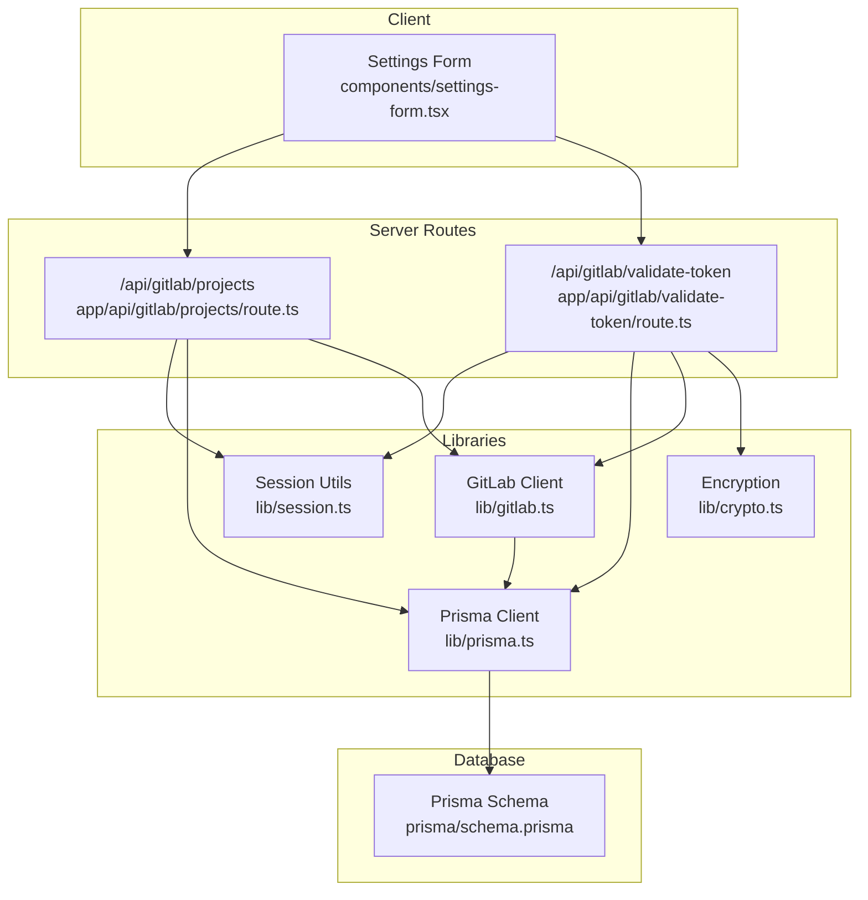
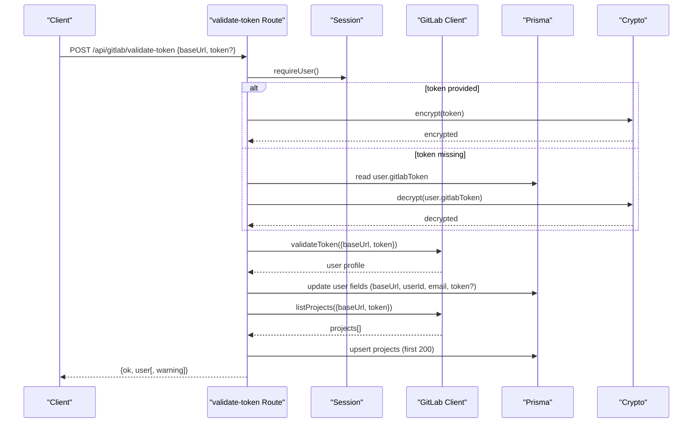
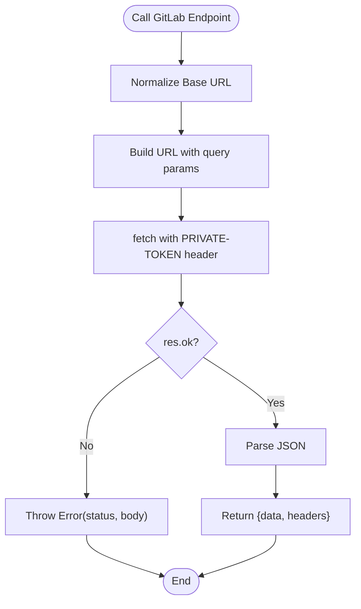
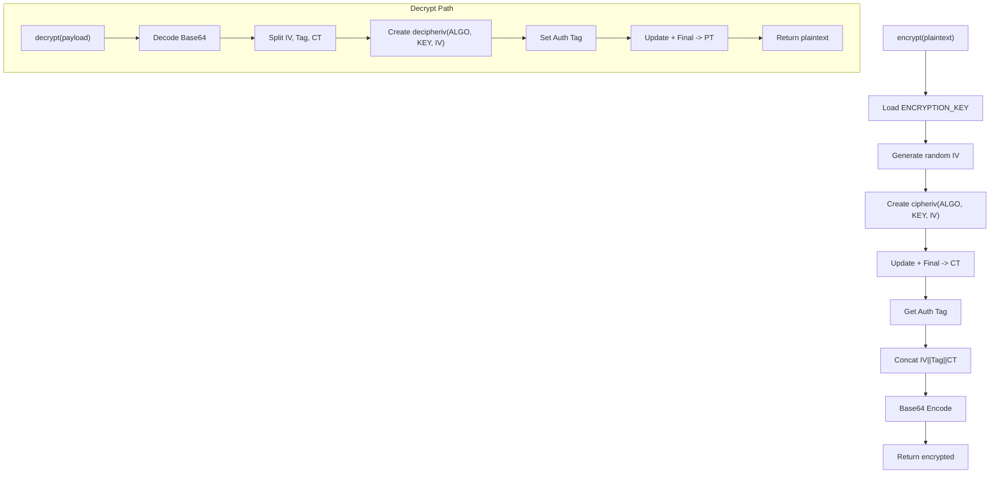
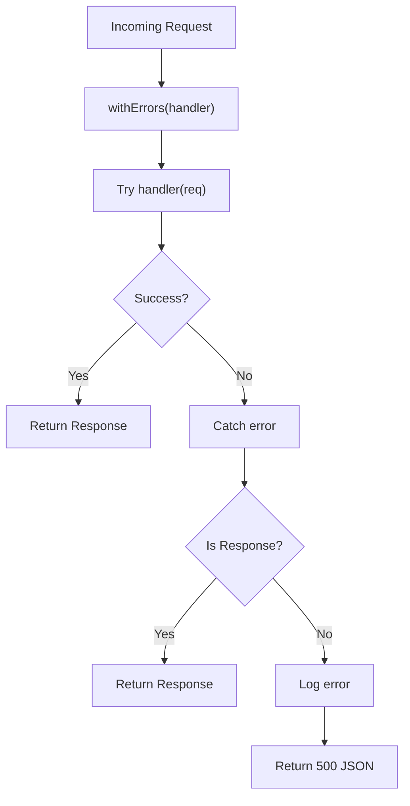
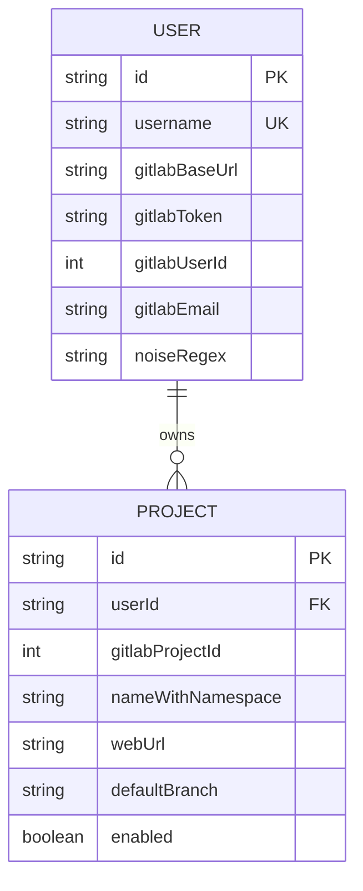
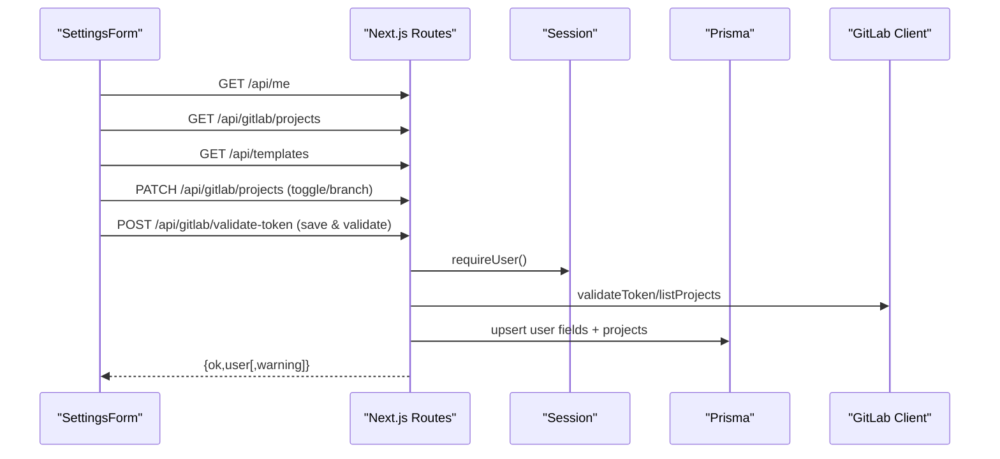
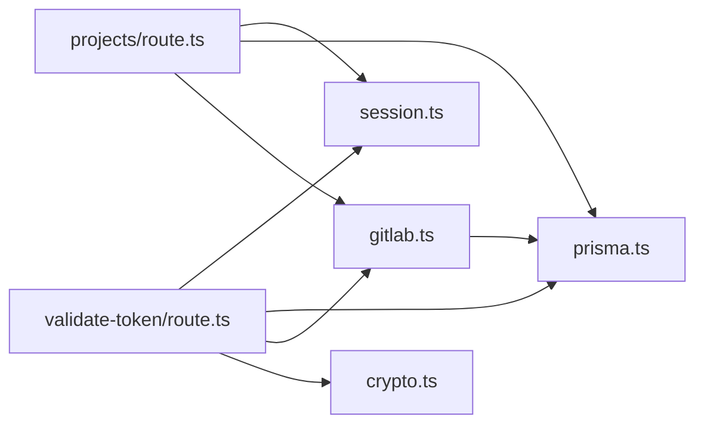

# GitLab Integration Endpoints

<cite>
**Referenced Files in This Document**
- [app/api/gitlab/projects/route.ts](file://app/api/gitlab/projects/route.ts)
- [app/api/gitlab/validate-token/route.ts](file://app/api/gitlab/validate-token/route.ts)
- [lib/gitlab.ts](file://lib/gitlab.ts)
- [lib/crypto.ts](file://lib/crypto.ts)
- [lib/session.ts](file://lib/session.ts)
- [lib/prisma.ts](file://lib/prisma.ts)
- [prisma/schema.prisma](file://prisma/schema.prisma)
- [components/settings-form.tsx](file://components/settings-form.tsx)
- [app/settings/page.tsx](file://app/settings/page.tsx)
- [lib/report.ts](file://lib/report.ts)
</cite>

## Table of Contents
1. [Introduction](#introduction)
2. [Project Structure](#project-structure)
3. [Core Components](#core-components)
4. [Architecture Overview](#architecture-overview)
5. [Detailed Component Analysis](#detailed-component-analysis)
6. [Dependency Analysis](#dependency-analysis)
7. [Performance Considerations](#performance-considerations)
8. [Troubleshooting Guide](#troubleshooting-guide)
9. [Conclusion](#conclusion)

## Introduction
This document describes the GitLab integration endpoints that enable users to configure GitLab project access, manage branch settings, and apply noise regex filtering for commit reports. It covers:
- Authentication and authorization flow
- Token validation and encryption handling
- Project configuration endpoints (GET/POST/PATCH)
- Noise regex filtering for commit processing
- Server-side token storage and security considerations
- Rate limiting and API version compatibility
- Error handling strategies and troubleshooting

## Project Structure
The GitLab integration spans server routes, a GitLab client library, encryption utilities, session management, and a React settings form.

**Diagram sources**
- [components/settings-form.tsx:1-316](file://components/settings-form.tsx#L1-L316)
- [app/api/gitlab/projects/route.ts:1-42](file://app/api/gitlab/projects/route.ts#L1-L42)
- [app/api/gitlab/validate-token/route.ts:1-81](file://app/api/gitlab/validate-token/route.ts#L1-L81)
- [lib/gitlab.ts:1-149](file://lib/gitlab.ts#L1-L149)
- [lib/crypto.ts:1-46](file://lib/crypto.ts#L1-L46)
- [lib/session.ts:1-56](file://lib/session.ts#L1-L56)
- [lib/prisma.ts:1-14](file://lib/prisma.ts#L1-L14)
- [prisma/schema.prisma:1-80](file://prisma/schema.prisma#L1-L80)

**Section sources**
- [app/api/gitlab/projects/route.ts:1-42](file://app/api/gitlab/projects/route.ts#L1-L42)
- [app/api/gitlab/validate-token/route.ts:1-81](file://app/api/gitlab/validate-token/route.ts#L1-L81)
- [lib/gitlab.ts:1-149](file://lib/gitlab.ts#L1-L149)
- [lib/crypto.ts:1-46](file://lib/crypto.ts#L1-L46)
- [lib/session.ts:1-56](file://lib/session.ts#L1-L56)
- [lib/prisma.ts:1-14](file://lib/prisma.ts#L1-L14)
- [prisma/schema.prisma:1-80](file://prisma/schema.prisma#L1-L80)
- [components/settings-form.tsx:1-316](file://components/settings-form.tsx#L1-L316)
- [app/settings/page.tsx:1-21](file://app/settings/page.tsx#L1-L21)

## Core Components
- GitLab client library: Provides typed wrappers for GitLab API v4, including token validation, project listing, and commit listing with pagination and timeouts.
- Encryption utilities: AES-256-GCM encryption/decryption for storing tokens securely in the database.
- Session utilities: Require authenticated user and convert thrown errors to HTTP responses.
- Prisma schema: Defines user and project entities with GitLab-related fields and indexes.
- Server routes:
  - GET /api/gitlab/projects: Lists user’s GitLab projects.
  - PATCH /api/gitlab/projects: Updates project enablement and default branch.
  - POST /api/gitlab/validate-token: Validates a GitLab token, persists user info and optional token, and caches projects.

**Section sources**
- [lib/gitlab.ts:1-149](file://lib/gitlab.ts#L1-L149)
- [lib/crypto.ts:1-46](file://lib/crypto.ts#L1-L46)
- [lib/session.ts:1-56](file://lib/session.ts#L1-L56)
- [prisma/schema.prisma:16-49](file://prisma/schema.prisma#L16-L49)
- [app/api/gitlab/projects/route.ts:1-42](file://app/api/gitlab/projects/route.ts#L1-L42)
- [app/api/gitlab/validate-token/route.ts:1-81](file://app/api/gitlab/validate-token/route.ts#L1-L81)

## Architecture Overview
The integration follows a server-side-first model:
- Client requests are handled by Next.js routes under app/api.
- Routes validate sessions, parse and validate request bodies, and call the GitLab client.
- GitLab API calls are made server-side with a 20-second timeout and pagination.
- Tokens are stored encrypted in the database; decryption occurs only during validation.
- Project caching is performed via upserts with a safety cap on pages.

**Diagram sources**
- [app/api/gitlab/validate-token/route.ts:13-80](file://app/api/gitlab/validate-token/route.ts#L13-L80)
- [lib/gitlab.ts:87-111](file://lib/gitlab.ts#L87-L111)
- [lib/crypto.ts:17-38](file://lib/crypto.ts#L17-L38)
- [lib/session.ts:22-29](file://lib/session.ts#L22-L29)

## Detailed Component Analysis

### GitLab Client Library
- API version: Uses GitLab API v4 endpoints.
- Base URL normalization: Removes trailing slashes.
- Timeout: 20 seconds per request; aborts on timeout.
- Pagination: Iterates pages with x-next-page header; caps at 20 pages for safety.
- Endpoints:
  - GET /api/v4/user (via validateToken/getCurrentUser)
  - GET /api/v4/projects (with membership=true, simple=true, order_by=last_activity_at)
  - GET /api/v4/projects/{projectId}/repository/commits (with since/until/ref_name/all)

**Diagram sources**
- [lib/gitlab.ts:45-80](file://lib/gitlab.ts#L45-L80)

**Section sources**
- [lib/gitlab.ts:36-89](file://lib/gitlab.ts#L36-L89)
- [lib/gitlab.ts:91-148](file://lib/gitlab.ts#L91-L148)

### Encryption Utilities
- Algorithm: AES-256-GCM.
- Key requirement: 64-character hex string from ENCRYPTION_KEY environment variable.
- Functions:
  - encrypt: Generates random IV, authenticates with GCM tag, concatenates IV||tag||ciphertext, base64 encodes.
  - decrypt: Decodes payload, splits IV, tag, ciphertext, verifies tag, and returns plaintext.
  - maskToken: Masks tokens for safe display.

**Diagram sources**
- [lib/crypto.ts:7-38](file://lib/crypto.ts#L7-L38)

**Section sources**
- [lib/crypto.ts:1-46](file://lib/crypto.ts#L1-L46)

### Session Utilities
- requireUser: Throws 401 if no session; otherwise returns session user.
- withErrors: Wraps route handlers to convert thrown errors into JSON responses with appropriate status codes.

**Diagram sources**
- [lib/session.ts:39-55](file://lib/session.ts#L39-L55)

**Section sources**
- [lib/session.ts:11-29](file://lib/session.ts#L11-L29)
- [lib/session.ts:39-55](file://lib/session.ts#L39-L55)

### Prisma Schema
- User model includes GitLab fields: gitlabBaseUrl, gitlabToken (encrypted), gitlabUserId, gitlabEmail, noiseRegex.
- Project model includes: userId, gitlabProjectId (unique per user), nameWithNamespace, webUrl, defaultBranch, enabled.
- Indexes: unique on (userId, gitlabProjectId), index on (userId).

**Diagram sources**
- [prisma/schema.prisma:16-49](file://prisma/schema.prisma#L16-L49)

**Section sources**
- [prisma/schema.prisma:16-49](file://prisma/schema.prisma#L16-L49)

### Project Configuration Endpoints

#### GET /api/gitlab/projects
- Purpose: Retrieve all projects configured by the authenticated user.
- Behavior:
  - Requires authenticated user.
  - Orders by enabled desc, then nameWithNamespace asc.
- Response: { projects: Project[] } where Project includes id, nameWithNamespace, webUrl, defaultBranch, enabled.

**Section sources**
- [app/api/gitlab/projects/route.ts:6-13](file://app/api/gitlab/projects/route.ts#L6-L13)

#### PATCH /api/gitlab/projects
- Purpose: Update a single project’s enabled flag and/or defaultBranch.
- Request body schema:
  - id: string (required)
  - enabled: boolean (optional)
  - defaultBranch: string|null (optional)
- Behavior:
  - Requires authenticated user.
  - Validates project ownership.
  - Updates fields conditionally (undefined values preserved).
- Response: { project: UpdatedProject }

**Section sources**
- [app/api/gitlab/projects/route.ts:15-41](file://app/api/gitlab/projects/route.ts#L15-L41)

### Token Validation Endpoint

#### POST /api/gitlab/validate-token
- Purpose: Validate a GitLab personal access token, persist user info, optionally store the token, and cache projects.
- Request body schema:
  - baseUrl: string (required, URL)
  - token: string (optional, min length 8)
- Behavior:
  - Requires authenticated user.
  - If token is missing, reads and decrypts user.gitlabToken.
  - Calls validateToken to fetch user profile.
  - Persists:
    - gitlabBaseUrl
    - gitlabUserId
    - gitlabEmail (public_email or email)
    - gitlabToken (encrypted) if provided
  - Attempts to cache projects via listProjects and upserts (first 200 projects).
  - On project cache failure, returns { ok: true, user, warning }.
- Response:
  - Success: { ok: true, user: { id, name, email } }
  - Partial success with warning: { ok: true, user, warning }
  - Missing token when token is absent: { error: "Please fill token" } (400)
  - Unauthorized/Forbidden via session utilities

**Section sources**
- [app/api/gitlab/validate-token/route.ts:8-11](file://app/api/gitlab/validate-token/route.ts#L8-L11)
- [app/api/gitlab/validate-token/route.ts:13-80](file://app/api/gitlab/validate-token/route.ts#L13-L80)
- [lib/gitlab.ts:87-89](file://lib/gitlab.ts#L87-L89)
- [lib/crypto.ts:17-38](file://lib/crypto.ts#L17-L38)

### Client Integration (Settings Form)
- Loads user, projects, and templates via client-side fetch.
- Supports saving GitLab connection (baseUrl/token), toggling project enablement, setting default branches, and configuring noise regex.
- Displays masked token and identifies GitLab email.

**Diagram sources**
- [components/settings-form.tsx:44-134](file://components/settings-form.tsx#L44-L134)
- [app/api/gitlab/projects/route.ts:6-13](file://app/api/gitlab/projects/route.ts#L6-L13)
- [app/api/gitlab/validate-token/route.ts:13-80](file://app/api/gitlab/validate-token/route.ts#L13-L80)

**Section sources**
- [components/settings-form.tsx:1-316](file://components/settings-form.tsx#L1-L316)
- [app/settings/page.tsx:8-20](file://app/settings/page.tsx#L8-L20)

## Dependency Analysis
- Routes depend on session utilities for authentication and error wrapping.
- Token validation depends on GitLab client for API calls and encryption utilities for secure storage.
- Project updates depend on Prisma for database operations.
- Client settings form depends on routes for data synchronization.

**Diagram sources**
- [app/api/gitlab/projects/route.ts:1-42](file://app/api/gitlab/projects/route.ts#L1-L42)
- [app/api/gitlab/validate-token/route.ts:1-81](file://app/api/gitlab/validate-token/route.ts#L1-L81)
- [lib/session.ts:1-56](file://lib/session.ts#L1-L56)
- [lib/prisma.ts:1-14](file://lib/prisma.ts#L1-L14)
- [lib/gitlab.ts:1-149](file://lib/gitlab.ts#L1-L149)
- [lib/crypto.ts:1-46](file://lib/crypto.ts#L1-L46)

**Section sources**
- [app/api/gitlab/projects/route.ts:1-42](file://app/api/gitlab/projects/route.ts#L1-L42)
- [app/api/gitlab/validate-token/route.ts:1-81](file://app/api/gitlab/validate-token/route.ts#L1-L81)
- [lib/session.ts:1-56](file://lib/session.ts#L1-L56)
- [lib/prisma.ts:1-14](file://lib/prisma.ts#L1-L14)
- [lib/gitlab.ts:1-149](file://lib/gitlab.ts#L1-L149)
- [lib/crypto.ts:1-46](file://lib/crypto.ts#L1-L46)

## Performance Considerations
- Pagination safety: GitLab client caps pagination at 20 pages to prevent excessive API calls.
- Project caching: Upserts are limited to the first 200 projects during validation to reduce transaction overhead.
- Timeout: 20-second fetch timeout prevents long-running requests.
- Indexes: Unique index on (userId, gitlabProjectId) and index on (userId) optimize lookups and upserts.

**Section sources**
- [lib/gitlab.ts:91-111](file://lib/gitlab.ts#L91-L111)
- [app/api/gitlab/validate-token/route.ts:42-67](file://app/api/gitlab/validate-token/route.ts#L42-L67)

## Troubleshooting Guide
Common issues and resolutions:
- Token validation fails:
  - Ensure baseUrl is a valid GitLab URL and token has read_api/read_repository scopes.
  - If token was omitted, verify that a previously saved encrypted token exists for the user.
  - On project list load failure, the endpoint returns a warning while still validating the token successfully.
- Unauthorized or forbidden:
  - Confirm the user is logged in; routes require an authenticated session.
- Project list empty:
  - Verify the token has access to projects and the user has membership.
  - The client requires a saved GitLab connection before displaying projects.
- Noise regex not applied:
  - Ensure noiseRegex is saved in user settings; filtering is applied during report generation.

**Section sources**
- [app/api/gitlab/validate-token/route.ts:18-27](file://app/api/gitlab/validate-token/route.ts#L18-L27)
- [app/api/gitlab/validate-token/route.ts:68-74](file://app/api/gitlab/validate-token/route.ts#L68-L74)
- [lib/session.ts:22-29](file://lib/session.ts#L22-L29)
- [components/settings-form.tsx:274-278](file://components/settings-form.tsx#L274-L278)
- [lib/report.ts:46-75](file://lib/report.ts#L46-L75)

## Conclusion
The GitLab integration provides a secure, server-side validated workflow for connecting GitLab accounts, caching projects, and configuring per-project settings. Token handling is encrypted, and the system gracefully handles partial failures during project caching. The client settings form offers a streamlined UX for enabling/disabling projects, setting default branches, and applying noise regex filtering for commit reports.