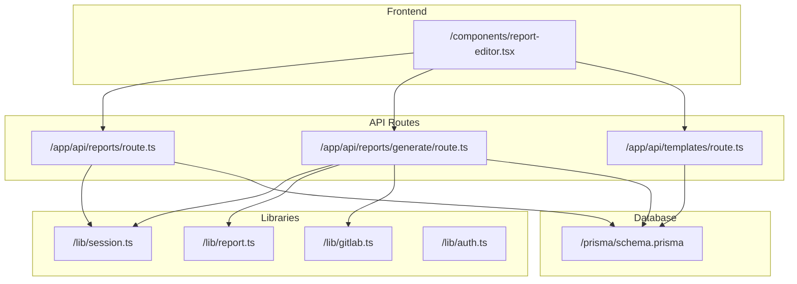
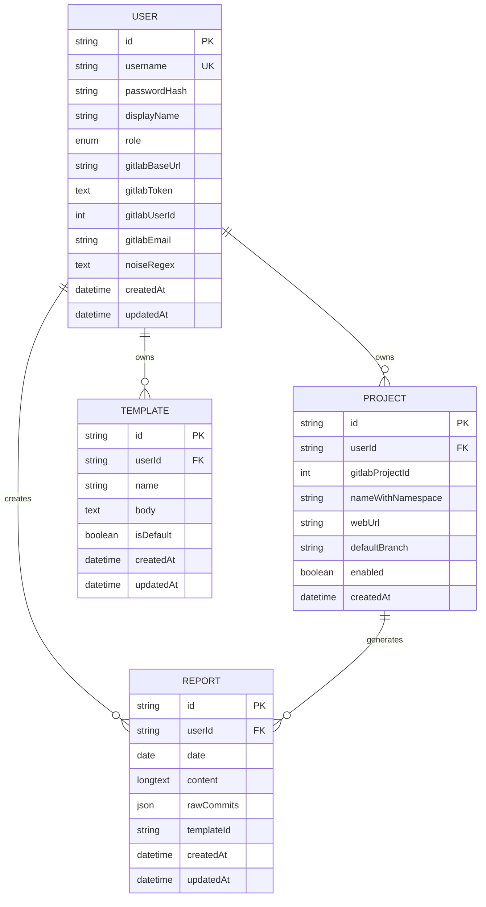
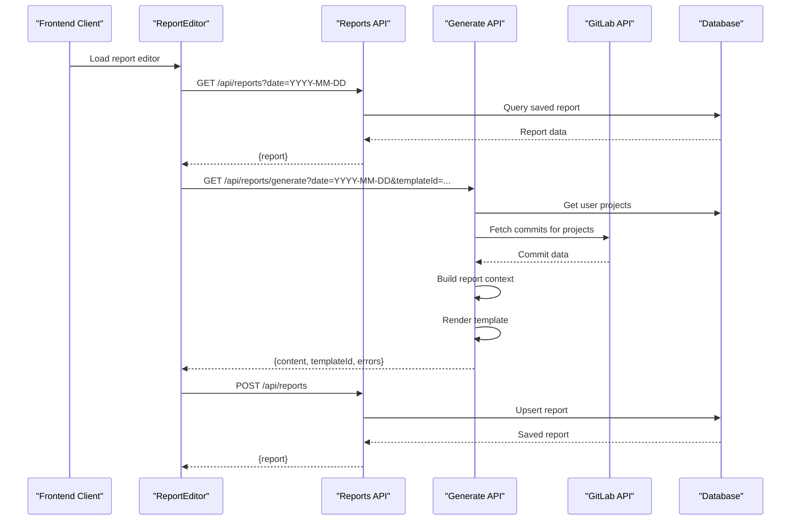
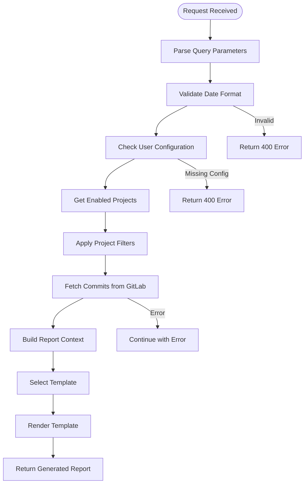
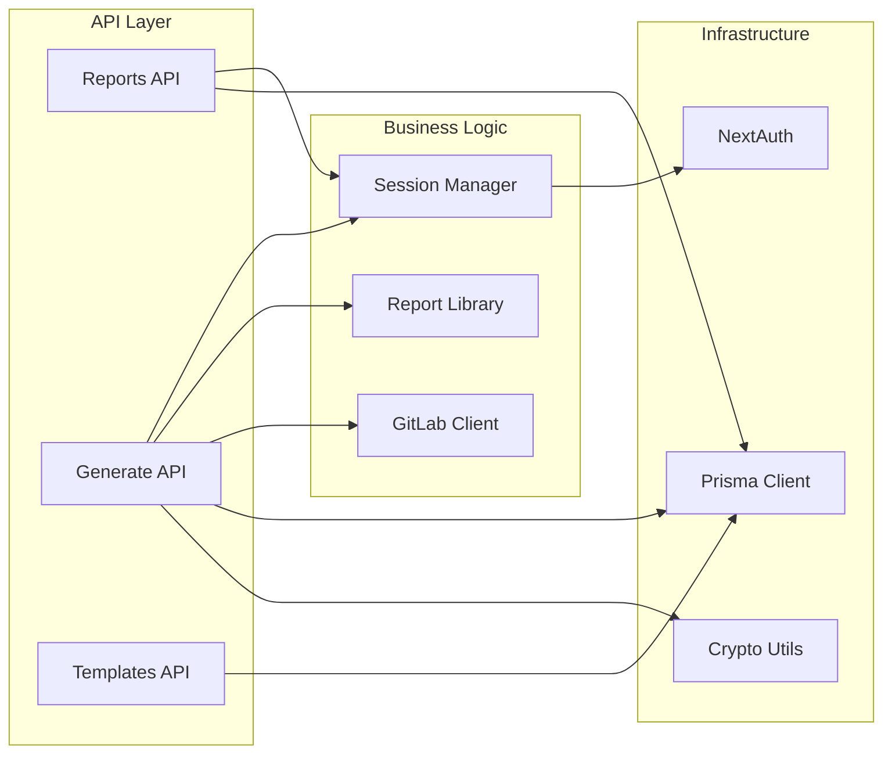

# Report Management Endpoints

<cite>
**Referenced Files in This Document**
- [app/api/reports/route.ts](file://app/api/reports/route.ts)
- [app/api/reports/generate/route.ts](file://app/api/reports/generate/route.ts)
- [lib/report.ts](file://lib/report.ts)
- [lib/gitlab.ts](file://lib/gitlab.ts)
- [lib/session.ts](file://lib/session.ts)
- [lib/auth.ts](file://lib/auth.ts)
- [prisma/schema.prisma](file://prisma/schema.prisma)
- [components/report-editor.tsx](file://components/report-editor.tsx)
- [app/api/templates/route.ts](file://app/api/templates/route.ts)
</cite>

## Table of Contents
1. [Introduction](#introduction)
2. [Project Structure](#project-structure)
3. [Core Components](#core-components)
4. [Architecture Overview](#architecture-overview)
5. [Detailed Component Analysis](#detailed-component-analysis)
6. [Dependency Analysis](#dependency-analysis)
7. [Performance Considerations](#performance-considerations)
8. [Troubleshooting Guide](#troubleshooting-guide)
9. [Conclusion](#conclusion)

## Introduction
This document provides comprehensive API documentation for report management endpoints in the Pingyun Report system. It covers two primary endpoints: retrieving saved reports and generating new reports with GitLab integration. The documentation includes request/response schemas, validation rules, error handling, and integration patterns with the frontend report editor.

## Project Structure
The report management functionality is organized within the Next.js API routes under the `/app/api` directory, with supporting libraries in the `/lib` directory and database models defined in Prisma schema.



**Diagram sources**
- [app/api/reports/route.ts:1-90](file://app/api/reports/route.ts#L1-L90)
- [app/api/reports/generate/route.ts:1-133](file://app/api/reports/generate/route.ts#L1-L133)
- [lib/report.ts:1-159](file://lib/report.ts#L1-L159)
- [lib/gitlab.ts:1-149](file://lib/gitlab.ts#L1-L149)
- [lib/session.ts:1-56](file://lib/session.ts#L1-L56)
- [prisma/schema.prisma:1-80](file://prisma/schema.prisma#L1-L80)
- [components/report-editor.tsx:1-284](file://components/report-editor.tsx#L1-L284)

**Section sources**
- [app/api/reports/route.ts:1-90](file://app/api/reports/route.ts#L1-L90)
- [app/api/reports/generate/route.ts:1-133](file://app/api/reports/generate/route.ts#L1-L133)
- [lib/report.ts:1-159](file://lib/report.ts#L1-L159)
- [lib/gitlab.ts:1-149](file://lib/gitlab.ts#L1-L149)
- [lib/session.ts:1-56](file://lib/session.ts#L1-L56)
- [prisma/schema.prisma:1-80](file://prisma/schema.prisma#L1-L80)
- [components/report-editor.tsx:1-284](file://components/report-editor.tsx#L1-L284)

## Core Components

### Report Data Model
The system uses a relational model with Users, Projects, Reports, and Templates entities. The Report entity stores daily report content with associated metadata.



**Diagram sources**
- [prisma/schema.prisma:16-79](file://prisma/schema.prisma#L16-L79)

### Authentication and Authorization
The system uses NextAuth.js with JWT strategy for authentication. All API endpoints are protected and require valid user sessions.

**Section sources**
- [lib/auth.ts:30-77](file://lib/auth.ts#L30-L77)
- [lib/session.ts:11-56](file://lib/session.ts#L11-L56)
- [middleware.ts:1-10](file://middleware.ts#L1-L10)

## Architecture Overview



**Diagram sources**
- [components/report-editor.tsx:39-131](file://components/report-editor.tsx#L39-L131)
- [app/api/reports/route.ts:9-76](file://app/api/reports/route.ts#L9-L76)
- [app/api/reports/generate/route.ts:23-132](file://app/api/reports/generate/route.ts#L23-L132)
- [lib/gitlab.ts:120-148](file://lib/gitlab.ts#L120-L148)

## Detailed Component Analysis

### GET /api/reports - Retrieve Saved Reports

This endpoint supports three retrieval modes: single date query, monthly aggregation, and recent reports listing.

#### Query Parameters
- `date` (optional): Specific date in YYYY-MM-DD format
- `month` (optional): Month in YYYY-MM format

#### Response Schemas

**Single Date Response**
```json
{
  "report": {
    "id": "string",
    "date": "date",
    "updatedAt": "datetime",
    "content": "string",
    "templateId": "string|null",
    "rawCommits": "any|null"
  }
}
```

**Monthly Response**
```json
{
  "reports": [
    {
      "id": "string",
      "date": "date",
      "updatedAt": "datetime"
    }
  ]
}
```

**Recent Reports Response**
```json
{
  "reports": [
    {
      "id": "string",
      "date": "date",
      "updatedAt": "datetime"
    }
  ]
}
```

#### Implementation Details
The endpoint validates date formats using regex patterns and performs different queries based on parameters:
- Single date: Uses unique index lookup for optimal performance
- Monthly: Queries reports within date range with ordering
- Default: Returns recent reports with limit

**Section sources**
- [app/api/reports/route.ts:9-46](file://app/api/reports/route.ts#L9-L46)

### POST /api/reports - Save Report Content

This endpoint saves or updates report content for a specific date.

#### Request Body Schema
```json
{
  "date": "YYYY-MM-DD",
  "content": "string",
  "templateId": "string|null",
  "rawCommits": "any|null"
}
```

#### Response Schema
```json
{
  "report": {
    "id": "string",
    "userId": "string",
    "date": "date",
    "content": "string",
    "templateId": "string|null",
    "rawCommits": "any|null",
    "createdAt": "datetime",
    "updatedAt": "datetime"
  }
}
```

#### Validation Rules
- Date format: Must match YYYY-MM-DD regex pattern
- Content: Required string field
- Template ID: Optional string or null
- Raw commits: Optional any type

#### Processing Logic
The endpoint uses upsert operation to either create a new report or update existing one based on user and date combination.

**Section sources**
- [app/api/reports/route.ts:48-76](file://app/api/reports/route.ts#L48-L76)

### DELETE /api/reports - Delete Reports

#### Query Parameters
- `date`: Required date in YYYY-MM-DD format

#### Response Schema
```json
{
  "ok": true
}
```

#### Error Handling
Returns 400 status for invalid date format and performs bulk deletion for the specified date.

**Section sources**
- [app/api/reports/route.ts:78-90](file://app/api/reports/route.ts#L78-L90)

### GET /api/reports/generate - Generate New Reports

This endpoint generates report content by fetching GitLab commit data and rendering templates.

#### Query Parameters
- `date` (optional): Target date in YYYY-MM-DD format (defaults to current date)
- `templateId` (optional): Template identifier to use
- `projectIds` (optional): Comma-separated project IDs to filter

#### Response Schema
```json
{
  "date": "YYYY-MM-DD",
  "content": "string",
  "templateId": "string|null",
  "context": {
    "date": "string",
    "projects": [
      {
        "name": "string",
        "webUrl": "string?",
        "commits": [
          {
            "id": "string",
            "short_id": "string",
            "title": "string",
            "message": "string",
            "author_email": "string",
            "authored_date": "string",
            "web_url": "string",
            "type": "string?",
            "scope": "string?"
          }
        ]
      }
    ],
    "total": "number",
    "user": {
      "displayName": "string",
      "email": "string?"
    }
  },
  "errors": [
    {
      "project": "string",
      "error": "string"
    }
  ]
}
```

#### Processing Workflow



**Diagram sources**
- [app/api/reports/generate/route.ts:23-132](file://app/api/reports/generate/route.ts#L23-L132)

#### Template Selection Logic
1. Use specified template if provided and exists
2. Use default template if exists
3. Fall back to built-in default template

#### Commit Processing Pipeline
1. Fetch commits from GitLab API
2. Filter commits based on user preferences
3. Clean commit messages using conventional commit parsing
4. Remove duplicates based on type/scope/subject
5. Group commits by project

**Section sources**
- [app/api/reports/generate/route.ts:23-132](file://app/api/reports/generate/route.ts#L23-L132)
- [lib/report.ts:115-135](file://lib/report.ts#L115-L135)
- [lib/gitlab.ts:120-148](file://lib/gitlab.ts#L120-L148)

### Template Management Endpoints

#### GET /api/templates
Retrieves user's templates with automatic default template creation if none exists.

#### Template CRUD Operations
- POST: Create new template
- PATCH: Update existing template  
- DELETE: Remove template

**Section sources**
- [app/api/templates/route.ts:7-96](file://app/api/templates/route.ts#L7-L96)

## Dependency Analysis



**Diagram sources**
- [app/api/reports/route.ts:1-90](file://app/api/reports/route.ts#L1-L90)
- [app/api/reports/generate/route.ts:1-133](file://app/api/reports/generate/route.ts#L1-L133)
- [lib/report.ts:1-159](file://lib/report.ts#L1-L159)
- [lib/gitlab.ts:1-149](file://lib/gitlab.ts#L1-L149)
- [lib/session.ts:1-56](file://lib/session.ts#L1-L56)

### External Dependencies
- **Day.js**: Date manipulation and validation
- **Zod**: Runtime type validation
- **Handlebars**: Template rendering engine
- **NextAuth.js**: Authentication framework
- **Prisma**: Database ORM

**Section sources**
- [package.json:16-31](file://package.json#L16-L31)

## Performance Considerations

### Database Optimization
- Unique index on (`userId`, `date`) for report lookups
- Proper indexing on user relations for efficient joins
- Pagination limits (60 reports) for recent queries

### API Response Caching
- No explicit caching implemented; consider implementing cache headers for static report data
- Template data could benefit from caching given its relatively static nature

### Rate Limiting Considerations
- No built-in rate limiting implemented
- Consider implementing rate limiting for GitLab API calls to prevent quota exhaustion
- Authentication endpoints should consider rate limiting to prevent brute force attacks

### Memory Management
- Streaming responses for large GitLab API responses
- Efficient commit deduplication using Set-based lookups
- Proper cleanup of temporary arrays during processing

## Troubleshooting Guide

### Common Error Scenarios

**Authentication Issues**
- 401 Unauthorized: User session missing or invalid
- 403 Forbidden: Insufficient permissions for admin endpoints

**Validation Errors**
- 400 Bad Request: Invalid date format (must be YYYY-MM-DD)
- 400 Bad Request: Missing required parameters
- 404 Not Found: User not found in database

**GitLab Integration Issues**
- 400 Bad Request: Missing GitLab configuration (base URL or token)
- 500 Internal Server Error: GitLab API connectivity issues
- Template rendering failures: Fallback to basic template format

### Error Response Format
```json
{
  "error": "Error message describing the issue"
}
```

### Debugging Steps
1. Verify user authentication status
2. Check GitLab configuration in user profile
3. Validate date format compliance
4. Monitor GitLab API response codes
5. Review template syntax and context data

**Section sources**
- [lib/session.ts:40-55](file://lib/session.ts#L40-L55)
- [app/api/reports/generate/route.ts:36-43](file://app/api/reports/generate/route.ts#L36-L43)
- [lib/report.ts:137-144](file://lib/report.ts#L137-L144)

## Conclusion

The report management system provides a comprehensive solution for automated daily report generation with GitLab integration. The API endpoints offer flexible querying capabilities for saved reports and robust report generation with template support. The system handles authentication securely, validates inputs rigorously, and provides fallback mechanisms for error scenarios.

Key strengths include:
- Flexible report retrieval with multiple query modes
- Comprehensive GitLab integration with error handling
- Template-based report generation with customization options
- Secure authentication using JWT tokens
- Type-safe request/response validation

Areas for potential improvement include implementing rate limiting for external API calls and adding caching mechanisms for frequently accessed data.