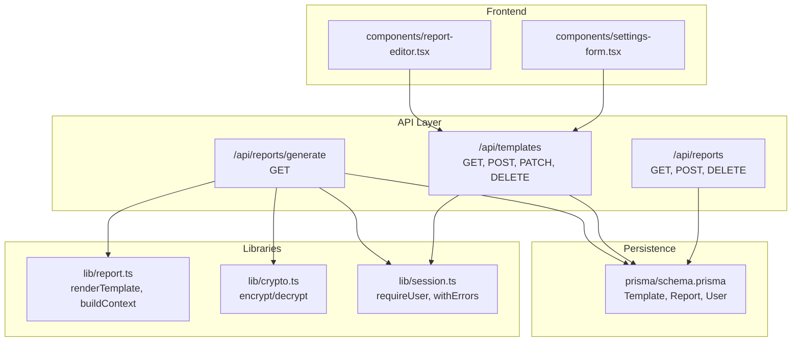
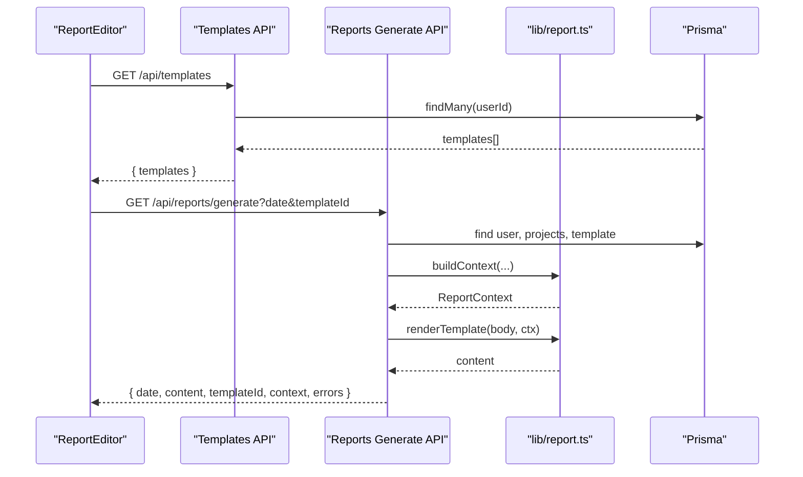
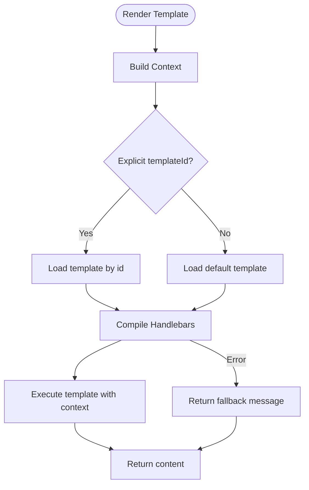
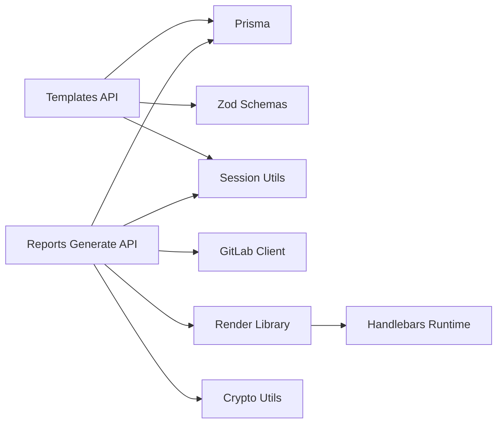

# Template Management Endpoints

<cite>
**Referenced Files in This Document**
- [route.ts](file://app/api/templates/route.ts)
- [route.ts](file://app/api/reports/generate/route.ts)
- [route.ts](file://app/api/reports/route.ts)
- [report.ts](file://lib/report.ts)
- [schema.prisma](file://prisma/schema.prisma)
- [report-editor.tsx](file://components/report-editor.tsx)
- [settings-form.tsx](file://components/settings-form.tsx)
- [crypto.ts](file://lib/crypto.ts)
- [session.ts](file://lib/session.ts)
</cite>

## Table of Contents
1. [Introduction](#introduction)
2. [Project Structure](#project-structure)
3. [Core Components](#core-components)
4. [Architecture Overview](#architecture-overview)
5. [Detailed Component Analysis](#detailed-component-analysis)
6. [Dependency Analysis](#dependency-analysis)
7. [Performance Considerations](#performance-considerations)
8. [Troubleshooting Guide](#troubleshooting-guide)
9. [Conclusion](#conclusion)

## Introduction
This document describes the template management API for report generation. It covers CRUD operations for user-specific templates, request/response schemas, Handlebars-based template rendering, template metadata, default template handling, and integration with the report generation pipeline. It also explains template context variables, helper functions, validation behavior, and operational considerations such as versioning, backups, and performance.

## Project Structure
The template management feature spans several modules:
- API routes for templates and report generation
- Rendering logic and context builders
- Frontend editor and settings UI
- Database schema for templates and reports
- Authentication and encryption utilities

**Diagram sources**
- [route.ts:1-96](file://app/api/templates/route.ts#L1-L96)
- [route.ts:1-133](file://app/api/reports/generate/route.ts#L1-L133)
- [route.ts:1-90](file://app/api/reports/route.ts#L1-L90)
- [report.ts:1-159](file://lib/report.ts#L1-L159)
- [schema.prisma:67-79](file://prisma/schema.prisma#L67-L79)
- [report-editor.tsx:1-284](file://components/report-editor.tsx#L1-L284)
- [settings-form.tsx:134-367](file://components/settings-form.tsx#L134-L367)
- [crypto.ts:1-46](file://lib/crypto.ts#L1-L46)
- [session.ts:1-56](file://lib/session.ts#L1-L56)

**Section sources**
- [route.ts:1-96](file://app/api/templates/route.ts#L1-L96)
- [route.ts:1-133](file://app/api/reports/generate/route.ts#L1-L133)
- [report.ts:1-159](file://lib/report.ts#L1-L159)
- [schema.prisma:67-79](file://prisma/schema.prisma#L67-L79)
- [report-editor.tsx:1-284](file://components/report-editor.tsx#L1-L284)
- [settings-form.tsx:134-367](file://components/settings-form.tsx#L134-L367)
- [crypto.ts:1-46](file://lib/crypto.ts#L1-L46)
- [session.ts:1-56](file://lib/session.ts#L1-L56)

## Core Components
- Template model and relations
  - Template: id, userId, name, body, isDefault, timestamps
  - Report: content, templateId (optional), rawCommits, date
  - User: owns Templates and Reports
- Template API
  - GET /api/templates: list templates, auto-create default if none
  - POST /api/templates: create template, optional default promotion
  - PATCH /api/templates: update template, optional default promotion
  - DELETE /api/templates?id=...: delete template
- Report generation API
  - GET /api/reports/generate: builds context, selects template, renders content
- Rendering engine
  - Handlebars compilation with fallback rendering on error
- Frontend integration
  - Editor loads templates and generates content
  - Settings supports creating/editing/deleting templates

**Section sources**
- [schema.prisma:67-79](file://prisma/schema.prisma#L67-L79)
- [route.ts:7-25](file://app/api/templates/route.ts#L7-L25)
- [route.ts:33-51](file://app/api/templates/route.ts#L33-L51)
- [route.ts:60-82](file://app/api/templates/route.ts#L60-L82)
- [route.ts:84-95](file://app/api/templates/route.ts#L84-L95)
- [route.ts:23-132](file://app/api/reports/generate/route.ts#L23-L132)
- [report.ts:137-144](file://lib/report.ts#L137-L144)
- [report-editor.tsx:39-91](file://components/report-editor.tsx#L39-L91)
- [settings-form.tsx:136-176](file://components/settings-form.tsx#L136-L176)

## Architecture Overview
The template management system integrates with the report generation pipeline. Users manage templates via the UI/API, and the generation endpoint selects a template (either explicit or default), constructs a context from GitLab data, and renders the final report content.

**Diagram sources**
- [report-editor.tsx:39-91](file://components/report-editor.tsx#L39-L91)
- [route.ts:7-25](file://app/api/templates/route.ts#L7-L25)
- [route.ts:23-132](file://app/api/reports/generate/route.ts#L23-L132)
- [report.ts:137-144](file://lib/report.ts#L137-L144)
- [schema.prisma:67-79](file://prisma/schema.prisma#L67-L79)

## Detailed Component Analysis

### Template Model and Metadata
- Fields
  - id: unique identifier
  - userId: owner linkage
  - name: human-readable label (1–50 chars)
  - body: template content (Handlebars)
  - isDefault: boolean flag
  - timestamps: createdAt, updatedAt
- Relations
  - Template belongs to User
  - Report optionally references Template via templateId

**Section sources**
- [schema.prisma:67-79](file://prisma/schema.prisma#L67-L79)

### Template CRUD Endpoints

#### GET /api/templates
- Behavior
  - Lists templates for the current user, ordered by default-first, then newest
  - If none exist, creates a default template using the built-in default body
- Response
  - { templates: Template[] }

Validation and defaults
- On empty list, a default template is created automatically

**Section sources**
- [route.ts:7-25](file://app/api/templates/route.ts#L7-L25)

#### POST /api/templates
- Request body
  - name: string (required, 1–50 chars)
  - body: string (required)
  - isDefault: boolean (optional)
- Behavior
  - Creates a new template for the user
  - If isDefault is true, demotes any existing default template for the user
- Response
  - { template: Template }

Validation
- Zod schema enforces field constraints

**Section sources**
- [route.ts:27-31](file://app/api/templates/route.ts#L27-L31)
- [route.ts:33-51](file://app/api/templates/route.ts#L33-L51)

#### PATCH /api/templates
- Request body
  - id: string (required)
  - name: string (optional, 1–50 chars)
  - body: string (optional)
  - isDefault: boolean (optional)
- Behavior
  - Updates an existing template owned by the user
  - If isDefault is true, demotes any existing default template for the user
- Response
  - { template: Template }
- Errors
  - 404 Not Found if template does not belong to the user

Validation
- Zod schema enforces field constraints

**Section sources**
- [route.ts:53-58](file://app/api/templates/route.ts#L53-L58)
- [route.ts:60-82](file://app/api/templates/route.ts#L60-L82)

#### DELETE /api/templates
- Query parameter
  - id: string (required)
- Behavior
  - Deletes a template owned by the user
- Response
  - { ok: true }
- Errors
  - 400 Bad Request if id missing
  - 404 Not Found if template does not belong to the user

**Section sources**
- [route.ts:84-95](file://app/api/templates/route.ts#L84-L95)

### Template Content and Validation
- Content format
  - Free-text body intended for Handlebars compilation
- Validation
  - Creation and update enforce non-empty name/body
  - No runtime syntax validation is performed on the Handlebars body
- Fallback rendering
  - On compilation/rendering errors, a fallback message is returned

**Section sources**
- [route.ts:27-31](file://app/api/templates/route.ts#L27-L31)
- [route.ts:53-58](file://app/api/templates/route.ts#L53-L58)
- [report.ts:137-144](file://lib/report.ts#L137-L144)

### Template Context Variables and Helpers
- Context shape (ReportContext)
  - date: string
  - projects: array of grouped projects
  - total: number
  - user: { displayName, email? }
- Project group shape
  - name: string
  - webUrl?: string
  - commits: cleaned commit entries
- Commit entry shape
  - id, short_id, title, message, author_email, authored_date, web_url
  - type?, scope?
- Helpers and syntax
  - Built-in Handlebars helpers are available (e.g., conditionals, iteration)
  - The default template demonstrates basic iteration over projects and commits

**Section sources**
- [report.ts:22-27](file://lib/report.ts#L22-L27)
- [report.ts:16-20](file://lib/report.ts#L16-L20)
- [report.ts:4-14](file://lib/report.ts#L4-L14)
- [report.ts:146-159](file://lib/report.ts#L146-L159)

### Rendering Process
- Steps
  1. Build context from GitLab data
  2. Select template (explicit or default)
  3. Compile and render with Handlebars
  4. Return rendered content and context
- Error handling
  - Compilation/rendering failures produce a fallback message

**Diagram sources**
- [route.ts:87-119](file://app/api/reports/generate/route.ts#L87-L119)
- [report.ts:137-144](file://lib/report.ts#L137-L144)

**Section sources**
- [route.ts:23-132](file://app/api/reports/generate/route.ts#L23-L132)
- [report.ts:137-144](file://lib/report.ts#L137-L144)

### Default Template Handling
- Automatic creation
  - On first access, a default template is created for the user
- Promotion/demotion
  - Setting isDefault=true on a template demotes any existing default for the user
- Selection precedence
  - Explicit templateId overrides default selection during generation

**Section sources**
- [route.ts:13-23](file://app/api/templates/route.ts#L13-L23)
- [route.ts:88-106](file://app/api/reports/generate/route.ts#L88-L106)

### Custom Template Creation Workflows
- UI actions
  - Create: prompts for name and body, sends POST /api/templates
  - Edit: prompts for updated body, sends PATCH /api/templates
  - Delete: confirms and deletes template
  - Set default: promotes a template to default
- Frontend integration
  - Editor lists templates and sets default template for generation

**Section sources**
- [settings-form.tsx:136-176](file://components/settings-form.tsx#L136-L176)
- [report-editor.tsx:39-91](file://components/report-editor.tsx#L39-L91)

### Template Inheritance Patterns
- The system does not implement explicit template inheritance
- Users can copy an existing template’s body to create variants
- Default template serves as a baseline for new users

**Section sources**
- [route.ts:13-23](file://app/api/templates/route.ts#L13-L23)
- [settings-form.tsx:136-176](file://components/settings-form.tsx#L136-L176)

### Integration with Report Generation
- Generation endpoint
  - Validates query parameters (date, templateId, projectIds)
  - Loads user and projects, fetches GitLab commits
  - Builds context and renders content using selected template
  - Returns content, templateId, context, and per-project errors
- Saving reports
  - Reports can be persisted with associated templateId and raw commit data

**Section sources**
- [route.ts:14-30](file://app/api/reports/generate/route.ts#L14-L30)
- [route.ts:36-132](file://app/api/reports/generate/route.ts#L36-L132)
- [route.ts:48-76](file://app/api/reports/route.ts#L48-L76)

## Dependency Analysis
- Template API depends on:
  - Prisma for persistence
  - Zod for request validation
  - Session utilities for authentication
- Report generation depends on:
  - Template API for template selection
  - GitLab client for commit data
  - Encryption utilities for secure token handling
  - Rendering library for Handlebars compilation

**Diagram sources**
- [route.ts:1-96](file://app/api/templates/route.ts#L1-L96)
- [route.ts:1-133](file://app/api/reports/generate/route.ts#L1-L133)
- [report.ts:1-159](file://lib/report.ts#L1-L159)
- [crypto.ts:1-46](file://lib/crypto.ts#L1-L46)
- [session.ts:1-56](file://lib/session.ts#L1-L56)

**Section sources**
- [route.ts:1-96](file://app/api/templates/route.ts#L1-L96)
- [route.ts:1-133](file://app/api/reports/generate/route.ts#L1-L133)
- [report.ts:1-159](file://lib/report.ts#L1-L159)
- [crypto.ts:1-46](file://lib/crypto.ts#L1-L46)
- [session.ts:1-56](file://lib/session.ts#L1-L56)

## Performance Considerations
- Template rendering
  - Handlebars compilation occurs per request; caching compiled templates at the process level could reduce overhead
- Report generation
  - Parallelization of GitLab commit fetching across projects is already used
  - Consider limiting the number of projects processed per request to avoid timeouts
- Storage
  - Template bodies are stored as Text; ensure database indexing remains efficient
- Network
  - GitLab API calls are subject to external latency; consider adding retry/backoff and pagination safeguards

[No sources needed since this section provides general guidance]

## Troubleshooting Guide
Common issues and resolutions:
- Unauthorized or forbidden requests
  - Ensure the user is authenticated and authorized
- Template not found
  - Verify template ownership and existence under the current user
- Validation errors on create/update
  - Ensure name and body are non-empty and within length limits
- Template rendering failure
  - Review Handlebars syntax; the system returns a fallback message on errors
- Missing GitLab credentials
  - Configure GitLab base URL and token before generating reports

**Section sources**
- [session.ts:22-37](file://lib/session.ts#L22-L37)
- [route.ts:33-51](file://app/api/templates/route.ts#L33-L51)
- [route.ts:60-82](file://app/api/templates/route.ts#L60-L82)
- [report.ts:137-144](file://lib/report.ts#L137-L144)
- [route.ts:36-43](file://app/api/reports/generate/route.ts#L36-L43)

## Conclusion
The template management system provides a straightforward CRUD interface for user-defined report templates backed by Handlebars. It integrates tightly with the report generation pipeline, offering default template creation, explicit template selection, and robust context building. While there is no explicit inheritance mechanism, the default template and flexible editing support enable effective customization. Operational improvements such as compiled template caching and enhanced error reporting can further improve reliability and performance.