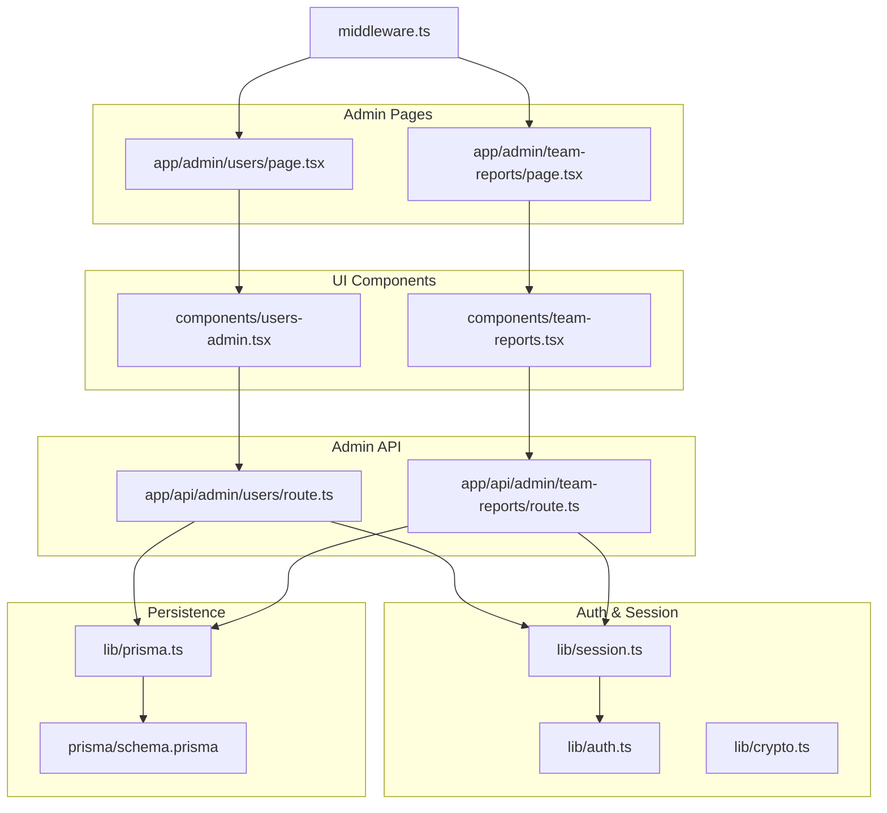
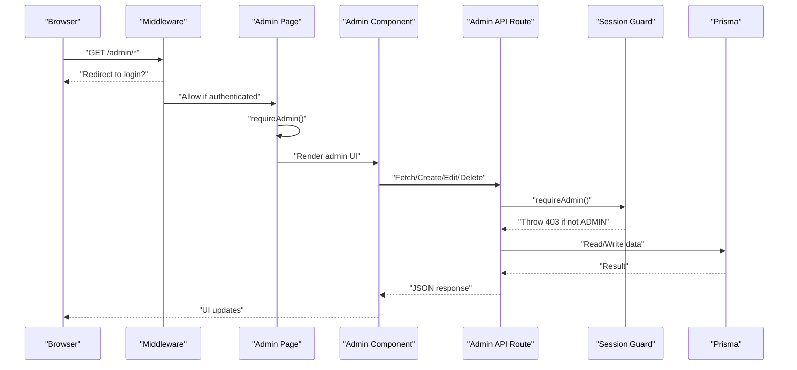
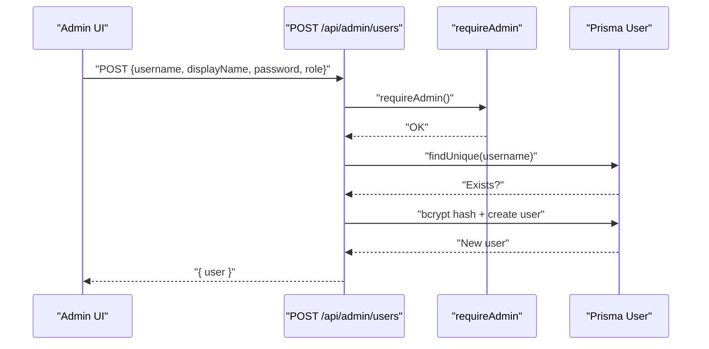
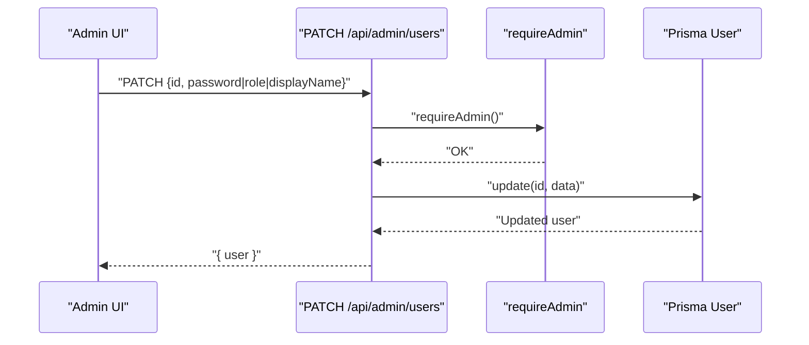
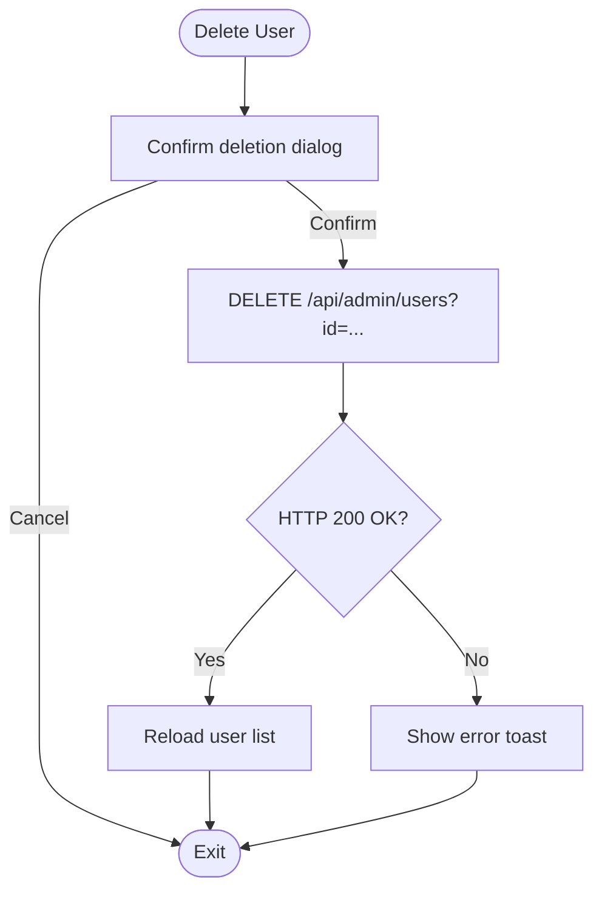
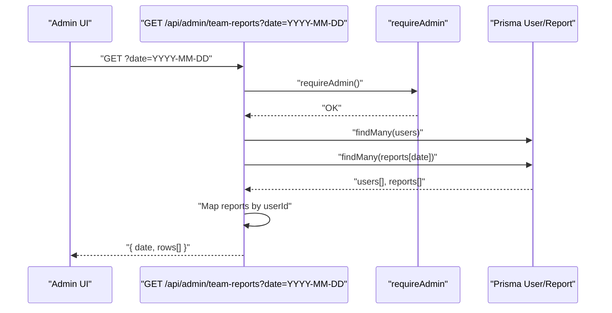
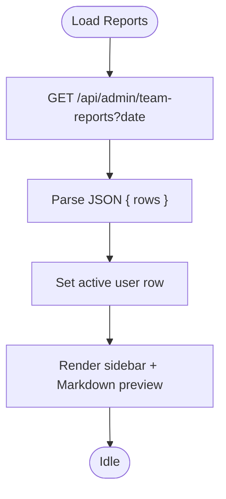
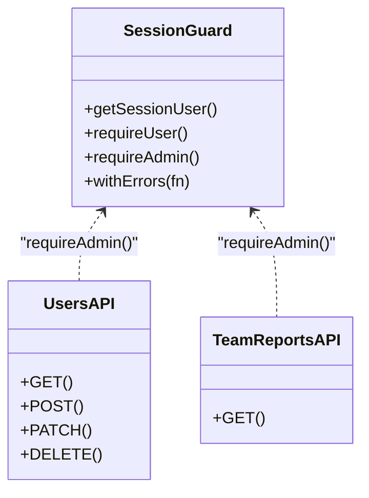
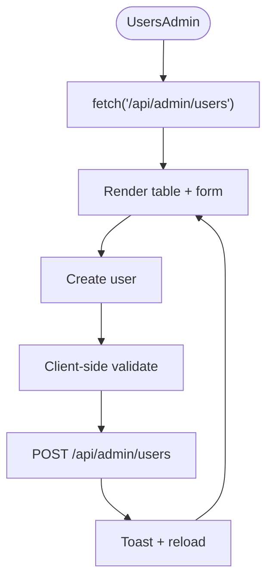
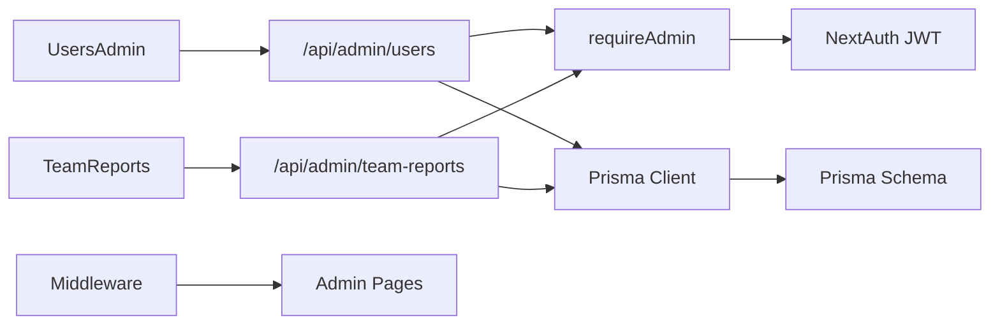

# Admin Features

<cite>
**Referenced Files in This Document**
- [app/admin/users/page.tsx](file://app/admin/users/page.tsx)
- [app/admin/team-reports/page.tsx](file://app/admin/team-reports/page.tsx)
- [app/api/admin/users/route.ts](file://app/api/admin/users/route.ts)
- [app/api/admin/team-reports/route.ts](file://app/api/admin/team-reports/route.ts)
- [components/users-admin.tsx](file://components/users-admin.tsx)
- [components/team-reports.tsx](file://components/team-reports.tsx)
- [lib/session.ts](file://lib/session.ts)
- [lib/auth.ts](file://lib/auth.ts)
- [lib/crypto.ts](file://lib/crypto.ts)
- [lib/prisma.ts](file://lib/prisma.ts)
- [prisma/schema.prisma](file://prisma/schema.prisma)
- [middleware.ts](file://middleware.ts)
- [components/nav.tsx](file://components/nav.tsx)
- [README.md](file://README.md)
</cite>

## Table of Contents
1. [Introduction](#introduction)
2. [Project Structure](#project-structure)
3. [Core Components](#core-components)
4. [Architecture Overview](#architecture-overview)
5. [Detailed Component Analysis](#detailed-component-analysis)
6. [Dependency Analysis](#dependency-analysis)
7. [Performance Considerations](#performance-considerations)
8. [Troubleshooting Guide](#troubleshooting-guide)
9. [Conclusion](#conclusion)
10. [Appendices](#appendices)

## Introduction
This document explains Pingyun Report’s administrative features with a focus on:
- User management: creation, profile editing, password reset, and role assignment
- Team report monitoring: calendar-based navigation and team activity tracking
- Admin-only endpoints and their security model
- UI components for admin operations: form validation, actions, and data visualization
- Administrative workflows for onboarding, maintenance, and oversight
- Security considerations around admin access, audit logging, and privilege escalation prevention

## Project Structure
Admin features are organized under the Next.js App Router:
- Admin pages: server-side routes that enforce admin-only access and render admin UI components
- Admin API routes: server-side handlers protected by admin middleware
- Admin UI components: client-side React components that call admin APIs
- Shared auth and session utilities: enforce roles and handle errors consistently

**Diagram sources**
- [app/admin/users/page.tsx:1-22](file://app/admin/users/page.tsx#L1-L22)
- [app/admin/team-reports/page.tsx:1-22](file://app/admin/team-reports/page.tsx#L1-L22)
- [app/api/admin/users/route.ts:1-88](file://app/api/admin/users/route.ts#L1-L88)
- [app/api/admin/team-reports/route.ts:1-34](file://app/api/admin/team-reports/route.ts#L1-L34)
- [components/users-admin.tsx:1-187](file://components/users-admin.tsx#L1-L187)
- [components/team-reports.tsx:1-114](file://components/team-reports.tsx#L1-L114)
- [lib/session.ts:1-56](file://lib/session.ts#L1-L56)
- [lib/auth.ts:1-77](file://lib/auth.ts#L1-L77)
- [lib/crypto.ts:1-45](file://lib/crypto.ts#L1-L45)
- [lib/prisma.ts:1-14](file://lib/prisma.ts#L1-L14)
- [prisma/schema.prisma:1-80](file://prisma/schema.prisma#L1-L80)
- [middleware.ts:1-10](file://middleware.ts#L1-L10)

**Section sources**
- [app/admin/users/page.tsx:1-22](file://app/admin/users/page.tsx#L1-L22)
- [app/admin/team-reports/page.tsx:1-22](file://app/admin/team-reports/page.tsx#L1-L22)
- [middleware.ts:1-10](file://middleware.ts#L1-L10)

## Core Components
- Admin user management page: renders the UsersAdmin component and enforces admin-only access
- Admin team reports page: renders the TeamReports component and enforces admin-only access
- UsersAdmin component: client-side form for creating users and table for listing/editing users
- TeamReports component: client-side calendar navigation and team activity viewer
- Admin API routes: server-side handlers for user CRUD and team report listing
- Session and auth utilities: enforce admin role and convert errors to HTTP responses
- Prisma integration: database client and schema for User, Report, Project, Template

Key responsibilities:
- Enforce admin-only access at both page and API levels
- Validate inputs and sanitize outputs
- Provide calendar-based filtering for team reports
- Support password hashing and role updates

**Section sources**
- [app/admin/users/page.tsx:8-21](file://app/admin/users/page.tsx#L8-L21)
- [app/admin/team-reports/page.tsx:8-21](file://app/admin/team-reports/page.tsx#L8-L21)
- [components/users-admin.tsx:16-186](file://components/users-admin.tsx#L16-L186)
- [components/team-reports.tsx:23-113](file://components/team-reports.tsx#L23-L113)
- [app/api/admin/users/route.ts:7-87](file://app/api/admin/users/route.ts#L7-L87)
- [app/api/admin/team-reports/route.ts:6-33](file://app/api/admin/team-reports/route.ts#L6-L33)
- [lib/session.ts:31-55](file://lib/session.ts#L31-L55)
- [lib/prisma.ts:1-14](file://lib/prisma.ts#L1-L14)
- [prisma/schema.prisma:16-33](file://prisma/schema.prisma#L16-L33)

## Architecture Overview
Admin access is enforced via:
- Middleware that protects admin routes
- Page-level guards that check session and role
- Route-level guards that enforce admin role and wrap handlers to normalize errors

**Diagram sources**
- [middleware.ts:1-10](file://middleware.ts#L1-L10)
- [app/admin/users/page.tsx:8-21](file://app/admin/users/page.tsx#L8-L21)
- [app/admin/team-reports/page.tsx:8-21](file://app/admin/team-reports/page.tsx#L8-L21)
- [components/users-admin.tsx:23-54](file://components/users-admin.tsx#L23-L54)
- [components/team-reports.tsx:28-37](file://components/team-reports.tsx#L28-L37)
- [app/api/admin/users/route.ts:31-87](file://app/api/admin/users/route.ts#L31-L87)
- [app/api/admin/team-reports/route.ts:6-33](file://app/api/admin/team-reports/route.ts#L6-L33)
- [lib/session.ts:31-55](file://lib/session.ts#L31-L55)
- [lib/prisma.ts:1-14](file://lib/prisma.ts#L1-L14)

## Detailed Component Analysis

### User Management System
Admins can:
- List users with basic metadata
- Create users with username, display name, and password
- Reset passwords for existing users
- Change roles (member/admin)
- Delete users (cascade deletes reports and templates)

**Diagram sources**
- [components/users-admin.tsx:33-54](file://components/users-admin.tsx#L33-L54)
- [app/api/admin/users/route.ts:31-56](file://app/api/admin/users/route.ts#L31-L56)
- [lib/session.ts:31-37](file://lib/session.ts#L31-L37)
- [lib/prisma.ts:1-14](file://lib/prisma.ts#L1-L14)

**Diagram sources**
- [components/users-admin.tsx:56-78](file://components/users-admin.tsx#L56-L78)
- [app/api/admin/users/route.ts:65-78](file://app/api/admin/users/route.ts#L65-L78)
- [lib/session.ts:31-37](file://lib/session.ts#L31-L37)

**Diagram sources**
- [components/users-admin.tsx:80-87](file://components/users-admin.tsx#L80-L87)
- [app/api/admin/users/route.ts:80-87](file://app/api/admin/users/route.ts#L80-L87)

Implementation highlights:
- Input validation with Zod schemas for create and patch operations
- Password hashing with bcrypt
- Role enforcement via requireAdmin
- Error normalization via withErrors

**Section sources**
- [components/users-admin.tsx:16-186](file://components/users-admin.tsx#L16-L186)
- [app/api/admin/users/route.ts:7-87](file://app/api/admin/users/route.ts#L7-L87)
- [lib/session.ts:31-55](file://lib/session.ts#L31-L55)
- [lib/prisma.ts:1-14](file://lib/prisma.ts#L1-L14)
- [prisma/schema.prisma:16-33](file://prisma/schema.prisma#L16-L33)

### Team Report Monitoring
Admins can:
- Filter team reports by date (calendar input)
- View submission status per team member
- Inspect report content for selected members

**Diagram sources**
- [components/team-reports.tsx:28-37](file://components/team-reports.tsx#L28-L37)
- [app/api/admin/team-reports/route.ts:6-33](file://app/api/admin/team-reports/route.ts#L6-L33)
- [lib/session.ts:31-37](file://lib/session.ts#L31-L37)

**Diagram sources**
- [components/team-reports.tsx:23-113](file://components/team-reports.tsx#L23-L113)
- [app/api/admin/team-reports/route.ts:6-33](file://app/api/admin/team-reports/route.ts#L6-L33)

**Section sources**
- [components/team-reports.tsx:23-113](file://components/team-reports.tsx#L23-L113)
- [app/api/admin/team-reports/route.ts:6-33](file://app/api/admin/team-reports/route.ts#L6-L33)
- [lib/session.ts:31-37](file://lib/session.ts#L31-L37)

### Admin-Only Endpoints and Security Implications
- GET /api/admin/users: lists users with minimal metadata
- POST /api/admin/users: create user (admin-only)
- PATCH /api/admin/users: update user (admin-only)
- DELETE /api/admin/users: delete user (admin-only)
- GET /api/admin/team-reports?date=YYYY-MM-DD: list team reports for a date (admin-only)

Security model:
- requireAdmin throws 403 if the session user is not ADMIN
- withErrors converts thrown Responses and logs unexpected errors
- Middleware protects admin routes globally
- Page-level guards ensure role before rendering admin UI

**Diagram sources**
- [lib/session.ts:11-55](file://lib/session.ts#L11-L55)
- [app/api/admin/users/route.ts:7-87](file://app/api/admin/users/route.ts#L7-L87)
- [app/api/admin/team-reports/route.ts:6-33](file://app/api/admin/team-reports/route.ts#L6-L33)

**Section sources**
- [app/api/admin/users/route.ts:7-87](file://app/api/admin/users/route.ts#L7-L87)
- [app/api/admin/team-reports/route.ts:6-33](file://app/api/admin/team-reports/route.ts#L6-L33)
- [lib/session.ts:31-55](file://lib/session.ts#L31-L55)
- [middleware.ts:7-9](file://middleware.ts#L7-L9)

### User Interface Components for Admin Operations
- UsersAdmin:
  - Form validation: ensures required fields are present before submit
  - Actions: create, reset password, change role, delete
  - Feedback: toast notifications for success/error
- TeamReports:
  - Calendar navigation: date picker with controlled state
  - Activity visualization: submission status indicators and Markdown preview
  - Responsive layout: sidebar for members, main panel for report content

**Diagram sources**
- [components/users-admin.tsx:23-54](file://components/users-admin.tsx#L23-L54)

**Section sources**
- [components/users-admin.tsx:16-186](file://components/users-admin.tsx#L16-L186)
- [components/team-reports.tsx:23-113](file://components/team-reports.tsx#L23-L113)

### Administrative Workflows
- User onboarding:
  - Create user with initial password
  - Assign role (member/admin)
  - Verify account can log in
- System maintenance:
  - Reset passwords for users who forgot
  - Revoke admin privileges by changing role
  - Remove inactive users
- Team reporting oversight:
  - Review submission rates by date
  - Inspect report content for anomalies
  - Track participation trends over time

[No sources needed since this section aggregates workflows conceptually]

## Dependency Analysis
- UI components depend on admin API routes
- Admin API routes depend on session guards and Prisma
- Prisma depends on the schema and database connection
- Middleware and page guards enforce role-based access

**Diagram sources**
- [components/users-admin.tsx:23-54](file://components/users-admin.tsx#L23-L54)
- [components/team-reports.tsx:28-37](file://components/team-reports.tsx#L28-L37)
- [app/api/admin/users/route.ts:31-87](file://app/api/admin/users/route.ts#L31-L87)
- [app/api/admin/team-reports/route.ts:6-33](file://app/api/admin/team-reports/route.ts#L6-L33)
- [lib/session.ts:31-37](file://lib/session.ts#L31-L37)
- [lib/auth.ts:30-77](file://lib/auth.ts#L30-L77)
- [lib/prisma.ts:1-14](file://lib/prisma.ts#L1-L14)
- [prisma/schema.prisma:16-33](file://prisma/schema.prisma#L16-L33)
- [middleware.ts:7-9](file://middleware.ts#L7-L9)

**Section sources**
- [lib/prisma.ts:1-14](file://lib/prisma.ts#L1-L14)
- [prisma/schema.prisma:16-33](file://prisma/schema.prisma#L16-L33)
- [lib/session.ts:31-37](file://lib/session.ts#L31-L37)
- [middleware.ts:7-9](file://middleware.ts#L7-L9)

## Performance Considerations
- API queries:
  - User listing orders by creation time and selects only necessary fields
  - Team reports query users and reports separately then map by userId
- Client-side:
  - Minimal state updates and targeted reloads after mutations
  - Dynamic imports for Markdown editor reduce initial bundle size
- Recommendations:
  - Add pagination for user listing if user counts grow large
  - Consider server-side date filtering for team reports to limit dataset size
  - Debounce date picker changes to avoid excessive requests

[No sources needed since this section provides general guidance]

## Troubleshooting Guide
Common issues and resolutions:
- Unauthorized access to admin pages:
  - Ensure the user is logged in and has role ADMIN
  - Verify middleware and page-level guards are active
- API returns 403 Forbidden:
  - Confirm the session user role is ADMIN
  - Check withErrors does not swallow expected errors
- User creation fails:
  - Validate username uniqueness and password length
  - Confirm bcrypt hashing succeeds
- Team reports not loading:
  - Verify date format YYYY-MM-DD
  - Check Prisma queries return expected users and reports
- Security and encryption:
  - ENCRYPTION_KEY must be a 64-character hex string
  - GitLab tokens are encrypted at rest and never returned to the browser

**Section sources**
- [lib/session.ts:31-55](file://lib/session.ts#L31-L55)
- [app/api/admin/users/route.ts:31-56](file://app/api/admin/users/route.ts#L31-L56)
- [app/api/admin/team-reports/route.ts:9-12](file://app/api/admin/team-reports/route.ts#L9-L12)
- [lib/crypto.ts:7-15](file://lib/crypto.ts#L7-L15)
- [README.md:65-71](file://README.md#L65-L71)

## Conclusion
Pingyun Report’s admin features are built around strict role enforcement, clear separation of concerns, and robust client-server interactions. Admins can efficiently manage users and oversee team reporting while the system maintains strong security boundaries and predictable error handling.

[No sources needed since this section summarizes without analyzing specific files]

## Appendices

### API Definitions
- GET /api/admin/users
  - Purpose: List users with minimal metadata
  - Auth: ADMIN required
- POST /api/admin/users
  - Purpose: Create a new user
  - Auth: ADMIN required
  - Body: username, displayName, password, role (optional)
- PATCH /api/admin/users
  - Purpose: Update user (password, role, displayName)
  - Auth: ADMIN required
  - Body: id, password (optional), displayName (optional), role (optional)
- DELETE /api/admin/users?id=...
  - Purpose: Delete a user
  - Auth: ADMIN required
- GET /api/admin/team-reports?date=YYYY-MM-DD
  - Purpose: Get team reports for a given date
  - Auth: ADMIN required
  - Query: date (optional, defaults to today)

**Section sources**
- [README.md:72-86](file://README.md#L72-L86)
- [app/api/admin/users/route.ts:7-87](file://app/api/admin/users/route.ts#L7-L87)
- [app/api/admin/team-reports/route.ts:6-33](file://app/api/admin/team-reports/route.ts#L6-L33)

### Data Model Highlights
- User: id, username (unique), passwordHash, displayName, role (MEMBER/ADMIN), timestamps
- Report: id, userId, date (Date), content (LongText), timestamps
- Project and Template: related entities owned by User

**Section sources**
- [prisma/schema.prisma:16-33](file://prisma/schema.prisma#L16-L33)
- [prisma/schema.prisma:51-65](file://prisma/schema.prisma#L51-L65)
- [prisma/schema.prisma:35-49](file://prisma/schema.prisma#L35-L49)
- [prisma/schema.prisma:67-79](file://prisma/schema.prisma#L67-L79)