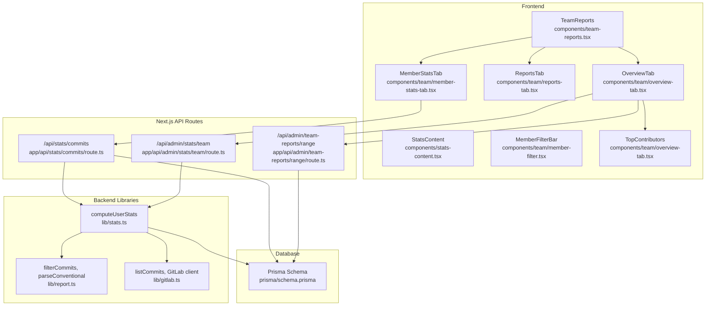
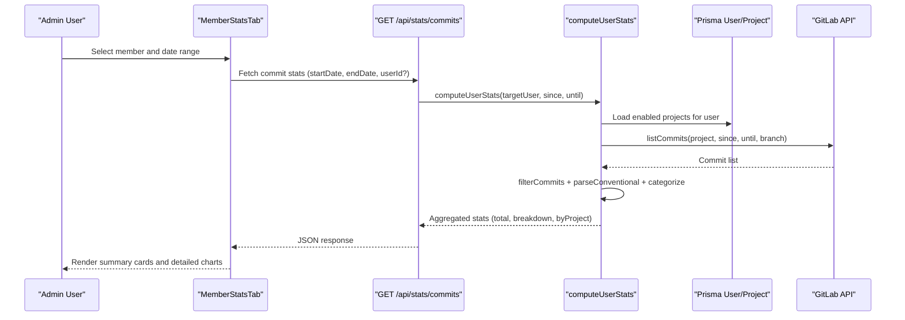
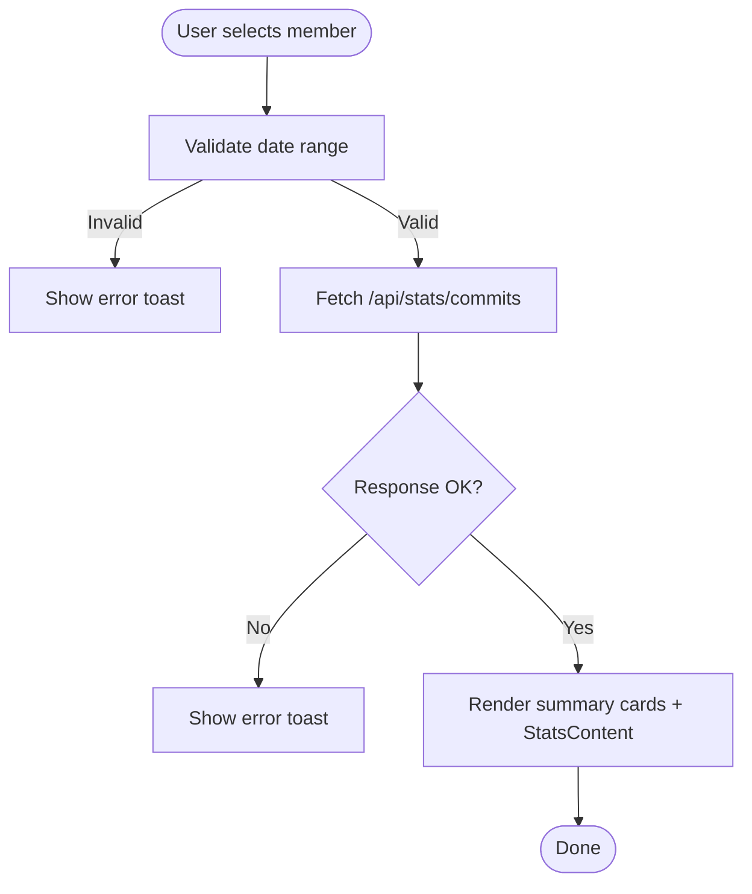
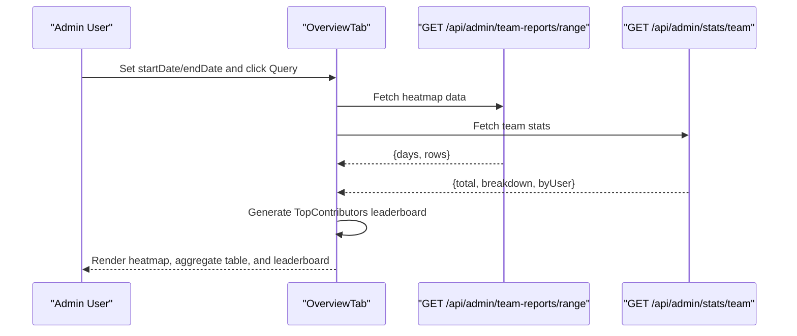
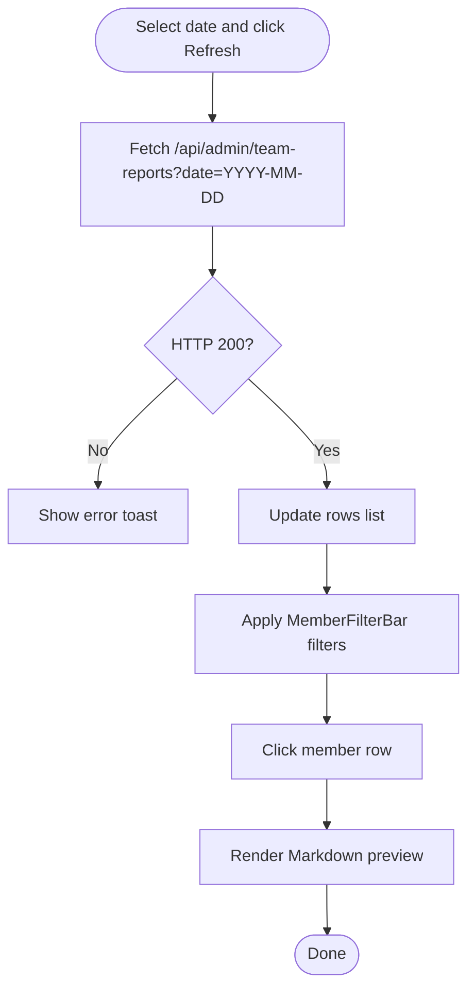
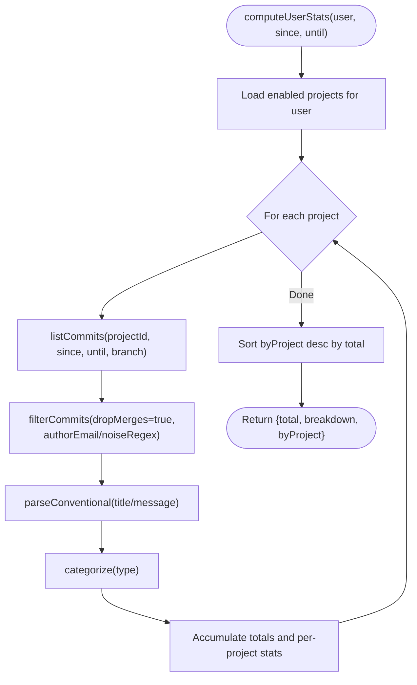
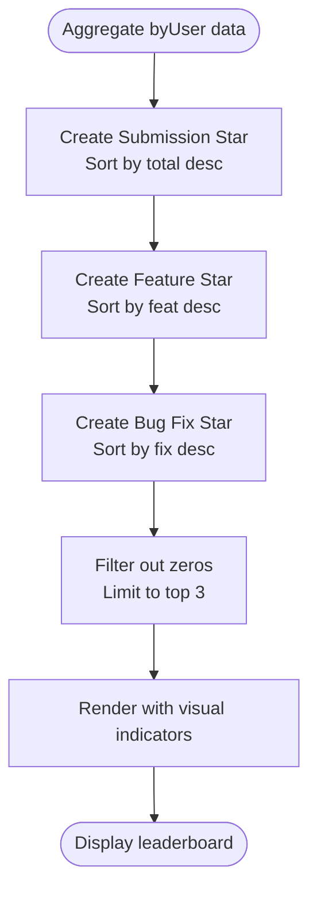
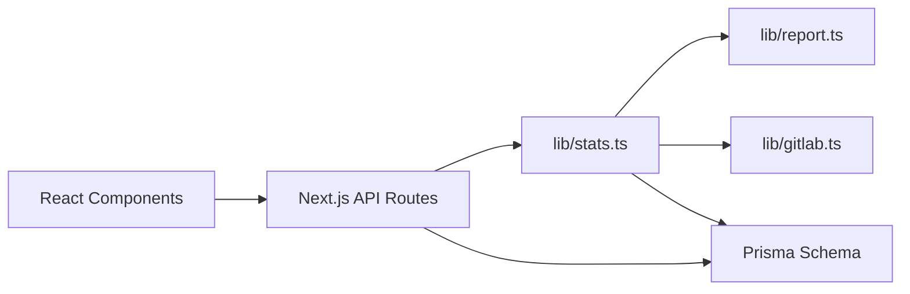

# Team Member Statistics

<cite>
**Referenced Files in This Document**
- [page.tsx](file://app/admin/team-reports/page.tsx)
- [team-reports.tsx](file://components/team-reports.tsx)
- [member-stats-tab.tsx](file://components/team/member-stats-tab.tsx)
- [member-filter.tsx](file://components/team/member-filter.tsx)
- [reports-tab.tsx](file://components/team/reports-tab.tsx)
- [overview-tab.tsx](file://components/team/overview-tab.tsx)
- [stats-content.tsx](file://components/stats-content.tsx)
- [route.ts](file://app/api/stats/commits/route.ts)
- [route.ts](file://app/api/admin/stats/team/route.ts)
- [route.ts](file://app/api/admin/team-reports/range/route.ts)
- [stats.ts](file://lib/stats.ts)
- [report.ts](file://lib/report.ts)
- [gitlab.ts](file://lib/gitlab.ts)
- [schema.prisma](file://prisma/schema.prisma)
</cite>

## Update Summary
**Changes Made**
- Added comprehensive top contributors leaderboard system with three ranking categories
- Enhanced responsive design with modern grid layouts and mobile-first approach
- Integrated visual ranking indicators with gold/silver/bronze styling
- Improved team statistics dashboard with leaderboard visualization

## Table of Contents
1. [Introduction](#introduction)
2. [Project Structure](#project-structure)
3. [Core Components](#core-components)
4. [Architecture Overview](#architecture-overview)
5. [Detailed Component Analysis](#detailed-component-analysis)
6. [Top Contributors Leaderboard System](#top-contributors-leaderboard-system)
7. [Responsive Design Enhancements](#responsive-design-enhancements)
8. [Dependency Analysis](#dependency-analysis)
9. [Performance Considerations](#performance-considerations)
10. [Troubleshooting Guide](#troubleshooting-guide)
11. [Conclusion](#conclusion)

## Introduction
This document explains the Team Member Statistics feature, which provides administrators with three primary capabilities:
- Individual member commit statistics with filtering and date range selection
- Team-wide daily report submission heatmaps and aggregated statistics
- Daily report review and approval workflows

**Updated** Added comprehensive top contributors leaderboard system with three ranking categories (Submission Star, Feature Star, Bug Fix Star) and responsive design enhancements to the team statistics dashboard.

The system integrates with GitLab via server-side APIs, computes conventional commit categories, and presents structured statistics with project-level breakdowns. The leaderboard system now provides visual recognition of top contributors across different contribution metrics.

## Project Structure
The Team Member Statistics feature spans frontend React components, Next.js API routes, and backend libraries for data computation and GitLab integration.

**Diagram sources**
- [team-reports.tsx:1-70](file://components/team-reports.tsx#L1-L70)
- [member-stats-tab.tsx:1-241](file://components/team/member-stats-tab.tsx#L1-L241)
- [reports-tab.tsx:1-183](file://components/team/reports-tab.tsx#L1-L183)
- [overview-tab.tsx:1-398](file://components/team/overview-tab.tsx#L1-L398)
- [stats-content.tsx:1-225](file://components/stats-content.tsx#L1-L225)
- [member-filter.tsx:1-60](file://components/team/member-filter.tsx#L1-L60)
- [route.ts:1-54](file://app/api/stats/commits/route.ts#L1-L54)
- [route.ts:1-76](file://app/api/admin/stats/team/route.ts#L1-L76)
- [route.ts:1-70](file://app/api/admin/team-reports/range/route.ts#L1-L70)
- [stats.ts:1-144](file://lib/stats.ts#L1-L144)
- [report.ts:1-159](file://lib/report.ts#L1-L159)
- [gitlab.ts:1-172](file://lib/gitlab.ts#L1-L172)
- [schema.prisma:1-81](file://prisma/schema.prisma#L1-L81)

**Section sources**
- [page.tsx:1-22](file://app/admin/team-reports/page.tsx#L1-L22)
- [team-reports.tsx:1-70](file://components/team-reports.tsx#L1-L70)

## Core Components
- TeamReports container manages tab navigation among "Daily Reports", "Member Statistics", and "Team Overview".
- MemberStatsTab enables administrators to select a team member and view their commit statistics for a chosen date range.
- ReportsTab displays daily report submissions per member for a selected date.
- OverviewTab shows team-wide submission heatmaps, aggregated commit statistics, and the new top contributors leaderboard.
- StatsContent renders detailed type distributions and per-project commit breakdowns.
- MemberFilterBar provides search and role-based filtering for member lists.
- TopContributors component displays the three leaderboard categories with visual ranking indicators.
- API routes handle authentication, authorization, and data retrieval for statistics and reports.
- Backend libraries compute commit statistics, filter and categorize commits, and interact with GitLab.

**Updated** Added TopContributors component that generates three distinct leaderboards: Submission Star (total commits), Feature Star (feature contributions), and Bug Fix Star (bug fixes).

**Section sources**
- [team-reports.tsx:1-70](file://components/team-reports.tsx#L1-L70)
- [member-stats-tab.tsx:1-241](file://components/team/member-stats-tab.tsx#L1-L241)
- [reports-tab.tsx:1-183](file://components/team/reports-tab.tsx#L1-L183)
- [overview-tab.tsx:1-398](file://components/team/overview-tab.tsx#L1-L398)
- [stats-content.tsx:1-225](file://components/stats-content.tsx#L1-L225)
- [member-filter.tsx:1-60](file://components/team/member-filter.tsx#L1-L60)

## Architecture Overview
The system follows a layered architecture:
- Presentation layer: Next.js App Router pages and client components with responsive design
- API layer: Next.js route handlers under app/api
- Domain layer: Business logic in lib/stats.ts and lib/report.ts
- Data access: Prisma ORM queries against MySQL
- External integration: GitLab REST API client in lib/gitlab.ts

**Diagram sources**
- [member-stats-tab.tsx:52-72](file://components/team/member-stats-tab.tsx#L52-L72)
- [route.ts:16-53](file://app/api/stats/commits/route.ts#L16-L53)
- [stats.ts:69-143](file://lib/stats.ts#L69-L143)
- [gitlab.ts:143-171](file://lib/gitlab.ts#L143-L171)
- [schema.prisma:16-33](file://prisma/schema.prisma#L16-L33)

## Detailed Component Analysis

### Member Statistics Tab
The MemberStatsTab component allows administrators to:
- Load all team members for the current date
- Filter members by name or role
- Select a member and query commit statistics for a date range
- View summary cards and detailed breakdowns

**Diagram sources**
- [member-stats-tab.tsx:52-72](file://components/team/member-stats-tab.tsx#L52-L72)
- [route.ts:16-53](file://app/api/stats/commits/route.ts#L16-L53)
- [stats-content.tsx:56-224](file://components/stats-content.tsx#L56-L224)

**Section sources**
- [member-stats-tab.tsx:1-241](file://components/team/member-stats-tab.tsx#L1-L241)
- [member-filter.tsx:1-60](file://components/team/member-filter.tsx#L1-L60)
- [stats-content.tsx:1-225](file://components/stats-content.tsx#L1-L225)

### Team Overview Tab
The OverviewTab component provides:
- Team-wide daily report submission heatmap
- Aggregate commit statistics across all members
- Member ranking by total commits and categorized counts
- **New** Top contributors leaderboard with three categories

**Diagram sources**
- [overview-tab.tsx:51-80](file://components/team/overview-tab.tsx#L51-L80)
- [route.ts:10-69](file://app/api/admin/team-reports/range/route.ts#L10-L69)
- [route.ts:13-75](file://app/api/admin/stats/team/route.ts#L13-L75)

**Section sources**
- [overview-tab.tsx:1-398](file://components/team/overview-tab.tsx#L1-L398)
- [route.ts:1-70](file://app/api/admin/team-reports/range/route.ts#L1-L70)
- [route.ts:1-76](file://app/api/admin/stats/team/route.ts#L1-L76)

### Daily Reports Tab
The ReportsTab component enables administrators to:
- Select a date and refresh report submissions
- Filter members by name or role
- Preview daily report content for selected members

**Diagram sources**
- [reports-tab.tsx:54-78](file://components/team/reports-tab.tsx#L54-L78)
- [reports-tab.tsx:109-182](file://components/team/reports-tab.tsx#L109-L182)

**Section sources**
- [reports-tab.tsx:1-183](file://components/team/reports-tab.tsx#L1-L183)
- [member-filter.tsx:1-60](file://components/team/member-filter.tsx#L1-L60)

### Statistics Computation Pipeline
The computeUserStats function orchestrates commit aggregation:
- Loads enabled projects for a user
- Lists commits via GitLab API within the date range
- Filters commits by author email and noise regex
- Parses conventional commit messages and categorizes types
- Builds per-project and total breakdowns

**Diagram sources**
- [stats.ts:69-143](file://lib/stats.ts#L69-L143)
- [report.ts:52-75](file://lib/report.ts#L52-L75)
- [gitlab.ts:143-171](file://lib/gitlab.ts#L143-L171)

**Section sources**
- [stats.ts:1-144](file://lib/stats.ts#L1-L144)
- [report.ts:1-159](file://lib/report.ts#L1-L159)
- [gitlab.ts:1-172](file://lib/gitlab.ts#L1-L172)

## Top Contributors Leaderboard System

**New Section** The OverviewTab now includes a comprehensive top contributors leaderboard system that displays three distinct ranking categories with visual indicators.

### Leaderboard Categories
The system generates three separate leaderboards:

1. **提交之星 (Submission Star)** - Top contributors by total commit count
2. **功能之星 (Feature Star)** - Top contributors by feature/development contributions  
3. **修复之星 (Bug Fix Star)** - Top contributors by bug fix contributions

### Visual Ranking Indicators
Each leaderboard displays the top 3 contributors with distinctive visual styling:
- **Gold circle** (#FFD700) for 1st place
- **Silver circle** (#C0C0C0) for 2nd place  
- **Bronze circle** (#CD7F32) for 3rd place
- **Gray circle** (#6B7280) for 4th+ place

### Implementation Details
The leaderboard is generated by the TopContributors component which:
- Sorts users by each category's metric in descending order
- Limits results to top 3 contributors per category
- Filters out users with zero contributions for that specific category
- Displays contributor name, username, and their score

**Diagram sources**
- [overview-tab.tsx:262-329](file://components/team/overview-tab.tsx#L262-L329)

**Section sources**
- [overview-tab.tsx:249-329](file://components/team/overview-tab.tsx#L249-L329)

## Responsive Design Enhancements

**New Section** The team statistics dashboard has been enhanced with modern responsive design patterns to provide optimal viewing experience across devices.

### Grid Layout System
The dashboard uses a progressive grid system:
- **Mobile (default)**: Single column layout for optimal vertical scrolling
- **Tablet (md:)**: Two-column layout for better space utilization
- **Desktop (lg:)**: Two-column layout with side-by-side components

### Component-Specific Responsive Patterns
- **Member Stats Tab**: `grid md:grid-cols-[280px_1fr]` - Fixed sidebar width on desktop
- **Leaderboard**: `grid grid-cols-1 md:grid-cols-3` - Three columns on desktop, single on mobile
- **Heatmap**: Responsive table with horizontal scrolling on small screens
- **Aggregate Stats**: `grid lg:grid-cols-2` - Two-column layout on larger screens

### Typography and Spacing
- Consistent use of `text-sm` and `text-xs` for smaller screens
- Adaptive padding and margins using responsive spacing utilities
- Mobile-first typography with larger text sizes for better readability

### Interactive Elements
- Touch-friendly button sizes and spacing
- Scrollable tables for better mobile experience
- Collapsible sections for complex data presentation

**Section sources**
- [member-stats-tab.tsx:87-123](file://components/team/member-stats-tab.tsx#L87-L123)
- [overview-tab.tsx:128-136](file://components/team/overview-tab.tsx#L128-L136)
- [overview-tab.tsx:290-329](file://components/team/overview-tab.tsx#L290-L329)

## Dependency Analysis
The feature exhibits clear separation of concerns:
- Frontend components depend on API routes for data
- API routes depend on domain logic in lib/stats.ts
- Domain logic depends on lib/report.ts for commit parsing and filtering, and lib/gitlab.ts for external integration
- All persistence is handled by Prisma ORM using the schema in prisma/schema.prisma

**Diagram sources**
- [team-reports.tsx:1-70](file://components/team-reports.tsx#L1-L70)
- [route.ts:1-54](file://app/api/stats/commits/route.ts#L1-L54)
- [stats.ts:1-144](file://lib/stats.ts#L1-L144)
- [report.ts:1-159](file://lib/report.ts#L1-L159)
- [gitlab.ts:1-172](file://lib/gitlab.ts#L1-L172)
- [schema.prisma:1-81](file://prisma/schema.prisma#L1-L81)

**Section sources**
- [schema.prisma:1-81](file://prisma/schema.prisma#L1-L81)

## Performance Considerations
- Parallelization: The computeUserStats function uses Promise.all to fetch commits across projects concurrently, reducing total latency.
- Pagination limits: GitLab client enforces page caps to prevent excessive network requests.
- Filtering early: Commits are filtered and deduplicated before building detailed structures to minimize downstream processing.
- Caching: Responses are intentionally marked as no-store to avoid stale data in long-lived sessions.
- UI responsiveness: Client components debounce user interactions and show loading states during fetches.
- **New** Leaderboard optimization: The TopContributors component processes data client-side with efficient sorting algorithms.

## Troubleshooting Guide
Common issues and resolutions:
- Authentication failures: Ensure the requesting user has ADMIN role for admin-only endpoints.
- Missing GitLab credentials: The stats computation returns null when required fields are missing; configure gitlabBaseUrl and gitlabToken.
- Invalid date range: API routes validate date formats and enforce startDate ≤ endDate; adjust accordingly.
- Rate limits and timeouts: GitLab API client sets timeouts; retry after a delay if encountering transient errors.
- No data returned: Verify that projects are enabled for the user and that commits exist within the selected date range.
- **New** Leaderboard empty states: The system gracefully handles cases where contributors have zero contributions in specific categories.

**Section sources**
- [route.ts:16-53](file://app/api/stats/commits/route.ts#L16-L53)
- [route.ts:13-75](file://app/api/admin/stats/team/route.ts#L13-L75)
- [route.ts:10-69](file://app/api/admin/team-reports/range/route.ts#L10-L69)
- [stats.ts:69-74](file://lib/stats.ts#L69-L74)

## Conclusion
The Team Member Statistics feature provides a comprehensive toolkit for administrators to monitor team activity:
- Individual commit statistics with conventional commit categorization
- Team-wide submission heatmaps and aggregate rankings
- Daily report review and filtering
- **New** Top contributors leaderboard system with visual recognition
- **New** Responsive design for optimal mobile and desktop experiences

The modular architecture ensures maintainability, while server-side GitLab integration and robust filtering deliver accurate insights across multiple projects and timeframes. The addition of the leaderboard system enhances team motivation and recognition by highlighting outstanding contributions across different categories of work.