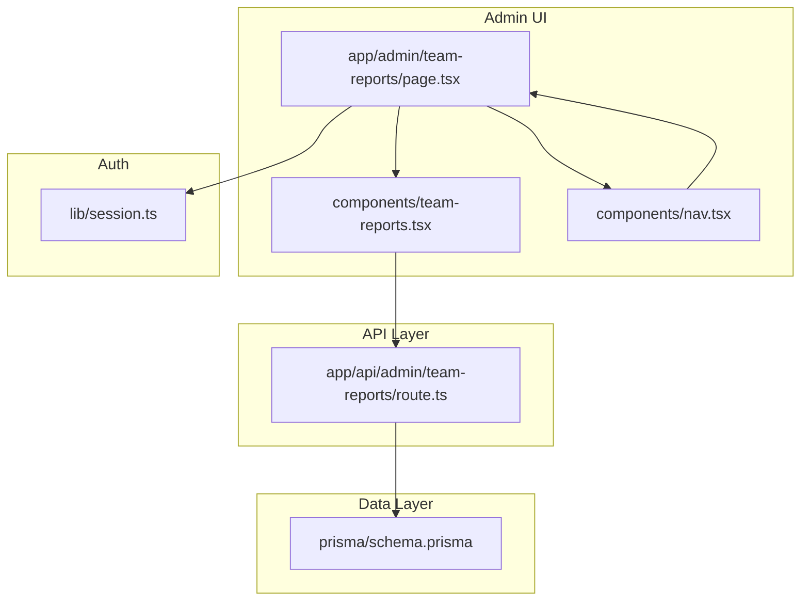
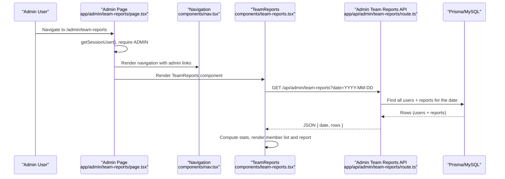
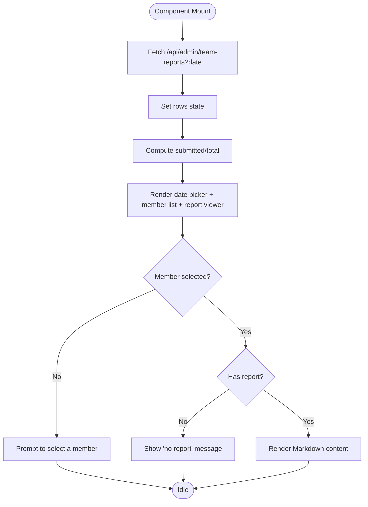
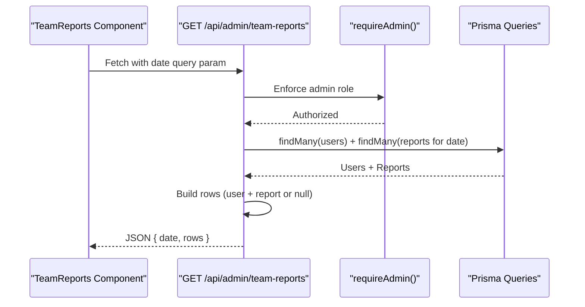
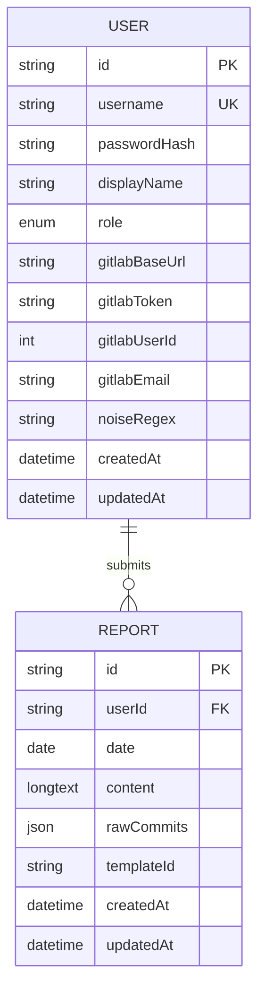
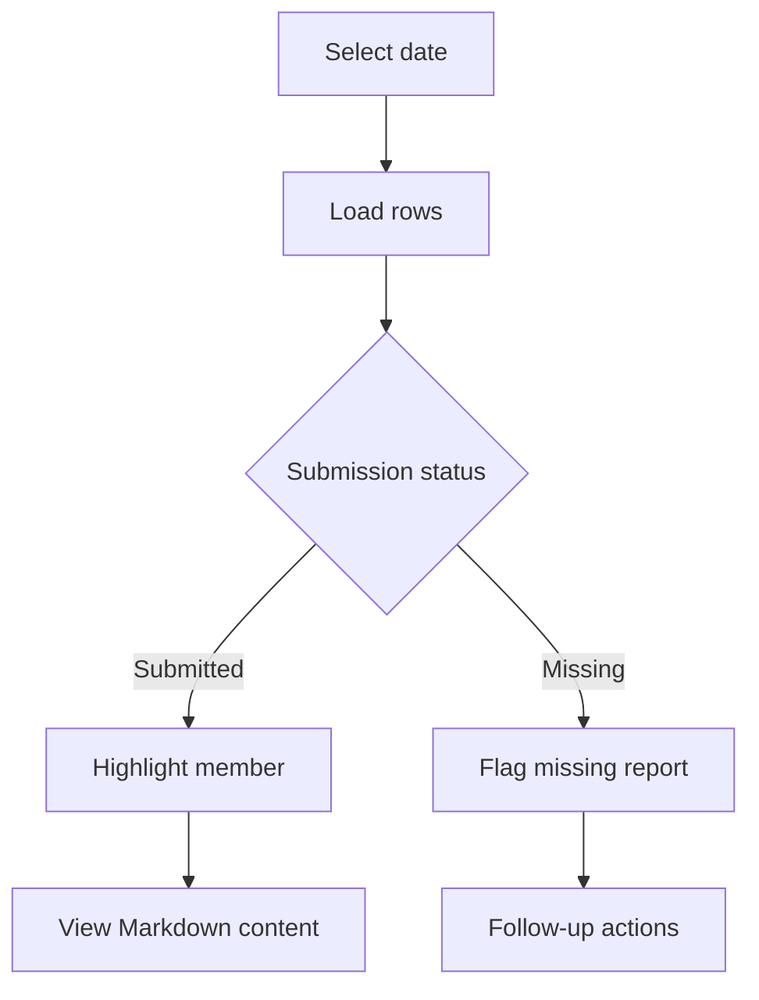
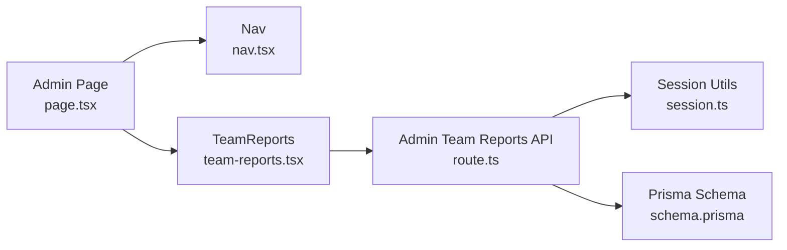

# Team Report Monitoring

<cite>
**Referenced Files in This Document**
- [app/admin/team-reports/page.tsx](file://app/admin/team-reports/page.tsx)
- [components/team-reports.tsx](file://components/team-reports.tsx)
- [app/api/admin/team-reports/route.ts](file://app/api/admin/team-reports/route.ts)
- [lib/session.ts](file://lib/session.ts)
- [components/nav.tsx](file://components/nav.tsx)
- [prisma/schema.prisma](file://prisma/schema.prisma)
- [README.md](file://README.md)
</cite>

## Table of Contents
1. [Introduction](#introduction)
2. [Project Structure](#project-structure)
3. [Core Components](#core-components)
4. [Architecture Overview](#architecture-overview)
5. [Detailed Component Analysis](#detailed-component-analysis)
6. [Dependency Analysis](#dependency-analysis)
7. [Performance Considerations](#performance-considerations)
8. [Troubleshooting Guide](#troubleshooting-guide)
9. [Conclusion](#conclusion)
10. [Appendices](#appendices)

## Introduction
This document describes the team report monitoring system that enables administrators to observe team-wide report activity across multiple users and dates. It focuses on the calendar-based navigation interface for selecting a target date, filtering and viewing team members, and aggregating report submissions. The system also supports administrative workflows for compliance oversight, identifying reporting gaps, and tracking individual contributor activity. Examples include reviewing weekly team progress, identifying inactive team members, and generating team performance reports. Performance considerations for large datasets and efficient data loading strategies are addressed.

## Project Structure
The team report monitoring feature spans a small set of coordinated files:
- A server-side admin page that enforces admin-only access and renders the monitoring UI.
- A client-side React component that implements the calendar-based navigation, member list, and report viewer.
- A server-side API endpoint that loads users and their reports for a given date.
- Shared session utilities that enforce authentication and roles.
- Navigation that exposes admin links for authorized users.
- Prisma schema that defines the data model for users and reports.
- Project README that documents the admin API surface and usage.

**Diagram sources**
- [app/admin/team-reports/page.tsx:1-22](file://app/admin/team-reports/page.tsx#L1-L22)
- [components/team-reports.tsx:1-114](file://components/team-reports.tsx#L1-L114)
- [components/nav.tsx:1-75](file://components/nav.tsx#L1-L75)
- [app/api/admin/team-reports/route.ts:1-34](file://app/api/admin/team-reports/route.ts#L1-L34)
- [prisma/schema.prisma:1-80](file://prisma/schema.prisma#L1-L80)
- [lib/session.ts:1-56](file://lib/session.ts#L1-L56)

**Section sources**
- [app/admin/team-reports/page.tsx:1-22](file://app/admin/team-reports/page.tsx#L1-L22)
- [components/team-reports.tsx:1-114](file://components/team-reports.tsx#L1-L114)
- [components/nav.tsx:1-75](file://components/nav.tsx#L1-L75)
- [app/api/admin/team-reports/route.ts:1-34](file://app/api/admin/team-reports/route.ts#L1-L34)
- [prisma/schema.prisma:1-80](file://prisma/schema.prisma#L1-L80)
- [lib/session.ts:1-56](file://lib/session.ts#L1-L56)
- [README.md:72-86](file://README.md#L72-L86)

## Core Components
- Admin Page: Enforces admin-only access and renders the TeamReports component. It also injects the navigation bar and sets up the page layout.
- TeamReports Component: Implements the calendar-based navigation, member list, and report viewer. It fetches data for a selected date, computes submission statistics, and displays report content in a Markdown editor.
- Admin Team Reports API: Loads all users ordered by role and username, finds reports for the selected date, and returns a joined array of users and their reports.
- Session Utilities: Provide helpers to retrieve the current user, require authentication, enforce admin role, and wrap route handlers to convert errors into HTTP responses.
- Navigation: Exposes admin links conditionally for ADMIN users, including the team reports dashboard.
- Prisma Schema: Defines the User and Report models, including unique constraints and indexes relevant to team monitoring.

Key responsibilities:
- Calendar-based navigation: Select a date and load the corresponding team report snapshot.
- Member filtering: Implicitly filters by displaying all users and allowing selection of individuals.
- Report aggregation: Computes submission counts and renders report content for the selected user.
- Administrative oversight: Provides a centralized view for compliance monitoring and gap identification.

**Section sources**
- [app/admin/team-reports/page.tsx:8-21](file://app/admin/team-reports/page.tsx#L8-L21)
- [components/team-reports.tsx:23-114](file://components/team-reports.tsx#L23-L114)
- [app/api/admin/team-reports/route.ts:6-33](file://app/api/admin/team-reports/route.ts#L6-L33)
- [lib/session.ts:12-37](file://lib/session.ts#L12-L37)
- [components/nav.tsx:38-59](file://components/nav.tsx#L38-L59)
- [prisma/schema.prisma:16-65](file://prisma/schema.prisma#L16-L65)

## Architecture Overview
The monitoring system follows a clear separation of concerns:
- UI rendering occurs on the client for interactivity (date picker, member list, report viewer).
- Data loading is performed server-side via a dedicated API endpoint to ensure admin-only access and accurate aggregation.
- Authentication and authorization are enforced at the page and API layers.

**Diagram sources**
- [app/admin/team-reports/page.tsx:8-21](file://app/admin/team-reports/page.tsx#L8-L21)
- [components/nav.tsx:38-59](file://components/nav.tsx#L38-L59)
- [components/team-reports.tsx:28-37](file://components/team-reports.tsx#L28-L37)
- [app/api/admin/team-reports/route.ts:6-33](file://app/api/admin/team-reports/route.ts#L6-L33)

## Detailed Component Analysis

### TeamReports Component Implementation
The TeamReports component orchestrates the calendar-based navigation and report aggregation:
- Date selection: A native date input controls the selected date. On change, it triggers a fetch to the admin API endpoint.
- Data loading: An asynchronous loader fetches rows for the selected date and resets the active member selection.
- Submission statistics: Computes submitted vs total counts from the loaded rows.
- Member list: Renders a scrollable list of team members with indicators for submission status and roles.
- Report viewer: Displays the Markdown content of the selected member’s report or appropriate messages when no report exists.

**Diagram sources**
- [components/team-reports.tsx:28-37](file://components/team-reports.tsx#L28-L37)
- [components/team-reports.tsx:39-41](file://components/team-reports.tsx#L39-L41)
- [components/team-reports.tsx:66-89](file://components/team-reports.tsx#L66-L89)
- [components/team-reports.tsx:94-108](file://components/team-reports.tsx#L94-L108)

**Section sources**
- [components/team-reports.tsx:23-114](file://components/team-reports.tsx#L23-L114)

### Admin Team Reports API
The API endpoint aggregates user and report data for a given date:
- Authentication: Requires admin role via a helper that throws forbidden responses when unauthorized.
- Input validation: Ensures the date parameter matches the expected format.
- Data retrieval: Loads all users ordered by role and username, then queries reports for the selected date.
- Aggregation: Builds a joined array pairing each user with their report (or null if missing).
- Response: Returns the date and rows for the client to render.

**Diagram sources**
- [app/api/admin/team-reports/route.ts:6-33](file://app/api/admin/team-reports/route.ts#L6-L33)
- [lib/session.ts:31-37](file://lib/session.ts#L31-L37)

**Section sources**
- [app/api/admin/team-reports/route.ts:6-33](file://app/api/admin/team-reports/route.ts#L6-L33)
- [lib/session.ts:31-37](file://lib/session.ts#L31-L37)

### Data Model for Team Monitoring
The Prisma schema defines the core entities used by the monitoring system:
- User: Includes identifiers, credentials, display metadata, role, and timestamps. Roles are used to sort and distinguish administrators.
- Report: Stores per-user, per-date report content and metadata, with a unique constraint on (userId, date) and an index on (userId, date) for efficient lookups.

**Diagram sources**
- [prisma/schema.prisma:16-65](file://prisma/schema.prisma#L16-L65)

**Section sources**
- [prisma/schema.prisma:16-65](file://prisma/schema.prisma#L16-L65)

### Administrative Oversight Workflows
Administrators can monitor team compliance and identify gaps:
- Compliance monitoring: Use the date picker to review who has submitted reports for a given day. The submission count helps assess adherence.
- Identifying gaps: Members without reports appear in the list with a non-submitted indicator. Administrators can drill down to view details or follow up.
- Tracking activity: Switch dates to observe trends over time. The list is sorted by role and username, aiding quick scanning.

**Diagram sources**
- [components/team-reports.tsx:39-41](file://components/team-reports.tsx#L39-L41)
- [components/team-reports.tsx:66-89](file://components/team-reports.tsx#L66-L89)
- [components/team-reports.tsx:94-108](file://components/team-reports.tsx#L94-L108)

**Section sources**
- [components/team-reports.tsx:39-108](file://components/team-reports.tsx#L39-L108)

### Common Monitoring Scenarios
- Reviewing weekly team progress: Select each weekday within a week and compare submission counts and report statuses to gauge consistency.
- Identifying inactive team members: Filter by missing reports across several days to pinpoint absent contributors.
- Generating team performance reports: Aggregate submission percentages and highlight trends by computing totals and submitted counts over multiple days.

Note: The current UI does not include built-in weekly or trend views. Administrators can manually iterate through dates or export data externally if needed.

**Section sources**
- [components/team-reports.tsx:24-41](file://components/team-reports.tsx#L24-L41)

## Dependency Analysis
The monitoring system exhibits low coupling and clear boundaries:
- The admin page depends on session utilities and navigation.
- The TeamReports component depends on the admin API endpoint and local state.
- The API endpoint depends on Prisma for database access and session utilities for authorization.
- Navigation conditionally exposes admin links based on user role.

**Diagram sources**
- [app/admin/team-reports/page.tsx:1-22](file://app/admin/team-reports/page.tsx#L1-L22)
- [components/nav.tsx:1-75](file://components/nav.tsx#L1-L75)
- [components/team-reports.tsx:1-114](file://components/team-reports.tsx#L1-L114)
- [app/api/admin/team-reports/route.ts:1-34](file://app/api/admin/team-reports/route.ts#L1-L34)
- [lib/session.ts:1-56](file://lib/session.ts#L1-L56)
- [prisma/schema.prisma:1-80](file://prisma/schema.prisma#L1-L80)

**Section sources**
- [app/admin/team-reports/page.tsx:1-22](file://app/admin/team-reports/page.tsx#L1-L22)
- [components/team-reports.tsx:1-114](file://components/team-reports.tsx#L1-L114)
- [app/api/admin/team-reports/route.ts:1-34](file://app/api/admin/team-reports/route.ts#L1-L34)
- [lib/session.ts:1-56](file://lib/session.ts#L1-L56)
- [components/nav.tsx:1-75](file://components/nav.tsx#L1-L75)
- [prisma/schema.prisma:1-80](file://prisma/schema.prisma#L1-L80)

## Performance Considerations
- Data volume: The API loads all users and all reports for a single date. For large teams, consider pagination or server-side filtering if needed.
- Index usage: The Report model has a unique index on (userId, date), supporting fast lookup by user and date. The API performs two queries (users and reports) and a small join in memory.
- Network efficiency: The component fetches data only on date change, minimizing unnecessary requests.
- Rendering: The UI renders a fixed-width member list and a Markdown viewer. For very large lists, virtualization could improve responsiveness.
- Caching: There is no explicit caching layer. For frequent admin checks, consider lightweight client-side caching with staleness policies.

Recommendations:
- Add server-side pagination for users if the team grows significantly.
- Consider precomputing daily submission summaries at the database level for faster dashboards.
- Introduce client-side caching keyed by date to reduce repeated network calls during admin sessions.

**Section sources**
- [app/api/admin/team-reports/route.ts:14-31](file://app/api/admin/team-reports/route.ts#L14-L31)
- [prisma/schema.prisma:63-64](file://prisma/schema.prisma#L63-L64)

## Troubleshooting Guide
Common issues and resolutions:
- Unauthorized access: If a non-admin visits the page, they are redirected. Verify the user role and session state.
- Invalid date format: The API validates the date parameter; ensure the date is formatted as YYYY-MM-DD.
- Empty rows: If no users or reports are found for the selected date, the UI shows zero submissions. Confirm user creation and report generation for that date.
- Network errors: Inspect the browser network tab for failed requests to the admin API endpoint.

Operational checks:
- Authentication: Confirm NextAuth is configured and the user session is present.
- Authorization: Ensure the user role is ADMIN when accessing admin routes.
- Database connectivity: Verify Prisma can connect to MySQL and that the schema is migrated.

**Section sources**
- [app/admin/team-reports/page.tsx:10-11](file://app/admin/team-reports/page.tsx#L10-L11)
- [app/api/admin/team-reports/route.ts:10-12](file://app/api/admin/team-reports/route.ts#L10-L12)
- [lib/session.ts:31-37](file://lib/session.ts#L31-L37)

## Conclusion
The team report monitoring system provides a focused, admin-driven interface for observing daily report submissions across team members. Its calendar-based navigation, combined with simple member filtering and report aggregation, supports effective oversight and compliance monitoring. While the current implementation emphasizes simplicity and clarity, future enhancements such as server-side pagination, caching, and trend views can further improve scalability and usability for larger teams.

## Appendices
- API Reference: The admin team reports endpoint is documented in the project README under the API surface section.

**Section sources**
- [README.md:72-86](file://README.md#L72-L86)