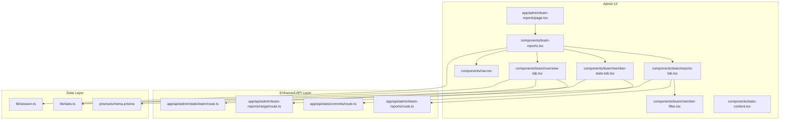
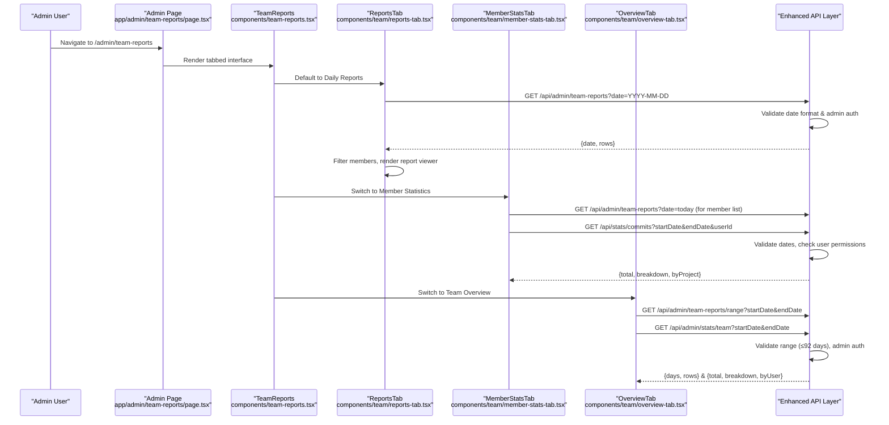
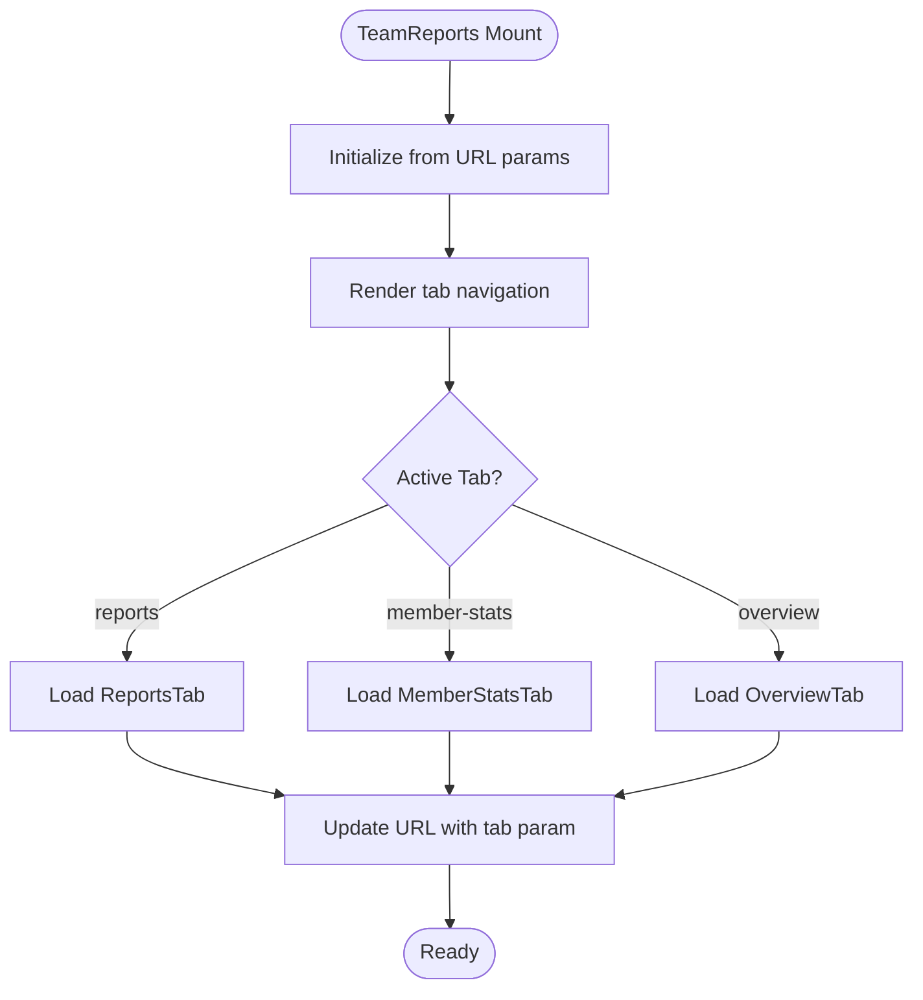
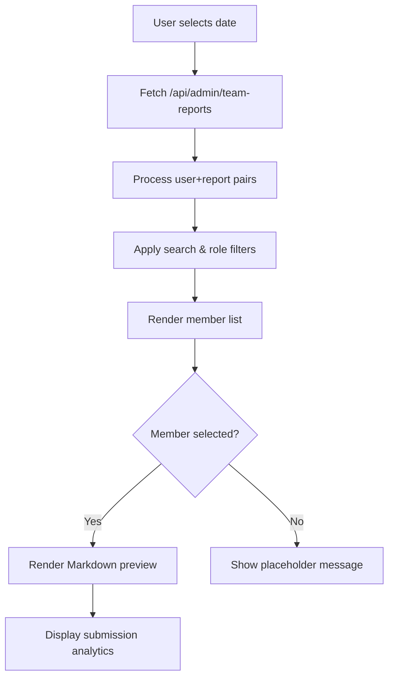
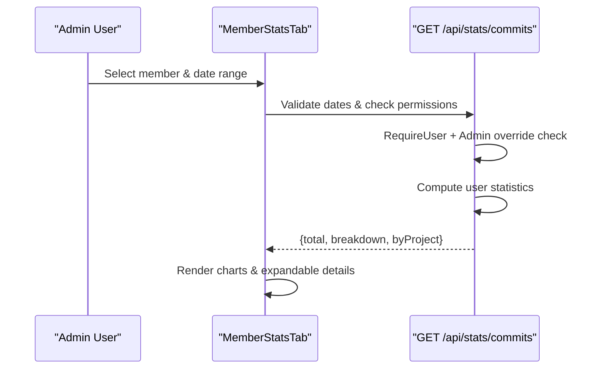
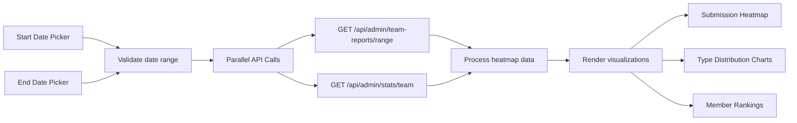
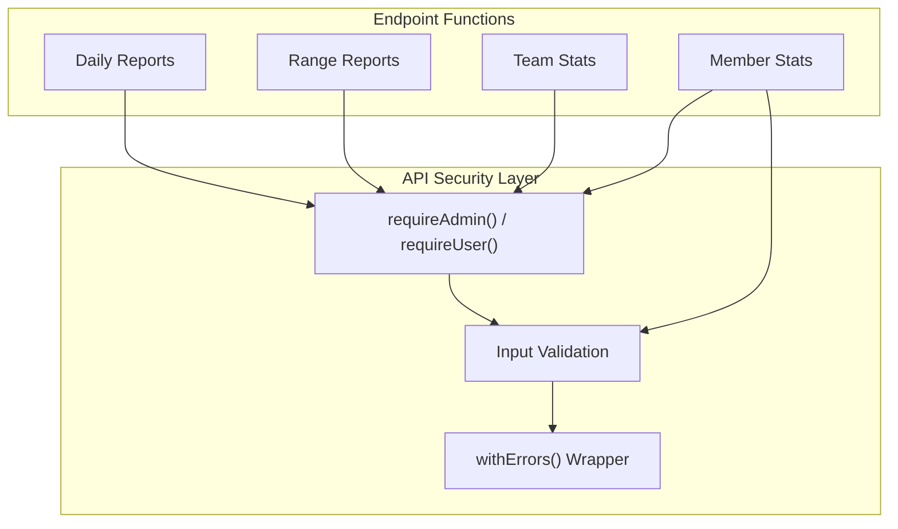
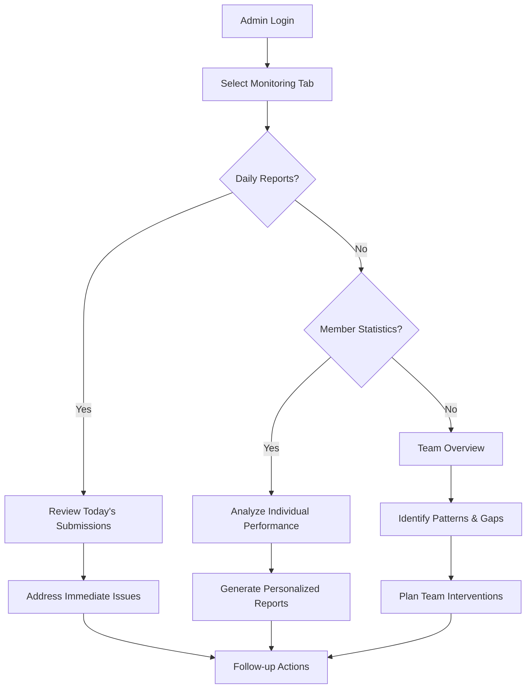

# Team Report Monitoring

<cite>
**Referenced Files in This Document**
- [app/admin/team-reports/page.tsx](file://app/admin/team-reports/page.tsx)
- [components/team-reports.tsx](file://components/team-reports.tsx)
- [components/team/reports-tab.tsx](file://components/team/reports-tab.tsx)
- [components/team/member-stats-tab.tsx](file://components/team/member-stats-tab.tsx)
- [components/team/overview-tab.tsx](file://components/team/overview-tab.tsx)
- [components/team/member-filter.tsx](file://components/team/member-filter.tsx)
- [components/stats-content.tsx](file://components/stats-content.tsx)
- [app/api/admin/team-reports/range/route.ts](file://app/api/admin/team-reports/range/route.ts)
- [app/api/admin/stats/team/route.ts](file://app/api/admin/stats/team/route.ts)
- [app/api/admin/team-reports/route.ts](file://app/api/admin/team-reports/route.ts)
- [app/api/stats/commits/route.ts](file://app/api/stats/commits/route.ts)
- [lib/stats.ts](file://lib/stats.ts)
- [lib/session.ts](file://lib/session.ts)
- [components/nav.tsx](file://components/nav.tsx)
- [prisma/schema.prisma](file://prisma/schema.prisma)
- [README.md](file://README.md)
</cite>

## Update Summary
**Changes Made**
- Updated to reflect the new tabbed navigation system replacing the single-page interface
- Added documentation for three new tab components: Daily Reports, Member Statistics, and Team Overview
- Enhanced API documentation with improved security validation and new endpoints
- Updated component architecture to show tab-based modular design
- Added comprehensive coverage of new data visualization features

## Table of Contents
1. [Introduction](#introduction)
2. [Project Structure](#project-structure)
3. [Core Components](#core-components)
4. [Architecture Overview](#architecture-overview)
5. [Detailed Component Analysis](#detailed-component-analysis)
6. [Enhanced API Endpoints](#enhanced-api-endpoints)
7. [Data Visualization Features](#data-visualization-features)
8. [Administrative Oversight Workflows](#administrative-oversight-workflows)
9. [Performance Considerations](#performance-considerations)
10. [Troubleshooting Guide](#troubleshooting-guide)
11. [Conclusion](#conclusion)
12. [Appendices](#appendices)

## Introduction
This document describes the enhanced team report monitoring system that enables administrators to observe team-wide report activity across multiple users and dates through a modern tabbed navigation interface. The system now features three distinct sections: Daily Reports for real-time report viewing, Member Statistics for individual contributor analytics, and Team Overview for comprehensive productivity insights. The interface supports calendar-based navigation, advanced member filtering, and sophisticated data visualization including heatmaps and statistical breakdowns. Administrative workflows for compliance oversight, identifying reporting gaps, and tracking individual contributor activity are streamlined through this modular approach.

## Project Structure
The team report monitoring feature has evolved into a comprehensive tabbed interface spanning multiple coordinated files:
- A server-side admin page that enforces admin-only access and renders the tabbed monitoring UI
- A central TeamReports component that manages tab navigation and state
- Three specialized tab components: ReportsTab for daily report viewing, MemberStatsTab for individual analytics, and OverviewTab for team-wide insights
- Enhanced API endpoints with improved security validation and data aggregation
- Advanced filtering components and data visualization utilities
- Shared session utilities with enhanced authentication enforcement
- Navigation that exposes admin links for authorized users
- Prisma schema supporting the expanded data model

**Diagram sources**
- [app/admin/team-reports/page.tsx:1-22](file://app/admin/team-reports/page.tsx#L1-L22)
- [components/team-reports.tsx:1-70](file://components/team-reports.tsx#L1-L70)
- [components/team/reports-tab.tsx:1-183](file://components/team/reports-tab.tsx#L1-L183)
- [components/team/member-stats-tab.tsx:1-241](file://components/team/member-stats-tab.tsx#L1-L241)
- [components/team/overview-tab.tsx:1-310](file://components/team/overview-tab.tsx#L1-L310)
- [components/team/member-filter.tsx:1-60](file://components/team/member-filter.tsx#L1-L60)
- [components/stats-content.tsx:1-225](file://components/stats-content.tsx#L1-L225)
- [app/api/admin/team-reports/range/route.ts:1-70](file://app/api/admin/team-reports/range/route.ts#L1-L70)
- [app/api/admin/stats/team/route.ts:1-76](file://app/api/admin/stats/team/route.ts#L1-L76)
- [app/api/admin/team-reports/route.ts:1-35](file://app/api/admin/team-reports/route.ts#L1-L35)
- [app/api/stats/commits/route.ts:1-54](file://app/api/stats/commits/route.ts#L1-L54)
- [lib/stats.ts:1-144](file://lib/stats.ts#L1-L144)
- [lib/session.ts:1-56](file://lib/session.ts#L1-L56)
- [components/nav.tsx:1-75](file://components/nav.tsx#L1-L75)
- [prisma/schema.prisma:1-80](file://prisma/schema.prisma#L1-L80)

**Section sources**
- [app/admin/team-reports/page.tsx:1-22](file://app/admin/team-reports/page.tsx#L1-L22)
- [components/team-reports.tsx:1-70](file://components/team-reports.tsx#L1-L70)
- [components/team/reports-tab.tsx:1-183](file://components/team/reports-tab.tsx#L1-L183)
- [components/team/member-stats-tab.tsx:1-241](file://components/team/member-stats-tab.tsx#L1-L241)
- [components/team/overview-tab.tsx:1-310](file://components/team/overview-tab.tsx#L1-L310)
- [components/team/member-filter.tsx:1-60](file://components/team/member-filter.tsx#L1-L60)
- [components/stats-content.tsx:1-225](file://components/stats-content.tsx#L1-L225)
- [app/api/admin/team-reports/range/route.ts:1-70](file://app/api/admin/team-reports/range/route.ts#L1-L70)
- [app/api/admin/stats/team/route.ts:1-76](file://app/api/admin/stats/team/route.ts#L1-L76)
- [app/api/admin/team-reports/route.ts:1-35](file://app/api/admin/team-reports/route.ts#L1-L35)
- [app/api/stats/commits/route.ts:1-54](file://app/api/stats/commits/route.ts#L1-L54)
- [lib/stats.ts:1-144](file://lib/stats.ts#L1-L144)
- [lib/session.ts:1-56](file://lib/session.ts#L1-L56)
- [components/nav.tsx:1-75](file://components/nav.tsx#L1-L75)
- [prisma/schema.prisma:1-80](file://prisma/schema.prisma#L1-L80)
- [README.md:72-86](file://README.md#L72-L86)

## Core Components
The system now operates through a modular tab-based architecture:

### Central Navigation Component
- **TeamReports**: Manages tab state, URL synchronization, and renders the appropriate tab component based on user selection
- **Tab Management**: Supports three tabs: "reports" (日报), "member-stats" (成员统计), and "overview" (团队总览)
- **URL State**: Persists tab selection in URL parameters for deep linking and bookmarking

### Daily Reports Tab
- **Calendar Navigation**: Native date picker for selecting report viewing dates
- **Member Filtering**: Real-time search and role-based filtering of team members
- **Report Viewer**: Dynamic Markdown rendering with theme-aware preview
- **Submission Tracking**: Visual indicators for report submission status

### Member Statistics Tab
- **Individual Analytics**: Detailed GitLab commit statistics for selected team members
- **Time Range Selection**: Configurable date ranges for historical analysis
- **Visual Breakdown**: Comprehensive type distribution charts and project-wise analysis
- **Admin Override**: Enhanced security allowing administrators to view other users' statistics

### Team Overview Tab
- **Heatmap Visualization**: Color-coded daily submission tracking across team members
- **Aggregate Statistics**: Team-wide type distribution and member ranking
- **Multi-day Analysis**: Support for extended date ranges with validation limits
- **Performance Metrics**: Submission rates and productivity trends

**Section sources**
- [components/team-reports.tsx:23-70](file://components/team-reports.tsx#L23-L70)
- [components/team/reports-tab.tsx:37-183](file://components/team/reports-tab.tsx#L37-L183)
- [components/team/member-stats-tab.tsx:29-241](file://components/team/member-stats-tab.tsx#L29-L241)
- [components/team/overview-tab.tsx:44-310](file://components/team/overview-tab.tsx#L44-L310)

## Architecture Overview
The enhanced monitoring system maintains clear separation of concerns while adding sophisticated data visualization capabilities:

**Diagram sources**
- [app/admin/team-reports/page.tsx:8-21](file://app/admin/team-reports/page.tsx#L8-L21)
- [components/team-reports.tsx:23-70](file://components/team-reports.tsx#L23-L70)
- [components/team/reports-tab.tsx:54-78](file://components/team/reports-tab.tsx#L54-L78)
- [components/team/member-stats-tab.tsx:52-77](file://components/team/member-stats-tab.tsx#L52-L77)
- [components/team/overview-tab.tsx:51-80](file://components/team/overview-tab.tsx#L51-L80)
- [app/api/admin/team-reports/range/route.ts:10-33](file://app/api/admin/team-reports/range/route.ts#L10-L33)
- [app/api/admin/stats/team/route.ts:13-24](file://app/api/admin/stats/team/route.ts#L13-L24)
- [app/api/admin/team-reports/route.ts:7-14](file://app/api/admin/team-reports/route.ts#L7-L14)
- [app/api/stats/commits/route.ts:16-29](file://app/api/stats/commits/route.ts#L16-L29)

## Detailed Component Analysis

### TeamReports Component - Tab Management System
The central component orchestrates the tabbed interface with sophisticated state management:

- **Tab State Management**: Uses URL parameters to persist tab selection across page reloads
- **Dynamic Imports**: Optimizes bundle size by lazy-loading heavy components like Markdown editor
- **Theme Integration**: Seamlessly integrates with Next.js theme system for consistent appearance
- **Responsive Design**: Adapts tab layout for different screen sizes

**Diagram sources**
- [components/team-reports.tsx:16-38](file://components/team-reports.tsx#L16-L38)
- [components/team-reports.tsx:40-68](file://components/team-reports.tsx#L40-L68)

**Section sources**
- [components/team-reports.tsx:23-70](file://components/team-reports.tsx#L23-L70)

### ReportsTab Component - Daily Report Interface
The primary interface for viewing and managing daily team reports:

- **Date Management**: Native date picker with automatic loading on date change
- **Member List**: Scrollable sidebar with real-time filtering and role indicators
- **Report Preview**: Dynamic Markdown rendering with theme-aware color modes
- **Loading States**: Comprehensive loading indicators and error handling
- **Submission Analytics**: Real-time calculation of submission rates and totals

**Diagram sources**
- [components/team/reports-tab.tsx:37-78](file://components/team/reports-tab.tsx#L37-L78)
- [components/team/reports-tab.tsx:80-159](file://components/team/reports-tab.tsx#L80-L159)
- [components/team/reports-tab.tsx:162-178](file://components/team/reports-tab.tsx#L162-L178)

**Section sources**
- [components/team/reports-tab.tsx:37-183](file://components/team/reports-tab.tsx#L37-L183)

### MemberStatsTab Component - Individual Contributor Analytics
Advanced analytics for individual team member GitLab commit statistics:

- **Member Discovery**: Dynamically loads team members using the existing reports endpoint
- **Date Range Analysis**: Configurable start/end dates with validation
- **Comprehensive Breakdown**: Type distribution charts and per-project analysis
- **Admin Override Security**: Enhanced permission system allowing admin access to other users
- **Visual Complexity**: Multi-level expandable interfaces for detailed commit analysis

**Diagram sources**
- [components/team/member-stats-tab.tsx:29-86](file://components/team/member-stats-tab.tsx#L29-L86)
- [components/team/member-stats-tab.tsx:52-77](file://components/team/member-stats-tab.tsx#L52-L77)
- [app/api/stats/commits/route.ts:16-29](file://app/api/stats/commits/route.ts#L16-L29)

**Section sources**
- [components/team/member-stats-tab.tsx:29-241](file://components/team/member-stats-tab.tsx#L29-L241)

### OverviewTab Component - Team-wide Insights
Comprehensive team analytics with advanced visualization:

- **Heatmap Generation**: Color-coded daily submission tracking across all team members
- **Aggregate Statistics**: Team-wide type distribution with detailed breakdown
- **Member Ranking**: Sortable leaderboard showing contribution metrics
- **Range Validation**: Maximum 92-day range enforcement with user feedback
- **Dual Visualization**: Side-by-side heatmaps and statistical tables

**Diagram sources**
- [components/team/overview-tab.tsx:44-80](file://components/team/overview-tab.tsx#L44-L80)
- [components/team/overview-tab.tsx:61-76](file://components/team/overview-tab.tsx#L61-L76)
- [app/api/admin/team-reports/range/route.ts:10-33](file://app/api/admin/team-reports/range/route.ts#L10-L33)
- [app/api/admin/stats/team/route.ts:13-24](file://app/api/admin/stats/team/route.ts#L13-L24)

**Section sources**
- [components/team/overview-tab.tsx:44-310](file://components/team/overview-tab.tsx#L44-L310)

### MemberFilter Component - Advanced Filtering System
Sophisticated filtering for team member management:

- **Search Functionality**: Real-time filtering by display name or username
- **Role-based Filtering**: Toggle between ALL, MEMBER, and ADMIN users
- **Reusable Logic**: Shared filtering logic across all tab components
- **State Management**: Centralized filter state with callback-based updates

**Section sources**
- [components/team/member-filter.tsx:6-60](file://components/team/member-filter.tsx#L6-L60)

## Enhanced API Endpoints
The system now features four specialized API endpoints with robust security and validation:

### Daily Reports Endpoint
- **Route**: `GET /api/admin/team-reports`
- **Security**: Admin-only access with date validation
- **Functionality**: Returns user-report pairs for a specific date
- **Response**: `{ date: string, rows: Array<{user, report|null}> }`

### Team Reports Range Endpoint
- **Route**: `GET /api/admin/team-reports/range`
- **Security**: Admin-only access with range validation
- **Validation**: Maximum 92-day range limit, proper date format checking
- **Functionality**: Returns submission heatmap data for date ranges
- **Response**: `{ days: string[], rows: Array<{user, submitted: string[]}> }`

### Team Statistics Endpoint
- **Route**: `GET /api/admin/stats/team`
- **Security**: Admin-only access with comprehensive user data
- **Functionality**: Aggregates commit statistics across all team members
- **Response**: `{ total: number, breakdown: Record, byUser: Array }`

### Member Commit Statistics Endpoint
- **Route**: `GET /api/stats/commits`
- **Security**: User-level access with admin override capability
- **Validation**: Zod schema validation for query parameters
- **Functionality**: Computes detailed GitLab commit statistics for users
- **Response**: `{ total: number, breakdown: Record, byProject: Array }`

**Diagram sources**
- [app/api/admin/team-reports/route.ts:7-14](file://app/api/admin/team-reports/route.ts#L7-L14)
- [app/api/admin/team-reports/range/route.ts:10-33](file://app/api/admin/team-reports/range/route.ts#L10-L33)
- [app/api/admin/stats/team/route.ts:13-24](file://app/api/admin/stats/team/route.ts#L13-L24)
- [app/api/stats/commits/route.ts:16-23](file://app/api/stats/commits/route.ts#L16-L23)

**Section sources**
- [app/api/admin/team-reports/range/route.ts:1-70](file://app/api/admin/team-reports/range/route.ts#L1-L70)
- [app/api/admin/stats/team/route.ts:1-76](file://app/api/admin/stats/team/route.ts#L1-L76)
- [app/api/admin/team-reports/route.ts:1-35](file://app/api/admin/team-reports/route.ts#L1-L35)
- [app/api/stats/commits/route.ts:1-54](file://app/api/stats/commits/route.ts#L1-L54)

## Data Visualization Features
The system provides comprehensive data visualization across all three tabs:

### Heatmap Visualization
- **Submission Tracking**: Color-coded daily submission status for all team members
- **Interactive Elements**: Hover tooltips showing submission details
- **Performance Optimization**: Efficient rendering for large team sizes
- **Accessibility**: Clear visual indicators for submission status

### Statistical Charts
- **Type Distribution**: Bar charts showing breakdown of commit types
- **Percentage Visualization**: Progress bars with percentage labels
- **Color Coding**: Consistent color schemes for different commit categories
- **Responsive Design**: Adapts to different screen sizes and orientations

### Member Analytics Dashboard
- **Summary Cards**: Key metrics with color-coded values
- **Ranking Tables**: Sortable member performance rankings
- **Project Breakdown**: Detailed analysis of contributions by project
- **Expandable Details**: Hierarchical disclosure of commit details

**Section sources**
- [components/team/overview-tab.ts:245-310](file://components/team/overview-tab.tsx#L245-L310)
- [components/stats-content.tsx:56-225](file://components/stats-content.tsx#L56-L225)
- [components/team/member-stats-tab.tsx:190-221](file://components/team/member-stats-tab.tsx#L190-L221)

## Administrative Oversight Workflows
The enhanced tabbed interface streamlines administrative workflows:

### Daily Monitoring
- **Real-time View**: Switch to Daily Reports tab for immediate team status
- **Quick Filtering**: Use member filters to focus on specific team segments
- **Immediate Action**: Click on unsubmitted reports for quick follow-up

### Individual Performance Tracking
- **Member Statistics**: Navigate to Member Statistics tab for detailed analytics
- **Historical Analysis**: Configure date ranges for trend analysis
- **Admin Override**: Access other team members' statistics with proper authorization

### Team-wide Analytics
- **Overview Analysis**: Use Team Overview tab for comprehensive insights
- **Heatmap Review**: Quickly identify reporting gaps across the team
- **Performance Benchmarking**: Compare individual performance against team averages

**Diagram sources**
- [components/team-reports.tsx:44-66](file://components/team-reports.tsx#L44-L66)
- [components/team/reports-tab.tsx:104-108](file://components/team/reports-tab.tsx#L104-L108)
- [components/team/member-stats-tab.tsx:167-173](file://components/team/member-stats-tab.tsx#L167-L173)
- [components/team/overview-tab.tsx:107-113](file://components/team/overview-tab.tsx#L107-L113)

**Section sources**
- [components/team-reports.tsx:40-68](file://components/team-reports.tsx#L40-L68)
- [components/team/reports-tab.tsx:104-108](file://components/team/reports-tab.tsx#L104-L108)
- [components/team/member-stats-tab.tsx:167-173](file://components/team/member-stats-tab.tsx#L167-L173)
- [components/team/overview-tab.tsx:107-113](file://components/team/overview-tab.tsx#L107-L113)

## Performance Considerations
The enhanced system addresses performance through multiple optimization strategies:

### API-Level Optimizations
- **Range Limits**: Maximum 92-day range enforcement prevents excessive data loads
- **Parallel Processing**: Concurrent API calls for team overview data
- **Efficient Queries**: Optimized database queries with proper indexing
- **Input Validation**: Early validation reduces unnecessary processing

### Client-Side Optimizations
- **Lazy Loading**: Dynamic imports for heavy components like Markdown editor
- **State Management**: Efficient state updates with minimal re-renders
- **Virtualization**: Potential for list virtualization in large datasets
- **Caching Strategy**: URL-based tab persistence reduces redundant loads

### Data Processing Optimizations
- **Server-Side Aggregation**: Pre-computed statistics reduce client processing
- **Efficient Filtering**: Client-side filtering optimized for large member lists
- **Memory Management**: Proper cleanup of event listeners and timers
- **Network Efficiency**: Batched requests and reduced API calls

**Section sources**
- [app/api/admin/team-reports/range/route.ts:27-33](file://app/api/admin/team-reports/range/route.ts#L27-L33)
- [components/team/overview-tab.tsx:61-64](file://components/team/overview-tab.tsx#L61-L64)
- [components/team/reports-tab.tsx:15-21](file://components/team/reports-tab.tsx#L15-L21)

## Troubleshooting Guide
Enhanced troubleshooting for the new tabbed interface:

### Tab Navigation Issues
- **Tab State Persistence**: If tabs don't persist, check URL parameter handling
- **Tab Switching Errors**: Verify tab key validation and state updates
- **Initial Load Problems**: Ensure URL parsing works correctly on client mount

### API Connectivity Issues
- **Authentication Failures**: Verify admin role and session validation
- **Date Validation Errors**: Check date format requirements (YYYY-MM-DD)
- **Range Limit Exceeded**: Confirm 92-day maximum limit enforcement
- **Permission Denied**: Verify admin override for member statistics

### Data Display Issues
- **Empty Member Lists**: Check team reports endpoint for user data
- **Missing Statistics**: Verify GitLab configuration for member statistics
- **Heatmap Rendering**: Ensure proper data structure for heatmap visualization
- **Chart Display**: Check type distribution data formatting

### Performance Issues
- **Slow Tab Switching**: Monitor API response times and client-side processing
- **Large Dataset Handling**: Consider pagination for extensive member lists
- **Memory Leaks**: Verify proper cleanup of event listeners and timers

**Section sources**
- [components/team-reports.tsx:16-21](file://components/team-reports.tsx#L16-L21)
- [app/api/admin/team-reports/range/route.ts:15-33](file://app/api/admin/team-reports/range/route.ts#L15-L33)
- [app/api/stats/commits/route.ts:25-29](file://app/api/stats/commits/route.ts#L25-L29)

## Conclusion
The enhanced team report monitoring system represents a significant evolution from the single-page interface to a comprehensive tabbed navigation system. The new architecture provides three distinct perspectives: daily report monitoring, individual contributor analytics, and team-wide insights. Enhanced security measures, improved data validation, and sophisticated visualization capabilities make this system suitable for large teams and complex administrative workflows. The modular component design ensures maintainability while the performance optimizations support scalability for growing organizations.

## Appendices
- API Reference: Enhanced API endpoints with comprehensive security validation and data aggregation capabilities
- Security Model: Multi-layered authentication and authorization system supporting both user-level and admin-level access
- Data Models: Expanded schema supporting team analytics, member statistics, and comprehensive reporting

**Section sources**
- [README.md:72-86](file://README.md#L72-L86)
- [lib/session.ts:31-37](file://lib/session.ts#L31-L37)
- [lib/stats.ts:69-144](file://lib/stats.ts#L69-L144)