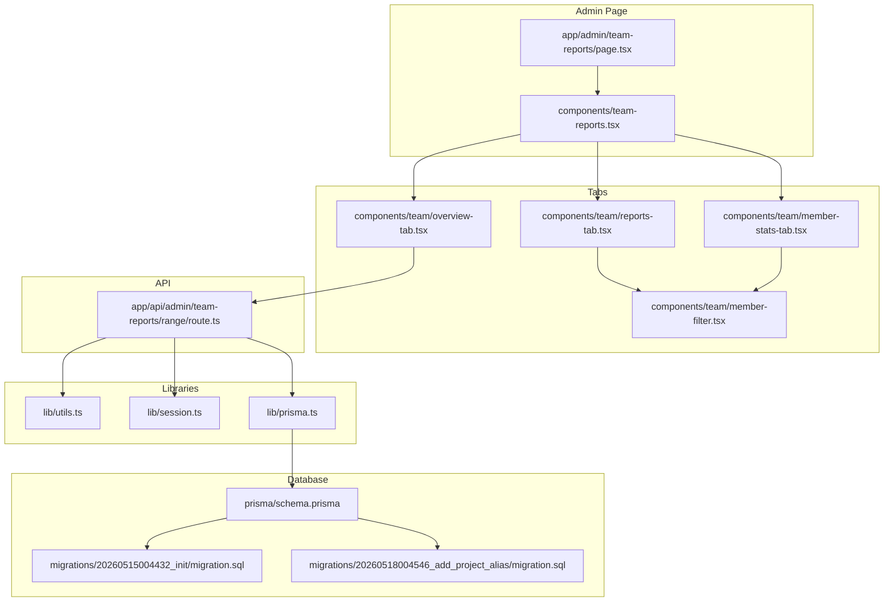
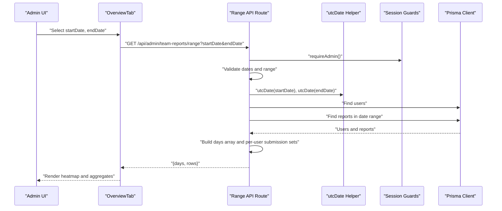
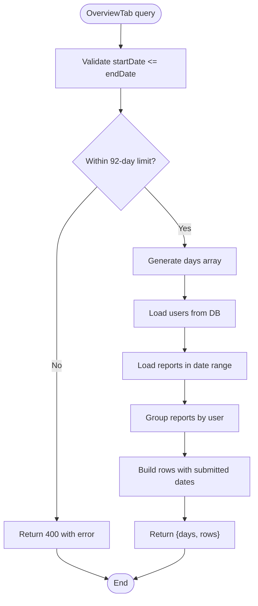
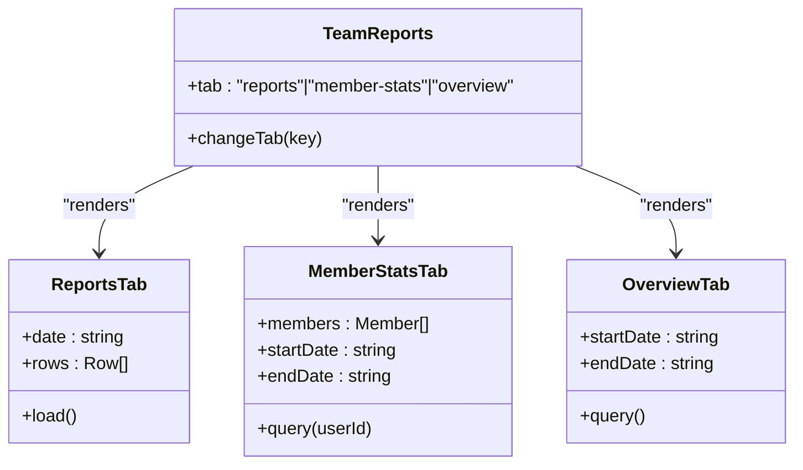
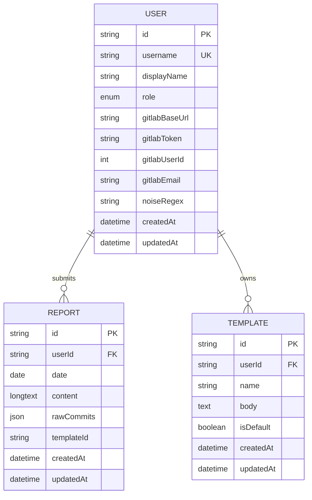
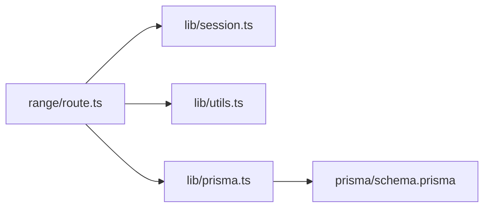

# Team Reports Range

<cite>
**Referenced Files in This Document**
- [README.md](file://README.md)
- [app/admin/team-reports/page.tsx](file://app/admin/team-reports/page.tsx)
- [components/team-reports.tsx](file://components/team-reports.tsx)
- [components/team/reports-tab.tsx](file://components/team/reports-tab.tsx)
- [components/team/member-stats-tab.tsx](file://components/team/member-stats-tab.tsx)
- [components/team/overview-tab.tsx](file://components/team/overview-tab.tsx)
- [components/team/member-filter.tsx](file://components/team/member-filter.tsx)
- [app/api/admin/team-reports/range/route.ts](file://app/api/admin/team-reports/range/route.ts)
- [lib/utils.ts](file://lib/utils.ts)
- [lib/session.ts](file://lib/session.ts)
- [lib/prisma.ts](file://lib/prisma.ts)
- [prisma/schema.prisma](file://prisma/schema.prisma)
- [prisma/migrations/20260515004432_init/migration.sql](file://prisma/migrations/20260515004432_init/migration.sql)
- [prisma/migrations/20260518004546_add_project_alias/migration.sql](file://prisma/migrations/20260518004546_add_project_alias/migration.sql)
</cite>

## Table of Contents
1. [Introduction](#introduction)
2. [Project Structure](#project-structure)
3. [Core Components](#core-components)
4. [Architecture Overview](#architecture-overview)
5. [Detailed Component Analysis](#detailed-component-analysis)
6. [Dependency Analysis](#dependency-analysis)
7. [Performance Considerations](#performance-considerations)
8. [Troubleshooting Guide](#troubleshooting-guide)
9. [Conclusion](#conclusion)

## Introduction
This document explains the Team Reports Range feature, which enables administrators to view team-wide daily report submission status across a configurable date range. It covers the frontend UI components, backend API endpoints, data models, and operational constraints such as maximum range limits and timezone handling.

The feature consists of:
- An admin-only page that renders three tabs: Daily Reports, Member Statistics, and Team Overview
- A dedicated API endpoint for fetching team report submissions across a date range
- A team overview heatmap visualization and aggregated statistics

## Project Structure
The Team Reports Range feature spans UI components under the team namespace and a backend API route for range queries.

**Diagram sources**
- [app/admin/team-reports/page.tsx:1-22](file://app/admin/team-reports/page.tsx#L1-L22)
- [components/team-reports.tsx:1-70](file://components/team-reports.tsx#L1-L70)
- [components/team/reports-tab.tsx:1-183](file://components/team/reports-tab.tsx#L1-L183)
- [components/team/member-stats-tab.tsx:1-241](file://components/team/member-stats-tab.tsx#L1-L241)
- [components/team/overview-tab.tsx:1-310](file://components/team/overview-tab.tsx#L1-L310)
- [components/team/member-filter.tsx:1-60](file://components/team/member-filter.tsx#L1-L60)
- [app/api/admin/team-reports/range/route.ts:1-70](file://app/api/admin/team-reports/range/route.ts#L1-L70)
- [lib/utils.ts:1-16](file://lib/utils.ts#L1-L16)
- [lib/session.ts:1-56](file://lib/session.ts#L1-L56)
- [lib/prisma.ts:1-14](file://lib/prisma.ts#L1-L14)
- [prisma/schema.prisma:1-81](file://prisma/schema.prisma#L1-L81)
- [prisma/migrations/20260515004432_init/migration.sql:1-74](file://prisma/migrations/20260515004432_init/migration.sql#L1-L74)
- [prisma/migrations/20260518004546_add_project_alias/migration.sql:1-3](file://prisma/migrations/20260518004546_add_project_alias/migration.sql#L1-L3)

**Section sources**
- [README.md:41-86](file://README.md#L41-L86)
- [app/admin/team-reports/page.tsx:1-22](file://app/admin/team-reports/page.tsx#L1-L22)
- [components/team-reports.tsx:1-70](file://components/team-reports.tsx#L1-L70)

## Core Components
- Admin page: Enforces admin-only access and renders the Team Reports container component.
- Team Reports container: Manages tab navigation and persists the selected tab in the URL.
- Overview tab: Allows selecting a date range, queries both the range endpoint and team statistics, and displays a heatmap and aggregate statistics.
- Range API endpoint: Validates dates, enforces a maximum range, computes the date sequence, loads users, and aggregates report submissions per user.

Key constraints and behaviors:
- Maximum range: 92 days per request.
- Date validation: ISO date strings (YYYY-MM-DD).
- Timezone handling: Uses UTC midnight normalization for consistent date comparisons.

**Section sources**
- [app/admin/team-reports/page.tsx:8-21](file://app/admin/team-reports/page.tsx#L8-L21)
- [components/team-reports.tsx:23-69](file://components/team-reports.tsx#L23-L69)
- [components/team/overview-tab.tsx:44-80](file://components/team/overview-tab.tsx#L44-L80)
- [app/api/admin/team-reports/range/route.ts:10-69](file://app/api/admin/team-reports/range/route.ts#L10-L69)
- [lib/utils.ts:13-15](file://lib/utils.ts#L13-L15)

## Architecture Overview
The Team Reports Range feature follows a client-server pattern:
- The client-side React components manage UI state and user interactions.
- The Next.js route handler performs server-side validation, database queries, and returns structured JSON.
- Data is persisted in MySQL via Prisma ORM.

**Diagram sources**
- [components/team/overview-tab.tsx:51-80](file://components/team/overview-tab.tsx#L51-L80)
- [app/api/admin/team-reports/range/route.ts:10-69](file://app/api/admin/team-reports/range/route.ts#L10-L69)
- [lib/utils.ts:13-15](file://lib/utils.ts#L13-L15)
- [lib/session.ts:31-37](file://lib/session.ts#L31-L37)
- [lib/prisma.ts:7-14](file://lib/prisma.ts#L7-L14)

## Detailed Component Analysis

### Overview Tab and Range API
The Overview tab orchestrates range-based queries and visualization:
- Computes a Monday-based default start date for convenience.
- Validates date order and range size.
- Fetches two datasets concurrently: submission heatmap and team statistics.
- Renders a heatmap table and aggregate statistics.

The range API endpoint enforces:
- ISO date format validation.
- Non-decreasing date constraint.
- A maximum 92-day window.
- UTC midnight normalization for date boundaries.
- Aggregation of report submissions per user into a compact structure.

**Diagram sources**
- [components/team/overview-tab.tsx:51-80](file://components/team/overview-tab.tsx#L51-L80)
- [app/api/admin/team-reports/range/route.ts:15-69](file://app/api/admin/team-reports/range/route.ts#L15-L69)
- [lib/utils.ts:13-15](file://lib/utils.ts#L13-L15)

**Section sources**
- [components/team/overview-tab.tsx:44-80](file://components/team/overview-tab.tsx#L44-L80)
- [app/api/admin/team-reports/range/route.ts:10-69](file://app/api/admin/team-reports/range/route.ts#L10-L69)
- [lib/utils.ts:13-15](file://lib/utils.ts#L13-L15)

### Team Reports Container and Tabs
The Team Reports container manages tab state and URL synchronization:
- Provides three tabs: Daily Reports, Member Statistics, and Team Overview.
- Hydrates tab selection from URL on mount to prevent SSR mismatches.
- Updates URL query parameters when switching tabs.

Reports tab:
- Loads daily report data for a single date.
- Filters members by search and role.
- Displays Markdown preview of selected report.

Member Statistics tab:
- Loads team members for the current date.
- Queries commit statistics for a selected user and date range.
- Shows summary cards and detailed commit breakdown.

**Diagram sources**
- [components/team-reports.tsx:23-69](file://components/team-reports.tsx#L23-L69)
- [components/team/reports-tab.tsx:37-78](file://components/team/reports-tab.tsx#L37-L78)
- [components/team/member-stats-tab.tsx:29-77](file://components/team/member-stats-tab.tsx#L29-L77)
- [components/team/overview-tab.tsx:44-80](file://components/team/overview-tab.tsx#L44-L80)

**Section sources**
- [components/team-reports.tsx:16-38](file://components/team-reports.tsx#L16-L38)
- [components/team/reports-tab.tsx:37-78](file://components/team/reports-tab.tsx#L37-L78)
- [components/team/member-stats-tab.tsx:29-77](file://components/team/member-stats-tab.tsx#L29-L77)

### Data Model and Database Schema
The feature relies on the Report model to track daily submissions and the User model for membership. The schema supports:
- Unique composite index on (userId, date) for efficient lookups.
- Foreign keys ensuring cascading deletes.
- Optional template association for report generation.

**Diagram sources**
- [prisma/schema.prisma:16-66](file://prisma/schema.prisma#L16-L66)
- [prisma/migrations/20260515004432_init/migration.sql:1-74](file://prisma/migrations/20260515004432_init/migration.sql#L1-L74)
- [prisma/migrations/20260518004546_add_project_alias/migration.sql:1-3](file://prisma/migrations/20260518004546_add_project_alias/migration.sql#L1-L3)

**Section sources**
- [prisma/schema.prisma:16-66](file://prisma/schema.prisma#L16-L66)
- [prisma/migrations/20260515004432_init/migration.sql:37-50](file://prisma/migrations/20260515004432_init/migration.sql#L37-L50)

## Dependency Analysis
The range endpoint depends on several libraries and utilities:
- Session guards enforce admin-only access.
- UTC date normalization ensures consistent date comparisons across timezones.
- Prisma client handles database queries for users and reports.

**Diagram sources**
- [app/api/admin/team-reports/range/route.ts:1-70](file://app/api/admin/team-reports/range/route.ts#L1-L70)
- [lib/session.ts:1-56](file://lib/session.ts#L1-L56)
- [lib/utils.ts:1-16](file://lib/utils.ts#L1-L16)
- [lib/prisma.ts:1-14](file://lib/prisma.ts#L1-L14)
- [prisma/schema.prisma:1-81](file://prisma/schema.prisma#L1-L81)

**Section sources**
- [app/api/admin/team-reports/range/route.ts:10-69](file://app/api/admin/team-reports/range/route.ts#L10-L69)
- [lib/session.ts:31-37](file://lib/session.ts#L31-L37)
- [lib/utils.ts:13-15](file://lib/utils.ts#L13-L15)
- [lib/prisma.ts:7-14](file://lib/prisma.ts#L7-L14)

## Performance Considerations
- Range limit: The 92-day cap prevents excessive computation and database scans.
- Index usage: Composite index on (userId, date) supports fast report lookups.
- Concurrency: The Overview tab fetches heatmap and aggregate data in parallel.
- Timezone consistency: Using UTC midnight eliminates timezone-related overhead and inconsistencies.

[No sources needed since this section provides general guidance]

## Troubleshooting Guide
Common issues and resolutions:
- Unauthorized access: Admin privileges are required; requests without proper session receive a 401/403 response.
- Invalid date format: Only ISO date strings (YYYY-MM-DD) are accepted; otherwise a 400 error is returned.
- End date before start date: The API validates ordering and returns a 400 error if violated.
- Excessive range: Requests exceeding 92 days are rejected with a 400 error.
- Network errors: Client-side fetch failures show user-friendly messages; check browser console for details.

**Section sources**
- [lib/session.ts:22-37](file://lib/session.ts#L22-L37)
- [app/api/admin/team-reports/range/route.ts:15-33](file://app/api/admin/team-reports/range/route.ts#L15-L33)
- [components/team/overview-tab.tsx:52-56](file://components/team/overview-tab.tsx#L52-L56)
- [components/team/reports-tab.tsx:59-70](file://components/team/reports-tab.tsx#L59-L70)

## Conclusion
The Team Reports Range feature provides administrators with a comprehensive view of team report submissions across a configurable window. Its design emphasizes clear separation of concerns, robust validation, and efficient database access patterns. The 92-day range limit, UTC date normalization, and admin-only access ensure reliability and security in production environments.