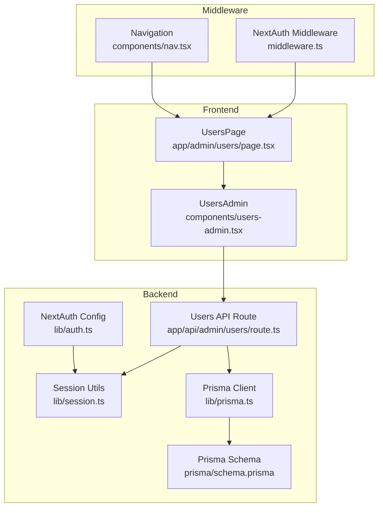
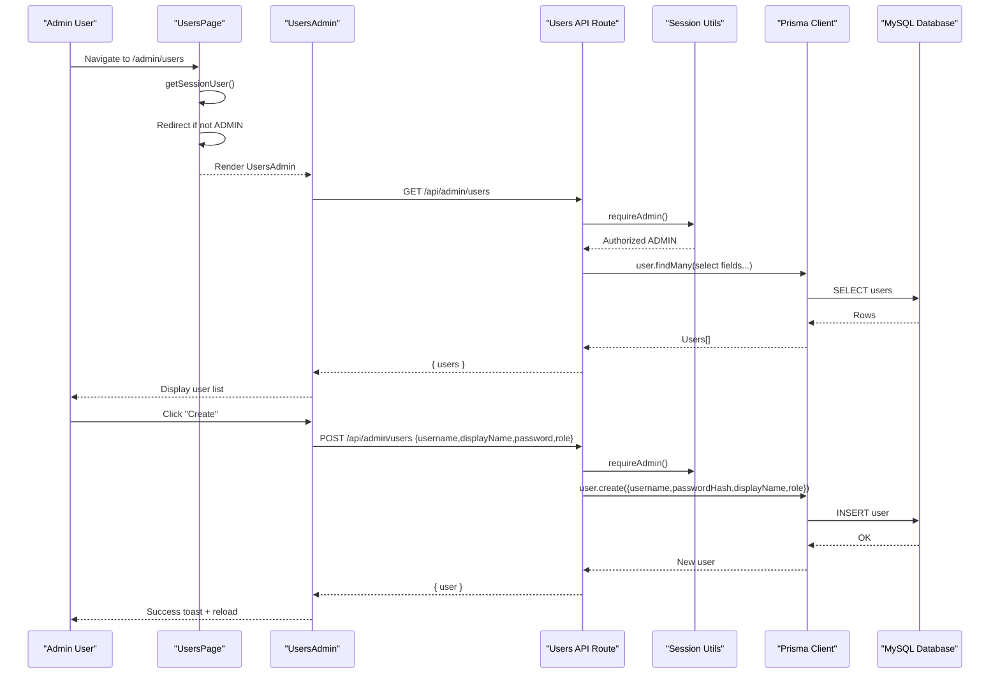
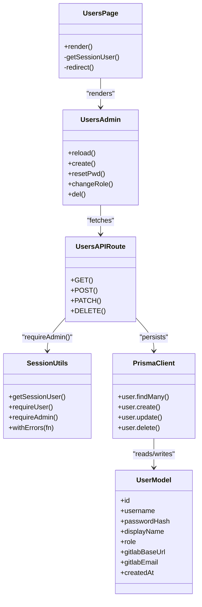
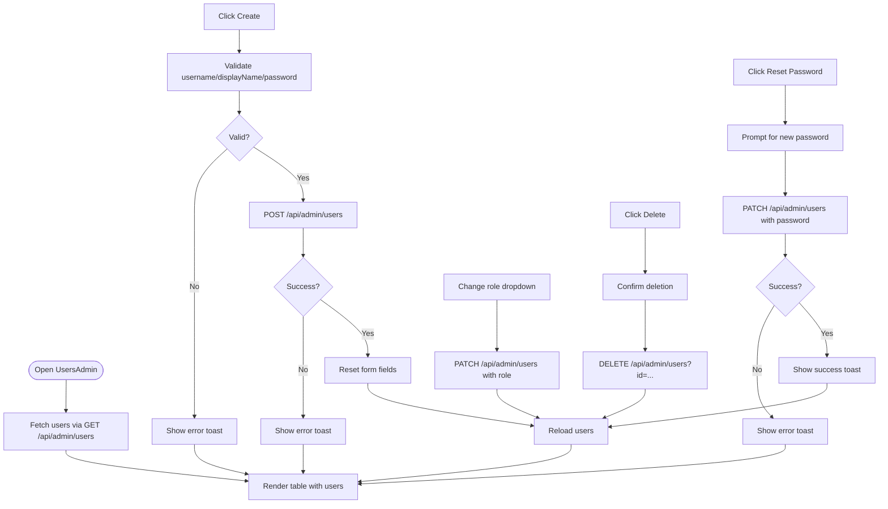
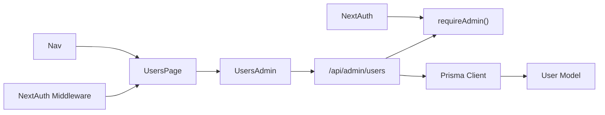

# User Management

<cite>
**Referenced Files in This Document**
- [app/admin/users/page.tsx](file://app/admin/users/page.tsx)
- [components/users-admin.tsx](file://components/users-admin.tsx)
- [app/api/admin/users/route.ts](file://app/api/admin/users/route.ts)
- [lib/session.ts](file://lib/session.ts)
- [lib/auth.ts](file://lib/auth.ts)
- [lib/prisma.ts](file://lib/prisma.ts)
- [prisma/schema.prisma](file://prisma/schema.prisma)
- [middleware.ts](file://middleware.ts)
- [components/nav.tsx](file://components/nav.tsx)
- [lib/crypto.ts](file://lib/crypto.ts)
</cite>

## Table of Contents
1. [Introduction](#introduction)
2. [Project Structure](#project-structure)
3. [Core Components](#core-components)
4. [Architecture Overview](#architecture-overview)
5. [Detailed Component Analysis](#detailed-component-analysis)
6. [Dependency Analysis](#dependency-analysis)
7. [Performance Considerations](#performance-considerations)
8. [Troubleshooting Guide](#troubleshooting-guide)
9. [Conclusion](#conclusion)
10. [Appendices](#appendices)

## Introduction
This document describes the user management system in Pingyun Report with a focus on admin-only functionality. It covers how administrators can create users, edit profiles, reset passwords, assign roles (MEMBER vs ADMIN), and manage user lifecycles. It documents the UsersAdmin component implementation, the /api/admin/users endpoint contract, and the underlying security model that prevents unauthorized access and privilege escalation.

## Project Structure
The user management feature spans frontend and backend components:
- Frontend page and component: admin page renders the UsersAdmin component; UsersAdmin handles forms, listing, and bulk operations.
- Backend API: a Next.js route under /api/admin/users exposes CRUD-like operations guarded by admin-only middleware.
- Authentication and authorization: NextAuth-based session management with role checks.
- Persistence: Prisma ORM against a MySQL database with a User model and Role enum.

**Diagram sources**
- [app/admin/users/page.tsx:1-22](file://app/admin/users/page.tsx#L1-L22)
- [components/users-admin.tsx:1-187](file://components/users-admin.tsx#L1-L187)
- [app/api/admin/users/route.ts:1-88](file://app/api/admin/users/route.ts#L1-L88)
- [lib/session.ts:1-56](file://lib/session.ts#L1-L56)
- [lib/auth.ts:1-77](file://lib/auth.ts#L1-L77)
- [lib/prisma.ts:1-14](file://lib/prisma.ts#L1-L14)
- [prisma/schema.prisma:1-80](file://prisma/schema.prisma#L1-L80)
- [middleware.ts:1-10](file://middleware.ts#L1-L10)
- [components/nav.tsx:1-75](file://components/nav.tsx#L1-L75)

**Section sources**
- [app/admin/users/page.tsx:1-22](file://app/admin/users/page.tsx#L1-L22)
- [components/users-admin.tsx:1-187](file://components/users-admin.tsx#L1-L187)
- [app/api/admin/users/route.ts:1-88](file://app/api/admin/users/route.ts#L1-L88)
- [lib/session.ts:1-56](file://lib/session.ts#L1-L56)
- [lib/auth.ts:1-77](file://lib/auth.ts#L1-L77)
- [lib/prisma.ts:1-14](file://lib/prisma.ts#L1-L14)
- [prisma/schema.prisma:1-80](file://prisma/schema.prisma#L1-L80)
- [middleware.ts:1-10](file://middleware.ts#L1-L10)
- [components/nav.tsx:1-75](file://components/nav.tsx#L1-L75)

## Core Components
- UsersPage (/admin/users): server-side guard ensures only logged-in users with ADMIN role can access. Renders the UsersAdmin component.
- UsersAdmin (client): manages user creation, listing, password reset, role change, and deletion. Uses local state and fetches from /api/admin/users.
- Users API Route (/api/admin/users): exposes GET, POST, PATCH, DELETE endpoints with admin-only enforcement and Zod validation.
- Session utilities: provide requireAdmin, requireUser, and withErrors wrapper for consistent error handling.
- NextAuth integration: defines session shape and role propagation for frontend navigation and guards.
- Prisma schema: defines the User model and Role enum used by the API.

**Section sources**
- [app/admin/users/page.tsx:8-21](file://app/admin/users/page.tsx#L8-L21)
- [components/users-admin.tsx:16-186](file://components/users-admin.tsx#L16-L186)
- [app/api/admin/users/route.ts:7-87](file://app/api/admin/users/route.ts#L7-L87)
- [lib/session.ts:31-37](file://lib/session.ts#L31-L37)
- [lib/auth.ts:6-28](file://lib/auth.ts#L6-L28)
- [prisma/schema.prisma:16-33](file://prisma/schema.prisma#L16-L33)

## Architecture Overview
The admin user management flow enforces role-based access control at both the UI and API layers. Administrators can perform user lifecycle operations through a React component that communicates with a protected API route backed by Prisma.

**Diagram sources**
- [app/admin/users/page.tsx:8-21](file://app/admin/users/page.tsx#L8-L21)
- [components/users-admin.tsx:23-54](file://components/users-admin.tsx#L23-L54)
- [app/api/admin/users/route.ts:7-56](file://app/api/admin/users/route.ts#L7-L56)
- [lib/session.ts:31-37](file://lib/session.ts#L31-L37)
- [lib/prisma.ts:7-14](file://lib/prisma.ts#L7-L14)
- [prisma/schema.prisma:16-33](file://prisma/schema.prisma#L16-L33)

## Detailed Component Analysis

### UsersPage (/admin/users)
- Purpose: Enforce admin-only access to the user management page.
- Behavior:
  - Fetches the current session user.
  - Redirects to login if not authenticated.
  - Redirects to home if the user is not ADMIN.
  - Renders the UsersAdmin component inside a layout with navigation.

Security considerations:
- Relies on NextAuth middleware and session utilities to enforce role checks.
- Uses server-side redirects to prevent unauthorized clients from accessing the page.

**Section sources**
- [app/admin/users/page.tsx:8-21](file://app/admin/users/page.tsx#L8-L21)
- [lib/session.ts:12-29](file://lib/session.ts#L12-L29)
- [middleware.ts:3-9](file://middleware.ts#L3-L9)

### UsersAdmin (client component)
- Purpose: Admin UI for managing users.
- Features:
  - Form for creating a new user (username, display name, initial password, role).
  - Table listing users with editable role dropdown and action buttons.
  - Actions: reset password, delete user.
- Validation and UX:
  - Client-side basic validation for create form.
  - Toast notifications for success/error feedback.
  - Confirmation prompts for destructive actions.

Operations:
- Create: Sends POST to /api/admin/users with Zod-validated payload.
- Reset Password: Prompts for new password and sends PATCH with password field.
- Change Role: Sends PATCH with role field.
- Delete: Sends DELETE with id query parameter.

**Section sources**
- [components/users-admin.tsx:16-186](file://components/users-admin.tsx#L16-L186)

### Users API Route (/api/admin/users)
- Methods and endpoints:
  - GET /api/admin/users: Lists all users with selected fields.
  - POST /api/admin/users: Creates a new user with validated and hashed password.
  - PATCH /api/admin/users: Updates user fields (password, display name, role).
  - DELETE /api/admin/users?id=...: Deletes a user by ID.
- Authentication and authorization:
  - requireAdmin() is invoked at the start of each handler.
  - withErrors() wraps handlers to convert thrown errors into HTTP responses.
- Validation:
  - Zod schemas define allowed fields and constraints.
  - Username uniqueness enforced on create.
- Data handling:
  - Password hashing via bcrypt.
  - Selective response fields to avoid leaking sensitive data.

Response schemas:
- GET: { users: Array<{ id, username, displayName, role, gitlabBaseUrl?, gitlabEmail?, createdAt }> }
- POST: { user: { id, username, displayName, role, createdAt } }
- PATCH: { user: { id, username, displayName, role } }
- DELETE: { ok: true }

Notes:
- Role values are MEMBER or ADMIN.
- Passwords are stored as bcrypt hashes; never returned in responses.

**Section sources**
- [app/api/admin/users/route.ts:7-87](file://app/api/admin/users/route.ts#L7-L87)
- [lib/session.ts:31-37](file://lib/session.ts#L31-L37)
- [lib/session.ts:40-55](file://lib/session.ts#L40-L55)

### Authentication and Authorization
- NextAuth configuration:
  - Credentials provider authenticates users against the User model.
  - JWT callbacks propagate id, username, and role to the session.
  - Session shape includes role for frontend guards and navigation.
- Session utilities:
  - requireAdmin() throws 403 for non-admins.
  - withErrors() standardizes error responses.
- Middleware:
  - NextAuth middleware protects routes and redirects unauthenticated users.

**Section sources**
- [lib/auth.ts:30-76](file://lib/auth.ts#L30-L76)
- [lib/session.ts:31-37](file://lib/session.ts#L31-L37)
- [lib/session.ts:40-55](file://lib/session.ts#L40-L55)
- [middleware.ts:3-9](file://middleware.ts#L3-L9)

### Data Model and Persistence
- User model:
  - Fields include id, username (unique), passwordHash, displayName, role (default MEMBER), GitLab fields, and timestamps.
  - Role enum is MEMBER or ADMIN.
- Prisma client:
  - Singleton client configured with logging level based on NODE_ENV.
- Encryption for secrets:
  - GitLab tokens are stored encrypted with AES-256-GCM and base64-encoded.
  - Helper functions provide encrypt/decrypt and masking utilities.

**Section sources**
- [prisma/schema.prisma:16-33](file://prisma/schema.prisma#L16-L33)
- [lib/prisma.ts:7-14](file://lib/prisma.ts#L7-L14)
- [lib/crypto.ts:17-45](file://lib/crypto.ts#L17-L45)

## Architecture Overview

**Diagram sources**
- [app/admin/users/page.tsx:8-21](file://app/admin/users/page.tsx#L8-L21)
- [components/users-admin.tsx:23-87](file://components/users-admin.tsx#L23-L87)
- [app/api/admin/users/route.ts:7-87](file://app/api/admin/users/route.ts#L7-L87)
- [lib/session.ts:12-37](file://lib/session.ts#L12-L37)
- [lib/prisma.ts:7-14](file://lib/prisma.ts#L7-L14)
- [prisma/schema.prisma:16-33](file://prisma/schema.prisma#L16-L33)

## Detailed Component Analysis

### UsersAdmin Component Implementation
- State management:
  - Maintains users list and form fields (username, displayName, password, role).
- Lifecycle:
  - Loads users on mount via GET /api/admin/users.
- Operations:
  - Create: Validates presence of required fields, posts to POST /api/admin/users, resets form, reloads list.
  - Reset Password: Prompts for new password (minimum length enforced by PATCH schema), patches password.
  - Change Role: Patches role field and reloads list.
  - Delete: Confirms deletion and deletes by id.
- UX:
  - Toast notifications for feedback.
  - Role dropdowns for quick updates.

**Diagram sources**
- [components/users-admin.tsx:23-87](file://components/users-admin.tsx#L23-L87)
- [app/api/admin/users/route.ts:31-56](file://app/api/admin/users/route.ts#L31-L56)
- [app/api/admin/users/route.ts:65-78](file://app/api/admin/users/route.ts#L65-L78)
- [app/api/admin/users/route.ts:80-87](file://app/api/admin/users/route.ts#L80-L87)

**Section sources**
- [components/users-admin.tsx:16-186](file://components/users-admin.tsx#L16-L186)

### /api/admin/users Endpoint Reference
- GET /api/admin/users
  - Method: GET
  - Auth: ADMIN required
  - Response: { users: UserListItem[] }
  - UserListItem: { id, username, displayName, role, gitlabBaseUrl?, gitlabEmail?, createdAt }
- POST /api/admin/users
  - Method: POST
  - Auth: ADMIN required
  - Request body: { username, password, displayName, role? }
  - Validation: username min/max lengths, password min length, role enum optional
  - Response: { user: { id, username, displayName, role, createdAt } }
  - Errors: 400 if username exists
- PATCH /api/admin/users
  - Method: PATCH
  - Auth: ADMIN required
  - Request body: { id, password?, displayName?, role? }
  - Validation: password min length if present, role enum if present
  - Response: { user: { id, username, displayName, role } }
- DELETE /api/admin/users?id=...
  - Method: DELETE
  - Auth: ADMIN required
  - Query param: id (required)
  - Response: { ok: true }
  - Errors: 400 if id missing

**Section sources**
- [app/api/admin/users/route.ts:7-22](file://app/api/admin/users/route.ts#L7-L22)
- [app/api/admin/users/route.ts:31-56](file://app/api/admin/users/route.ts#L31-L56)
- [app/api/admin/users/route.ts:65-78](file://app/api/admin/users/route.ts#L65-L78)
- [app/api/admin/users/route.ts:80-87](file://app/api/admin/users/route.ts#L80-L87)

### User Lifecycle Management
- Onboarding:
  - Admin creates a new user with username, display name, and initial password.
  - Password is hashed before storage.
- Active Management:
  - Admin can reset passwords for users.
  - Admin can change roles between MEMBER and ADMIN.
  - Admin can delete users; associated data is removed via cascade rules in Prisma schema.
- Deactivation:
  - Deletion removes the user account and cascades to related records (reports, templates, projects).
  - No separate “disable” flag is exposed; deletion is the primary deactivation mechanism.

**Section sources**
- [app/api/admin/users/route.ts:31-56](file://app/api/admin/users/route.ts#L31-L56)
- [app/api/admin/users/route.ts:65-78](file://app/api/admin/users/route.ts#L65-L78)
- [app/api/admin/users/route.ts:80-87](file://app/api/admin/users/route.ts#L80-L87)
- [prisma/schema.prisma:30-33](file://prisma/schema.prisma#L30-L33)

### Common Administrative Tasks
- Add a new team member:
  - Navigate to /admin/users, fill the form (username, display name, initial password), select role MEMBER, submit.
- Reset a user’s password:
  - From the user list, click “Reset password”, enter a new password meeting the minimum length, confirm.
- Manage user permissions:
  - From the user list, change the role dropdown to ADMIN or MEMBER.

**Section sources**
- [components/users-admin.tsx:93-127](file://components/users-admin.tsx#L93-L127)
- [components/users-admin.tsx:166-177](file://components/users-admin.tsx#L166-L177)
- [components/users-admin.tsx:148-157](file://components/users-admin.tsx#L148-L157)

## Dependency Analysis

**Diagram sources**
- [app/admin/users/page.tsx:8-21](file://app/admin/users/page.tsx#L8-L21)
- [components/users-admin.tsx:23-87](file://components/users-admin.tsx#L23-L87)
- [app/api/admin/users/route.ts:7-87](file://app/api/admin/users/route.ts#L7-L87)
- [lib/session.ts:31-37](file://lib/session.ts#L31-L37)
- [lib/prisma.ts:7-14](file://lib/prisma.ts#L7-L14)
- [prisma/schema.prisma:16-33](file://prisma/schema.prisma#L16-L33)
- [middleware.ts:3-9](file://middleware.ts#L3-L9)
- [components/nav.tsx:38-59](file://components/nav.tsx#L38-L59)

**Section sources**
- [app/admin/users/page.tsx:8-21](file://app/admin/users/page.tsx#L8-L21)
- [components/users-admin.tsx:23-87](file://components/users-admin.tsx#L23-L87)
- [app/api/admin/users/route.ts:7-87](file://app/api/admin/users/route.ts#L7-L87)
- [lib/session.ts:31-37](file://lib/session.ts#L31-L37)
- [lib/prisma.ts:7-14](file://lib/prisma.ts#L7-L14)
- [prisma/schema.prisma:16-33](file://prisma/schema.prisma#L16-L33)
- [middleware.ts:3-9](file://middleware.ts#L3-L9)
- [components/nav.tsx:38-59](file://components/nav.tsx#L38-L59)

## Performance Considerations
- Client-side:
  - Minimal re-renders via local state; batched reloads after mutations.
- Server-side:
  - GET lists users with selective fields to reduce payload size.
  - Zod parsing validates requests early to fail fast.
  - bcrypt cost is balanced for security; consider monitoring slow requests in production.
- Database:
  - Prisma client configured with appropriate logging; ensure connection pooling and indexing are tuned for expected load.

[No sources needed since this section provides general guidance]

## Troubleshooting Guide
- Unauthorized access to /admin/users:
  - Ensure the user is authenticated and has role ADMIN. The page performs server-side checks and redirects accordingly.
- Forbidden on API calls:
  - Verify the session carries ADMIN role; API handlers call requireAdmin().
- Validation errors on create/update:
  - Check request payload against Zod constraints (username length, password length, role enum).
- Duplicate username on create:
  - The API returns a 400 error when username already exists.
- Error responses:
  - withErrors() converts thrown errors into JSON responses with appropriate status codes.

**Section sources**
- [app/admin/users/page.tsx:10-11](file://app/admin/users/page.tsx#L10-L11)
- [lib/session.ts:31-37](file://lib/session.ts#L31-L37)
- [app/api/admin/users/route.ts:34-38](file://app/api/admin/users/route.ts#L34-L38)
- [app/api/admin/users/route.ts:40-55](file://app/api/admin/users/route.ts#L40-L55)
- [lib/session.ts:40-55](file://lib/session.ts#L40-L55)

## Conclusion
The user management system in Pingyun Report is designed around strict admin-only access, robust validation, and secure password handling. The UsersAdmin component provides a practical interface for administrators to manage users, while the /api/admin/users endpoint enforces role-based access control and sanitizes responses. Together with NextAuth and Prisma, the system offers a clear, maintainable foundation for user lifecycle operations.

[No sources needed since this section summarizes without analyzing specific files]

## Appendices

### Security Considerations
- Privilege Escalation Prevention:
  - requireAdmin() is invoked at the start of each API handler.
  - NextAuth middleware protects routes and redirects unauthenticated users.
- Data Protection:
  - Passwords are hashed with bcrypt before storage.
  - GitLab tokens are encrypted at rest and masked in UI where shown.
- Least Privilege:
  - Role defaults to MEMBER; ADMIN role is only granted when necessary.
- Auditability:
  - Creation timestamps are recorded; API responses include minimal fields to avoid leaking sensitive data.

**Section sources**
- [lib/session.ts:31-37](file://lib/session.ts#L31-L37)
- [middleware.ts:3-9](file://middleware.ts#L3-L9)
- [lib/crypto.ts:17-45](file://lib/crypto.ts#L17-L45)
- [prisma/schema.prisma:16-33](file://prisma/schema.prisma#L16-L33)