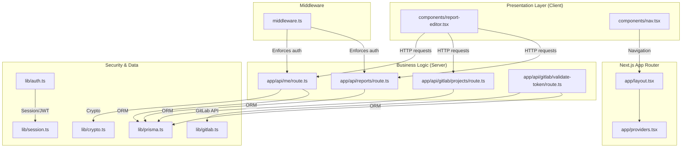
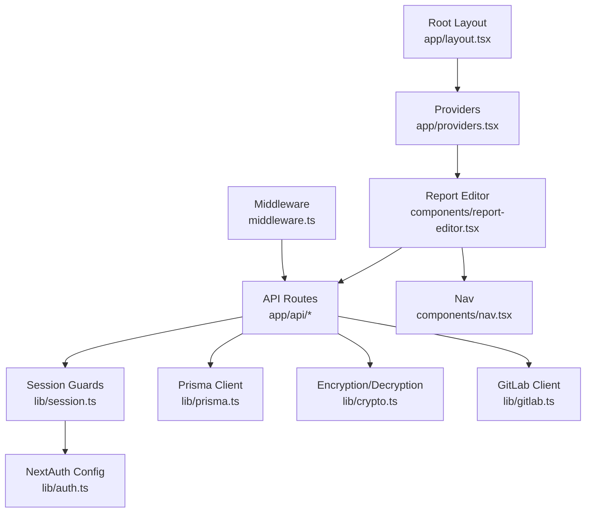
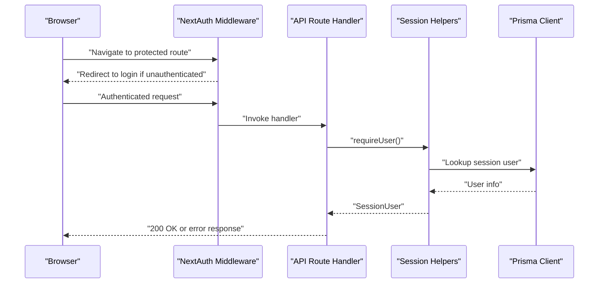
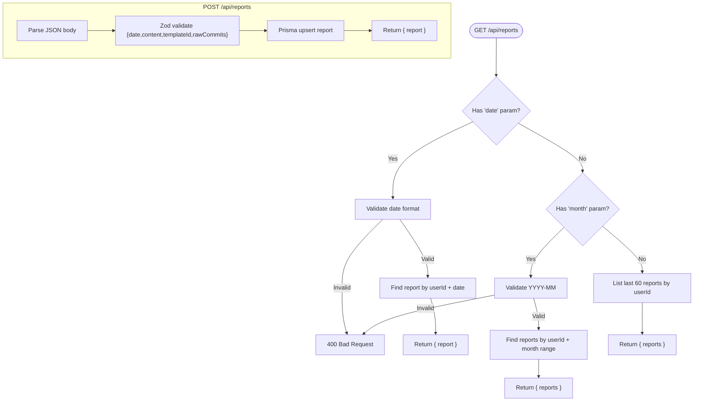
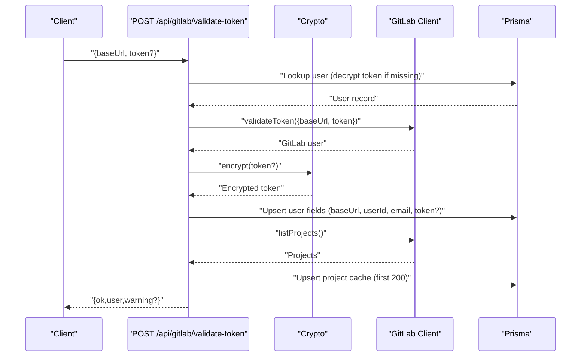
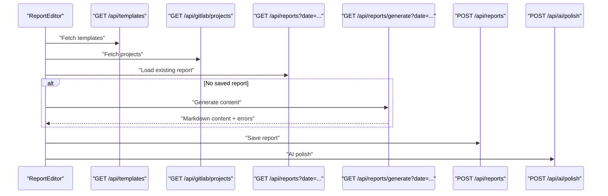
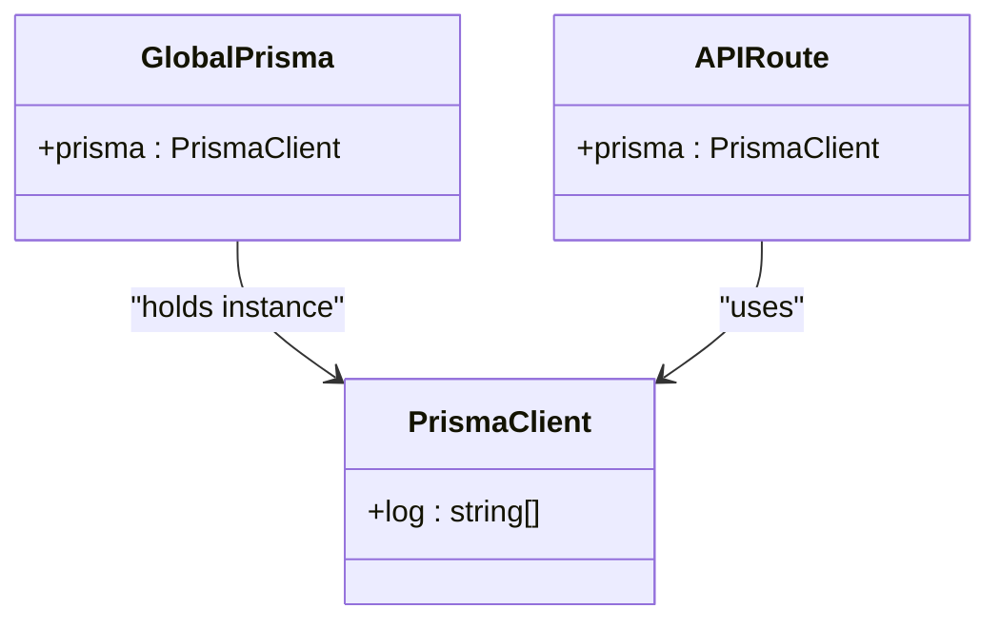
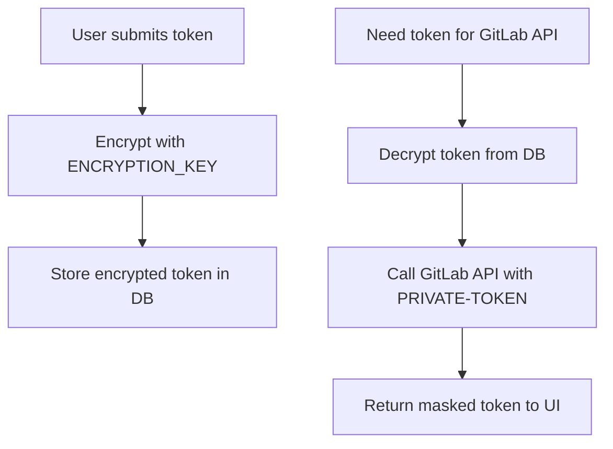
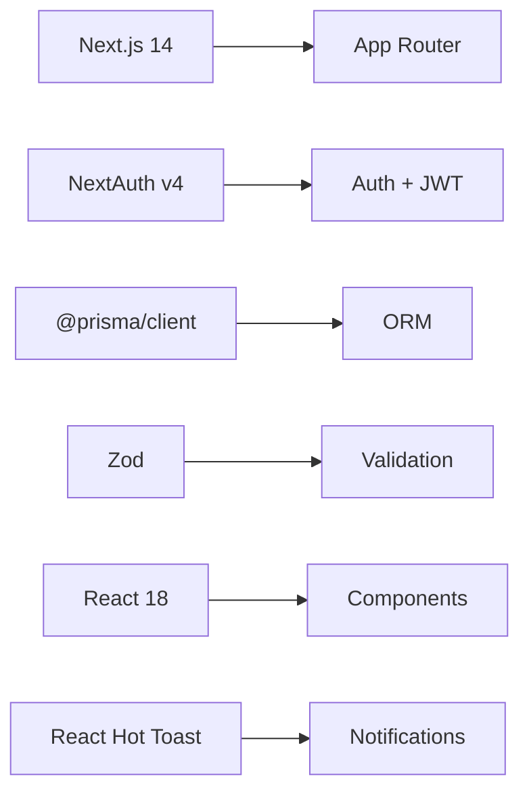

# Architecture Overview

<cite>
**Referenced Files in This Document**
- [app/layout.tsx](file://app/layout.tsx)
- [app/providers.tsx](file://app/providers.tsx)
- [middleware.ts](file://middleware.ts)
- [lib/prisma.ts](file://lib/prisma.ts)
- [lib/auth.ts](file://lib/auth.ts)
- [lib/session.ts](file://lib/session.ts)
- [lib/crypto.ts](file://lib/crypto.ts)
- [lib/gitlab.ts](file://lib/gitlab.ts)
- [app/api/me/route.ts](file://app/api/me/route.ts)
- [app/api/reports/route.ts](file://app/api/reports/route.ts)
- [app/api/gitlab/projects/route.ts](file://app/api/gitlab/projects/route.ts)
- [app/api/gitlab/validate-token/route.ts](file://app/api/gitlab/validate-token/route.ts)
- [components/report-editor.tsx](file://components/report-editor.tsx)
- [components/nav.tsx](file://components/nav.tsx)
- [package.json](file://package.json)
</cite>

## Table of Contents
1. [Introduction](#introduction)
2. [Project Structure](#project-structure)
3. [Core Components](#core-components)
4. [Architecture Overview](#architecture-overview)
5. [Detailed Component Analysis](#detailed-component-analysis)
6. [Dependency Analysis](#dependency-analysis)
7. [Performance Considerations](#performance-considerations)
8. [Troubleshooting Guide](#troubleshooting-guide)
9. [Conclusion](#conclusion)
10. [Appendices](#appendices)

## Introduction
This document describes the architecture of Pingyun Report, a Next.js application that helps users generate daily reports by aggregating GitLab commit data. The system follows a layered architecture:
- Presentation layer: React components under the Next.js App Router.
- Business logic layer: Server-side API routes implementing CRUD and orchestration.
- Data access layer: Prisma ORM client with a PostgreSQL database.
- Security: Server-side token handling and encryption, enforced via middleware and session guards.
- Integrations: GitLab REST API accessed exclusively from the server.

## Project Structure
The project is organized around Next.js App Router conventions:
- app/: Route handlers and pages.
- components/: Client-side React components.
- lib/: Shared libraries for auth, sessions, cryptography, GitLab client, and Prisma.
- prisma/: Prisma schema and seeding utilities.
- Root-level configuration files for Next.js, Tailwind, PostCSS, TypeScript, and Docker.

**Diagram sources**
- [app/layout.tsx:1-25](file://app/layout.tsx#L1-L25)
- [app/providers.tsx:1-8](file://app/providers.tsx#L1-L8)
- [middleware.ts:1-10](file://middleware.ts#L1-L10)
- [lib/session.ts:1-56](file://lib/session.ts#L1-L56)
- [lib/auth.ts:1-77](file://lib/auth.ts#L1-L77)
- [lib/prisma.ts:1-14](file://lib/prisma.ts#L1-L14)
- [lib/crypto.ts:1-46](file://lib/crypto.ts#L1-L46)
- [lib/gitlab.ts:1-149](file://lib/gitlab.ts#L1-L149)
- [app/api/me/route.ts:1-67](file://app/api/me/route.ts#L1-L67)
- [app/api/reports/route.ts:1-90](file://app/api/reports/route.ts#L1-L90)
- [app/api/gitlab/projects/route.ts:1-42](file://app/api/gitlab/projects/route.ts#L1-L42)
- [app/api/gitlab/validate-token/route.ts:1-81](file://app/api/gitlab/validate-token/route.ts#L1-L81)

**Section sources**
- [app/layout.tsx:1-25](file://app/layout.tsx#L1-L25)
- [app/providers.tsx:1-8](file://app/providers.tsx#L1-L8)
- [middleware.ts:1-10](file://middleware.ts#L1-L10)
- [lib/prisma.ts:1-14](file://lib/prisma.ts#L1-L14)
- [lib/auth.ts:1-77](file://lib/auth.ts#L1-L77)
- [lib/session.ts:1-56](file://lib/session.ts#L1-L56)
- [lib/crypto.ts:1-46](file://lib/crypto.ts#L1-L46)
- [lib/gitlab.ts:1-149](file://lib/gitlab.ts#L1-L149)
- [app/api/me/route.ts:1-67](file://app/api/me/route.ts#L1-L67)
- [app/api/reports/route.ts:1-90](file://app/api/reports/route.ts#L1-L90)
- [app/api/gitlab/projects/route.ts:1-42](file://app/api/gitlab/projects/route.ts#L1-L42)
- [app/api/gitlab/validate-token/route.ts:1-81](file://app/api/gitlab/validate-token/route.ts#L1-L81)
- [components/report-editor.tsx:1-284](file://components/report-editor.tsx#L1-L284)
- [components/nav.tsx:1-75](file://components/nav.tsx#L1-L75)
- [package.json:1-47](file://package.json#L1-L47)

## Core Components
- Presentation layer:
  - Report editor component orchestrates fetching templates, projects, generating content, saving reports, and AI polishing.
  - Navigation component renders menu items and logout.
- Business logic layer:
  - API routes implement report CRUD, user profile retrieval, GitLab project management, and token validation with caching.
- Data access layer:
  - Prisma client singleton with development logging and global instance reuse.
- Security:
  - NextAuth middleware enforces authentication for protected routes.
  - Session helpers guard API endpoints and convert errors to HTTP responses.
  - Encryption/decryption of GitLab tokens stored in the database.
- GitLab integration:
  - Server-only client for GitLab REST API with pagination and timeouts.

**Section sources**
- [components/report-editor.tsx:1-284](file://components/report-editor.tsx#L1-L284)
- [components/nav.tsx:1-75](file://components/nav.tsx#L1-L75)
- [app/api/reports/route.ts:1-90](file://app/api/reports/route.ts#L1-L90)
- [app/api/me/route.ts:1-67](file://app/api/me/route.ts#L1-L67)
- [app/api/gitlab/projects/route.ts:1-42](file://app/api/gitlab/projects/route.ts#L1-L42)
- [app/api/gitlab/validate-token/route.ts:1-81](file://app/api/gitlab/validate-token/route.ts#L1-L81)
- [lib/prisma.ts:1-14](file://lib/prisma.ts#L1-L14)
- [lib/session.ts:1-56](file://lib/session.ts#L1-L56)
- [lib/crypto.ts:1-46](file://lib/crypto.ts#L1-L46)
- [lib/gitlab.ts:1-149](file://lib/gitlab.ts#L1-L149)

## Architecture Overview
The system adheres to a clean layered architecture:
- Presentation: Client-side React components render UI and call server endpoints.
- Application: Server-side API routes handle request parsing, validation, authorization, and orchestration.
- Persistence: Prisma ORM abstracts database operations.
- Security: Middleware and session guards enforce authentication and authorization; secrets are handled server-side.

**Diagram sources**
- [components/report-editor.tsx:1-284](file://components/report-editor.tsx#L1-L284)
- [components/nav.tsx:1-75](file://components/nav.tsx#L1-L75)
- [app/api/reports/route.ts:1-90](file://app/api/reports/route.ts#L1-L90)
- [app/api/me/route.ts:1-67](file://app/api/me/route.ts#L1-L67)
- [app/api/gitlab/projects/route.ts:1-42](file://app/api/gitlab/projects/route.ts#L1-L42)
- [app/api/gitlab/validate-token/route.ts:1-81](file://app/api/gitlab/validate-token/route.ts#L1-L81)
- [lib/session.ts:1-56](file://lib/session.ts#L1-L56)
- [lib/auth.ts:1-77](file://lib/auth.ts#L1-L77)
- [lib/prisma.ts:1-14](file://lib/prisma.ts#L1-L14)
- [lib/crypto.ts:1-46](file://lib/crypto.ts#L1-L46)
- [lib/gitlab.ts:1-149](file://lib/gitlab.ts#L1-L149)
- [middleware.ts:1-10](file://middleware.ts#L1-L10)
- [app/layout.tsx:1-25](file://app/layout.tsx#L1-L25)
- [app/providers.tsx:1-8](file://app/providers.tsx#L1-L8)

## Detailed Component Analysis

### Authentication and Authorization Flow
The system uses NextAuth with JWT strategy and middleware-based enforcement:
- NextAuth configuration defines credentials provider, hashing, and JWT/session callbacks.
- Middleware enforces authentication for protected routes.
- Session helpers extract and validate the current user in API routes.
- API routes wrap handlers with error conversion to HTTP responses.

**Diagram sources**
- [middleware.ts:1-10](file://middleware.ts#L1-L10)
- [lib/auth.ts:1-77](file://lib/auth.ts#L1-L77)
- [lib/session.ts:1-56](file://lib/session.ts#L1-L56)
- [app/api/me/route.ts:1-67](file://app/api/me/route.ts#L1-L67)
- [app/api/reports/route.ts:1-90](file://app/api/reports/route.ts#L1-L90)

**Section sources**
- [middleware.ts:1-10](file://middleware.ts#L1-L10)
- [lib/auth.ts:1-77](file://lib/auth.ts#L1-L77)
- [lib/session.ts:1-56](file://lib/session.ts#L1-L56)

### Report CRUD API
The report endpoint supports retrieving a single report by date, listing monthly reports, listing recent reports, upserting a report, and deleting by date. It validates inputs, enforces authentication, and interacts with Prisma.

**Diagram sources**
- [app/api/reports/route.ts:1-90](file://app/api/reports/route.ts#L1-L90)

**Section sources**
- [app/api/reports/route.ts:1-90](file://app/api/reports/route.ts#L1-L90)

### GitLab Token Validation and Project Caching
This flow validates a GitLab token, persists masked token and user info, and caches projects for the user.

**Diagram sources**
- [app/api/gitlab/validate-token/route.ts:1-81](file://app/api/gitlab/validate-token/route.ts#L1-L81)
- [lib/crypto.ts:1-46](file://lib/crypto.ts#L1-L46)
- [lib/gitlab.ts:1-149](file://lib/gitlab.ts#L1-L149)
- [lib/prisma.ts:1-14](file://lib/prisma.ts#L1-L14)

**Section sources**
- [app/api/gitlab/validate-token/route.ts:1-81](file://app/api/gitlab/validate-token/route.ts#L1-L81)
- [lib/crypto.ts:1-46](file://lib/crypto.ts#L1-L46)
- [lib/gitlab.ts:1-149](file://lib/gitlab.ts#L1-L149)

### Client-Side Report Editor Workflow
The editor component fetches templates and projects, generates content from server, saves reports, and triggers AI polishing.

**Diagram sources**
- [components/report-editor.tsx:1-284](file://components/report-editor.tsx#L1-L284)
- [app/api/reports/route.ts:1-90](file://app/api/reports/route.ts#L1-L90)

**Section sources**
- [components/report-editor.tsx:1-284](file://components/report-editor.tsx#L1-L284)

### Data Access Layer (Prisma)
Prisma is initialized as a singleton with environment-aware logging and global reuse in non-production environments. API routes import the shared client and perform queries.

**Diagram sources**
- [lib/prisma.ts:1-14](file://lib/prisma.ts#L1-L14)

**Section sources**
- [lib/prisma.ts:1-14](file://lib/prisma.ts#L1-L14)

### Security Architecture
- Server-side token handling: GitLab tokens are encrypted before storage and decrypted only on the server for API calls.
- Encryption scheme: AES-256-GCM with random IV and authentication tag.
- Exposure prevention: Encrypted tokens are never returned to the client; masked previews are shown instead.
- Authentication enforcement: Middleware protects routes; API routes require a valid user session.

**Diagram sources**
- [lib/crypto.ts:1-46](file://lib/crypto.ts#L1-L46)
- [app/api/me/route.ts:1-67](file://app/api/me/route.ts#L1-L67)
- [app/api/gitlab/validate-token/route.ts:1-81](file://app/api/gitlab/validate-token/route.ts#L1-L81)
- [lib/gitlab.ts:1-149](file://lib/gitlab.ts#L1-L149)

**Section sources**
- [lib/crypto.ts:1-46](file://lib/crypto.ts#L1-L46)
- [app/api/me/route.ts:1-67](file://app/api/me/route.ts#L1-L67)
- [app/api/gitlab/validate-token/route.ts:1-81](file://app/api/gitlab/validate-token/route.ts#L1-L81)
- [lib/gitlab.ts:1-149](file://lib/gitlab.ts#L1-L149)

## Dependency Analysis
Key dependencies and their roles:
- Next.js 14 App Router for routing and SSR/SSG.
- NextAuth v4 for authentication with JWT strategy.
- Prisma Client for database access.
- Zod for runtime validation.
- React Hot Toast for notifications.
- Tailwind CSS for styling.

**Diagram sources**
- [package.json:16-31](file://package.json#L16-L31)

**Section sources**
- [package.json:16-31](file://package.json#L16-L31)

## Performance Considerations
- Prisma client reuse: Initialize once globally to avoid connection overhead.
- Pagination and limits: GitLab client paginates and caps pages; API caches project lists to reduce repeated fetches.
- Request timeouts: GitLab client enforces 20s timeouts to prevent hanging requests.
- Logging: Development logs only essential warnings/errors; production logs reduced to errors.
- Client-side concurrency: The editor fetches templates and projects in parallel.

[No sources needed since this section provides general guidance]

## Troubleshooting Guide
Common issues and resolutions:
- Unauthorized/Forbidden responses from API routes:
  - Ensure the user is authenticated and the session is valid.
  - Verify middleware protection and that the route is under a protected path.
- Bad request errors (400):
  - Validate date/month formats and payload shapes against Zod schemas.
- Internal server errors (500):
  - Inspect server logs for exceptions; the error wrapper converts thrown errors to JSON responses.
- GitLab token validation failures:
  - Confirm the token is valid and the base URL is correct.
  - Check that the token is encrypted in the database and decrypted only on the server.
- Project list loading failures:
  - The API attempts to refresh project cache; failures are returned as warnings alongside success.

**Section sources**
- [lib/session.ts:1-56](file://lib/session.ts#L1-L56)
- [app/api/reports/route.ts:1-90](file://app/api/reports/route.ts#L1-L90)
- [app/api/gitlab/validate-token/route.ts:1-81](file://app/api/gitlab/validate-token/route.ts#L1-L81)
- [lib/crypto.ts:1-46](file://lib/crypto.ts#L1-L46)

## Conclusion
Pingyun Report employs a clear separation of concerns with a robust security model centered on server-side secret handling and middleware-enforced authentication. The layered architecture enables maintainable growth, predictable data flows, and scalable integrations with GitLab.

[No sources needed since this section summarizes without analyzing specific files]

## Appendices

### Technology Stack Decisions
- Next.js App Router: Enables route handlers, static generation, and modern React patterns.
- NextAuth: Provides flexible authentication with JWT and credential provider.
- Prisma: Type-safe database access with a singleton client for efficiency.
- Zod: Strong runtime validation for API payloads.
- Tailwind CSS: Utility-first styling with minimal configuration.
- Docker: Containerization support for deployment.

**Section sources**
- [package.json:16-31](file://package.json#L16-L31)
- [app/layout.tsx:1-25](file://app/layout.tsx#L1-L25)
- [app/providers.tsx:1-8](file://app/providers.tsx#L1-L8)
- [middleware.ts:1-10](file://middleware.ts#L1-L10)
- [lib/prisma.ts:1-14](file://lib/prisma.ts#L1-L14)
- [lib/auth.ts:1-77](file://lib/auth.ts#L1-L77)
- [lib/session.ts:1-56](file://lib/session.ts#L1-L56)
- [lib/crypto.ts:1-46](file://lib/crypto.ts#L1-L46)
- [lib/gitlab.ts:1-149](file://lib/gitlab.ts#L1-L149)
- [components/report-editor.tsx:1-284](file://components/report-editor.tsx#L1-L284)
- [components/nav.tsx:1-75](file://components/nav.tsx#L1-L75)