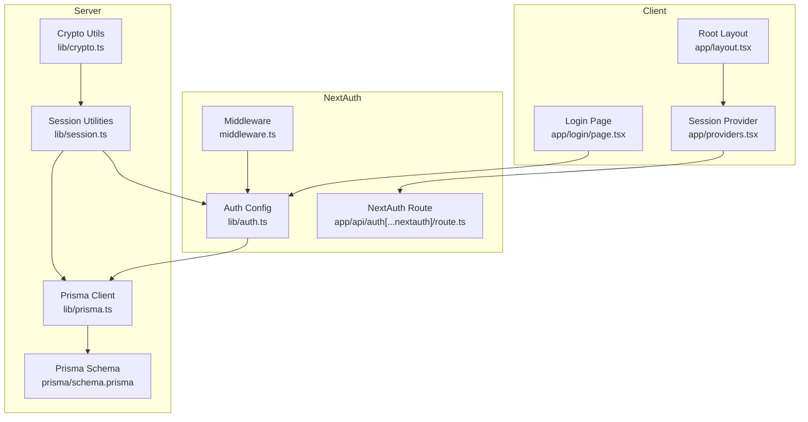
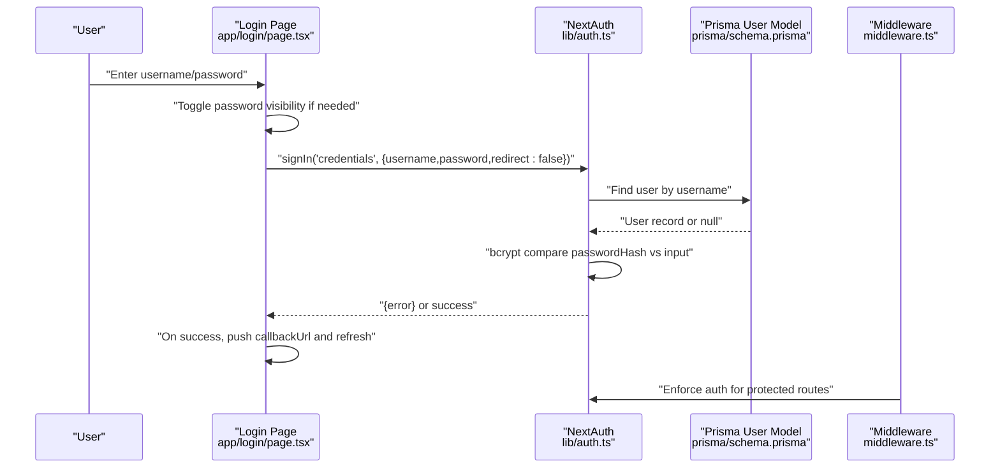
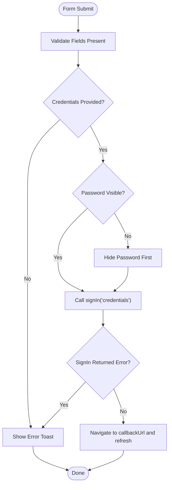
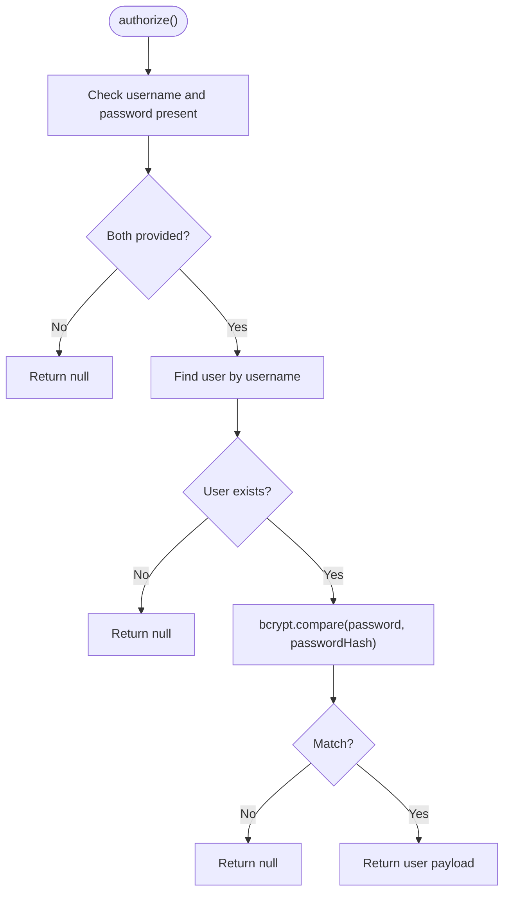
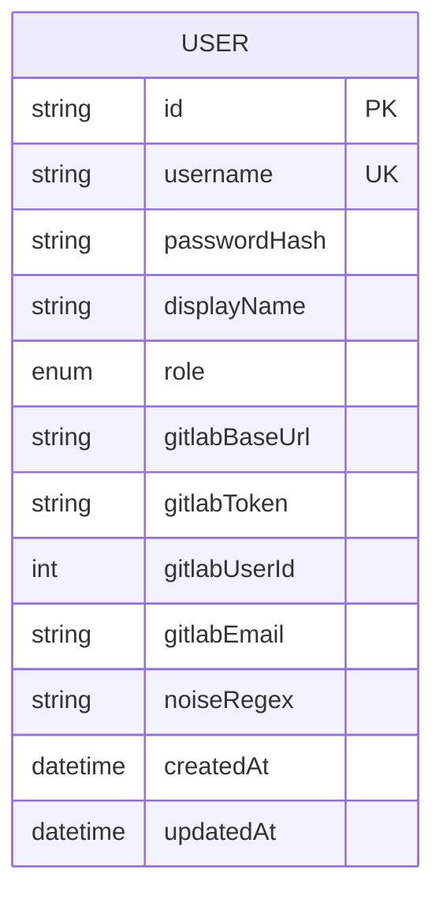
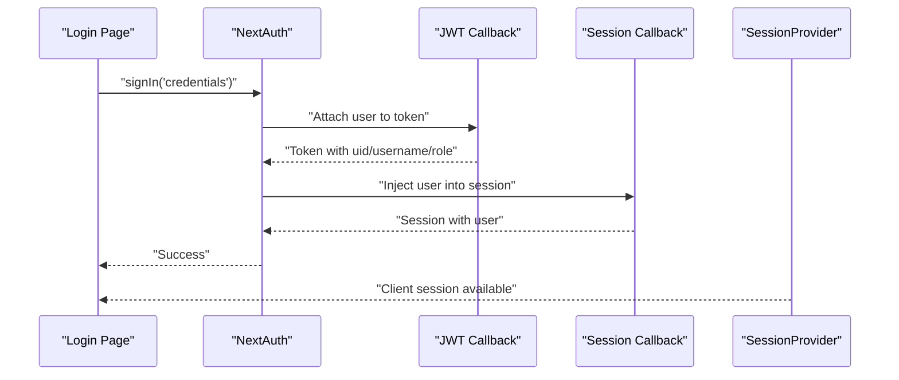
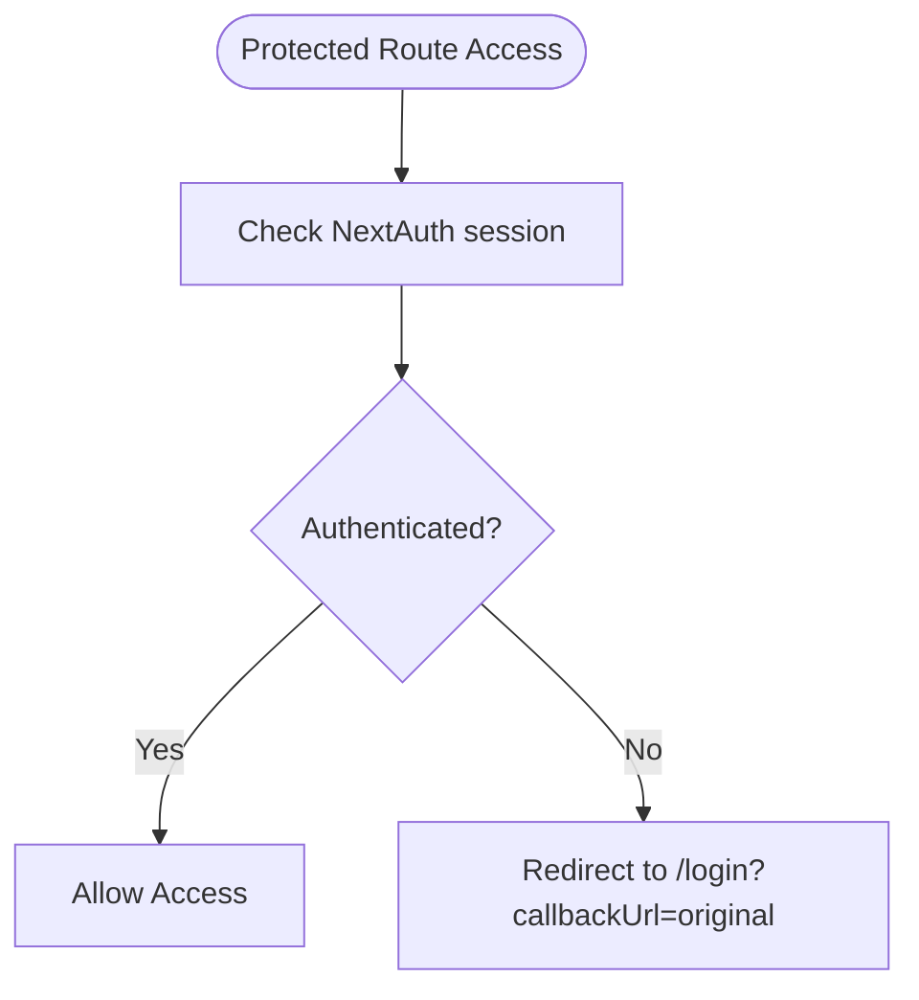
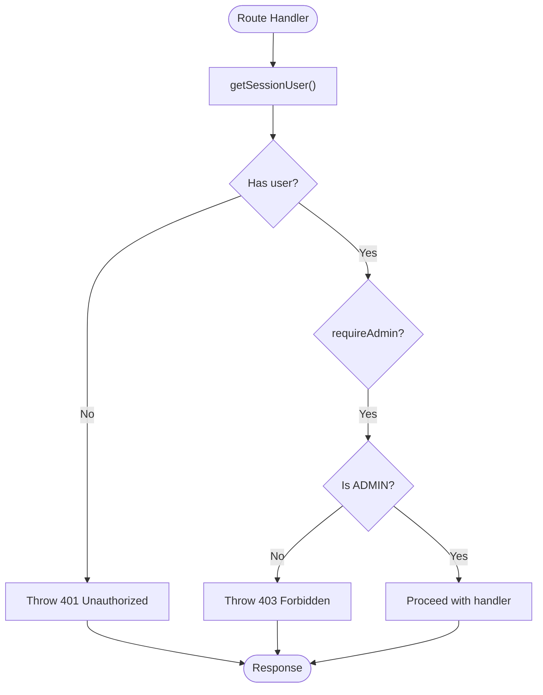
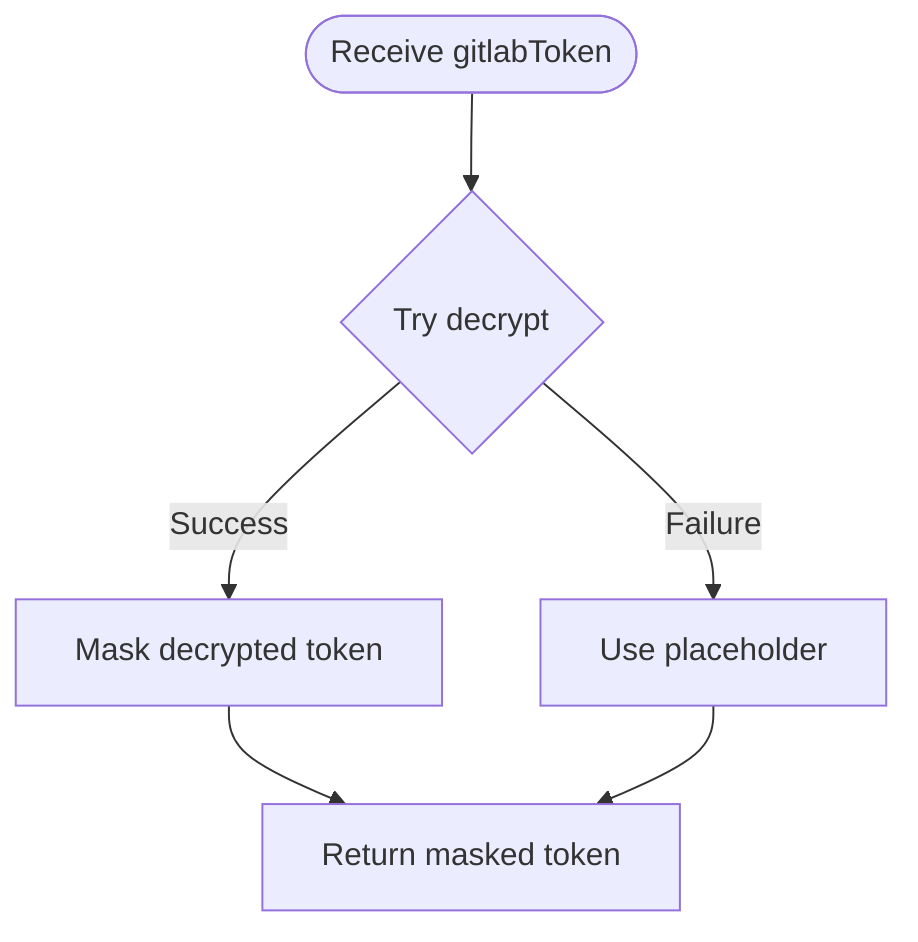
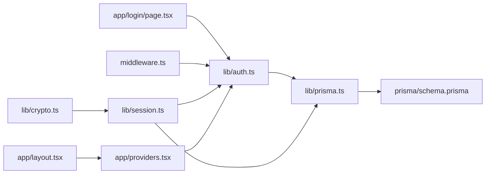

# Authentication Flow

<cite>
**Referenced Files in This Document**
- [app/login/page.tsx](file://app/login/page.tsx)
- [lib/auth.ts](file://lib/auth.ts)
- [lib/session.ts](file://lib/session.ts)
- [lib/crypto.ts](file://lib/crypto.ts)
- [lib/prisma.ts](file://lib/prisma.ts)
- [middleware.ts](file://middleware.ts)
- [app/providers.tsx](file://app/providers.tsx)
- [app/layout.tsx](file://app/layout.tsx)
- [prisma/schema.prisma](file://prisma/schema.prisma)
- [app/api/me/route.ts](file://app/api/me/route.ts)
- [tailwind.config.ts](file://tailwind.config.ts)
- [app/globals.css](file://app/globals.css)
</cite>

## Update Summary
**Changes Made**
- Updated Login Page Implementation section to document new password visibility toggle feature
- Enhanced visual design documentation covering gradient backgrounds and decorative elements
- Added accessibility improvements with proper ARIA labels and screen reader support
- Updated UI component documentation with modern typography and spacing guidelines
- Expanded troubleshooting section to include password visibility toggle functionality

## Table of Contents
1. [Introduction](#introduction)
2. [Project Structure](#project-structure)
3. [Core Components](#core-components)
4. [Architecture Overview](#architecture-overview)
5. [Detailed Component Analysis](#detailed-component-analysis)
6. [Dependency Analysis](#dependency-analysis)
7. [Performance Considerations](#performance-considerations)
8. [Troubleshooting Guide](#troubleshooting-guide)
9. [Conclusion](#conclusion)

## Introduction
This document explains the complete authentication flow in Pingyun Report, from user login to session establishment. It traces the step-by-step process from credential submission through bcrypt verification to JWT token generation and session creation. It also documents the credential provider flow, database lookup procedures, user validation mechanisms, redirect behavior, error handling, failure scenarios, login page implementation, form validation, user feedback mechanisms, and security considerations.

**Updated** The login page now features comprehensive visual optimizations including password visibility toggle, enhanced gradient backgrounds, decorative elements, improved accessibility features, and modern UI components with better typography and spacing.

## Project Structure
Authentication in Pingyun Report is implemented using NextAuth.js with a custom JWT strategy. The key pieces are:
- Login page client component that submits credentials via NextAuth's credentials provider
- NextAuth configuration that defines the credentials provider, bcrypt verification, and JWT/session callbacks
- Middleware enforcing protected routes and redirecting unauthenticated users to the login page
- Session utilities for server-side session retrieval and role-based access checks
- Prisma integration for user lookup and database schema
- Encryption utilities for secure storage and masking of tokens

**Diagram sources**
- [app/login/page.tsx:1-179](file://app/login/page.tsx#L1-L179)
- [lib/auth.ts:1-77](file://lib/auth.ts#L1-L77)
- [middleware.ts:1-10](file://middleware.ts#L1-L10)
- [lib/session.ts:1-56](file://lib/session.ts#L1-L56)
- [lib/prisma.ts:1-14](file://lib/prisma.ts#L1-L14)
- [prisma/schema.prisma:1-81](file://prisma/schema.prisma#L1-L81)
- [lib/crypto.ts:1-46](file://lib/crypto.ts#L1-L46)
- [app/providers.tsx:1-18](file://app/providers.tsx#L1-L18)
- [app/layout.tsx:1-36](file://app/layout.tsx#L1-L36)

**Section sources**
- [app/login/page.tsx:1-179](file://app/login/page.tsx#L1-L179)
- [lib/auth.ts:1-77](file://lib/auth.ts#L1-L77)
- [middleware.ts:1-10](file://middleware.ts#L1-L10)
- [lib/session.ts:1-56](file://lib/session.ts#L1-L56)
- [lib/prisma.ts:1-14](file://lib/prisma.ts#L1-L14)
- [prisma/schema.prisma:1-81](file://prisma/schema.prisma#L1-L81)
- [lib/crypto.ts:1-46](file://lib/crypto.ts#L1-L46)
- [app/providers.tsx:1-18](file://app/providers.tsx#L1-L18)
- [app/layout.tsx:1-36](file://app/layout.tsx#L1-L36)

## Core Components
- Login Page: Renders a form with username and password fields, password visibility toggle, decorative gradient backgrounds, and enhanced visual design. Handles submission via NextAuth's credentials provider, disables the button during submission, shows user feedback on errors, and redirects on success.
- NextAuth Configuration: Defines the credentials provider, performs bcrypt verification against the stored password hash, and sets up JWT/session callbacks to attach user identity to the token and session.
- Middleware: Protects routes and redirects unauthenticated users to the login page.
- Session Utilities: Provides server-side helpers to retrieve current user, enforce authentication, enforce admin roles, and wrap route handlers with standardized error responses.
- Prisma Integration: Connects to MySQL and exposes the user model with fields for credentials, roles, and optional GitLab token encryption.
- Encryption Utilities: Provides AES-256-GCM encryption/decryption and token masking for secure handling of sensitive tokens.
- Providers and Layout: Wrap the app with NextAuth's SessionProvider so client components can use session-aware hooks.

**Section sources**
- [app/login/page.tsx:8-179](file://app/login/page.tsx#L8-L179)
- [lib/auth.ts:30-77](file://lib/auth.ts#L30-L77)
- [middleware.ts:1-10](file://middleware.ts#L1-L10)
- [lib/session.ts:11-37](file://lib/session.ts#L11-L37)
- [lib/prisma.ts:1-14](file://lib/prisma.ts#L1-L14)
- [prisma/schema.prisma:16-33](file://prisma/schema.prisma#L16-L33)
- [lib/crypto.ts:17-46](file://lib/crypto.ts#L17-L46)
- [app/providers.tsx:3-17](file://app/providers.tsx#L3-L17)
- [app/layout.tsx:17-35](file://app/layout.tsx#L17-L35)

## Architecture Overview
The authentication pipeline uses a client-driven login form that posts credentials to NextAuth's credentials provider. The provider validates the user against the database using bcrypt and, upon success, generates a JWT and attaches user identity to the session. Protected routes are enforced by middleware, and server-side utilities rely on NextAuth sessions for authorization.

**Diagram sources**
- [app/login/page.tsx:18-33](file://app/login/page.tsx#L18-L33)
- [lib/auth.ts:40-55](file://lib/auth.ts#L40-L55)
- [prisma/schema.prisma:16-33](file://prisma/schema.prisma#L16-L33)
- [middleware.ts:1-10](file://middleware.ts#L1-10)

## Detailed Component Analysis

### Login Page Implementation
- Renders a form with username and password fields, autoFocus on username, and a submit button disabled while loading.
- **Updated** Includes password visibility toggle with show/hide icons, proper ARIA labels, and accessible button controls.
- Features decorative gradient backgrounds with blurred circular elements and modern card-based design.
- Submits credentials using NextAuth's credentials provider with redirect disabled to handle navigation manually.
- On error response from the provider, displays a localized error message and remains on the login page.
- On success, navigates to the callbackUrl and refreshes the route to apply session updates.

**Diagram sources**
- [app/login/page.tsx:18-33](file://app/login/page.tsx#L18-L33)
- [app/login/page.tsx:119-125](file://app/login/page.tsx#L119-L125)

**Section sources**
- [app/login/page.tsx:8-179](file://app/login/page.tsx#L8-L179)

### Enhanced Visual Design and Accessibility Features
- **Updated** Decorative gradient backgrounds with blurred circular elements positioned at top-right and bottom-left corners for visual appeal.
- Modern card-based form design with rounded corners, subtle shadows, and responsive spacing.
- Enhanced typography with improved font sizing, spacing, and visual hierarchy.
- **Updated** Password visibility toggle with SVG icons, proper ARIA labels ("显示密码" / "隐藏密码"), and hover/focus states.
- **Updated** Accessible form controls with proper labeling, auto-focus on username field, and keyboard navigation support.
- **Updated** Responsive design with proper padding, margins, and mobile-first approach.

**Section sources**
- [app/login/page.tsx:35-179](file://app/login/page.tsx#L35-L179)
- [tailwind.config.ts:1-26](file://tailwind.config.ts#L1-L26)
- [app/globals.css:1-45](file://app/globals.css#L1-L45)

### NextAuth Credentials Provider and Validation
- Defines a credentials provider with explicit username and password fields.
- authorize function:
  - Rejects missing credentials.
  - Looks up the user by unique username.
  - Compares the provided password against the stored bcrypt hash.
  - Returns a user object with id, username, displayName, and role on success; otherwise returns null.
- JWT and session callbacks:
  - On initial login, populate the JWT with user identity.
  - On subsequent requests, inject user identity into the session from the JWT.

**Diagram sources**
- [lib/auth.ts:40-55](file://lib/auth.ts#L40-L55)

**Section sources**
- [lib/auth.ts:30-77](file://lib/auth.ts#L30-L77)

### Database Lookup Procedures and User Validation
- Prisma schema defines the User model with a unique username, passwordHash, displayName, role, and optional GitLab token fields.
- Password hashing is performed externally; the stored field is passwordHash.
- The credentials provider queries by unique username and compares the bcrypt hash.

**Diagram sources**
- [prisma/schema.prisma:16-33](file://prisma/schema.prisma#L16-L33)

**Section sources**
- [prisma/schema.prisma:16-33](file://prisma/schema.prisma#L16-L33)
- [lib/auth.ts:42-47](file://lib/auth.ts#L42-L47)

### Session Establishment and JWT Generation
- Session strategy is JWT; the authorize function returns user data that is stored in the JWT via the JWT callback.
- The session callback ensures the session object contains user identity derived from the JWT.
- Client-side session state is provided by wrapping the app with SessionProvider.

**Diagram sources**
- [lib/auth.ts:58-75](file://lib/auth.ts#L58-L75)
- [app/providers.tsx:3-17](file://app/providers.tsx#L3-L17)

**Section sources**
- [lib/auth.ts:30-77](file://lib/auth.ts#L30-L77)
- [app/providers.tsx:1-18](file://app/providers.tsx#L1-L18)

### Redirect Behavior and Middleware Enforcement
- The login page redirects to the callbackUrl after successful sign-in.
- Middleware protects routes and redirects unauthenticated users to the login page.
- NextAuth pages.signIn is configured to point to the login route.

**Diagram sources**
- [middleware.ts:1-10](file://middleware.ts#L1-L10)
- [lib/auth.ts:32](file://lib/auth.ts#L32)

**Section sources**
- [middleware.ts:1-10](file://middleware.ts#L1-L10)
- [lib/auth.ts:32](file://lib/auth.ts#L32)

### Server-Side Session Retrieval and Authorization
- getSessionUser retrieves the current user from the NextAuth session.
- requireUser throws a 401 response if no session; requireAdmin additionally enforces ADMIN role.
- withErrors wraps route handlers to convert thrown Responses into JSON responses and logs unexpected errors.

**Diagram sources**
- [lib/session.ts:11-37](file://lib/session.ts#L11-L37)

**Section sources**
- [lib/session.ts:11-37](file://lib/session.ts#L11-L37)

### Token Handling and Security Considerations
- GitLab token is stored encrypted with AES-256-GCM and returned masked to the client.
- Decryption is attempted for display; on failure, a safe placeholder is shown.
- Encryption key must be a 32-byte hex string; invalid keys cause initialization errors.

**Diagram sources**
- [lib/crypto.ts:17-46](file://lib/crypto.ts#L17-L46)
- [app/api/me/route.ts:24-32](file://app/api/me/route.ts#L24-L32)

**Section sources**
- [lib/crypto.ts:1-46](file://lib/crypto.ts#L1-L46)
- [app/api/me/route.ts:24-32](file://app/api/me/route.ts#L24-L32)

## Dependency Analysis
- The login page depends on NextAuth's client-side signIn and react-hot-toast for feedback.
- NextAuth configuration depends on bcrypt for password comparison and Prisma for user lookup.
- Middleware depends on NextAuth's withAuth to protect routes.
- Server-side utilities depend on NextAuth's getServerSession and Prisma for authorization and data retrieval.
- Encryption utilities are used by server-side routes to handle sensitive tokens.

**Diagram sources**
- [app/login/page.tsx:1-179](file://app/login/page.tsx#L1-L179)
- [lib/auth.ts:1-77](file://lib/auth.ts#L1-L77)
- [lib/prisma.ts:1-14](file://lib/prisma.ts#L1-L14)
- [prisma/schema.prisma:1-81](file://prisma/schema.prisma#L1-L81)
- [middleware.ts:1-10](file://middleware.ts#L1-L10)
- [lib/session.ts:1-56](file://lib/session.ts#L1-L56)
- [lib/crypto.ts:1-46](file://lib/crypto.ts#L1-L46)
- [app/providers.tsx:1-18](file://app/providers.tsx#L1-L18)
- [app/layout.tsx:1-36](file://app/layout.tsx#L1-L36)

**Section sources**
- [app/login/page.tsx:1-179](file://app/login/page.tsx#L1-L179)
- [lib/auth.ts:1-77](file://lib/auth.ts#L1-L77)
- [lib/prisma.ts:1-14](file://lib/prisma.ts#L1-L14)
- [prisma/schema.prisma:1-81](file://prisma/schema.prisma#L1-L81)
- [middleware.ts:1-10](file://middleware.ts#L1-L10)
- [lib/session.ts:1-56](file://lib/session.ts#L1-L56)
- [lib/crypto.ts:1-46](file://lib/crypto.ts#L1-L46)
- [app/providers.tsx:1-18](file://app/providers.tsx#L1-L18)
- [app/layout.tsx:1-36](file://app/layout.tsx#L1-L36)

## Performance Considerations
- bcrypt verification is CPU-intensive; keep password hashes precomputed and avoid unnecessary re-hashing.
- Minimize database roundtrips by relying on unique username indexing.
- Use JWT strategy for lightweight client-side session access; avoid heavy session stores.
- Cache frequently accessed user metadata on the client only if acceptable for freshness.
- **Updated** Password visibility toggle uses efficient state management with minimal re-rendering.

## Troubleshooting Guide
Common authentication failures and resolutions:
- Username or password incorrect:
  - Symptom: Error toast appears on login page.
  - Cause: authorize returns null due to missing credentials, user not found, or bcrypt mismatch.
  - Resolution: Verify credentials and ensure the user exists with a valid passwordHash.
- No session after login:
  - Symptom: Protected routes redirect to login.
  - Cause: Session not established or cookie not set.
  - Resolution: Confirm NextAuth is initialized, SessionProvider wraps the app, and cookies are accepted.
- 401 Unauthorized on API routes:
  - Symptom: API returns 401.
  - Cause: requireUser finds no session.
  - Resolution: Ensure the client is signed in and the session is refreshed after login.
- 403 Forbidden on admin routes:
  - Symptom: API returns 403.
  - Cause: requireAdmin fails because role is not ADMIN.
  - Resolution: Verify the user's role in the database.
- GitLab token decryption errors:
  - Symptom: Masked token shows placeholder.
  - Cause: ENCRYPTION_KEY misconfigured or corrupted token.
  - Resolution: Regenerate ENCRYPTION_KEY and re-save the token.
- **Updated** Password visibility toggle not working:
  - Symptom: Password toggle button doesn't change state.
  - Cause: JavaScript disabled or state management issue.
  - Resolution: Ensure JavaScript is enabled and browser supports React state management.

Security considerations:
- Passwords must be hashed with bcrypt before storage; the schema requires passwordHash.
- Use HTTPS in production to protect cookies and tokens.
- Enforce role-based access using requireAdmin for administrative endpoints.
- Mask tokens in UI to prevent accidental exposure.
- **Updated** Password visibility toggle provides secure password entry while allowing users to verify input accuracy.

**Section sources**
- [app/login/page.tsx:27-33](file://app/login/page.tsx#L27-L33)
- [lib/auth.ts:40-55](file://lib/auth.ts#L40-L55)
- [lib/session.ts:23-37](file://lib/session.ts#L23-L37)
- [lib/crypto.ts:7-15](file://lib/crypto.ts#L7-L15)
- [app/api/me/route.ts:24-32](file://app/api/me/route.ts#L24-L32)

## Conclusion
Pingyun Report's authentication flow leverages NextAuth's credentials provider with bcrypt verification and JWT-based sessions. The login page submits credentials securely, the provider validates them against the database, and successful authentication establishes a session propagated to both client and server. **Updated** The login page now features comprehensive visual optimizations including password visibility toggle, enhanced gradient backgrounds, decorative elements, improved accessibility features, and modern UI components with better typography and spacing. Middleware and server utilities enforce access control, while encryption and masking protect sensitive tokens. Following the troubleshooting steps and security recommendations ensures reliable and secure authentication across the application.