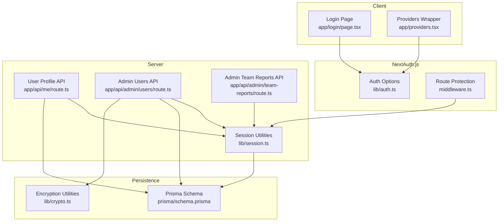
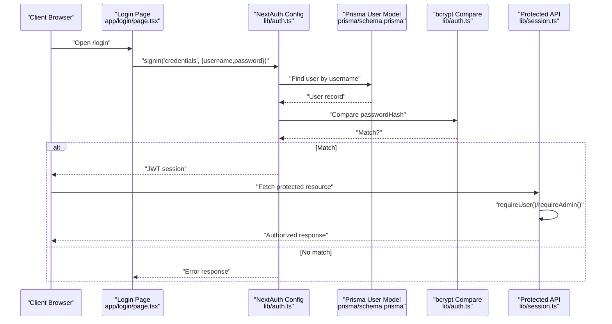
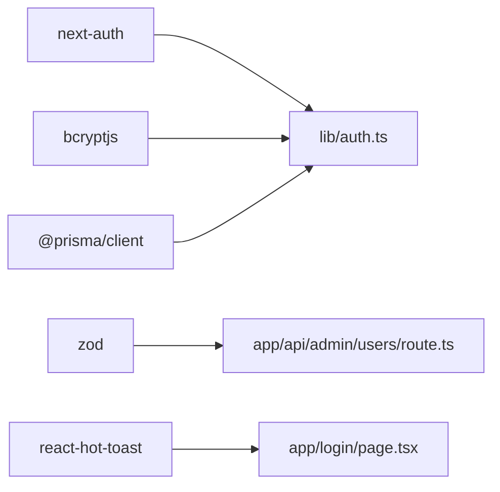
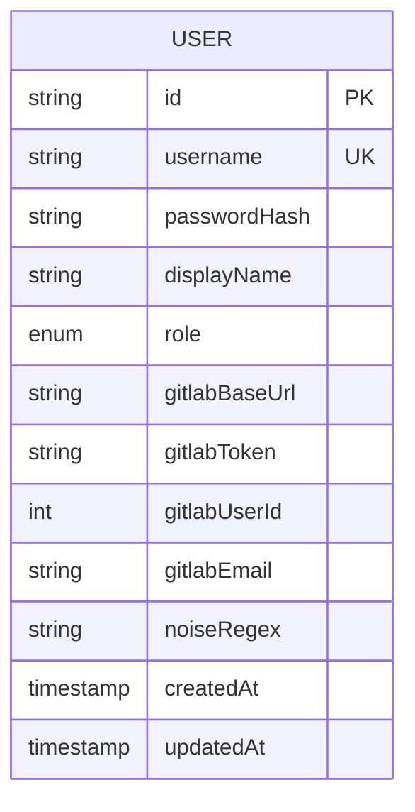

# Authentication and Authorization

<cite>
**Referenced Files in This Document**
- [lib/auth.ts](file://lib/auth.ts)
- [middleware.ts](file://middleware.ts)
- [lib/session.ts](file://lib/session.ts)
- [app/login/page.tsx](file://app/login/page.tsx)
- [app/providers.tsx](file://app/providers.tsx)
- [app/api/me/route.ts](file://app/api/me/route.ts)
- [app/api/admin/users/route.ts](file://app/api/admin/users/route.ts)
- [app/api/admin/team-reports/route.ts](file://app/api/admin/team-reports/route.ts)
- [lib/crypto.ts](file://lib/crypto.ts)
- [prisma/schema.prisma](file://prisma/schema.prisma)
- [package.json](file://package.json)
</cite>

## Table of Contents
1. [Introduction](#introduction)
2. [Project Structure](#project-structure)
3. [Core Components](#core-components)
4. [Architecture Overview](#architecture-overview)
5. [Detailed Component Analysis](#detailed-component-analysis)
6. [Dependency Analysis](#dependency-analysis)
7. [Performance Considerations](#performance-considerations)
8. [Security Best Practices](#security-best-practices)
9. [Troubleshooting Guide](#troubleshooting-guide)
10. [Conclusion](#conclusion)
11. [Appendices](#appendices)

## Introduction
This document explains the authentication and authorization system for Pingyun Report. It covers NextAuth.js configuration with a custom JWT strategy, user roles (MEMBER and ADMIN), session management, and middleware-based route protection. It also documents the authentication flow from login to session validation, credential verification, token generation, and role-based access control. Additional topics include user registration, password hashing with bcrypt, session persistence, security best practices for token storage and validation, logout procedures, session timeout handling, concurrent session management, and examples of protected route implementation and role-checking utilities.

## Project Structure
Authentication-related components are organized across a few key areas:
- NextAuth.js configuration and JWT callbacks
- Middleware for route protection
- Client-side login page using credentials provider
- Server-side session utilities and role checks
- Protected API endpoints for admin and user management
- Prisma schema defining user roles and sensitive fields
- Encryption utilities for secure storage of tokens

**Diagram sources**
- [lib/auth.ts:30-77](file://lib/auth.ts#L30-L77)
- [middleware.ts:1-10](file://middleware.ts#L1-L10)
- [lib/session.ts:11-37](file://lib/session.ts#L11-L37)
- [app/login/page.tsx:17-32](file://app/login/page.tsx#L17-L32)
- [app/providers.tsx:3-7](file://app/providers.tsx#L3-L7)
- [app/api/me/route.ts:7-47](file://app/api/me/route.ts#L7-L47)
- [app/api/admin/users/route.ts:31-56](file://app/api/admin/users/route.ts#L31-L56)
- [app/api/admin/team-reports/route.ts:6-33](file://app/api/admin/team-reports/route.ts#L6-L33)
- [prisma/schema.prisma:16-33](file://prisma/schema.prisma#L16-L33)
- [lib/crypto.ts:17-45](file://lib/crypto.ts#L17-L45)

**Section sources**
- [lib/auth.ts:30-77](file://lib/auth.ts#L30-L77)
- [middleware.ts:1-10](file://middleware.ts#L1-L10)
- [lib/session.ts:11-37](file://lib/session.ts#L11-L37)
- [app/login/page.tsx:17-32](file://app/login/page.tsx#L17-L32)
- [app/providers.tsx:3-7](file://app/providers.tsx#L3-L7)
- [prisma/schema.prisma:16-33](file://prisma/schema.prisma#L16-L33)
- [lib/crypto.ts:17-45](file://lib/crypto.ts#L17-L45)

## Core Components
- NextAuth.js configuration with JWT strategy and credentials provider
- Middleware for protecting routes
- Session utilities for user and role checks
- Client-side login form using credentials provider
- Protected APIs for admin and user profile
- Prisma schema with Role enum and encrypted token field
- Encryption utilities for secure token storage

Key responsibilities:
- lib/auth.ts: Defines NextAuthOptions, credentials provider, JWT callbacks, and session strategy
- middleware.ts: Protects routes via next-auth/middleware
- lib/session.ts: Provides getSessionUser, requireUser, requireAdmin, and error wrapper
- app/login/page.tsx: Client-side login form submitting credentials
- app/api/me/route.ts: Returns current user profile with masked GitLab token
- app/api/admin/users/route.ts: Admin-only user creation, update, and deletion with bcrypt hashing
- app/api/admin/team-reports/route.ts: Admin-only endpoint to fetch team reports
- prisma/schema.prisma: Defines User model, Role enum, and encrypted token fields
- lib/crypto.ts: AES-256-GCM encryption/decryption and token masking

**Section sources**
- [lib/auth.ts:30-77](file://lib/auth.ts#L30-L77)
- [middleware.ts:1-10](file://middleware.ts#L1-L10)
- [lib/session.ts:11-37](file://lib/session.ts#L11-L37)
- [app/login/page.tsx:17-32](file://app/login/page.tsx#L17-L32)
- [app/api/me/route.ts:7-47](file://app/api/me/route.ts#L7-L47)
- [app/api/admin/users/route.ts:31-56](file://app/api/admin/users/route.ts#L31-L56)
- [app/api/admin/team-reports/route.ts:6-33](file://app/api/admin/team-reports/route.ts#L6-L33)
- [prisma/schema.prisma:16-33](file://prisma/schema.prisma#L16-L33)
- [lib/crypto.ts:17-45](file://lib/crypto.ts#L17-L45)

## Architecture Overview
The authentication system uses NextAuth.js with a JWT strategy. The client submits credentials to the credentials provider, which validates them against the database using bcrypt. On successful authentication, a JWT is issued and stored in the browser. Subsequent requests include the JWT, which is validated server-side. Middleware protects routes, while server-side utilities enforce role-based access control.

**Diagram sources**
- [app/login/page.tsx:17-32](file://app/login/page.tsx#L17-L32)
- [lib/auth.ts:40-57](file://lib/auth.ts#L40-L57)
- [prisma/schema.prisma:16-33](file://prisma/schema.prisma#L16-L33)
- [lib/session.ts:23-37](file://lib/session.ts#L23-L37)

**Section sources**
- [lib/auth.ts:30-77](file://lib/auth.ts#L30-L77)
- [middleware.ts:1-10](file://middleware.ts#L1-L10)
- [lib/session.ts:11-37](file://lib/session.ts#L11-L37)
- [app/login/page.tsx:17-32](file://app/login/page.tsx#L17-L32)

## Detailed Component Analysis

### NextAuth.js Configuration and JWT Strategy
- Session strategy: JWT
- Credentials provider: Validates username/password against database
- JWT callbacks: Attach user id, username, and role to JWT; populate session with JWT claims
- Pages: Redirect unauthenticated users to /login

Implementation highlights:
- Session strategy set to JWT
- Credentials provider authorize function queries user by username and compares password hash using bcrypt
- JWT callback stores uid, username, role
- Session callback populates session.user with JWT claims

**Section sources**
- [lib/auth.ts:30-77](file://lib/auth.ts#L30-L77)

### Middleware Implementation for Route Protection
- Uses next-auth/middleware with signIn page configured
- Protects root, history, settings, and admin routes via matcher
- Automatically redirects to /login when unauthenticated

**Section sources**
- [middleware.ts:1-10](file://middleware.ts#L1-L10)

### Client-Side Login Flow
- LoginForm captures username/password
- Calls signIn with credentials provider
- Handles errors and redirects on success

**Section sources**
- [app/login/page.tsx:17-32](file://app/login/page.tsx#L17-L32)

### Session Management Utilities
- getSessionUser: Returns current user or null
- requireUser: Throws 401 if no session
- requireAdmin: Throws 403 if not ADMIN
- withErrors: Converts thrown Responses into JSON responses

Usage patterns:
- Wrap API handlers with withErrors to normalize error responses
- Call requireUser/requireAdmin before performing privileged actions

**Section sources**
- [lib/session.ts:11-37](file://lib/session.ts#L11-L37)

### Protected API Endpoints
- GET /api/me: Requires user, returns profile with masked GitLab token
- GET /api/admin/users: Requires ADMIN, lists users
- POST /api/admin/users: Requires ADMIN, creates user with hashed password
- PATCH /api/admin/users: Requires ADMIN, updates user (optionally hashes new password)
- DELETE /api/admin/users: Requires ADMIN, deletes user
- GET /api/admin/team-reports: Requires ADMIN, fetches team reports for a given date

**Section sources**
- [app/api/me/route.ts:7-47](file://app/api/me/route.ts#L7-L47)
- [app/api/admin/users/route.ts:31-56](file://app/api/admin/users/route.ts#L31-L56)
- [app/api/admin/users/route.ts:65-77](file://app/api/admin/users/route.ts#L65-L77)
- [app/api/admin/team-reports/route.ts:6-33](file://app/api/admin/team-reports/route.ts#L6-L33)

### User Roles and Prisma Schema
- Role enum: MEMBER, ADMIN
- User model includes role with default MEMBER
- Encrypted token field for GitLab token using AES-256-GCM

**Section sources**
- [prisma/schema.prisma:11-14](file://prisma/schema.prisma#L11-L14)
- [prisma/schema.prisma:16-33](file://prisma/schema.prisma#L16-L33)

### Password Hashing and Token Storage
- bcrypt used for password hashing during registration and validation
- GitLab token stored encrypted and returned masked for safety

**Section sources**
- [lib/auth.ts:46](file://lib/auth.ts#L46)
- [app/api/admin/users/route.ts:39](file://app/api/admin/users/route.ts#L39)
- [app/api/me/route.ts:24-32](file://app/api/me/route.ts#L24-L32)
- [lib/crypto.ts:17-45](file://lib/crypto.ts#L17-L45)

### Logout Procedures
- NextAuth.js does not expose a built-in signOut endpoint in this codebase
- To log out, clients should clear local session state and redirect to a logout action if implemented
- Consider adding a dedicated API endpoint to invalidate sessions if needed

[No sources needed since this section provides general guidance]

### Session Timeout and Validation
- JWT strategy implies client-side token storage; expiration is controlled by JWT configuration
- Configure JWT lifetime and revalidation in NextAuth options as needed
- Use callbacks to refresh or reject tokens based on external conditions

[No sources needed since this section provides general guidance]

### Concurrent Sessions Management
- JWT strategy supports multiple concurrent sessions per client
- To enforce single-session behavior, implement token blacklisting or revocation mechanisms
- Store issued token identifiers and validate against a revocation list

[No sources needed since this section provides general guidance]

### Examples of Protected Routes and Role Checking
- Use requireUser to protect user-specific resources
- Use requireAdmin to protect administrative endpoints
- Wrap handlers with withErrors to normalize error responses

**Section sources**
- [lib/session.ts:23-37](file://lib/session.ts#L23-L37)
- [app/api/me/route.ts:7-47](file://app/api/me/route.ts#L7-L47)
- [app/api/admin/users/route.ts:31-56](file://app/api/admin/users/route.ts#L31-L56)

## Dependency Analysis
External dependencies relevant to authentication:
- next-auth: Provides NextAuth.js framework and middleware
- bcryptjs: Used for password hashing and comparison
- @prisma/client: ORM for user and report data
- zod: Schema validation for API payloads
- react-hot-toast: Client-side notifications for login errors

**Diagram sources**
- [package.json:16-31](file://package.json#L16-L31)
- [lib/auth.ts:2-4](file://lib/auth.ts#L2-L4)
- [app/api/admin/users/route.ts:24-29](file://app/api/admin/users/route.ts#L24-L29)
- [app/login/page.tsx:6](file://app/login/page.tsx#L6)

**Section sources**
- [package.json:16-31](file://package.json#L16-L31)

## Performance Considerations
- Prefer bcrypt cost factors appropriate for deployment environment to balance security and performance
- Cache frequently accessed user metadata to reduce database queries
- Minimize payload sizes in JWT claims to reduce bandwidth and storage overhead
- Use pagination for admin endpoints that list large datasets

[No sources needed since this section provides general guidance]

## Security Best Practices
- Token storage
  - Store JWT securely in HttpOnly cookies if using cookie strategy, or in memory/localStorage with CSRF protection if using JWT
  - Avoid logging tokens or exposing them in URLs
- Token rotation and validation
  - Set reasonable JWT expiration times
  - Implement refresh token strategy if needed
  - Validate token signatures and claims server-side
- Password security
  - Use bcrypt with sufficient cost factor
  - Enforce strong password policies
- Sensitive data
  - Encrypt tokens at rest using AES-256-GCM
  - Mask tokens in UI and logs
- Access control
  - Always check roles server-side for privileged endpoints
  - Use least privilege principle for default role (MEMBER)

[No sources needed since this section provides general guidance]

## Troubleshooting Guide
Common issues and resolutions:
- Unauthorized errors on protected routes
  - Ensure middleware is configured and routes are matched
  - Verify session is present and valid
- 401/403 responses
  - Confirm requireUser/requireAdmin is called before privileged operations
  - Check role assignment in database
- Login failures
  - Validate username exists and password matches hash
  - Confirm bcrypt compare succeeds
- Token decryption errors
  - Verify ENCRYPTION_KEY environment variable is set correctly
  - Ensure encrypted token format is preserved

**Section sources**
- [lib/session.ts:23-37](file://lib/session.ts#L23-L37)
- [lib/auth.ts:40-57](file://lib/auth.ts#L40-L57)
- [lib/crypto.ts:7-15](file://lib/crypto.ts#L7-L15)

## Conclusion
Pingyun Report’s authentication system leverages NextAuth.js with a JWT strategy, providing robust credential-based authentication, middleware-driven route protection, and role-based access control. The design separates concerns between client-side login, server-side session utilities, and protected APIs. Security is strengthened through bcrypt-based password hashing, encrypted token storage, and masked token presentation. Extending the system with logout, token rotation, and single-session enforcement would further harden the solution.

[No sources needed since this section summarizes without analyzing specific files]

## Appendices

### Appendix A: Data Model for Users

**Diagram sources**
- [prisma/schema.prisma:16-33](file://prisma/schema.prisma#L16-L33)