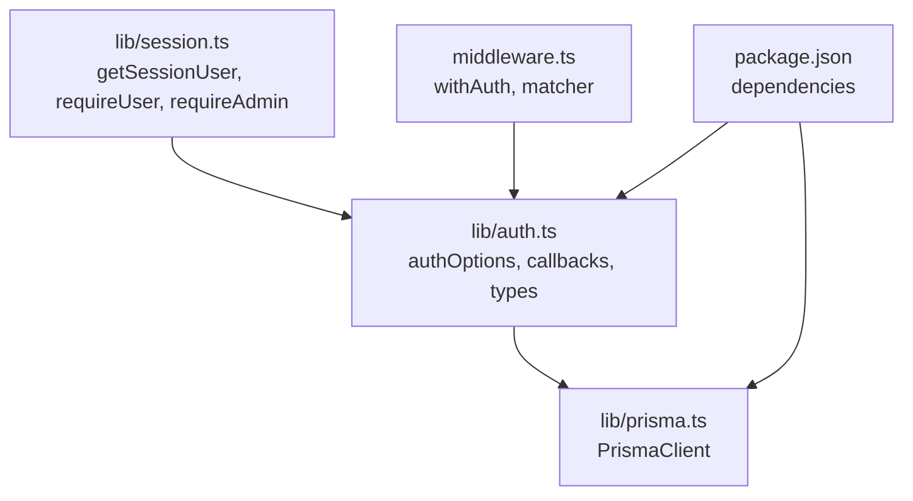
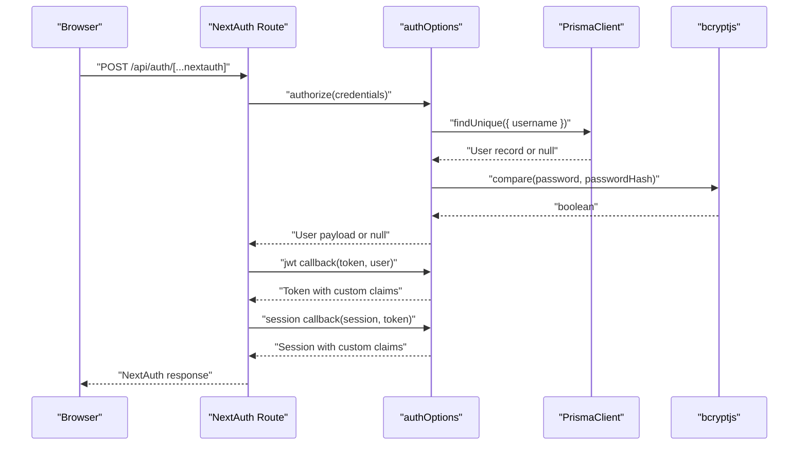
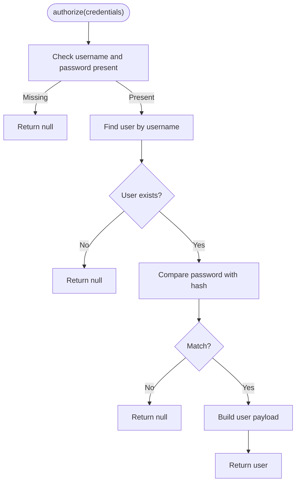
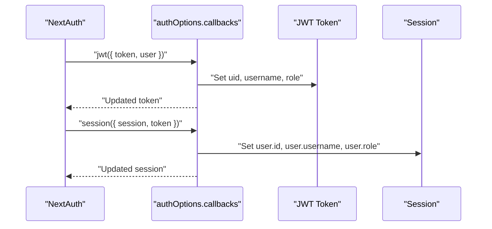
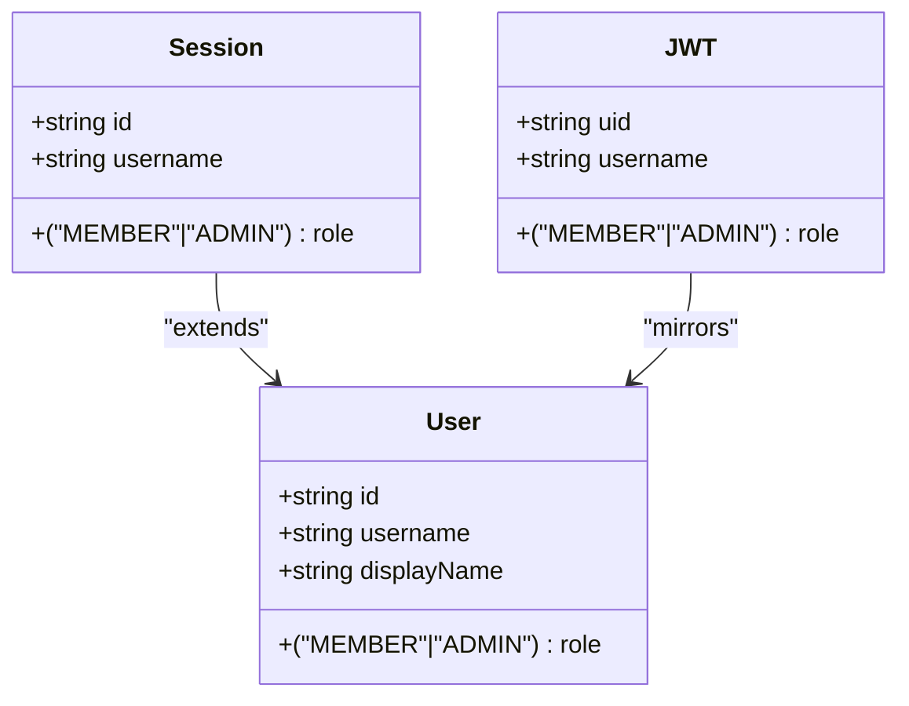
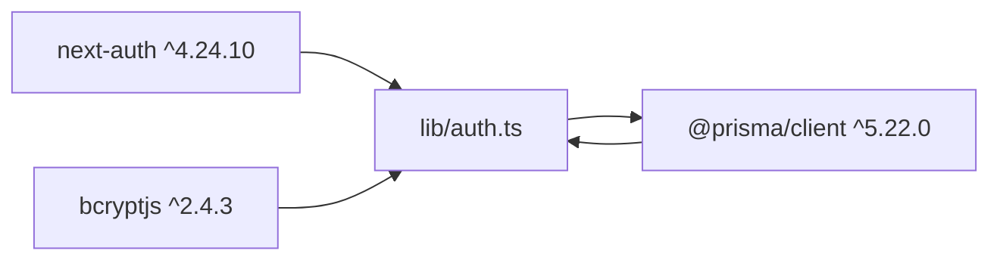

# NextAuth.js Configuration

<cite>
**Referenced Files in This Document**
- [lib/auth.ts](file://lib/auth.ts)
- [lib/prisma.ts](file://lib/prisma.ts)
- [lib/session.ts](file://lib/session.ts)
- [middleware.ts](file://middleware.ts)
- [package.json](file://package.json)
</cite>

## Table of Contents
1. [Introduction](#introduction)
2. [Project Structure](#project-structure)
3. [Core Components](#core-components)
4. [Architecture Overview](#architecture-overview)
5. [Detailed Component Analysis](#detailed-component-analysis)
6. [Dependency Analysis](#dependency-analysis)
7. [Performance Considerations](#performance-considerations)
8. [Troubleshooting Guide](#troubleshooting-guide)
9. [Conclusion](#conclusion)

## Introduction
This document explains the NextAuth.js configuration used in Pingyun Report. It focuses on the authOptions object setup with JWT session strategy, credential provider configuration, and TypeScript module augmentation for strongly typed User and Session interfaces. It also details the authorize callback that authenticates users against the Prisma database using bcrypt, the JWT and session callbacks that transform tokens to sessions and inject custom claims, and outlines configuration examples for credential fields, session duration, and provider setup. Type safety is achieved via module augmentation and custom JWT properties.

## Project Structure
The authentication system is centered around a small set of cohesive modules:
- Authentication configuration and callbacks
- Prisma client initialization
- Server-side session helpers and guards
- Middleware for protected routes
- Dependencies declared in package.json

**Diagram sources**
- [lib/auth.ts:1-77](file://lib/auth.ts#L1-L77)
- [lib/prisma.ts:1-14](file://lib/prisma.ts#L1-L14)
- [lib/session.ts:1-56](file://lib/session.ts#L1-L56)
- [middleware.ts:1-10](file://middleware.ts#L1-L10)
- [package.json:16-31](file://package.json#L16-L31)

**Section sources**
- [lib/auth.ts:1-77](file://lib/auth.ts#L1-L77)
- [lib/prisma.ts:1-14](file://lib/prisma.ts#L1-L14)
- [lib/session.ts:1-56](file://lib/session.ts#L1-L56)
- [middleware.ts:1-10](file://middleware.ts#L1-L10)
- [package.json:16-31](file://package.json#L16-L31)

## Core Components
- authOptions: Defines NextAuth.js behavior, including session strategy, provider, pages, and callbacks.
- Credential Provider: Validates user credentials against the database using bcrypt.
- JWT and Session Callbacks: Populate and extract custom claims (uid, username, role) from tokens to session.
- Module Augmentation: Extends NextAuth types for User, Session, and JWT to include custom fields.
- Prisma Integration: Uses PrismaClient to fetch user records and compare hashed passwords.
- Session Utilities: Provides server-side helpers to access typed session data and enforce roles.
- Middleware Protection: Protects routes using NextAuth middleware.

**Section sources**
- [lib/auth.ts:30-77](file://lib/auth.ts#L30-L77)
- [lib/auth.ts:6-28](file://lib/auth.ts#L6-L28)
- [lib/prisma.ts:1-14](file://lib/prisma.ts#L1-L14)
- [lib/session.ts:1-56](file://lib/session.ts#L1-L56)
- [middleware.ts:1-10](file://middleware.ts#L1-L10)

## Architecture Overview
The authentication pipeline integrates NextAuth.js with Prisma and middleware to secure application routes.

**Diagram sources**
- [lib/auth.ts:40-56](file://lib/auth.ts#L40-L56)
- [lib/auth.ts:58-75](file://lib/auth.ts#L58-L75)
- [lib/prisma.ts:1-14](file://lib/prisma.ts#L1-L14)

## Detailed Component Analysis

### authOptions and Session Strategy
- Session strategy is configured to use JWT.
- Sign-in page is mapped to the login route.
- Provider is configured as Credentials with labeled fields for username and password.
- No custom session duration is set; defaults apply.

Key configuration references:
- Session strategy and pages: [lib/auth.ts:30-33](file://lib/auth.ts#L30-L33)
- Provider definition: [lib/auth.ts:34-57](file://lib/auth.ts#L34-L57)

**Section sources**
- [lib/auth.ts:30-57](file://lib/auth.ts#L30-L57)

### Credential Provider and authorize Callback
- Validates presence of username and password.
- Fetches user by username from Prisma.
- Compares password hash using bcrypt.
- Returns a normalized user object with id, username, displayName, role, and name when successful.

Important implementation references:
- authorize input validation: [lib/auth.ts:40-41](file://lib/auth.ts#L40-L41)
- Prisma lookup: [lib/auth.ts:42-44](file://lib/auth.ts#L42-L44)
- bcrypt comparison: [lib/auth.ts:46](file://lib/auth.ts#L46)
- Successful return shape: [lib/auth.ts:48-54](file://lib/auth.ts#L48-L54)

**Diagram sources**
- [lib/auth.ts:40-54](file://lib/auth.ts#L40-L54)
- [lib/prisma.ts:1-14](file://lib/prisma.ts#L1-L14)

**Section sources**
- [lib/auth.ts:40-54](file://lib/auth.ts#L40-L54)

### JWT and Session Callbacks
- jwt callback: On initial sign-in, attaches uid, username, and role to the token.
- session callback: Injects id, username, and role into the session object derived from the token.

References:
- jwt callback: [lib/auth.ts:58-66](file://lib/auth.ts#L58-L66)
- session callback: [lib/auth.ts:67-74](file://lib/auth.ts#L67-L74)

**Diagram sources**
- [lib/auth.ts:58-74](file://lib/auth.ts#L58-L74)

**Section sources**
- [lib/auth.ts:58-74](file://lib/auth.ts#L58-L74)

### TypeScript Module Augmentation and Type Safety
Module augmentation ensures strong typing for:
- Session.user: adds id, username, and role fields.
- User: adds id, username, displayName, and role fields.
- JWT: adds uid, username, and role fields.

References:
- Session augmentation: [lib/auth.ts:6-20](file://lib/auth.ts#L6-L20)
- JWT augmentation: [lib/auth.ts:22-28](file://lib/auth.ts#L22-L28)
- Session utilities type: [lib/session.ts:5-9](file://lib/session.ts#L5-L9)

**Diagram sources**
- [lib/auth.ts:6-28](file://lib/auth.ts#L6-L28)
- [lib/session.ts:5-9](file://lib/session.ts#L5-L9)

**Section sources**
- [lib/auth.ts:6-28](file://lib/auth.ts#L6-L28)
- [lib/session.ts:5-9](file://lib/session.ts#L5-L9)

### Prisma Integration
- PrismaClient is initialized globally to avoid multiple instances.
- Logging level is tuned based on environment.
- The authorize callback uses Prisma to fetch the user and compare hashes.

References:
- Prisma client setup: [lib/prisma.ts:1-14](file://lib/prisma.ts#L1-L14)

**Section sources**
- [lib/prisma.ts:1-14](file://lib/prisma.ts#L1-L14)

### Server-Side Session Helpers and Guards
- getSessionUser: retrieves typed session user from the server session.
- requireUser: throws a 401 response if no session.
- requireAdmin: enforces ADMIN role and throws 403 if not authorized.
- withErrors: wraps handlers to convert thrown Responses into proper HTTP responses.

References:
- getSessionUser: [lib/session.ts:12-20](file://lib/session.ts#L12-L20)
- requireUser: [lib/session.ts:23-29](file://lib/session.ts#L23-L29)
- requireAdmin: [lib/session.ts:31-37](file://lib/session.ts#L31-L37)
- withErrors: [lib/session.ts:40-55](file://lib/session.ts#L40-L55)

**Section sources**
- [lib/session.ts:12-37](file://lib/session.ts#L12-L37)
- [lib/session.ts:40-55](file://lib/session.ts#L40-L55)

### Middleware Protection
- withAuth protects routes and redirects unauthenticated users to the sign-in page.
- Matcher defines protected paths under root, history, settings, and admin.

References:
- Middleware configuration: [middleware.ts:1-10](file://middleware.ts#L1-L10)

**Section sources**
- [middleware.ts:1-10](file://middleware.ts#L1-L10)

## Dependency Analysis
- NextAuth.js v4 is used for authentication.
- bcryptjs is used for password hashing verification.
- @prisma/client is used for database access.
- The auth configuration depends on Prisma and bcrypt.

**Diagram sources**
- [package.json:16-31](file://package.json#L16-L31)
- [lib/auth.ts:1-5](file://lib/auth.ts#L1-L5)

**Section sources**
- [package.json:16-31](file://package.json#L16-L31)
- [lib/auth.ts:1-5](file://lib/auth.ts#L1-L5)

## Performance Considerations
- Using JWT session strategy avoids server-side session storage and reduces database load for session retrieval.
- Password comparison occurs only during sign-in; bcryptjs is efficient for typical workloads.
- Prisma client is reused globally to prevent connection overhead.

[No sources needed since this section provides general guidance]

## Troubleshooting Guide
Common issues and resolutions:
- Unauthorized errors: Ensure the user is authenticated and the session contains id, username, and role. Use requireUser to detect missing session.
- Forbidden errors: Verify the user role is ADMIN when accessing admin routes.
- 401/403 responses: The session guards throw explicit responses; catch and handle them appropriately in API routes.
- Middleware redirect loop: Confirm the signIn page path matches the configured NextAuth pages.signIn.

References:
- Unauthorized guard: [lib/session.ts:23-29](file://lib/session.ts#L23-L29)
- Forbidden guard: [lib/session.ts:31-37](file://lib/session.ts#L31-L37)
- Middleware pages.signIn: [middleware.ts:4](file://middleware.ts#L4)
- NextAuth pages.signIn: [lib/auth.ts:32](file://lib/auth.ts#L32)

**Section sources**
- [lib/session.ts:23-37](file://lib/session.ts#L23-L37)
- [middleware.ts:4](file://middleware.ts#L4)
- [lib/auth.ts:32](file://lib/auth.ts#L32)

## Conclusion
The NextAuth.js configuration in Pingyun Report uses a JWT-based session strategy with a Credentials provider. Strong type safety is enforced via module augmentation for Session, User, and JWT. The authorize callback authenticates users against Prisma using bcrypt, while JWT and session callbacks propagate custom claims to the token and session. Server-side helpers and middleware provide robust protection and typed access to session data across the application.

[No sources needed since this section summarizes without analyzing specific files]