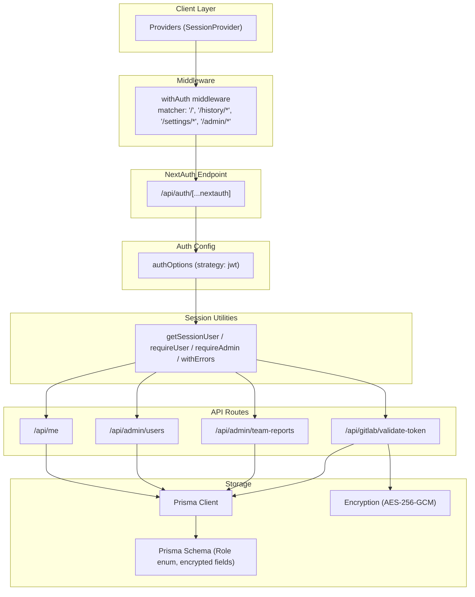
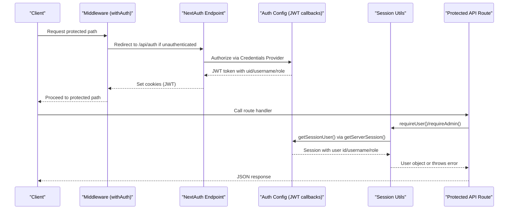
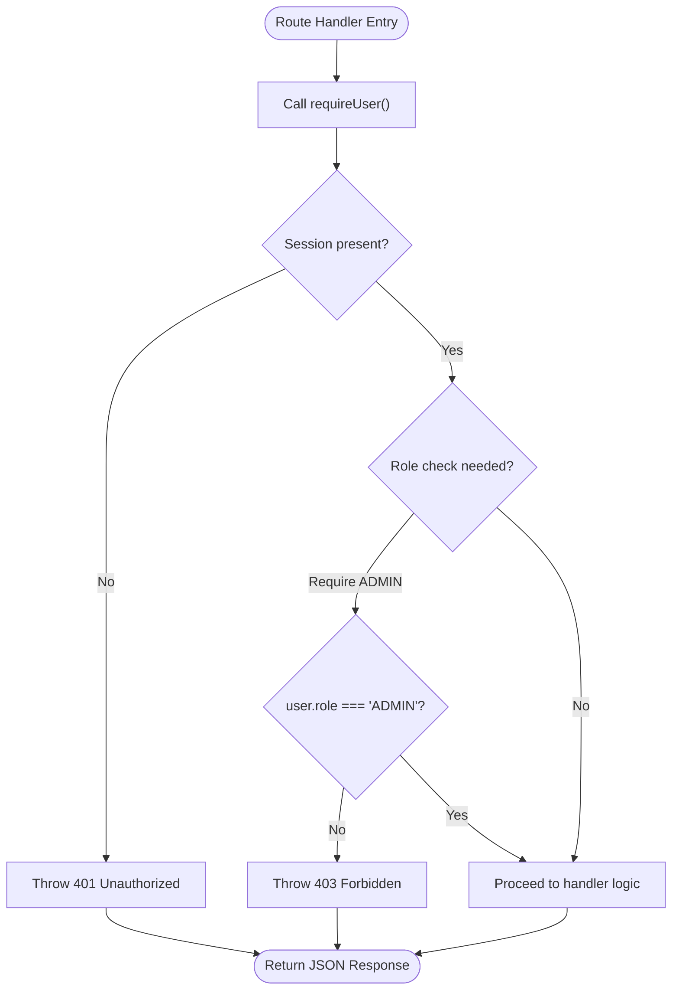
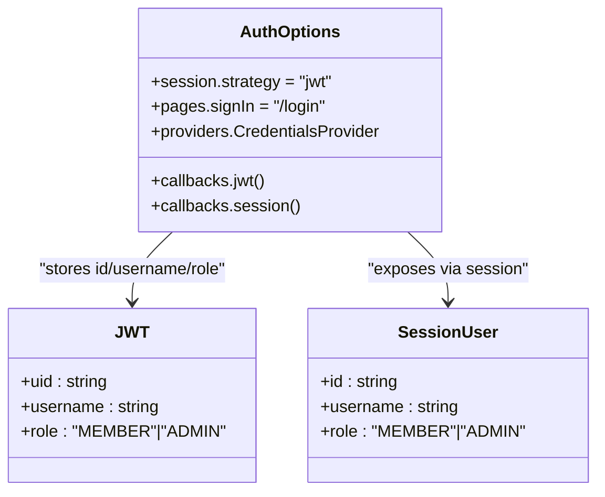
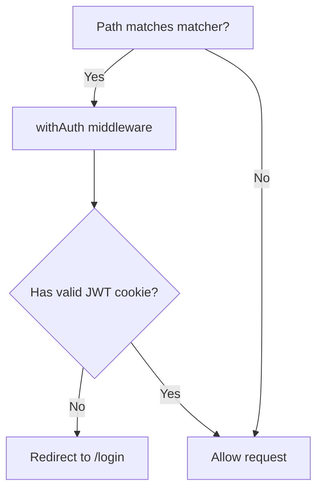
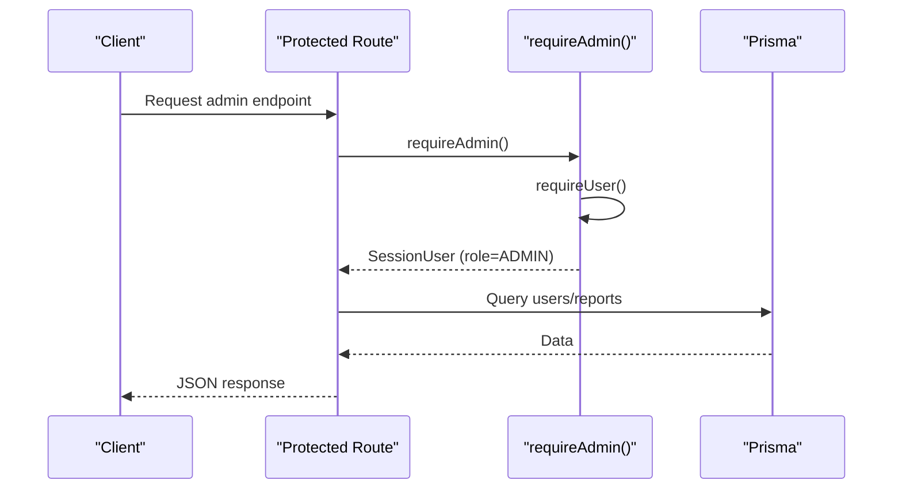
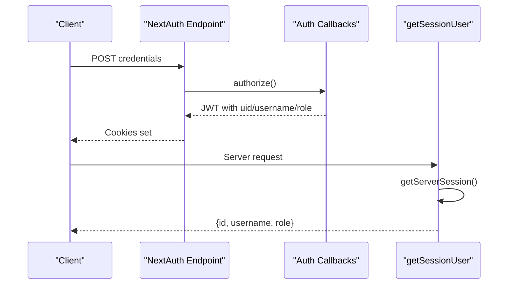
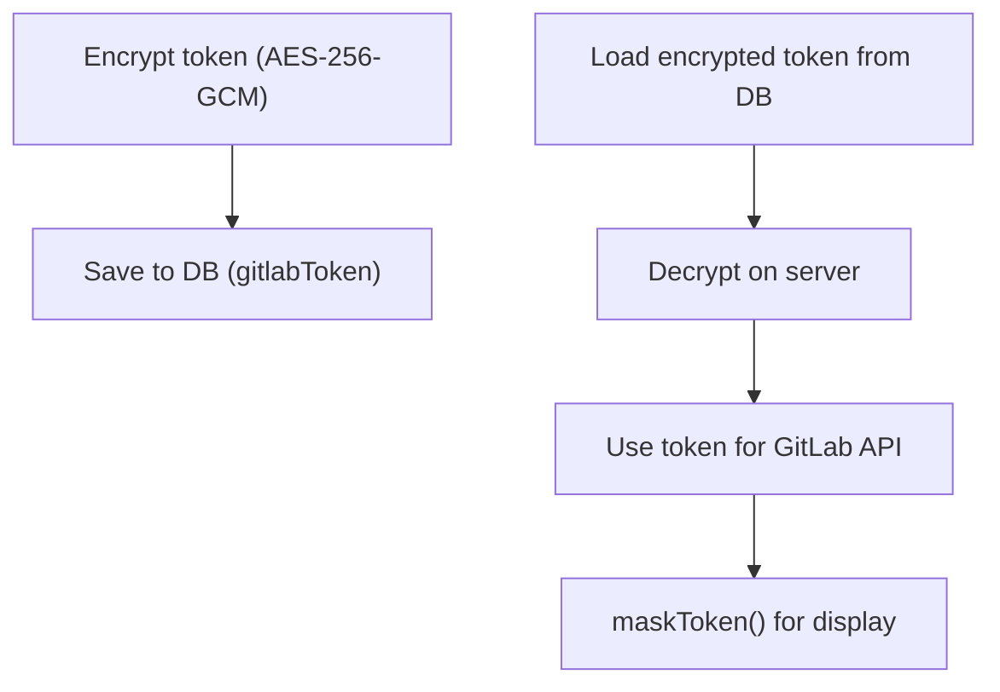
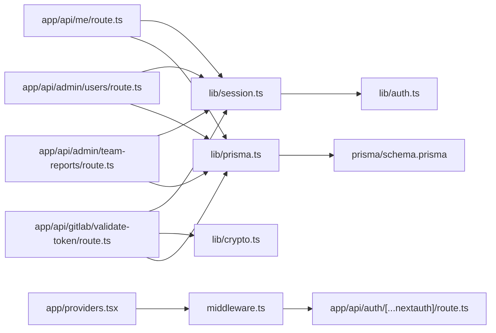

# Session Management

<cite>
**Referenced Files in This Document**
- [lib/session.ts](file://lib/session.ts)
- [lib/auth.ts](file://lib/auth.ts)
- [middleware.ts](file://middleware.ts)
- [app/providers.tsx](file://app/providers.tsx)
- [app/api/auth/[...nextauth]/route.ts](file://app/api/auth/[...nextauth]/route.ts)
- [app/api/me/route.ts](file://app/api/me/route.ts)
- [app/api/admin/team-reports/route.ts](file://app/api/admin/team-reports/route.ts)
- [app/api/admin/users/route.ts](file://app/api/admin/users/route.ts)
- [app/api/gitlab/validate-token/route.ts](file://app/api/gitlab/validate-token/route.ts)
- [lib/crypto.ts](file://lib/crypto.ts)
- [lib/prisma.ts](file://lib/prisma.ts)
- [prisma/schema.prisma](file://prisma/schema.prisma)
</cite>

## Table of Contents
1. [Introduction](#introduction)
2. [Project Structure](#project-structure)
3. [Core Components](#core-components)
4. [Architecture Overview](#architecture-overview)
5. [Detailed Component Analysis](#detailed-component-analysis)
6. [Dependency Analysis](#dependency-analysis)
7. [Performance Considerations](#performance-considerations)
8. [Troubleshooting Guide](#troubleshooting-guide)
9. [Conclusion](#conclusion)

## Introduction
This document explains the session management implementation for Pingyun Report. It covers JWT-based authentication via NextAuth.js, server-side session retrieval utilities, middleware protection for routes, role-based access control (RBAC) enforcement, and secure handling of sensitive data such as third-party tokens. It also documents how protected routes are structured, how errors are normalized, and how encryption keys are managed for token storage.

## Project Structure
The session management spans several layers:
- Authentication configuration and JWT callbacks
- Middleware for route protection
- Server-side session utilities for validation and RBAC
- API routes that enforce authentication and roles
- Encryption utilities for secure token storage
- Database schema modeling user roles and encrypted fields

**Diagram sources**
- [app/providers.tsx:1-7](file://app/providers.tsx#L1-L7)
- [middleware.ts:1-10](file://middleware.ts#L1-L10)
- [app/api/auth/[...nextauth]/route.ts:1-6](file://app/api/auth/[...nextauth]/route.ts#L1-L6)
- [lib/auth.ts:30-76](file://lib/auth.ts#L30-L76)
- [lib/session.ts:11-55](file://lib/session.ts#L11-L55)
- [app/api/me/route.ts:1-67](file://app/api/me/route.ts#L1-L67)
- [app/api/admin/users/route.ts:1-88](file://app/api/admin/users/route.ts#L1-L88)
- [app/api/admin/team-reports/route.ts:1-34](file://app/api/admin/team-reports/route.ts#L1-L34)
- [app/api/gitlab/validate-token/route.ts:1-81](file://app/api/gitlab/validate-token/route.ts#L1-L81)
- [lib/crypto.ts:1-46](file://lib/crypto.ts#L1-L46)
- [lib/prisma.ts:1-14](file://lib/prisma.ts#L1-L14)
- [prisma/schema.prisma:11-33](file://prisma/schema.prisma#L11-L33)

**Section sources**
- [lib/session.ts:1-56](file://lib/session.ts#L1-L56)
- [lib/auth.ts:1-77](file://lib/auth.ts#L1-L77)
- [middleware.ts:1-10](file://middleware.ts#L1-L10)
- [app/providers.tsx:1-7](file://app/providers.tsx#L1-L7)
- [app/api/auth/[...nextauth]/route.ts:1-6](file://app/api/auth/[...nextauth]/route.ts#L1-L6)
- [lib/crypto.ts:1-46](file://lib/crypto.ts#L1-L46)
- [lib/prisma.ts:1-14](file://lib/prisma.ts#L1-L14)
- [prisma/schema.prisma:11-33](file://prisma/schema.prisma#L11-L33)

## Core Components
- Session utilities
  - getSessionUser: retrieves current user from server session or returns null
  - requireUser: throws 401 if no session; otherwise returns user
  - requireAdmin: throws 403 if user is not ADMIN after requiring a session
  - withErrors: wraps route handlers to normalize thrown errors into JSON responses
- NextAuth configuration
  - Strategy: JWT
  - Credentials provider with bcrypt password verification
  - JWT and session callbacks to attach id, username, role to token and session
- Middleware
  - withAuth protects routes and redirects unauthenticated users to /login
  - Matcher restricts protection to specific paths
- Providers
  - SessionProvider wraps the app to enable client-side use of session data

**Section sources**
- [lib/session.ts:11-55](file://lib/session.ts#L11-L55)
- [lib/auth.ts:30-76](file://lib/auth.ts#L30-L76)
- [middleware.ts:1-10](file://middleware.ts#L1-L10)
- [app/providers.tsx:1-7](file://app/providers.tsx#L1-L7)

## Architecture Overview
The system uses server-side JWT sessions with NextAuth.js. On the server, getSessionUser reads the current session and extracts id, username, and role. Route handlers call requireUser or requireAdmin to enforce authentication and RBAC. Middleware enforces authentication globally for protected paths. Sensitive tokens are stored encrypted in the database and decrypted only on the server during runtime.

**Diagram sources**
- [middleware.ts:1-10](file://middleware.ts#L1-L10)
- [app/api/auth/[...nextauth]/route.ts:1-6](file://app/api/auth/[...nextauth]/route.ts#L1-L6)
- [lib/auth.ts:30-76](file://lib/auth.ts#L30-L76)
- [lib/session.ts:11-29](file://lib/session.ts#L11-L29)
- [app/api/me/route.ts:7-23](file://app/api/me/route.ts#L7-L23)

## Detailed Component Analysis

### Session Utilities
- getSessionUser
  - Reads server session using NextAuth’s getServerSession with configured authOptions
  - Returns typed SessionUser or null if missing
- requireUser
  - Validates session presence; throws 401 Unauthorized if absent
- requireAdmin
  - Enforces ADMIN role; throws 403 Forbidden if role mismatch
- withErrors
  - Normalizes thrown errors into JSON responses with appropriate HTTP status
  - Converts thrown Response instances directly to HTTP responses
  - Logs unexpected errors and returns 500 Internal Server Error

**Diagram sources**
- [lib/session.ts:22-37](file://lib/session.ts#L22-L37)
- [lib/session.ts:40-55](file://lib/session.ts#L40-L55)

**Section sources**
- [lib/session.ts:11-55](file://lib/session.ts#L11-L55)

### NextAuth Configuration and JWT Handling
- Strategy: JWT
- Credentials provider
  - Validates username/password against Prisma User model
  - Uses bcrypt to compare password hash
- JWT callback
  - Stores id, username, role into token on initial login
- Session callback
  - Injects id, username, role into session object for server-side use

**Diagram sources**
- [lib/auth.ts:30-76](file://lib/auth.ts#L30-L76)
- [lib/session.ts:5-19](file://lib/session.ts#L5-L19)

**Section sources**
- [lib/auth.ts:30-76](file://lib/auth.ts#L30-L76)

### Middleware Implementation
- withAuth wraps the app to protect routes
- pages.signIn defines redirect target for unauthenticated requests
- matcher restricts protection to:
  - Root path
  - History subpaths
  - Settings subpaths
  - Admin subpaths

**Diagram sources**
- [middleware.ts:3-9](file://middleware.ts#L3-L9)

**Section sources**
- [middleware.ts:1-10](file://middleware.ts#L1-L10)

### Protected Route Examples and RBAC
- Member-only routes
  - Example: GET /api/me validates session and returns user profile
  - Example: POST /api/gitlab/validate-token validates session and persists masked token
- Admin-only routes
  - GET /api/admin/team-reports validates ADMIN role and returns aggregated reports
  - GET/POST/PATCH/DELETE /api/admin/users validates ADMIN role and manages users

**Diagram sources**
- [app/api/admin/team-reports/route.ts:6-33](file://app/api/admin/team-reports/route.ts#L6-L33)
- [app/api/admin/users/route.ts:7-87](file://app/api/admin/users/route.ts#L7-L87)
- [lib/session.ts:31-37](file://lib/session.ts#L31-L37)

**Section sources**
- [app/api/me/route.ts:7-47](file://app/api/me/route.ts#L7-L47)
- [app/api/admin/team-reports/route.ts:6-33](file://app/api/admin/team-reports/route.ts#L6-L33)
- [app/api/admin/users/route.ts:7-87](file://app/api/admin/users/route.ts#L7-L87)
- [lib/session.ts:31-37](file://lib/session.ts#L31-L37)

### Session Creation, Validation, and Cleanup
- Creation
  - Successful login via Credentials Provider stores id, username, role in JWT via callbacks
- Validation
  - Server-side getSessionUser reads current session
  - requireUser/requireAdmin enforce presence and role checks
- Cleanup
  - Logout is handled by NextAuth endpoint; middleware redirects to /login for unauthenticated requests

**Diagram sources**
- [app/api/auth/[...nextauth]/route.ts:1-6](file://app/api/auth/[...nextauth]/route.ts#L1-L6)
- [lib/auth.ts:58-74](file://lib/auth.ts#L58-L74)
- [lib/session.ts:12-19](file://lib/session.ts#L12-L19)

**Section sources**
- [lib/auth.ts:58-74](file://lib/auth.ts#L58-L74)
- [lib/session.ts:12-19](file://lib/session.ts#L12-L19)

### Role-Based Access Control (RBAC)
- Roles
  - MEMBER: can access member-only endpoints
  - ADMIN: can access admin endpoints and member endpoints
- Enforcement
  - requireAdmin throws 403 if role is not ADMIN
  - requireUser throws 401 if session is absent

**Section sources**
- [lib/session.ts:31-37](file://lib/session.ts#L31-L37)
- [prisma/schema.prisma:11-14](file://prisma/schema.prisma#L11-L14)

### Session Timeout Handling
- JWT expiration is governed by NextAuth’s JWT lifetime defaults
- No explicit client-side refresh logic is implemented; clients should reauthenticate when cookies expire

[No sources needed since this section provides general guidance]

### Concurrent Session Management
- The implementation relies on single JWT cookie per browser session
- There is no explicit mechanism to manage multiple concurrent sessions or enforce logout elsewhere

[No sources needed since this section provides general guidance]

### Token Security Measures
- Encrypted storage
  - gitlabToken is stored encrypted with AES-256-GCM and base64-encoded
  - Decryption occurs server-side only; raw tokens are never returned to the client
- Masked display
  - maskToken shows a safe preview of tokens for UI
- Environment key
  - ENCRYPTION_KEY must be a 64-character hex string (32 bytes); validated at runtime

**Diagram sources**
- [lib/crypto.ts:17-45](file://lib/crypto.ts#L17-L45)
- [app/api/gitlab/validate-token/route.ts:37-38](file://app/api/gitlab/validate-token/route.ts#L37-L38)
- [app/api/me/route.ts:24-32](file://app/api/me/route.ts#L24-L32)

**Section sources**
- [lib/crypto.ts:17-45](file://lib/crypto.ts#L17-L45)
- [app/api/gitlab/validate-token/route.ts:13-38](file://app/api/gitlab/validate-token/route.ts#L13-L38)
- [app/api/me/route.ts:24-32](file://app/api/me/route.ts#L24-L32)

### Token Refresh Strategies
- No dedicated token refresh endpoint is implemented
- Clients can re-authenticate to obtain a new JWT
- GitLab token validation supports optional token updates and refreshes project caches

**Section sources**
- [app/api/gitlab/validate-token/route.ts:13-79](file://app/api/gitlab/validate-token/route.ts#L13-L79)

### Session Invalidation Procedures
- Logout is handled by NextAuth; unauthenticated requests are redirected to /login by middleware
- To invalidate a session, clients should trigger NextAuth sign-out flow

**Section sources**
- [middleware.ts:3-5](file://middleware.ts#L3-L5)

## Dependency Analysis
- Session utilities depend on NextAuth’s getServerSession and authOptions
- API routes depend on session utilities for RBAC
- Crypto utilities depend on ENCRYPTION_KEY environment variable
- Prisma schema defines Role enum and encrypted token field
- Middleware depends on NextAuth middleware wrapper

**Diagram sources**
- [lib/session.ts:1-3](file://lib/session.ts#L1-L3)
- [lib/auth.ts:1-4](file://lib/auth.ts#L1-L4)
- [app/api/me/route.ts:1-4](file://app/api/me/route.ts#L1-L4)
- [app/api/admin/users/route.ts:1-5](file://app/api/admin/users/route.ts#L1-L5)
- [app/api/admin/team-reports/route.ts:1-4](file://app/api/admin/team-reports/route.ts#L1-L4)
- [app/api/gitlab/validate-token/route.ts:1-5](file://app/api/gitlab/validate-token/route.ts#L1-L5)
- [lib/crypto.ts:1-15](file://lib/crypto.ts#L1-L15)
- [lib/prisma.ts:1-14](file://lib/prisma.ts#L1-L14)
- [prisma/schema.prisma:11-33](file://prisma/schema.prisma#L11-L33)
- [middleware.ts:1-5](file://middleware.ts#L1-L5)
- [app/providers.tsx:1-7](file://app/providers.tsx#L1-L7)
- [app/api/auth/[...nextauth]/route.ts:1-6](file://app/api/auth/[...nextauth]/route.ts#L1-L6)

**Section sources**
- [lib/session.ts:1-3](file://lib/session.ts#L1-L3)
- [lib/auth.ts:1-4](file://lib/auth.ts#L1-L4)
- [lib/crypto.ts:1-15](file://lib/crypto.ts#L1-L15)
- [lib/prisma.ts:1-14](file://lib/prisma.ts#L1-L14)
- [prisma/schema.prisma:11-33](file://prisma/schema.prisma#L11-L33)
- [middleware.ts:1-5](file://middleware.ts#L1-L5)
- [app/providers.tsx:1-7](file://app/providers.tsx#L1-L7)
- [app/api/auth/[...nextauth]/route.ts:1-6](file://app/api/auth/[...nextauth]/route.ts#L1-L6)

## Performance Considerations
- JWT callbacks run on login and on each session read; keep logic lightweight
- Avoid heavy operations inside callbacks and session utilities
- Use Prisma efficiently with selective field queries in route handlers

[No sources needed since this section provides general guidance]

## Troubleshooting Guide
- 401 Unauthorized
  - Occurs when requireUser finds no session
  - Verify middleware matcher and NextAuth endpoint availability
- 403 Forbidden
  - Occurs when requireAdmin is called but user role is not ADMIN
  - Confirm user role in database and schema
- 500 Internal Server Error
  - withErrors normalizes thrown errors; check server logs for stack traces
- Encryption key issues
  - ENCRYPTION_KEY must be a 64-character hex string; invalid key length triggers error
- GitLab token validation failures
  - Ensure token is valid and baseUrl is correct; masked token display indicates partial visibility

**Section sources**
- [lib/session.ts:22-37](file://lib/session.ts#L22-L37)
- [lib/session.ts:40-55](file://lib/session.ts#L40-L55)
- [lib/crypto.ts:7-15](file://lib/crypto.ts#L7-L15)
- [app/api/gitlab/validate-token/route.ts:13-38](file://app/api/gitlab/validate-token/route.ts#L13-L38)

## Conclusion
Pingyun Report implements robust server-side JWT session management with NextAuth.js, enforced via middleware and route-level utilities. Authentication and RBAC are centralized in session utilities, while sensitive tokens are securely stored and handled. The design emphasizes simplicity, security, and maintainability, with clear separation between server-side session logic and client-side providers.