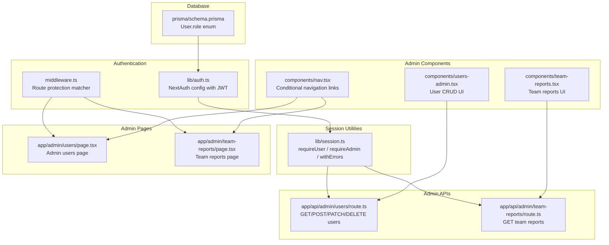
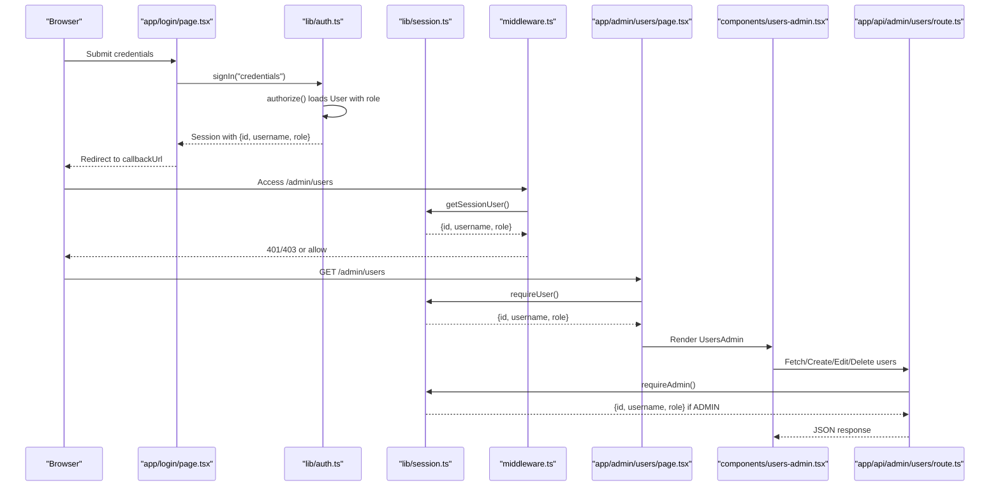
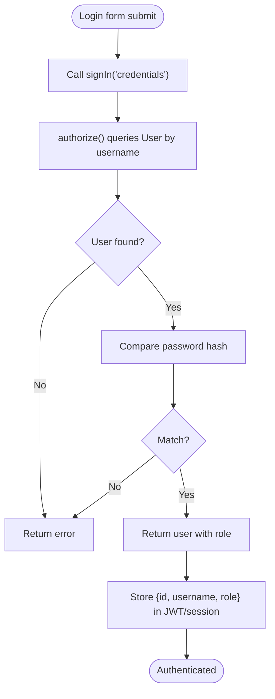
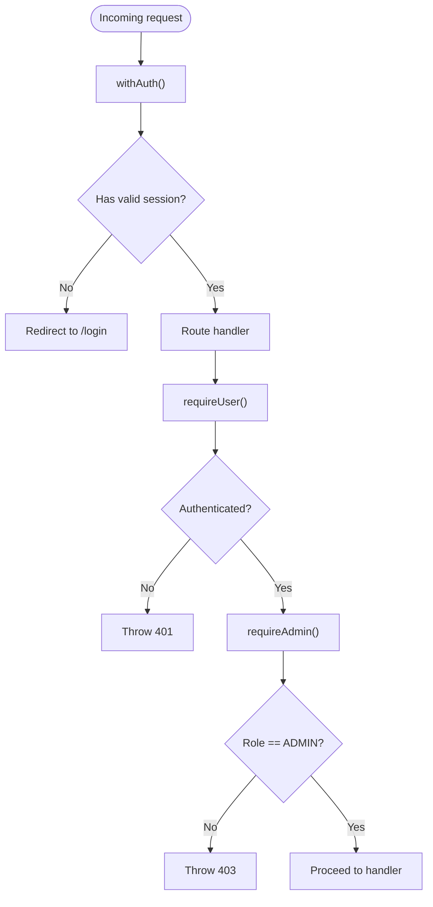
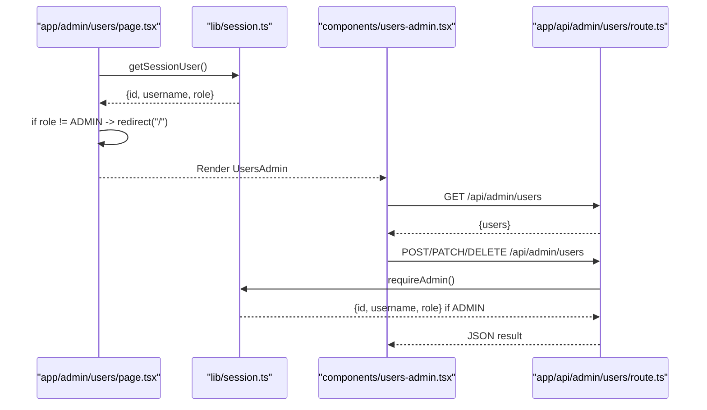
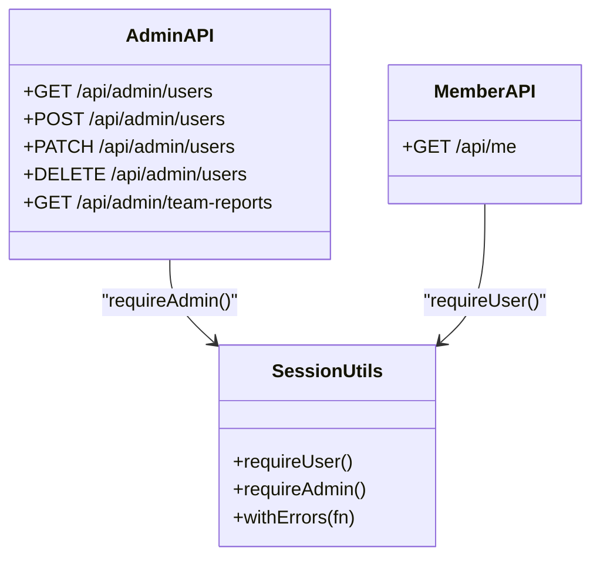
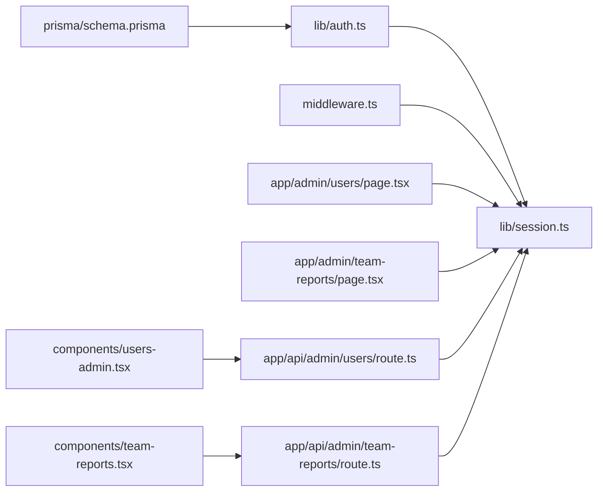

# User Roles and Permissions

<cite>
**Referenced Files in This Document**
- [auth.ts](file://lib/auth.ts)
- [session.ts](file://lib/session.ts)
- [middleware.ts](file://middleware.ts)
- [schema.prisma](file://prisma/schema.prisma)
- [users\page.tsx](file://app/admin/users/page.tsx)
- [team-reports\page.tsx](file://app/admin/team-reports/page.tsx)
- [users-admin.tsx](file://components/users-admin.tsx)
- [team-reports.tsx](file://components/team-reports.tsx)
- [nav.tsx](file://components/nav.tsx)
- [users\route.ts](file://app/api/admin/users/route.ts)
- [team-reports\route.ts](file://app/api/admin/team-reports/route.ts)
- [me\route.ts](file://app/api/me/route.ts)
- [login\page.tsx](file://app/login/page.tsx)
</cite>

## Table of Contents
1. [Introduction](#introduction)
2. [Project Structure](#project-structure)
3. [Core Components](#core-components)
4. [Architecture Overview](#architecture-overview)
5. [Detailed Component Analysis](#detailed-component-analysis)
6. [Dependency Analysis](#dependency-analysis)
7. [Performance Considerations](#performance-considerations)
8. [Troubleshooting Guide](#troubleshooting-guide)
9. [Conclusion](#conclusion)

## Introduction
This document explains the user role-based access control (RBAC) model in Pingyun Report. It covers the role hierarchy, permission matrices, role assignment and authentication flow, role-checking utilities, middleware protections, admin panel access restrictions, and user management capabilities. It also provides examples of conditional UI rendering, protected API endpoints, and role-based feature availability, along with security considerations around role inheritance and escalation.

## Project Structure
The RBAC implementation spans authentication configuration, server-side session utilities, middleware protection, database schema, admin UI pages, and admin API endpoints.

**Diagram sources**
- [auth.ts:30-76](file://lib/auth.ts#L30-L76)
- [middleware.ts:1-10](file://middleware.ts#L1-L10)
- [session.ts:11-37](file://lib/session.ts#L11-L37)
- [schema.prisma:11-33](file://prisma/schema.prisma#L11-L33)
- [users\page.tsx:8-21](file://app/admin/users/page.tsx#L8-L21)
- [team-reports\page.tsx:8-21](file://app/admin/team-reports/page.tsx#L8-L21)
- [users-admin.tsx:16-186](file://components/users-admin.tsx#L16-L186)
- [team-reports.tsx:23-113](file://components/team-reports.tsx#L23-L113)
- [nav.tsx:12-74](file://components/nav.tsx#L12-L74)
- [users\route.ts:7-87](file://app/api/admin/users/route.ts#L7-L87)
- [team-reports\route.ts:6-33](file://app/api/admin/team-reports/route.ts#L6-L33)

**Section sources**
- [auth.ts:30-76](file://lib/auth.ts#L30-L76)
- [session.ts:11-37](file://lib/session.ts#L11-L37)
- [middleware.ts:1-10](file://middleware.ts#L1-10)
- [schema.prisma:11-33](file://prisma/schema.prisma#L11-L33)
- [users\page.tsx:8-21](file://app/admin/users/page.tsx#L8-L21)
- [team-reports\page.tsx:8-21](file://app/admin/team-reports/page.tsx#L8-L21)
- [users-admin.tsx:16-186](file://components/users-admin.tsx#L16-L186)
- [team-reports.tsx:23-113](file://components/team-reports.tsx#L23-L113)
- [nav.tsx:12-74](file://components/nav.tsx#L12-L74)
- [users\route.ts:7-87](file://app/api/admin/users/route.ts#L7-L87)
- [team-reports\route.ts:6-33](file://app/api/admin/team-reports/route.ts#L6-L33)

## Core Components
- Role model: Two roles are defined in the database schema: MEMBER and ADMIN.
- Authentication: NextAuth with JWT strategy stores role in both session and JWT tokens.
- Authorization utilities: requireUser and requireAdmin enforce role checks in API handlers.
- Middleware: Protects routes under "/" and "/admin/*".
- Admin pages: Enforce role checks server-side and render role-specific UI.
- Admin APIs: Expose user management and team reports endpoints guarded by requireAdmin.

**Section sources**
- [schema.prisma:11-21](file://prisma/schema.prisma#L11-L21)
- [auth.ts:30-76](file://lib/auth.ts#L30-L76)
- [session.ts:11-37](file://lib/session.ts#L11-L37)
- [middleware.ts:7-9](file://middleware.ts#L7-L9)
- [users\page.tsx:9-11](file://app/admin/users/page.tsx#L9-L11)
- [team-reports\page.tsx:9-11](file://app/admin/team-reports/page.tsx#L9-L11)

## Architecture Overview
The RBAC architecture integrates authentication, session management, middleware protection, and role-aware UI/API layers.

**Diagram sources**
- [login\page.tsx:17-32](file://app/login/page.tsx#L17-L32)
- [auth.ts:40-55](file://lib/auth.ts#L40-L55)
- [session.ts:11-37](file://lib/session.ts#L11-L37)
- [middleware.ts:1-9](file://middleware.ts#L1-L9)
- [users\page.tsx:9-11](file://app/admin/users/page.tsx#L9-L11)
- [users-admin.tsx:23-54](file://components/users-admin.tsx#L23-L54)
- [users\route.ts:7-87](file://app/api/admin/users/route.ts#L7-L87)

## Detailed Component Analysis

### Role Hierarchy and Permission Matrix
- Roles
  - MEMBER: Standard user with read/write access to personal resources (reports, templates, settings).
  - ADMIN: Full administrative access including user management and team reports inspection.
- Permission matrix (by endpoint and UI)
  - Member-only endpoints/UI: Personal profile and settings.
  - Admin-only endpoints/UI: User management, team reports dashboard.
  - Shared: Reports generation, templates, GitLab integrations, AI polish (no role gating in provided code).

Notes:
- The schema defines only two roles and no explicit permissions per resource. The application enforces ADMIN-only access to admin endpoints and pages.
- There is no role inheritance beyond ADMIN/MEMBER; escalation is performed via direct role updates.

**Section sources**
- [schema.prisma:11-21](file://prisma/schema.prisma#L11-L21)
- [users\page.tsx:11](file://app/admin/users/page.tsx#L11)
- [team-reports\page.tsx:11](file://app/admin/team-reports/page.tsx#L11)
- [users\route.ts:31-32](file://app/api/admin/users/route.ts#L31-L32)
- [team-reports\route.ts:6](file://app/api/admin/team-reports/route.ts#L6)

### Role Assignment During Registration and Authentication
- Authentication flow
  - Credentials provider validates username/password against stored hash.
  - On success, the returned user includes role, which is stored in JWT and session.
- Registration behavior
  - Admin API supports creating users with optional role; defaults to MEMBER when not specified.
  - No public registration endpoint is present in the examined files.

**Diagram sources**
- [login\page.tsx:17-32](file://app/login/page.tsx#L17-L32)
- [auth.ts:40-55](file://lib/auth.ts#L40-L55)
- [auth.ts:59-74](file://lib/auth.ts#L59-L74)

**Section sources**
- [login\page.tsx:17-32](file://app/login/page.tsx#L17-L32)
- [auth.ts:40-55](file://lib/auth.ts#L40-L55)
- [auth.ts:59-74](file://lib/auth.ts#L59-L74)
- [users\route.ts:31-55](file://app/api/admin/users/route.ts#L31-L55)

### Role Checking Utilities and Middleware Protection
- Session utilities
  - requireUser: throws 401 if not authenticated.
  - requireAdmin: throws 403 if role is not ADMIN.
  - withErrors: wraps route handlers to convert errors into JSON responses.
- Middleware
  - withAuth protects matched routes and redirects unauthenticated users to /login.
  - Matcher includes "/", "/history/:path*", "/settings/:path*", "/admin/:path*".

**Diagram sources**
- [middleware.ts:1-9](file://middleware.ts#L1-L9)
- [session.ts:22-37](file://lib/session.ts#L22-L37)
- [users\page.tsx:9-11](file://app/admin/users/page.tsx#L9-L11)
- [team-reports\page.tsx:9-11](file://app/admin/team-reports/page.tsx#L9-L11)

**Section sources**
- [session.ts:11-37](file://lib/session.ts#L11-L37)
- [middleware.ts:1-9](file://middleware.ts#L1-9)
- [users\page.tsx:9-11](file://app/admin/users/page.tsx#L9-L11)
- [team-reports\page.tsx:9-11](file://app/admin/team-reports/page.tsx#L9-L11)

### Admin Panel Access Restrictions and User Management
- Admin pages
  - Both /admin/users and /admin/team-reports check getSessionUser and redirect non-admins to home.
- User management UI
  - UsersAdmin component renders a table of users and exposes actions: create, reset password, change role, delete.
  - These actions call /api/admin/users with appropriate HTTP methods.
- Team reports UI
  - TeamReports component lists users and displays their daily reports; shows ADMIN badge for admins.

**Diagram sources**
- [users\page.tsx:9-11](file://app/admin/users/page.tsx#L9-L11)
- [session.ts:11-37](file://lib/session.ts#L11-L37)
- [users-admin.tsx:23-87](file://components/users-admin.tsx#L23-L87)
- [users\route.ts:7-87](file://app/api/admin/users/route.ts#L7-L87)

**Section sources**
- [users\page.tsx:9-11](file://app/admin/users/page.tsx#L9-L11)
- [users-admin.tsx:16-186](file://components/users-admin.tsx#L16-L186)
- [users\route.ts:7-87](file://app/api/admin/users/route.ts#L7-L87)

### Protected API Endpoints and Role-Based Feature Availability
- Admin-only endpoints
  - GET /api/admin/users: List users.
  - POST /api/admin/users: Create user (role defaults to MEMBER if unspecified).
  - PATCH /api/admin/users: Update user (supports updating role).
  - DELETE /api/admin/users: Delete user.
  - GET /api/admin/team-reports: Retrieve team reports for a given date.
- Member-only endpoints
  - GET /api/me: Personal profile and settings (no role gating in code).
- Conditional UI rendering
  - Navigation shows admin links only to ADMIN users.
  - Team reports UI marks ADMIN users distinctly.

**Diagram sources**
- [users\route.ts:7-87](file://app/api/admin/users/route.ts#L7-L87)
- [team-reports\route.ts:6-33](file://app/api/admin/team-reports/route.ts#L6-L33)
- [me\route.ts:7-47](file://app/api/me/route.ts#L7-L47)
- [session.ts:22-37](file://lib/session.ts#L22-L37)

**Section sources**
- [users\route.ts:7-87](file://app/api/admin/users/route.ts#L7-L87)
- [team-reports\route.ts:6-33](file://app/api/admin/team-reports/route.ts#L6-L33)
- [me\route.ts:7-47](file://app/api/me/route.ts#L7-L47)
- [nav.tsx:38-59](file://components/nav.tsx#L38-L59)
- [team-reports.tsx:85-87](file://components/team-reports.tsx#L85-L87)

### Examples of Role-Based Access Patterns
- Conditional UI rendering
  - Admin navigation links appear only when user.role is ADMIN.
  - Admin badge shown next to ADMIN users in team reports.
- Protected routes
  - Server-side redirect prevents non-admins from accessing admin pages.
- Protected APIs
  - requireAdmin blocks unauthorized modifications to users and team reports.

**Section sources**
- [nav.tsx:38-59](file://components/nav.tsx#L38-L59)
- [team-reports.tsx:85-87](file://components/team-reports.tsx#L85-L87)
- [users\page.tsx:11](file://app/admin/users/page.tsx#L11)
- [team-reports\page.tsx:11](file://app/admin/team-reports/page.tsx#L11)
- [users\route.ts:31-32](file://app/api/admin/users/route.ts#L31-L32)

## Dependency Analysis
- Authentication depends on the User model’s role field.
- Session utilities depend on NextAuth configuration and are used by middleware and API handlers.
- Admin pages depend on session utilities to enforce role checks.
- Admin components depend on admin APIs for data and mutations.
- Admin APIs depend on session utilities for authorization and Prisma for persistence.

**Diagram sources**
- [auth.ts:30-76](file://lib/auth.ts#L30-L76)
- [session.ts:11-37](file://lib/session.ts#L11-L37)
- [schema.prisma:11-33](file://prisma/schema.prisma#L11-L33)
- [middleware.ts:1-9](file://middleware.ts#L1-L9)
- [users\page.tsx:9-11](file://app/admin/users/page.tsx#L9-L11)
- [team-reports\page.tsx:9-11](file://app/admin/team-reports/page.tsx#L9-L11)
- [users-admin.tsx:23-87](file://components/users-admin.tsx#L23-L87)
- [team-reports.tsx:29](file://components/team-reports.tsx#L29)
- [users\route.ts:7-87](file://app/api/admin/users/route.ts#L7-L87)
- [team-reports\route.ts:6-33](file://app/api/admin/team-reports/route.ts#L6-L33)

**Section sources**
- [auth.ts:30-76](file://lib/auth.ts#L30-L76)
- [session.ts:11-37](file://lib/session.ts#L11-L37)
- [schema.prisma:11-33](file://prisma/schema.prisma#L11-L33)
- [middleware.ts:1-9](file://middleware.ts#L1-L9)
- [users\page.tsx:9-11](file://app/admin/users/page.tsx#L9-L11)
- [team-reports\page.tsx:9-11](file://app/admin/team-reports/page.tsx#L9-L11)
- [users-admin.tsx:23-87](file://components/users-admin.tsx#L23-L87)
- [team-reports.tsx:29](file://components/team-reports.tsx#L29)
- [users\route.ts:7-87](file://app/api/admin/users/route.ts#L7-L87)
- [team-reports\route.ts:6-33](file://app/api/admin/team-reports/route.ts#L6-L33)

## Performance Considerations
- JWT-based sessions avoid repeated database lookups for authenticated requests.
- Admin endpoints perform minimal queries (list users, update single user, fetch reports by date).
- UI components fetch data on mount; consider caching or debouncing for frequent date changes in team reports.

## Troubleshooting Guide
- Unauthorized or Forbidden responses
  - 401 Unauthorized indicates missing or invalid session; verify authentication flow and middleware matcher.
  - 403 Forbidden indicates lack of ADMIN role; ensure the user’s role is set correctly in the database.
- Admin endpoints failing
  - Confirm requireAdmin is called at the start of handlers.
  - Verify withErrors wraps handlers to normalize error responses.
- UI not showing admin links
  - Ensure user.role is present in session and passed to Nav.
  - Confirm server-side redirect logic in admin pages.

**Section sources**
- [session.ts:22-37](file://lib/session.ts#L22-L37)
- [session.ts:39-55](file://lib/session.ts#L39-L55)
- [users\page.tsx:10-11](file://app/admin/users/page.tsx#L10-L11)
- [team-reports\page.tsx:10-11](file://app/admin/team-reports/page.tsx#L10-L11)
- [nav.tsx:38-59](file://components/nav.tsx#L38-L59)

## Conclusion
Pingyun Report implements a straightforward RBAC model with two roles: MEMBER and ADMIN. Authentication stores role in JWT/session, middleware protects routes, and server-side checks enforce admin-only access to sensitive pages and APIs. Admin pages and components conditionally render features based on role, while user management APIs support creation, updates (including role changes), and deletion. Security relies on strict enforcement of requireAdmin for administrative actions and server-side redirects for admin-only pages.