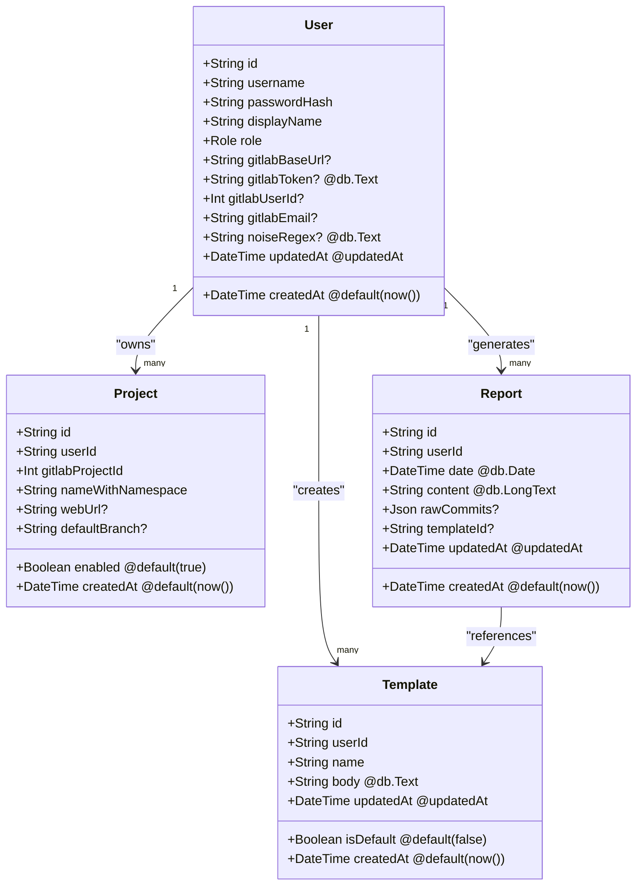
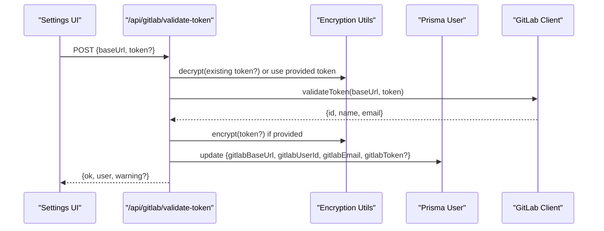
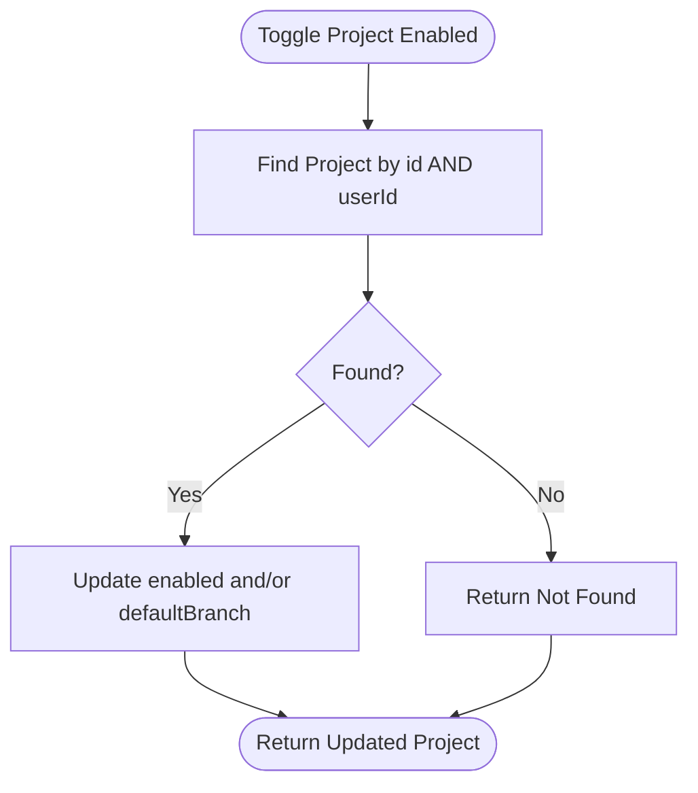
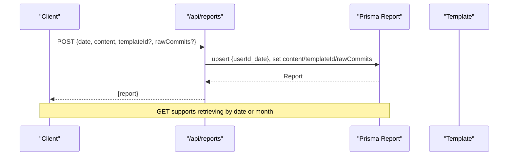
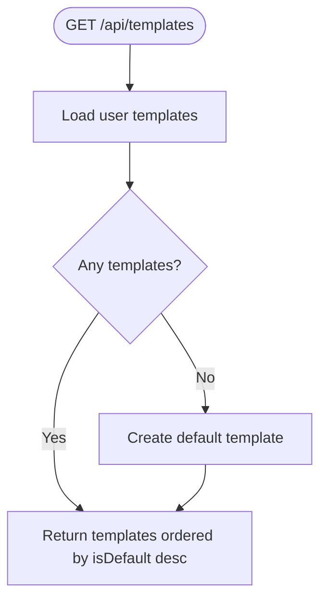
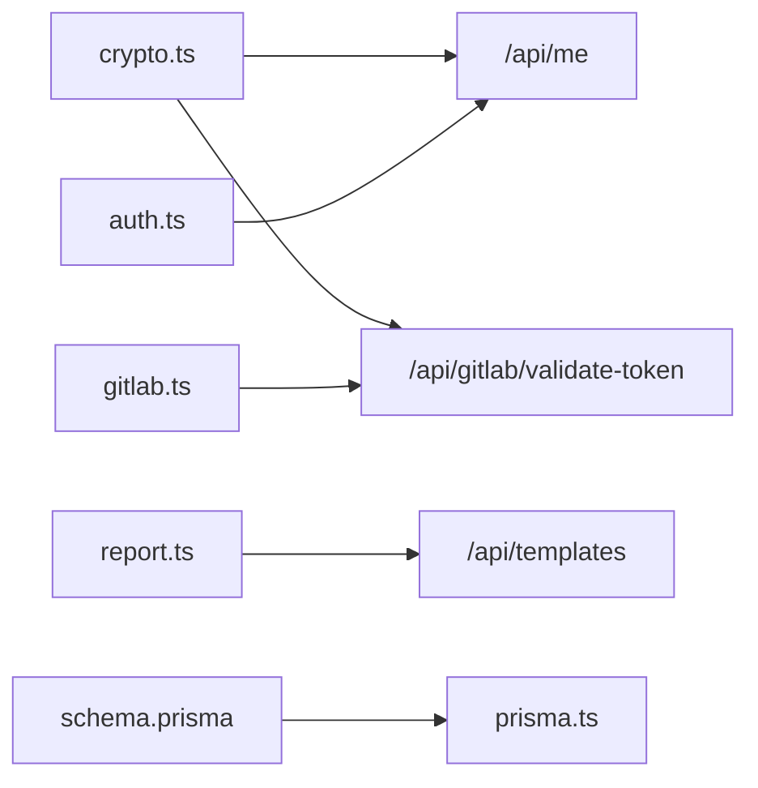

# Data Models and Field Definitions

<cite>
**Referenced Files in This Document**
- [schema.prisma](file://prisma/schema.prisma)
- [seed.ts](file://prisma/seed.ts)
- [README.md](file://README.md)
- [crypto.ts](file://lib/crypto.ts)
- [gitlab.ts](file://lib/gitlab.ts)
- [report.ts](file://lib/report.ts)
- [prisma.ts](file://lib/prisma.ts)
- [auth.ts](file://lib/auth.ts)
- [settings-form.tsx](file://components/settings-form.tsx)
- [route.ts (me)](file://app/api/me/route.ts)
- [route.ts (gitlab validate-token)](file://app/api/gitlab/validate-token/route.ts)
- [route.ts (gitlab projects)](file://app/api/gitlab/projects/route.ts)
- [route.ts (templates)](file://app/api/templates/route.ts)
- [route.ts (reports)](file://app/api/reports/route.ts)
- [route.ts (admin users)](file://app/api/admin/users/route.ts)
</cite>

## Table of Contents
1. [Introduction](#introduction)
2. [Project Structure](#project-structure)
3. [Core Components](#core-components)
4. [Architecture Overview](#architecture-overview)
5. [Detailed Component Analysis](#detailed-component-analysis)
6. [Dependency Analysis](#dependency-analysis)
7. [Performance Considerations](#performance-considerations)
8. [Troubleshooting Guide](#troubleshooting-guide)
9. [Conclusion](#conclusion)

## Introduction
This document describes the data models and field definitions used by Pingyun Report, focusing on how fields are typed, constrained, annotated, and validated. It explains the purpose of each field, business constraints, and how they integrate with authentication, GitLab integration, report generation, and templating. The models covered are User, Project, Report, and Template.

## Project Structure
The data models are defined in the Prisma schema and enforced by database constraints. Supporting libraries handle encryption, GitLab API interactions, report rendering, and authentication. API routes manage CRUD operations and enforce authorization and validation.

```mermaid
graph TB
subgraph "Data Layer"
PRISMA["Prisma Schema<br/>schema.prisma"]
SEED["Seed Script<br/>seed.ts"]
end
subgraph "Libraries"
CRYPTO["Encryption Utilities<br/>crypto.ts"]
GITLAB["GitLab Client Types & Calls<br/>gitlab.ts"]
REPORT["Report Rendering & Filters<br/>report.ts"]
AUTH["NextAuth Options & Types<br/>auth.ts"]
PRISMA_CLIENT["Prisma Client Init<br/>prisma.ts"]
end
subgraph "API Routes"
ME["/api/me<br/>route.ts"]
GL_VALIDATE["/api/gitlab/validate-token<br/>route.ts"]
GL_PROJECTS["/api/gitlab/projects<br/>route.ts"]
TEMPLATES["/api/templates<br/>route.ts"]
REPORTS["/api/reports<br/>route.ts"]
ADMIN_USERS["/api/admin/users<br/>route.ts"]
end
PRISMA --> PRISMA_CLIENT
SEED --> PRISMA_CLIENT
CRYPTO <- --> GL_VALIDATE
GITLAB --> GL_VALIDATE
REPORT --> TEMPLATES
AUTH --> ME
PRISMA_CLIENT --> ME
PRISMA_CLIENT --> GL_VALIDATE
PRISMA_CLIENT --> GL_PROJECTS
PRISMA_CLIENT --> TEMPLATES
PRISMA_CLIENT --> REPORTS
PRISMA_CLIENT --> ADMIN_USERS
```

**Diagram sources**
- [schema.prisma](file://prisma/schema.prisma)
- [seed.ts](file://prisma/seed.ts)
- [crypto.ts](file://lib/crypto.ts)
- [gitlab.ts](file://lib/gitlab.ts)
- [report.ts](file://lib/report.ts)
- [prisma.ts](file://lib/prisma.ts)
- [auth.ts](file://lib/auth.ts)
- [route.ts (me)](file://app/api/me/route.ts)
- [route.ts (gitlab validate-token)](file://app/api/gitlab/validate-token/route.ts)
- [route.ts (gitlab projects)](file://app/api/gitlab/projects/route.ts)
- [route.ts (templates)](file://app/api/templates/route.ts)
- [route.ts (reports)](file://app/api/reports/route.ts)
- [route.ts (admin users)](file://app/api/admin/users/route.ts)

**Section sources**
- [schema.prisma](file://prisma/schema.prisma)
- [README.md](file://README.md)

## Core Components
This section documents each model’s fields, data types, annotations, constraints, and business rules.

- Model: User
  - Purpose: Stores authentication, profile, role, and GitLab integration metadata for each user.
  - Fields and annotations:
    - id: String @id @default(cuid())
    - username: String @unique
    - passwordHash: String
    - displayName: String
    - role: Role @default(MEMBER)
    - gitlabBaseUrl: String? (nullable)
    - gitlabToken: String? @db.Text (encrypted at rest with AES-256-GCM; persisted as base64(iv | tag | ciphertext))
    - gitlabUserId: Int?
    - gitlabEmail: String?
    - noiseRegex: String? @db.Text (user-configured regex to filter commits by title)
    - createdAt: DateTime @default(now())
    - updatedAt: DateTime @updatedAt
  - Relationships:
    - projects: Project[]
    - reports: Report[]
    - templates: Template[]
  - Validation and constraints:
    - username uniqueness enforced by @unique.
    - role defaults to MEMBER.
    - noiseRegex stored as text; compiled into a regular expression during filtering.
    - gitlabToken encrypted before persistence; decrypted server-side for validation; masked preview shown to clients.
  - Business constraints:
    - Authentication uses bcrypt-compare against passwordHash.
    - GitLab token is optional; if absent, a token can be supplied later and will be encrypted.
    - noiseRegex is optional and case-insensitive when compiled.

- Model: Project
  - Purpose: Tracks a user’s GitLab project integrations and per-project settings.
  - Fields and annotations:
    - id: String @id @default(cuid())
    - userId: String (foreign key to User)
    - gitlabProjectId: Int
    - nameWithNamespace: String
    - webUrl: String?
    - defaultBranch: String?
    - enabled: Boolean @default(true)
    - createdAt: DateTime @default(now())
  - Relationships:
    - user: User (relation on userId -> User.id with onDelete: Cascade)
  - Constraints:
    - Unique composite index on (userId, gitlabProjectId) via @@unique([...]).
    - Index on userId via @@index([userId]).
  - Business constraints:
    - enabled toggles whether a project contributes to report generation.
    - defaultBranch overrides the project’s default branch for fetching commits.

- Model: Report
  - Purpose: Stores daily generated reports per user.
  - Fields and annotations:
    - id: String @id @default(cuid())
    - userId: String
    - date: DateTime @db.Date (date-only storage)
    - content: String @db.LongText (rendered Markdown content)
    - rawCommits: Json? (raw GitLab commit data captured during generation)
    - templateId: String? (links to a chosen Template)
    - createdAt: DateTime @default(now())
    - updatedAt: DateTime @updatedAt
  - Relationships:
    - user: User (onDelete: Cascade)
  - Constraints:
    - Unique composite index on (userId, date) via @@unique([...]).
    - Index on (userId, date) via @@index([...]).
  - Business constraints:
    - Upsert semantics by (userId, date) ensure one report per day per user.
    - templateId can be null; if null, the system falls back to a default template during rendering.

- Model: Template
  - Purpose: Stores user-defined report templates and default template selection.
  - Fields and annotations:
    - id: String @id @default(cuid())
    - userId: String
    - name: String
    - body: String @db.Text (template content, Handlebars-compatible)
    - isDefault: Boolean @default(false)
    - createdAt: DateTime @default(now())
    - updatedAt: DateTime @updatedAt
  - Relationships:
    - user: User (onDelete: Cascade)
  - Constraints:
    - Index on userId via @@index([userId]).
  - Business constraints:
    - Only one default template per user; setting a new default unsets previous default.
    - Seed initializes a default template for admin users if none exists.

**Section sources**
- [schema.prisma](file://prisma/schema.prisma)
- [seed.ts](file://prisma/seed.ts)
- [crypto.ts](file://lib/crypto.ts)
- [report.ts](file://lib/report.ts)
- [route.ts (me)](file://app/api/me/route.ts)
- [route.ts (gitlab validate-token)](file://app/api/gitlab/validate-token/route.ts)
- [route.ts (templates)](file://app/api/templates/route.ts)
- [route.ts (reports)](file://app/api/reports/route.ts)

## Architecture Overview
The models are orchestrated by API routes and utilities:
- Authentication uses NextAuth with a credentials provider backed by User.passwordHash.
- GitLab integration persists encrypted tokens and caches user info and project lists.
- Reports are generated per day and optionally associated with a template.
- Templates support default selection and per-user customization.



**Diagram sources**
- [schema.prisma](file://prisma/schema.prisma)

**Section sources**
- [schema.prisma](file://prisma/schema.prisma)

## Detailed Component Analysis

### User Model
- Authentication fields:
  - username: unique identifier; required for login.
  - passwordHash: bcrypt hash; compared against provided password during login.
- Profile fields:
  - displayName: human-friendly name; editable via /api/me PATCH.
- GitLab integration fields:
  - gitlabBaseUrl: base URL for GitLab instance; required for validation.
  - gitlabToken: encrypted PAT stored as base64 payload; never returned to client; masked preview shown.
  - gitlabUserId, gitlabEmail: cached user info from GitLab after validation.
- Noise regex configuration:
  - noiseRegex: optional regex applied to commit titles to filter out unwanted entries.



**Diagram sources**
- [route.ts (gitlab validate-token)](file://app/api/gitlab/validate-token/route.ts)
- [crypto.ts](file://lib/crypto.ts)
- [gitlab.ts](file://lib/gitlab.ts)

**Section sources**
- [schema.prisma](file://prisma/schema.prisma)
- [route.ts (me)](file://app/api/me/route.ts)
- [route.ts (gitlab validate-token)](file://app/api/gitlab/validate-token/route.ts)
- [crypto.ts](file://lib/crypto.ts)
- [settings-form.tsx](file://components/settings-form.tsx)

### Project Model
- Purpose: Associates a GitLab project with a user and controls inclusion and branch selection.
- Key fields:
  - gitlabProjectId: unique per user; ensures no duplicates via unique constraint.
  - enabled: toggles participation in report generation.
  - defaultBranch: optional override for branch used when fetching commits.
- Constraints:
  - Composite unique index on (userId, gitlabProjectId).
  - Index on userId for efficient queries.



**Diagram sources**
- [route.ts (gitlab projects)](file://app/api/gitlab/projects/route.ts)
- [schema.prisma](file://prisma/schema.prisma)

**Section sources**
- [schema.prisma](file://prisma/schema.prisma)
- [route.ts (gitlab projects)](file://app/api/gitlab/projects/route.ts)

### Report Model
- Purpose: Stores a single day’s report per user.
- Key fields:
  - date: @db.Date ensures only date is stored; time components are ignored.
  - content: @db.LongText holds rendered Markdown.
  - rawCommits: Json? captures original commit data for audit/debugging.
  - templateId: links to a chosen Template; nullable to allow default rendering.
- Constraints:
  - Unique index on (userId, date); upsert semantics ensure one report per day.
  - Index on (userId, date) supports efficient retrieval by date/month.



**Diagram sources**
- [route.ts (reports)](file://app/api/reports/route.ts)
- [schema.prisma](file://prisma/schema.prisma)

**Section sources**
- [schema.prisma](file://prisma/schema.prisma)
- [route.ts (reports)](file://app/api/reports/route.ts)

### Template Model
- Purpose: Provides customizable report templates with default selection.
- Key fields:
  - name: template title; max length enforced by API.
  - body: @db.Text containing Handlebars template.
  - isDefault: @default(false); only one default allowed per user.
- Behavior:
  - On first access, if no templates exist, a default template is created.
  - Setting a new default unsets the previous default.



**Diagram sources**
- [route.ts (templates)](file://app/api/templates/route.ts)
- [seed.ts](file://prisma/seed.ts)
- [report.ts](file://lib/report.ts)

**Section sources**
- [schema.prisma](file://prisma/schema.prisma)
- [route.ts (templates)](file://app/api/templates/route.ts)
- [seed.ts](file://prisma/seed.ts)
- [report.ts](file://lib/report.ts)

## Dependency Analysis
- Encryption dependency:
  - gitlabToken is encrypted/decrypted using AES-256-GCM; ENCRYPTION_KEY must be 64 hex chars.
- GitLab dependency:
  - All GitLab API calls are proxied server-side; tokens are never exposed to the client.
- Report rendering:
  - Templates are compiled via Handlebars; default template body is provided by report utilities.
- Authentication:
  - NextAuth credentials provider validates against User.passwordHash.



**Diagram sources**
- [crypto.ts](file://lib/crypto.ts)
- [gitlab.ts](file://lib/gitlab.ts)
- [report.ts](file://lib/report.ts)
- [auth.ts](file://lib/auth.ts)
- [prisma.ts](file://lib/prisma.ts)
- [schema.prisma](file://prisma/schema.prisma)
- [route.ts (me)](file://app/api/me/route.ts)
- [route.ts (gitlab validate-token)](file://app/api/gitlab/validate-token/route.ts)
- [route.ts (templates)](file://app/api/templates/route.ts)

**Section sources**
- [crypto.ts](file://lib/crypto.ts)
- [gitlab.ts](file://lib/gitlab.ts)
- [report.ts](file://lib/report.ts)
- [auth.ts](file://lib/auth.ts)
- [prisma.ts](file://lib/prisma.ts)
- [schema.prisma](file://prisma/schema.prisma)

## Performance Considerations
- Indexes:
  - Unique (userId, date) on Report prevents duplicate daily entries and supports fast lookup.
  - Index on (userId) on Project and Template improves filtering by user.
- Pagination and limits:
  - Report listing is capped (e.g., last 60 days) to avoid heavy scans.
- Text sizes:
  - @db.Text and @db.LongText are used for content fields; ensure appropriate MySQL storage and consider compression if needed.
- Encryption overhead:
  - Encryption/decryption occurs on write/read; consider caching decrypted tokens per-session if latency becomes a concern.

[No sources needed since this section provides general guidance]

## Troubleshooting Guide
- GitLab token errors:
  - Symptom: Validation fails or project list load fails.
  - Causes: Invalid URL, insufficient scopes, expired token, network timeouts.
  - Resolution: Re-enter token, confirm scopes (read_api, read_repository), verify base URL, retry.
- Encrypted token issues:
  - Symptom: Masked preview shows “****”.
  - Causes: ENCRYPTION_KEY misconfiguration or tampered token.
  - Resolution: Rotate ENCRYPTION_KEY and re-encrypt tokens; rotate requires re-entry of PATs.
- Template rendering failures:
  - Symptom: Template renders error message.
  - Causes: Malformed Handlebars or invalid context.
  - Resolution: Review template body; test with minimal template.
- Report duplication:
  - Symptom: Multiple reports for the same day.
  - Causes: Missing unique index or incorrect date handling.
  - Resolution: Verify unique (userId, date) constraint and date normalization.

**Section sources**
- [route.ts (gitlab validate-token)](file://app/api/gitlab/validate-token/route.ts)
- [crypto.ts](file://lib/crypto.ts)
- [report.ts](file://lib/report.ts)
- [route.ts (reports)](file://app/api/reports/route.ts)

## Conclusion
Pingyun Report’s data models are designed around secure, user-centric workflows: strong authentication, encrypted secrets, configurable filters, and flexible templating. The schema enforces referential integrity and efficient indexing, while API routes and utilities ensure robust validation and safe handling of sensitive data.