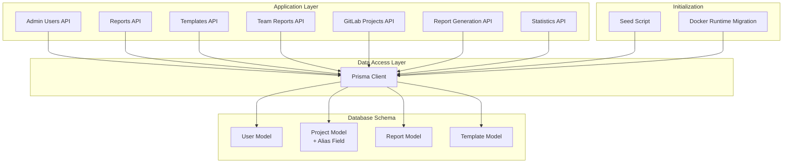
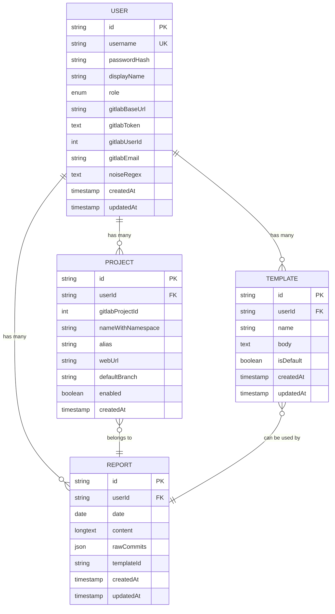
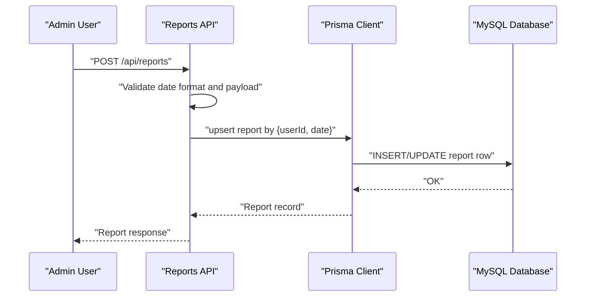
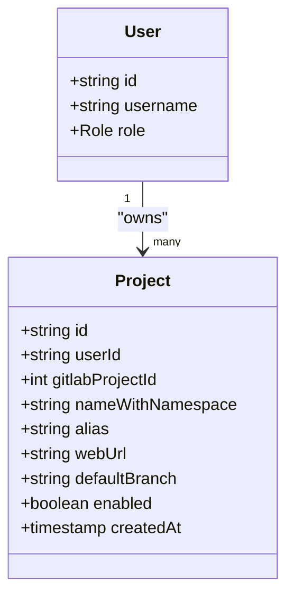
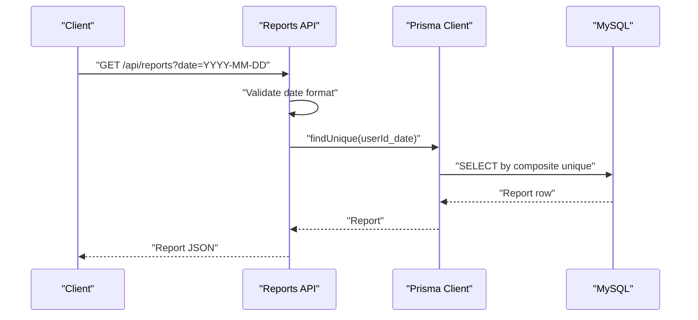
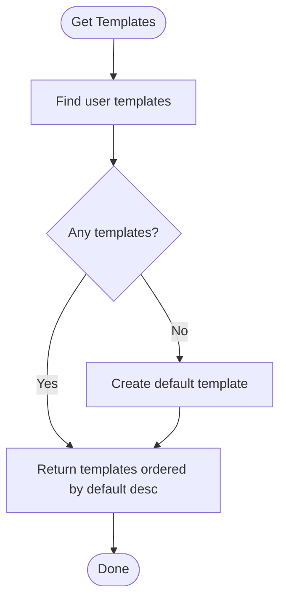
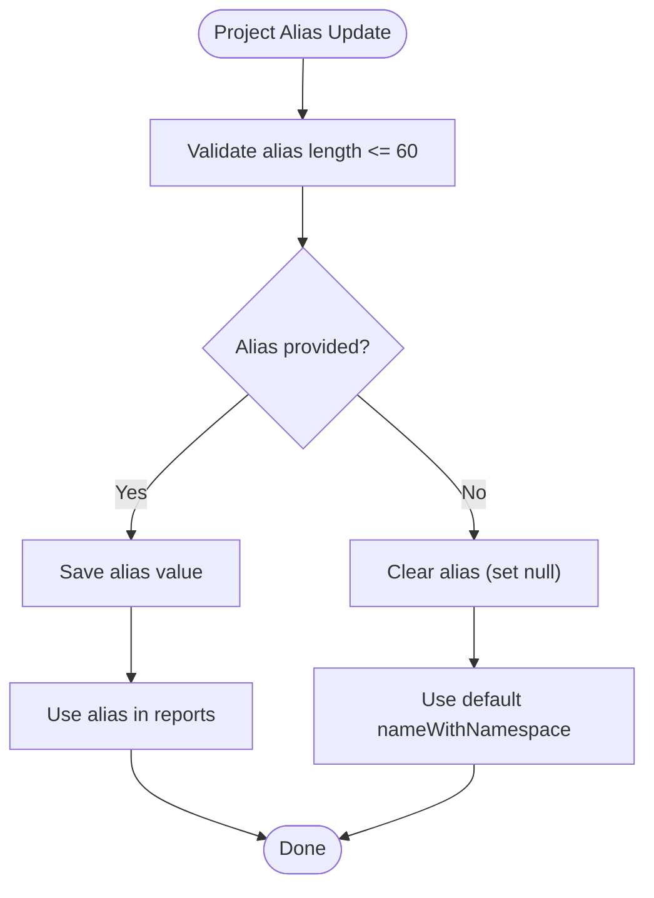
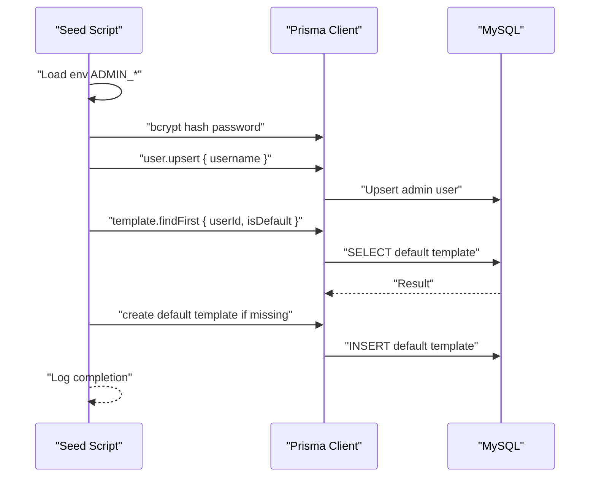
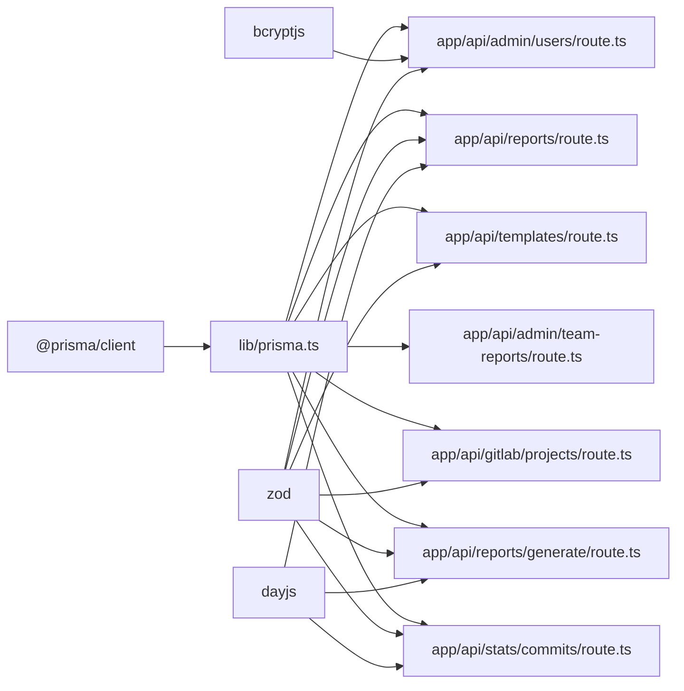

# Database Design

<cite>
**Referenced Files in This Document**
- [schema.prisma](file://prisma/schema.prisma)
- [seed.ts](file://prisma/seed.ts)
- [prisma.ts](file://lib/prisma.ts)
- [report.ts](file://lib/report.ts)
- [route.ts](file://app/api/admin/users/route.ts)
- [route.ts](file://app/api/reports/route.ts)
- [route.ts](file://app/api/templates/route.ts)
- [route.ts](file://app/api/admin/team-reports/route.ts)
- [route.ts](file://app/api/gitlab/projects/route.ts)
- [route.ts](file://app/api/reports/generate/route.ts)
- [route.ts](file://app/api/stats/commits/route.ts)
- [Dockerfile](file://Dockerfile)
- [package.json](file://package.json)
</cite>

## Update Summary
**Changes Made**
- Updated Project model documentation to include new alias field for project naming customization
- Added documentation for project alias functionality in GitLab project management API
- Enhanced data relationships section to reflect alias usage in report generation and statistics
- Updated core components section with alias field specifications
- Added new section documenting project alias feature implementation and usage patterns

## Table of Contents
1. [Introduction](#introduction)
2. [Project Structure](#project-structure)
3. [Core Components](#core-components)
4. [Architecture Overview](#architecture-overview)
5. [Detailed Component Analysis](#detailed-component-analysis)
6. [Dependency Analysis](#dependency-analysis)
7. [Performance Considerations](#performance-considerations)
8. [Troubleshooting Guide](#troubleshooting-guide)
9. [Conclusion](#conclusion)
10. [Appendices](#appendices)

## Introduction
This document provides comprehensive database design documentation for Pingyun Report's data model. It covers the Prisma schema for Users, Projects, Reports, and Templates, including entity definitions, relationships, constraints, indexes, and referential integrity. The schema now supports project aliases for enhanced user customization and improved data relationships for expanded functionality. It also documents seed data creation, initial admin user setup, data validation rules, business constraints, data access patterns via the Prisma client, query optimization strategies, and migration procedures for schema evolution.

## Project Structure
The database design is defined in Prisma schema and enforced by the Prisma client. Application APIs interact with the database through the Prisma client, while seed scripts initialize baseline data. The deployment pipeline ensures migrations are applied at runtime. The schema now includes project alias functionality that allows users to customize project display names while maintaining the underlying GitLab project identifier.

**Diagram sources**
- [prisma.ts:1-14](file://lib/prisma.ts#L1-L14)
- [schema.prisma:1-81](file://prisma/schema.prisma#L1-L81)
- [seed.ts:1-63](file://prisma/seed.ts#L1-L63)
- [Dockerfile:42-43](file://Dockerfile#L42-L43)

**Section sources**
- [prisma.ts:1-14](file://lib/prisma.ts#L1-L14)
- [schema.prisma:1-81](file://prisma/schema.prisma#L1-L81)
- [seed.ts:1-63](file://prisma/seed.ts#L1-L63)
- [Dockerfile:1-44](file://Dockerfile#L1-L44)

## Core Components
This section documents each model, its fields, data types, constraints, and indexes, along with relationships and referential integrity. The schema now includes enhanced project alias functionality.

- User
  - Identity: String ID (auto-generated)
  - Authentication: Username (unique), Password hash
  - Profile: Display name, Role (enum MEMBER/ADMIN)
  - GitLab integration: Base URL, encrypted token, user ID, email, noise regex
  - Timestamps: Created at, Updated at
  - Relationships: One-to-many to Project, Report, Template
  - Indexes: None (primary key index on ID)
  - Constraints: Unique username; default role MEMBER

- Project
  - Identity: String ID (auto-generated)
  - Association: User ID (foreign key)
  - GitLab metadata: GitLab project ID (unique per user), namespace name, web URL, default branch
  - Customization: Optional alias for display purposes
  - Status: Enabled flag (default true)
  - Timestamps: Created at
  - Relationships: Belongs to User (Cascade delete)
  - Uniqueness: Composite unique(userId, gitlabProjectId)
  - Indexes: Single-column index on userId
  - Constraints: Enforces uniqueness and cascade deletion
  - **Updated**: Added alias field for custom project naming

- Report
  - Identity: String ID (auto-generated)
  - Association: User ID (foreign key)
  - Content: Date (Date), Markdown content (LongText), raw commits JSON
  - Template: Optional template ID
  - Timestamps: Created at, Updated at
  - Relationships: Belongs to User (Cascade delete)
  - Uniqueness: Composite unique(userId, date)
  - Indexes: Composite index on (userId, date)
  - Constraints: Enforces uniqueness and cascade deletion

- Template
  - Identity: String ID (auto-generated)
  - Association: User ID (foreign key)
  - Content: Name, Body (Text), Is default flag
  - Timestamps: Created at, Updated at
  - Relationships: Belongs to User (Cascade delete)
  - Indexes: Single-column index on userId
  - Constraints: Cascade deletion; default isDefault=false

**Diagram sources**
- [schema.prisma:16-80](file://prisma/schema.prisma#L16-L80)

**Section sources**
- [schema.prisma:16-80](file://prisma/schema.prisma#L16-L80)

## Architecture Overview
The database architecture centers on four entities with explicit foreign keys and cascading deletes. The Prisma client enforces referential integrity and provides typed queries. Seed scripts create an initial admin user and a default template. Deployment runs Prisma migrations at startup to keep the schema aligned with the Prisma schema. The architecture now supports project alias functionality that enhances user experience by allowing custom project naming while maintaining data integrity.

**Diagram sources**
- [route.ts:55-76](file://app/api/reports/route.ts#L55-L76)
- [prisma.ts:1-14](file://lib/prisma.ts#L1-L14)
- [schema.prisma:52-66](file://prisma/schema.prisma#L52-L66)

**Section sources**
- [route.ts:1-90](file://app/api/reports/route.ts#L1-L90)
- [prisma.ts:1-14](file://lib/prisma.ts#L1-L14)
- [schema.prisma:1-81](file://prisma/schema.prisma#L1-L81)

## Detailed Component Analysis

### User Model
- Purpose: Stores user identity, authentication credentials, profile, GitLab integration, and role.
- Key constraints:
  - Unique username
  - Default role MEMBER
  - Encrypted GitLab token stored as text
- Relationships:
  - Projects: One-to-many
  - Reports: One-to-many
  - Templates: One-to-many
- Access patterns:
  - Admin endpoints query users with selective fields
  - Validation ensures unique usernames during creation

**Diagram sources**
- [route.ts:31-56](file://app/api/admin/users/route.ts#L31-L56)

**Section sources**
- [schema.prisma:16-33](file://prisma/schema.prisma#L16-L33)
- [route.ts:1-88](file://app/api/admin/users/route.ts#L1-L88)

### Project Model
- Purpose: Links users to GitLab projects and tracks project metadata with enhanced alias support.
- Key constraints:
  - Composite unique(userId, gitlabProjectId)
  - Index(userId) for efficient lookups
  - Cascade delete on user removal
  - **Updated**: Added alias field with max length 60 characters
- Business rules:
  - Enabled flag defaults to true
  - Stores GitLab identifiers and URLs
  - **Updated**: Alias overrides display name in UI and reports
- **Enhanced**: Project alias functionality allows users to customize how projects appear in reports and statistics

**Diagram sources**
- [schema.prisma:35-50](file://prisma/schema.prisma#L35-L50)

**Section sources**
- [schema.prisma:35-50](file://prisma/schema.prisma#L35-L50)

### Report Model
- Purpose: Stores daily report content per user and date, with optional template association.
- Key constraints:
  - Composite unique(userId, date)
  - Composite index(userId, date) for fast lookups
  - Cascade delete on user removal
- Data types:
  - Date stored as DATE
  - Content stored as LONGTEXT
  - Raw commits stored as JSON
- Access patterns:
  - Query by date or month
  - Upsert on save to handle updates or creation
- **Enhanced**: Report generation now uses project alias when available for better user experience

**Diagram sources**
- [route.ts:9-23](file://app/api/reports/route.ts#L9-L23)
- [schema.prisma:52-66](file://prisma/schema.prisma#L52-L66)

**Section sources**
- [schema.prisma:52-66](file://prisma/schema.prisma#L52-L66)
- [route.ts:1-90](file://app/api/reports/route.ts#L1-L90)

### Template Model
- Purpose: Provides customizable report templates per user with a default selection.
- Key constraints:
  - Index(userId) for efficient user-scoped queries
  - Cascade delete on user removal
  - Default isDefault=false
- Business rules:
  - Only one default template per user (enforced by application logic)
  - Fallback to create default template if none exists

**Diagram sources**
- [route.ts:7-25](file://app/api/templates/route.ts#L7-L25)
- [report.ts:146-159](file://lib/report.ts#L146-L159)

**Section sources**
- [schema.prisma:68-80](file://prisma/schema.prisma#L68-L80)
- [route.ts:1-96](file://app/api/templates/route.ts#L1-L96)
- [report.ts:146-159](file://lib/report.ts#L146-L159)

### Project Alias Feature
- Purpose: Allows users to customize project display names while maintaining the underlying GitLab project identifier.
- Implementation:
  - Database: VARCHAR(191) NULL field in Project table
  - API: PATCH endpoint accepts alias parameter with max length 60
  - Usage: Reports and statistics use alias when present, fallback to nameWithNamespace
- Validation:
  - Max length: 60 characters
  - Optional field (nullable)
  - Trimming and validation via Zod schema
- Business logic:
  - alias || nameWithNamespace in report generation
  - alias || nameWithNamespace in statistics display
  - Can be cleared to restore default name

**Diagram sources**
- [route.ts:17-46](file://app/api/gitlab/projects/route.ts#L17-L46)
- [route.ts:67-78](file://app/api/reports/generate/route.ts#L67-L78)
- [route.ts:112-113](file://app/api/stats/commits/route.ts#L112-L113)

**Section sources**
- [schema.prisma:40](file://prisma/schema.prisma#L40)
- [route.ts:17-46](file://app/api/gitlab/projects/route.ts#L17-L46)
- [route.ts:67-78](file://app/api/reports/generate/route.ts#L67-L78)
- [route.ts:112-113](file://app/api/stats/commits/route.ts#L112-L113)

### Seed Data and Initial Admin Setup
- Seed script creates an admin user with configurable credentials via environment variables.
- Ensures a default template exists for the admin user.
- Uses bcrypt to hash passwords before insertion.

**Diagram sources**
- [seed.ts:19-53](file://prisma/seed.ts#L19-L53)

**Section sources**
- [seed.ts:1-63](file://prisma/seed.ts#L1-L63)

## Dependency Analysis
- Prisma client dependency: The application imports Prisma client globally and reuses it across modules.
- Relationship dependencies:
  - Project and Report depend on User via foreign keys with cascade delete.
  - Template depends on User with cascade delete.
- External dependencies:
  - bcrypt for password hashing
  - zod for request validation
  - dayjs for date parsing and manipulation
- **Updated**: Project alias feature adds new dependencies in GitLab projects API and report generation components.

**Diagram sources**
- [prisma.ts:1-14](file://lib/prisma.ts#L1-L14)
- [route.ts:1-88](file://app/api/admin/users/route.ts#L1-L88)
- [route.ts:1-90](file://app/api/reports/route.ts#L1-L90)
- [route.ts:1-96](file://app/api/templates/route.ts#L1-L96)
- [route.ts:1-34](file://app/api/admin/team-reports/route.ts#L1-L34)
- [route.ts:1-163](file://app/api/gitlab/projects/route.ts#L1-L163)
- [route.ts:1-133](file://app/api/reports/generate/route.ts#L1-L133)
- [route.ts:1-129](file://app/api/stats/commits/route.ts#L1-L129)

**Section sources**
- [prisma.ts:1-14](file://lib/prisma.ts#L1-L14)
- [route.ts:1-88](file://app/api/admin/users/route.ts#L1-L88)
- [route.ts:1-90](file://app/api/reports/route.ts#L1-L90)
- [route.ts:1-96](file://app/api/templates/route.ts#L1-L96)
- [route.ts:1-34](file://app/api/admin/team-reports/route.ts#L1-L34)
- [route.ts:1-163](file://app/api/gitlab/projects/route.ts#L1-L163)
- [route.ts:1-133](file://app/api/reports/generate/route.ts#L1-L133)
- [route.ts:1-129](file://app/api/stats/commits/route.ts#L1-L129)

## Performance Considerations
- Indexes and uniqueness:
  - Composite unique on (userId, date) for Reports prevents duplicates and enables fast lookups.
  - Composite index on (userId, date) accelerates monthly queries and pagination.
  - Single-column index on userId for Projects and Templates improves user-scoped queries.
  - **Updated**: No additional indexes needed for alias field as it's rarely queried
- Query patterns:
  - Prefer unique lookups by composite keys for date-based reports.
  - Limit result sets (e.g., take 60) for recent report lists.
  - Use selective field projections to reduce payload sizes.
  - **Updated**: Project alias queries use simple COALESCE logic (alias || nameWithNamespace)
- Data types:
  - Use DATE for report dates to minimize storage overhead.
  - Store raw commits as JSON for flexibility; consider normalization if growth demands.
  - **Updated**: Alias field uses VARCHAR(191) with NULL values for sparse data
- Cascading deletes:
  - Cascade deletion simplifies cleanup but can be expensive for large datasets; monitor impact.
- Logging:
  - Prisma client logs configured to error/warn in development and error only in production.
- **New**: Project alias performance considerations:
  - Minimal storage overhead (NULL for most projects)
  - Simple string concatenation in application layer
  - No database-level performance impact

## Troubleshooting Guide
- Common errors and causes:
  - Duplicate username: Creation fails if username already exists; handled by validation.
  - Bad date format: Date queries reject invalid formats; ensure YYYY-MM-DD.
  - Not found: Template operations return 404 when template does not belong to user.
  - Unauthorized: Admin-only endpoints require admin role.
  - **Updated**: Project alias validation errors when alias exceeds 60 characters.
- Validation rules:
  - Username length: 2–50 characters
  - Password length: 6–200 characters
  - Display name length: 1–50 characters
  - Date format: Strict regex validation
  - **Updated**: Project alias length: 1–60 characters (max 60)
- Operational checks:
  - Ensure DATABASE_URL environment variable is set.
  - Verify Prisma client initialization and connection.
  - Confirm migrations are applied at startup in production.
  - **Updated**: Verify project alias migration has been applied.

**Section sources**
- [route.ts:24-56](file://app/api/admin/users/route.ts#L24-L56)
- [route.ts:7-46](file://app/api/reports/route.ts#L7-L46)
- [route.ts:27-51](file://app/api/templates/route.ts#L27-L51)
- [route.ts:17-22](file://app/api/gitlab/projects/route.ts#L17-L22)
- [prisma.ts:1-14](file://lib/prisma.ts#L1-L14)

## Conclusion
Pingyun Report's database design emphasizes clear entity relationships, strong referential integrity, and practical indexes for common access patterns. The schema now includes enhanced project alias functionality that provides users with customizable project naming while maintaining data integrity. The Prisma schema defines robust constraints and cascading behavior, while seed scripts bootstrap essential data. APIs enforce validation and provide efficient query paths. Deployment integrates Prisma migrations to keep the schema current across environments, including the new project alias feature.

## Appendices

### Data Access Patterns via Prisma Client
- Initialization: Global singleton Prisma client with environment-aware logging.
- Usage: Import prisma from lib/prisma.ts in all API handlers.
- Best practices:
  - Use upsert for idempotent saves (e.g., reports).
  - Use selective projections to limit data transfer.
  - Apply unique and composite indexes for predictable performance.
  - **Updated**: Handle nullable alias fields safely in queries.

**Section sources**
- [prisma.ts:1-14](file://lib/prisma.ts#L1-L14)
- [route.ts:55-76](file://app/api/reports/route.ts#L55-L76)
- [route.ts:7-25](file://app/api/templates/route.ts#L7-L25)

### Migration Procedures and Schema Evolution
- Local development:
  - Generate client and apply migrations locally using npm scripts.
- Production:
  - Dockerfile runs Prisma migrations at startup via migrate deploy.
- Scripts:
  - db:generate, db:migrate, db:deploy, db:studio, seed.
- **Updated**: Migration history includes project alias addition:
  - 20260515004432_init: Initial schema creation
  - 20260518004546_add_project_alias: Added alias column to project table

**Section sources**
- [package.json:5-14](file://package.json#L5-L14)
- [Dockerfile:42-43](file://Dockerfile#L42-L43)
- [migration_lock.toml:1-3](file://prisma/migrations/migration_lock.toml#L1-L3)

### Sample Data Structures
- User
  - Fields: id, username, passwordHash, displayName, role, gitlabBaseUrl, gitlabToken, gitlabUserId, gitlabEmail, noiseRegex, createdAt, updatedAt
  - Example: Admin user with role ADMIN and default template

- Project
  - Fields: id, userId, gitlabProjectId, nameWithNamespace, alias, webUrl, defaultBranch, enabled, createdAt
  - Example: Linked to a specific GitLab project with optional custom alias
  - **Updated**: alias field allows custom display name override

- Report
  - Fields: id, userId, date, content, rawCommits, templateId, createdAt, updatedAt
  - Example: Daily report content for a given date

- Template
  - Fields: id, userId, name, body, isDefault, createdAt, updatedAt
  - Example: Default template body for rendering reports

**Section sources**
- [schema.prisma:16-80](file://prisma/schema.prisma#L16-L80)
- [seed.ts:6-17](file://prisma/seed.ts#L6-L17)
- [report.ts:146-159](file://lib/report.ts#L146-L159)

### Project Alias Implementation Details
- Database schema: VARCHAR(191) NULL column in Project table
- API validation: Zod schema enforces max 60 characters
- Usage patterns:
  - Reports: `alias || nameWithNamespace` for display
  - Statistics: Same pattern for project naming
  - Management: PATCH endpoint updates alias value
- Backward compatibility: Null alias falls back to default name
- Performance: Minimal storage overhead with sparse usage

**Section sources**
- [schema.prisma:40](file://prisma/schema.prisma#L40)
- [route.ts:17-46](file://app/api/gitlab/projects/route.ts#L17-L46)
- [route.ts:67-78](file://app/api/reports/generate/route.ts#L67-L78)
- [route.ts:112-113](file://app/api/stats/commits/route.ts#L112-L113)