# Database Design

<cite>
**Referenced Files in This Document**
- [schema.prisma](file://prisma/schema.prisma)
- [seed.ts](file://prisma/seed.ts)
- [prisma.ts](file://lib/prisma.ts)
- [report.ts](file://lib/report.ts)
- [route.ts](file://app/api/admin/users/route.ts)
- [route.ts](file://app/api/reports/route.ts)
- [route.ts](file://app/api/templates/route.ts)
- [route.ts](file://app/api/admin/team-reports/route.ts)
- [route.ts](file://app/api/gitlab/projects/route.ts)
- [route.ts](file://app/api/reports/generate/route.ts)
- [route.ts](file://app/api/stats/commits/route.ts)
- [route.ts](file://app/api/comments/route.ts)
- [route.ts](file://app/api/likes/route.ts)
- [route.ts](file://app/api/notifications/route.ts)
- [route.ts](file://app/api/notifications/stream/route.ts)
- [notify.ts](file://lib/notify.ts)
- [Dockerfile](file://Dockerfile)
- [package.json](file://package.json)
</cite>

## Update Summary
**Changes Made**
- Added new Comment, Like, and Notification tables with comprehensive relationships to existing User and Report models
- Updated schema documentation to include three new entity models with their constraints and indexes
- Enhanced data relationships section to reflect social interaction features and real-time notifications
- Added new sections documenting comment functionality, like system, and notification management
- Updated core components section with new social features and real-time communication capabilities
- Added new section documenting notification streaming via Server-Sent Events and Redis pub/sub

## Table of Contents
1. [Introduction](#introduction)
2. [Project Structure](#project-structure)
3. [Core Components](#core-components)
4. [Architecture Overview](#architecture-overview)
5. [Detailed Component Analysis](#detailed-component-analysis)
6. [Dependency Analysis](#dependency-analysis)
7. [Performance Considerations](#performance-considerations)
8. [Troubleshooting Guide](#troubleshooting-guide)
9. [Conclusion](#conclusion)
10. [Appendices](#appendices)

## Introduction
This document provides comprehensive database design documentation for Pingyun Report's data model. It covers the Prisma schema for Users, Projects, Reports, Templates, Comments, Likes, and Notifications, including entity definitions, relationships, constraints, indexes, and referential integrity. The schema now supports social interaction features including commenting, liking, and real-time notifications with Redis pub/sub integration. It also documents seed data creation, initial admin user setup, data validation rules, business constraints, data access patterns via the Prisma client, query optimization strategies, and migration procedures for schema evolution.

## Project Structure
The database design is defined in Prisma schema and enforced by the Prisma client. Application APIs interact with the database through the Prisma client, while seed scripts initialize baseline data. The deployment pipeline ensures migrations are applied at runtime. The schema now includes comprehensive social interaction features that enable users to engage with each other's reports through comments, likes, and real-time notifications.

```mermaid
graph TB
subgraph "Application Layer"
API_Admin_Users["Admin Users API"]
API_Reports["Reports API"]
API_Templates["Templates API"]
API_Team_Reports["Team Reports API"]
API_GitLab_Projects["GitLab Projects API"]
API_Report_Generation["Report Generation API"]
API_Stats_Commits["Statistics API"]
API_Comments["Comments API"]
API_Likes["Likes API"]
API_Notifications["Notifications API"]
API_Notification_Stream["Notification Stream API"]
end
subgraph "Data Access Layer"
PrismaClient["Prisma Client"]
RedisPubSub["Redis Pub/Sub"]
end
subgraph "Database Schema"
User["User Model"]
Project["Project Model<br/>+ Alias Field"]
Report["Report Model"]
Template["Template Model"]
Comment["Comment Model"]
Like["Like Model"]
Notification["Notification Model"]
end
subgraph "Initialization"
Seed["Seed Script"]
Docker["Docker Runtime Migration"]
end
API_Admin_Users --> PrismaClient
API_Reports --> PrismaClient
API_Templates --> PrismaClient
API_Team_Reports --> PrismaClient
API_GitLab_Projects --> PrismaClient
API_Report_Generation --> PrismaClient
API_Stats_Commits --> PrismaClient
API_Comments --> PrismaClient
API_Likes --> PrismaClient
API_Notifications --> PrismaClient
API_Notification_Stream --> RedisPubSub
PrismaClient --> User
PrismaClient --> Project
PrismaClient --> Report
PrismaClient --> Template
PrismaClient --> Comment
PrismaClient --> Like
PrismaClient --> Notification
Seed --> PrismaClient
Docker --> PrismaClient
RedisPubSub --> Notification
```

**Diagram sources**
- [prisma.ts:1-14](file://lib/prisma.ts#L1-L14)
- [schema.prisma:1-126](file://prisma/schema.prisma#L1-L126)
- [seed.ts:1-63](file://prisma/seed.ts#L1-L63)
- [Dockerfile:42-43](file://Dockerfile#L42-L43)
- [notify.ts:1-25](file://lib/notify.ts#L1-L25)

**Section sources**
- [prisma.ts:1-14](file://lib/prisma.ts#L1-L14)
- [schema.prisma:1-126](file://prisma/schema.prisma#L1-L126)
- [seed.ts:1-63](file://prisma/seed.ts#L1-L63)
- [Dockerfile:1-44](file://Dockerfile#L1-L44)

## Core Components
This section documents each model, its fields, data types, constraints, and indexes, along with relationships and referential integrity. The schema now includes comprehensive social interaction features.

- User
  - Identity: String ID (auto-generated)
  - Authentication: Username (unique), Password hash
  - Profile: Display name, Role (enum MEMBER/ADMIN)
  - GitLab integration: Base URL, encrypted token, user ID, email, noise regex
  - Timestamps: Created at, Updated at
  - Relationships: One-to-many to Project, Report, Template, Comment, Like, Notification
  - Indexes: None (primary key index on ID)
  - Constraints: Unique username; default role MEMBER

- Project
  - Identity: String ID (auto-generated)
  - Association: User ID (foreign key)
  - GitLab metadata: GitLab project ID (unique per user), namespace name, web URL, default branch
  - Customization: Optional alias for display purposes
  - Status: Enabled flag (default true)
  - Timestamps: Created at
  - Relationships: Belongs to User (Cascade delete)
  - Uniqueness: Composite unique(userId, gitlabProjectId)
  - Indexes: Single-column index on userId
  - Constraints: Enforces uniqueness and cascade deletion
  - **Updated**: Added alias field for custom project naming

- Report
  - Identity: String ID (auto-generated)
  - Association: User ID (foreign key)
  - Content: Date (Date), Markdown content (LongText), raw commits JSON
  - Template: Optional template ID
  - Timestamps: Created at, Updated at
  - Relationships: Belongs to User (Cascade delete), Comments (One-to-many), Likes (One-to-many)
  - Uniqueness: Composite unique(userId, date)
  - Indexes: Composite index on (userId, date)
  - Constraints: Enforces uniqueness and cascade deletion

- Template
  - Identity: String ID (auto-generated)
  - Association: User ID (foreign key)
  - Content: Name, Body (Text), Is default flag
  - Timestamps: Created at, Updated at
  - Relationships: Belongs to User (Cascade delete)
  - Indexes: Single-column index on userId
  - Constraints: Cascade deletion; default isDefault=false

- Comment
  - Identity: String ID (auto-generated)
  - Association: Report ID (foreign key), Author ID (foreign key)
  - Content: Text content (max 2000 characters)
  - Timestamps: Created at
  - Relationships: Belongs to Report (Cascade delete), Author (Cascade delete)
  - Indexes: Single-column index on reportId
  - Constraints: Cascade deletion; content validation (1-2000 chars)

- Like
  - Identity: String ID (auto-generated)
  - Association: Report ID (foreign key), User ID (foreign key)
  - Timestamps: Created at
  - Relationships: Belongs to Report (Cascade delete), User (Cascade delete)
  - Uniqueness: Composite unique(reportId, userId)
  - Constraints: Prevents duplicate likes; cascade deletion

- Notification
  - Identity: String ID (auto-generated)
  - Association: User ID (foreign key)
  - Content: Type, Title, Optional body, Read status, Related ID
  - Timestamps: Created at
  - Relationships: Belongs to User (Cascade delete)
  - Indexes: Composite index on (userId, read, createdAt)
  - Constraints: Cascade deletion; default read=false

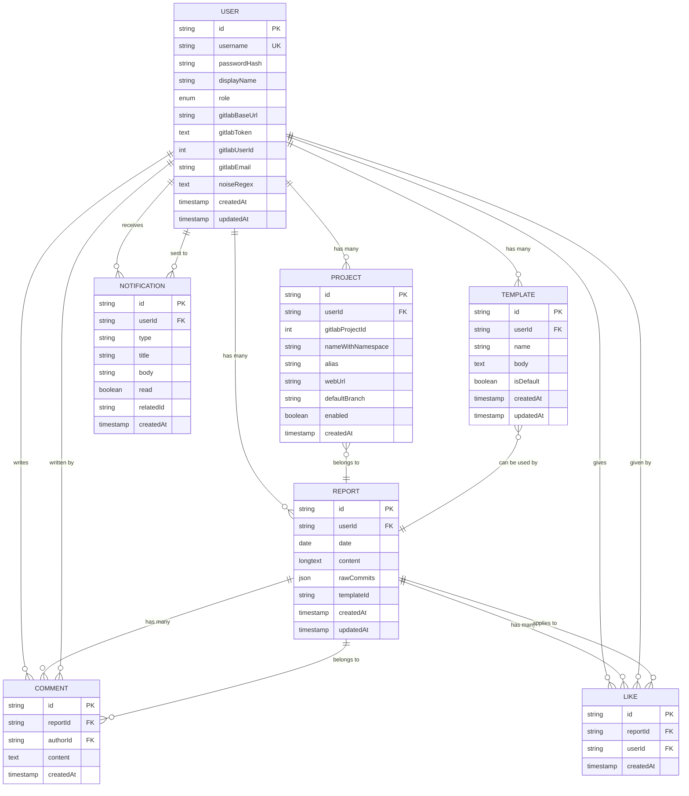

**Diagram sources**
- [schema.prisma:16-125](file://prisma/schema.prisma#L16-L125)

**Section sources**
- [schema.prisma:16-125](file://prisma/schema.prisma#L16-L125)

## Architecture Overview
The database architecture centers on seven entities with explicit foreign keys and cascading deletes. The Prisma client enforces referential integrity and provides typed queries. Seed scripts create an initial admin user and a default template. Deployment runs Prisma migrations at startup to keep the schema aligned with the Prisma schema. The architecture now supports comprehensive social interaction features including commenting, liking, and real-time notifications with Redis pub/sub integration for instant delivery.

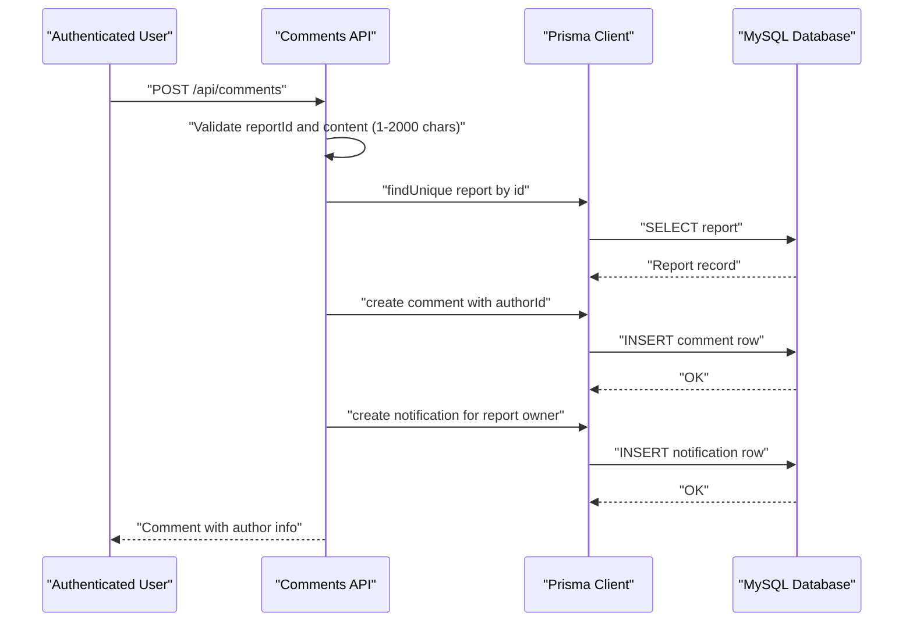

**Diagram sources**
- [route.ts:46-90](file://app/api/comments/route.ts#L46-L90)
- [prisma.ts:1-14](file://lib/prisma.ts#L1-L14)
- [schema.prisma:87-98](file://prisma/schema.prisma#L87-L98)

**Section sources**
- [route.ts:1-117](file://app/api/comments/route.ts#L1-L117)
- [prisma.ts:1-14](file://lib/prisma.ts#L1-L14)
- [schema.prisma:1-126](file://prisma/schema.prisma#L1-L126)

## Detailed Component Analysis

### User Model
- Purpose: Stores user identity, authentication credentials, profile, GitLab integration, and role.
- Key constraints:
  - Unique username
  - Default role MEMBER
  - Encrypted GitLab token stored as text
- Relationships:
  - Projects: One-to-many
  - Reports: One-to-many
  - Templates: One-to-many
  - Comments: One-to-many (CommentAuthor relation)
  - Likes: One-to-many (LikeUser relation)
  - Notifications: One-to-many (NotificationUser relation)
- Access patterns:
  - Admin endpoints query users with selective fields
  - Validation ensures unique usernames during creation

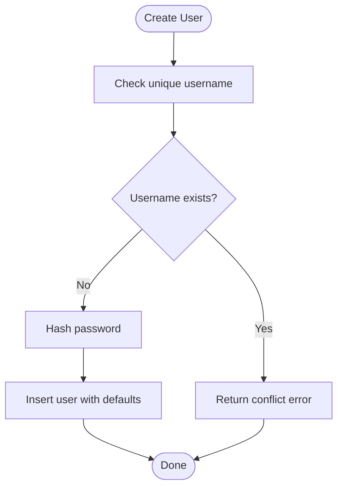

**Diagram sources**
- [route.ts:31-56](file://app/api/admin/users/route.ts#L31-L56)

**Section sources**
- [schema.prisma:16-36](file://prisma/schema.prisma#L16-L36)
- [route.ts:1-88](file://app/api/admin/users/route.ts#L1-L88)

### Project Model
- Purpose: Links users to GitLab projects and tracks project metadata with enhanced alias support.
- Key constraints:
  - Composite unique(userId, gitlabProjectId)
  - Index(userId) for efficient lookups
  - Cascade delete on user removal
  - **Updated**: Added alias field with max length 60 characters
- Business rules:
  - Enabled flag defaults to true
  - Stores GitLab identifiers and URLs
  - **Updated**: Alias overrides display name in UI and reports
- **Enhanced**: Project alias functionality allows users to customize how projects appear in reports and statistics

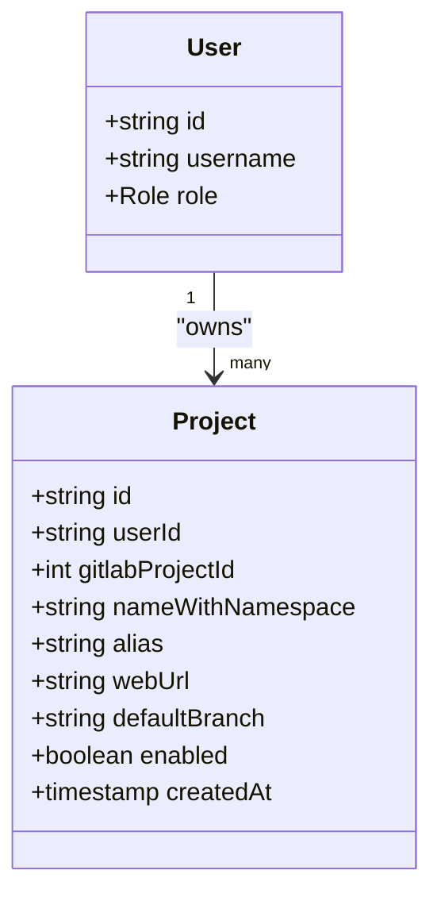

**Diagram sources**
- [schema.prisma:38-53](file://prisma/schema.prisma#L38-L53)

**Section sources**
- [schema.prisma:38-53](file://prisma/schema.prisma#L38-L53)

### Report Model
- Purpose: Stores daily report content per user and date, with optional template association.
- Key constraints:
  - Composite unique(userId, date)
  - Composite index(userId, date) for fast lookups
  - Cascade delete on user removal
- Data types:
  - Date stored as DATE
  - Content stored as LONGTEXT
  - Raw commits stored as JSON
- Relationships:
  - Comments: One-to-many
  - Likes: One-to-many
- Access patterns:
  - Query by date or month
  - Upsert on save to handle updates or creation
- **Enhanced**: Report generation now uses project alias when available for better user experience

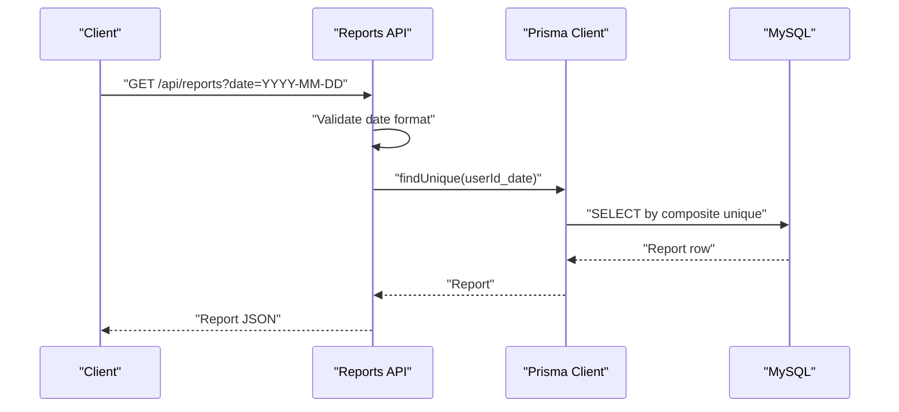

**Diagram sources**
- [route.ts:9-23](file://app/api/reports/route.ts#L9-L23)
- [schema.prisma:55-71](file://prisma/schema.prisma#L55-L71)

**Section sources**
- [schema.prisma:55-71](file://prisma/schema.prisma#L55-L71)
- [route.ts:1-90](file://app/api/reports/route.ts#L1-L90)

### Template Model
- Purpose: Provides customizable report templates per user with a default selection.
- Key constraints:
  - Index(userId) for efficient user-scoped queries
  - Cascade delete on user removal
  - Default isDefault=false
- Business rules:
  - Only one default template per user (enforced by application logic)
  - Fallback to create default template if none exists

**Diagram sources**
- [route.ts:7-25](file://app/api/templates/route.ts#L7-L25)
- [report.ts:146-159](file://lib/report.ts#L146-L159)

**Section sources**
- [schema.prisma:73-85](file://prisma/schema.prisma#L73-L85)
- [route.ts:1-96](file://app/api/templates/route.ts#L1-L96)
- [report.ts:146-159](file://lib/report.ts#L146-L159)

### Comment Model
- Purpose: Enables users to add comments to reports with content validation and access control.
- Key constraints:
  - Index(reportId) for efficient comment retrieval
  - Cascade delete on report/user removal
  - Content validation: 1-2000 characters
- Relationships:
  - Report: Many-to-one (Cascade delete)
  - Author: Many-to-one (Cascade delete)
- Access control:
  - Only report owners or admins can view comments
  - Only authors or admins can delete comments
- Real-time integration:
  - Creates notifications for report owners when comments are posted
- Business rules:
  - Content must be non-empty and within character limits
  - Access restricted to authorized users only

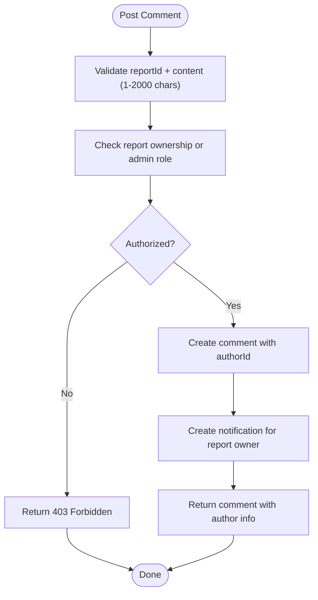

**Diagram sources**
- [route.ts:46-90](file://app/api/comments/route.ts#L46-L90)
- [schema.prisma:87-98](file://prisma/schema.prisma#L87-L98)

**Section sources**
- [schema.prisma:87-98](file://prisma/schema.prisma#L87-L98)
- [route.ts:1-117](file://app/api/comments/route.ts#L1-L117)

### Like Model
- Purpose: Allows users to express appreciation for reports with automatic duplicate prevention.
- Key constraints:
  - Composite unique(reportId, userId) prevents duplicate likes
  - Cascade delete on report/user removal
- Relationships:
  - Report: Many-to-one (Cascade delete)
  - User: Many-to-one (Cascade delete)
- Business logic:
  - Toggle-like functionality (create or delete)
  - Automatic notification creation for report owners (excluding self-likes)
- Access control:
  - Only authenticated users can like reports
  - Report owners cannot like their own reports

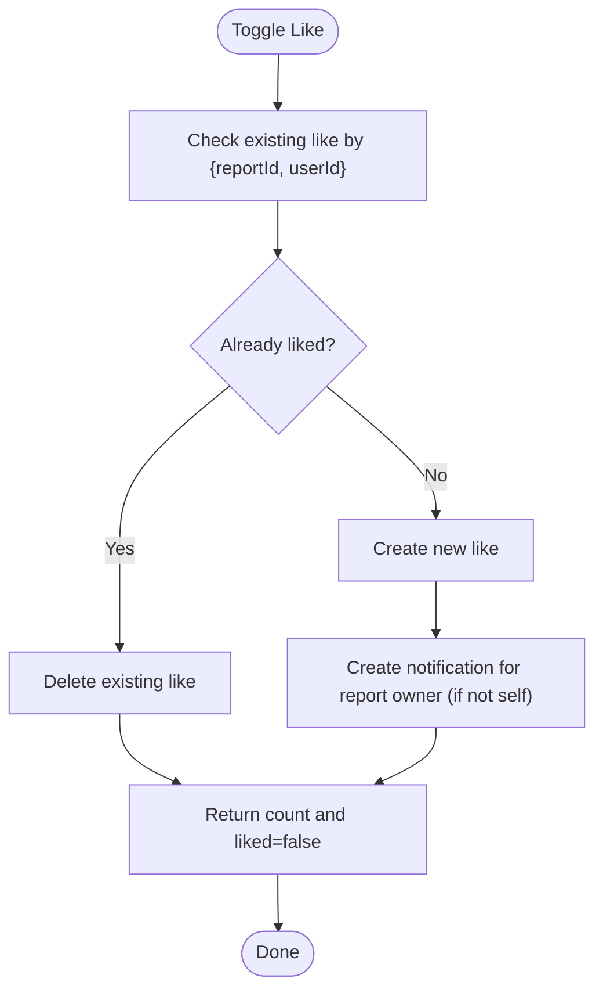

**Diagram sources**
- [route.ts:28-70](file://app/api/likes/route.ts#L28-L70)
- [schema.prisma:100-110](file://prisma/schema.prisma#L100-L110)

**Section sources**
- [schema.prisma:100-110](file://prisma/schema.prisma#L100-L110)
- [route.ts:1-71](file://app/api/likes/route.ts#L1-L71)

### Notification Model
- Purpose: Manages user notifications for social interactions with real-time delivery via Redis.
- Key constraints:
  - Index(userId, read, createdAt) for efficient notification retrieval
  - Cascade delete on user removal
  - Default read=false
- Relationships:
  - User: Many-to-one (Cascade delete)
- Features:
  - Real-time delivery via Server-Sent Events (SSE)
  - Batch marking as read (all or specific IDs)
  - Redis pub/sub integration for instant delivery
- Types:
  - comment: When someone comments on your report
  - like: When someone likes your report
- Business rules:
  - Notifications are automatically created for report owners
  - Self-interactions do not generate notifications
  - Unread count is maintained for UI display

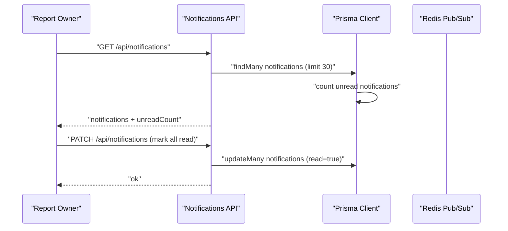

**Diagram sources**
- [route.ts:6-21](file://app/api/notifications/route.ts#L6-L21)
- [route.ts:28-45](file://app/api/notifications/route.ts#L28-L45)
- [schema.prisma:112-125](file://prisma/schema.prisma#L112-L125)

**Section sources**
- [schema.prisma:112-125](file://prisma/schema.prisma#L112-L125)
- [route.ts:1-46](file://app/api/notifications/route.ts#L1-L46)

### Notification Streaming System
- Purpose: Provides real-time notification delivery using Server-Sent Events with Redis pub/sub.
- Architecture:
  - Redis channels per user (`notifications:{userId}`)
  - SSE endpoint that maintains persistent connections
  - Automatic heartbeat messages to keep connections alive
- Features:
  - Instant notification delivery when new events occur
  - Automatic cleanup on client disconnect
  - Dynamic unread count updates
- Performance:
  - Lightweight SSE connections
  - Efficient Redis pub/sub messaging
  - Minimal server resource usage

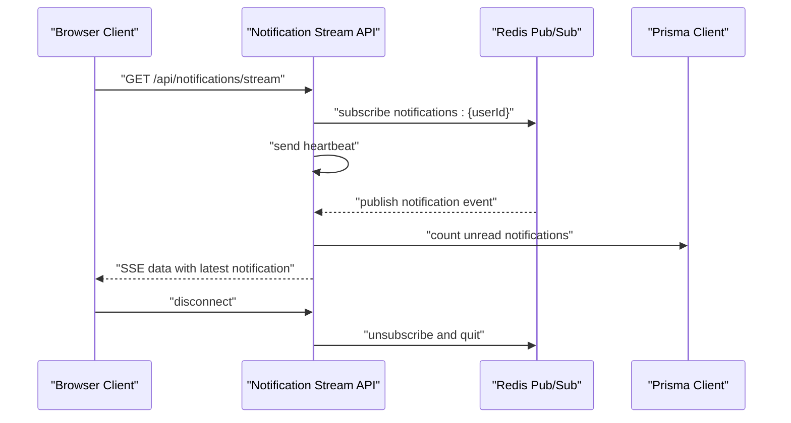

**Diagram sources**
- [route.ts:7-65](file://app/api/notifications/stream/route.ts#L7-L65)
- [notify.ts:16-24](file://lib/notify.ts#L16-L24)

**Section sources**
- [route.ts:1-65](file://app/api/notifications/stream/route.ts#L1-L65)
- [notify.ts:1-25](file://lib/notify.ts#L1-25)

### Project Alias Feature
- Purpose: Allows users to customize project display names while maintaining the underlying GitLab project identifier.
- Implementation:
  - Database: VARCHAR(191) NULL field in Project table
  - API: PATCH endpoint accepts alias parameter with max length 60
  - Usage: Reports and statistics use alias when present, fallback to nameWithNamespace
- Validation:
  - Max length: 60 characters
  - Optional field (nullable)
  - Trimming and validation via Zod schema
- Business logic:
  - alias || nameWithNamespace in report generation
  - alias || nameWithNamespace in statistics display
  - Can be cleared to restore default name

**Diagram sources**
- [route.ts:17-46](file://app/api/gitlab/projects/route.ts#L17-L46)
- [route.ts:67-78](file://app/api/reports/generate/route.ts#L67-L78)
- [route.ts:112-113](file://app/api/stats/commits/route.ts#L112-L113)

**Section sources**
- [schema.prisma:43](file://prisma/schema.prisma#L43)
- [route.ts:17-46](file://app/api/gitlab/projects/route.ts#L17-L46)
- [route.ts:67-78](file://app/api/reports/generate/route.ts#L67-L78)
- [route.ts:112-113](file://app/api/stats/commits/route.ts#L112-L113)

### Seed Data and Initial Admin Setup
- Seed script creates an admin user with configurable credentials via environment variables.
- Ensures a default template exists for the admin user.
- Uses bcrypt to hash passwords before insertion.

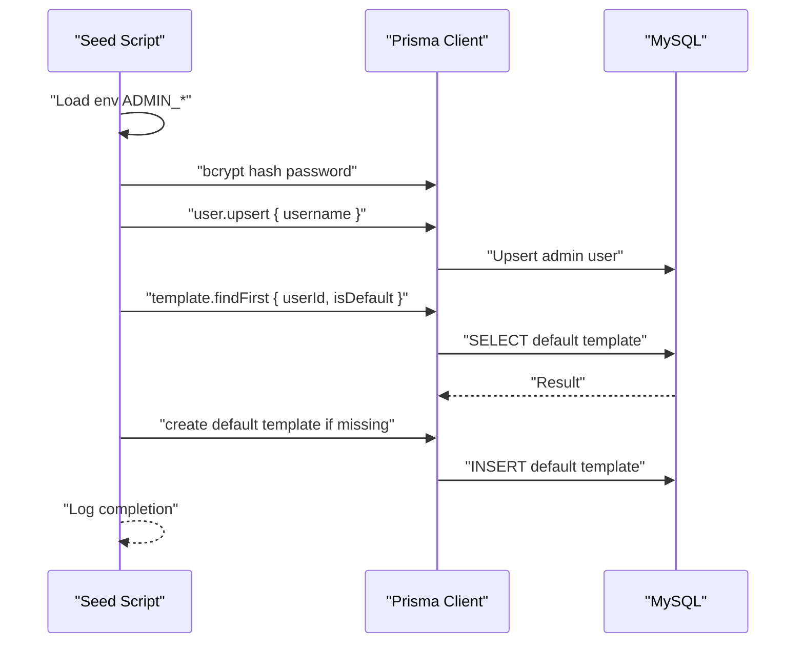

**Diagram sources**
- [seed.ts:19-53](file://prisma/seed.ts#L19-L53)

**Section sources**
- [seed.ts:1-63](file://prisma/seed.ts#L1-L63)

## Dependency Analysis
- Prisma client dependency: The application imports Prisma client globally and reuses it across modules.
- Relationship dependencies:
  - Project, Report, Template depend on User via foreign keys with cascade delete.
  - Comment depends on Report and User with cascade delete.
  - Like depends on Report and User with cascade delete.
  - Notification depends on User with cascade delete.
- External dependencies:
  - bcrypt for password hashing
  - zod for request validation
  - dayjs for date parsing and manipulation
  - redis for real-time notifications
- **Updated**: Social interaction features add new dependencies in comments, likes, and notifications APIs.
- **New**: Redis pub/sub integration for real-time notification delivery.

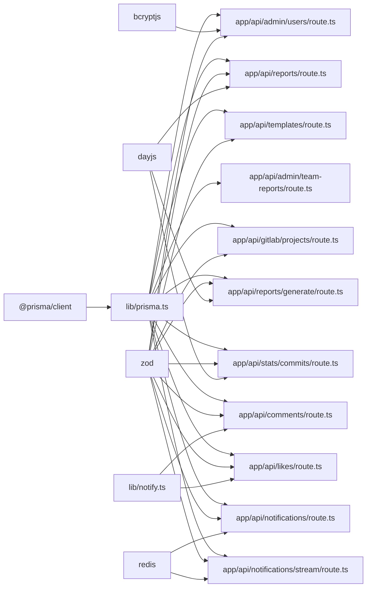

**Diagram sources**
- [prisma.ts:1-14](file://lib/prisma.ts#L1-L14)
- [route.ts:1-88](file://app/api/admin/users/route.ts#L1-L88)
- [route.ts:1-90](file://app/api/reports/route.ts#L1-L90)
- [route.ts:1-96](file://app/api/templates/route.ts#L1-L96)
- [route.ts:1-34](file://app/api/admin/team-reports/route.ts#L1-L34)
- [route.ts:1-163](file://app/api/gitlab/projects/route.ts#L1-L163)
- [route.ts:1-133](file://app/api/reports/generate/route.ts#L1-L133)
- [route.ts:1-129](file://app/api/stats/commits/route.ts#L1-L129)
- [route.ts:1-117](file://app/api/comments/route.ts#L1-L117)
- [route.ts:1-71](file://app/api/likes/route.ts#L1-L71)
- [route.ts:1-46](file://app/api/notifications/route.ts#L1-L46)
- [route.ts:1-65](file://app/api/notifications/stream/route.ts#L1-L65)
- [notify.ts:1-25](file://lib/notify.ts#L1-L25)

**Section sources**
- [prisma.ts:1-14](file://lib/prisma.ts#L1-L14)
- [route.ts:1-88](file://app/api/admin/users/route.ts#L1-L88)
- [route.ts:1-90](file://app/api/reports/route.ts#L1-L90)
- [route.ts:1-96](file://app/api/templates/route.ts#L1-L96)
- [route.ts:1-34](file://app/api/admin/team-reports/route.ts#L1-L34)
- [route.ts:1-163](file://app/api/gitlab/projects/route.ts#L1-L163)
- [route.ts:1-133](file://app/api/reports/generate/route.ts#L1-L133)
- [route.ts:1-129](file://app/api/stats/commits/route.ts#L1-L129)
- [route.ts:1-117](file://app/api/comments/route.ts#L1-L117)
- [route.ts:1-71](file://app/api/likes/route.ts#L1-L71)
- [route.ts:1-46](file://app/api/notifications/route.ts#L1-L46)
- [route.ts:1-65](file://app/api/notifications/stream/route.ts#L1-L65)
- [notify.ts:1-25](file://lib/notify.ts#L1-L25)

## Performance Considerations
- Indexes and uniqueness:
  - Composite unique on (userId, date) for Reports prevents duplicates and enables fast lookups.
  - Composite index on (userId, date) accelerates monthly queries and pagination.
  - Single-column index on userId for Projects and Templates improves user-scoped queries.
  - **Updated**: New indexes for social features:
    - Index on Comment.reportId for efficient comment retrieval
    - Composite unique on Like.reportId_userId for duplicate prevention
    - Composite index on Notification.userId_read_createdAt for fast notification queries
  - **Updated**: No additional indexes needed for alias field as it's rarely queried
- Query patterns:
  - Prefer unique lookups by composite keys for date-based reports.
  - Limit result sets (e.g., take 60) for recent report lists.
  - Use selective field projections to reduce payload sizes.
  - **Updated**: Handle nullable alias fields safely in queries.
  - **New**: Use batch operations for notification marking (updateMany for efficiency).
- Data types:
  - Use DATE for report dates to minimize storage overhead.
  - Store raw commits as JSON for flexibility; consider normalization if growth demands.
  - **Updated**: Alias field uses VARCHAR(191) with NULL values for sparse data.
  - **New**: Notification types use VARCHAR for flexible categorization.
- Cascading deletes:
  - Cascade deletion simplifies cleanup but can be expensive for large datasets; monitor impact.
  - **New**: Cascade deletes on Comment, Like, and Notification ensure data integrity.
- Logging:
  - Prisma client logs configured to error/warn in development and error only in production.
- **New**: Social features performance considerations:
  - Minimal storage overhead for comments (max 2000 chars)
  - Efficient duplicate prevention via composite unique constraint
  - Lightweight notification system with Redis pub/sub
  - SSE connections are lightweight and automatically cleaned up

## Troubleshooting Guide
- Common errors and causes:
  - Duplicate username: Creation fails if username already exists; handled by validation.
  - Bad date format: Date queries reject invalid formats; ensure YYYY-MM-DD.
  - Not found: Template operations return 404 when template does not belong to user.
  - Unauthorized: Admin-only endpoints require admin role.
  - **Updated**: Project alias validation errors when alias exceeds 60 characters.
  - **New**: Comment validation errors when content is empty or exceeds 2000 characters.
  - **New**: Like toggle errors when report does not exist.
  - **New**: Notification access errors when user tries to mark others' notifications.
- Validation rules:
  - Username length: 2–50 characters
  - Password length: 6–200 characters
  - Display name length: 1–50 characters
  - Date format: Strict regex validation
  - **Updated**: Project alias length: 1–60 characters (max 60)
  - **New**: Comment content length: 1–2000 characters (max 2000)
  - **New**: Like operations require valid reportId
  - **New**: Notification marking requires valid notification IDs or all flag
- Operational checks:
  - Ensure DATABASE_URL environment variable is set.
  - Verify Prisma client initialization and connection.
  - Confirm migrations are applied at startup in production.
  - **Updated**: Verify project alias migration has been applied.
  - **New**: Verify social interaction migrations (comments, likes, notifications) have been applied.
  - **New**: Ensure Redis is running for real-time notifications.
- **New**: Social features troubleshooting:
  - Check Redis connectivity for notification streaming
  - Verify SSE connections are properly established
  - Monitor Redis pub/sub channels for notification delivery
  - Check notification counts for proper unread tracking

**Section sources**
- [route.ts:24-56](file://app/api/admin/users/route.ts#L24-L56)
- [route.ts:7-46](file://app/api/reports/route.ts#L7-L46)
- [route.ts:27-51](file://app/api/templates/route.ts#L27-L51)
- [route.ts:17-22](file://app/api/gitlab/projects/route.ts#L17-L22)
- [route.ts:41-44](file://app/api/comments/route.ts#L41-L44)
- [route.ts:24-26](file://app/api/likes/route.ts#L24-L26)
- [route.ts:23-26](file://app/api/notifications/route.ts#L23-L26)
- [prisma.ts:1-14](file://lib/prisma.ts#L1-L14)

## Conclusion
Pingyun Report's database design emphasizes clear entity relationships, strong referential integrity, and practical indexes for common access patterns. The schema now includes comprehensive social interaction features with Comment, Like, and Notification models that provide rich user engagement capabilities. The architecture supports real-time notifications via Redis pub/sub and Server-Sent Events, enabling instant delivery of social updates. The Prisma schema defines robust constraints and cascading behavior, while seed scripts bootstrap essential data. APIs enforce validation and provide efficient query paths for all entities. Deployment integrates Prisma migrations to keep the schema current across environments, including the new social features and project alias functionality.

## Appendices

### Data Access Patterns via Prisma Client
- Initialization: Global singleton Prisma client with environment-aware logging.
- Usage: Import prisma from lib/prisma.ts in all API handlers.
- Best practices:
  - Use upsert for idempotent saves (e.g., reports).
  - Use selective projections to limit data transfer.
  - Apply unique and composite indexes for predictable performance.
  - **Updated**: Handle nullable alias fields safely in queries.
  - **New**: Use transaction blocks for atomic social operations (comment + notification).
  - **New**: Use updateMany for efficient batch notification marking.

**Section sources**
- [prisma.ts:1-14](file://lib/prisma.ts#L1-L14)
- [route.ts:55-76](file://app/api/reports/route.ts#L55-L76)
- [route.ts:7-25](file://app/api/templates/route.ts#L7-L25)
- [route.ts:28-45](file://app/api/comments/route.ts#L28-L45)
- [route.ts:28-45](file://app/api/likes/route.ts#L28-L45)
- [route.ts:28-45](file://app/api/notifications/route.ts#L28-L45)

### Migration Procedures and Schema Evolution
- Local development:
  - Generate client and apply migrations locally using npm scripts.
- Production:
  - Dockerfile runs Prisma migrations at startup via migrate deploy.
- Scripts:
  - db:generate, db:migrate, db:deploy, db:studio, seed.
- **Updated**: Migration history includes comprehensive feature additions:
  - 20260515004432_init: Initial schema creation
  - 20260518004546_add_project_alias: Added alias column to project table
  - 20260525102244_add_comments_notifications: Added Comment, Like, and Notification tables

**Section sources**
- [package.json:5-14](file://package.json#L5-L14)
- [Dockerfile:42-43](file://Dockerfile#L42-L43)
- [migration_lock.toml:1-3](file://prisma/migrations/migration_lock.toml#L1-L3)

### Sample Data Structures
- User
  - Fields: id, username, passwordHash, displayName, role, gitlabBaseUrl, gitlabToken, gitlabUserId, gitlabEmail, noiseRegex, createdAt, updatedAt
  - Example: Admin user with role ADMIN and default template

- Project
  - Fields: id, userId, gitlabProjectId, nameWithNamespace, alias, webUrl, defaultBranch, enabled, createdAt
  - Example: Linked to a specific GitLab project with optional custom alias
  - **Updated**: alias field allows custom display name override

- Report
  - Fields: id, userId, date, content, rawCommits, templateId, createdAt, updatedAt
  - Example: Daily report content for a given date

- Template
  - Fields: id, userId, name, body, isDefault, createdAt, updatedAt
  - Example: Default template body for rendering reports

- Comment
  - Fields: id, reportId, authorId, content, createdAt
  - Example: User comment on a specific report with content validation

- Like
  - Fields: id, reportId, userId, createdAt
  - Example: User like for a specific report (prevents duplicates)

- Notification
  - Fields: id, userId, type, title, body, read, relatedId, createdAt
  - Example: User notification for social interactions

**Section sources**
- [schema.prisma:16-125](file://prisma/schema.prisma#L16-L125)
- [seed.ts:6-17](file://prisma/seed.ts#L6-L17)
- [report.ts:146-159](file://lib/report.ts#L146-L159)

### Social Features Implementation Details
- Comment system:
  - Database: Text field with 2000 char limit in Comment table
  - API validation: Zod schema enforces content length and report existence
  - Access control: Report owner or admin can view; author or admin can delete
  - Notifications: Automatic creation for report owners (excluding self-comments)
- Like system:
  - Database: Composite unique constraint prevents duplicate likes
  - API logic: Toggle functionality with automatic notification for report owners
  - Business rules: Self-likes are prevented; likes are cascade-deleted with reports
- Notification system:
  - Database: Flexible type system with Redis pub/sub integration
  - API: Real-time delivery via SSE with heartbeat and automatic cleanup
  - Performance: Efficient indexing and batch operations for marking as read
- Backward compatibility: All new features integrate seamlessly with existing data
- Performance: Minimal storage overhead with efficient indexing and caching

**Section sources**
- [schema.prisma:87-125](file://prisma/schema.prisma#L87-L125)
- [route.ts:41-44](file://app/api/comments/route.ts#L41-L44)
- [route.ts:24-26](file://app/api/likes/route.ts#L24-L26)
- [route.ts:23-26](file://app/api/notifications/route.ts#L23-L26)
- [route.ts:7-65](file://app/api/notifications/stream/route.ts#L7-L65)
- [notify.ts:16-24](file://lib/notify.ts#L16-L24)

### Project Alias Implementation Details
- Database schema: VARCHAR(191) NULL column in Project table
- API validation: Zod schema enforces max 60 characters
- Usage patterns:
  - Reports: `alias || nameWithNamespace` for display
  - Statistics: Same pattern for project naming
  - Management: PATCH endpoint updates alias value
- Backward compatibility: Null alias falls back to default name
- Performance: Minimal storage overhead with sparse usage

**Section sources**
- [schema.prisma:43](file://prisma/schema.prisma#L43)
- [route.ts:17-46](file://app/api/gitlab/projects/route.ts#L17-L46)
- [route.ts:67-78](file://app/api/reports/generate/route.ts#L67-L78)
- [route.ts:112-113](file://app/api/stats/commits/route.ts#L112-L113)