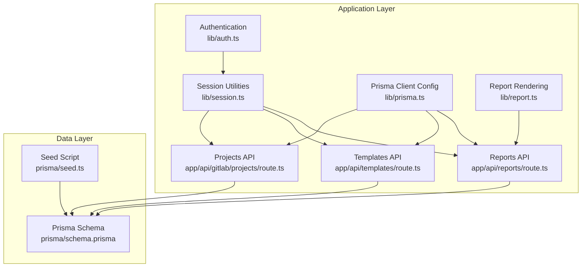
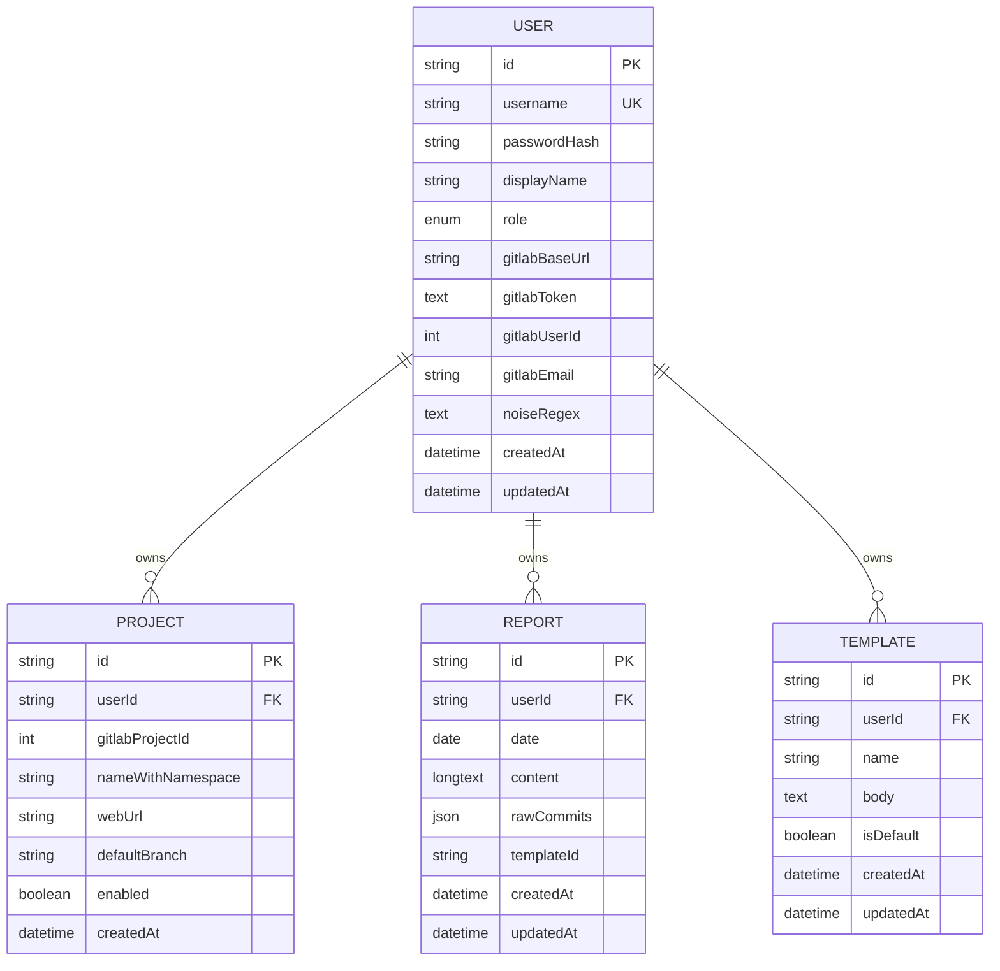
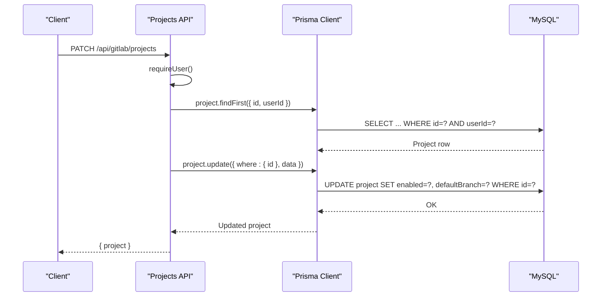
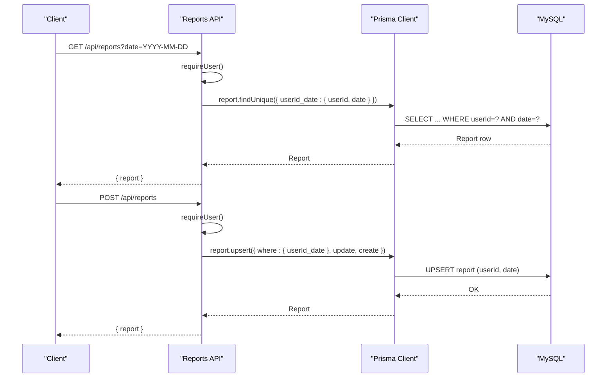
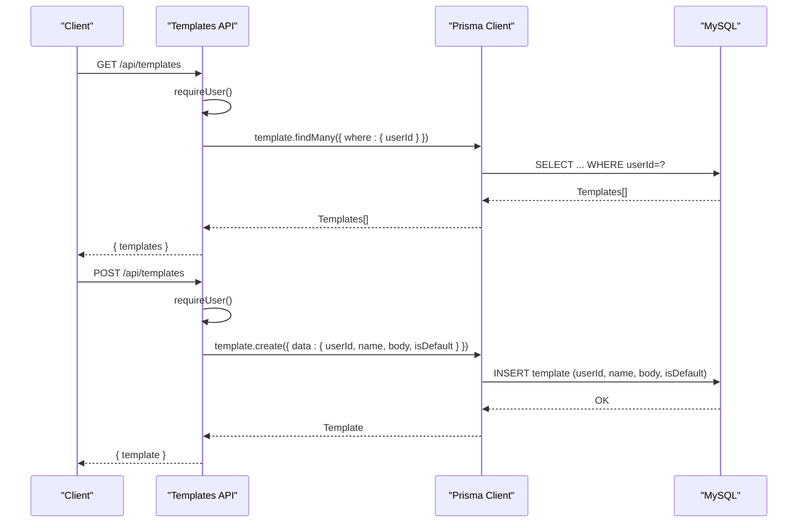
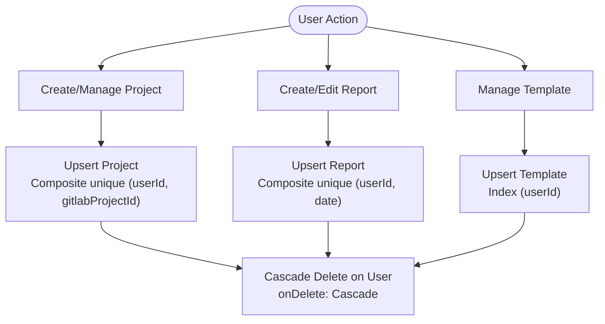
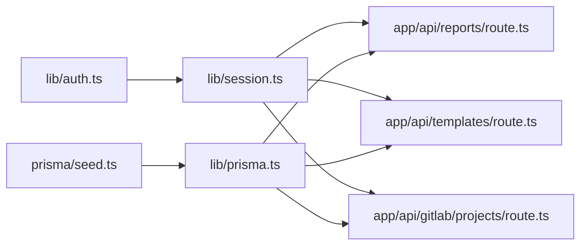

# Entity Relationships

<cite>
**Referenced Files in This Document**
- [schema.prisma](file://prisma/schema.prisma)
- [seed.ts](file://prisma/seed.ts)
- [prisma.ts](file://lib/prisma.ts)
- [session.ts](file://lib/session.ts)
- [auth.ts](file://lib/auth.ts)
- [route.ts](file://app/api/reports/route.ts)
- [route.ts](file://app/api/templates/route.ts)
- [route.ts](file://app/api/gitlab/projects/route.ts)
- [report.ts](file://lib/report.ts)
- [README.md](file://README.md)
</cite>

## Table of Contents
1. [Introduction](#introduction)
2. [Project Structure](#project-structure)
3. [Core Components](#core-components)
4. [Architecture Overview](#architecture-overview)
5. [Detailed Component Analysis](#detailed-component-analysis)
6. [Dependency Analysis](#dependency-analysis)
7. [Performance Considerations](#performance-considerations)
8. [Troubleshooting Guide](#troubleshooting-guide)
9. [Conclusion](#conclusion)

## Introduction
This document describes the entity relationship model for Pingyun Report’s database design. It focuses on the relationships among User, Project, Report, and Template entities, including foreign keys, cascade deletion policies, composite unique constraints, and indexes. It also explains the business logic that underpins multi-user, multi-project reporting functionality and how these relationships support the application’s core workflows.

## Project Structure
The entity model is defined in the Prisma schema and enforced by the application’s API routes and session management. The key files involved are:
- Prisma schema defining models, relations, constraints, and indexes
- Seed script initializing default admin user and default template
- Prisma client configuration
- Authentication and session utilities
- API routes that enforce per-user scoping and CRUD operations
- Report rendering utilities that consume templates and project data

**Diagram sources**
- [auth.ts:1-77](file://lib/auth.ts#L1-L77)
- [session.ts:1-56](file://lib/session.ts#L1-L56)
- [prisma.ts:1-14](file://lib/prisma.ts#L1-L14)
- [route.ts](file://app/api/reports/route.ts)
- [route.ts](file://app/api/templates/route.ts)
- [route.ts](file://app/api/gitlab/projects/route.ts)
- [report.ts:1-159](file://lib/report.ts#L1-L159)
- [schema.prisma:1-80](file://prisma/schema.prisma#L1-L80)
- [seed.ts:1-63](file://prisma/seed.ts#L1-L63)

**Section sources**
- [README.md:1-86](file://README.md#L1-L86)
- [schema.prisma:1-80](file://prisma/schema.prisma#L1-L80)
- [prisma.ts:1-14](file://lib/prisma.ts#L1-L14)
- [auth.ts:1-77](file://lib/auth.ts#L1-L77)
- [session.ts:1-56](file://lib/session.ts#L1-L56)

## Core Components
This section documents the four core entities and their relationships.

- User
  - Primary key: id
  - Properties include identity, role, and GitLab integration fields
  - Has collections: projects, reports, templates
- Project
  - Primary key: id
  - Foreign key: userId -> User.id
  - Composite unique constraint: (userId, gitlabProjectId)
  - Index: (userId)
  - Cascade delete: enabled via onDelete: Cascade on the relation
- Report
  - Primary key: id
  - Foreign key: userId -> User.id
  - Composite unique constraint: (userId, date)
  - Index: (userId, date)
  - Cascade delete: enabled via onDelete: Cascade on the relation
- Template
  - Primary key: id
  - Foreign key: userId -> User.id
  - Index: (userId)
  - Cascade delete: enabled via onDelete: Cascade on the relation

Key constraints and policies:
- One-to-many relationships:
  - User to Projects: one user owns many projects
  - User to Reports: one user owns many reports
  - User to Templates: one user owns many templates
- Many-to-one relationships back to User:
  - Project.userId
  - Report.userId
  - Template.userId
- Composite unique constraints:
  - Projects: (userId, gitlabProjectId) ensures a user can only have one row per GitLab project ID
  - Reports: (userId, date) ensures a user can only have one report per date
- Cascade deletion:
  - Deleting a User deletes their Projects, Reports, and Templates due to onDelete: Cascade on each relation
- Indexes:
  - Projects: index on (userId) for efficient user-scoped queries
  - Reports: index on (userId, date) for efficient date-range and per-user queries
  - Templates: index on (userId) for efficient user-scoped queries

These constraints and indexes are defined in the Prisma schema and enforced by the database.

**Section sources**
- [schema.prisma:16-80](file://prisma/schema.prisma#L16-L80)

## Architecture Overview
The application enforces per-user isolation at runtime. API routes require an authenticated user and scope all operations to that user’s data. The Prisma schema defines the database-level relationships and constraints.

**Diagram sources**
- [schema.prisma:16-80](file://prisma/schema.prisma#L16-L80)

**Section sources**
- [schema.prisma:16-80](file://prisma/schema.prisma#L16-L80)

## Detailed Component Analysis

### User Model
- Responsibilities:
  - Stores identity and role
  - Holds GitLab integration credentials (encrypted)
  - Serves as the owner of Projects, Reports, and Templates
- Business impact:
  - Multi-user support through per-user scoping in API routes
  - Admin role enables administrative endpoints

**Section sources**
- [schema.prisma:16-33](file://prisma/schema.prisma#L16-L33)
- [auth.ts:40-57](file://lib/auth.ts#L40-L57)
- [session.ts:22-29](file://lib/session.ts#L22-L29)

### Project Model
- Purpose:
  - Tracks GitLab project associations for a user
- Uniqueness:
  - Composite unique constraint (userId, gitlabProjectId) prevents duplicates
- Indexing:
  - Index on (userId) supports efficient user-scoped queries
- Cascade policy:
  - onDelete: Cascade ensures deleting a user removes their projects

**Diagram sources**
- [route.ts](file://app/api/gitlab/projects/route.ts)
- [session.ts:22-29](file://lib/session.ts#L22-L29)

**Section sources**
- [schema.prisma:35-49](file://prisma/schema.prisma#L35-L49)
- [route.ts](file://app/api/gitlab/projects/route.ts)

### Report Model
- Purpose:
  - Stores daily reports for a user
- Uniqueness:
  - Composite unique constraint (userId, date) ensures one report per user per date
- Indexing:
  - Index on (userId, date) optimizes date-range queries and per-user listing
- Cascade policy:
  - onDelete: Cascade ensures deleting a user removes their reports

**Diagram sources**
- [route.ts](file://app/api/reports/route.ts)
- [schema.prisma:51-65](file://prisma/schema.prisma#L51-L65)

**Section sources**
- [schema.prisma:51-65](file://prisma/schema.prisma#L51-L65)
- [route.ts](file://app/api/reports/route.ts)

### Template Model
- Purpose:
  - Stores user-defined templates for report rendering
- Indexing:
  - Index on (userId) supports efficient user-scoping
- Cascade policy:
  - onDelete: Cascade ensures deleting a user removes their templates

**Diagram sources**
- [route.ts](file://app/api/templates/route.ts)
- [schema.prisma:67-79](file://prisma/schema.prisma#L67-L79)

**Section sources**
- [schema.prisma:67-79](file://prisma/schema.prisma#L67-L79)
- [route.ts](file://app/api/templates/route.ts)

### Relationship Flow: From User to Entities

**Diagram sources**
- [schema.prisma:35-79](file://prisma/schema.prisma#L35-L79)

**Section sources**
- [schema.prisma:35-79](file://prisma/schema.prisma#L35-L79)

## Dependency Analysis
Runtime dependencies and how they enforce referential integrity and per-user isolation:

- Authentication and session:
  - Authentication provider resolves users by username and verifies password hash
  - Session utilities require a user for protected routes and wrap handlers to convert errors into responses
- Prisma client:
  - Centralized client configuration with environment-aware logging
- API routes:
  - All routes call requireUser() to ensure the request is scoped to the authenticated user
  - Queries and mutations use userId to constrain operations
- Seed script:
  - Creates an initial admin user and a default template for that user

**Diagram sources**
- [auth.ts:1-77](file://lib/auth.ts#L1-L77)
- [session.ts:1-56](file://lib/session.ts#L1-L56)
- [prisma.ts:1-14](file://lib/prisma.ts#L1-L14)
- [route.ts](file://app/api/reports/route.ts)
- [route.ts](file://app/api/templates/route.ts)
- [route.ts](file://app/api/gitlab/projects/route.ts)
- [seed.ts:1-63](file://prisma/seed.ts#L1-L63)

**Section sources**
- [auth.ts:1-77](file://lib/auth.ts#L1-L77)
- [session.ts:1-56](file://lib/session.ts#L1-L56)
- [prisma.ts:1-14](file://lib/prisma.ts#L1-L14)
- [route.ts](file://app/api/reports/route.ts)
- [route.ts](file://app/api/templates/route.ts)
- [route.ts](file://app/api/gitlab/projects/route.ts)
- [seed.ts:1-63](file://prisma/seed.ts#L1-L63)

## Performance Considerations
- Composite unique constraints:
  - (userId, gitlabProjectId) and (userId, date) prevent duplicates and enable fast lookups
- Indexes:
  - Projects: (userId) supports efficient user-scoped queries
  - Reports: (userId, date) supports date-range filtering and per-user listing
  - Templates: (userId) supports efficient user-scoped queries
- Cascade deletion:
  - Reduces orphaned records and simplifies cleanup when users are removed
- Prisma client configuration:
  - Environment-aware logging reduces overhead in production

[No sources needed since this section provides general guidance]

## Troubleshooting Guide
Common issues and resolutions:

- Duplicate report per date:
  - Symptom: Upsert attempts fail due to unique constraint violation
  - Resolution: Ensure the date parameter is correct; the composite unique (userId, date) prevents duplicates
- Duplicate project per GitLab project ID:
  - Symptom: Upsert attempts fail due to unique constraint violation
  - Resolution: Ensure the gitlabProjectId is unique per user; the composite unique (userId, gitlabProjectId) prevents duplicates
- Unauthorized access:
  - Symptom: 401 Unauthorized responses
  - Resolution: Ensure the user is authenticated; API routes require a valid session
- Forbidden access:
  - Symptom: 403 Forbidden responses
  - Resolution: Ensure the user has ADMIN role for admin-only endpoints
- Template default conflicts:
  - Symptom: Multiple default templates for a user
  - Resolution: The API ensures only one default template per user by toggling isDefault appropriately

**Section sources**
- [route.ts](file://app/api/reports/route.ts)
- [route.ts](file://app/api/templates/route.ts)
- [route.ts](file://app/api/gitlab/projects/route.ts)
- [session.ts:22-37](file://lib/session.ts#L22-L37)

## Conclusion
The entity relationship model in Pingyun Report is designed to support a multi-user, multi-project reporting system. The User entity owns Projects, Reports, and Templates through one-to-many relationships. Composite unique constraints and indexes ensure data integrity and query efficiency. Cascade deletion maintains referential integrity when users are removed. Runtime enforcement via authentication and session utilities ensures per-user scoping across all API operations, aligning database-level constraints with application-level business logic.