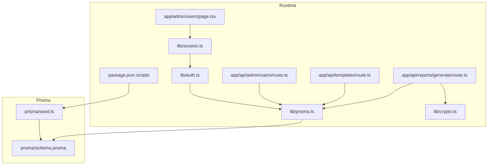
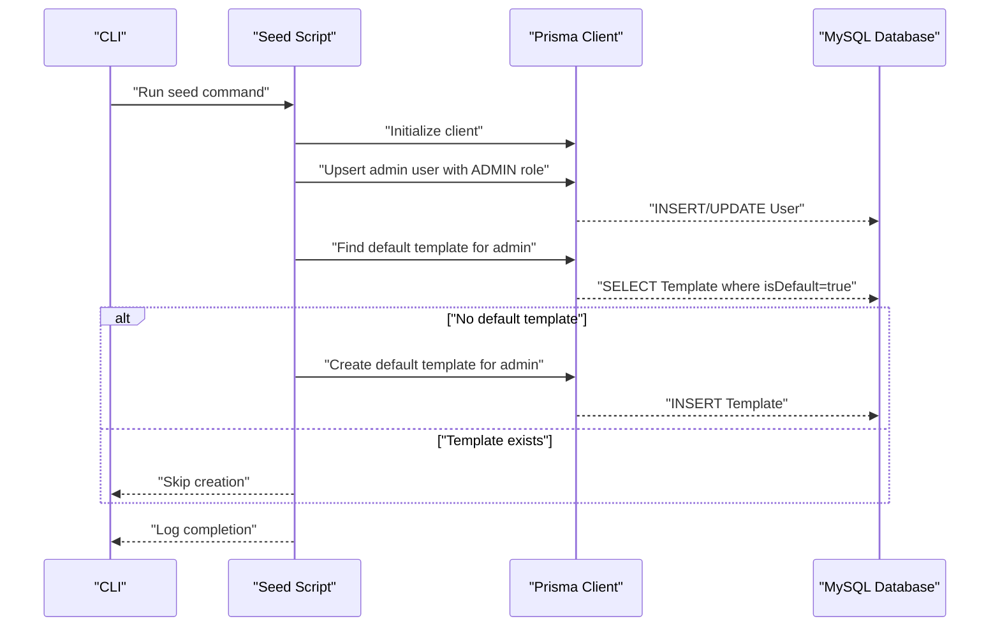
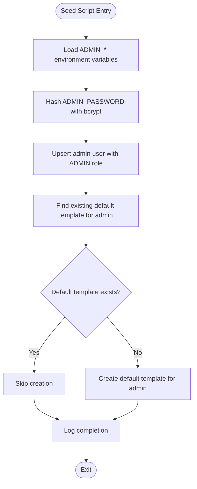
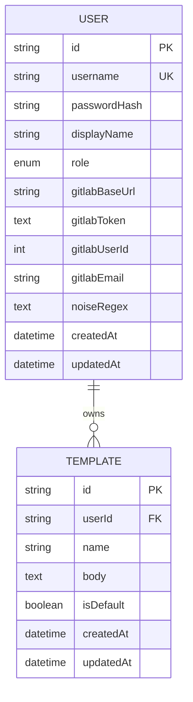
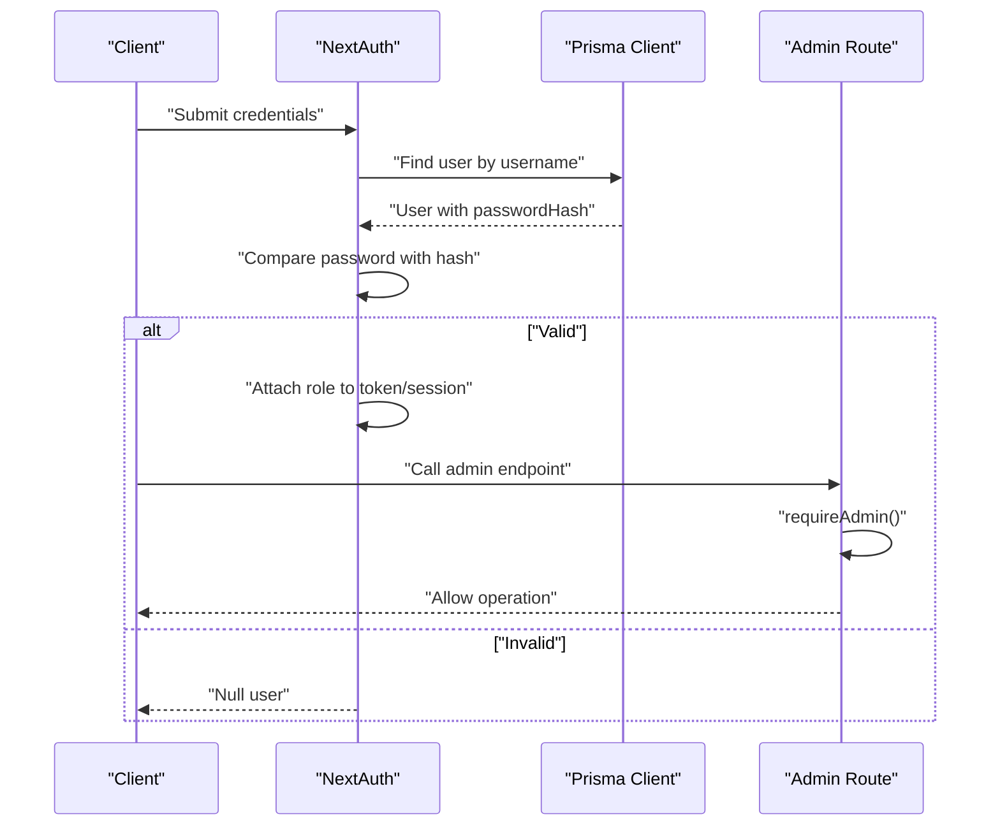
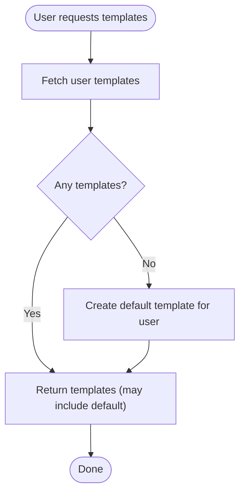
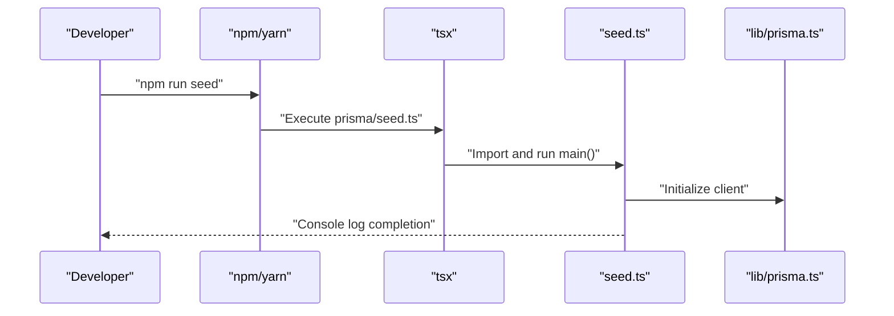
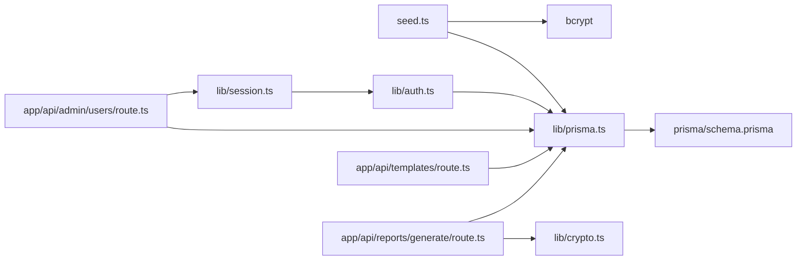

# Seed Data and Initialization

<cite>
**Referenced Files in This Document**
- [schema.prisma](file://prisma/schema.prisma)
- [seed.ts](file://prisma/seed.ts)
- [package.json](file://package.json)
- [prisma.ts](file://lib/prisma.ts)
- [auth.ts](file://lib/auth.ts)
- [session.ts](file://lib/session.ts)
- [users.route.ts](file://app/api/admin/users/route.ts)
- [users.page.tsx](file://app/admin/users/page.tsx)
- [templates.route.ts](file://app/api/templates/route.ts)
- [generate.route.ts](file://app/api/reports/generate/route.ts)
- [crypto.ts](file://lib/crypto.ts)
</cite>

## Table of Contents
1. [Introduction](#introduction)
2. [Project Structure](#project-structure)
3. [Core Components](#core-components)
4. [Architecture Overview](#architecture-overview)
5. [Detailed Component Analysis](#detailed-component-analysis)
6. [Dependency Analysis](#dependency-analysis)
7. [Performance Considerations](#performance-considerations)
8. [Troubleshooting Guide](#troubleshooting-guide)
9. [Conclusion](#conclusion)
10. [Appendices](#appendices)

## Introduction
This document explains the database seed data creation and initialization process in Pingyun Report. It focuses on how the seed script creates the initial administrator user, sets up the default template for that user, and integrates with the Prisma schema. It also covers environment-specific configuration, security considerations, execution commands, and best practices for managing seed data across environments and migrations.

## Project Structure
The seed logic is implemented as a standalone TypeScript script that runs against the Prisma schema. The schema defines the database models and enums used during seeding. Scripts and runtime libraries integrate with Next.js and NextAuth for authentication and session handling.

**Diagram sources**
- [schema.prisma:1-80](file://prisma/schema.prisma#L1-L80)
- [seed.ts:1-63](file://prisma/seed.ts#L1-L63)
- [package.json:5-14](file://package.json#L5-L14)
- [prisma.ts:1-14](file://lib/prisma.ts#L1-L14)
- [auth.ts:1-77](file://lib/auth.ts#L1-L77)
- [session.ts:1-56](file://lib/session.ts#L1-L56)
- [users.route.ts:1-88](file://app/api/admin/users/route.ts#L1-L88)
- [users.page.tsx:1-22](file://app/admin/users/page.tsx#L1-L22)
- [templates.route.ts:1-96](file://app/api/templates/route.ts#L1-L96)
- [generate.route.ts:1-133](file://app/api/reports/generate/route.ts#L1-L133)
- [crypto.ts:1-46](file://lib/crypto.ts#L1-L46)

**Section sources**
- [schema.prisma:1-80](file://prisma/schema.prisma#L1-L80)
- [seed.ts:1-63](file://prisma/seed.ts#L1-L63)
- [package.json:5-14](file://package.json#L5-L14)
- [prisma.ts:1-14](file://lib/prisma.ts#L1-L14)

## Core Components
- Prisma schema: Defines the database models and enums used by the seed script and application.
- Seed script: Creates the initial admin user and ensures a default template exists for that user.
- Authentication and session: Provides role-based access control and credential verification.
- Admin APIs: Allow management of users and templates after seeding.
- Encryption utility: Handles secure storage of sensitive tokens used by the application.

Key responsibilities:
- Seed script: Upsert admin user with hashed password, assign ADMIN role, and create default template if missing.
- Prisma client: Centralized client configuration with environment-aware logging.
- Auth: Validates credentials against stored hashes and exposes roles to the session.
- Admin routes: Enforce ADMIN role for user management operations.
- Templates route: Ensures each user has a default template; supports per-user customization.
- Crypto: Provides encryption/decryption for GitLab tokens stored in the database.

**Section sources**
- [schema.prisma:11-33](file://prisma/schema.prisma#L11-L33)
- [seed.ts:19-53](file://prisma/seed.ts#L19-L53)
- [prisma.ts:7-14](file://lib/prisma.ts#L7-L14)
- [auth.ts:30-77](file://lib/auth.ts#L30-L77)
- [users.route.ts:31-87](file://app/api/admin/users/route.ts#L31-L87)
- [templates.route.ts:7-25](file://app/api/templates/route.ts#L7-L25)
- [crypto.ts:17-38](file://lib/crypto.ts#L17-L38)

## Architecture Overview
The seed process is a one-time initialization step that prepares the database with an administrative account and baseline data. It interacts with the Prisma schema and writes records that subsequent application features depend on.

**Diagram sources**
- [seed.ts:19-53](file://prisma/seed.ts#L19-L53)
- [schema.prisma:16-33](file://prisma/schema.prisma#L16-L33)
- [schema.prisma:67-79](file://prisma/schema.prisma#L67-L79)

## Detailed Component Analysis

### Seed Script Implementation
The seed script performs two primary tasks:
- Create or update the admin user with a hashed password and ADMIN role.
- Ensure a default template exists for the admin user.

Environment variables:
- ADMIN_USERNAME: Overrides the default admin username.
- ADMIN_PASSWORD: Overrides the default admin password.
- ADMIN_DISPLAY_NAME: Overrides the default admin display name.

Processing logic:
- Hash the provided or default password using bcrypt.
- Upsert the admin user record with the computed hash and ADMIN role.
- Check for an existing default template for the admin user.
- Create a default template if none is found.

**Diagram sources**
- [seed.ts:19-53](file://prisma/seed.ts#L19-L53)

**Section sources**
- [seed.ts:19-53](file://prisma/seed.ts#L19-L53)

### Prisma Schema Integration
The schema defines the models and enums used by the seed script:
- Role enum with MEMBER and ADMIN values.
- User model with unique username, password hash, role, and optional GitLab fields.
- Template model with isDefault flag and per-user ownership via foreign key.
- Report and Project models support the reporting workflow.

**Diagram sources**
- [schema.prisma:16-33](file://prisma/schema.prisma#L16-L33)
- [schema.prisma:67-79](file://prisma/schema.prisma#L67-L79)

**Section sources**
- [schema.prisma:11-14](file://prisma/schema.prisma#L11-L14)
- [schema.prisma:16-33](file://prisma/schema.prisma#L16-L33)
- [schema.prisma:67-79](file://prisma/schema.prisma#L67-L79)

### Authentication and Role Assignment
The seed assigns the ADMIN role to the initial user. The application enforces role-based access control:
- NextAuth credentials provider validates username/password against the stored hash.
- Session callbacks attach role to JWT and session objects.
- Admin-only routes require ADMIN role before allowing modifications.

**Diagram sources**
- [auth.ts:40-55](file://lib/auth.ts#L40-L55)
- [session.ts:31-37](file://lib/session.ts#L31-L37)
- [users.route.ts:31-37](file://app/api/admin/users/route.ts#L31-L37)

**Section sources**
- [auth.ts:30-77](file://lib/auth.ts#L30-L77)
- [session.ts:31-37](file://lib/session.ts#L31-L37)
- [users.route.ts:31-37](file://app/api/admin/users/route.ts#L31-L37)

### Default Template Creation and Per-User Behavior
The seed script ensures a default template exists for the admin user. Application logic mirrors this pattern for other users:
- On first access, templates return empty results and create a default template.
- Users can manage templates individually, with isDefault controlling selection.

**Diagram sources**
- [templates.route.ts:7-25](file://app/api/templates/route.ts#L7-L25)
- [seed.ts:37-50](file://prisma/seed.ts#L37-L50)

**Section sources**
- [templates.route.ts:7-25](file://app/api/templates/route.ts#L7-L25)
- [seed.ts:37-50](file://prisma/seed.ts#L37-L50)

### Security Considerations for Seed Data
- Password hashing: bcrypt is used to hash passwords during seeding and authentication.
- Environment variables: ADMIN_* variables allow overriding defaults; ensure they are set securely in production.
- Encrypted storage: GitLab tokens are stored encrypted at rest and decrypted at runtime.
- Role enforcement: Admin-only endpoints prevent unauthorized user management.

**Section sources**
- [seed.ts:20-24](file://prisma/seed.ts#L20-L24)
- [auth.ts:46](file://lib/auth.ts#L46)
- [crypto.ts:17-38](file://lib/crypto.ts#L17-L38)
- [users.route.ts:31-37](file://app/api/admin/users/route.ts#L31-L37)

### Execution Commands and Integration
- The seed command is defined in package.json and executed via a TypeScript runner.
- Prisma client is configured centrally and reused by the seed script.
- The seed script logs completion and disconnects the client.

**Diagram sources**
- [package.json:14](file://package.json#L14)
- [seed.ts:19-53](file://prisma/seed.ts#L19-L53)
- [prisma.ts:7-14](file://lib/prisma.ts#L7-L14)

**Section sources**
- [package.json:14](file://package.json#L14)
- [seed.ts:19-53](file://prisma/seed.ts#L19-L53)
- [prisma.ts:7-14](file://lib/prisma.ts#L7-L14)

## Dependency Analysis
The seed script depends on:
- Prisma client for database operations.
- bcrypt for password hashing.
- Environment variables for admin credentials.

The application’s admin features depend on:
- Prisma client for user and template persistence.
- NextAuth for authentication and session management.
- Session utilities for role checks.
- Crypto utility for secure token handling.

**Diagram sources**
- [seed.ts:1-2](file://prisma/seed.ts#L1-L2)
- [prisma.ts:1-14](file://lib/prisma.ts#L1-L14)
- [schema.prisma:1-80](file://prisma/schema.prisma#L1-L80)
- [auth.ts:1-4](file://lib/auth.ts#L1-L4)
- [session.ts:1-3](file://lib/session.ts#L1-L3)
- [users.route.ts:1-5](file://app/api/admin/users/route.ts#L1-L5)
- [templates.route.ts:1-5](file://app/api/templates/route.ts#L1-L5)
- [generate.route.ts:1-7](file://app/api/reports/generate/route.ts#L1-L7)
- [crypto.ts:1-1](file://lib/crypto.ts#L1-L1)

**Section sources**
- [seed.ts:1-2](file://prisma/seed.ts#L1-L2)
- [prisma.ts:1-14](file://lib/prisma.ts#L1-L14)
- [auth.ts:1-4](file://lib/auth.ts#L1-L4)
- [session.ts:1-3](file://lib/session.ts#L1-L3)
- [users.route.ts:1-5](file://app/api/admin/users/route.ts#L1-L5)
- [templates.route.ts:1-5](file://app/api/templates/route.ts#L1-L5)
- [generate.route.ts:1-7](file://app/api/reports/generate/route.ts#L1-L7)
- [crypto.ts:1-1](file://lib/crypto.ts#L1-L1)

## Performance Considerations
- Seed script: Minimal overhead; uses upsert and single queries to avoid redundant writes.
- Prisma client: Configured with environment-aware logging to reduce noise in production.
- Authentication: bcrypt cost factor is balanced for development convenience while remaining reasonable for production.

## Troubleshooting Guide
Common issues and resolutions:
- Seed fails due to missing environment variables:
  - Set ADMIN_USERNAME, ADMIN_PASSWORD, ADMIN_DISPLAY_NAME for deterministic admin setup.
- Authentication failures:
  - Verify the stored password hash matches the provided password using bcrypt comparison.
- Missing default template:
  - The seed ensures a default template for the admin user; application logic also creates one on first access for other users.
- Admin endpoints return forbidden:
  - Confirm the requesting user has ADMIN role and that session is established via NextAuth.

**Section sources**
- [seed.ts:20-22](file://prisma/seed.ts#L20-L22)
- [auth.ts:46](file://lib/auth.ts#L46)
- [templates.route.ts:13-23](file://app/api/templates/route.ts#L13-L23)
- [users.route.ts:31-37](file://app/api/admin/users/route.ts#L31-L37)

## Conclusion
The seed script initializes the database with a secure admin user and a default template, ensuring the application is ready for immediate use. It integrates cleanly with the Prisma schema and leverages NextAuth for robust authentication and role-based access control. Following the best practices outlined here will help maintain consistent, secure, and manageable seed data across environments.

## Appendices

### Best Practices for Seed Data Management
- Keep seed data minimal and deterministic; avoid sensitive real-world data.
- Use environment variables to override defaults for different environments.
- Version seed logic alongside schema changes; document breaking changes.
- Run seeds after migrations in CI/CD pipelines to keep test databases consistent.
- Avoid hardcoding secrets; rely on environment variables and encryption for sensitive fields.

### Environment-Specific Configurations
- Development: Use short-lived defaults for ADMIN_* variables; enable verbose logging.
- Production: Provide secure ADMIN_* values; disable unnecessary logging; enforce strict encryption keys.

### Data Migration Strategies
- Treat seed data as part of the schema lifecycle; evolve seed logic when adding new models or default records.
- Use Prisma migrations for structural changes; run seeds afterward to populate defaults.
- For incremental updates, implement idempotent seed steps that detect existing records.

### Seed Data Versioning and Maintenance
- Track seed changes in version control; annotate with release notes.
- Periodically review seed data for stale defaults or outdated templates.
- Automate seed execution in provisioning scripts and CI pipelines to ensure reproducibility.