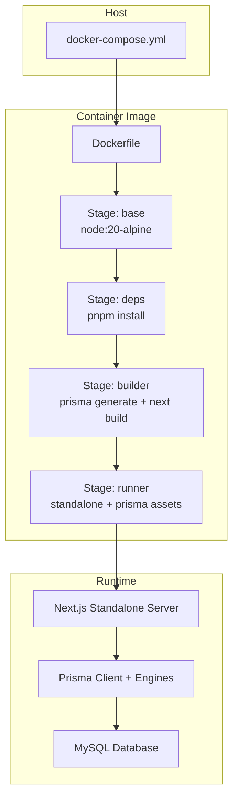
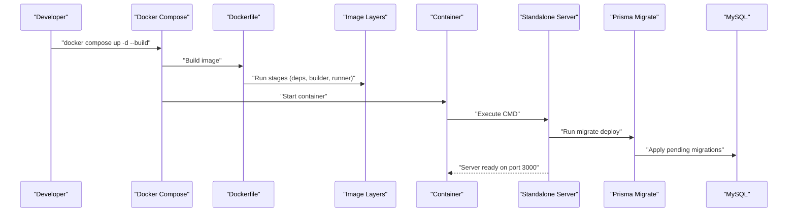
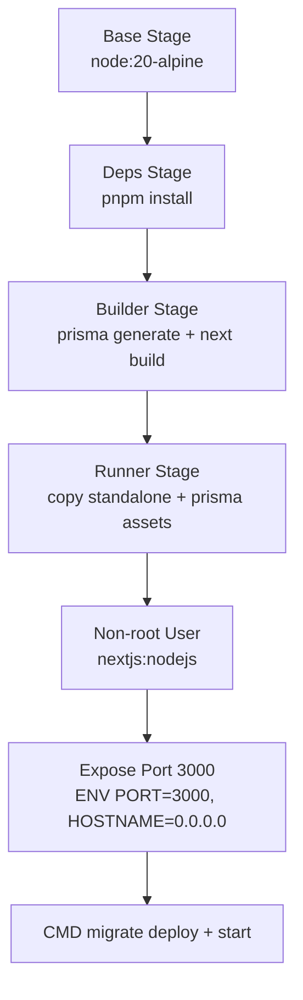
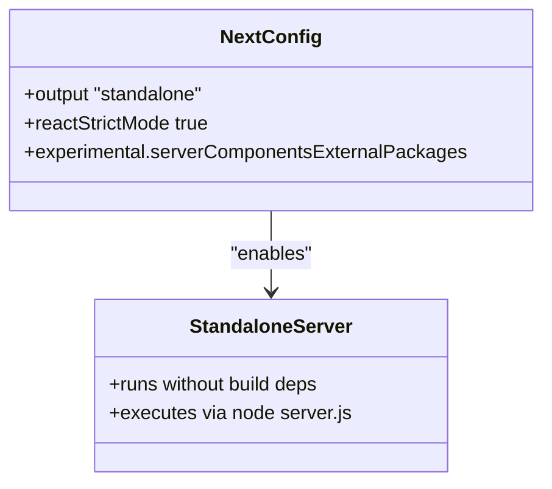
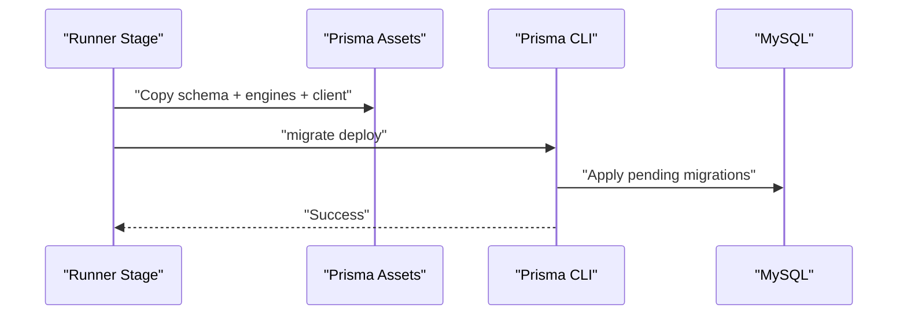
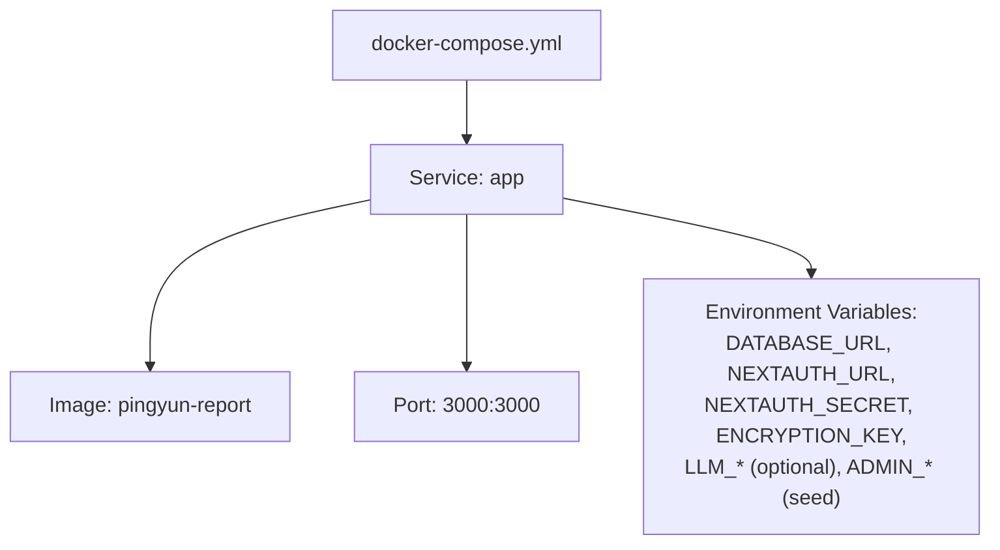
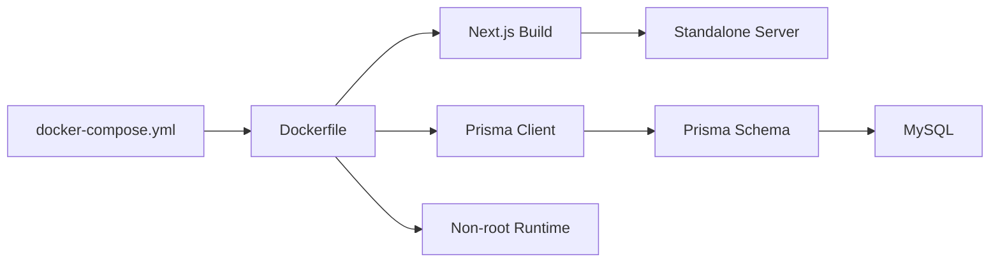

# Containerization and Docker Setup

<cite>
**Referenced Files in This Document**
- [Dockerfile](file://Dockerfile)
- [docker-compose.yml](file://docker-compose.yml)
- [package.json](file://package.json)
- [next.config.mjs](file://next.config.mjs)
- [prisma/schema.prisma](file://prisma/schema.prisma)
- [lib/prisma.ts](file://lib/prisma.ts)
- [lib/crypto.ts](file://lib/crypto.ts)
- [prisma/seed.ts](file://prisma/seed.ts)
- [middleware.ts](file://middleware.ts)
- [README.md](file://README.md)
</cite>

## Table of Contents
1. [Introduction](#introduction)
2. [Project Structure](#project-structure)
3. [Core Components](#core-components)
4. [Architecture Overview](#architecture-overview)
5. [Detailed Component Analysis](#detailed-component-analysis)
6. [Dependency Analysis](#dependency-analysis)
7. [Performance Considerations](#performance-considerations)
8. [Troubleshooting Guide](#troubleshooting-guide)
9. [Conclusion](#conclusion)
10. [Appendices](#appendices)

## Introduction
This document explains the containerization and Docker setup for Pingyun Report. It covers the multi-stage Dockerfile architecture, standalone Next.js build optimization, Prisma engine copying for migration support, and Docker Compose configuration for development and production environments. It also documents environment variable management, port exposure, user privilege configuration, security best practices, health checks, and resource limits, along with step-by-step instructions for building, running, and troubleshooting Docker containers.

## Project Structure
Pingyun Report is a Next.js 14 application with TypeScript, Prisma ORM, and MySQL. The containerization relies on:
- A multi-stage Dockerfile that builds a standalone Next.js server and copies Prisma artifacts for migrations.
- A Docker Compose configuration that defines the application service and environment variables.
- Next.js configuration enabling standalone output and selective external packages.
- Prisma schema defining the database model and datasource.

**Diagram sources**
- [Dockerfile:1-44](file://Dockerfile#L1-L44)
- [next.config.mjs:1-11](file://next.config.mjs#L1-L11)
- [prisma/schema.prisma:1-80](file://prisma/schema.prisma#L1-L80)

**Section sources**
- [Dockerfile:1-44](file://Dockerfile#L1-L44)
- [docker-compose.yml:1-21](file://docker-compose.yml#L1-L21)
- [next.config.mjs:1-11](file://next.config.mjs#L1-L11)
- [prisma/schema.prisma:1-80](file://prisma/schema.prisma#L1-L80)

## Core Components
- Multi-stage Dockerfile:
  - Base stage sets up Alpine Linux, Node.js, and system dependencies.
  - Deps stage enables Corepack and installs dependencies using pnpm.
  - Builder stage generates Prisma client and performs Next.js build.
  - Runner stage prepares a non-root user, copies standalone output, Prisma assets, and sets runtime environment.
- Docker Compose:
  - Builds the image from the Dockerfile, exposes port 3000, and injects environment variables.
- Next.js standalone build:
  - Enabled via configuration to produce a portable server binary.
- Prisma integration:
  - Prisma client and engines are copied into the runtime image to support migrations on startup.

**Section sources**
- [Dockerfile:1-44](file://Dockerfile#L1-L44)
- [docker-compose.yml:1-21](file://docker-compose.yml#L1-L21)
- [next.config.mjs:1-11](file://next.config.mjs#L1-L11)
- [prisma/schema.prisma:1-80](file://prisma/schema.prisma#L1-L80)

## Architecture Overview
The container architecture separates concerns across stages:
- Build-time: Prisma client generation and Next.js compilation.
- Runtime: Non-root user, standalone server, and Prisma migration execution on startup.

**Diagram sources**
- [Dockerfile:42-44](file://Dockerfile#L42-L44)
- [docker-compose.yml:3-21](file://docker-compose.yml#L3-L21)

## Detailed Component Analysis

### Multi-Stage Dockerfile
- Base stage:
  - Uses node:20-alpine and installs libc6-compat and openssl for compatibility.
  - Sets working directory to /app.
- Deps stage:
  - Enables Corepack and installs dependencies using pnpm with a lockfile.
- Builder stage:
  - Copies node_modules from deps stage.
  - Generates Prisma client and builds Next.js.
  - Disables telemetry during build.
- Runner stage:
  - Creates a non-root user (nextjs:nodejs) with UID/GID 1001.
  - Copies standalone Next.js output and static assets.
  - Copies Prisma schema, engines, and client to support migrations on startup.
  - Switches to non-root user, exposes port 3000, sets HOSTNAME and PORT.
  - Runs Prisma migrations on startup, then starts the standalone server.

**Diagram sources**
- [Dockerfile:2-44](file://Dockerfile#L2-L44)

**Section sources**
- [Dockerfile:1-44](file://Dockerfile#L1-L44)

### Standalone Next.js Build Optimization
- Standalone output is enabled so the server can run independently without the build-time dependencies.
- Certain packages are marked external to reduce bundle size and improve runtime performance.
- The standalone server is executed by the container’s CMD.

**Diagram sources**
- [next.config.mjs:1-11](file://next.config.mjs#L1-L11)
- [Dockerfile:28-44](file://Dockerfile#L28-L44)

**Section sources**
- [next.config.mjs:1-11](file://next.config.mjs#L1-L11)
- [Dockerfile:17-19](file://Dockerfile#L17-L19)

### Prisma Engine Copying and Migration Support
- Prisma schema, engines, and client are copied into the runtime image.
- On startup, migrations are applied using the Prisma CLI before starting the server.
- This ensures the database is up-to-date without requiring separate migration steps.

**Diagram sources**
- [Dockerfile:32-35](file://Dockerfile#L32-L35)
- [Dockerfile:42-44](file://Dockerfile#L42-L44)
- [prisma/schema.prisma:1-80](file://prisma/schema.prisma#L1-L80)

**Section sources**
- [Dockerfile:32-35](file://Dockerfile#L32-L35)
- [Dockerfile:42-44](file://Dockerfile#L42-L44)
- [prisma/schema.prisma:1-80](file://prisma/schema.prisma#L1-L80)

### Docker Compose Configuration
- Builds the image from the current directory and assigns a container name.
- Exposes port 3000 and restart policy.
- Injects environment variables for database connectivity, authentication, encryption, and optional AI features.
- No volumes are mounted by default, keeping the container ephemeral.

**Diagram sources**
- [docker-compose.yml:1-21](file://docker-compose.yml#L1-L21)

**Section sources**
- [docker-compose.yml:1-21](file://docker-compose.yml#L1-L21)

### Environment Variable Management
- Required variables:
  - DATABASE_URL: MySQL connection string.
  - NEXTAUTH_URL: External URL for NextAuth.
  - NEXTAUTH_SECRET: Secret for NextAuth sessions.
  - ENCRYPTION_KEY: 64-character hex string for AES-256-GCM encryption.
- Optional variables:
  - LLM_API_BASE, LLM_API_KEY, LLM_MODEL: AI polish integration.
  - ADMIN_USERNAME, ADMIN_PASSWORD, ADMIN_DISPLAY_NAME: Initial admin seed values.
- Validation:
  - Encryption key length is validated in crypto utilities.

**Section sources**
- [docker-compose.yml:10-21](file://docker-compose.yml#L10-L21)
- [lib/crypto.ts:7-15](file://lib/crypto.ts#L7-L15)
- [prisma/seed.ts:20-22](file://prisma/seed.ts#L20-L22)

### Port Exposure and User Privilege Configuration
- Port 3000 is exposed and mapped inside the container.
- The container runs as a non-root user (UID/GID 1001) for improved security.
- Hostname is bound to 0.0.0.0 to accept connections from outside the container.

**Section sources**
- [Dockerfile:37-41](file://Dockerfile#L37-L41)

### Authentication Middleware and Authorization
- NextAuth middleware enforces authentication for protected routes.
- Protected paths include home, history, settings, and admin areas.

**Section sources**
- [middleware.ts:1-10](file://middleware.ts#L1-L10)

### Prisma Client Initialization
- Prisma client is initialized globally with environment-aware logging.
- In development, logs include warnings; in production, only errors are logged.

**Section sources**
- [lib/prisma.ts:1-14](file://lib/prisma.ts#L1-L14)

### Initial Admin Seed
- During seeding, an admin user is created using environment-provided credentials.
- A default template is provisioned for the admin if none exists.

**Section sources**
- [prisma/seed.ts:19-53](file://prisma/seed.ts#L19-L53)

## Dependency Analysis
- Dockerfile depends on:
  - Node.js 20 Alpine base image.
  - pnpm for dependency management.
  - Next.js standalone output and Prisma client generation.
- Docker Compose depends on:
  - Local Dockerfile build.
  - Environment variables for database and authentication.
- Next.js configuration depends on:
  - Standalone output and external package list.
- Prisma schema depends on:
  - MySQL datasource URL from environment variables.

**Diagram sources**
- [Dockerfile:1-44](file://Dockerfile#L1-L44)
- [next.config.mjs:1-11](file://next.config.mjs#L1-L11)
- [prisma/schema.prisma:1-80](file://prisma/schema.prisma#L1-L80)

**Section sources**
- [Dockerfile:1-44](file://Dockerfile#L1-L44)
- [next.config.mjs:1-11](file://next.config.mjs#L1-L11)
- [prisma/schema.prisma:1-80](file://prisma/schema.prisma#L1-L80)

## Performance Considerations
- Multi-stage builds minimize final image size by discarding build-time dependencies.
- Standalone Next.js server reduces cold-start overhead and simplifies runtime.
- Non-root user reduces attack surface and aligns with security best practices.
- Environment-specific logging reduces noise in production logs.

[No sources needed since this section provides general guidance]

## Troubleshooting Guide
- Build failures:
  - Verify pnpm lockfile presence and integrity.
  - Ensure Corepack is enabled in the builder stage.
- Migration failures:
  - Confirm DATABASE_URL points to a reachable MySQL instance.
  - Review Prisma schema and ensure provider is MySQL.
- Authentication issues:
  - Validate NEXTAUTH_URL and NEXTAUTH_SECRET.
  - Check middleware matcher configuration for protected routes.
- Encryption errors:
  - Confirm ENCRYPTION_KEY is a 64-character hex string.
- Port conflicts:
  - Ensure port 3000 is free on the host or adjust docker-compose port mapping.
- Health checks and resource limits:
  - Add health checks and CPU/memory limits in docker-compose for production deployments.

**Section sources**
- [Dockerfile:8-10](file://Dockerfile#L8-L10)
- [Dockerfile:17-19](file://Dockerfile#L17-L19)
- [Dockerfile:42-44](file://Dockerfile#L42-L44)
- [prisma/schema.prisma:6-9](file://prisma/schema.prisma#L6-L9)
- [middleware.ts:7-9](file://middleware.ts#L7-L9)
- [lib/crypto.ts:7-15](file://lib/crypto.ts#L7-L15)
- [docker-compose.yml:8-9](file://docker-compose.yml#L8-L9)

## Conclusion
Pingyun Report’s containerization leverages a multi-stage Dockerfile to produce a secure, minimal runtime image with a standalone Next.js server and embedded Prisma assets. Docker Compose orchestrates the service with environment-driven configuration. The setup supports database migrations on startup, non-root execution, and a clean separation between build and runtime concerns. Following the provided instructions and best practices ensures reliable local development and production deployment.

[No sources needed since this section summarizes without analyzing specific files]

## Appendices

### Step-by-Step Instructions

- Build and run locally:
  - Build the image and start the service in detached mode.
  - Access the application at the configured port.

- Environment preparation:
  - Set required environment variables for database, authentication, and encryption.
  - Optionally configure AI-related variables.

- First-time setup:
  - Ensure migrations are applied on startup.
  - Seed the initial admin user if desired.

- Security hardening:
  - Add health checks and resource limits.
  - Consider adding read-only filesystem and dropping unnecessary capabilities.

**Section sources**
- [README.md:46-53](file://README.md#L46-L53)
- [docker-compose.yml:10-21](file://docker-compose.yml#L10-L21)
- [Dockerfile:42-44](file://Dockerfile#L42-L44)
- [prisma/seed.ts:19-53](file://prisma/seed.ts#L19-L53)