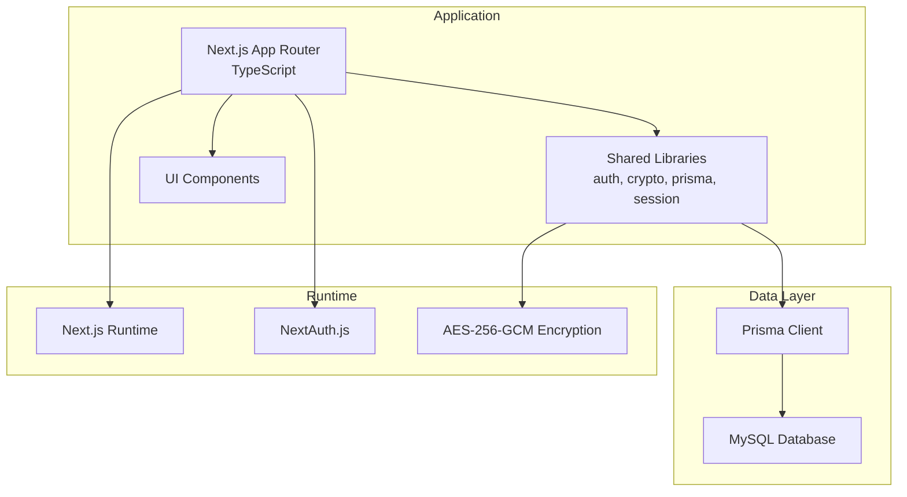
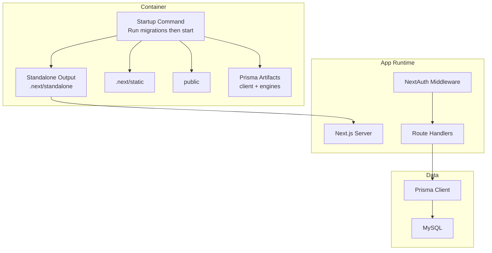
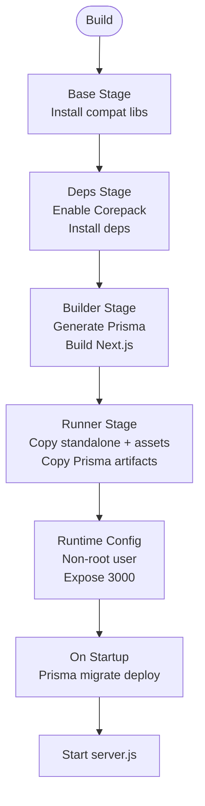
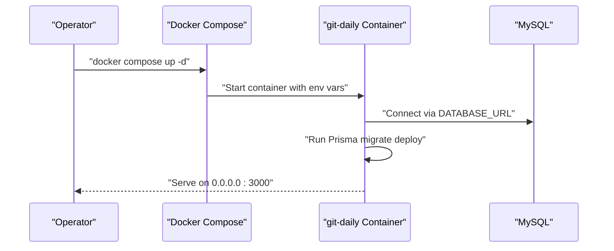
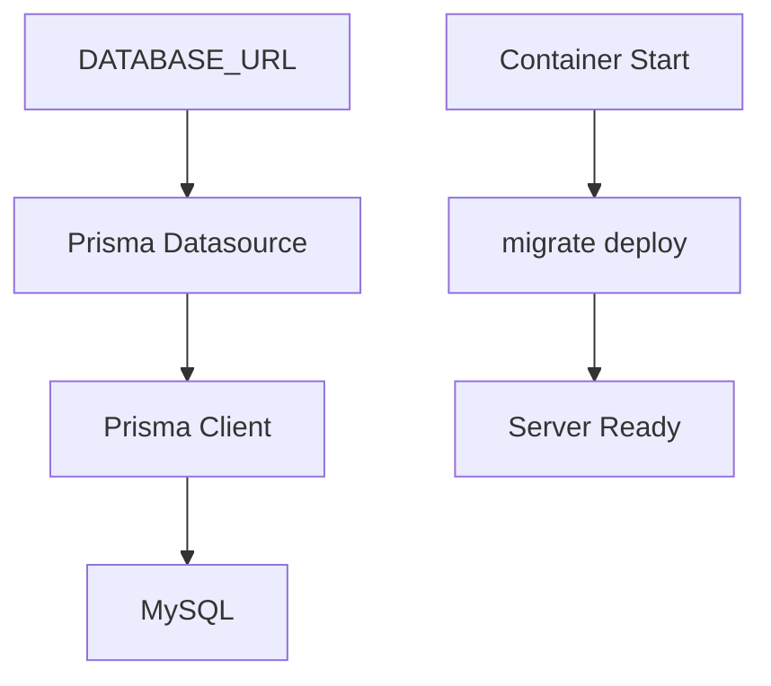
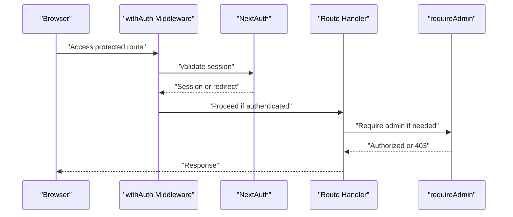
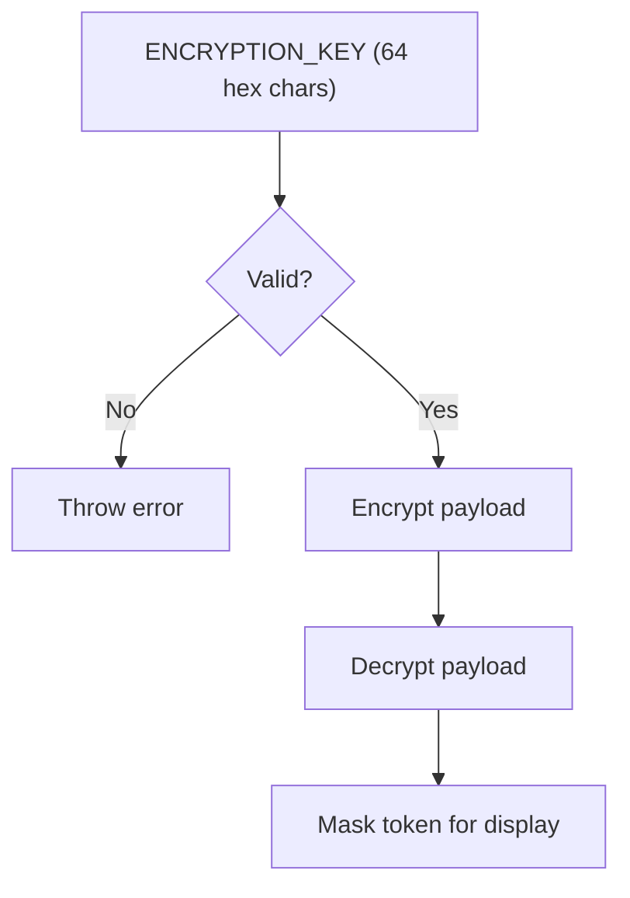
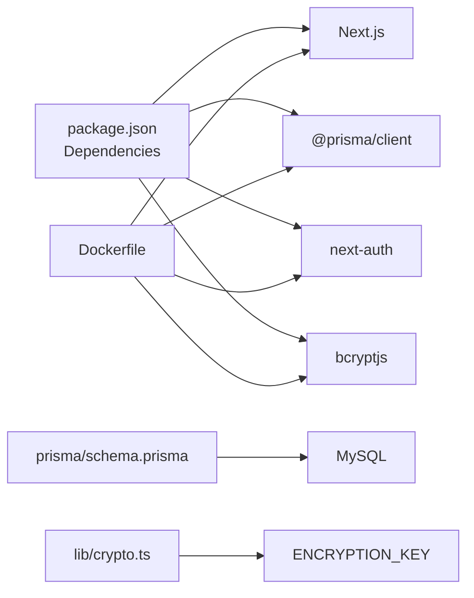

# Deployment and Operations

<cite>
**Referenced Files in This Document**
- [Dockerfile](file://Dockerfile)
- [docker-compose.yml](file://docker-compose.yml)
- [package.json](file://package.json)
- [next.config.mjs](file://next.config.mjs)
- [prisma/schema.prisma](file://prisma/schema.prisma)
- [lib/crypto.ts](file://lib/crypto.ts)
- [lib/prisma.ts](file://lib/prisma.ts)
- [lib/auth.ts](file://lib/auth.ts)
- [middleware.ts](file://middleware.ts)
- [prisma/seed.ts](file://prisma/seed.ts)
- [README.md](file://README.md)
</cite>

## Update Summary
**Changes Made**
- Updated Docker Compose service configuration to use 'git-daily' image and container name
- Updated project naming references to reflect the new 'git-daily' branding
- Enhanced deployment examples to use the new 'git-daily' naming convention
- Updated container orchestration references throughout the documentation

## Table of Contents
1. [Introduction](#introduction)
2. [Project Structure](#project-structure)
3. [Core Components](#core-components)
4. [Architecture Overview](#architecture-overview)
5. [Detailed Component Analysis](#detailed-component-analysis)
6. [Dependency Analysis](#dependency-analysis)
7. [Performance Considerations](#performance-considerations)
8. [Troubleshooting Guide](#troubleshooting-guide)
9. [Conclusion](#conclusion)
10. [Appendices](#appendices)

## Introduction
This document provides comprehensive deployment and operations guidance for GitDaily (formerly Pingyun Report). It covers containerization with Docker, multi-stage builds, production deployment via Docker Compose, environment variable configuration, database connectivity, standalone Next.js build and deployment optimization, monitoring and maintenance, scaling and high availability, security hardening, and operational checklists including rollback and disaster recovery.

## Project Structure
GitDaily is a Next.js 14 application with TypeScript, using Prisma for MySQL-backed persistence, NextAuth.js for credentials-based authentication, and a server-side GitLab integration. The repository includes:
- Application code under app/ and components/
- Shared libraries under lib/
- Prisma schema and seed under prisma/
- Containerization and orchestration assets at the repository root

**Section sources**
- [README.md:14-50](file://README.md#L14-L50)
- [package.json:16-31](file://package.json#L16-L31)

## Core Components
- Containerization and Build
  - Multi-stage Docker build produces a standalone Next.js runtime optimized for production.
  - Prisma client and engine artifacts are included to support on-startup migrations.
- Orchestration
  - Docker Compose service exposes port 3000 and mounts the standalone output and static assets.
- Environment Variables
  - Required variables include database URL, NextAuth configuration, encryption key, and optional LLM settings.
- Authentication and Authorization
  - Credentials provider with JWT sessions and middleware enforcing protected routes.
- Data Persistence
  - Prisma schema defines Users, Projects, Reports, and Templates with MySQL provider.

**Section sources**
- [Dockerfile:1-44](file://Dockerfile#L1-L44)
- [docker-compose.yml:1-21](file://docker-compose.yml#L1-L21)
- [next.config.mjs:1-11](file://next.config.mjs#L1-L11)
- [prisma/schema.prisma:1-80](file://prisma/schema.prisma#L1-L80)
- [lib/auth.ts:30-77](file://lib/auth.ts#L30-L77)
- [middleware.ts:1-10](file://middleware.ts#L1-L10)
- [lib/crypto.ts:7-46](file://lib/crypto.ts#L7-L46)

## Architecture Overview
The production runtime executes a standalone Next.js server. On startup, Prisma migrations are applied, then the server starts. Authentication is enforced via middleware and NextAuth. Data access is performed through Prisma.

**Diagram sources**
- [Dockerfile:21-44](file://Dockerfile#L21-L44)
- [next.config.mjs:3](file://next.config.mjs#L3)
- [lib/prisma.ts:1-14](file://lib/prisma.ts#L1-L14)
- [prisma/schema.prisma:6-9](file://prisma/schema.prisma#L6-L9)

**Section sources**
- [Dockerfile:42-44](file://Dockerfile#L42-L44)
- [next.config.mjs:3](file://next.config.mjs#L3)
- [lib/prisma.ts:7-11](file://lib/prisma.ts#L7-L11)

## Detailed Component Analysis

### Docker Containerization
- Base image and stage targets
  - Uses a multi-stage build with base, deps, builder, and runner stages.
  - Enables Corepack and installs dependencies using pnpm lockfile.
- Standalone build
  - Next.js is built with output set to standalone.
  - Copies standalone output, static assets, public assets, Prisma client/engine, and schema.
- Runtime user and exposure
  - Creates non-root user and sets production environment variables.
  - Exposes port 3000 and binds hostname to 0.0.0.0.
- Startup command
  - Applies Prisma migrations on startup, then starts the server.

**Diagram sources**
- [Dockerfile:2-44](file://Dockerfile#L2-L44)
- [next.config.mjs:3](file://next.config.mjs#L3)

**Section sources**
- [Dockerfile:2-44](file://Dockerfile#L2-L44)
- [next.config.mjs:3](file://next.config.mjs#L3)

### Docker Compose Deployment
- Service definition
  - Builds from repository root and assigns image and container name as 'git-daily'.
  - Publishes port 3000 and persists container lifecycle with restart policy.
- Environment variables
  - DATABASE_URL, NEXTAUTH_URL, NEXTAUTH_SECRET, ENCRYPTION_KEY are required.
  - Optional LLM settings and admin seeding variables are provided with defaults.

**Diagram sources**
- [docker-compose.yml:3-21](file://docker-compose.yml#L3-L21)
- [prisma/schema.prisma:6-9](file://prisma/schema.prisma#L6-L9)

**Section sources**
- [docker-compose.yml:1-21](file://docker-compose.yml#L1-L21)
- [README.md:46-53](file://README.md#L46-L53)

### Environment Variable Configuration
- Required variables
  - DATABASE_URL: MySQL connection string.
  - NEXTAUTH_URL: External URL for NextAuth.
  - NEXTAUTH_SECRET: Secure random secret for NextAuth.
  - ENCRYPTION_KEY: 64-character hex key for AES-256-GCM encryption.
- Optional variables
  - LLM_API_BASE, LLM_API_KEY, LLM_MODEL: AI polish integration.
  - ADMIN_USERNAME, ADMIN_PASSWORD, ADMIN_DISPLAY_NAME: Initial admin seeding.
- Validation and usage
  - Encryption key length and format are validated at runtime.
  - Seed script uses admin variables to create the initial admin user.

**Section sources**
- [docker-compose.yml:10-20](file://docker-compose.yml#L10-L20)
- [lib/crypto.ts:7-15](file://lib/crypto.ts#L7-L15)
- [prisma/seed.ts:20-35](file://prisma/seed.ts#L20-L35)
- [README.md:54-64](file://README.md#L54-L64)

### Database Connectivity and Prisma
- Provider and URL
  - MySQL provider with DATABASE_URL sourced from environment.
- Client initialization
  - Singleton Prisma client with environment-specific logging.
- Migration strategy
  - Migrations are applied on startup via the container's CMD.

**Diagram sources**
- [prisma/schema.prisma:6-9](file://prisma/schema.prisma#L6-L9)
- [lib/prisma.ts:7-11](file://lib/prisma.ts#L7-L11)
- [Dockerfile:42-44](file://Dockerfile#L42-L44)

**Section sources**
- [prisma/schema.prisma:6-9](file://prisma/schema.prisma#L6-L9)
- [lib/prisma.ts:7-11](file://lib/prisma.ts#L7-L11)
- [Dockerfile:42-44](file://Dockerfile#L42-L44)

### Authentication and Authorization
- NextAuth configuration
  - Credentials provider with bcrypt verification against Prisma-managed users.
  - JWT-based session strategy with typed session and JWT interfaces.
- Middleware protection
  - Enforces authentication for protected routes.
- Route-level guards
  - Utility wrappers convert errors to JSON responses and enforce admin roles.

**Diagram sources**
- [middleware.ts:1-10](file://middleware.ts#L1-L10)
- [lib/auth.ts:30-77](file://lib/auth.ts#L30-L77)
- [lib/session.ts:22-37](file://lib/session.ts#L22-L37)

**Section sources**
- [lib/auth.ts:30-77](file://lib/auth.ts#L30-L77)
- [middleware.ts:1-10](file://middleware.ts#L1-L10)
- [lib/session.ts:22-37](file://lib/session.ts#L22-L37)

### Encryption and Secrets Management
- AES-256-GCM encryption
  - Validates ENCRYPTION_KEY length/format and throws if invalid.
  - Provides encrypt/decrypt helpers and masking utility for tokens.
- Secret rotation
  - Rotation requires re-encryption of existing tokens; otherwise users must re-enter PATs.

**Diagram sources**
- [lib/crypto.ts:7-46](file://lib/crypto.ts#L7-L46)

**Section sources**
- [lib/crypto.ts:7-15](file://lib/crypto.ts#L7-L15)
- [README.md:65-71](file://README.md#L65-L71)

### Standalone Next.js Build and Deployment Optimization
- Standalone output
  - next.config.mjs sets output to standalone for efficient containerization.
- Prisma artifacts inclusion
  - Dockerfile copies Prisma client and engine to support migrations at runtime.
- Non-root runtime
  - Dedicated non-root user and chown of copied assets for security.

**Section sources**
- [next.config.mjs:3](file://next.config.mjs#L3)
- [Dockerfile:27-35](file://Dockerfile#L27-L35)
- [Dockerfile:25-38](file://Dockerfile#L25-L38)

### Monitoring and Maintenance
- Health checks
  - Implement a lightweight GET endpoint at a dedicated path to probe readiness and liveness.
- Logs
  - Prisma client logs are reduced in production; ensure container logging captures application logs.
- Maintenance tasks
  - Regular migration runs are handled at startup; schedule periodic backups of the MySQL database.

**Section sources**
- [lib/prisma.ts:10](file://lib/prisma.ts#L10)
- [Dockerfile:42-44](file://Dockerfile#L42-L44)

### Scaling and High Availability
- Horizontal scaling
  - Stateless application; scale replicas behind a load balancer.
- Load balancing
  - Use reverse proxy or platform LB to distribute traffic across instances.
- Session considerations
  - JWT-based sessions are stateless; no sticky sessions required.

**Section sources**
- [lib/auth.ts:30-31](file://lib/auth.ts#L30-L31)

### Security Hardening and Certificate Management
- Secrets
  - Store DATABASE_URL, NEXTAUTH_SECRET, ENCRYPTION_KEY in secure secrets management.
- TLS
  - Terminate TLS at a reverse proxy or platform ingress; configure HTTPS externally.
- Network
  - Restrict inbound access to port 3000; allow outbound to MySQL host only.
- Rotation
  - Rotate ENCRYPTION_KEY with re-encryption of stored tokens.

**Section sources**
- [README.md:65-71](file://README.md#L65-L71)
- [docker-compose.yml:8](file://docker-compose.yml#L8)

### Deployment Checklists
- Pre-deployment
  - Set environment variables (DATABASE_URL, NEXTAUTH_URL, NEXTAUTH_SECRET, ENCRYPTION_KEY).
  - Prepare MySQL database and network connectivity.
- Deploy
  - Build and start with Docker Compose using the 'git-daily' image.
  - Verify migrations applied and application responds.
- Post-deploy
  - Seed initial admin user if needed.
  - Configure TLS termination and firewall rules.

**Section sources**
- [README.md:46-53](file://README.md#L46-L53)
- [prisma/seed.ts:19-53](file://prisma/seed.ts#L19-L53)

### Rollback and Disaster Recovery
- Rollback
  - Revert to previous image tag and redeploy using the 'git-daily' container.
  - Keep previous Prisma migration snapshots for quick rollback.
- Disaster recovery
  - Back up MySQL database regularly; restore to a new environment using the same Docker Compose configuration with the 'git-daily' naming convention.

**Section sources**
- [Dockerfile:42-44](file://Dockerfile#L42-L44)

## Dependency Analysis
The application depends on Next.js, Prisma, NextAuth.js, and bcrypt. Docker ensures deterministic builds and minimal runtime footprint. Prisma manages schema and migrations, while encryption utilities protect sensitive data.

**Diagram sources**
- [package.json:16-31](file://package.json#L16-L31)
- [Dockerfile:2-44](file://Dockerfile#L2-L44)
- [prisma/schema.prisma:2-4](file://prisma/schema.prisma#L2-L4)
- [lib/crypto.ts:7-15](file://lib/crypto.ts#L7-L15)

**Section sources**
- [package.json:16-31](file://package.json#L16-L31)
- [Dockerfile:2-44](file://Dockerfile#L2-L44)
- [prisma/schema.prisma:2-4](file://prisma/schema.prisma#L2-L4)
- [lib/crypto.ts:7-15](file://lib/crypto.ts#L7-L15)

## Performance Considerations
- Build-time
  - Use pnpm and frozen lockfile for reproducible builds.
  - Enable Corepack for deterministic Node.js packaging.
- Runtime
  - Standalone output reduces cold start overhead.
  - Minimize Prisma queries; leverage indexes defined in schema.
- Observability
  - Add structured logging and metrics collection.
  - Monitor database latency and connection pool saturation.

## Troubleshooting Guide
- Migration failures
  - Ensure DATABASE_URL is reachable and schema is compatible.
  - Review Prisma logs during startup.
- Authentication issues
  - Verify NEXTAUTH_URL and NEXTAUTH_SECRET correctness.
  - Confirm user exists and password hash matches.
- Encryption errors
  - Check ENCRYPTION_KEY format and length.
- Port conflicts
  - Change published port in Compose if 3000 is in use.

**Section sources**
- [Dockerfile:42-44](file://Dockerfile#L42-L44)
- [lib/auth.ts:40-56](file://lib/auth.ts#L40-L56)
- [lib/crypto.ts:7-15](file://lib/crypto.ts#L7-L15)
- [docker-compose.yml:8](file://docker-compose.yml#L8)

## Conclusion
GitDaily is designed for straightforward containerized deployment with a robust multi-stage build, standalone runtime, and integrated Prisma migrations. By following the environment configuration, security hardening, and operational procedures outlined here, teams can reliably operate GitDaily in production with scalability, observability, and disaster recovery in mind.

## Appendices
- API Surface
  - See the API table in the repository README for method and path coverage.

**Section sources**
- [README.md:72-86](file://README.md#L72-L86)