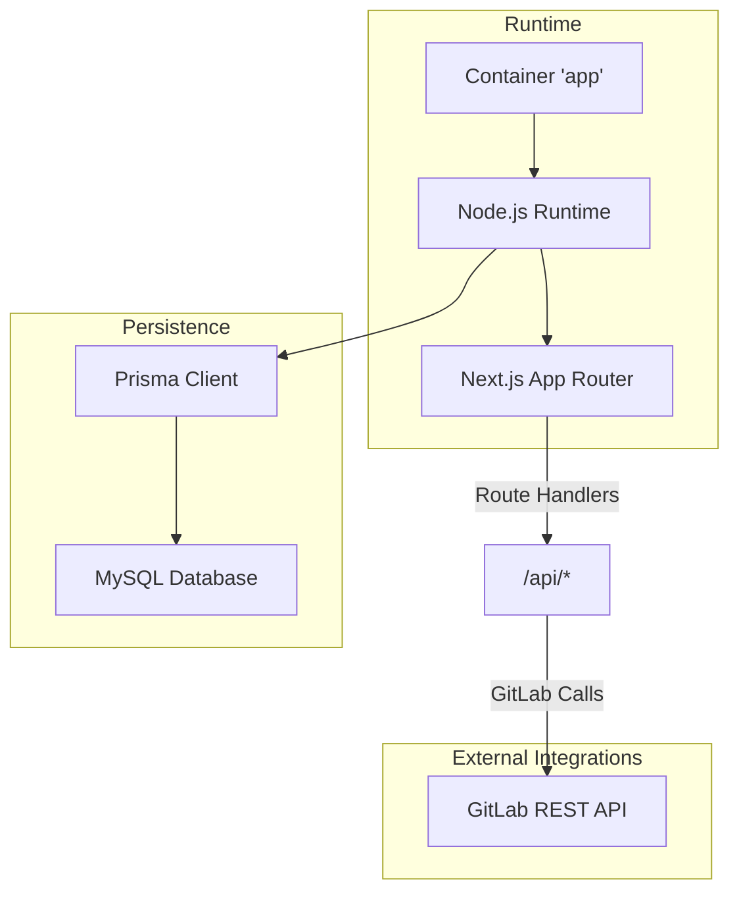
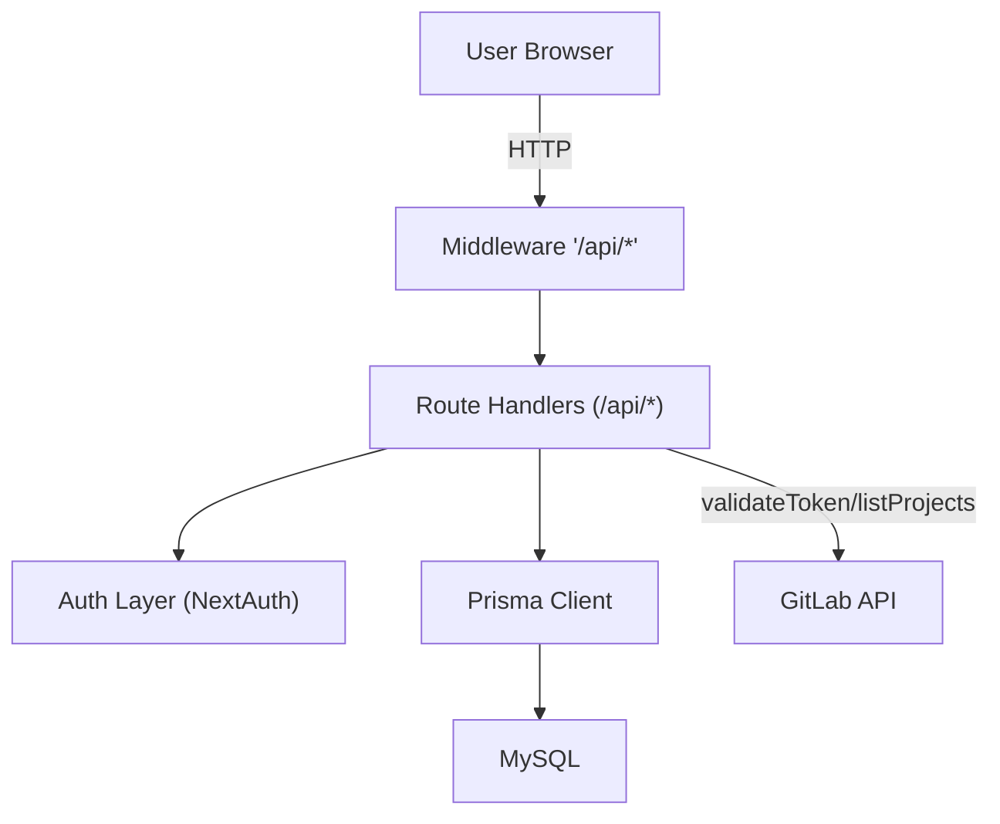
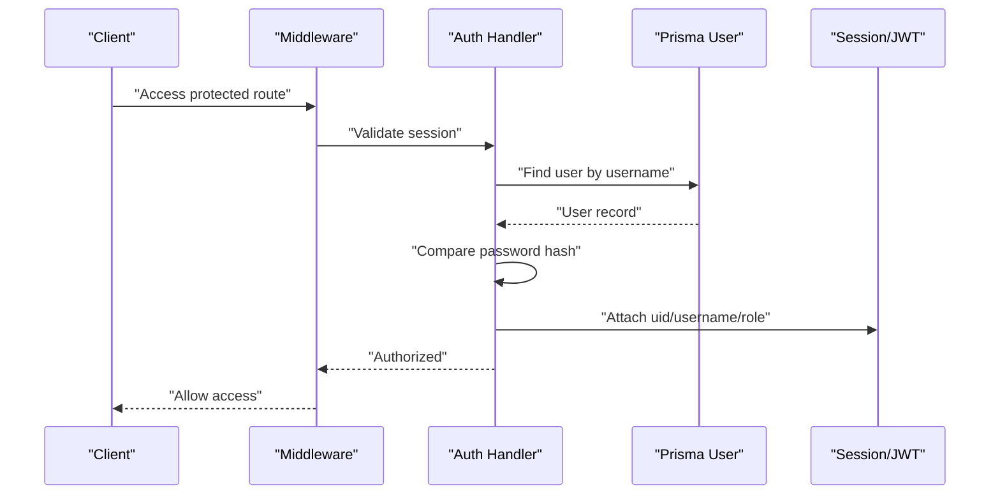
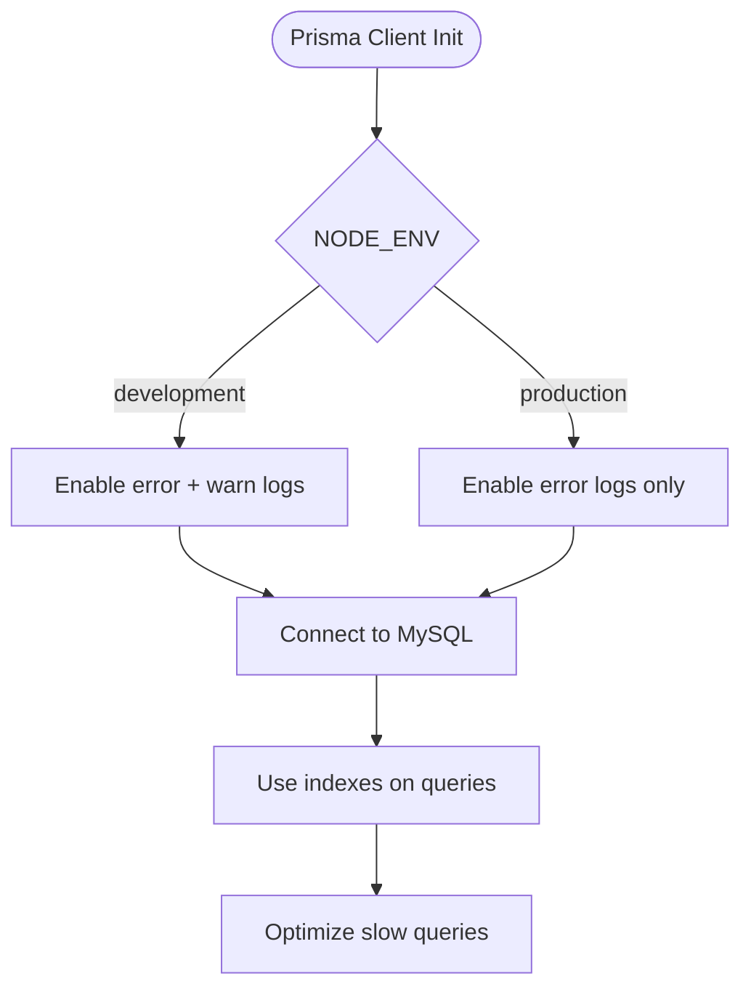
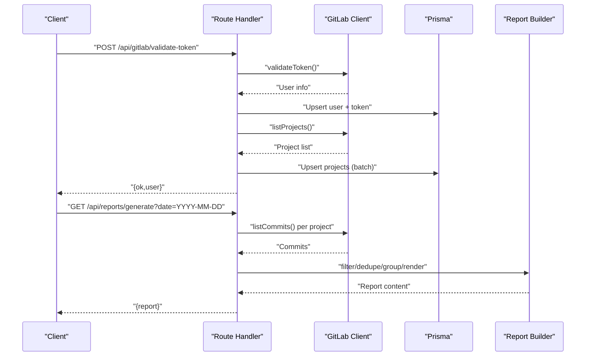
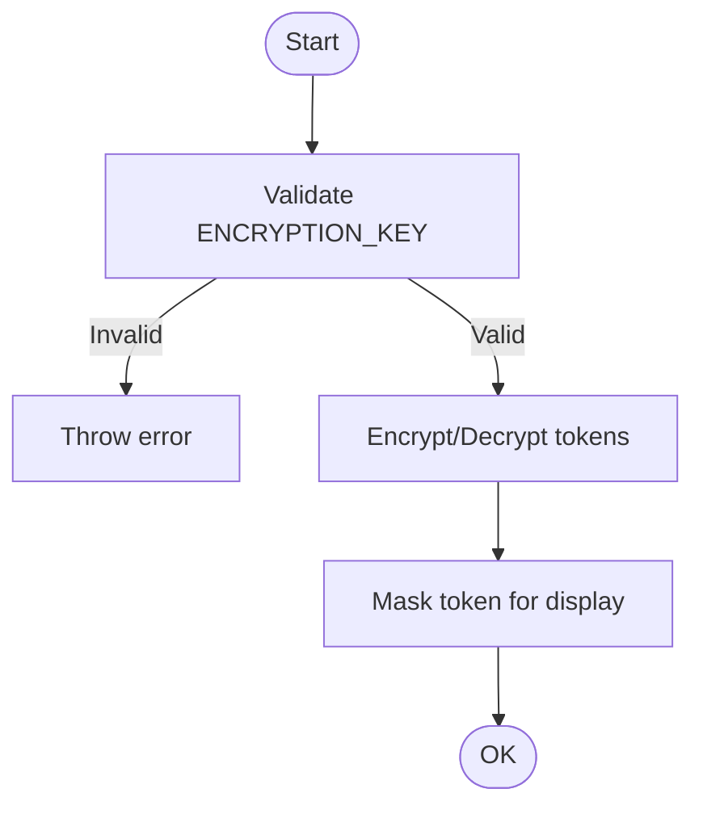
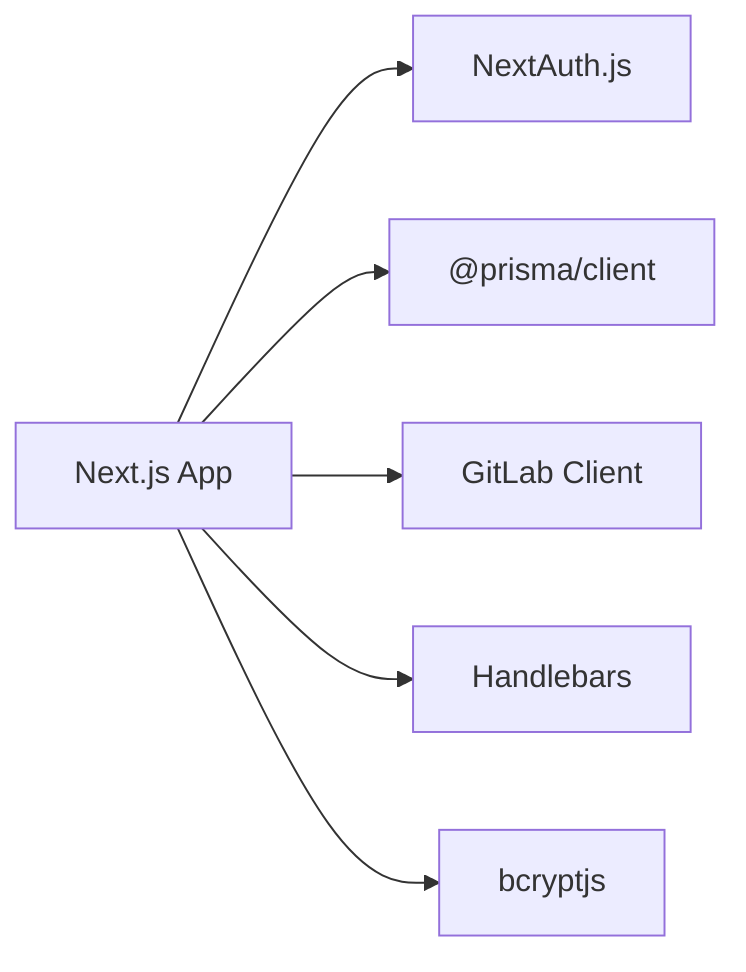

# Monitoring and Maintenance

<cite>
**Referenced Files in This Document**
- [README.md](file://README.md)
- [package.json](file://package.json)
- [Dockerfile](file://Dockerfile)
- [docker-compose.yml](file://docker-compose.yml)
- [next.config.mjs](file://next.config.mjs)
- [middleware.ts](file://middleware.ts)
- [lib/prisma.ts](file://lib/prisma.ts)
- [prisma/schema.prisma](file://prisma/schema.prisma)
- [prisma/seed.ts](file://prisma/seed.ts)
- [lib/auth.ts](file://lib/auth.ts)
- [lib/crypto.ts](file://lib/crypto.ts)
- [lib/gitlab.ts](file://lib/gitlab.ts)
- [lib/report.ts](file://lib/report.ts)
- [app/api/reports/route.ts](file://app/api/reports/route.ts)
- [app/api/gitlab/validate-token/route.ts](file://app/api/gitlab/validate-token/route.ts)
</cite>

## Table of Contents
1. [Introduction](#introduction)
2. [Project Structure](#project-structure)
3. [Core Components](#core-components)
4. [Architecture Overview](#architecture-overview)
5. [Detailed Component Analysis](#detailed-component-analysis)
6. [Dependency Analysis](#dependency-analysis)
7. [Performance Considerations](#performance-considerations)
8. [Troubleshooting Guide](#troubleshooting-guide)
9. [Conclusion](#conclusion)
10. [Appendices](#appendices)

## Introduction
This document provides comprehensive monitoring and maintenance guidance for Pingyun Report operations. It covers application health monitoring, performance metrics collection, and log management strategies. It also documents database monitoring, connection pooling, and query performance optimization, along with system maintenance procedures such as database migrations, backups, and cleanup tasks. Error tracking, alerting systems, and incident response procedures are included, alongside capacity planning, scaling considerations, and resource utilization monitoring. Security maintenance topics include dependency updates, vulnerability scanning, and certificate renewal. Finally, it outlines maintenance schedules, update procedures, and rollback strategies to ensure operational continuity.

## Project Structure
Pingyun Report is a Next.js 14 application using TypeScript, Prisma ORM with MySQL, NextAuth.js for authentication, and a GitLab integration layer. The runtime is containerized and orchestrated via Docker Compose. Prisma migrations are applied at startup, and the application exposes a set of REST-like API endpoints under the Next.js App Router.

**Diagram sources**
- [Dockerfile:42-44](file://Dockerfile#L42-L44)
- [lib/prisma.ts:1-14](file://lib/prisma.ts#L1-L14)
- [prisma/schema.prisma:1-9](file://prisma/schema.prisma#L1-L9)
- [lib/gitlab.ts:45-80](file://lib/gitlab.ts#L45-L80)

**Section sources**
- [README.md:46-52](file://README.md#L46-L52)
- [Dockerfile:1-44](file://Dockerfile#L1-L44)
- [docker-compose.yml:1-21](file://docker-compose.yml#L1-L21)
- [next.config.mjs:1-11](file://next.config.mjs#L1-L11)

## Core Components
- Authentication and session management: Implemented with NextAuth.js using JWT strategy and credential provider. User roles (MEMBER/ADMIN) are enforced via middleware and session callbacks.
- Database layer: Prisma Client connects to MySQL. Logging is configured differently for development vs production.
- GitLab integration: A dedicated client module handles token validation, project listing, and commit retrieval with timeouts and pagination safeguards.
- Report generation pipeline: Filters, deduplication, conventional commit parsing, grouping by project, and Handlebars templating.
- API surface: Route handlers under /api handle user management, report CRUD, GitLab token validation, and AI polish (when configured).

Key operational scripts and environment variables are defined in package.json and documented in README.md. Deployment uses Docker Compose with Prisma migrations executed at startup.

**Section sources**
- [lib/auth.ts:30-77](file://lib/auth.ts#L30-L77)
- [middleware.ts:1-10](file://middleware.ts#L1-L10)
- [lib/prisma.ts:1-14](file://lib/prisma.ts#L1-L14)
- [lib/gitlab.ts:45-149](file://lib/gitlab.ts#L45-L149)
- [lib/report.ts:29-159](file://lib/report.ts#L29-L159)
- [package.json:5-14](file://package.json#L5-L14)
- [README.md:54-64](file://README.md#L54-L64)

## Architecture Overview
The system architecture centers around a containerized Next.js application that authenticates users, persists data via Prisma/MySQL, and integrates with GitLab to generate daily reports. Middleware enforces authentication for protected routes. Docker Compose provisions the service and injects environment variables. Prisma migrations are applied at startup.

**Diagram sources**
- [middleware.ts:1-10](file://middleware.ts#L1-L10)
- [lib/auth.ts:30-77](file://lib/auth.ts#L30-L77)
- [lib/prisma.ts:1-14](file://lib/prisma.ts#L1-L14)
- [prisma/schema.prisma:1-9](file://prisma/schema.prisma#L1-L9)
- [lib/gitlab.ts:87-111](file://lib/gitlab.ts#L87-L111)

## Detailed Component Analysis

### Authentication and Session Management
- Strategy: JWT-based sessions with credentials provider.
- Role enforcement: Session callbacks attach role to JWT and session; middleware protects routes.
- Security: Passwords are hashed with bcrypt; encryption key is required for GitLab token storage.

**Diagram sources**
- [lib/auth.ts:30-77](file://lib/auth.ts#L30-L77)
- [middleware.ts:1-10](file://middleware.ts#L1-L10)

**Section sources**
- [lib/auth.ts:30-77](file://lib/auth.ts#L30-L77)
- [middleware.ts:1-10](file://middleware.ts#L1-L10)
- [lib/crypto.ts:7-15](file://lib/crypto.ts#L7-L15)

### Database Monitoring, Connection Pooling, and Query Performance
- Prisma Client configuration: Logs are enabled for errors/warnings in development and only errors in production. This impacts observability and should be reviewed for production logging policies.
- Connection pooling: Prisma manages connections; ensure MySQL connection limits and timeouts align with workload.
- Indexes and queries: The schema defines unique and composite indexes on frequently queried fields (e.g., user-project uniqueness, report user-date uniqueness). Queries in route handlers leverage these indexes.

**Diagram sources**
- [lib/prisma.ts:9-11](file://lib/prisma.ts#L9-L11)
- [prisma/schema.prisma:47-48](file://prisma/schema.prisma#L47-L48)
- [prisma/schema.prisma:63-64](file://prisma/schema.prisma#L63-L64)

**Section sources**
- [lib/prisma.ts:1-14](file://lib/prisma.ts#L1-L14)
- [prisma/schema.prisma:16-33](file://prisma/schema.prisma#L16-L33)
- [prisma/schema.prisma:35-49](file://prisma/schema.prisma#L35-L49)
- [prisma/schema.prisma:51-65](file://prisma/schema.prisma#L51-L65)
- [prisma/schema.prisma:67-79](file://prisma/schema.prisma#L67-L79)

### GitLab Integration and Report Generation Pipeline
- Token validation and project caching: Validates tokens server-side, persists masked tokens, and caches project metadata.
- Commit fetching: Paginates with safety caps and enforces timeouts to prevent long-hanging requests.
- Report pipeline: Parses conventional commits, filters merges/noise, deduplicates entries, groups by project, and renders with Handlebars.

**Diagram sources**
- [app/api/gitlab/validate-token/route.ts:13-80](file://app/api/gitlab/validate-token/route.ts#L13-L80)
- [lib/gitlab.ts:87-149](file://lib/gitlab.ts#L87-L149)
- [lib/report.ts:52-135](file://lib/report.ts#L52-L135)
- [app/api/reports/route.ts:9-46](file://app/api/reports/route.ts#L9-L46)

**Section sources**
- [app/api/gitlab/validate-token/route.ts:13-80](file://app/api/gitlab/validate-token/route.ts#L13-L80)
- [lib/gitlab.ts:45-149](file://lib/gitlab.ts#L45-L149)
- [lib/report.ts:29-159](file://lib/report.ts#L29-L159)
- [app/api/reports/route.ts:9-90](file://app/api/reports/route.ts#L9-L90)

### Encryption and Secrets Management
- AES-256-GCM encryption for GitLab tokens at rest.
- Masking for safe display of tokens.
- Strict validation of ENCRYPTION_KEY format.

**Diagram sources**
- [lib/crypto.ts:7-45](file://lib/crypto.ts#L7-L45)

**Section sources**
- [lib/crypto.ts:7-45](file://lib/crypto.ts#L7-L45)
- [README.md:65-71](file://README.md#L65-L71)

### API Surface and Route Handlers
- Authentication: NextAuth endpoints under /api/auth.
- User: GET/PATCH /api/me.
- GitLab: validate-token and project list endpoints.
- Reports: GET/PATCH/DELETE /api/reports with date/month filtering.
- Templates: CRUD endpoints under /api/templates.
- Admin: Users and team reports endpoints.
- AI polish: POST /api/ai/polish (LLM integration).

**Section sources**
- [README.md:72-86](file://README.md#L72-L86)
- [app/api/reports/route.ts:9-90](file://app/api/reports/route.ts#L9-L90)
- [app/api/gitlab/validate-token/route.ts:13-80](file://app/api/gitlab/validate-token/route.ts#L13-L80)

## Dependency Analysis
- Application dependencies: Next.js, NextAuth.js, Prisma Client, bcrypt, handlebars, react-md-editor, and related libraries.
- Build and runtime: Next.js standalone output, Prisma engines bundled for migration execution.
- Containerization: Node.js Alpine base image, non-root user, exposed port 3000, migrations executed at startup.

**Diagram sources**
- [package.json:16-31](file://package.json#L16-L31)
- [Dockerfile:32-35](file://Dockerfile#L32-L35)

**Section sources**
- [package.json:16-31](file://package.json#L16-L31)
- [Dockerfile:1-44](file://Dockerfile#L1-L44)
- [next.config.mjs:1-11](file://next.config.mjs#L1-L11)

## Performance Considerations
- Database logging: Adjust Prisma log levels in production to balance observability and overhead.
- Query optimization: Leverage existing indexes and avoid N+1 patterns; batch operations where possible (e.g., project upserts).
- Network latency: GitLab client enforces timeouts and pagination caps; tune thresholds based on network conditions.
- Rendering cost: Template rendering and commit processing scale with volume; consider pagination and caching for large datasets.
- Resource limits: Configure container CPU/memory limits and autoscaling thresholds aligned with expected load.

[No sources needed since this section provides general guidance]

## Troubleshooting Guide
- Authentication failures: Verify credentials provider configuration, bcrypt comparison, and session callbacks.
- GitLab token issues: Confirm token validation endpoint response, encryption key correctness, and project list caching behavior.
- Report generation errors: Inspect commit filtering, deduplication, and template rendering exceptions.
- Database connectivity: Review Prisma log level, connection string, and MySQL availability.
- Middleware protection: Ensure protected routes match and redirect to login when unauthenticated.

**Section sources**
- [lib/auth.ts:30-77](file://lib/auth.ts#L30-L77)
- [app/api/gitlab/validate-token/route.ts:13-80](file://app/api/gitlab/validate-token/route.ts#L13-L80)
- [lib/report.ts:137-144](file://lib/report.ts#L137-L144)
- [lib/prisma.ts:9-11](file://lib/prisma.ts#L9-L11)
- [middleware.ts:1-10](file://middleware.ts#L1-L10)

## Conclusion
Pingyun Report’s monitoring and maintenance posture hinges on robust authentication, secure secrets handling, disciplined database operations, and resilient external integrations. By tuning Prisma logging, leveraging schema indexes, enforcing timeouts and pagination, and applying containerized deployments with automated migrations, the system can achieve reliable performance and operability. Regular audits of dependencies, secrets rotation, and incident response playbooks further strengthen operational resilience.

[No sources needed since this section summarizes without analyzing specific files]

## Appendices

### A. Health Monitoring and Log Management
- Application logs: Capture stdout/stderr from the container; centralize with a logging agent.
- Prisma logs: Align log levels with environment; consider structured logging for production.
- Middleware and route handler errors: Return standardized JSON errors; include correlation IDs for tracing.
- GitLab integration: Log request durations and error responses; monitor rate limits.

**Section sources**
- [lib/prisma.ts:9-11](file://lib/prisma.ts#L9-L11)
- [lib/gitlab.ts:45-80](file://lib/gitlab.ts#L45-L80)
- [app/api/reports/route.ts:9-46](file://app/api/reports/route.ts#L9-L46)

### B. Database Monitoring and Migration Procedures
- Schema and migrations: Use Prisma-managed migrations; apply via scripts or container startup.
- Backup strategy: Schedule regular logical backups of MySQL; test restore procedures.
- Cleanup tasks: Archive old reports or templates if retention policies are needed; prune unused data periodically.
- Rollback: Revert to previous migration version; ensure compatibility of schema changes.

**Section sources**
- [package.json:11-12](file://package.json#L11-L12)
- [Dockerfile:42-44](file://Dockerfile#L42-L44)
- [prisma/schema.prisma:1-9](file://prisma/schema.prisma#L1-L9)

### C. Capacity Planning and Scaling
- Horizontal scaling: Stateless Next.js app; scale replicas behind a load balancer.
- Vertical scaling: Increase container CPU/memory limits; monitor resource saturation.
- Database scaling: Add read replicas, optimize queries, and consider connection pooling tuning.
- CDN and static assets: Serve static content efficiently; offload media if applicable.

[No sources needed since this section provides general guidance]

### D. Security Maintenance
- Dependency updates: Automate scanning and testing; keep Next.js, Prisma, and libraries current.
- Vulnerability scanning: Integrate SCA into CI/CD; remediate critical/high severity issues promptly.
- Certificate renewal: Renew TLS certificates for NEXTAUTH_URL; rotate secrets regularly.
- Secrets rotation: Rotate ENCRYPTION_KEY carefully; re-encrypt stored tokens and update environment.

**Section sources**
- [README.md:65-71](file://README.md#L65-L71)
- [lib/crypto.ts:7-15](file://lib/crypto.ts#L7-L15)

### E. Maintenance Schedules and Rollout Procedures
- Scheduled maintenance windows: Apply database migrations during low-traffic periods.
- Blue-green or rolling deployments: Minimize downtime; validate health checks before traffic switch.
- Rollback strategy: Keep previous image/tag; revert on failure; restore DB from last known-good backup.
- Post-deploy verification: Smoke tests for authentication, report generation, and GitLab integration.

**Section sources**
- [Dockerfile:42-44](file://Dockerfile#L42-L44)
- [README.md:46-52](file://README.md#L46-L52)