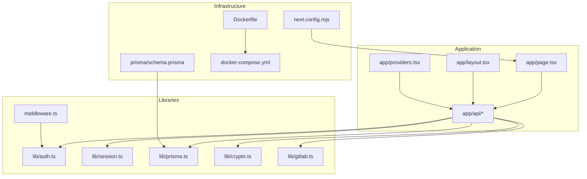
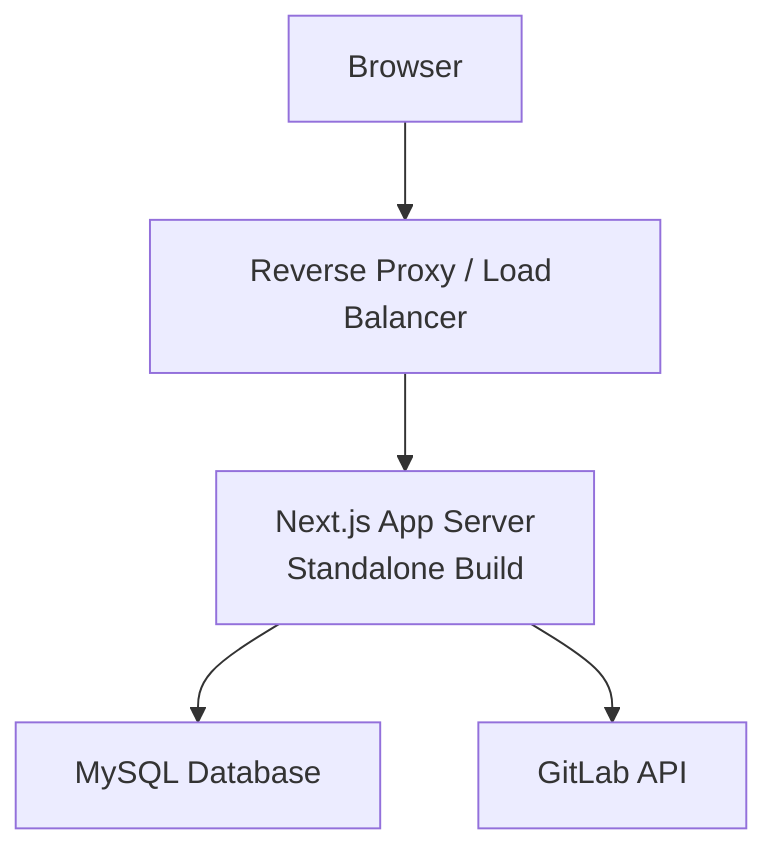
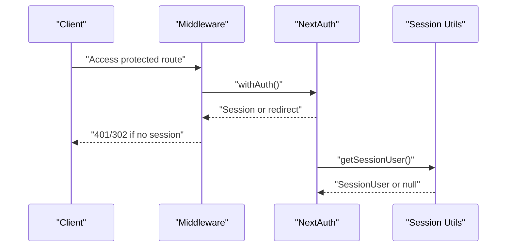
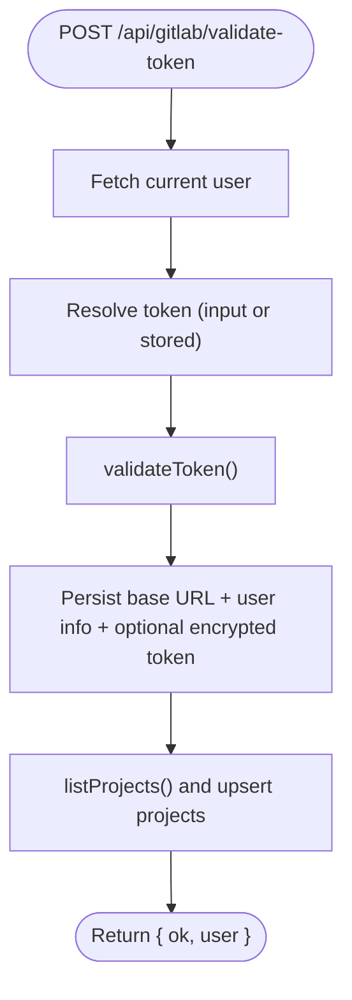
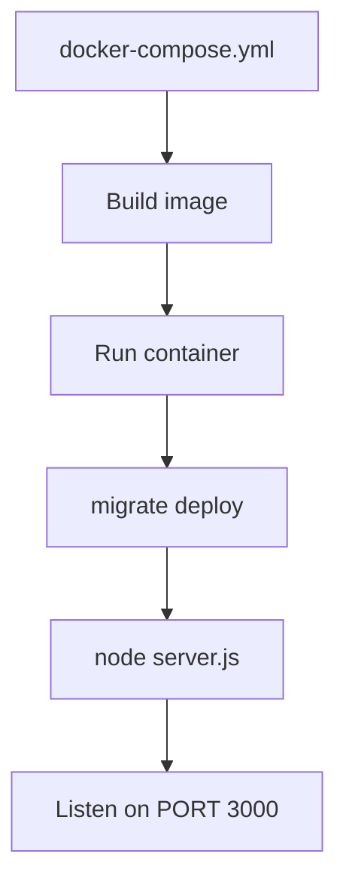

# Production Deployment Guide

<cite>
**Referenced Files in This Document**
- [package.json](file://package.json)
- [Dockerfile](file://Dockerfile)
- [docker-compose.yml](file://docker-compose.yml)
- [next.config.mjs](file://next.config.mjs)
- [prisma/schema.prisma](file://prisma/schema.prisma)
- [lib/prisma.ts](file://lib/prisma.ts)
- [lib/auth.ts](file://lib/auth.ts)
- [lib/session.ts](file://lib/session.ts)
- [lib/crypto.ts](file://lib/crypto.ts)
- [lib/gitlab.ts](file://lib/gitlab.ts)
- [middleware.ts](file://middleware.ts)
- [app/api/reports/route.ts](file://app/api/reports/route.ts)
- [app/api/gitlab/projects/route.ts](file://app/api/gitlab/projects/route.ts)
- [app/api/gitlab/validate-token/route.ts](file://app/api/gitlab/validate-token/route.ts)
- [app/api/me/route.ts](file://app/api/me/route.ts)
- [README.md](file://README.md)
</cite>

## Table of Contents
1. [Introduction](#introduction)
2. [Project Structure](#project-structure)
3. [Core Components](#core-components)
4. [Architecture Overview](#architecture-overview)
5. [Detailed Component Analysis](#detailed-component-analysis)
6. [Environment Variables and Secrets](#environment-variables-and-secrets)
7. [Deployment Strategies](#deployment-strategies)
8. [Reverse Proxy, SSL/TLS, and Load Balancing](#reverse-proxy-ssl-tls-and-load-balancing)
9. [CI/CD Pipeline Integration](#cicd-pipeline-integration)
10. [Performance Optimization and Caching](#performance-optimization-and-caching)
11. [Troubleshooting Guide](#troubleshooting-guide)
12. [Conclusion](#conclusion)

## Introduction
This guide documents production deployment of Pingyun Report, a Next.js 14 application with server-side authentication, database-backed storage, and GitLab integration. It covers standalone build configuration, environment setup, database connectivity, containerized and cloud deployments, reverse proxy and TLS, load balancing, automation, CI/CD, blue-green deployments, performance optimization, and CDN integration.

## Project Structure
Pingyun Report follows Next.js App Router conventions with:
- Application routes under app/
- API routes under app/api/*
- Shared libraries under lib/
- Database schema under prisma/
- Containerization via Dockerfile and docker-compose.yml
- Build configuration via next.config.mjs

**Diagram sources**
- [next.config.mjs](file://next.config.mjs)
- [Dockerfile](file://Dockerfile)
- [docker-compose.yml](file://docker-compose.yml)
- [lib/prisma.ts](file://lib/prisma.ts)
- [lib/auth.ts](file://lib/auth.ts)
- [lib/session.ts](file://lib/session.ts)
- [lib/crypto.ts](file://lib/crypto.ts)
- [lib/gitlab.ts](file://lib/gitlab.ts)
- [middleware.ts](file://middleware.ts)
- [prisma/schema.prisma](file://prisma/schema.prisma)

**Section sources**
- [README.md](file://README.md)
- [next.config.mjs](file://next.config.mjs)
- [Dockerfile](file://Dockerfile)
- [docker-compose.yml](file://docker-compose.yml)

## Core Components
- Standalone Next.js build: configured via next.config.mjs to produce a standalone server artifact suitable for containers.
- Authentication: NextAuth.js with credentials provider and JWT sessions; enforced by middleware.
- Database: Prisma ORM targeting MySQL; client instantiated in lib/prisma.ts with production logging tuned.
- GitLab integration: Server-side API client in lib/gitlab.ts; tokens encrypted at rest.
- Session utilities: Safe session retrieval and route error wrapping in lib/session.ts.
- Crypto utilities: AES-256-GCM encryption/decryption for tokens in lib/crypto.ts.

Key production implications:
- Standalone output enables single-container deployments.
- Middleware enforces authentication for protected routes.
- Prisma manages schema and migrations at startup.
- GitLab tokens are handled server-side and never exposed to clients.

**Section sources**
- [next.config.mjs](file://next.config.mjs)
- [lib/prisma.ts](file://lib/prisma.ts)
- [lib/auth.ts](file://lib/auth.ts)
- [lib/session.ts](file://lib/session.ts)
- [lib/crypto.ts](file://lib/crypto.ts)
- [lib/gitlab.ts](file://lib/gitlab.ts)
- [middleware.ts](file://middleware.ts)

## Architecture Overview
The runtime architecture centers on a single Next.js process serving both static assets and API routes, with database and GitLab integrations.

**Diagram sources**
- [Dockerfile](file://Dockerfile)
- [prisma/schema.prisma](file://prisma/schema.prisma)
- [lib/gitlab.ts](file://lib/gitlab.ts)

## Detailed Component Analysis

### Standalone Next.js Build
- next.config.mjs sets output to standalone and configures serverComponentsExternalPackages for Prisma and bcrypt.
- Dockerfile builds a standalone server, copies static and standalone artifacts, injects Prisma engines, and runs migrations on startup before launching the server.

Operational notes:
- Standalone build simplifies containerization and eliminates Node.js runtime assumptions outside the container.
- Prisma engines and client are included to support migrations at container startup.

**Section sources**
- [next.config.mjs](file://next.config.mjs)
- [Dockerfile](file://Dockerfile)

### Database Connectivity and Prisma
- prisma/schema.prisma defines a MySQL datasource and models for User, Project, Report, and Template.
- lib/prisma.ts initializes PrismaClient with environment-specific logging and a global singleton pattern for non-production environments.

Production considerations:
- DATABASE_URL must point to a reachable MySQL instance.
- Migrations are executed at startup via the container CMD.

**Section sources**
- [prisma/schema.prisma](file://prisma/schema.prisma)
- [lib/prisma.ts](file://lib/prisma.ts)

### Authentication and Authorization
- lib/auth.ts configures NextAuth.js with credentials provider and JWT strategy, mapping user roles.
- middleware.ts enforces authentication for protected routes.
- lib/session.ts provides requireUser and requireAdmin helpers and a withErrors wrapper for API routes.

Security highlights:
- Passwords are hashed with bcrypt.
- Admin role controls administrative endpoints.
- API routes use requireUser to enforce session presence.

**Diagram sources**
- [middleware.ts](file://middleware.ts)
- [lib/auth.ts](file://lib/auth.ts)
- [lib/session.ts](file://lib/session.ts)

**Section sources**
- [lib/auth.ts](file://lib/auth.ts)
- [middleware.ts](file://middleware.ts)
- [lib/session.ts](file://lib/session.ts)

### GitLab Integration and Token Management
- lib/gitlab.ts implements a server-side GitLab REST client with timeouts and pagination.
- app/api/gitlab/validate-token/route.ts validates tokens, persists base URL and user info, and caches project lists.
- app/api/gitlab/projects/route.ts manages user project toggles and default branches.
- lib/crypto.ts encrypts tokens at rest using AES-256-GCM; tokens are never returned to the client.

**Diagram sources**
- [app/api/gitlab/validate-token/route.ts](file://app/api/gitlab/validate-token/route.ts)
- [lib/gitlab.ts](file://lib/gitlab.ts)
- [lib/crypto.ts](file://lib/crypto.ts)

**Section sources**
- [lib/gitlab.ts](file://lib/gitlab.ts)
- [app/api/gitlab/validate-token/route.ts](file://app/api/gitlab/validate-token/route.ts)
- [app/api/gitlab/projects/route.ts](file://app/api/gitlab/projects/route.ts)
- [lib/crypto.ts](file://lib/crypto.ts)

### Reports and Templates APIs
- app/api/reports/route.ts implements per-day CRUD for reports with date validation and pagination.
- app/api/me/route.ts exposes user profile and preferences, masking stored tokens.

Operational notes:
- Date parameters are validated to prevent injection.
- Upsert semantics ensure idempotent creation/update.

**Section sources**
- [app/api/reports/route.ts](file://app/api/reports/route.ts)
- [app/api/me/route.ts](file://app/api/me/route.ts)

## Environment Variables and Secrets
Required production environment variables:
- DATABASE_URL: MySQL connection string
- NEXTAUTH_URL: External URL for NextAuth
- NEXTAUTH_SECRET: 32-byte base64 value
- ENCRYPTION_KEY: 64-character hex string for AES-256-GCM
- LLM_API_BASE / LLM_API_KEY / LLM_MODEL: Optional for AI polish
- ADMIN_USERNAME / ADMIN_PASSWORD / ADMIN_DISPLAY_NAME: Seed-only initial admin

Additional guidance:
- Generate ENCRYPTION_KEY with a cryptographically secure 32-byte hex string.
- Rotate ENCRYPTION_KEY carefully; existing tokens must be re-encrypted or users must re-enter tokens.
- Store secrets in your platform’s secret manager and mount them securely.

**Section sources**
- [README.md](file://README.md)
- [docker-compose.yml](file://docker-compose.yml)
- [lib/crypto.ts](file://lib/crypto.ts)

## Deployment Strategies

### Containerized Deployments (Docker)
- Build and run via docker-compose.yml, which:
  - Builds the image from Dockerfile
  - Exposes port 3000
  - Passes environment variables
  - Runs migrations on startup and starts the server

**Diagram sources**
- [Dockerfile](file://Dockerfile)
- [docker-compose.yml](file://docker-compose.yml)

**Section sources**
- [Dockerfile](file://Dockerfile)
- [docker-compose.yml](file://docker-compose.yml)

### Cloud Platform Deployments
- Use platform-provided container services (e.g., ECS, EKS, GKE, Cloud Run).
- Set environment variables via managed secret stores.
- Configure health checks on the Next.js port and path.
- Enable automatic scaling based on CPU/memory or requests.

[No sources needed since this section provides general guidance]

### Traditional Server Setup
- Install Node.js 20.x and a MySQL server.
- Build the app and run the standalone server.
- Use systemd or similar to manage the service.
- Ensure migrations are applied before starting the server.

[No sources needed since this section provides general guidance]

## Reverse Proxy, SSL/TLS, and Load Balancing
- Place a reverse proxy (Nginx, HAProxy, or cloud LB) in front of the Next.js server.
- Terminate TLS at the proxy; forward to http://localhost:3000.
- Configure keep-alive and appropriate timeouts for API and static assets.
- For horizontal scaling, ensure sticky sessions if needed or switch to shared session storage (not applicable for JWT).

[No sources needed since this section provides general guidance]

## CI/CD Pipeline Integration
Recommended pipeline stages:
- Install dependencies and build the standalone artifact.
- Run database migrations in a controlled job.
- Push the container image to your registry.
- Deploy to target environment with zero-downtime strategy.

Automation hooks:
- Use scripts from package.json for build, migration, and seeding.
- Integrate with your CI platform to trigger on push and pull requests.

**Section sources**
- [package.json](file://package.json)
- [Dockerfile](file://Dockerfile)

## Performance Optimization and Caching
- Static assets: Serve via CDN or proxy cache; leverage browser caching headers.
- Database: Use connection pooling and indexes as defined in the schema.
- API caching: Add server-side caching for read-heavy endpoints where appropriate.
- Compression: Enable gzip/deflate at the reverse proxy.
- Image optimization: Use Next.js built-in optimization for images served by the app.

[No sources needed since this section provides general guidance]

## Troubleshooting Guide
Common production issues and resolutions:
- Database connectivity failures: Verify DATABASE_URL and network access.
- Migration errors on startup: Ensure Prisma migrations are compatible and run to completion.
- Authentication failures: Confirm NEXTAUTH_SECRET correctness and NEXTAUTH_URL alignment with external URL.
- Token decryption errors: Check ENCRYPTION_KEY length/format; rotate carefully and re-encrypt stored tokens.
- GitLab API errors: Validate base URL and token scopes; confirm server-side network access.

**Section sources**
- [lib/crypto.ts](file://lib/crypto.ts)
- [lib/gitlab.ts](file://lib/gitlab.ts)
- [lib/session.ts](file://lib/session.ts)
- [Dockerfile](file://Dockerfile)

## Conclusion
Pingyun Report is designed for straightforward production deployment using a standalone Next.js build, secure environment configuration, and robust containerization. By following this guide—covering environment setup, database connectivity, reverse proxy and TLS, load balancing, automation, and performance—you can reliably operate Pingyun Report in production.