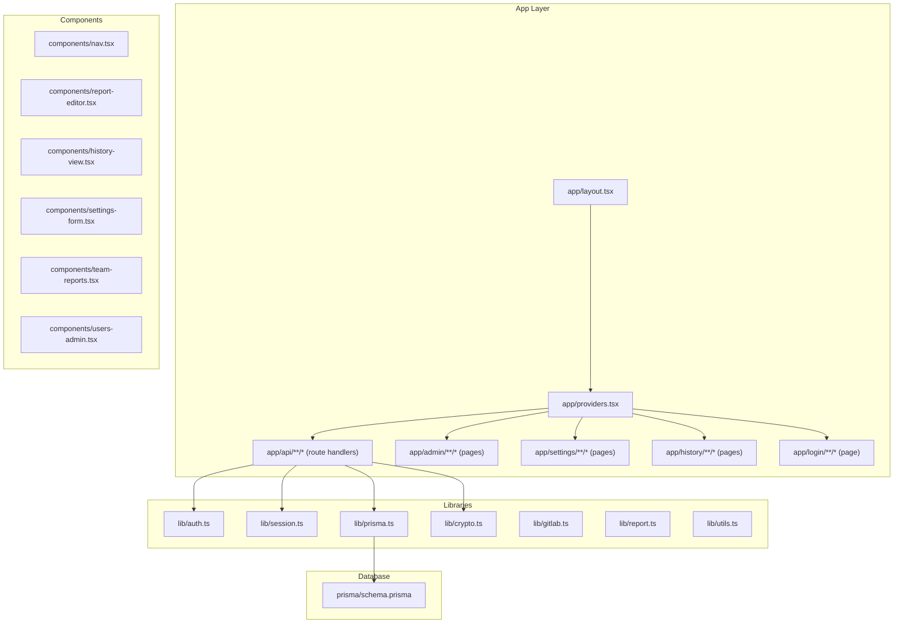
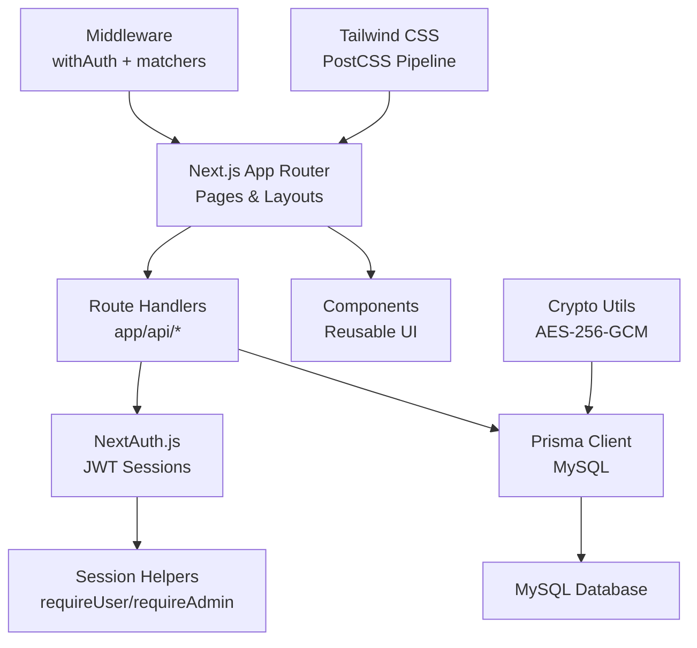
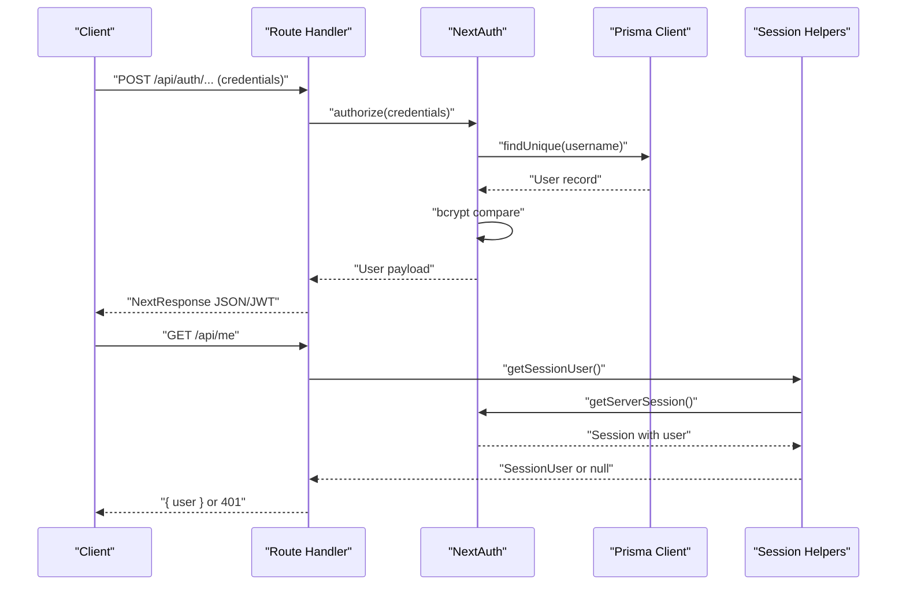
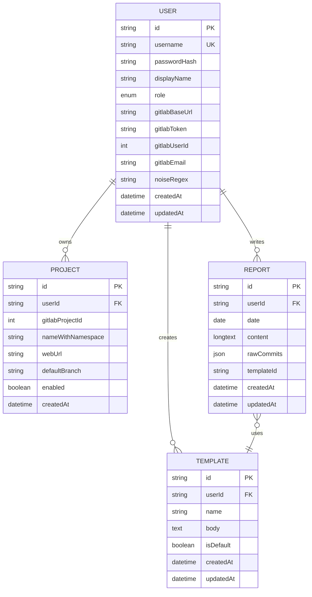
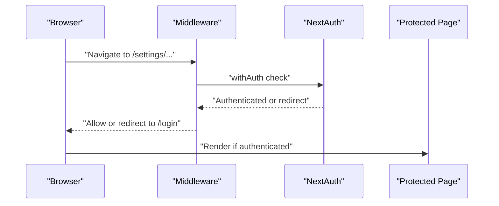
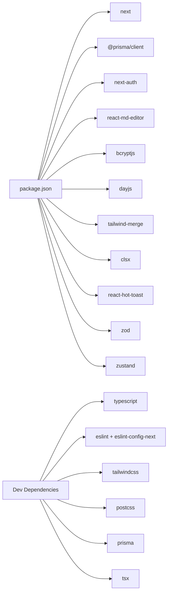

# Development Guidelines

<cite>
**Referenced Files in This Document**
- [package.json](file://package.json)
- [.eslintrc.json](file://.eslintrc.json)
- [tsconfig.json](file://tsconfig.json)
- [next.config.mjs](file://next.config.mjs)
- [tailwind.config.ts](file://tailwind.config.ts)
- [postcss.config.mjs](file://postcss.config.mjs)
- [middleware.ts](file://middleware.ts)
- [app/layout.tsx](file://app/layout.tsx)
- [app/providers.tsx](file://app/providers.tsx)
- [lib/prisma.ts](file://lib/prisma.ts)
- [lib/crypto.ts](file://lib/crypto.ts)
- [lib/auth.ts](file://lib/auth.ts)
- [lib/session.ts](file://lib/session.ts)
- [prisma/schema.prisma](file://prisma/schema.prisma)
- [README.md](file://README.md)
</cite>

## Table of Contents
1. [Introduction](#introduction)
2. [Project Structure](#project-structure)
3. [Core Components](#core-components)
4. [Architecture Overview](#architecture-overview)
5. [Detailed Component Analysis](#detailed-component-analysis)
6. [Dependency Analysis](#dependency-analysis)
7. [Performance Considerations](#performance-considerations)
8. [Troubleshooting Guide](#troubleshooting-guide)
9. [Development Workflow](#development-workflow)
10. [Contribution and Issue Procedures](#contribution-and-issue-procedures)
11. [Testing Strategies](#testing-strategies)
12. [Debugging and Profiling](#debugging-and-profiling)
13. [Code Style and Linting](#code-style-and-linting)
14. [TypeScript Configuration](#typescript-configuration)
15. [Dependency Management and Versioning](#dependency-management-and-versioning)
16. [Examples and Best Practices](#examples-and-best-practices)
17. [Conclusion](#conclusion)

## Introduction
This document provides comprehensive development guidelines for Pingyun Report. It covers code style standards, TypeScript configuration, ESLint rules, project structure conventions, architectural principles, testing strategies, development workflow, contribution procedures, debugging techniques, performance profiling, development tooling, dependency management, versioning, and practical examples for extending the application.

## Project Structure
The project follows a Next.js 14 App Router structure with a clear separation of concerns:
- app: Route handlers, pages, layouts, and providers
- components: Reusable UI components
- lib: Shared libraries for auth, crypto, Prisma client, sessions, and utilities
- prisma: Database schema and seeding
- Tooling configs: TypeScript, ESLint, Tailwind CSS, PostCSS, Next.js, and middleware

**Diagram sources**
- [app/layout.tsx:1-25](file://app/layout.tsx#L1-L25)
- [app/providers.tsx:1-8](file://app/providers.tsx#L1-L8)
- [lib/auth.ts:1-77](file://lib/auth.ts#L1-L77)
- [lib/session.ts:1-56](file://lib/session.ts#L1-L56)
- [lib/prisma.ts:1-14](file://lib/prisma.ts#L1-L14)
- [lib/crypto.ts:1-46](file://lib/crypto.ts#L1-L46)
- [prisma/schema.prisma:1-80](file://prisma/schema.prisma#L1-L80)

**Section sources**
- [README.md:1-86](file://README.md#L1-L86)
- [package.json:1-47](file://package.json#L1-L47)

## Core Components
- Authentication and session management: NextAuth.js with JWT strategy, credential provider, and server-side session helpers.
- Database client: Prisma client singleton with environment-aware logging.
- Encryption utilities: AES-256-GCM encryption/decryption and token masking for secure storage and display.
- Middleware: Route protection for authenticated routes and admin-only routes.
- UI providers: Session provider wrapper and toast notifications.

Key responsibilities:
- lib/auth.ts: Defines NextAuth options, JWT/session callbacks, and typed session/user interfaces.
- lib/session.ts: Provides helpers to require user/admin roles and a wrapper to normalize API errors.
- lib/prisma.ts: Singleton Prisma client with development vs production logging.
- lib/crypto.ts: Secure encryption/decryption and token masking utilities.
- middleware.ts: Enforces authentication and restricts admin routes.

**Section sources**
- [lib/auth.ts:1-77](file://lib/auth.ts#L1-L77)
- [lib/session.ts:1-56](file://lib/session.ts#L1-L56)
- [lib/prisma.ts:1-14](file://lib/prisma.ts#L1-L14)
- [lib/crypto.ts:1-46](file://lib/crypto.ts#L1-L46)
- [middleware.ts:1-10](file://middleware.ts#L1-L10)

## Architecture Overview
High-level architecture:
- Frontend: Next.js App Router with React Server Components and Client Components.
- Backend: Route handlers under app/api implementing REST-like endpoints.
- Authentication: NextAuth.js with JWT; protected by middleware.
- Persistence: Prisma ORM with MySQL.
- Styling: Tailwind CSS with PostCSS pipeline.
- Security: Encrypted secrets at rest, server-side GitLab API calls, bcrypt password hashing.

**Diagram sources**
- [middleware.ts:1-10](file://middleware.ts#L1-L10)
- [lib/auth.ts:1-77](file://lib/auth.ts#L1-L77)
- [lib/session.ts:1-56](file://lib/session.ts#L1-L56)
- [lib/prisma.ts:1-14](file://lib/prisma.ts#L1-L14)
- [lib/crypto.ts:1-46](file://lib/crypto.ts#L1-L46)
- [tailwind.config.ts:1-24](file://tailwind.config.ts#L1-L24)
- [postcss.config.mjs:1-7](file://postcss.config.mjs#L1-L7)

## Detailed Component Analysis

### Authentication and Session Management
- NextAuth configuration with credentials provider and JWT strategy.
- Typed session/user interfaces extended via module augmentation.
- Callbacks map user data to JWT and back to session.
- Server-side session retrieval and enforcement helpers.

**Diagram sources**
- [lib/auth.ts:30-77](file://lib/auth.ts#L30-L77)
- [lib/session.ts:11-29](file://lib/session.ts#L11-L29)
- [lib/prisma.ts:1-14](file://lib/prisma.ts#L1-L14)

**Section sources**
- [lib/auth.ts:1-77](file://lib/auth.ts#L1-L77)
- [lib/session.ts:1-56](file://lib/session.ts#L1-L56)

### Database Schema and Client
- Prisma schema defines User, Project, Report, and Template models with relations and indexes.
- Prisma client singleton pattern with environment-aware logging.
- Migration and seeding scripts in package.json.

**Diagram sources**
- [prisma/schema.prisma:16-79](file://prisma/schema.prisma#L16-L79)
- [lib/prisma.ts:1-14](file://lib/prisma.ts#L1-L14)

**Section sources**
- [prisma/schema.prisma:1-80](file://prisma/schema.prisma#L1-L80)
- [lib/prisma.ts:1-14](file://lib/prisma.ts#L1-L14)

### Encryption Utilities
- AES-256-GCM encryption/decryption for sensitive data at rest.
- Validation of ENCRYPTION_KEY environment variable.
- Token masking for safe display.

**Diagram sources**
- [lib/crypto.ts:7-45](file://lib/crypto.ts#L7-L45)

**Section sources**
- [lib/crypto.ts:1-46](file://lib/crypto.ts#L1-L46)

### Middleware and Routing Protection
- Middleware enforces authentication for protected routes.
- Matcher restricts middleware to specific paths.
- Session provider wraps the app for client-side session consumption.

**Diagram sources**
- [middleware.ts:1-10](file://middleware.ts#L1-L10)
- [app/providers.tsx:1-8](file://app/providers.tsx#L1-L8)

**Section sources**
- [middleware.ts:1-10](file://middleware.ts#L1-L10)
- [app/providers.tsx:1-8](file://app/providers.tsx#L1-L8)

## Dependency Analysis
- Next.js runtime and build-time dependencies.
- Prisma client and dev tooling.
- UI and utility libraries (Tailwind, react-md-editor, zustand, etc.).
- Toolchain: TypeScript, ESLint, PostCSS, Tailwind, Prisma.

**Diagram sources**
- [package.json:16-45](file://package.json#L16-L45)

**Section sources**
- [package.json:1-47](file://package.json#L1-L47)

## Performance Considerations
- Use Prisma client logging judiciously; development logs are more verbose than production.
- Minimize unnecessary re-renders by leveraging stable props and memoization in components.
- Prefer server-side rendering for authenticated pages and avoid heavy client-side computations.
- Keep middleware matchers narrow to reduce overhead on public routes.
- Optimize database queries with appropriate indexes (as defined in Prisma schema).

[No sources needed since this section provides general guidance]

## Troubleshooting Guide
Common areas to inspect:
- Authentication failures: Verify credentials provider, bcrypt comparison, and session callbacks.
- Unauthorized/forbidden responses: Confirm requireUser/requireAdmin wrappers and middleware matchers.
- Database connectivity: Check Prisma client initialization and environment variables.
- Encryption errors: Ensure ENCRYPTION_KEY is set and 64 hex characters long.
- API errors: Use the withErrors wrapper to normalize thrown responses.

**Section sources**
- [lib/auth.ts:30-77](file://lib/auth.ts#L30-L77)
- [lib/session.ts:22-55](file://lib/session.ts#L22-L55)
- [lib/prisma.ts:7-14](file://lib/prisma.ts#L7-L14)
- [lib/crypto.ts:7-15](file://lib/crypto.ts#L7-L15)

## Development Workflow
- Branching: Use feature branches prefixed with feature/, fix/, chore/, or docs/.
- Commit messages: Follow imperative mood; keep subject under 50 characters.
- Pull requests: Target develop for integration; include a summary, motivation, and test notes.
- Code review: Ensure at least one reviewer approves; address comments promptly.
- CI/CD: Automated checks via linter and build; production deploys via Docker Compose.

[No sources needed since this section provides general guidance]

## Contribution and Issue Procedures
- Issues: Provide environment details, steps to reproduce, and expected vs actual behavior.
- Feature requests: Describe the problem being solved, acceptance criteria, and proposed solution.
- Discussions: Use GitHub Discussions for design proposals and architecture questions.

[No sources needed since this section provides general guidance]

## Testing Strategies
- Unit tests: Focus on pure functions in lib/crypto.ts, lib/utils.ts, and small helpers.
- Integration tests: Validate route handlers with mock sessions and database stubs.
- End-to-end tests: Use Playwright/Cypress to simulate user flows (login, report generation, admin actions).
- Test data: Seed database with deterministic fixtures; isolate tests with transactions or test databases.

[No sources needed since this section provides general guidance]

## Debugging and Profiling
- Logging: Enable Prisma client logs in development; inspect server logs for API errors.
- Network: Use browser devtools to inspect API responses and middleware redirects.
- Profiling: Use React DevTools Profiler; analyze bundle size with Next.js telemetry.
- Environment: Set NODE_ENV appropriately; verify middleware matchers and session providers.

[No sources needed since this section provides general guidance]

## Code Style and Linting
- ESLint extends Next.js Core Web Vitals recommended config.
- Disable specific rules only when justified; document exceptions.
- Keep React hooks dependencies exhaustive; resolve warnings proactively.

**Section sources**
- [.eslintrc.json:1-8](file://.eslintrc.json#L1-L8)

## TypeScript Configuration
- Strict mode enabled; no emit to leverage type checking during dev/build.
- Bundler module resolution; preserve JSX; incremental builds.
- Path aliases (@/*) mapped to repository root for clean imports.
- Next.js plugin enabled for framework-specific checks.

**Section sources**
- [tsconfig.json:1-25](file://tsconfig.json#L1-L25)

## Dependency Management and Versioning
- Dependencies: Managed in package.json; keep aligned with Next.js 14 compatibility.
- Prisma: Use migrate dev for local schema changes; migrate deploy for production.
- Updates: Review changelogs; test against local and CI environments.
- Scripts: Use provided scripts for linting, building, and database operations.

**Section sources**
- [package.json:5-14](file://package.json#L5-L14)
- [README.md:46-52](file://README.md#L46-L52)

## Examples and Best Practices
- Adding a new route handler:
  - Place under app/api/<resource>/<action>/route.ts.
  - Use requireUser/requireAdmin to enforce permissions.
  - Wrap with withErrors to normalize responses.
  - Reference lib/prisma.ts for database operations.
- Extending authentication:
  - Add providers to lib/auth.ts; update session/user types accordingly.
  - Ensure callbacks handle new claims consistently.
- Securing sensitive data:
  - Encrypt tokens before storing; use lib/crypto.ts.
  - Never expose decrypted tokens to clients; use maskToken for display.
- Styling and UI:
  - Extend Tailwind colors in tailwind.config.ts.
  - Use clsx/tailwind-merge for conditional classes.
- Performance:
  - Use indexes defined in Prisma schema; avoid N+1 queries.
  - Leverage server components for authenticated pages.

**Section sources**
- [lib/session.ts:40-55](file://lib/session.ts#L40-L55)
- [lib/prisma.ts:1-14](file://lib/prisma.ts#L1-L14)
- [lib/crypto.ts:17-45](file://lib/crypto.ts#L17-L45)
- [tailwind.config.ts:8-20](file://tailwind.config.ts#L8-L20)

## Conclusion
These guidelines consolidate the project’s conventions, architecture, and operational practices. By adhering to the outlined standards—code style, TypeScript configuration, linting, testing, workflow, and security—you can contribute effectively and maintain a robust, scalable codebase.