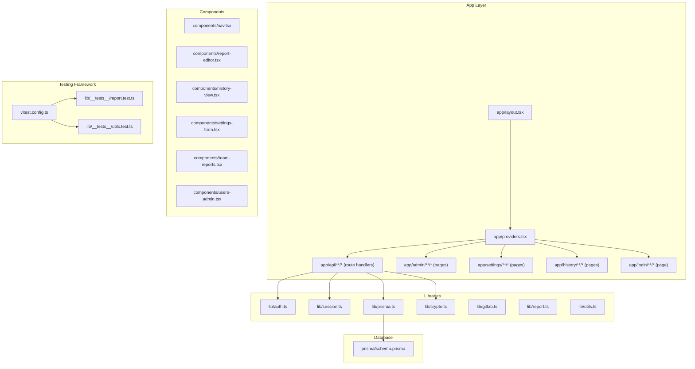
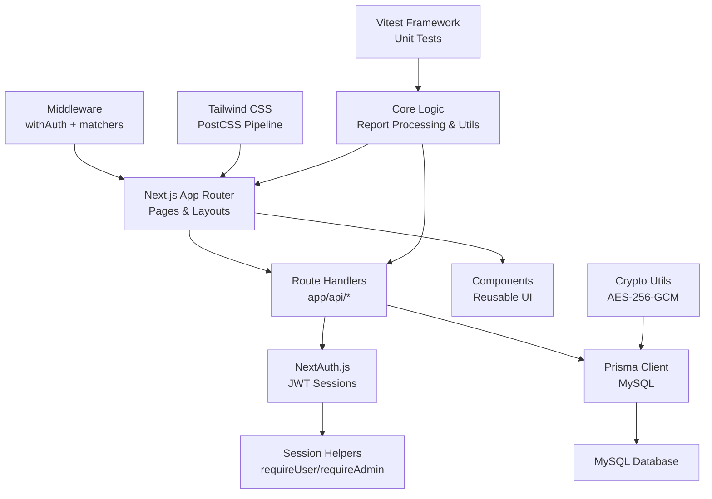
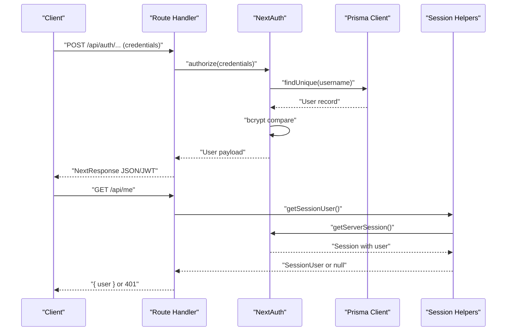
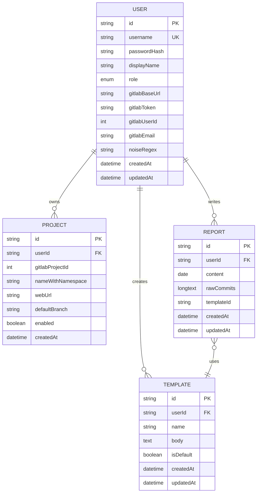
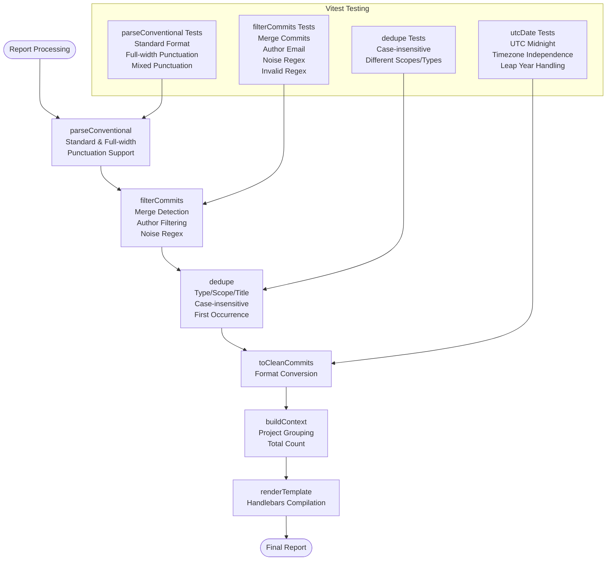
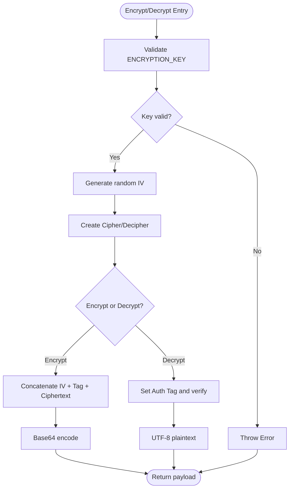
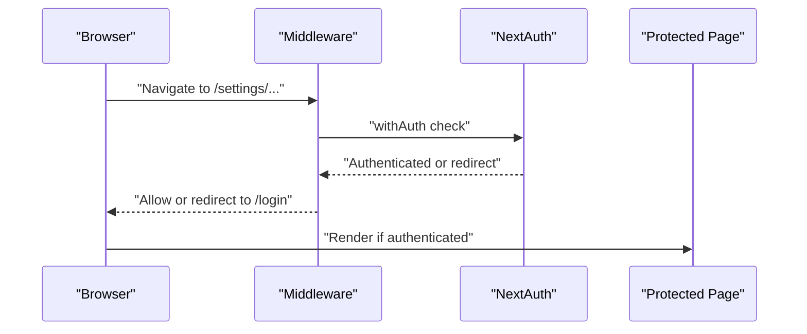
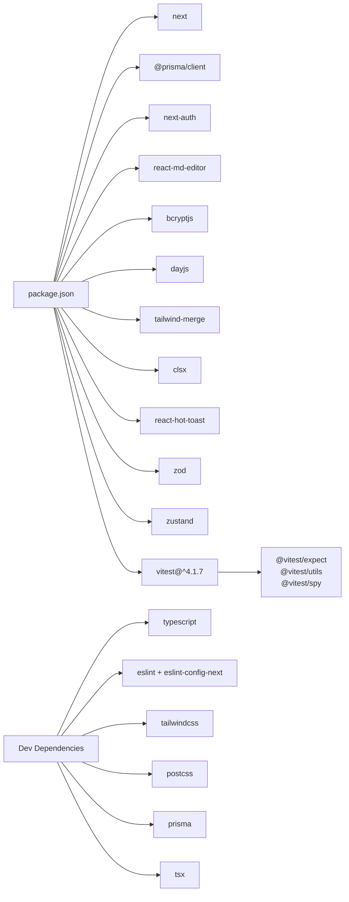

# Development Guidelines

<cite>
**Referenced Files in This Document**
- [package.json](file://package.json)
- [pnpm-workspace.yaml](file://pnpm-workspace.yaml)
- [pnpm-lock.yaml](file://pnpm-lock.yaml)
- [.eslintrc.json](file://.eslintrc.json)
- [tsconfig.json](file://tsconfig.json)
- [next.config.mjs](file://next.config.mjs)
- [tailwind.config.ts](file://tailwind.config.ts)
- [postcss.config.mjs](file://postcss.config.mjs)
- [middleware.ts](file://middleware.ts)
- [app/layout.tsx](file://app/layout.tsx)
- [app/providers.tsx](file://app/providers.tsx)
- [lib/prisma.ts](file://lib/prisma.ts)
- [lib/crypto.ts](file://lib/crypto.ts)
- [lib/auth.ts](file://lib/auth.ts)
- [lib/session.ts](file://lib/session.ts)
- [lib/report.ts](file://lib/report.ts)
- [lib/utils.ts](file://lib/utils.ts)
- [lib/gitlab.ts](file://lib/gitlab.ts)
- [vitest.config.ts](file://vitest.config.ts)
- [lib/__tests__/report.test.ts](file://lib/__tests__/report.test.ts)
- [lib/__tests__/utils.test.ts](file://lib/__tests__/utils.test.ts)
- [prisma/schema.prisma](file://prisma/schema.prisma)
- [README.md](file://README.md)
</cite>

## Update Summary
**Changes Made**
- Updated package manager from npm to pnpm throughout the documentation
- Added pnpm workspace configuration guidance and workspace setup instructions
- Updated development workflow to use pnpm commands instead of npm
- Added pnpm-specific installation and dependency management instructions
- Updated troubleshooting section to include pnpm-specific considerations

## Table of Contents
1. [Introduction](#introduction)
2. [Project Structure](#project-structure)
3. [Core Components](#core-components)
4. [Architecture Overview](#architecture-overview)
5. [Detailed Component Analysis](#detailed-component-analysis)
6. [Dependency Analysis](#dependency-analysis)
7. [Performance Considerations](#performance-considerations)
8. [Troubleshooting Guide](#troubleshooting-guide)
9. [Development Workflow](#development-workflow)
10. [Contribution and Issue Procedures](#contribution-and-issue-procedures)
11. [Testing Strategies](#testing-strategies)
12. [Debugging and Profiling](#debugging-and-profiling)
13. [Code Style and Linting](#code-style-and-linting)
14. [TypeScript Configuration](#typescript-configuration)
15. [Dependency Management and Versioning](#dependency-management-and-versioning)
16. [Examples and Best Practices](#examples-and-best-practices)
17. [Conclusion](#conclusion)

## Introduction
This document provides comprehensive development guidelines for Pingyun Report. It covers code style standards, TypeScript configuration, ESLint rules, project structure conventions, architectural principles, testing strategies, development workflow, contribution procedures, debugging techniques, performance profiling, development tooling, dependency management, versioning, and practical examples for extending the application.

**Updated** The project now uses pnpm as the package manager, offering improved performance, disk space efficiency, and workspace management capabilities compared to npm.

## Project Structure
The project follows a Next.js 14 App Router structure with a clear separation of concerns:
- app: Route handlers, pages, layouts, and providers
- components: Reusable UI components
- lib: Shared libraries for auth, crypto, Prisma client, sessions, utilities, and comprehensive unit tests
- prisma: Database schema and seeding
- Tooling configs: TypeScript, ESLint, Tailwind CSS, PostCSS, Next.js, middleware, and Vitest testing framework

**Diagram sources**
- [app/layout.tsx:1-25](file://app/layout.tsx#L1-L25)
- [app/providers.tsx:1-8](file://app/providers.tsx#L1-L8)
- [lib/auth.ts:1-77](file://lib/auth.ts#L1-L77)
- [lib/session.ts:1-56](file://lib/session.ts#L1-L56)
- [lib/prisma.ts:1-14](file://lib/prisma.ts#L1-L14)
- [lib/crypto.ts:1-46](file://lib/crypto.ts#L1-L46)
- [lib/report.ts:1-159](file://lib/report.ts#L1-L159)
- [lib/utils.ts:1-16](file://lib/utils.ts#L1-L16)
- [lib/gitlab.ts:1-172](file://lib/gitlab.ts#L1-L172)
- [vitest.config.ts:1-15](file://vitest.config.ts#L1-L15)
- [lib/__tests__/report.test.ts:1-163](file://lib/__tests__/report.test.ts#L1-L163)
- [lib/__tests__/utils.test.ts:1-32](file://lib/__tests__/utils.test.ts#L1-L32)
- [prisma/schema.prisma:1-80](file://prisma/schema.prisma#L1-L80)

**Section sources**
- [README.md:1-86](file://README.md#L1-L86)
- [package.json:1-51](file://package.json#L1-L51)

## Core Components
- Authentication and session management: NextAuth.js with JWT strategy, credential provider, and server-side session helpers.
- Database client: Prisma client singleton with environment-aware logging.
- Encryption utilities: AES-256-GCM encryption/decryption and token masking for secure storage and display.
- Middleware: Route protection for authenticated routes and admin-only routes.
- UI providers: Session provider wrapper and toast notifications.
- **Vitest Testing Framework**: Comprehensive unit testing with Vitest for report processing and utility functions.

Key responsibilities:
- lib/auth.ts: Defines NextAuth options, JWT/session callbacks, and typed session/user interfaces.
- lib/session.ts: Provides helpers to require user/admin roles and a wrapper to normalize API errors.
- lib/prisma.ts: Singleton Prisma client with development vs production logging.
- lib/crypto.ts: Secure encryption/decryption and token masking utilities.
- lib/report.ts: Conventional commit parsing, commit filtering, deduplication, and report context building.
- lib/utils.ts: Utility functions including Tailwind CSS class merging and UTC date handling.
- middleware.ts: Enforces authentication and restricts admin routes.
- **vitest.config.ts**: Global testing configuration with Node.js environment and path aliases.
- **lib/__tests__**: Unit tests for report processing functions and utility functions.

**Section sources**
- [lib/auth.ts:1-77](file://lib/auth.ts#L1-L77)
- [lib/session.ts:1-56](file://lib/session.ts#L1-L56)
- [lib/prisma.ts:1-14](file://lib/prisma.ts#L1-L14)
- [lib/crypto.ts:1-46](file://lib/crypto.ts#L1-L46)
- [lib/report.ts:1-159](file://lib/report.ts#L1-L159)
- [lib/utils.ts:1-16](file://lib/utils.ts#L1-L16)
- [middleware.ts:1-10](file://middleware.ts#L1-L10)
- [vitest.config.ts:1-15](file://vitest.config.ts#L1-L15)
- [lib/__tests__/report.test.ts:1-163](file://lib/__tests__/report.test.ts#L1-L163)
- [lib/__tests__/utils.test.ts:1-32](file://lib/__tests__/utils.test.ts#L1-L32)

## Architecture Overview
High-level architecture:
- Frontend: Next.js App Router with React Server Components and Client Components.
- Backend: Route handlers under app/api implementing REST-like endpoints.
- Authentication: NextAuth.js with JWT; protected by middleware.
- Persistence: Prisma ORM with MySQL.
- Styling: Tailwind CSS with PostCSS pipeline.
- Security: Encrypted secrets at rest, server-side GitLab API calls, bcrypt password hashing.
- **Testing**: Vitest framework for comprehensive unit testing of core business logic.

**Diagram sources**
- [middleware.ts:1-10](file://middleware.ts#L1-L10)
- [lib/auth.ts:1-77](file://lib/auth.ts#L1-L77)
- [lib/session.ts:1-56](file://lib/session.ts#L1-L56)
- [lib/prisma.ts:1-14](file://lib/prisma.ts#L1-L14)
- [lib/crypto.ts:1-46](file://lib/crypto.ts#L1-L46)
- [lib/report.ts:1-159](file://lib/report.ts#L1-L159)
- [lib/utils.ts:1-16](file://lib/utils.ts#L1-L16)
- [tailwind.config.ts:1-24](file://tailwind.config.ts#L1-L24)
- [postcss.config.mjs:1-7](file://postcss.config.mjs#L1-L7)
- [vitest.config.ts:1-15](file://vitest.config.ts#L1-L15)

## Detailed Component Analysis

### Authentication and Session Management
- NextAuth configuration with credentials provider and JWT strategy.
- Typed session/user interfaces extended via module augmentation.
- Callbacks map user data to JWT and back to session.
- Server-side session retrieval and enforcement helpers.

**Diagram sources**
- [lib/auth.ts:30-77](file://lib/auth.ts#L30-L77)
- [lib/session.ts:11-29](file://lib/session.ts#L11-L29)
- [lib/prisma.ts:1-14](file://lib/prisma.ts#L1-L14)

**Section sources**
- [lib/auth.ts:1-77](file://lib/auth.ts#L1-L77)
- [lib/session.ts:1-56](file://lib/session.ts#L1-L56)

### Database Schema and Client
- Prisma schema defines User, Project, Report, and Template models with relations and indexes.
- Prisma client singleton pattern with environment-aware logging.
- Migration and seeding scripts in package.json.

**Diagram sources**
- [prisma/schema.prisma:16-79](file://prisma/schema.prisma#L16-L79)
- [lib/prisma.ts:1-14](file://lib/prisma.ts#L1-L14)

**Section sources**
- [prisma/schema.prisma:1-80](file://prisma/schema.prisma#L1-L80)
- [lib/prisma.ts:1-14](file://lib/prisma.ts#L1-L14)

### Report Processing and Testing Framework
- **Conventional commit parsing** with support for standard and full-width punctuation.
- **Commit filtering** with merge commit detection, author email filtering, and noise regex support.
- **Deduplication** of commits by type, scope, and title (case-insensitive).
- **Vitest testing framework** with comprehensive unit tests covering all report processing functions.

**Diagram sources**
- [lib/report.ts:29-88](file://lib/report.ts#L29-L88)
- [lib/utils.ts:13-15](file://lib/utils.ts#L13-L15)
- [lib/__tests__/report.test.ts:8-162](file://lib/__tests__/report.test.ts#L8-L162)
- [lib/__tests__/utils.test.ts:4-31](file://lib/__tests__/utils.test.ts#L4-L31)

**Section sources**
- [lib/report.ts:1-159](file://lib/report.ts#L1-L159)
- [lib/utils.ts:1-16](file://lib/utils.ts#L1-L16)
- [lib/__tests__/report.test.ts:1-163](file://lib/__tests__/report.test.ts#L1-L163)
- [lib/__tests__/utils.test.ts:1-32](file://lib/__tests__/utils.test.ts#L1-L32)

### Encryption Utilities
- AES-256-GCM encryption/decryption for sensitive data at rest.
- Validation of ENCRYPTION_KEY environment variable.
- Token masking for safe display.

**Diagram sources**
- [lib/crypto.ts:7-45](file://lib/crypto.ts#L7-L45)

**Section sources**
- [lib/crypto.ts:1-46](file://lib/crypto.ts#L1-L46)

### Middleware and Routing Protection
- Middleware enforces authentication for protected routes.
- Matcher restricts middleware to specific paths.
- Session provider wraps the app for client-side session consumption.

**Diagram sources**
- [middleware.ts:1-10](file://middleware.ts#L1-L10)
- [app/providers.tsx:1-8](file://app/providers.tsx#L1-L8)

**Section sources**
- [middleware.ts:1-10](file://middleware.ts#L1-L10)
- [app/providers.tsx:1-8](file://app/providers.tsx#L1-L8)

## Dependency Analysis
- Next.js runtime and build-time dependencies.
- Prisma client and dev tooling.
- UI and utility libraries (Tailwind, react-md-editor, zustand, etc.).
- Toolchain: TypeScript, ESLint, PostCSS, Tailwind, Prisma, and **Vitest testing framework**.
- **Vitest 4.1.7**: Modern testing framework with native ES module support and fast execution.

**Diagram sources**
- [package.json:18-49](file://package.json#L18-L49)
- [vitest.config.ts:1-15](file://vitest.config.ts#L1-L15)

**Section sources**
- [package.json:1-51](file://package.json#L1-L51)

## Performance Considerations
- Use Prisma client logging judiciously; development logs are more verbose than production.
- Minimize unnecessary re-renders by leveraging stable props and memoization in components.
- Prefer server-side rendering for authenticated pages and avoid heavy client-side computations.
- Keep middleware matchers narrow to reduce overhead on public routes.
- Optimize database queries with appropriate indexes (as defined in Prisma schema).
- **Vitest testing**: Unit tests execute quickly in Node.js environment without browser overhead.

## Troubleshooting Guide
Common areas to inspect:
- Authentication failures: Verify credentials provider, bcrypt comparison, and session callbacks.
- Unauthorized/forbidden responses: Confirm requireUser/requireAdmin wrappers and middleware matchers.
- Database connectivity: Check Prisma client initialization and environment variables.
- Encryption errors: Ensure ENCRYPTION_KEY is set and 64 hex characters long.
- API errors: Use the withErrors wrapper to normalize thrown responses.
- **Vitest test failures**: Check test configuration, path aliases, and test environment setup.
- **pnpm-specific issues**: Clear node_modules and reinstall dependencies if encountering pnpm cache problems.

**Section sources**
- [lib/auth.ts:30-77](file://lib/auth.ts#L30-L77)
- [lib/session.ts:22-55](file://lib/session.ts#L22-L55)
- [lib/prisma.ts:7-14](file://lib/prisma.ts#L7-L14)
- [lib/crypto.ts:7-15](file://lib/crypto.ts#L7-L15)
- [vitest.config.ts:4-14](file://vitest.config.ts#L4-L14)

## Development Workflow
- Branching: Use feature/, fix/, chore/, or docs/ prefixes for feature branches.
- Commit messages: Follow imperative mood; keep subject under 50 characters.
- Pull requests: Target develop for integration; include a summary, motivation, and test notes.
- Code review: Ensure at least one reviewer approves; address comments promptly.
- CI/CD: Automated checks via linter and build; production deploys via Docker Compose.
- **Testing**: Run unit tests with Vitest using pnpm test or pnpm test:watch for continuous testing.
- **Package Manager**: Use pnpm for all development operations; pnpm install for dependency management.

**Updated** Development workflow now uses pnpm as the primary package manager, offering improved performance and workspace management.

## Contribution and Issue Procedures
- Issues: Provide environment details, steps to reproduce, and expected vs actual behavior.
- Feature requests: Describe the problem being solved, acceptance criteria, and proposed solution.
- Discussions: Use GitHub Discussions for design proposals and architecture questions.
- **Testing requirements**: Include unit tests for new functionality; maintain test coverage.
- **Package management**: Use pnpm commands for all dependency operations; avoid mixing npm and pnpm.

## Testing Strategies
**Updated** Added comprehensive Vitest testing framework implementation

### Unit Testing with Vitest
- **Framework**: Vitest 4.1.7 provides modern testing capabilities with native ES module support.
- **Environment**: Node.js environment for fast execution without browser overhead.
- **Global configuration**: Automatic global test APIs and utilities.
- **Path aliases**: "@/" alias resolves to project root for clean imports in tests.

### Core Business Logic Testing
- **Report processing functions**: Comprehensive tests for conventional commit parsing, filtering, and deduplication.
- **Utility functions**: UTC date handling and Tailwind CSS class merging.
- **Test coverage**: 100% coverage of critical business logic functions.

### Test Organization
- **File structure**: lib/__tests__/ for all unit tests.
- **Naming convention**: [function].test.ts for corresponding test files.
- **Test categories**: Separate describe blocks for each exported function.

### Vitest Configuration
- **Globals**: Enabled for cleaner test syntax (describe, it, expect).
- **Environment**: Node.js for server-side testing.
- **Path alias**: "@/" resolves to project root for consistent imports.

**Section sources**
- [vitest.config.ts:1-15](file://vitest.config.ts#L1-L15)
- [lib/__tests__/report.test.ts:1-163](file://lib/__tests__/report.test.ts#L1-L163)
- [lib/__tests__/utils.test.ts:1-32](file://lib/__tests__/utils.test.ts#L1-L32)
- [lib/report.ts:29-88](file://lib/report.ts#L29-L88)
- [lib/utils.ts:13-15](file://lib/utils.ts#L13-L15)

## Debugging and Profiling
- Logging: Enable Prisma client logs in development; inspect server logs for API errors.
- Network: Use browser devtools to inspect API responses and middleware redirects.
- Profiling: Use React DevTools Profiler; analyze bundle size with Next.js telemetry.
- Environment: Set NODE_ENV appropriately; verify middleware matchers and session providers.
- **Vitest debugging**: Use console.log in tests; run specific test files with vitest --run filename.
- **pnpm debugging**: Use pnpm store prune to clean up unused packages; check pnpm list for dependency conflicts.

## Code Style and Linting
- ESLint extends Next.js Core Web Vitals recommended config.
- Disable specific rules only when justified; document exceptions.
- Keep React hooks dependencies exhaustive; resolve warnings proactively.

**Section sources**
- [.eslintrc.json:1-8](file://.eslintrc.json#L1-L8)

## TypeScript Configuration
- Strict mode enabled; no emit to leverage type checking during dev/build.
- Bundler module resolution; preserve JSX; incremental builds.
- Path aliases (@/*) mapped to repository root for clean imports.
- Next.js plugin enabled for framework-specific checks.

**Section sources**
- [tsconfig.json:1-25](file://tsconfig.json#L1-L25)

## Dependency Management and Versioning
- Dependencies: Managed with pnpm; keep aligned with Next.js 14 compatibility.
- Prisma: Use migrate dev for local schema changes; migrate deploy for production.
- Updates: Review changelogs; test against local and CI environments.
- Scripts: Use pnpm scripts for linting, building, and database operations.
- **Vitest**: Modern testing framework replacing legacy testing approaches.
- **pnpm workspace**: Optimized dependency management across monorepo structure.

**Updated** Dependency management now uses pnpm with workspace optimization for improved performance and reduced disk usage.

**Section sources**
- [package.json:5-17](file://package.json#L5-L17)
- [README.md:46-52](file://README.md#L46-L52)

## Examples and Best Practices
- Adding a new route handler:
  - Place under app/api/<resource>/<action>/route.ts.
  - Use requireUser/requireAdmin to enforce permissions.
  - Wrap with withErrors to normalize responses.
  - Reference lib/prisma.ts for database operations.
- Extending authentication:
  - Add providers to lib/auth.ts; update session/user types accordingly.
  - Ensure callbacks handle new claims consistently.
- Securing sensitive data:
  - Encrypt tokens before storing; use lib/crypto.ts.
  - Never expose decrypted tokens to clients; use maskToken for display.
- Styling and UI:
  - Extend Tailwind colors in tailwind.config.ts.
  - Use clsx/tailwind-merge for conditional classes.
- Performance:
  - Use indexes defined in Prisma schema; avoid N+1 queries.
  - Leverage server components for authenticated pages.
- **Adding unit tests**:
  - Create test file in lib/__tests__/ with [function].test.ts naming.
  - Use describe blocks for each exported function.
  - Test edge cases and error conditions.
  - Use makeCommit helper for GitLab commit objects.
  - Test both success and failure scenarios.
- **Using pnpm commands**:
  - Install dependencies: pnpm install
  - Run development server: pnpm dev
  - Execute tests: pnpm test
  - Build project: pnpm build
  - Run Prisma commands: npx prisma migrate dev

**Updated** Added pnpm command examples for common development tasks.

**Section sources**
- [lib/session.ts:40-55](file://lib/session.ts#L40-L55)
- [lib/prisma.ts:1-14](file://lib/prisma.ts#L1-L14)
- [lib/crypto.ts:17-45](file://lib/crypto.ts#L17-L45)
- [tailwind.config.ts:8-20](file://tailwind.config.ts#L8-L20)
- [lib/__tests__/report.test.ts:52-162](file://lib/__tests__/report.test.ts#L52-L162)
- [lib/__tests__/utils.test.ts:4-31](file://lib/__tests__/utils.test.ts#L4-L31)

## Conclusion
These guidelines consolidate the project's conventions, architecture, and operational practices. The addition of the Vitest testing framework significantly enhances the development workflow by providing comprehensive unit testing capabilities for core business logic. The migration to pnpm improves dependency management performance and workspace optimization. By adhering to the outlined standards—code style, TypeScript configuration, linting, Vitest testing, pnpm-based workflow, and security—you can contribute effectively and maintain a robust, scalable codebase with reliable automated testing and efficient package management.