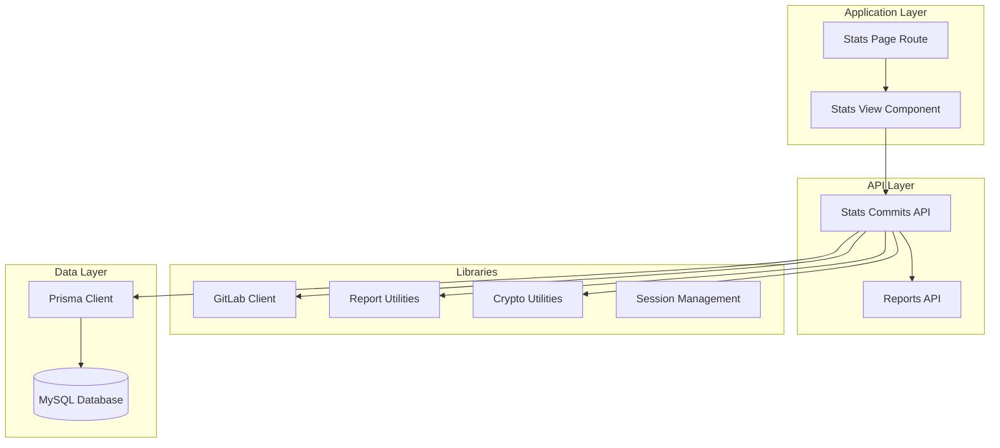
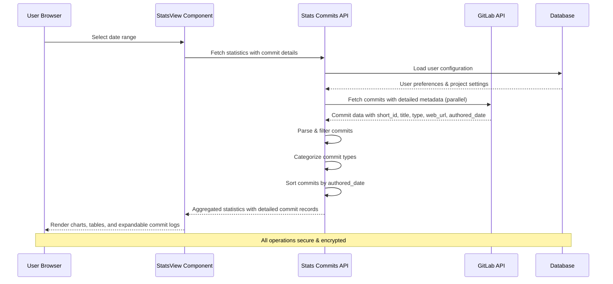
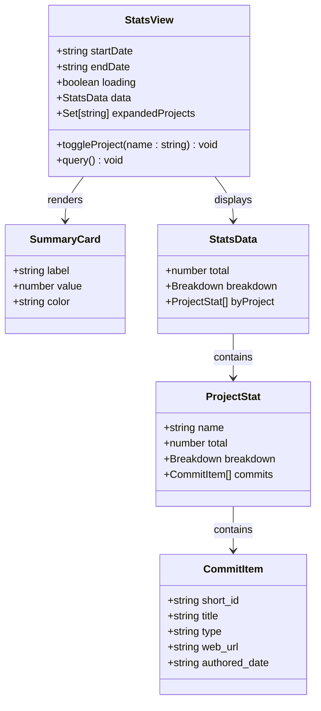
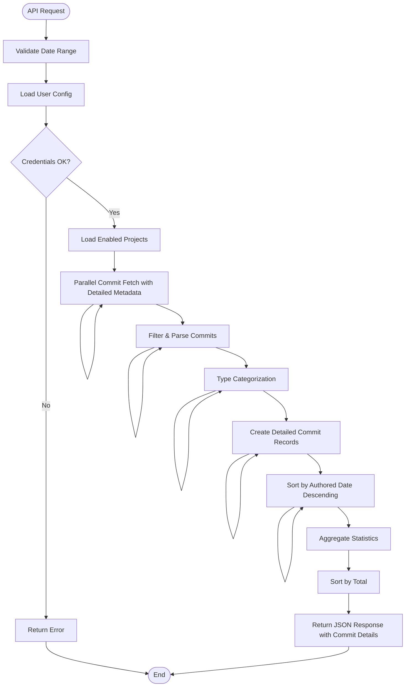
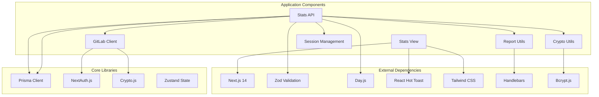

# Commit Statistics Dashboard

<cite>
**Referenced Files in This Document**
- [README.md](file://README.md)
- [package.json](file://package.json)
- [app/stats/page.tsx](file://app/stats/page.tsx)
- [app/api/stats/commits/route.ts](file://app/api/stats/commits/route.ts)
- [components/stats-view.tsx](file://components/stats-view.tsx)
- [lib/gitlab.ts](file://lib/gitlab.ts)
- [lib/report.ts](file://lib/report.ts)
- [lib/crypto.ts](file://lib/crypto.ts)
- [lib/prisma.ts](file://lib/prisma.ts)
- [prisma/schema.prisma](file://prisma/schema.prisma)
- [lib/session.ts](file://lib/session.ts)
- [middleware.ts](file://middleware.ts)
- [components/nav.tsx](file://components/nav.tsx)
- [app/layout.tsx](file://app/layout.tsx)
</cite>

## Update Summary
**Changes Made**
- Enhanced commit record details functionality with comprehensive commit listing
- Added expandable project sections with toggle functionality
- Implemented detailed commit log display with up to 320px scrollable history
- Integrated interactive GitLab links for commit navigation
- Improved UI with empty states and loading indicators
- Added commit sorting by authored_date for chronological display

## Table of Contents
1. [Introduction](#introduction)
2. [Project Structure](#project-structure)
3. [Core Components](#core-components)
4. [Architecture Overview](#architecture-overview)
5. [Detailed Component Analysis](#detailed-component-analysis)
6. [Enhanced Features](#enhanced-features)
7. [Dependency Analysis](#dependency-analysis)
8. [Performance Considerations](#performance-considerations)
9. [Troubleshooting Guide](#troubleshooting-guide)
10. [Conclusion](#conclusion)

## Introduction
The Commit Statistics Dashboard is a specialized feature within the Pingyun Report system that provides developers with comprehensive insights into their GitLab commit patterns over customizable date ranges. This dashboard enables users to analyze commit types, distribution across projects, and productivity trends, supporting data-driven development practices and performance monitoring.

The dashboard integrates seamlessly with the broader Pingyun Report ecosystem, leveraging encrypted GitLab tokens, conventional commit parsing, and comprehensive filtering capabilities to deliver accurate and meaningful statistics with enhanced commit detail visibility.

## Project Structure
The Commit Statistics Dashboard follows the modular architecture of the Pingyun Report application, organized around clear separation of concerns:

**Diagram sources**
- [app/stats/page.tsx:1-21](file://app/stats/page.tsx#L1-L21)
- [components/stats-view.tsx:1-374](file://components/stats-view.tsx#L1-L374)
- [app/api/stats/commits/route.ts:1-150](file://app/api/stats/commits/route.ts#L1-L150)

**Section sources**
- [README.md:1-86](file://README.md#L1-L86)
- [package.json:1-48](file://package.json#L1-L48)

## Core Components
The Commit Statistics Dashboard consists of three primary components working in harmony:

### Frontend Interface
The StatsView component serves as the interactive user interface, providing:
- Date range selection with validation
- Real-time statistics visualization
- Project-wise commit breakdown with expandable sections
- Comprehensive commit detail display with scrollable history
- Interactive GitLab links for commit navigation
- Responsive design for various screen sizes
- Enhanced empty states and loading indicators

### Backend Processing
The Stats Commits API handles complex data aggregation:
- Multi-project commit fetching with detailed commit information
- Conventional commit parsing with type categorization
- Parallel processing for performance optimization
- Commit sorting by authored_date for chronological display
- Web URL integration for GitLab commit links

### Data Integration
The system integrates with multiple data sources:
- GitLab REST API for comprehensive commit data
- Encrypted database storage for credentials
- User preferences and project configurations
- Project alias resolution for display purposes

**Section sources**
- [components/stats-view.tsx:44-374](file://components/stats-view.tsx#L44-L374)
- [app/api/stats/commits/route.ts:47-150](file://app/api/stats/commits/route.ts#L47-L150)

## Architecture Overview
The Commit Statistics Dashboard employs a client-server architecture with robust security measures and efficient data processing:

**Diagram sources**
- [components/stats-view.tsx:74-97](file://components/stats-view.tsx#L74-L97)
- [app/api/stats/commits/route.ts:92-148](file://app/api/stats/commits/route.ts#L92-L148)

The architecture ensures:
- **Security**: GitLab tokens remain server-side, encrypted at rest
- **Performance**: Parallel commit fetching across projects with detailed metadata
- **Accuracy**: Conventional commit parsing and deduplication with comprehensive field mapping
- **Scalability**: Modular design supporting future enhancements with expandable UI components

## Detailed Component Analysis

### StatsView Component
The StatsView component provides the enhanced user interface for statistics visualization with comprehensive commit detail support:

**Diagram sources**
- [components/stats-view.tsx:30-43](file://components/stats-view.tsx#L30-L43)
- [components/stats-view.tsx:218-343](file://components/stats-view.tsx#L218-L343)

Key features include:
- **Interactive Date Selection**: Validates date ranges and prevents invalid selections
- **Real-time Loading States**: Provides feedback during data fetching operations
- **Expandable Project Sections**: Toggle functionality for detailed commit log display
- **Scrollable Commit History**: Up to 320px scrollable commit list with chronological sorting
- **Responsive Layout**: Adapts to mobile and desktop screen sizes
- **Visual Progress Indicators**: Bar charts showing commit type distributions
- **Interactive GitLab Links**: Clickable commit links with web_url integration
- **Enhanced Empty States**: User-friendly messaging for no-data scenarios

**Section sources**
- [components/stats-view.tsx:44-374](file://components/stats-view.tsx#L44-L374)

### Stats Commits API
The backend API handles complex statistical computations with comprehensive commit detail processing:

**Diagram sources**
- [app/api/stats/commits/route.ts:47-148](file://app/api/stats/commits/route.ts#L47-L148)

**Section sources**
- [app/api/stats/commits/route.ts:1-150](file://app/api/stats/commits/route.ts#L1-L150)

### Data Processing Pipeline
The system implements a sophisticated data processing pipeline with enhanced commit detail extraction:

```mermaid
flowchart LR
subgraph "Input Layer"
RawCommits[Raw GitLab Commits with Full Metadata]
end
subgraph "Processing Layer"
ParseConventional[Parse Conventional Commits]
FilterNoise[Filter Noise Regex]
DropMerges[Drop Merge Commits]
Dedupe[Deduplicate Commits]
end
subgraph "Enhanced Categorization"
ExtractType[Extract Commit Type]
Categorize[Map to Known Types]
OtherCategory[Assign to 'Other' Category]
end
subgraph "Detail Enhancement"
MapFields[Map short_id, title, type, web_url, authored_date]
SortChronological[Sort by Authored Date Descending]
ProjectLevel[Project-level Stats with Commit Lists]
GlobalLevel[Global Stats with Commit Lists]
end
RawCommits --> ParseConventional
ParseConventional --> FilterNoise
FilterNoise --> DropMerges
DropMerges --> Dedupe
Dedupe --> ExtractType
ExtractType --> Categorize
Categorize --> OtherCategory
OtherCategory --> MapFields
MapFields --> SortChronological
SortChronological --> ProjectLevel
ProjectLevel --> GlobalLevel
```

**Diagram sources**
- [lib/report.ts:52-105](file://lib/report.ts#L52-L105)
- [app/api/stats/commits/route.ts:112-137](file://app/api/stats/commits/route.ts#L112-L137)

**Section sources**
- [lib/report.ts:1-159](file://lib/report.ts#L1-159)

## Enhanced Features

### Comprehensive Commit Detail Display
The dashboard now provides detailed commit information with five key fields:
- **short_id**: Short commit identifier for quick reference
- **title**: Commit message subject line
- **type**: Categorized commit type (feat, fix, refactor, etc.)
- **web_url**: Direct link to GitLab commit page
- **authored_date**: Timestamp for chronological sorting

### Expandable Project Sections
Users can now interact with project sections through:
- **Toggle Functionality**: Click project headers to expand/collapse commit details
- **Batch Operations**: Toggle all projects with "全部展开"/"全部收起" buttons
- **Visual Feedback**: Arrow indicators show expansion state
- **Progressive Disclosure**: Detailed commit logs revealed only when needed

### Scrollable Commit History
The commit display includes:
- **Height Limit**: Maximum 320px height for optimal screen utilization
- **Vertical Scrolling**: Smooth scrolling for long commit lists
- **Responsive Design**: Adapts to different screen sizes
- **Performance Optimization**: Virtual scrolling considerations for large datasets

### Interactive GitLab Integration
Direct GitLab integration provides:
- **Web URL Links**: Clickable commit links in commit list items
- **External Navigation**: Opens GitLab pages in new tabs
- **URL Validation**: Ensures web_url availability before rendering links
- **Fallback Handling**: Graceful degradation when web_url is unavailable

### Enhanced User Experience
The UI improvements include:
- **Loading States**: Clear "查询中…" feedback during data fetching
- **Empty States**: Helpful messaging when no commits are found
- **Error Handling**: User-friendly error messages for API failures
- **Accessibility**: Proper ARIA attributes and keyboard navigation support

**Section sources**
- [components/stats-view.tsx:297-335](file://components/stats-view.tsx#L297-L335)
- [app/api/stats/commits/route.ts:119-125](file://app/api/stats/commits/route.ts#L119-L125)

## Dependency Analysis
The Commit Statistics Dashboard relies on several key dependencies and their interactions:

**Diagram sources**
- [package.json:16-32](file://package.json#L16-L32)
- [components/stats-view.tsx:1-7](file://components/stats-view.tsx#L1-L7)

**Section sources**
- [package.json:1-48](file://package.json#L1-L48)

## Performance Considerations
The dashboard implements several performance optimization strategies:

### Parallel Processing
- **Multi-project Fetching**: Commits are fetched concurrently across all enabled projects with detailed metadata
- **Asynchronous Operations**: Non-blocking data processing prevents UI freezing
- **Efficient Caching**: GitLab API responses utilize appropriate caching headers
- **Memory Management**: Optimized data structures for commit lists and project collections

### Network Optimization
- **Connection Pooling**: Reused connections to GitLab API
- **Timeout Management**: Configurable timeouts prevent hanging requests
- **Error Recovery**: Graceful handling of partial failures with silent project skipping
- **Pagination Control**: Limited to 20 pages per project to prevent excessive API calls

### UI Performance
- **Virtual Scrolling**: Potential for future virtual scrolling implementation for large commit lists
- **State Management**: Efficient React state updates with minimal re-renders
- **Lazy Loading**: Commit details loaded only when project sections are expanded
- **Component Memoization**: React.memo usage for static components

### Data Processing Efficiency
- **Streaming Results**: Incremental processing of commit data
- **Garbage Collection**: Proper cleanup of temporary objects and arrays
- **Optimized Data Structures**: Efficient use of Maps and Sets for deduplication and categorization
- **Early Termination**: Project processing stops on critical errors with graceful fallback

## Troubleshooting Guide

### Common Issues and Solutions

**Authentication Problems**
- Verify NextAuth.js configuration
- Check session cookie validity
- Confirm user role permissions
- Ensure GitLab token is properly configured in user settings

**GitLab Integration Issues**
- Validate GitLab base URL format
- Ensure Personal Access Token has required scopes
- Check network connectivity to GitLab instance
- Verify project membership and access permissions
- Confirm project default branches are accessible

**Statistics Not Loading**
- Verify date range selection is valid
- Check project enablement status in user settings
- Review console for JavaScript errors
- Ensure API endpoint is reachable
- Check browser network tab for failed requests

**Performance Issues**
- Monitor API response times for individual projects
- Check database connection limits
- Review browser developer tools for memory leaks
- Verify commit count thresholds for large date ranges
- Consider reducing date range for better performance

**UI Display Issues**
- Clear browser cache and reload page
- Check browser console for JavaScript errors
- Verify Tailwind CSS is properly loaded
- Ensure React Hot Toast is functioning correctly
- Check for CSS conflicts with other components

**Commit Detail Problems**
- Verify web_url field availability in GitLab API response
- Check commit message parsing for conventional commit format
- Ensure project alias resolution works correctly
- Verify authored_date format consistency
- Check for merge commit filtering effectiveness

**Section sources**
- [lib/session.ts:22-56](file://lib/session.ts#L22-L56)
- [lib/crypto.ts:7-15](file://lib/crypto.ts#L7-L15)

## Conclusion
The Commit Statistics Dashboard represents a comprehensive solution for developers seeking insights into their GitLab commit patterns. Through its modular architecture, robust security measures, and efficient data processing capabilities, it provides valuable analytics while maintaining the security and reliability standards expected in enterprise environments.

The enhanced commit detail functionality significantly improves the dashboard's utility by providing comprehensive commit information, interactive GitLab integration, and user-friendly expandable sections. These improvements support detailed analysis workflows while maintaining the dashboard's performance and scalability characteristics.

The dashboard's extensible design supports future enhancements, including additional visualization types, export capabilities, virtual scrolling for large commit lists, and integration with other development tools. Its clean separation of concerns ensures maintainability and scalability as the Pingyun Report ecosystem continues to evolve.

The implementation demonstrates best practices in modern web development, including proper error handling, responsive design, accessibility considerations, and performance optimization strategies that scale with growing user bases and larger datasets.