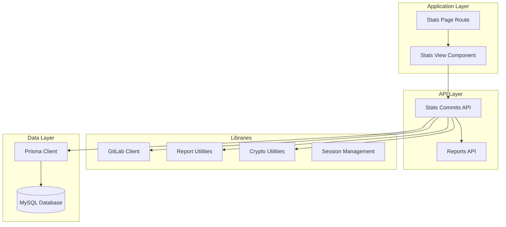
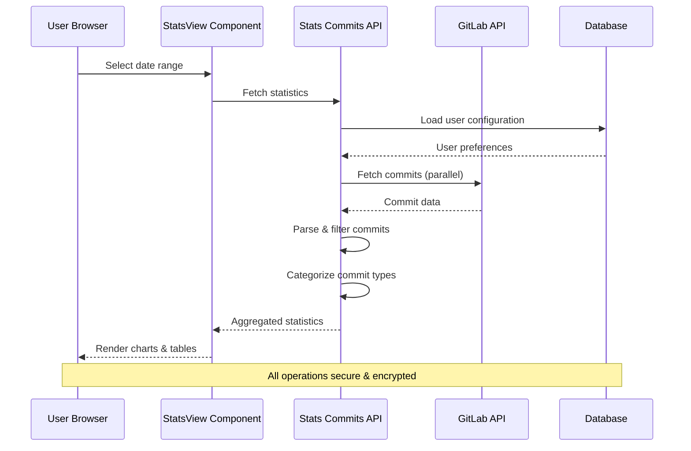
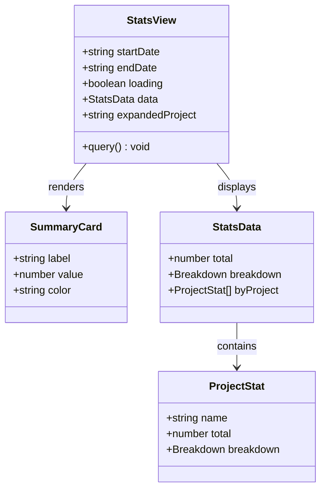
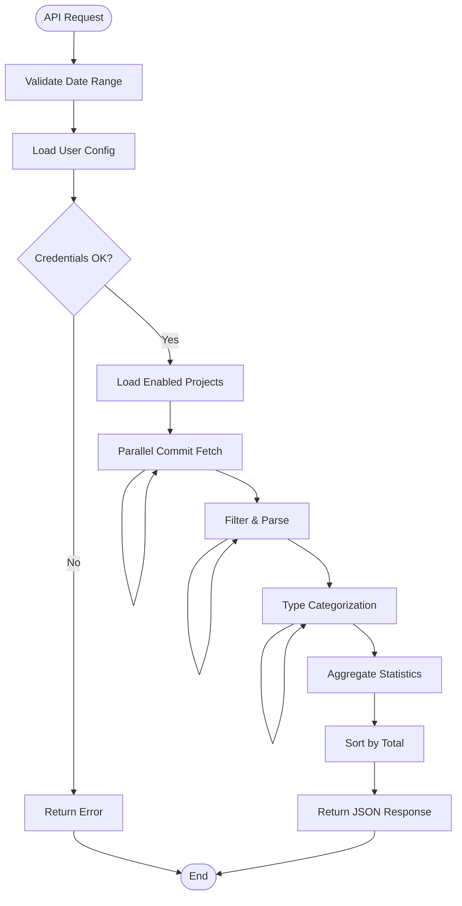
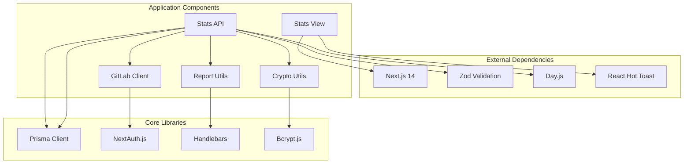

# Commit Statistics Dashboard

<cite>
**Referenced Files in This Document**
- [README.md](file://README.md)
- [package.json](file://package.json)
- [app/stats/page.tsx](file://app/stats/page.tsx)
- [app/api/stats/commits/route.ts](file://app/api/stats/commits/route.ts)
- [components/stats-view.tsx](file://components/stats-view.tsx)
- [lib/gitlab.ts](file://lib/gitlab.ts)
- [lib/report.ts](file://lib/report.ts)
- [lib/crypto.ts](file://lib/crypto.ts)
- [lib/prisma.ts](file://lib/prisma.ts)
- [prisma/schema.prisma](file://prisma/schema.prisma)
- [lib/session.ts](file://lib/session.ts)
- [middleware.ts](file://middleware.ts)
- [components/nav.tsx](file://components/nav.tsx)
- [app/layout.tsx](file://app/layout.tsx)
</cite>

## Table of Contents
1. [Introduction](#introduction)
2. [Project Structure](#project-structure)
3. [Core Components](#core-components)
4. [Architecture Overview](#architecture-overview)
5. [Detailed Component Analysis](#detailed-component-analysis)
6. [Dependency Analysis](#dependency-analysis)
7. [Performance Considerations](#performance-considerations)
8. [Troubleshooting Guide](#troubleshooting-guide)
9. [Conclusion](#conclusion)

## Introduction
The Commit Statistics Dashboard is a specialized feature within the Pingyun Report system that provides developers with insights into their GitLab commit patterns over customizable date ranges. This dashboard enables users to analyze commit types, distribution across projects, and productivity trends, supporting data-driven development practices and performance monitoring.

The dashboard integrates seamlessly with the broader Pingyun Report ecosystem, leveraging encrypted GitLab tokens, conventional commit parsing, and comprehensive filtering capabilities to deliver accurate and meaningful statistics.

## Project Structure
The Commit Statistics Dashboard follows the modular architecture of the Pingyun Report application, organized around clear separation of concerns:

**Diagram sources**
- [app/stats/page.tsx:1-21](file://app/stats/page.tsx#L1-L21)
- [components/stats-view.tsx:1-258](file://components/stats-view.tsx#L1-L258)
- [app/api/stats/commits/route.ts:1-129](file://app/api/stats/commits/route.ts#L1-L129)

**Section sources**
- [README.md:1-86](file://README.md#L1-L86)
- [package.json:1-47](file://package.json#L1-L47)

## Core Components
The Commit Statistics Dashboard consists of three primary components working in harmony:

### Frontend Interface
The StatsView component serves as the interactive user interface, providing:
- Date range selection with validation
- Real-time statistics visualization
- Project-wise commit breakdown
- Responsive design for various screen sizes

### Backend Processing
The Stats Commits API handles complex data aggregation:
- Multi-project commit fetching
- Conventional commit parsing
- Type categorization and filtering
- Parallel processing for performance

### Data Integration
The system integrates with multiple data sources:
- GitLab REST API for commit data
- Encrypted database storage for credentials
- User preferences and project configurations

**Section sources**
- [components/stats-view.tsx:44-238](file://components/stats-view.tsx#L44-L238)
- [app/api/stats/commits/route.ts:47-128](file://app/api/stats/commits/route.ts#L47-L128)

## Architecture Overview
The Commit Statistics Dashboard employs a client-server architecture with robust security measures and efficient data processing:

**Diagram sources**
- [components/stats-view.tsx:51-74](file://components/stats-view.tsx#L51-L74)
- [app/api/stats/commits/route.ts:83-122](file://app/api/stats/commits/route.ts#L83-L122)

The architecture ensures:
- **Security**: GitLab tokens remain server-side, encrypted at rest
- **Performance**: Parallel commit fetching across projects
- **Accuracy**: Conventional commit parsing and deduplication
- **Scalability**: Modular design supporting future enhancements

## Detailed Component Analysis

### StatsView Component
The StatsView component provides the user interface for statistics visualization:

**Diagram sources**
- [components/stats-view.tsx:44-258](file://components/stats-view.tsx#L44-L258)

Key features include:
- **Interactive Date Selection**: Validates date ranges and prevents invalid selections
- **Real-time Loading States**: Provides feedback during data fetching operations
- **Responsive Layout**: Adapts to mobile and desktop screen sizes
- **Visual Progress Indicators**: Bar charts showing commit type distributions

**Section sources**
- [components/stats-view.tsx:44-238](file://components/stats-view.tsx#L44-L238)

### Stats Commits API
The backend API handles complex statistical computations:

**Diagram sources**
- [app/api/stats/commits/route.ts:47-128](file://app/api/stats/commits/route.ts#L47-L128)

**Section sources**
- [app/api/stats/commits/route.ts:1-129](file://app/api/stats/commits/route.ts#L1-L129)

### Data Processing Pipeline
The system implements a sophisticated data processing pipeline:

```mermaid
flowchart LR
subgraph "Input Layer"
RawCommits[Raw GitLab Commits]
end
subgraph "Processing Layer"
ParseConventional[Parse Conventional Commits]
FilterNoise[Filter Noise Regex]
DropMerges[Drop Merge Commits]
Dedupe[Deduplicate Commits]
end
subgraph "Categorization"
ExtractType[Extract Commit Type]
Categorize[Map to Known Types]
OtherCategory[Assign to 'Other' Category]
end
subgraph "Aggregation"
ProjectLevel[Project-level Stats]
GlobalLevel[Global Stats]
end
RawCommits --> ParseConventional
ParseConventional --> FilterNoise
FilterNoise --> DropMerges
DropMerges --> Dedupe
Dedupe --> ExtractType
ExtractType --> Categorize
Categorize --> OtherCategory
OtherCategory --> ProjectLevel
ProjectLevel --> GlobalLevel
```

**Diagram sources**
- [lib/report.ts:52-105](file://lib/report.ts#L52-L105)
- [app/api/stats/commits/route.ts:93-109](file://app/api/stats/commits/route.ts#L93-L109)

**Section sources**
- [lib/report.ts:1-159](file://lib/report.ts#L1-159)

## Dependency Analysis
The Commit Statistics Dashboard relies on several key dependencies and their interactions:

**Diagram sources**
- [package.json:16-31](file://package.json#L16-L31)
- [components/stats-view.tsx:1-7](file://components/stats-view.tsx#L1-L7)

**Section sources**
- [package.json:1-47](file://package.json#L1-L47)

## Performance Considerations
The dashboard implements several performance optimization strategies:

### Parallel Processing
- **Multi-project Fetching**: Commits are fetched concurrently across all enabled projects
- **Asynchronous Operations**: Non-blocking data processing prevents UI freezing
- **Efficient Caching**: GitLab API responses utilize appropriate caching headers

### Memory Management
- **Streaming Results**: Large datasets are processed incrementally
- **Garbage Collection**: Proper cleanup of temporary objects and arrays
- **Optimized Data Structures**: Efficient use of Maps and Sets for deduplication

### Network Optimization
- **Connection Pooling**: Reused connections to GitLab API
- **Timeout Management**: Configurable timeouts prevent hanging requests
- **Error Recovery**: Graceful handling of partial failures

## Troubleshooting Guide

### Common Issues and Solutions

**Authentication Problems**
- Verify NextAuth.js configuration
- Check session cookie validity
- Confirm user role permissions

**GitLab Integration Issues**
- Validate GitLab base URL format
- Ensure Personal Access Token has required scopes
- Check network connectivity to GitLab instance

**Statistics Not Loading**
- Verify date range selection
- Check project enablement status
- Review console for JavaScript errors

**Performance Issues**
- Monitor API response times
- Check database connection limits
- Review browser developer tools for memory leaks

**Section sources**
- [lib/session.ts:22-55](file://lib/session.ts#L22-L55)
- [lib/crypto.ts:7-15](file://lib/crypto.ts#L7-L15)

## Conclusion
The Commit Statistics Dashboard represents a comprehensive solution for developers seeking insights into their GitLab commit patterns. Through its modular architecture, robust security measures, and efficient data processing capabilities, it provides valuable analytics while maintaining the security and reliability standards expected in enterprise environments.

The dashboard's extensible design supports future enhancements, including additional visualization types, export capabilities, and integration with other development tools. Its clean separation of concerns ensures maintainability and scalability as the Pingyun Report ecosystem continues to evolve.