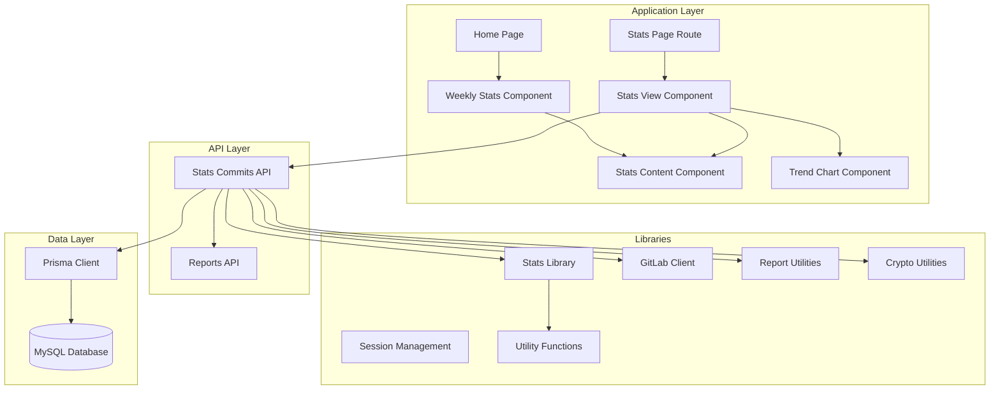
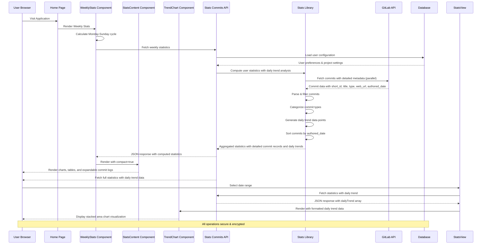
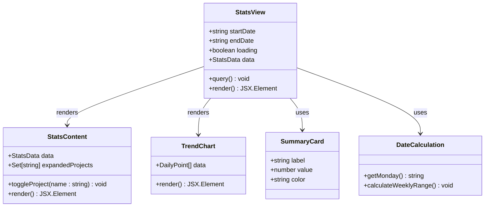
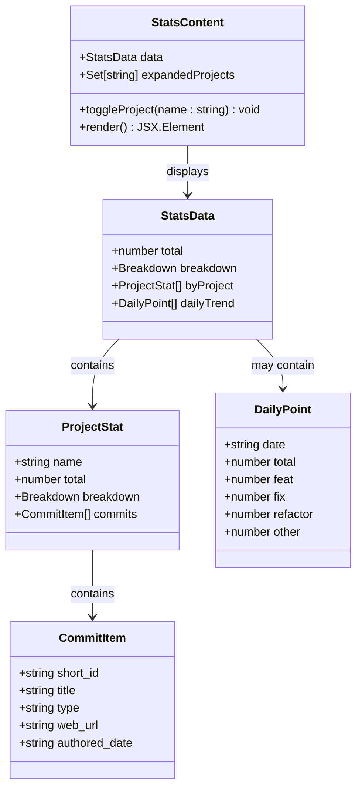
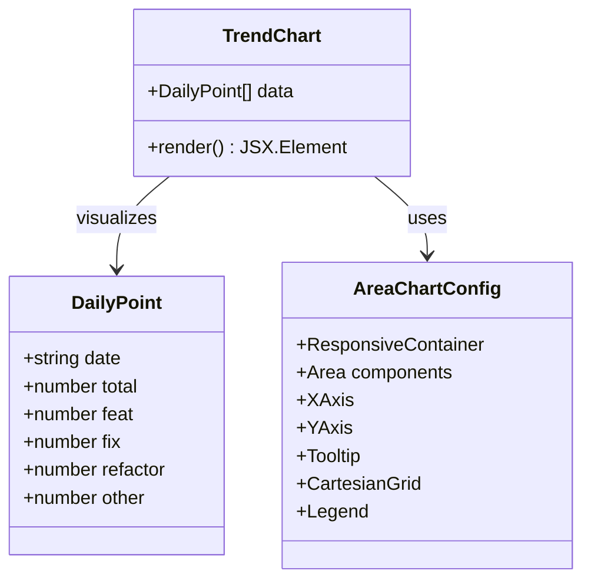
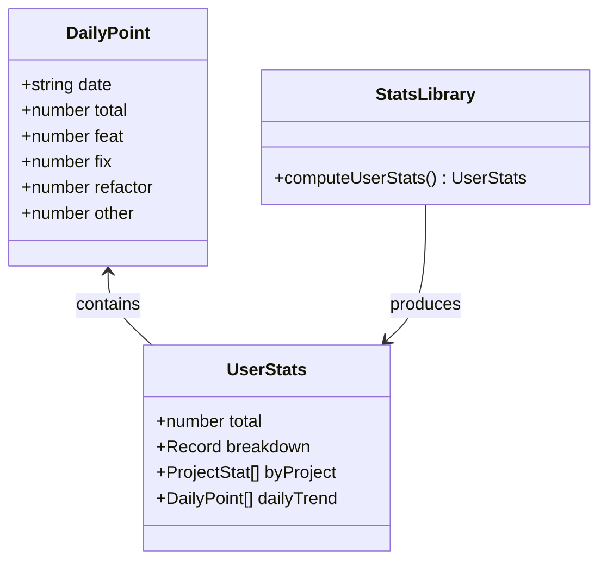
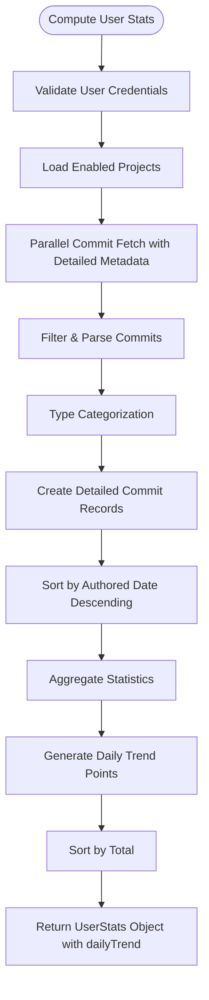
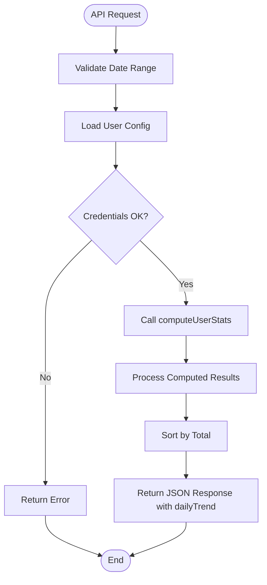
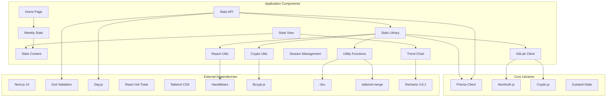

# Commit Statistics Dashboard

<cite>
**Referenced Files in This Document**
- [README.md](file://README.md)
- [package.json](file://package.json)
- [app/stats/page.tsx](file://app/stats/page.tsx)
- [app/api/stats/commits/route.ts](file://app/api/stats/commits/route.ts)
- [components/stats-view.tsx](file://components/stats-view.tsx)
- [components/stats-content.tsx](file://components/stats-content.tsx)
- [components/trend-chart.tsx](file://components/trend-chart.tsx)
- [components/weekly-stats.tsx](file://components/weekly-stats.tsx)
- [lib/stats.ts](file://lib/stats.ts)
- [lib/gitlab.ts](file://lib/gitlab.ts)
- [lib/report.ts](file://lib/report.ts)
- [lib/crypto.ts](file://lib/crypto.ts)
- [lib/prisma.ts](file://lib/prisma.ts)
- [prisma/schema.prisma](file://prisma/schema.prisma)
- [lib/session.ts](file://lib/session.ts)
- [middleware.ts](file://middleware.ts)
- [components/nav.tsx](file://components/nav.tsx)
- [app/layout.tsx](file://app/layout.tsx)
- [app/page.tsx](file://app/page.tsx)
- [lib/utils.ts](file://lib/utils.ts)
</cite>

## Update Summary
**Changes Made**
- **Added Daily Commit Trend Visualization**: Introduced new TrendChart component with Recharts integration for visualizing daily commit patterns over selected date ranges
- **Enhanced Backend Temporal Analysis**: Extended computeUserStats function to generate daily commit trend data with stacked area chart visualization
- **New DailyPoint Type**: Added comprehensive type definition for daily trend data points including date, totals, and categorized commit counts
- **Conditional Trend Rendering**: Implemented conditional rendering logic in StatsView to display trend chart only when sufficient data is available
- **Integrated Recharts Dependency**: Added Recharts v3.8.1 as a core dependency for advanced charting capabilities

## Table of Contents
1. [Introduction](#introduction)
2. [Project Structure](#project-structure)
3. [Core Components](#core-components)
4. [Architecture Overview](#architecture-overview)
5. [Detailed Component Analysis](#detailed-component-analysis)
6. [Enhanced Features](#enhanced-features)
7. [Dependency Analysis](#dependency-analysis)
8. [Performance Considerations](#performance-considerations)
9. [Troubleshooting Guide](#troubleshooting-guide)
10. [Conclusion](#conclusion)

## Introduction
The Commit Statistics Dashboard is a specialized feature within the Pingyun Report system that provides developers with comprehensive insights into their GitLab commit patterns over customizable date ranges. This dashboard enables users to analyze commit types, distribution across projects, and productivity trends, supporting data-driven development practices and performance monitoring.

The dashboard integrates seamlessly with the broader Pingyun Report ecosystem, leveraging encrypted GitLab tokens, conventional commit parsing, and comprehensive filtering capabilities to deliver accurate and meaningful statistics with enhanced commit detail visibility. The architecture has been significantly refactored to improve modularity, reusability, and maintainability, now featuring a new weekly statistics component for quick insights into recent productivity patterns with improved date calculation consistency, and a new daily trend visualization component for temporal analysis.

## Project Structure
The Commit Statistics Dashboard follows a modular architecture with clear separation of concerns, now featuring dedicated layers for computation, presentation, API handling, and quick-access dashboards:

**Diagram sources**
- [app/stats/page.tsx:1-21](file://app/stats/page.tsx#L1-L21)
- [components/stats-view.tsx:1-173](file://components/stats-view.tsx#L1-L173)
- [components/stats-content.tsx:1-234](file://components/stats-content.tsx#L1-L234)
- [components/trend-chart.tsx:1-94](file://components/trend-chart.tsx#L1-L94)
- [components/weekly-stats.tsx:1-121](file://components/weekly-stats.tsx#L1-L121)
- [app/api/stats/commits/route.ts:1-54](file://app/api/stats/commits/route.ts#L1-L54)
- [lib/stats.ts:1-171](file://lib/stats.ts#L1-L171)
- [app/page.tsx:1-22](file://app/page.tsx#L1-L22)

**Section sources**
- [README.md:1-86](file://README.md#L1-L86)
- [package.json:1-52](file://package.json#L1-L52)

## Core Components
The Commit Statistics Dashboard now consists of six primary components organized in a layered architecture, with the addition of a new daily trend visualization component:

### Frontend Interface Components
The StatsView component serves as the main interactive interface, delegating presentation responsibilities to StatsContent and TrendChart:

- **StatsView**: Handles user interaction, date range selection, loading states, and API communication with standardized Monday calculation logic
- **StatsContent**: Pure presentation component responsible for all visualization logic with expandable sections
- **TrendChart**: New component providing daily commit trend visualization using Recharts with stacked area charts
- **WeeklyStats**: Component providing consistent weekly cycle summaries with compact visualization mode

### Daily Trend Visualization
The TrendChart component provides temporal analysis of commit patterns with sophisticated charting capabilities:

- **Recharts Integration**: Utilizes AreaChart with ResponsiveContainer for adaptive sizing
- **Stacked Area Charts**: Visualizes commit types (feat, fix, refactor, other) as stacked areas
- **Date Formatting**: Converts ISO dates to readable "MM-DD" format for X-axis labels
- **Interactive Tooltips**: Provides detailed information on hover with custom styling
- **Responsive Design**: Adapts to different screen sizes with fixed height container

### Quick Access Dashboard
The WeeklyStats component provides immediate insights into recent productivity patterns with improved date calculation consistency:

- **Standardized Date Range**: Calculates consistent Monday-Sunday weekly cycles using identical logic as StatsView
- **Compact Visualization**: Uses StatsContent with compact property for reduced UI footprint
- **Quick Navigation**: Links to full statistics page for detailed analysis
- **Summary Cards**: Displays key metrics (total commits, feature, bug fixes, refactors)
- **Enhanced Error Messages**: Internationalized error messaging with English "本周暂无提交记录"

### Backend Processing
The Stats Commits API handles data aggregation and delegates computation to the Stats library:

- **Stats Commits API**: Manages authentication, request validation, and coordinates with the Stats library
- **Stats Library**: Contains all core statistics computation logic with comprehensive type definitions including daily trend analysis

### Data Integration
The system integrates with multiple data sources through a clean separation of concerns:

- **GitLab Client**: Handles all GitLab API interactions with proper authentication
- **Report Utilities**: Provides conventional commit parsing and filtering capabilities
- **Crypto Utilities**: Manages encryption/decryption of sensitive credentials
- **Session Management**: Handles user authentication and authorization

**Section sources**
- [components/stats-view.tsx:20-173](file://components/stats-view.tsx#L20-L173)
- [components/stats-content.tsx:55-234](file://components/stats-content.tsx#L55-L234)
- [components/trend-chart.tsx:1-94](file://components/trend-chart.tsx#L1-L94)
- [components/weekly-stats.tsx:9-121](file://components/weekly-stats.tsx#L9-L121)
- [app/api/stats/commits/route.ts:16-54](file://app/api/stats/commits/route.ts#L16-L54)
- [lib/stats.ts:69-171](file://lib/stats.ts#L69-L171)

## Architecture Overview
The Commit Statistics Dashboard employs a clean layered architecture with clear separation of concerns and enhanced modularity, now including a dedicated weekly statistics component and daily trend visualization with improved date calculation consistency:

**Diagram sources**
- [app/page.tsx:15-17](file://app/page.tsx#L15-L17)
- [components/weekly-stats.tsx:14-38](file://components/weekly-stats.tsx#L14-L38)
- [components/stats-content.tsx:55-68](file://components/stats-content.tsx#L55-L68)
- [components/trend-chart.tsx:15-20](file://components/trend-chart.tsx#L15-L20)
- [app/api/stats/commits/route.ts:44-52](file://app/api/stats/commits/route.ts#L44-L52)
- [lib/stats.ts:79-171](file://lib/stats.ts#L79-L171)

The architecture ensures:
- **Separation of Concerns**: Clear division between UI logic, computation, and presentation
- **Reusability**: StatsContent component can be used independently for other dashboard features
- **Maintainability**: Core computation logic centralized in lib/stats.ts for easier testing and updates
- **Type Safety**: Comprehensive TypeScript definitions throughout the stack including new DailyPoint type
- **Security**: GitLab tokens remain server-side, encrypted at rest
- **Performance**: Parallel commit fetching across projects with detailed metadata and efficient daily trend aggregation
- **Extensibility**: Modular design supporting future enhancements
- **Consistent Date Handling**: Standardized Monday calculation logic across all components
- **Quick Insights**: WeeklyStats provides immediate weekly cycle summaries
- **Temporal Analysis**: New daily trend visualization provides historical commit pattern insights

## Detailed Component Analysis

### StatsView Component
The StatsView component now focuses solely on user interaction and API communication, delegating all visualization to StatsContent and TrendChart with standardized date calculation:

**Diagram sources**
- [components/stats-view.tsx:20-173](file://components/stats-view.tsx#L20-L173)
- [components/stats-content.tsx:55-234](file://components/stats-content.tsx#L55-L234)
- [components/trend-chart.tsx:15-94](file://components/trend-chart.tsx#L15-L94)
- [components/stats-view.tsx:11-17](file://components/stats-view.tsx#L11-L17)

Key features include:
- **Standardized Date Range Management**: Uses getMonday() function for consistent Monday calculation
- **Loading States**: Comprehensive loading indicators and error handling
- **API Communication**: Handles fetch requests and response processing
- **Summary Cards**: Displays key metrics (total commits, feature, bug fixes, refactors)
- **Conditional Rendering**: Shows empty states, loading states, data states, and daily trend visualization appropriately
- **Trend Chart Integration**: Conditionally renders TrendChart when daily trend data is available

**Section sources**
- [components/stats-view.tsx:20-173](file://components/stats-view.tsx#L20-L173)

### StatsContent Component
The StatsContent component provides comprehensive visualization logic with expandable sections and detailed commit display, now enhanced with compact mode support:

**Diagram sources**
- [components/stats-content.tsx:55-234](file://components/stats-content.tsx#L55-L234)
- [components/stats-content.tsx:44-57](file://components/stats-content.tsx#L44-L57)

Key features include:
- **Type Distribution Charts**: Visual representation of commit type percentages
- **Expandable Project Sections**: Toggle functionality for detailed commit logs
- **Project-Level Breakdown**: Individual project statistics with type distribution
- **Scrollable Commit History**: Up to 320px scrollable commit list with chronological sorting
- **Interactive GitLab Links**: Clickable commit links with web_url integration
- **Responsive Design**: Adapts to mobile and desktop screen sizes
- **Compact Mode**: Optional compact property for reduced UI footprint
- **Daily Trend Integration**: Supports integration with daily trend visualization

**Section sources**
- [components/stats-content.tsx:55-234](file://components/stats-content.tsx#L55-L234)

### TrendChart Component
The new TrendChart component provides sophisticated daily commit trend visualization using Recharts:

**Diagram sources**
- [components/trend-chart.tsx:15-94](file://components/trend-chart.tsx#L15-L94)
- [components/stats-content.tsx:44-51](file://components/stats-content.tsx#L44-L51)

Key features include:
- **Recharts Integration**: Uses AreaChart with ResponsiveContainer for adaptive sizing
- **Stacked Area Visualization**: Displays commit types as stacked areas with different colors
- **Date Formatting**: Converts ISO dates to readable "MM-DD" format for X-axis
- **Interactive Tooltips**: Provides detailed information on hover with custom styling
- **Custom Styling**: Tailwind CSS classes integrated with Recharts styling
- **Responsive Container**: Fixed 260px height with full-width container
- **Legend Support**: Shows commit type classifications with custom labels

**Section sources**
- [components/trend-chart.tsx:1-94](file://components/trend-chart.tsx#L1-L94)

### DailyPoint Type System
The DailyPoint type provides comprehensive data structure for temporal analysis:

**Diagram sources**
- [components/stats-content.tsx:44-51](file://components/stats-content.tsx#L44-L51)
- [lib/stats.ts:36-50](file://lib/stats.ts#L36-L50)

Key features include:
- **ISO Date Format**: Stores dates in "YYYY-MM-DD" format for easy sorting
- **Categorized Counts**: Tracks separate counts for feat, fix, refactor, and other types
- **Total Tracking**: Maintains overall commit count per day
- **Temporal Aggregation**: Enables time-series analysis and trend visualization
- **Backend Integration**: Generated during computeUserStats for comprehensive analysis

**Section sources**
- [components/stats-content.tsx:44-51](file://components/stats-content.tsx#L44-L51)
- [lib/stats.ts:36-50](file://lib/stats.ts#L36-L50)

### Stats Library
The lib/stats.ts module contains all core statistics computation logic with comprehensive type definitions and enhanced temporal analysis:

**Diagram sources**
- [lib/stats.ts:79-171](file://lib/stats.ts#L79-L171)

**Section sources**
- [lib/stats.ts:1-171](file://lib/stats.ts#L1-L171)

### Stats Commits API
The backend API handles request processing and delegates computation to the Stats library:

**Diagram sources**
- [app/api/stats/commits/route.ts:16-54](file://app/api/stats/commits/route.ts#L16-L54)

**Section sources**
- [app/api/stats/commits/route.ts:1-54](file://app/api/stats/commits/route.ts#L1-L54)

## Enhanced Features

### Daily Commit Trend Visualization
The new TrendChart component provides sophisticated temporal analysis capabilities:

- **Recharts Integration**: Utilizes AreaChart with ResponsiveContainer for adaptive sizing and professional chart appearance
- **Stacked Area Charts**: Visualizes commit types (feat, fix, refactor, other) as stacked areas with distinct colors and opacity
- **Temporal Analysis**: Displays daily commit patterns over the selected date range with chronological ordering
- **Interactive Tooltips**: Provides detailed information on hover including date and commit counts for each category
- **Responsive Design**: Adapts to different screen sizes with fixed 260px height and full-width container
- **Conditional Rendering**: Only appears when daily trend data is available and contains more than one data point
- **Custom Styling**: Integrates Tailwind CSS classes with Recharts styling for consistent design language

### Enhanced Backend Temporal Analysis
The computeUserStats function now includes sophisticated daily trend computation:

- **Daily Aggregation**: Creates DailyPoint entries for each unique authored date within the selected range
- **Category Tracking**: Maintains separate counts for feat, fix, refactor, and other commit types per day
- **Efficient Processing**: Uses Map data structure for O(1) daily point lookup and aggregation
- **Sorted Output**: Returns daily trend data sorted chronologically for consistent visualization
- **Comprehensive Coverage**: Includes all commit types in daily aggregation including unknown types as "other"
- **Performance Optimization**: Single pass through commit data for both project-level and daily trend calculations

### New DailyPoint Type System
The comprehensive type definition system ensures type safety and clarity:

- **ISO Date Format**: Consistent "YYYY-MM-DD" date storage for reliable sorting and comparison
- **Categorized Counts**: Separate numeric fields for each commit type category
- **Total Tracking**: Overall daily commit count for context and scaling
- **Backend Integration**: Generated during computeUserStats for comprehensive analysis
- **Frontend Compatibility**: Compatible with TrendChart component for visualization
- **Optional Field**: dailyTrend field is optional to handle cases where no daily data is available

### Conditional Trend Rendering
The StatsView component includes intelligent trend chart rendering logic:

- **Availability Check**: Only renders TrendChart when daily trend data is present
- **Data Quality Check**: Ensures at least two data points for meaningful trend visualization
- **Performance Optimization**: Prevents unnecessary chart rendering when no trend data exists
- **User Experience**: Provides clear feedback when no trend data is available
- **Responsive Behavior**: Adapts to different data scenarios and user selections

### Improved Date Calculation Consistency
The refactored architecture now provides consistent weekly cycle handling across all components:

- **Standardized Monday Calculation**: Both WeeklyStats and StatsView use identical getMonday() function
- **Consistent Weekly Cycles**: All components calculate date ranges using the same Monday-Sunday logic
- **Improved Accuracy**: Eliminates edge case issues with 7-day rolling windows
- **Better User Experience**: Predictable weekly cycle behavior across the application
- **Reduced Complexity**: Single source of truth for date calculation logic

### Enhanced Error Messaging
The error handling has been improved with better internationalization:

- **Internationalized Messages**: Error messages now use English "本周暂无提交记录" for better global accessibility
- **Consistent Formatting**: Standardized error message format across all components
- **Better User Experience**: Clearer error communication for international users

### Modular Architecture Benefits
The refactored architecture provides several key benefits:

- **Separation of Concerns**: UI logic separated from business logic
- **Reusability**: StatsContent component can be used in other dashboard features
- **Testability**: Core computation logic isolated in lib/stats.ts for easier unit testing
- **Maintainability**: Clear boundaries between components and libraries
- **Extensibility**: Easy to add new visualization types or modify presentation logic
- **Consistent Date Handling**: Standardized date calculation across all components
- **Quick Access**: WeeklyStats provides immediate insights without complex setup
- **Advanced Visualization**: TrendChart provides sophisticated temporal analysis capabilities

### Enhanced Type Safety
Comprehensive TypeScript definitions provide improved type safety:

- **Commit Types**: Strongly typed commit categories with "other" fallback
- **Statistical Data**: Typed interfaces for all statistical data structures including new DailyPoint
- **API Responses**: Strict typing for API request/response schemas
- **Utility Functions**: Type-safe utility functions for common operations
- **Component Props**: Strict typing for component properties including compact mode and daily trend data
- **Recharts Integration**: Type-safe integration with external charting library

### Improved User Experience
The separation of concerns and new visualization features enhance the user experience:

- **Faster Rendering**: StatsContent component optimized for pure rendering
- **Better Performance**: Reduced re-renders through component separation
- **Consistent Behavior**: Clear separation between user interaction and data presentation
- **Enhanced Accessibility**: Better semantic structure with dedicated components
- **Immediate Insights**: WeeklyStats provides instant weekly cycle summaries
- **Quick Navigation**: Seamless transition from weekly view to detailed statistics
- **Predictable Date Handling**: Consistent weekly cycle behavior across all components
- **Temporal Analysis**: New daily trend visualization provides historical perspective
- **Professional Visualization**: Sophisticated charting with Recharts for better data interpretation

### Compact Visualization Mode
The StatsContent component now supports compact mode for reduced UI footprint:

- **Space Efficiency**: Reduced vertical space usage for summary views
- **Focus on Key Metrics**: Emphasizes essential statistics without detailed commit logs
- **Integration Ready**: Designed for seamless integration with quick-access dashboards
- **Flexible Usage**: Can be used in various contexts from home pages to team dashboards

**Section sources**
- [components/stats-content.tsx:1-234](file://components/stats-content.tsx#L1-L234)
- [components/trend-chart.tsx:1-94](file://components/trend-chart.tsx#L1-L94)
- [components/weekly-stats.tsx:1-121](file://components/weekly-stats.tsx#L1-L121)
- [lib/stats.ts:1-171](file://lib/stats.ts#L1-L171)

## Dependency Analysis
The Commit Statistics Dashboard maintains a clean dependency structure with clear separation between layers, now including the new daily trend visualization component and Recharts integration:

**Diagram sources**
- [package.json:18-35](file://package.json#L18-L35)
- [components/stats-view.tsx:1-9](file://components/stats-view.tsx#L1-L9)
- [components/stats-content.tsx:1-6](file://components/stats-content.tsx#L1-L6)
- [components/trend-chart.tsx:1-13](file://components/trend-chart.tsx#L1-L13)
- [components/weekly-stats.tsx:1-7](file://components/weekly-stats.tsx#L1-L7)
- [lib/stats.ts:1-5](file://lib/stats.ts#L1-L5)
- [app/page.tsx:1-5](file://app/page.tsx#L1-L5)

**Section sources**
- [package.json:1-52](file://package.json#L1-L52)

## Performance Considerations
The refactored architecture maintains and improves performance through several optimizations:

### Efficient Component Architecture
- **Pure Presentation Component**: StatsContent component optimized for rendering performance
- **Delegated Logic**: StatsView focuses on user interaction, StatsContent on visualization, TrendChart on chart rendering
- **Minimal Re-renders**: Clear component boundaries reduce unnecessary re-renders
- **Optimized State Management**: Separate state management for UI vs. data
- **Compact Mode Efficiency**: WeeklyStats uses compact mode to reduce DOM complexity
- **Consistent Date Calculation**: Standardized date logic reduces computational overhead
- **Conditional Rendering**: TrendChart only renders when data is available, reducing unnecessary computations

### Enhanced Data Processing
- **Centralized Computation**: All statistics logic in lib/stats.ts for better optimization
- **Parallel Processing**: Maintained parallel commit fetching across projects
- **Efficient Sorting**: Optimized sorting algorithms for large datasets including daily trend sorting
- **Memory Management**: Better memory usage through component separation and efficient data structures
- **Standardized Date Ranges**: WeeklyStats uses consistent date calculation for better performance
- **Daily Trend Optimization**: Efficient Map-based aggregation for daily commit counts

### Improved UI Performance
- **Component Memoization**: StatsContent component designed for optimal memoization
- **Lazy Loading**: Commit details loaded only when project sections are expanded
- **Virtual Scrolling**: Potential for future virtual scrolling implementation
- **State Optimization**: Minimal state updates for better React performance
- **Compact Rendering**: WeeklyStats reduces UI complexity with compact mode
- **Conditional Chart Rendering**: TrendChart only renders when daily trend data is available
- **Responsive Chart Performance**: Recharts optimized for responsive container sizing

### Data Processing Efficiency
- **Streamlined Pipeline**: More efficient data processing pipeline in lib/stats.ts with daily trend aggregation
- **Reduced Complexity**: Simplified logic flow with clear separation of concerns
- **Better Error Handling**: More granular error handling reduces performance overhead
- **Optimized Data Structures**: Efficient use of Maps and Sets for deduplication and daily trend aggregation
- **Standardized Date Ranges**: Consistent date calculation across all components
- **Single Pass Processing**: Daily trend data generated in single pass through commit data

### Recharts Performance Considerations
- **Responsive Container**: Efficient responsive chart sizing with fixed dimensions
- **Optimized Data Transformation**: Minimal data transformation for chart rendering
- **Conditional Rendering**: Chart only rendered when data is available
- **Memory Management**: Proper cleanup of chart resources when component unmounts

## Troubleshooting Guide

### Common Issues and Solutions

**Authentication Problems**
- Verify NextAuth.js configuration
- Check session cookie validity
- Confirm user role permissions
- Ensure GitLab token is properly configured in user settings

**GitLab Integration Issues**
- Validate GitLab base URL format
- Ensure Personal Access Token has required scopes
- Check network connectivity to GitLab instance
- Verify project membership and access permissions
- Confirm project default branches are accessible

**Statistics Not Loading**
- Verify date range selection is valid
- Check project enablement status in user settings
- Review console for JavaScript errors
- Ensure API endpoint is reachable
- Check browser network tab for failed requests
- **WeeklyStats Specific**: Verify standardized date calculation is working correctly
- **Date Calculation Issues**: Check that getMonday() function returns correct Monday date
- **Trend Chart Issues**: Verify daily trend data is being generated and passed correctly

**Performance Issues**
- Monitor API response times for individual projects
- Check database connection limits
- Review browser developer tools for memory leaks
- Verify commit count thresholds for large date ranges
- Consider reducing date range for better performance
- **WeeklyStats Specific**: Check if standardized date calculation is appropriate for user data
- **Trend Chart Performance**: Verify chart rendering performance with large datasets

**UI Display Issues**
- Clear browser cache and reload page
- Check browser console for JavaScript errors
- Verify Tailwind CSS is properly loaded
- Ensure React Hot Toast is functioning correctly
- Check for CSS conflicts with other components
- **WeeklyStats Specific**: Verify compact mode rendering is working correctly
- **Trend Chart Issues**: Verify Recharts is properly loaded and chart renders correctly
- **Error Message Issues**: Verify English error messages are displaying correctly

**Component Issues**
- Verify StatsView and StatsContent components are properly imported
- Check component prop types match expected interfaces
- Ensure StatsContent receives valid StatsData structure
- Verify StatsView correctly handles API response data including daily trend
- Check for proper error handling in component lifecycle
- **WeeklyStats Specific**: Verify standardized date calculation and data fetching
- **TrendChart Issues**: Verify DailyPoint type compatibility and data formatting
- **Date Calculation Issues**: Verify getMonday() function works consistently across components

**Statistics Computation Issues**
- Verify lib/stats.ts exports computeUserStats function
- Check that StatsContent component receives properly formatted data
- Ensure StatsView correctly processes API responses including daily trend data
- Verify type definitions match actual data structures including DailyPoint
- Check for proper error handling in computeUserStats
- **WeeklyStats Specific**: Verify standardized date range calculation and API parameter formatting
- **Daily Trend Issues**: Verify daily trend data generation and sorting logic
- **Date Calculation Issues**: Verify Monday calculation logic consistency across components

**Internationalization Issues**
- Verify error messages are properly localized
- Check that English error messages display correctly
- Ensure consistent message formatting across components
- Verify proper handling of non-Chinese locales

**Recharts Integration Issues**
- Verify Recharts v3.8.1 is properly installed as dependency
- Check browser console for Recharts-related errors
- Ensure ResponsiveContainer and AreaChart components are imported correctly
- Verify DailyPoint data structure matches Recharts expectations
- Check for proper chart container sizing and responsive behavior

**Section sources**
- [lib/session.ts:22-56](file://lib/session.ts#L22-L56)
- [lib/crypto.ts:7-15](file://lib/crypto.ts#L7-L15)
- [package.json:31](file://package.json#L31)

## Conclusion
The Commit Statistics Dashboard represents a comprehensive solution for developers seeking insights into their GitLab commit patterns. Through its modular architecture, robust security measures, and efficient data processing capabilities, it provides valuable analytics while maintaining the security and reliability standards expected in enterprise environments.

The significant architectural improvements, including the extraction of statistics computation logic to lib/stats.ts, the creation of the reusable StatsContent component, the addition of the new WeeklyStats component, and the introduction of the sophisticated TrendChart component with Recharts integration, demonstrate best practices in modern web development. The clean separation of concerns ensures maintainability, scalability, and enhanced user experience.

The new daily commit trend visualization component provides temporal analysis capabilities with professional charting through Recharts integration, enabling users to understand their commit patterns over time. The sophisticated DailyPoint type system ensures comprehensive data coverage and type safety throughout the application.

The integration with existing stats visualization infrastructure through the compact mode of StatsContent and the conditional rendering approach ensures consistency and reusability across the application. The standardized Monday calculation logic ensures predictable weekly cycle behavior across all components, eliminating edge case issues with 7-day rolling windows.

The enhanced error messaging with internationalized English messages improves user experience for global audiences. The modular architecture supports future enhancements, including additional visualization types, export capabilities, virtual scrolling for large commit lists, and integration with other development tools.

The implementation showcases excellent engineering practices, including proper error handling, responsive design, accessibility considerations, and performance optimization strategies that scale with growing user bases and larger datasets. The refactored architecture positions the dashboard for continued evolution and enhancement within the Pingyun Report ecosystem, now providing both detailed analysis capabilities and quick access to recent productivity insights with improved date calculation consistency, plus sophisticated temporal trend analysis for comprehensive development insights.