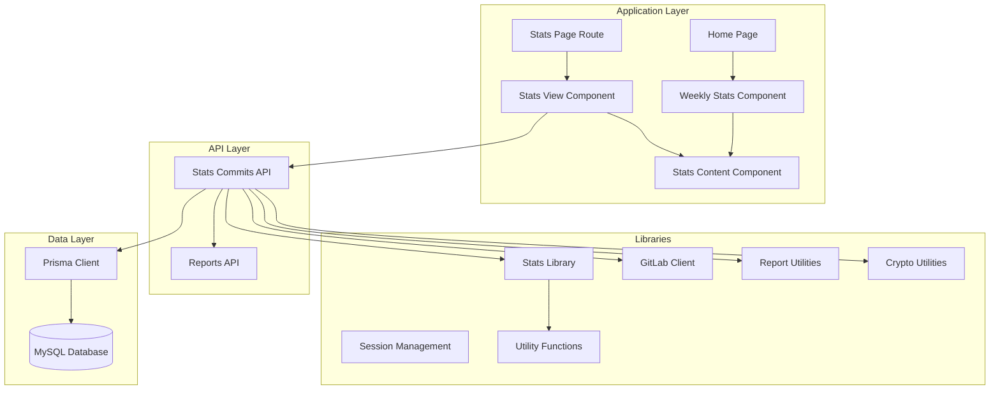
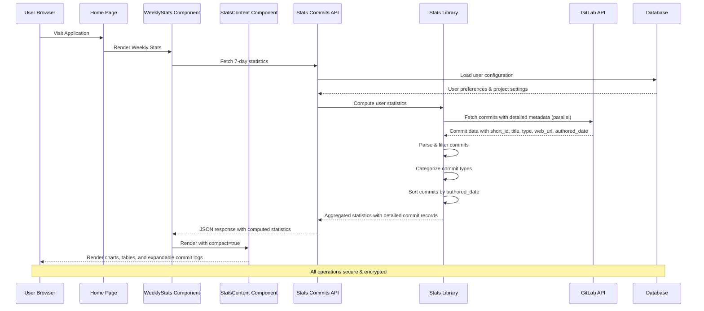
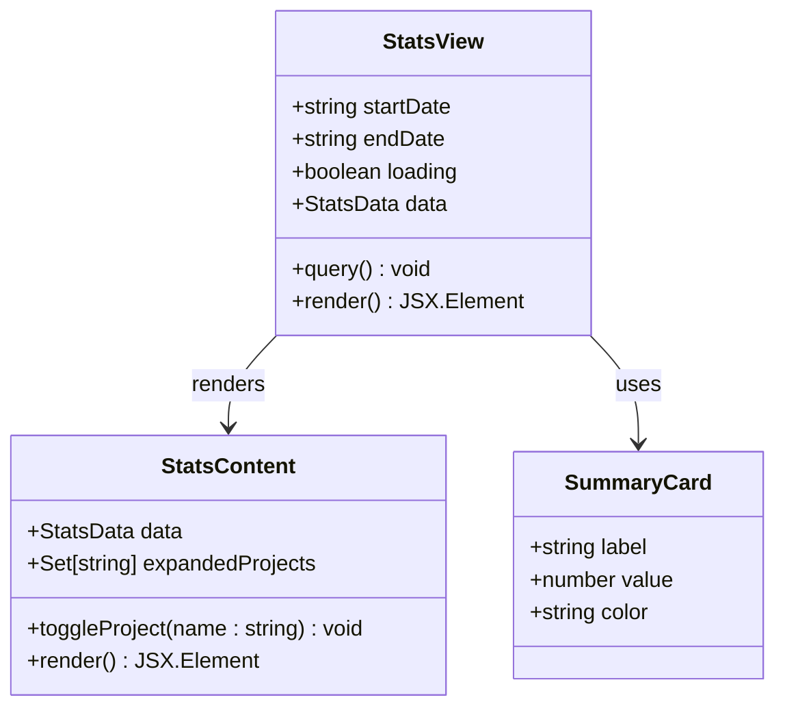
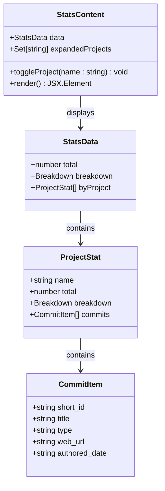
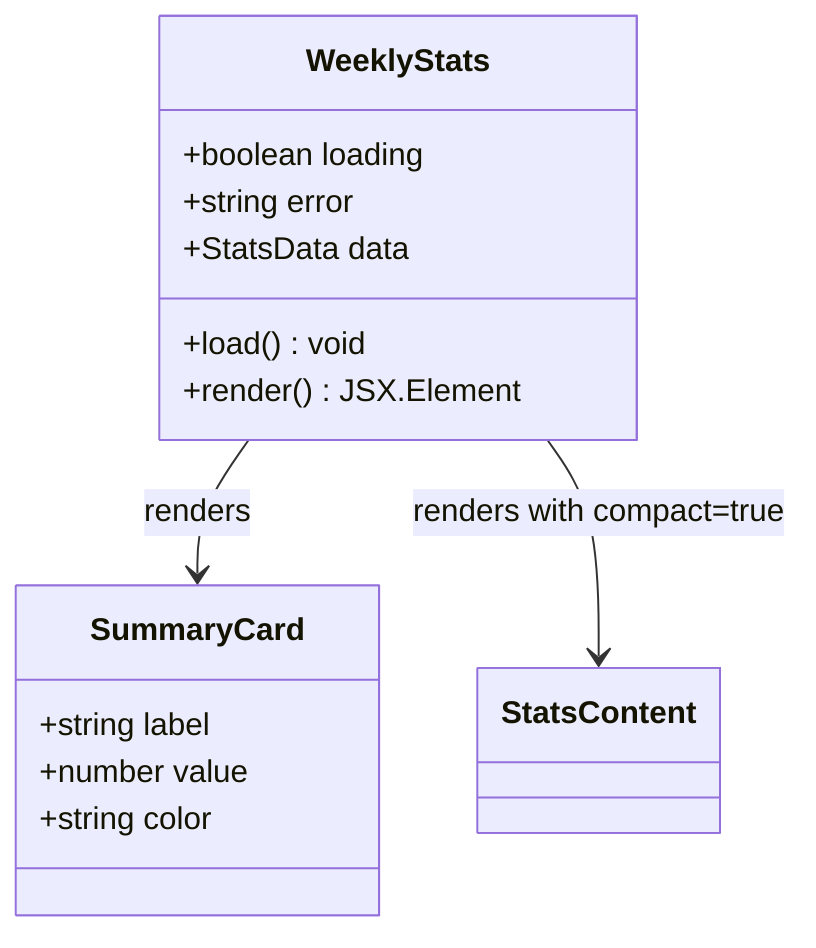
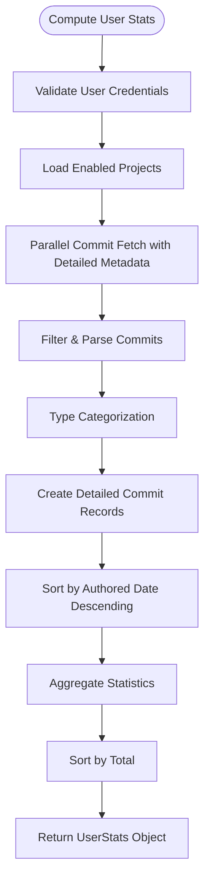
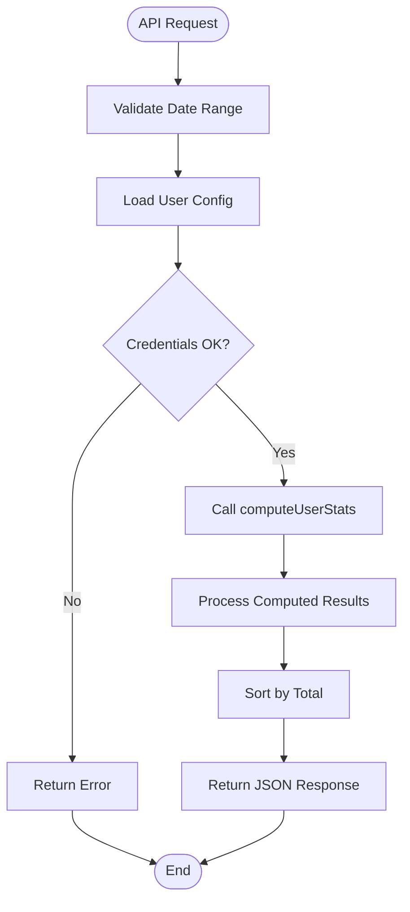
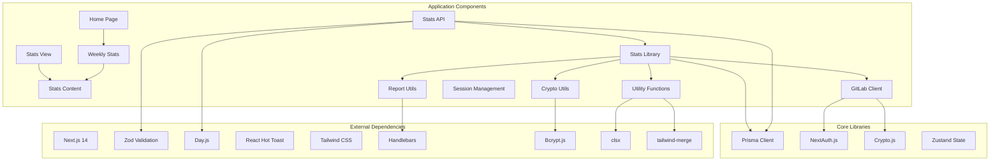

# Commit Statistics Dashboard

<cite>
**Referenced Files in This Document**
- [README.md](file://README.md)
- [package.json](file://package.json)
- [app/stats/page.tsx](file://app/stats/page.tsx)
- [app/api/stats/commits/route.ts](file://app/api/stats/commits/route.ts)
- [components/stats-view.tsx](file://components/stats-view.tsx)
- [components/stats-content.tsx](file://components/stats-content.tsx)
- [components/weekly-stats.tsx](file://components/weekly-stats.tsx)
- [lib/stats.ts](file://lib/stats.ts)
- [lib/gitlab.ts](file://lib/gitlab.ts)
- [lib/report.ts](file://lib/report.ts)
- [lib/crypto.ts](file://lib/crypto.ts)
- [lib/prisma.ts](file://lib/prisma.ts)
- [prisma/schema.prisma](file://prisma/schema.prisma)
- [lib/session.ts](file://lib/session.ts)
- [middleware.ts](file://middleware.ts)
- [components/nav.tsx](file://components/nav.tsx)
- [app/layout.tsx](file://app/layout.tsx)
- [app/page.tsx](file://app/page.tsx)
- [lib/utils.ts](file://lib/utils.ts)
</cite>

## Update Summary
**Changes Made**
- **New Weekly Statistics Component**: Added WeeklyStats component (components/weekly-stats.tsx) providing 7-day rolling summaries
- **Enhanced Dashboard Integration**: WeeklyStats integrates with existing StatsContent component for consistent visualization
- **Home Page Integration**: WeeklyStats component added to the main application homepage for quick insights
- **Compact Visualization Mode**: StatsContent component enhanced with compact property for reduced UI footprint
- **Real-time Data Fetching**: WeeklyStats automatically calculates 7-day date range and fetches statistics
- **Quick Access Navigation**: Users can navigate from weekly view to full statistics page for detailed analysis

## Table of Contents
1. [Introduction](#introduction)
2. [Project Structure](#project-structure)
3. [Core Components](#core-components)
4. [Architecture Overview](#architecture-overview)
5. [Detailed Component Analysis](#detailed-component-analysis)
6. [Enhanced Features](#enhanced-features)
7. [Dependency Analysis](#dependency-analysis)
8. [Performance Considerations](#performance-considerations)
9. [Troubleshooting Guide](#troubleshooting-guide)
10. [Conclusion](#conclusion)

## Introduction
The Commit Statistics Dashboard is a specialized feature within the Pingyun Report system that provides developers with comprehensive insights into their GitLab commit patterns over customizable date ranges. This dashboard enables users to analyze commit types, distribution across projects, and productivity trends, supporting data-driven development practices and performance monitoring.

The dashboard integrates seamlessly with the broader Pingyun Report ecosystem, leveraging encrypted GitLab tokens, conventional commit parsing, and comprehensive filtering capabilities to deliver accurate and meaningful statistics with enhanced commit detail visibility. The architecture has been significantly refactored to improve modularity, reusability, and maintainability, now featuring a new weekly statistics component for quick insights into recent productivity patterns.

## Project Structure
The Commit Statistics Dashboard follows a modular architecture with clear separation of concerns, now featuring dedicated layers for computation, presentation, API handling, and quick-access dashboards:

**Diagram sources**
- [app/stats/page.tsx:1-21](file://app/stats/page.tsx#L1-L21)
- [components/stats-view.tsx:1-170](file://components/stats-view.tsx#L1-L170)
- [components/stats-content.tsx:1-225](file://components/stats-content.tsx#L1-L225)
- [components/weekly-stats.tsx:1-118](file://components/weekly-stats.tsx#L1-L118)
- [app/api/stats/commits/route.ts:1-54](file://app/api/stats/commits/route.ts#L1-L54)
- [lib/stats.ts:1-144](file://lib/stats.ts#L1-L144)
- [app/page.tsx:1-22](file://app/page.tsx#L1-L22)

**Section sources**
- [README.md:1-86](file://README.md#L1-L86)
- [package.json:1-48](file://package.json#L1-L48)

## Core Components
The Commit Statistics Dashboard now consists of five primary components organized in a layered architecture, with the addition of a new weekly statistics component:

### Frontend Interface Components
The StatsView component serves as the main interactive interface, delegating presentation responsibilities to StatsContent:

- **StatsView**: Handles user interaction, date range selection, loading states, and API communication
- **StatsContent**: Pure presentation component responsible for all visualization logic with expandable sections
- **WeeklyStats**: New component providing 7-day rolling summaries with compact visualization mode

### Quick Access Dashboard
The WeeklyStats component provides immediate insights into recent productivity patterns:

- **Automatic Date Range**: Calculates 7-day rolling window (current day + 6 previous days)
- **Compact Visualization**: Uses StatsContent with compact property for reduced UI footprint
- **Quick Navigation**: Links to full statistics page for detailed analysis
- **Summary Cards**: Displays key metrics (total commits, feature, bug fixes, refactors)

### Backend Processing
The Stats Commits API handles data aggregation and delegates computation to the Stats library:

- **Stats Commits API**: Manages authentication, request validation, and coordinates with the Stats library
- **Stats Library**: Contains all core statistics computation logic with comprehensive type definitions

### Data Integration
The system integrates with multiple data sources through a clean separation of concerns:

- **GitLab Client**: Handles all GitLab API interactions with proper authentication
- **Report Utilities**: Provides conventional commit parsing and filtering capabilities
- **Crypto Utilities**: Manages encryption/decryption of sensitive credentials
- **Session Management**: Handles user authentication and authorization

**Section sources**
- [components/stats-view.tsx:20-170](file://components/stats-view.tsx#L20-L170)
- [components/stats-content.tsx:56-225](file://components/stats-content.tsx#L56-L225)
- [components/weekly-stats.tsx:9-118](file://components/weekly-stats.tsx#L9-L118)
- [app/api/stats/commits/route.ts:16-54](file://app/api/stats/commits/route.ts#L16-L54)
- [lib/stats.ts:69-144](file://lib/stats.ts#L69-L144)

## Architecture Overview
The Commit Statistics Dashboard employs a clean layered architecture with clear separation of concerns and enhanced modularity, now including a dedicated weekly statistics component:

**Diagram sources**
- [app/page.tsx:15-17](file://app/page.tsx#L15-L17)
- [components/weekly-stats.tsx:14-35](file://components/weekly-stats.tsx#L14-L35)
- [components/stats-content.tsx:56-68](file://components/stats-content.tsx#L56-L68)
- [app/api/stats/commits/route.ts:44-52](file://app/api/stats/commits/route.ts#L44-L52)
- [lib/stats.ts:69-144](file://lib/stats.ts#L69-L144)

The architecture ensures:
- **Separation of Concerns**: Clear division between UI logic, computation, and presentation
- **Reusability**: StatsContent component can be used independently for other dashboard features
- **Maintainability**: Core computation logic centralized in lib/stats.ts for easier testing and updates
- **Type Safety**: Comprehensive TypeScript definitions throughout the stack
- **Security**: GitLab tokens remain server-side, encrypted at rest
- **Performance**: Parallel commit fetching across projects with detailed metadata
- **Extensibility**: Modular design supporting future enhancements
- **Quick Insights**: WeeklyStats provides immediate 7-day rolling summaries

## Detailed Component Analysis

### StatsView Component
The StatsView component now focuses solely on user interaction and API communication, delegating all visualization to StatsContent:

**Diagram sources**
- [components/stats-view.tsx:20-170](file://components/stats-view.tsx#L20-L170)
- [components/stats-content.tsx:56-225](file://components/stats-content.tsx#L56-L225)

Key features include:
- **Date Range Management**: Validates and manages date selection with default week-based ranges
- **Loading States**: Comprehensive loading indicators and error handling
- **API Communication**: Handles fetch requests and response processing
- **Summary Cards**: Displays key metrics (total commits, feature, bug fixes, refactors)
- **Conditional Rendering**: Shows empty states, loading states, and data states appropriately

**Section sources**
- [components/stats-view.tsx:20-170](file://components/stats-view.tsx#L20-L170)

### StatsContent Component
The StatsContent component provides comprehensive visualization logic with expandable sections and detailed commit display, now enhanced with compact mode support:

**Diagram sources**
- [components/stats-content.tsx:56-225](file://components/stats-content.tsx#L56-L225)
- [components/stats-content.tsx:44-48](file://components/stats-content.tsx#L44-L48)

Key features include:
- **Type Distribution Charts**: Visual representation of commit type percentages
- **Expandable Project Sections**: Toggle functionality for detailed commit logs
- **Project-Level Breakdown**: Individual project statistics with type distribution
- **Scrollable Commit History**: Up to 320px scrollable commit list with chronological sorting
- **Interactive GitLab Links**: Clickable commit links with web_url integration
- **Responsive Design**: Adapts to mobile and desktop screen sizes
- **Compact Mode**: Optional compact property for reduced UI footprint

**Section sources**
- [components/stats-content.tsx:56-225](file://components/stats-content.tsx#L56-L225)

### WeeklyStats Component
The new WeeklyStats component provides immediate insights into recent productivity patterns with automatic 7-day rolling calculations:

**Diagram sources**
- [components/weekly-stats.tsx:9-118](file://components/weekly-stats.tsx#L9-L118)

Key features include:
- **Automatic Date Calculation**: Computes 7-day rolling window (current day + 6 previous days)
- **Real-time Data Fetching**: Automatically loads statistics on component mount
- **Loading States**: Comprehensive loading indicators and error handling
- **Summary Cards**: Displays key metrics (total commits, feature, bug fixes, refactors)
- **Quick Navigation**: Link to full statistics page for detailed analysis
- **Compact Visualization**: Uses StatsContent with compact property for reduced UI footprint
- **Empty State Handling**: Displays appropriate messages when no commits are found

**Section sources**
- [components/weekly-stats.tsx:9-118](file://components/weekly-stats.tsx#L9-L118)

### Stats Library
The lib/stats.ts module contains all core statistics computation logic with comprehensive type definitions:

**Diagram sources**
- [lib/stats.ts:69-144](file://lib/stats.ts#L69-L144)

**Section sources**
- [lib/stats.ts:1-144](file://lib/stats.ts#L1-L144)

### Stats Commits API
The backend API handles request processing and delegates computation to the Stats library:

**Diagram sources**
- [app/api/stats/commits/route.ts:16-54](file://app/api/stats/commits/route.ts#L16-L54)

**Section sources**
- [app/api/stats/commits/route.ts:1-54](file://app/api/stats/commits/route.ts#L1-L54)

## Enhanced Features

### Modular Architecture Benefits
The refactored architecture provides several key benefits:

- **Separation of Concerns**: UI logic separated from business logic
- **Reusability**: StatsContent component can be used in other dashboard features
- **Testability**: Core computation logic isolated in lib/stats.ts for easier unit testing
- **Maintainability**: Clear boundaries between components and libraries
- **Extensibility**: Easy to add new visualization types or modify presentation logic
- **Quick Access**: WeeklyStats provides immediate insights without complex setup

### Enhanced Type Safety
Comprehensive TypeScript definitions provide improved type safety:

- **Commit Types**: Strongly typed commit categories with "other" fallback
- **Statistical Data**: Typed interfaces for all statistical data structures
- **API Responses**: Strict typing for API request/response schemas
- **Utility Functions**: Type-safe utility functions for common operations
- **Component Props**: Strict typing for component properties including compact mode

### Improved User Experience
The separation of concerns enhances the user experience:

- **Faster Rendering**: StatsContent component optimized for pure rendering
- **Better Performance**: Reduced re-renders through component separation
- **Consistent Behavior**: Clear separation between user interaction and data presentation
- **Enhanced Accessibility**: Better semantic structure with dedicated components
- **Immediate Insights**: WeeklyStats provides instant 7-day rolling summaries
- **Quick Navigation**: Seamless transition from weekly view to detailed statistics

### Compact Visualization Mode
The StatsContent component now supports compact mode for reduced UI footprint:

- **Space Efficiency**: Reduced vertical space usage for summary views
- **Focus on Key Metrics**: Emphasizes essential statistics without detailed commit logs
- **Integration Ready**: Designed for seamless integration with quick-access dashboards
- **Flexible Usage**: Can be used in various contexts from home pages to team dashboards

**Section sources**
- [components/stats-content.tsx:1-225](file://components/stats-content.tsx#L1-L225)
- [components/weekly-stats.tsx:1-118](file://components/weekly-stats.tsx#L1-L118)
- [lib/stats.ts:1-144](file://lib/stats.ts#L1-L144)

## Dependency Analysis
The Commit Statistics Dashboard maintains a clean dependency structure with clear separation between layers, now including the new weekly statistics component:

**Diagram sources**
- [package.json:16-32](file://package.json#L16-L32)
- [components/stats-view.tsx:1-8](file://components/stats-view.tsx#L1-L8)
- [components/stats-content.tsx:1-6](file://components/stats-content.tsx#L1-L6)
- [components/weekly-stats.tsx:1-7](file://components/weekly-stats.tsx#L1-L7)
- [lib/stats.ts:1-5](file://lib/stats.ts#L1-L5)
- [app/page.tsx:1-5](file://app/page.tsx#L1-L5)

**Section sources**
- [package.json:1-48](file://package.json#L1-L48)

## Performance Considerations
The refactored architecture maintains and improves performance through several optimizations:

### Efficient Component Architecture
- **Pure Presentation Component**: StatsContent component optimized for rendering performance
- **Delegated Logic**: StatsView focuses on user interaction, StatsContent on visualization
- **Minimal Re-renders**: Clear component boundaries reduce unnecessary re-renders
- **Optimized State Management**: Separate state management for UI vs. data
- **Compact Mode Efficiency**: WeeklyStats uses compact mode to reduce DOM complexity

### Enhanced Data Processing
- **Centralized Computation**: All statistics logic in lib/stats.ts for better optimization
- **Parallel Processing**: Maintained parallel commit fetching across projects
- **Efficient Sorting**: Optimized sorting algorithms for large datasets
- **Memory Management**: Better memory usage through component separation
- **Automatic Date Range**: WeeklyStats optimizes API calls with precise 7-day windows

### Improved UI Performance
- **Component Memoization**: StatsContent component designed for optimal memoization
- **Lazy Loading**: Commit details loaded only when project sections are expanded
- **Virtual Scrolling**: Potential for future virtual scrolling implementation
- **State Optimization**: Minimal state updates for better React performance
- **Compact Rendering**: WeeklyStats reduces UI complexity with compact mode

### Data Processing Efficiency
- **Streamlined Pipeline**: More efficient data processing pipeline in lib/stats.ts
- **Reduced Complexity**: Simplified logic flow with clear separation of concerns
- **Better Error Handling**: More granular error handling reduces performance overhead
- **Optimized Data Structures**: Efficient use of Maps and Sets for deduplication
- **Automatic Optimization**: WeeklyStats automatically optimizes date ranges for better performance

## Troubleshooting Guide

### Common Issues and Solutions

**Authentication Problems**
- Verify NextAuth.js configuration
- Check session cookie validity
- Confirm user role permissions
- Ensure GitLab token is properly configured in user settings

**GitLab Integration Issues**
- Validate GitLab base URL format
- Ensure Personal Access Token has required scopes
- Check network connectivity to GitLab instance
- Verify project membership and access permissions
- Confirm project default branches are accessible

**Statistics Not Loading**
- Verify date range selection is valid
- Check project enablement status in user settings
- Review console for JavaScript errors
- Ensure API endpoint is reachable
- Check browser network tab for failed requests
- **WeeklyStats Specific**: Verify automatic date calculation is working correctly

**Performance Issues**
- Monitor API response times for individual projects
- Check database connection limits
- Review browser developer tools for memory leaks
- Verify commit count thresholds for large date ranges
- Consider reducing date range for better performance
- **WeeklyStats Specific**: Check if 7-day rolling window is appropriate for user data

**UI Display Issues**
- Clear browser cache and reload page
- Check browser console for JavaScript errors
- Verify Tailwind CSS is properly loaded
- Ensure React Hot Toast is functioning correctly
- Check for CSS conflicts with other components
- **WeeklyStats Specific**: Verify compact mode rendering is working correctly

**Component Issues**
- Verify StatsView and StatsContent components are properly imported
- Check component prop types match expected interfaces
- Ensure StatsContent receives valid StatsData structure
- Verify StatsView correctly handles API response data
- Check for proper error handling in component lifecycle
- **WeeklyStats Specific**: Verify automatic date calculation and data fetching

**Statistics Computation Issues**
- Verify lib/stats.ts exports computeUserStats function
- Check that StatsContent component receives properly formatted data
- Ensure StatsView correctly processes API responses
- Verify type definitions match actual data structures
- Check for proper error handling in computeUserStats
- **WeeklyStats Specific**: Verify date range calculation and API parameter formatting

**Section sources**
- [lib/session.ts:22-56](file://lib/session.ts#L22-L56)
- [lib/crypto.ts:7-15](file://lib/crypto.ts#L7-L15)

## Conclusion
The Commit Statistics Dashboard represents a comprehensive solution for developers seeking insights into their GitLab commit patterns. Through its modular architecture, robust security measures, and efficient data processing capabilities, it provides valuable analytics while maintaining the security and reliability standards expected in enterprise environments.

The significant architectural improvements, including the extraction of statistics computation logic to lib/stats.ts, the creation of the reusable StatsContent component, and the addition of the new WeeklyStats component, demonstrate best practices in modern web development. The clean separation of concerns ensures maintainability, scalability, and enhanced user experience.

The new weekly statistics dashboard component provides immediate 7-day rolling summaries, complementing the existing full statistics page with quick insights into recent productivity patterns. The integration with existing stats visualization infrastructure through the compact mode of StatsContent ensures consistency and reusability across the application.

The dashboard's extensible design supports future enhancements, including additional visualization types, export capabilities, virtual scrolling for large commit lists, and integration with other development tools. The modular architecture ensures that new features can be added without disrupting existing functionality.

The implementation showcases excellent engineering practices, including proper error handling, responsive design, accessibility considerations, and performance optimization strategies that scale with growing user bases and larger datasets. The refactored architecture positions the dashboard for continued evolution and enhancement within the Pingyun Report ecosystem, now providing both detailed analysis capabilities and quick access to recent productivity insights.