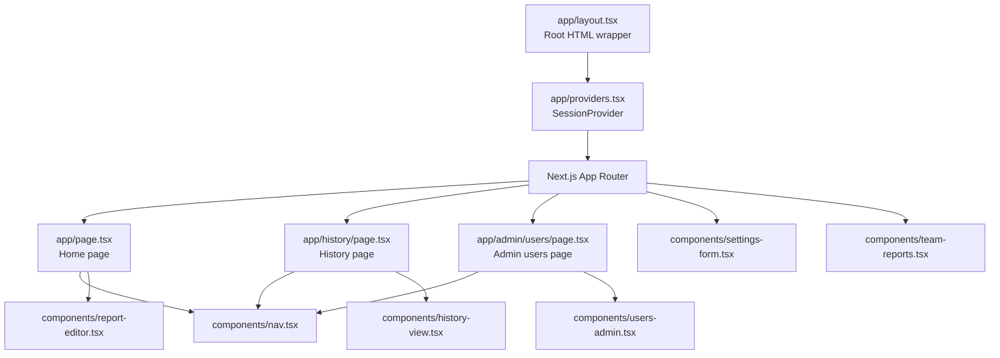
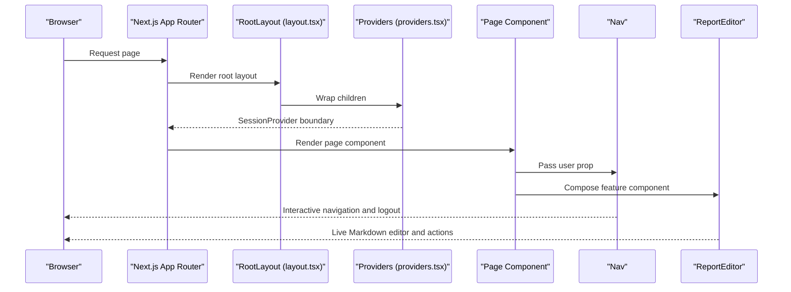
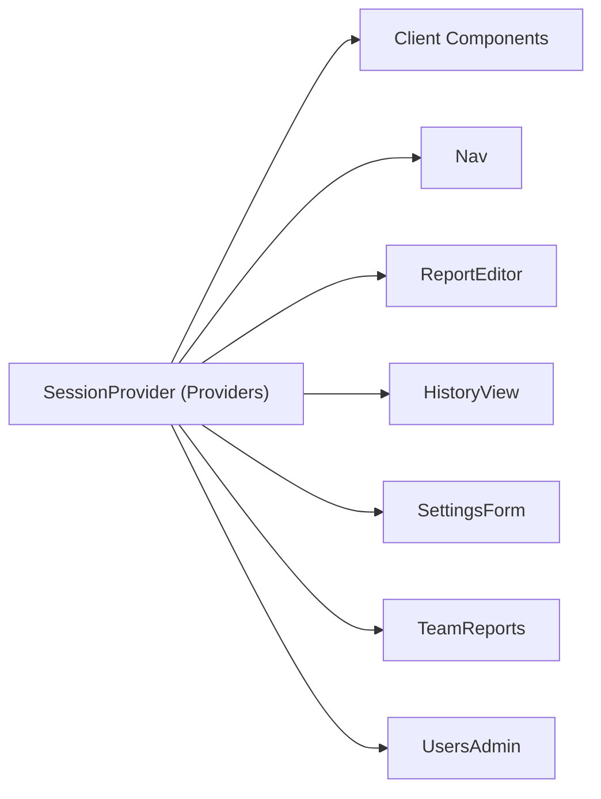
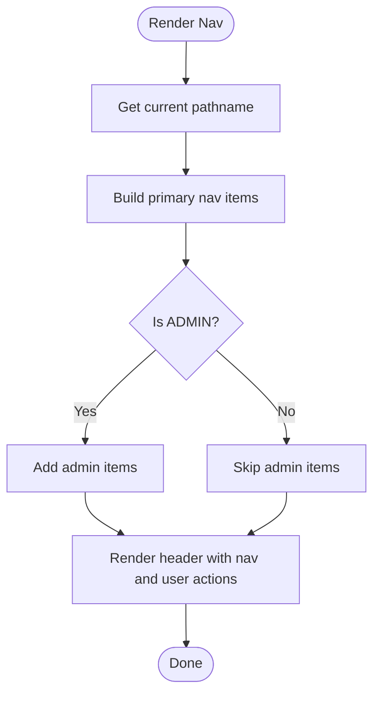
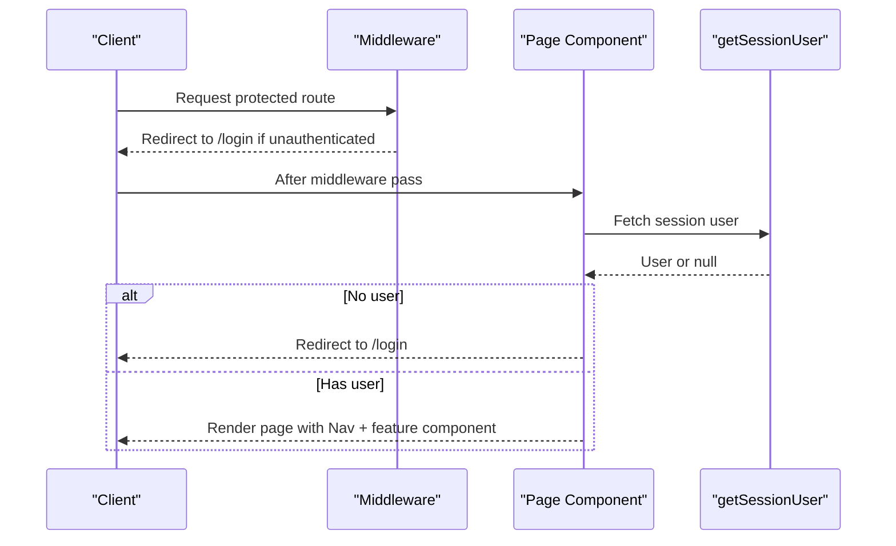
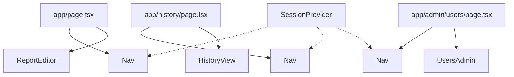
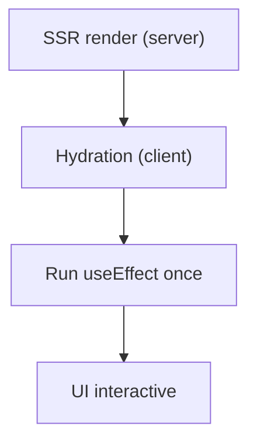
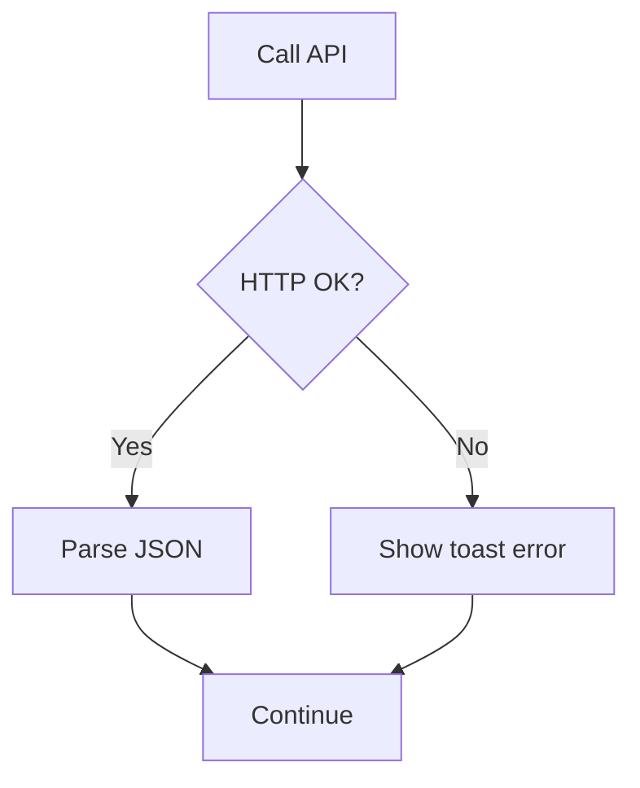
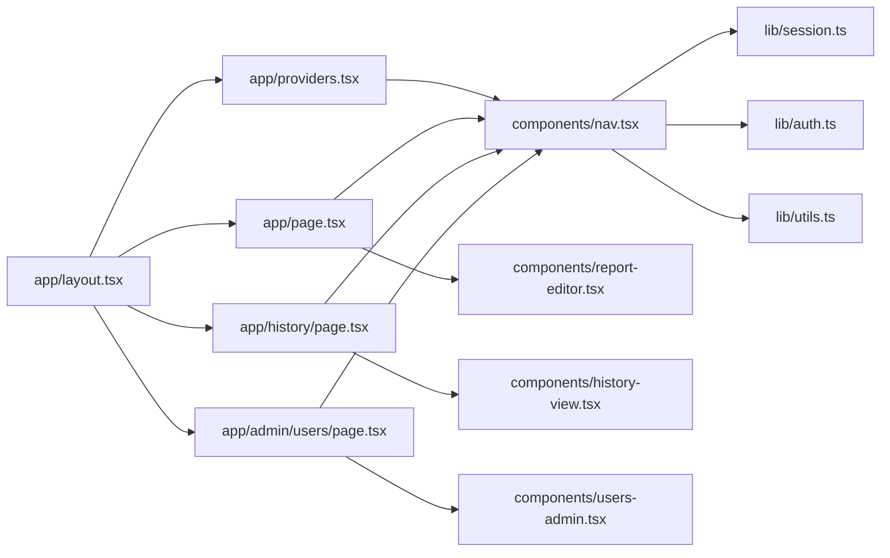

# Component Architecture

<cite>
**Referenced Files in This Document**
- [layout.tsx](file://app/layout.tsx)
- [providers.tsx](file://app/providers.tsx)
- [middleware.ts](file://middleware.ts)
- [page.tsx](file://app/page.tsx)
- [history/page.tsx](file://app/history/page.tsx)
- [admin/users/page.tsx](file://app/admin/users/page.tsx)
- [nav.tsx](file://components/nav.tsx)
- [report-editor.tsx](file://components/report-editor.tsx)
- [history-view.tsx](file://components/history-view.tsx)
- [settings-form.tsx](file://components/settings-form.tsx)
- [team-reports.tsx](file://components/team-reports.tsx)
- [users-admin.tsx](file://components/users-admin.tsx)
- [auth.ts](file://lib/auth.ts)
- [session.ts](file://lib/session.ts)
- [utils.ts](file://lib/utils.ts)
</cite>

## Table of Contents
1. [Introduction](#introduction)
2. [Project Structure](#project-structure)
3. [Core Components](#core-components)
4. [Architecture Overview](#architecture-overview)
5. [Detailed Component Analysis](#detailed-component-analysis)
6. [Dependency Analysis](#dependency-analysis)
7. [Performance Considerations](#performance-considerations)
8. [Troubleshooting Guide](#troubleshooting-guide)
9. [Conclusion](#conclusion)

## Introduction
This document explains Pingyun Report’s frontend component architecture built with Next.js App Router. It covers the main layout and Providers pattern, navigation and route protection, component composition and state management, lifecycle and hydration, and performance strategies. The goal is to help developers understand how components are organized, how context and session state flow through the tree, and how to maintain clean boundaries and scalable patterns.

## Project Structure
At a high level, the application uses:
- app/layout.tsx as the root HTML wrapper and container for Providers
- app/providers.tsx to wrap the app with NextAuth session provider
- Page components under app/ that render authenticated content and compose feature components
- Shared UI components under components/
- Authentication and session utilities under lib/

**Diagram sources**
- [layout.tsx:11-24](file://app/layout.tsx#L11-L24)
- [providers.tsx:5-7](file://app/providers.tsx#L5-L7)
- [page.tsx:8-19](file://app/page.tsx#L8-L19)
- [history/page.tsx:8-20](file://app/history/page.tsx#L8-L20)
- [admin/users/page.tsx:8-21](file://app/admin/users/page.tsx#L8-L21)
- [nav.tsx:12-74](file://components/nav.tsx#L12-L74)
- [report-editor.tsx:19-283](file://components/report-editor.tsx#L19-L283)
- [history-view.tsx:13-207](file://components/history-view.tsx#L13-L207)
- [users-admin.tsx:16-186](file://components/users-admin.tsx#L16-L186)
- [settings-form.tsx:33-367](file://components/settings-form.tsx#L33-L367)
- [team-reports.tsx:23-113](file://components/team-reports.tsx#L23-L113)

**Section sources**
- [layout.tsx:1-25](file://app/layout.tsx#L1-L25)
- [providers.tsx:1-8](file://app/providers.tsx#L1-L8)
- [page.tsx:1-20](file://app/page.tsx#L1-L20)
- [history/page.tsx:1-21](file://app/history/page.tsx#L1-L21)
- [admin/users/page.tsx:1-22](file://app/admin/users/page.tsx#L1-L22)

## Core Components
- Root layout and Providers
  - RootLayout renders the HTML shell and wraps children with Providers.
  - Providers wraps children with SessionProvider so client components can use session state via next-auth/react hooks.
  - A global toast container is rendered alongside the Providers boundary.

- Navigation
  - Nav displays top-level links and conditionally shows admin links for ADMIN users.
  - Uses Next.js usePathname to highlight active links and NextAuth signOut to log out.

- Feature components
  - ReportEditor: date selection, template selection, project filtering, AI polish, save, and live Markdown editing.
  - HistoryView: calendar-based report browsing, month navigation, inline editing, and saving.
  - SettingsForm: GitLab connection, noise regex, project enablement/branch defaults, and template CRUD.
  - TeamReports and UsersAdmin: admin-only views for team report review and user management.

- Session and auth utilities
  - lib/auth.ts defines NextAuth options, JWT/session callbacks, and typed session/user shapes.
  - lib/session.ts exposes server-side helpers to require user/admin and convert errors to responses.

**Section sources**
- [layout.tsx:11-24](file://app/layout.tsx#L11-L24)
- [providers.tsx:5-7](file://app/providers.tsx#L5-L7)
- [nav.tsx:12-74](file://components/nav.tsx#L12-L74)
- [report-editor.tsx:19-283](file://components/report-editor.tsx#L19-L283)
- [history-view.tsx:13-207](file://components/history-view.tsx#L13-L207)
- [settings-form.tsx:33-367](file://components/settings-form.tsx#L33-L367)
- [team-reports.tsx:23-113](file://components/team-reports.tsx#L23-L113)
- [users-admin.tsx:16-186](file://components/users-admin.tsx#L16-L186)
- [auth.ts:30-77](file://lib/auth.ts#L30-L77)
- [session.ts:11-37](file://lib/session.ts#L11-L37)

## Architecture Overview
The runtime architecture integrates Next.js App Router with NextAuth session state and client-side component composition.

**Diagram sources**
- [layout.tsx:11-24](file://app/layout.tsx#L11-L24)
- [providers.tsx:5-7](file://app/providers.tsx#L5-L7)
- [page.tsx:8-19](file://app/page.tsx#L8-L19)
- [nav.tsx:12-74](file://components/nav.tsx#L12-L74)
- [report-editor.tsx:19-283](file://components/report-editor.tsx#L19-L283)

## Detailed Component Analysis

### Providers Pattern and Context
- Providers wraps the entire app with SessionProvider, enabling client components to consume session data via next-auth/react hooks.
- This pattern centralizes session context and avoids prop drilling to leaf components.

**Diagram sources**
- [providers.tsx:5-7](file://app/providers.tsx#L5-L7)
- [nav.tsx:1](file://components/nav.tsx#L1)
- [report-editor.tsx:1](file://components/report-editor.tsx#L1)
- [history-view.tsx:1](file://components/history-view.tsx#L1)
- [settings-form.tsx:1](file://components/settings-form.tsx#L1)
- [team-reports.tsx:1](file://components/team-reports.tsx#L1)
- [users-admin.tsx:1](file://components/users-admin.tsx#L1)

**Section sources**
- [providers.tsx:1-8](file://app/providers.tsx#L1-L8)

### Navigation Component
- Nav receives user as a prop and renders:
  - Brand and primary links (today’s report, history, settings)
  - Admin links conditionally shown for ADMIN users
  - Active link highlighting using usePathname
  - User display and logout action via signOut

**Diagram sources**
- [nav.tsx:12-74](file://components/nav.tsx#L12-L74)

**Section sources**
- [nav.tsx:1-75](file://components/nav.tsx#L1-L75)

### Route Protection and Middleware
- Middleware enforces authentication for protected routes using withAuth and a matcher that targets home, history, settings, and admin routes.
- Page components also perform server-side checks via getSessionUser and redirect unauthenticated users to login.

**Diagram sources**
- [middleware.ts:1-10](file://middleware.ts#L1-L10)
- [page.tsx:8-10](file://app/page.tsx#L8-L10)
- [history/page.tsx:8-10](file://app/history/page.tsx#L8-L10)
- [admin/users/page.tsx:8-11](file://app/admin/users/page.tsx#L8-L11)
- [session.ts:11-20](file://lib/session.ts#L11-L20)

**Section sources**
- [middleware.ts:1-10](file://middleware.ts#L1-L10)
- [page.tsx:1-20](file://app/page.tsx#L1-L20)
- [history/page.tsx:1-21](file://app/history/page.tsx#L1-L21)
- [admin/users/page.tsx:1-22](file://app/admin/users/page.tsx#L1-L22)
- [session.ts:11-37](file://lib/session.ts#L11-L37)

### Component Composition Strategies
- Page components are thin shells that:
  - Perform server-side auth checks
  - Inject user into Nav
  - Compose feature components
- Feature components encapsulate state and effects:
  - ReportEditor: manages date, templates, projects, generation, saving, and AI polish
  - HistoryView: manages month, calendar grid, selection, editing, and saving
  - SettingsForm: manages user/GitLab settings, project enablement, and templates
  - TeamReports and UsersAdmin: manage admin data fetching and updates

**Diagram sources**
- [page.tsx:8-19](file://app/page.tsx#L8-L19)
- [history/page.tsx:8-20](file://app/history/page.tsx#L8-L20)
- [admin/users/page.tsx:8-21](file://app/admin/users/page.tsx#L8-L21)
- [nav.tsx:12-74](file://components/nav.tsx#L12-L74)
- [report-editor.tsx:19-283](file://components/report-editor.tsx#L19-L283)
- [history-view.tsx:13-207](file://components/history-view.tsx#L13-L207)
- [users-admin.tsx:16-186](file://components/users-admin.tsx#L16-L186)
- [providers.tsx:5-7](file://app/providers.tsx#L5-L7)

**Section sources**
- [page.tsx:1-20](file://app/page.tsx#L1-L20)
- [history/page.tsx:1-21](file://app/history/page.tsx#L1-L21)
- [admin/users/page.tsx:1-22](file://app/admin/users/page.tsx#L1-L22)
- [nav.tsx:12-74](file://components/nav.tsx#L12-L74)
- [report-editor.tsx:19-283](file://components/report-editor.tsx#L19-L283)
- [history-view.tsx:13-207](file://components/history-view.tsx#L13-L207)
- [users-admin.tsx:16-186](file://components/users-admin.tsx#L16-L186)

### State Management and Prop Drilling Prevention
- Global session state is provided via Providers and consumed by client components without passing props down multiple levels.
- Feature components manage local state internally (useState/useMemo/useEffect) and coordinate with APIs.
- Utilities like cn consolidate class merging to reduce prop complexity.

**Section sources**
- [providers.tsx:5-7](file://app/providers.tsx#L5-L7)
- [utils.ts:4-7](file://lib/utils.ts#L4-L7)
- [report-editor.tsx:19-283](file://components/report-editor.tsx#L19-L283)
- [history-view.tsx:13-207](file://components/history-view.tsx#L13-L207)
- [settings-form.tsx:33-367](file://components/settings-form.tsx#L33-L367)
- [team-reports.tsx:23-113](file://components/team-reports.tsx#L23-L113)
- [users-admin.tsx:16-186](file://components/users-admin.tsx#L16-L186)

### Component Lifecycle and Hydration
- Client components declare "use client" and rely on Next.js hydration to restore state after SSR.
- Dynamic imports are used for heavy client-only libraries (Markdown editor) to avoid SSR overhead.
- Effects run after mount to fetch initial data and set up UI state.

**Diagram sources**
- [report-editor.tsx:1](file://components/report-editor.tsx#L1)
- [history-view.tsx:1](file://components/history-view.tsx#L1)
- [settings-form.tsx:1](file://components/settings-form.tsx#L1)
- [team-reports.tsx:1](file://components/team-reports.tsx#L1)
- [users-admin.tsx:1](file://components/users-admin.tsx#L1)

**Section sources**
- [report-editor.tsx:19-283](file://components/report-editor.tsx#L19-L283)
- [history-view.tsx:13-207](file://components/history-view.tsx#L13-L207)
- [settings-form.tsx:33-367](file://components/settings-form.tsx#L33-L367)
- [team-reports.tsx:23-113](file://components/team-reports.tsx#L23-L113)
- [users-admin.tsx:16-186](file://components/users-admin.tsx#L16-L186)

### Error Boundaries and Error Handling
- Client components surface user-friendly messages via toast notifications for network failures and validation errors.
- Server-side API wrappers convert thrown responses into proper HTTP responses and log unexpected errors.

**Diagram sources**
- [report-editor.tsx:109-131](file://components/report-editor.tsx#L109-L131)
- [history-view.tsx:53-73](file://components/history-view.tsx#L53-L73)
- [settings-form.tsx:61-88](file://components/settings-form.tsx#L61-L88)
- [team-reports.tsx:28-37](file://components/team-reports.tsx#L28-L37)
- [users-admin.tsx:33-54](file://components/users-admin.tsx#L33-L54)
- [session.ts:40-55](file://lib/session.ts#L40-L55)

**Section sources**
- [report-editor.tsx:109-164](file://components/report-editor.tsx#L109-L164)
- [history-view.tsx:39-82](file://components/history-view.tsx#L39-L82)
- [settings-form.tsx:61-107](file://components/settings-form.tsx#L61-L107)
- [team-reports.tsx:28-37](file://components/team-reports.tsx#L28-L37)
- [users-admin.tsx:33-87](file://components/users-admin.tsx#L33-L87)
- [session.ts:40-55](file://lib/session.ts#L40-L55)

### SSR vs CSR and Hydration Patterns
- Pages opt into dynamic rendering to ensure server-side auth checks occur per-request.
- Client components lazy-load heavy UI libraries to minimize SSR cost and improve hydration performance.
- State initialization occurs after hydration to avoid mismatches.

**Section sources**
- [page.tsx:6](file://app/page.tsx#L6)
- [history/page.tsx:6](file://app/history/page.tsx#L6)
- [admin/users/page.tsx:6](file://app/admin/users/page.tsx#L6)
- [report-editor.tsx:9](file://components/report-editor.tsx#L9)
- [history-view.tsx:9](file://components/history-view.tsx#L9)
- [team-reports.tsx:7](file://components/team-reports.tsx#L7)
- [users-admin.tsx:3](file://components/users-admin.tsx#L3)

### Responsive Design Patterns
- Components use Tailwind utilities to adapt layouts across breakpoints (e.g., grid columns for editor and history).
- Inputs and buttons scale with text-sm classes and padding utilities for consistent spacing.

**Section sources**
- [report-editor.tsx:172-282](file://components/report-editor.tsx#L172-L282)
- [history-view.tsx:88-206](file://components/history-view.tsx#L88-L206)
- [settings-form.tsx:193-367](file://components/settings-form.tsx#L193-L367)
- [team-reports.tsx:43-112](file://components/team-reports.tsx#L43-L112)
- [users-admin.tsx:89-186](file://components/users-admin.tsx#L89-L186)

## Dependency Analysis
- Root boundary: layout.tsx depends on providers.tsx to establish session context.
- Page components depend on lib/session.ts for server-side auth checks.
- Client components depend on next/navigation for routing state and next-auth/react for session state.
- Utilities like cn consolidate class merging and improve composability.

**Diagram sources**
- [layout.tsx:11-24](file://app/layout.tsx#L11-L24)
- [providers.tsx:5-7](file://app/providers.tsx#L5-L7)
- [page.tsx:8-19](file://app/page.tsx#L8-L19)
- [history/page.tsx:8-20](file://app/history/page.tsx#L8-L20)
- [admin/users/page.tsx:8-21](file://app/admin/users/page.tsx#L8-L21)
- [nav.tsx:12-74](file://components/nav.tsx#L12-L74)
- [report-editor.tsx:19-283](file://components/report-editor.tsx#L19-L283)
- [history-view.tsx:13-207](file://components/history-view.tsx#L13-L207)
- [users-admin.tsx:16-186](file://components/users-admin.tsx#L16-L186)
- [session.ts:11-37](file://lib/session.ts#L11-L37)
- [auth.ts:30-77](file://lib/auth.ts#L30-L77)
- [utils.ts:4-7](file://lib/utils.ts#L4-L7)

**Section sources**
- [layout.tsx:1-25](file://app/layout.tsx#L1-L25)
- [providers.tsx:1-8](file://app/providers.tsx#L1-L8)
- [nav.tsx:1-75](file://components/nav.tsx#L1-L75)
- [session.ts:11-37](file://lib/session.ts#L11-L37)
- [auth.ts:30-77](file://lib/auth.ts#L30-L77)
- [utils.ts:4-7](file://lib/utils.ts#L4-L7)

## Performance Considerations
- Prefer client-only components for heavy UI to avoid SSR overhead; use dynamic imports with ssr: false for large libraries.
- Memoize derived data with useMemo to prevent unnecessary re-renders in components with frequent updates.
- Batch related fetches with Promise.all to reduce round-trips.
- Keep server-rendered pages minimal and defer heavy work to client effects.
- Use toast for immediate feedback instead of complex state machines for transient errors.

[No sources needed since this section provides general guidance]

## Troubleshooting Guide
- Authentication redirects
  - Ensure middleware matcher includes intended routes and that pages check getSessionUser and redirect appropriately.
- Session state not available
  - Verify Providers wraps the app and client components use next-auth/react hooks.
- API errors
  - Inspect toast messages and server-side error conversion via withErrors to diagnose failures.
- Hydration mismatches
  - Confirm client-only components are marked “use client” and dynamic imports are used for browser-only libraries.

**Section sources**
- [middleware.ts:1-10](file://middleware.ts#L1-L10)
- [page.tsx:8-10](file://app/page.tsx#L8-L10)
- [providers.tsx:5-7](file://app/providers.tsx#L5-L7)
- [report-editor.tsx:109-131](file://components/report-editor.tsx#L109-L131)
- [history-view.tsx:53-73](file://components/history-view.tsx#L53-L73)
- [session.ts:40-55](file://lib/session.ts#L40-L55)

## Conclusion
Pingyun Report’s frontend follows a clean separation of concerns: the root layout establishes a Providers boundary for session state, page components handle server-side auth and composition, and client components encapsulate UI logic and data fetching. The architecture leverages Next.js App Router, NextAuth, and client-side composition to deliver a responsive, secure, and maintainable user experience. By adhering to the patterns documented here—Providers pattern, route protection, memoization, dynamic imports, and robust error handling—teams can extend functionality while preserving component boundaries and performance.