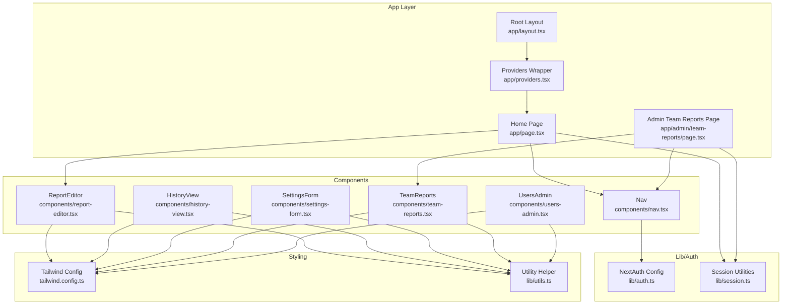
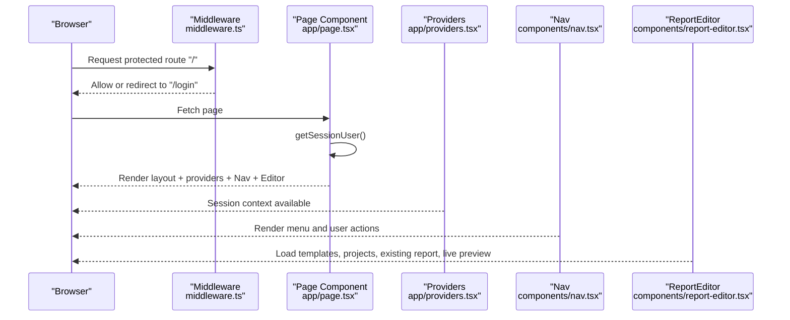
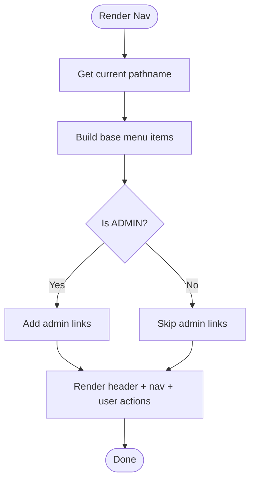
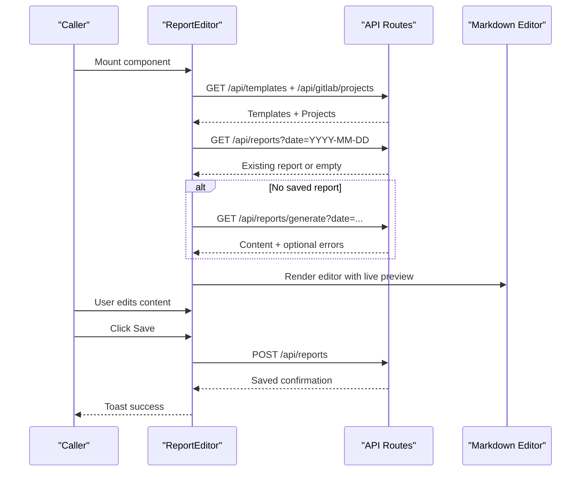
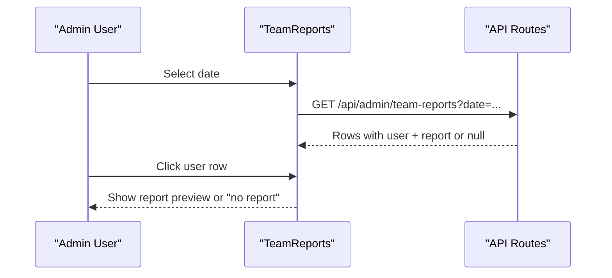
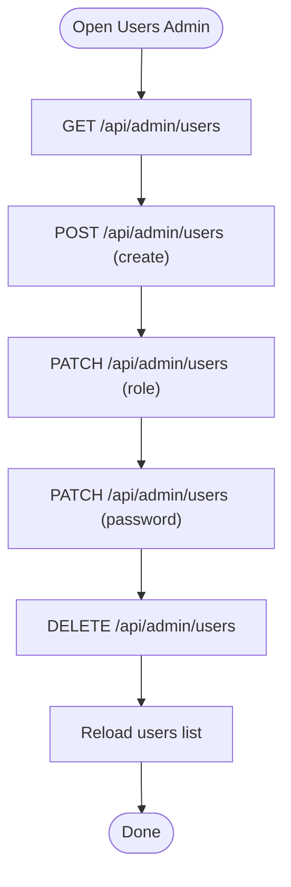
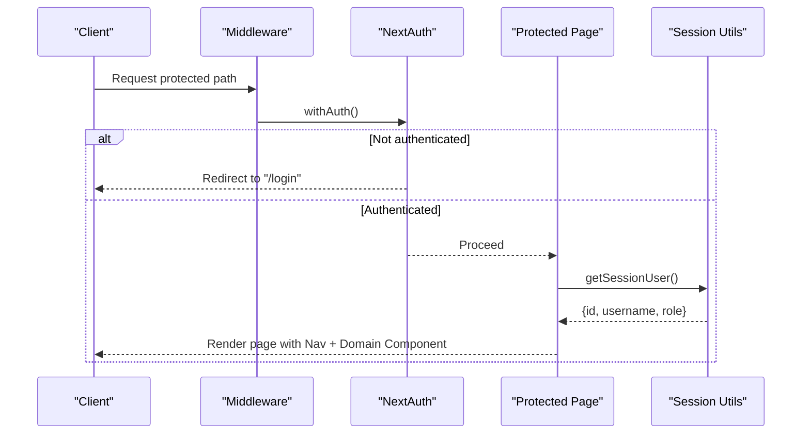
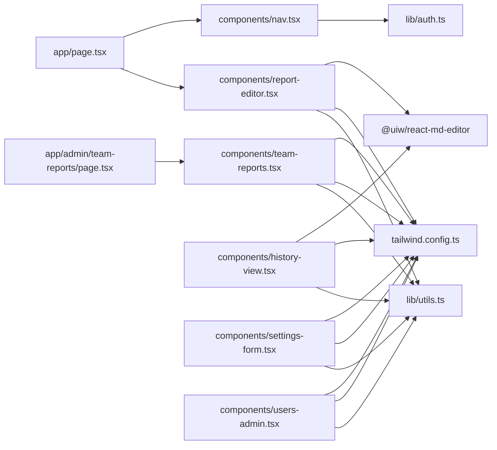

# Frontend Components

<cite>
**Referenced Files in This Document**
- [layout.tsx](file://app/layout.tsx)
- [providers.tsx](file://app/providers.tsx)
- [page.tsx](file://app/page.tsx)
- [admin/team-reports/page.tsx](file://app/admin/team-reports/page.tsx)
- [middleware.ts](file://middleware.ts)
- [nav.tsx](file://components/nav.tsx)
- [report-editor.tsx](file://components/report-editor.tsx)
- [history-view.tsx](file://components/history-view.tsx)
- [settings-form.tsx](file://components/settings-form.tsx)
- [team-reports.tsx](file://components/team-reports.tsx)
- [users-admin.tsx](file://components/users-admin.tsx)
- [auth.ts](file://lib/auth.ts)
- [session.ts](file://lib/session.ts)
- [utils.ts](file://lib/utils.ts)
- [tailwind.config.ts](file://tailwind.config.ts)
</cite>

## Table of Contents
1. [Introduction](#introduction)
2. [Project Structure](#project-structure)
3. [Core Components](#core-components)
4. [Architecture Overview](#architecture-overview)
5. [Detailed Component Analysis](#detailed-component-analysis)
6. [Dependency Analysis](#dependency-analysis)
7. [Performance Considerations](#performance-considerations)
8. [Troubleshooting Guide](#troubleshooting-guide)
9. [Conclusion](#conclusion)
10. [Appendices](#appendices)

## Introduction
This document explains the frontend component architecture of Pingyun Report, focusing on the main layout and navigation system, the report editor with markdown editing and live preview, navigation with route protection, state management patterns, styling via Tailwind CSS, responsive design, accessibility, cross-browser compatibility, lifecycle management, error handling, and performance optimization. It also provides integration and customization patterns for extending the system.

## Project Structure
The application follows a Next.js App Router layout with a root layout, providers wrapper, and page-level components. Navigation is shared across pages, and several domain-specific components handle editing, history viewing, settings, and admin views. Authentication is handled by NextAuth with JWT strategy and middleware-based route protection.

**Diagram sources**
- [layout.tsx:1-25](file://app/layout.tsx#L1-L25)
- [providers.tsx:1-8](file://app/providers.tsx#L1-L8)
- [page.tsx:1-20](file://app/page.tsx#L1-L20)
- [admin/team-reports/page.tsx:1-22](file://app/admin/team-reports/page.tsx#L1-L22)
- [nav.tsx:1-75](file://components/nav.tsx#L1-L75)
- [report-editor.tsx:1-284](file://components/report-editor.tsx#L1-L284)
- [history-view.tsx:1-208](file://components/history-view.tsx#L1-L208)
- [settings-form.tsx:1-368](file://components/settings-form.tsx#L1-L368)
- [team-reports.tsx:1-114](file://components/team-reports.tsx#L1-L114)
- [users-admin.tsx:1-187](file://components/users-admin.tsx#L1-L187)
- [auth.ts:1-77](file://lib/auth.ts#L1-L77)
- [session.ts:1-56](file://lib/session.ts#L1-L56)
- [utils.ts:1-7](file://lib/utils.ts#L1-L7)
- [tailwind.config.ts:1-24](file://tailwind.config.ts#L1-L24)

**Section sources**
- [layout.tsx:1-25](file://app/layout.tsx#L1-L25)
- [providers.tsx:1-8](file://app/providers.tsx#L1-L8)
- [page.tsx:1-20](file://app/page.tsx#L1-L20)
- [admin/team-reports/page.tsx:1-22](file://app/admin/team-reports/page.tsx#L1-L22)
- [nav.tsx:1-75](file://components/nav.tsx#L1-L75)
- [report-editor.tsx:1-284](file://components/report-editor.tsx#L1-L284)
- [history-view.tsx:1-208](file://components/history-view.tsx#L1-L208)
- [settings-form.tsx:1-368](file://components/settings-form.tsx#L1-L368)
- [team-reports.tsx:1-114](file://components/team-reports.tsx#L1-L114)
- [users-admin.tsx:1-187](file://components/users-admin.tsx#L1-L187)
- [auth.ts:1-77](file://lib/auth.ts#L1-L77)
- [session.ts:1-56](file://lib/session.ts#L1-L56)
- [utils.ts:1-7](file://lib/utils.ts#L1-L7)
- [tailwind.config.ts:1-24](file://tailwind.config.ts#L1-L24)

## Core Components
- Root layout and providers: Sets global styles, toast notifications, and wraps children with NextAuth session provider.
- Navigation: Renders top-level menu items, admin-only links for ADMIN users, displays current user, and signs out.
- Report Editor: Manages date selection, template selection, project filtering, AI polishing, saving, copying, and live markdown editing.
- History View: Calendar-based navigation to select dates, loads report content, supports inline editing and saving.
- Settings Form: Manages GitLab connection, noise regex filtering, project enablement/default branch, and template CRUD.
- Team Reports (Admin): Lists users and previews their daily reports for a selected date.
- Users Admin (Admin): Creates, updates roles, resets passwords, and deletes users.

**Section sources**
- [layout.tsx:1-25](file://app/layout.tsx#L1-L25)
- [providers.tsx:1-8](file://app/providers.tsx#L1-L8)
- [nav.tsx:1-75](file://components/nav.tsx#L1-L75)
- [report-editor.tsx:1-284](file://components/report-editor.tsx#L1-L284)
- [history-view.tsx:1-208](file://components/history-view.tsx#L1-L208)
- [settings-form.tsx:1-368](file://components/settings-form.tsx#L1-L368)
- [team-reports.tsx:1-114](file://components/team-reports.tsx#L1-L114)
- [users-admin.tsx:1-187](file://components/users-admin.tsx#L1-L187)

## Architecture Overview
The frontend architecture centers around:
- Shared layout and providers for consistent UI and session context.
- Route-level page components that enforce authentication and render domain components.
- Client-side components using React hooks for state and effects, with server utilities for session checks.
- NextAuth for authentication and middleware for route protection.
- Tailwind CSS for styling with a centralized config and a utility helper for class merging.

**Diagram sources**
- [middleware.ts:1-10](file://middleware.ts#L1-L10)
- [page.tsx:1-20](file://app/page.tsx#L1-L20)
- [providers.tsx:1-8](file://app/providers.tsx#L1-L8)
- [nav.tsx:1-75](file://components/nav.tsx#L1-L75)
- [report-editor.tsx:1-284](file://components/report-editor.tsx#L1-L284)

## Detailed Component Analysis

### Navigation Component
- Responsibilities:
  - Build menu items for member and admin roles.
  - Highlight active route using pathname comparison.
  - Display current username and sign-out action.
- Implementation highlights:
  - Uses Next.js router hooks for pathname and navigation.
  - Conditionally renders admin-only links based on user role.
  - Integrates with NextAuth for sign-out and redirects to login.
- Styling and composition:
  - Uses Tailwind utilities for spacing, borders, and color tokens.
  - Utility helper merges classes safely.

**Diagram sources**
- [nav.tsx:12-75](file://components/nav.tsx#L12-L75)

**Section sources**
- [nav.tsx:1-75](file://components/nav.tsx#L1-L75)
- [utils.ts:1-7](file://lib/utils.ts#L1-L7)

### Report Editor Component
- Responsibilities:
  - Manage date, content, templates, projects, and selection state.
  - Load configuration (templates and projects), preselect enabled projects.
  - Generate report content via API, show per-project errors, and mark saved state.
  - Save, copy, and AI polish content.
  - Live markdown editing with a third-party editor component.
- State management patterns:
  - Local state via React hooks for UI state and form data.
  - Memoized derived state for enabled projects.
  - Callbacks extracted with useCallback to stabilize refs for effects and event handlers.
  - Effects orchestrate initial load and conditional generation.
- Validation and feedback:
  - Toast notifications for success/error states.
  - Disabled controls during async operations.
- Lifecycle management:
  - Cleanup and deferred work handled via effect cleanup and setTimeout.
- Accessibility and UX:
  - Clear labels and disabled states.
  - Live preview mode for immediate feedback.

**Diagram sources**
- [report-editor.tsx:19-131](file://components/report-editor.tsx#L19-L131)
- [report-editor.tsx:172-282](file://components/report-editor.tsx#L172-L282)

**Section sources**
- [report-editor.tsx:1-284](file://components/report-editor.tsx#L1-L284)

### History View Component
- Responsibilities:
  - Calendar grid for month navigation and day selection.
  - Load monthly summaries, selected day’s report, and toggle edit/view modes.
  - Save edited content and reflect updates.
- State management:
  - Month, selected date, content, editing flag, and saving state.
  - Derived sets for quick presence checks.
- UX:
  - Visual indicators for selected day, presence of reports, and today.
  - Edit/save toggling with appropriate controls.

**Diagram sources**
- [history-view.tsx:13-86](file://components/history-view.tsx#L13-L86)
- [history-view.tsx:88-207](file://components/history-view.tsx#L88-L207)

**Section sources**
- [history-view.tsx:1-208](file://components/history-view.tsx#L1-L208)

### Settings Form Component
- Responsibilities:
  - Manage GitLab base URL and token, validate connectivity, and mask token display.
  - Filter settings via regex for commit titles.
  - Enable/disable projects and set default branches.
  - Create, edit, set default, and delete templates.
- State management:
  - Separate state for user profile, projects, templates, filters, and saving flags.
  - Optimistic UI updates with rollback on failure.
- UX:
  - Searchable project list, inline editing, and clear actions with confirmations.

**Diagram sources**
- [settings-form.tsx:33-186](file://components/settings-form.tsx#L33-L186)
- [settings-form.tsx:193-367](file://components/settings-form.tsx#L193-L367)

**Section sources**
- [settings-form.tsx:1-368](file://components/settings-form.tsx#L1-L368)

### Team Reports (Admin) Component
- Responsibilities:
  - Select date and list users with submission status.
  - Preview selected user’s report content.
- State management:
  - Date, rows, and active user ID.
- UX:
  - Left panel for user list with submission indicators.
  - Right panel for report preview.

**Diagram sources**
- [team-reports.tsx:23-42](file://components/team-reports.tsx#L23-L42)
- [team-reports.tsx:43-113](file://components/team-reports.tsx#L43-L113)

**Section sources**
- [team-reports.tsx:1-114](file://components/team-reports.tsx#L1-L114)

### Users Admin (Admin) Component
- Responsibilities:
  - Create users with username, display name, password, and role.
  - Reset passwords, change roles, and delete users.
- State management:
  - Users list and form fields for creation.
- UX:
  - Inline role selector and action buttons with confirmations.

**Diagram sources**
- [users-admin.tsx:16-87](file://components/users-admin.tsx#L16-L87)
- [users-admin.tsx:89-186](file://components/users-admin.tsx#L89-L186)

**Section sources**
- [users-admin.tsx:1-187](file://components/users-admin.tsx#L1-L187)

### Authentication and Route Protection
- NextAuth configuration defines JWT-based sessions, credential provider, and session/user typing.
- Server utilities provide typed session retrieval and enforcement helpers.
- Middleware enforces authentication for protected routes and redirects unauthenticated users to login.

**Diagram sources**
- [middleware.ts:1-10](file://middleware.ts#L1-L10)
- [auth.ts:30-77](file://lib/auth.ts#L30-L77)
- [session.ts:11-37](file://lib/session.ts#L11-L37)
- [page.tsx:8-20](file://app/page.tsx#L8-L20)
- [admin/team-reports/page.tsx:8-21](file://app/admin/team-reports/page.tsx#L8-L21)

**Section sources**
- [auth.ts:1-77](file://lib/auth.ts#L1-L77)
- [session.ts:1-56](file://lib/session.ts#L1-L56)
- [middleware.ts:1-10](file://middleware.ts#L1-L10)
- [page.tsx:1-20](file://app/page.tsx#L1-L20)
- [admin/team-reports/page.tsx:1-22](file://app/admin/team-reports/page.tsx#L1-L22)

## Dependency Analysis
- Component dependencies:
  - Pages depend on Nav and domain components.
  - Domain components depend on shared utilities and Tailwind classes.
  - Nav depends on NextAuth for user info and sign-out.
  - ReportEditor and HistoryView depend on the markdown editor component.
- External libraries:
  - NextAuth for authentication and session management.
  - @uiw/react-md-editor for markdown editing and preview.
  - react-hot-toast for toast notifications.
  - dayjs for date utilities.
- Styling:
  - Tailwind CSS configured with CSS variables for theme tokens.
  - Utility helper merges classes and resolves conflicts.

**Diagram sources**
- [page.tsx:1-20](file://app/page.tsx#L1-L20)
- [admin/team-reports/page.tsx:1-22](file://app/admin/team-reports/page.tsx#L1-L22)
- [nav.tsx:1-75](file://components/nav.tsx#L1-L75)
- [report-editor.tsx:1-284](file://components/report-editor.tsx#L1-L284)
- [history-view.tsx:1-208](file://components/history-view.tsx#L1-L208)
- [settings-form.tsx:1-368](file://components/settings-form.tsx#L1-L368)
- [team-reports.tsx:1-114](file://components/team-reports.tsx#L1-L114)
- [users-admin.tsx:1-187](file://components/users-admin.tsx#L1-L187)
- [auth.ts:1-77](file://lib/auth.ts#L1-L77)
- [utils.ts:1-7](file://lib/utils.ts#L1-L7)
- [tailwind.config.ts:1-24](file://tailwind.config.ts#L1-L24)

**Section sources**
- [page.tsx:1-20](file://app/page.tsx#L1-L20)
- [admin/team-reports/page.tsx:1-22](file://app/admin/team-reports/page.tsx#L1-L22)
- [nav.tsx:1-75](file://components/nav.tsx#L1-L75)
- [report-editor.tsx:1-284](file://components/report-editor.tsx#L1-L284)
- [history-view.tsx:1-208](file://components/history-view.tsx#L1-L208)
- [settings-form.tsx:1-368](file://components/settings-form.tsx#L1-L368)
- [team-reports.tsx:1-114](file://components/team-reports.tsx#L1-L114)
- [users-admin.tsx:1-187](file://components/users-admin.tsx#L1-L187)
- [auth.ts:1-77](file://lib/auth.ts#L1-L77)
- [utils.ts:1-7](file://lib/utils.ts#L1-L7)
- [tailwind.config.ts:1-24](file://tailwind.config.ts#L1-L24)

## Performance Considerations
- Client-side rendering and dynamic imports:
  - Markdown editor is loaded dynamically to reduce initial bundle size.
- State stability:
  - useCallback used for event handlers and callbacks to prevent unnecessary re-renders.
  - useMemo used for derived data (e.g., enabled projects).
- Async operations:
  - Parallel loading for templates and projects.
  - Disabled controls during async operations to avoid redundant requests.
- Rendering:
  - Conditional rendering for admin-only sections reduces DOM size for members.
  - Grid layouts and virtualization-like techniques (limited by fixed sizes) keep lists manageable.
- Styling:
  - Tailwind’s JIT scanning targets app and components directories to minimize CSS.

[No sources needed since this section provides general guidance]

## Troubleshooting Guide
- Authentication issues:
  - Ensure middleware matcher covers protected routes and NextAuth pages are configured correctly.
  - Verify session retrieval helpers return expected user shape.
- Navigation and route protection:
  - Confirm middleware matcher includes intended paths and redirects to login when missing session.
- Editor and API errors:
  - Check toast messages for explicit error feedback from API responses.
  - Validate that report generation and saving endpoints return expected shapes.
- State synchronization:
  - After save/edit operations, refresh lists or summaries to reflect updates (e.g., reload month after save).
- Styling and responsiveness:
  - Confirm Tailwind content paths include app and components directories.
  - Use responsive utilities consistently (e.g., grid columns) and test across screen sizes.

**Section sources**
- [middleware.ts:1-10](file://middleware.ts#L1-L10)
- [session.ts:11-37](file://lib/session.ts#L11-L37)
- [report-editor.tsx:67-91](file://components/report-editor.tsx#L67-L91)
- [history-view.tsx:53-73](file://components/history-view.tsx#L53-L73)
- [tailwind.config.ts:4-7](file://tailwind.config.ts#L4-L7)

## Conclusion
The Pingyun Report frontend is structured around a clean layout and providers layer, with robust client-side components for editing, history, settings, and admin views. Authentication is enforced via NextAuth and middleware, while Tailwind CSS and a utility helper streamline styling and composition. The components emphasize user experience with live previews, clear feedback, and responsive layouts, supported by careful state management and performance-conscious patterns.

[No sources needed since this section summarizes without analyzing specific files]

## Appendices

### Styling Approaches and Composition Patterns
- Tailwind CSS:
  - Centralized theme tokens via CSS variables.
  - Utility-first classes for layout, spacing, colors, and typography.
- Composition patterns:
  - Container components (pages) pass user and minimal props to presentational components.
  - Utility helper merges classes safely to avoid duplicates and conflicts.
- Responsive design:
  - Use of grid and flex utilities with breakpoints to adapt to different screen sizes.
- Accessibility:
  - Semantic HTML and labels; disabled states for buttons during async operations.
- Cross-browser compatibility:
  - Modern CSS variables and Tailwind utilities are broadly supported; test critical interactions across browsers.

**Section sources**
- [tailwind.config.ts:1-24](file://tailwind.config.ts#L1-L24)
- [utils.ts:1-7](file://lib/utils.ts#L1-L7)
- [nav.tsx:20-72](file://components/nav.tsx#L20-L72)
- [report-editor.tsx:172-282](file://components/report-editor.tsx#L172-L282)
- [history-view.tsx:89-206](file://components/history-view.tsx#L89-L206)
- [settings-form.tsx:193-367](file://components/settings-form.tsx#L193-L367)
- [team-reports.tsx:43-113](file://components/team-reports.tsx#L43-L113)
- [users-admin.tsx:89-186](file://components/users-admin.tsx#L89-L186)

### Component Integration and Customization Patterns
- Integration:
  - Wrap page content with Providers to expose session context.
  - Pass user object from server utilities to Nav and conditionally render admin sections.
  - Use dynamic imports for heavy components (e.g., markdown editor) to optimize load.
- Customization:
  - Extend templates and project filtering logic in domain components.
  - Add new admin features by following the UsersAdmin pattern (CRUD + confirmations).
  - Introduce new route protection by adding paths to middleware matcher and enforcing role checks in pages.

**Section sources**
- [providers.tsx:1-8](file://app/providers.tsx#L1-L8)
- [page.tsx:8-20](file://app/page.tsx#L8-L20)
- [admin/team-reports/page.tsx:8-21](file://app/admin/team-reports/page.tsx#L8-L21)
- [report-editor.tsx:9](file://components/report-editor.tsx#L9)
- [users-admin.tsx:33-87](file://components/users-admin.tsx#L33-L87)
- [middleware.ts:7-9](file://middleware.ts#L7-L9)