# Frontend Components

<cite>
**Referenced Files in This Document**
- [layout.tsx](file://app/layout.tsx)
- [providers.tsx](file://app/providers.tsx)
- [page.tsx](file://app/page.tsx)
- [admin/team-reports/page.tsx](file://app/admin/team-reports/page.tsx)
- [middleware.ts](file://middleware.ts)
- [nav.tsx](file://components/nav.tsx)
- [report-editor.tsx](file://components/report-editor.tsx)
- [history-view.tsx](file://components/history-view.tsx)
- [settings-form.tsx](file://components/settings-form.tsx)
- [team-reports.tsx](file://components/team-reports.tsx)
- [users-admin.tsx](file://components/users-admin.tsx)
- [stats-view.tsx](file://components/stats-view.tsx)
- [projects-manager.tsx](file://components/projects-manager.tsx)
- [templates-manager.tsx](file://components/templates-manager.tsx)
- [stats/page.tsx](file://app/stats/page.tsx)
- [projects/page.tsx](file://app/projects/page.tsx)
- [templates/page.tsx](file://app/templates/page.tsx)
- [stats/commits/route.ts](file://app/api/stats/commits/route.ts)
- [gitlab/projects/route.ts](file://app/api/gitlab/projects/route.ts)
- [templates/route.ts](file://app/api/templates/route.ts)
- [templates/preview/route.ts](file://app/api/templates/preview/route.ts)
- [auth.ts](file://lib/auth.ts)
- [session.ts](file://lib/session.ts)
- [utils.ts](file://lib/utils.ts)
- [tailwind.config.ts](file://tailwind.config.ts)
</cite>

## Update Summary
**Changes Made**
- Added new StatsView component for commit statistics visualization
- Added ProjectsManager component for GitLab project management
- Added TemplatesManager component for Handlebars template editing and preview
- Enhanced navigation system with new menu items for Statistics, Projects, and Templates
- Integrated new API routes for stats, projects, and templates management
- Updated component architecture to support enhanced state management patterns

## Table of Contents
1. [Introduction](#introduction)
2. [Project Structure](#project-structure)
3. [Core Components](#core-components)
4. [Architecture Overview](#architecture-overview)
5. [Detailed Component Analysis](#detailed-component-analysis)
6. [Dependency Analysis](#dependency-analysis)
7. [Performance Considerations](#performance-considerations)
8. [Troubleshooting Guide](#troubleshooting-guide)
9. [Conclusion](#conclusion)
10. [Appendices](#appendices)

## Introduction
This document explains the frontend component architecture of Pingyun Report, focusing on the main layout and navigation system, the report editor with markdown editing and live preview, navigation with route protection, state management patterns, styling via Tailwind CSS, responsive design, accessibility, cross-browser compatibility, lifecycle management, error handling, and performance optimization. It also provides integration and customization patterns for extending the system with the newly added StatsView, ProjectsManager, and TemplatesManager components.

## Project Structure
The application follows a Next.js App Router layout with a root layout, providers wrapper, and page-level components. Navigation is shared across pages, and several domain-specific components handle editing, history viewing, settings, admin views, statistics, project management, and template management. Authentication is handled by NextAuth with JWT strategy and middleware-based route protection.

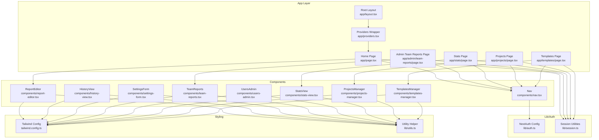

**Diagram sources**
- [layout.tsx:1-25](file://app/layout.tsx#L1-L25)
- [providers.tsx:1-8](file://app/providers.tsx#L1-L8)
- [page.tsx:1-20](file://app/page.tsx#L1-L20)
- [admin/team-reports/page.tsx:1-22](file://app/admin/team-reports/page.tsx#L1-L22)
- [stats/page.tsx:1-21](file://app/stats/page.tsx#L1-L21)
- [projects/page.tsx:1-27](file://app/projects/page.tsx#L1-L27)
- [templates/page.tsx:1-27](file://app/templates/page.tsx#L1-L27)
- [nav.tsx:1-171](file://components/nav.tsx#L1-L171)
- [report-editor.tsx:1-284](file://components/report-editor.tsx#L1-L284)
- [history-view.tsx:1-208](file://components/history-view.tsx#L1-L208)
- [settings-form.tsx:1-368](file://components/settings-form.tsx#L1-L368)
- [team-reports.tsx:1-114](file://components/team-reports.tsx#L1-L114)
- [users-admin.tsx:1-187](file://components/users-admin.tsx#L1-L187)
- [stats-view.tsx:1-258](file://components/stats-view.tsx#L1-L258)
- [projects-manager.tsx:1-343](file://components/projects-manager.tsx#L1-L343)
- [templates-manager.tsx:1-492](file://components/templates-manager.tsx#L1-L492)
- [auth.ts:1-77](file://lib/auth.ts#L1-L77)
- [session.ts:1-56](file://lib/session.ts#L1-L56)
- [utils.ts:1-7](file://lib/utils.ts#L1-L7)
- [tailwind.config.ts:1-24](file://tailwind.config.ts#L1-L24)

**Section sources**
- [layout.tsx:1-25](file://app/layout.tsx#L1-L25)
- [providers.tsx:1-8](file://app/providers.tsx#L1-L8)
- [page.tsx:1-20](file://app/page.tsx#L1-L20)
- [admin/team-reports/page.tsx:1-22](file://app/admin/team-reports/page.tsx#L1-L22)
- [stats/page.tsx:1-21](file://app/stats/page.tsx#L1-L21)
- [projects/page.tsx:1-27](file://app/projects/page.tsx#L1-L27)
- [templates/page.tsx:1-27](file://app/templates/page.tsx#L1-L27)
- [nav.tsx:1-171](file://components/nav.tsx#L1-L171)
- [report-editor.tsx:1-284](file://components/report-editor.tsx#L1-L284)
- [history-view.tsx:1-208](file://components/history-view.tsx#L1-L208)
- [settings-form.tsx:1-368](file://components/settings-form.tsx#L1-L368)
- [team-reports.tsx:1-114](file://components/team-reports.tsx#L1-L114)
- [users-admin.tsx:1-187](file://components/users-admin.tsx#L1-L187)
- [stats-view.tsx:1-258](file://components/stats-view.tsx#L1-L258)
- [projects-manager.tsx:1-343](file://components/projects-manager.tsx#L1-L343)
- [templates-manager.tsx:1-492](file://components/templates-manager.tsx#L1-L492)
- [auth.ts:1-77](file://lib/auth.ts#L1-L77)
- [session.ts:1-56](file://lib/session.ts#L1-L56)
- [utils.ts:1-7](file://lib/utils.ts#L1-L7)
- [tailwind.config.ts:1-24](file://tailwind.config.ts#L1-L24)

## Core Components
- Root layout and providers: Sets global styles, toast notifications, and wraps children with NextAuth session provider.
- Navigation: Renders top-level menu items including new Statistics, Projects, and Templates links, admin-only links for ADMIN users, displays current user, and signs out.
- Report Editor: Manages date selection, template selection, project filtering, AI polishing, saving, copying, and live markdown editing.
- History View: Calendar-based navigation to select dates, loads report content, supports inline editing and saving.
- Settings Form: Manages GitLab connection, noise regex filtering, project enablement/default branch, and template CRUD.
- Team Reports (Admin): Lists users and previews their daily reports for a selected date.
- Users Admin (Admin): Creates, updates roles, resets passwords, and deletes users.
- Stats View: Displays commit statistics with date range selection, summary cards, type distribution charts, and per-project breakdowns.
- Projects Manager: Manages GitLab project list, enables/disables projects, sets aliases and default branches, adds/removes projects, and bulk operations.
- Templates Manager: Handles Handlebars template editing, preview generation, placeholder reference, and template CRUD operations.

**Section sources**
- [layout.tsx:1-25](file://app/layout.tsx#L1-L25)
- [providers.tsx:1-8](file://app/providers.tsx#L1-L8)
- [nav.tsx:1-171](file://components/nav.tsx#L1-L171)
- [report-editor.tsx:1-284](file://components/report-editor.tsx#L1-L284)
- [history-view.tsx:1-208](file://components/history-view.tsx#L1-L208)
- [settings-form.tsx:1-368](file://components/settings-form.tsx#L1-L368)
- [team-reports.tsx:1-114](file://components/team-reports.tsx#L1-L114)
- [users-admin.tsx:1-187](file://components/users-admin.tsx#L1-L187)
- [stats-view.tsx:1-258](file://components/stats-view.tsx#L1-L258)
- [projects-manager.tsx:1-343](file://components/projects-manager.tsx#L1-L343)
- [templates-manager.tsx:1-492](file://components/templates-manager.tsx#L1-L492)

## Architecture Overview
The frontend architecture centers around:
- Shared layout and providers for consistent UI and session context.
- Route-level page components that enforce authentication and render domain components.
- Client-side components using React hooks for state and effects, with server utilities for session checks.
- NextAuth for authentication and middleware for route protection.
- Tailwind CSS for styling with a centralized config and a utility helper for class merging.
- Enhanced navigation system supporting new domain-specific components for statistics, project management, and template management.

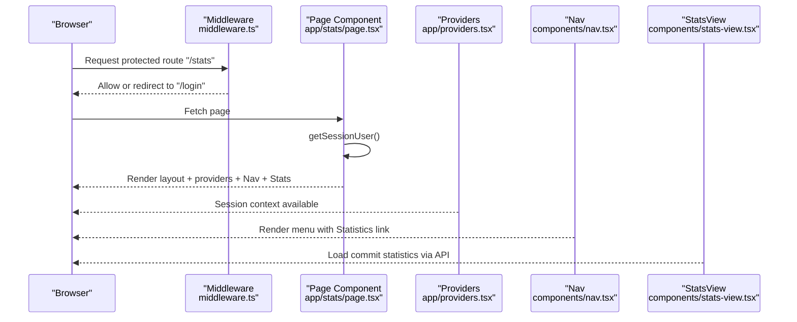

**Diagram sources**
- [middleware.ts:1-10](file://middleware.ts#L1-L10)
- [stats/page.tsx:1-21](file://app/stats/page.tsx#L1-L21)
- [providers.tsx:1-8](file://app/providers.tsx#L1-L8)
- [nav.tsx:1-171](file://components/nav.tsx#L1-L171)
- [stats-view.tsx:1-258](file://components/stats-view.tsx#L1-L258)

## Detailed Component Analysis

### Navigation Component
- Responsibilities:
  - Build menu items for member and admin roles including new Statistics, Projects, and Templates links.
  - Highlight active route using pathname comparison with enhanced route matching.
  - Display current username and sign-out action.
- Implementation highlights:
  - Uses Next.js router hooks for pathname and navigation.
  - Conditionally renders admin-only links based on user role.
  - Integrates with NextAuth for sign-out and redirects to login.
  - Enhanced route matching supports nested routes like "/admin/team-reports".
- Styling and composition:
  - Uses Tailwind utilities for spacing, borders, and color tokens.
  - Utility helper merges classes safely.

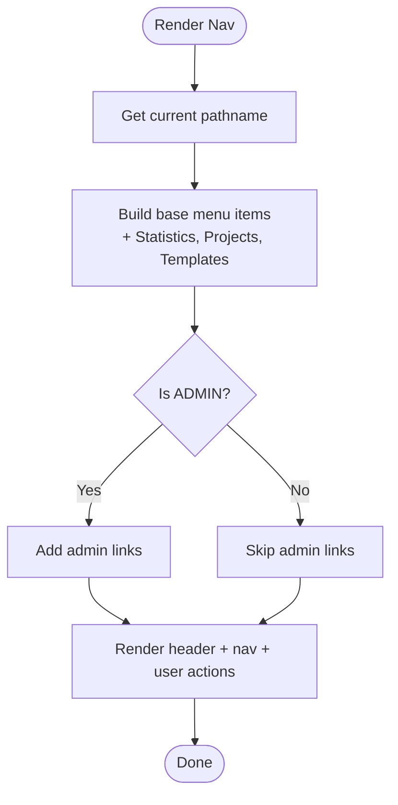

**Diagram sources**
- [nav.tsx:35-59](file://components/nav.tsx#L35-L59)

**Section sources**
- [nav.tsx:1-171](file://components/nav.tsx#L1-L171)
- [utils.ts:1-7](file://lib/utils.ts#L1-L7)

### Stats View Component
- Responsibilities:
  - Display commit statistics with date range selection (defaults to current week).
  - Show summary cards for total commits and major commit types.
  - Render type distribution charts with percentages and counts.
  - Provide per-project breakdown with expandable/collapsible sections.
  - Handle API communication for fetching statistics data.
- State management patterns:
  - Local state for date range, loading states, and data caching.
  - Form validation for date inputs with user feedback.
  - Controlled components for date inputs with React state.
- Data visualization:
  - Progress bars with color-coded commit types.
  - Percentage calculations with precision control.
  - Expandable project sections with detailed breakdowns.
- UX:
  - Empty state handling when no commits found.
  - Loading states during API requests.
  - Clear visual hierarchy with summary cards and detailed tables.

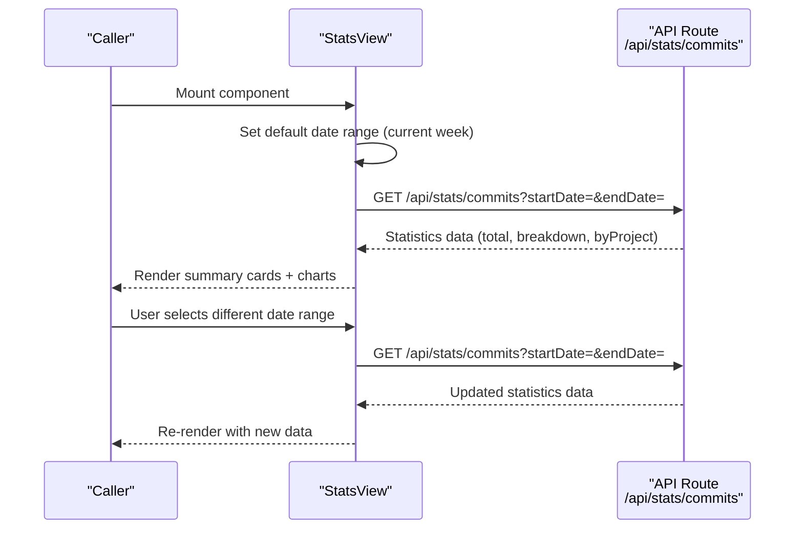

**Diagram sources**
- [stats-view.tsx:44-74](file://components/stats-view.tsx#L44-L74)
- [stats/commits/route.ts:47-128](file://app/api/stats/commits/route.ts#L47-L128)

**Section sources**
- [stats-view.tsx:1-258](file://components/stats-view.tsx#L1-L258)
- [stats/commits/route.ts:1-129](file://app/api/stats/commits/route.ts#L1-L129)

### Projects Manager Component
- Responsibilities:
  - Manage GitLab project list with filtering and sorting capabilities.
  - Enable/disable projects, set aliases, and configure default branches.
  - Add new projects by ID or path, refresh from GitLab, and bulk cleanup.
  - Handle project deletion with confirmation dialogs.
- State management patterns:
  - Comprehensive local state for projects, filters, and UI states.
  - Optimistic UI updates with rollback on API failures.
  - Batch operations with Promise.allSettled for reliability.
  - Real-time state updates for immediate user feedback.
- CRUD operations:
  - Create: Add projects via POST with idOrPath or refreshAll.
  - Read: Load projects via GET with user-scoped filtering.
  - Update: Toggle enable/disable, set alias, and update default branch.
  - Delete: Remove projects with confirmation and cleanup.
- UX:
  - Loading states during async operations.
  - Confirmation dialogs for destructive actions.
  - Searchable project list with multiple filter criteria.
  - Visual indicators for enabled/disabled projects.

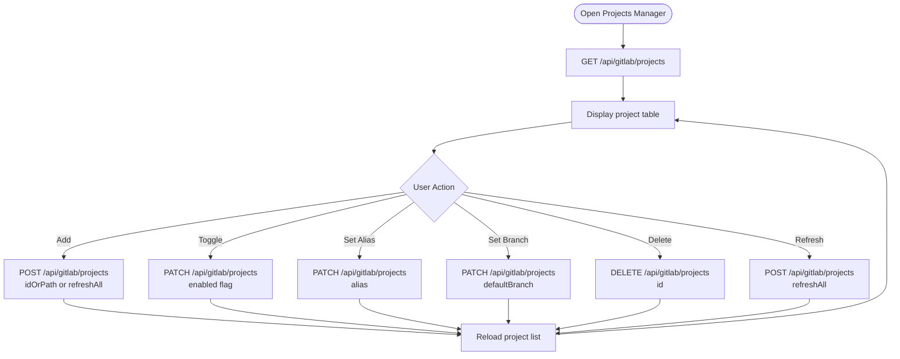

**Diagram sources**
- [projects-manager.tsx:17-164](file://components/projects-manager.tsx#L17-L164)
- [gitlab/projects/route.ts:8-162](file://app/api/gitlab/projects/route.ts#L8-L162)

**Section sources**
- [projects-manager.tsx:1-343](file://components/projects-manager.tsx#L1-L343)
- [gitlab/projects/route.ts:1-163](file://app/api/gitlab/projects/route.ts#L1-L163)

### Templates Manager Component
- Responsibilities:
  - Manage Handlebars templates with CRUD operations.
  - Provide template preview functionality with example data.
  - Offer comprehensive placeholder reference guide.
  - Handle template switching, editing, and saving.
- State management patterns:
  - Complex state management for template selection, editing, and preview.
  - Dirty state tracking with beforeunload protection.
  - Tab-based interface for reference and preview modes.
  - Cursor positioning for seamless template editing.
- Template system:
  - Handlebars syntax with comprehensive placeholder support.
  - Default template with sensible daily report structure.
  - Preview system with realistic commit data simulation.
  - Placeholder groups: basic, conditional, project loops, and commit loops.
- UX:
  - Split-pane layout with template list and editor.
  - Tabbed interface for reference and preview.
  - Real-time preview updates during editing.
  - Visual indicators for default templates and unsaved changes.

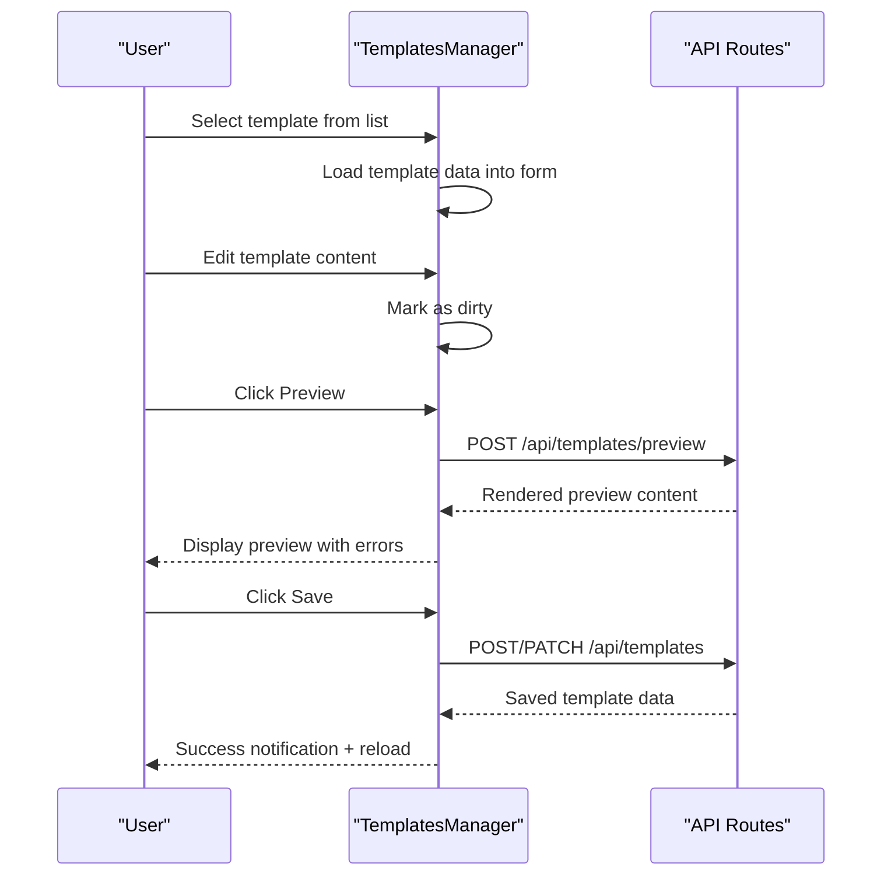

**Diagram sources**
- [templates-manager.tsx:82-244](file://components/templates-manager.tsx#L82-L244)
- [templates/route.ts:7-95](file://app/api/templates/route.ts#L7-L95)
- [templates/preview/route.ts:11-61](file://app/api/templates/preview/route.ts#L11-L61)

**Section sources**
- [templates-manager.tsx:1-492](file://components/templates-manager.tsx#L1-L492)
- [templates/route.ts:1-96](file://app/api/templates/route.ts#L1-L96)
- [templates/preview/route.ts:1-62](file://app/api/templates/preview/route.ts#L1-L62)

### Report Editor Component
- Responsibilities:
  - Manage date, content, templates, projects, and selection state.
  - Load configuration (templates and projects), preselect enabled projects.
  - Generate report content via API, show per-project errors, and mark saved state.
  - Save, copy, and AI polish content.
  - Live markdown editing with a third-party editor component.
- State management patterns:
  - Local state via React hooks for UI state and form data.
  - Memoized derived state for enabled projects.
  - Callbacks extracted with useCallback to stabilize refs for effects and event handlers.
  - Effects orchestrate initial load and conditional generation.
- Validation and feedback:
  - Toast notifications for success/error states.
  - Disabled controls during async operations.
- Lifecycle management:
  - Cleanup and deferred work handled via effect cleanup and setTimeout.
- Accessibility and UX:
  - Clear labels and disabled states.
  - Live preview mode for immediate feedback.

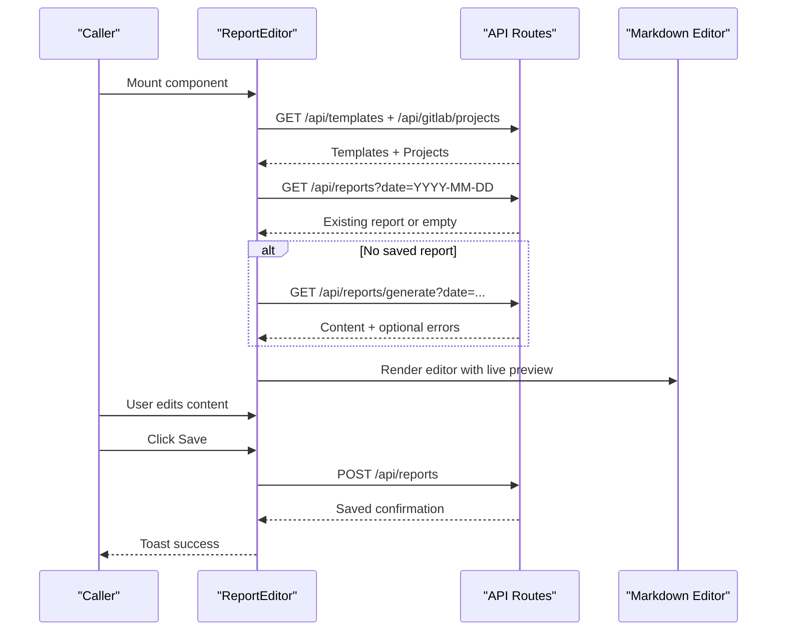

**Diagram sources**
- [report-editor.tsx:19-131](file://components/report-editor.tsx#L19-L131)
- [report-editor.tsx:172-282](file://components/report-editor.tsx#L172-L282)

**Section sources**
- [report-editor.tsx:1-284](file://components/report-editor.tsx#L1-L284)

### History View Component
- Responsibilities:
  - Calendar grid for month navigation and day selection.
  - Load monthly summaries, selected day's report, and toggle edit/view modes.
  - Save edited content and reflect updates.
- State management:
  - Month, selected date, content, editing flag, and saving state.
  - Derived sets for quick presence checks.
- UX:
  - Visual indicators for selected day, presence of reports, and today.
  - Edit/save toggling with appropriate controls.

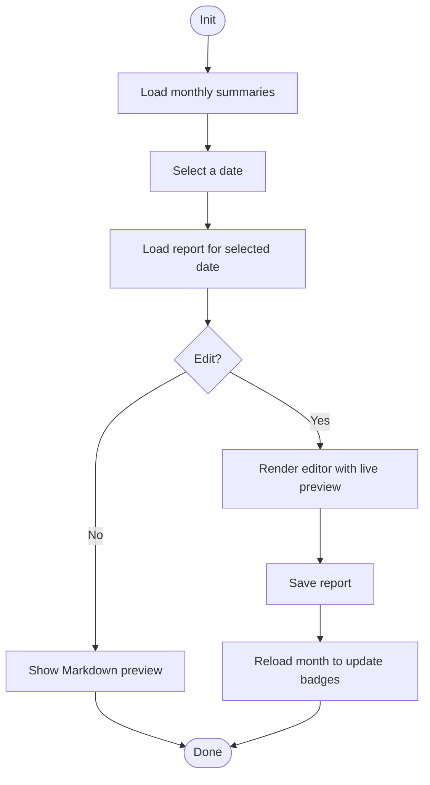

**Diagram sources**
- [history-view.tsx:13-86](file://components/history-view.tsx#L13-L86)
- [history-view.tsx:88-207](file://components/history-view.tsx#L88-L207)

**Section sources**
- [history-view.tsx:1-208](file://components/history-view.tsx#L1-L208)

### Settings Form Component
- Responsibilities:
  - Manage GitLab base URL and token, validate connectivity, and mask token display.
  - Filter settings via regex for commit titles.
  - Enable/disable projects and set default branches.
  - Create, edit, set default, and delete templates.
- State management:
  - Separate state for user profile, projects, templates, filters, and saving flags.
  - Optimistic UI updates with rollback on failure.
- UX:
  - Searchable project list, inline editing, and clear actions with confirmations.

**Diagram sources**
- [settings-form.tsx:33-186](file://components/settings-form.tsx#L33-L186)
- [settings-form.tsx:193-367](file://components/settings-form.tsx#L193-L367)

**Section sources**
- [settings-form.tsx:1-368](file://components/settings-form.tsx#L1-L368)

### Team Reports (Admin) Component
- Responsibilities:
  - Select date and list users with submission status.
  - Preview selected user's report content.
- State management:
  - Date, rows, and active user ID.
- UX:
  - Left panel for user list with submission indicators.
  - Right panel for report preview.

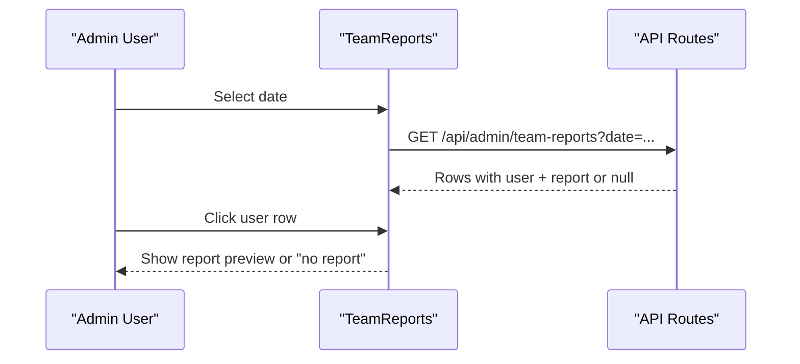

**Diagram sources**
- [team-reports.tsx:23-42](file://components/team-reports.tsx#L23-L42)
- [team-reports.tsx:43-113](file://components/team-reports.tsx#L43-L113)

**Section sources**
- [team-reports.tsx:1-114](file://components/team-reports.tsx#L1-L114)

### Users Admin (Admin) Component
- Responsibilities:
  - Create users with username, display name, password, and role.
  - Reset passwords, change roles, and delete users.
- State management:
  - Users list and form fields for creation.
- UX:
  - Inline role selector and action buttons with confirmations.

**Diagram sources**
- [users-admin.tsx:16-87](file://components/users-admin.tsx#L16-L87)
- [users-admin.tsx:89-186](file://components/users-admin.tsx#L89-L186)

**Section sources**
- [users-admin.tsx:1-187](file://components/users-admin.tsx#L1-L187)

### Authentication and Route Protection
- NextAuth configuration defines JWT-based sessions, credential provider, and session/user typing.
- Server utilities provide typed session retrieval and enforcement helpers.
- Middleware enforces authentication for protected routes and redirects unauthenticated users to login.

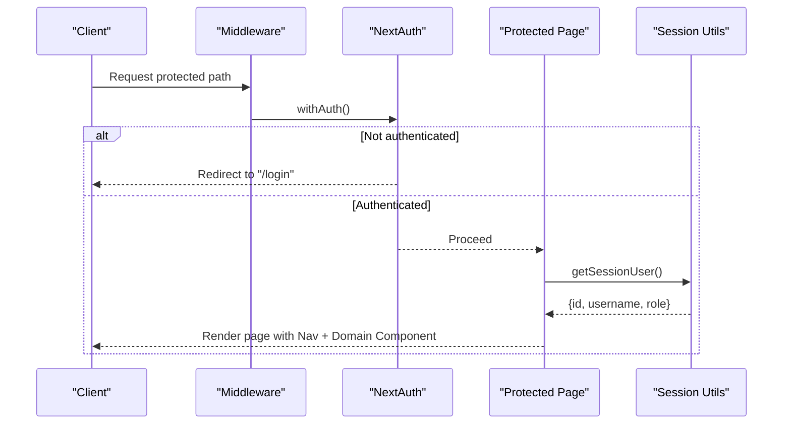

**Diagram sources**
- [middleware.ts:1-10](file://middleware.ts#L1-L10)
- [auth.ts:30-77](file://lib/auth.ts#L30-L77)
- [session.ts:11-37](file://lib/session.ts#L11-L37)
- [page.tsx:8-20](file://app/page.tsx#L8-L20)
- [admin/team-reports/page.tsx:8-21](file://app/admin/team-reports/page.tsx#L8-L21)

**Section sources**
- [auth.ts:1-77](file://lib/auth.ts#L1-L77)
- [session.ts:1-56](file://lib/session.ts#L1-L56)
- [middleware.ts:1-10](file://middleware.ts#L1-L10)
- [page.tsx:1-20](file://app/page.tsx#L1-L20)
- [admin/team-reports/page.tsx:1-22](file://app/admin/team-reports/page.tsx#L1-L22)

## Dependency Analysis
- Component dependencies:
  - Pages depend on Nav and domain components including new StatsView, ProjectsManager, and TemplatesManager.
  - Domain components depend on shared utilities and Tailwind classes.
  - Nav depends on NextAuth for user info and sign-out.
  - ReportEditor and HistoryView depend on the markdown editor component.
  - StatsView depends on API route for commit statistics.
  - ProjectsManager depends on API route for GitLab project management.
  - TemplatesManager depends on API routes for template CRUD and preview.
- External libraries:
  - NextAuth for authentication and session management.
  - @uiw/react-md-editor for markdown editing and preview.
  - react-hot-toast for toast notifications.
  - dayjs for date utilities.
- Styling:
  - Tailwind CSS configured with CSS variables for theme tokens.
  - Utility helper merges classes and resolves conflicts.

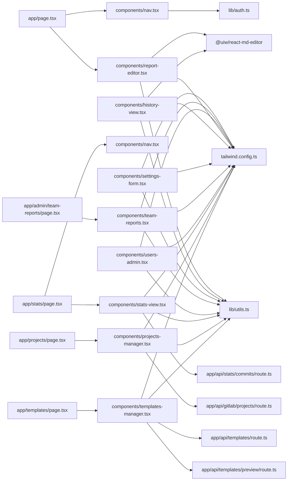

**Diagram sources**
- [page.tsx:1-20](file://app/page.tsx#L1-L20)
- [admin/team-reports/page.tsx:1-22](file://app/admin/team-reports/page.tsx#L1-L22)
- [stats/page.tsx:1-21](file://app/stats/page.tsx#L1-L21)
- [projects/page.tsx:1-27](file://app/projects/page.tsx#L1-L27)
- [templates/page.tsx:1-27](file://app/templates/page.tsx#L1-L27)
- [nav.tsx:1-171](file://components/nav.tsx#L1-L171)
- [report-editor.tsx:1-284](file://components/report-editor.tsx#L1-L284)
- [history-view.tsx:1-208](file://components/history-view.tsx#L1-L208)
- [settings-form.tsx:1-368](file://components/settings-form.tsx#L1-L368)
- [team-reports.tsx:1-114](file://components/team-reports.tsx#L1-L114)
- [users-admin.tsx:1-187](file://components/users-admin.tsx#L1-L187)
- [stats-view.tsx:1-258](file://components/stats-view.tsx#L1-L258)
- [projects-manager.tsx:1-343](file://components/projects-manager.tsx#L1-L343)
- [templates-manager.tsx:1-492](file://components/templates-manager.tsx#L1-L492)
- [auth.ts:1-77](file://lib/auth.ts#L1-L77)
- [utils.ts:1-7](file://lib/utils.ts#L1-L7)
- [tailwind.config.ts:1-24](file://tailwind.config.ts#L1-L24)
- [stats/commits/route.ts:1-129](file://app/api/stats/commits/route.ts#L1-L129)
- [gitlab/projects/route.ts:1-163](file://app/api/gitlab/projects/route.ts#L1-L163)
- [templates/route.ts:1-96](file://app/api/templates/route.ts#L1-L96)
- [templates/preview/route.ts:1-62](file://app/api/templates/preview/route.ts#L1-L62)

**Section sources**
- [page.tsx:1-20](file://app/page.tsx#L1-L20)
- [admin/team-reports/page.tsx:1-22](file://app/admin/team-reports/page.tsx#L1-L22)
- [stats/page.tsx:1-21](file://app/stats/page.tsx#L1-L21)
- [projects/page.tsx:1-27](file://app/projects/page.tsx#L1-L27)
- [templates/page.tsx:1-27](file://app/templates/page.tsx#L1-L27)
- [nav.tsx:1-171](file://components/nav.tsx#L1-L171)
- [report-editor.tsx:1-284](file://components/report-editor.tsx#L1-L284)
- [history-view.tsx:1-208](file://components/history-view.tsx#L1-L208)
- [settings-form.tsx:1-368](file://components/settings-form.tsx#L1-L368)
- [team-reports.tsx:1-114](file://components/team-reports.tsx#L1-L114)
- [users-admin.tsx:1-187](file://components/users-admin.tsx#L1-L187)
- [stats-view.tsx:1-258](file://components/stats-view.tsx#L1-L258)
- [projects-manager.tsx:1-343](file://components/projects-manager.tsx#L1-L343)
- [templates-manager.tsx:1-492](file://components/templates-manager.tsx#L1-L492)
- [auth.ts:1-77](file://lib/auth.ts#L1-L77)
- [utils.ts:1-7](file://lib/utils.ts#L1-L7)
- [tailwind.config.ts:1-24](file://tailwind.config.ts#L1-L24)
- [stats/commits/route.ts:1-129](file://app/api/stats/commits/route.ts#L1-L129)
- [gitlab/projects/route.ts:1-163](file://app/api/gitlab/projects/route.ts#L1-L163)
- [templates/route.ts:1-96](file://app/api/templates/route.ts#L1-L96)
- [templates/preview/route.ts:1-62](file://app/api/templates/preview/route.ts#L1-L62)

## Performance Considerations
- Client-side rendering and dynamic imports:
  - Markdown editor is loaded dynamically to reduce initial bundle size.
  - Heavy components like StatsView, ProjectsManager, and TemplatesManager are client-only.
- State stability:
  - useCallback used for event handlers and callbacks to prevent unnecessary re-renders.
  - useMemo used for derived data (e.g., enabled projects, filtered projects).
- Async operations:
  - Parallel loading for templates and projects.
  - Disabled controls during async operations to avoid redundant requests.
  - Batch operations with Promise.allSettled for reliable bulk updates.
- Rendering:
  - Conditional rendering for admin-only sections reduces DOM size for members.
  - Grid layouts and virtualization-like techniques (limited by fixed sizes) keep lists manageable.
  - Expandable sections with lazy loading for detailed project breakdowns.
- Styling:
  - Tailwind's JIT scanning targets app and components directories to minimize CSS.
  - Utility helper merges classes efficiently to avoid style conflicts.

## Troubleshooting Guide
- Authentication issues:
  - Ensure middleware matcher covers protected routes and NextAuth pages are configured correctly.
  - Verify session retrieval helpers return expected user shape.
- Navigation and route protection:
  - Confirm middleware matcher includes intended paths and redirects to login when missing session.
  - Check that new navigation items (Statistics, Projects, Templates) are properly integrated.
- Editor and API errors:
  - Check toast messages for explicit error feedback from API responses.
  - Validate that report generation and saving endpoints return expected shapes.
  - For StatsView, ensure GitLab credentials are configured before querying statistics.
  - For ProjectsManager, verify GitLab project access permissions.
  - For TemplatesManager, check Handlebars syntax validity during preview.
- State synchronization:
  - After save/edit operations, refresh lists or summaries to reflect updates (e.g., reload month after save).
  - For bulk operations, monitor Promise.allSettled results for individual operation outcomes.
- Styling and responsiveness:
  - Confirm Tailwind content paths include app and components directories.
  - Use responsive utilities consistently (e.g., grid columns) and test across screen sizes.
  - Check that new components properly utilize Tailwind utility classes.

**Section sources**
- [middleware.ts:1-10](file://middleware.ts#L1-L10)
- [session.ts:11-37](file://lib/session.ts#L11-L37)
- [report-editor.tsx:67-91](file://components/report-editor.tsx#L67-L91)
- [history-view.tsx:53-73](file://components/history-view.tsx#L53-L73)
- [stats-view.tsx:51-74](file://components/stats-view.tsx#L51-L74)
- [projects-manager.tsx:26-35](file://components/projects-manager.tsx#L26-L35)
- [templates-manager.tsx:162-194](file://components/templates-manager.tsx#L162-L194)
- [tailwind.config.ts:4-7](file://tailwind.config.ts#L4-L7)

## Conclusion
The Pingyun Report frontend is structured around a clean layout and providers layer, with robust client-side components for editing, history, settings, admin views, statistics, project management, and template management. Authentication is enforced via NextAuth and middleware, while Tailwind CSS and a utility helper streamline styling and composition. The components emphasize user experience with live previews, clear feedback, and responsive layouts, supported by careful state management and performance-conscious patterns. The addition of StatsView, ProjectsManager, and TemplatesManager enhances the system's capabilities for comprehensive development workflow management.

## Appendices

### Styling Approaches and Composition Patterns
- Tailwind CSS:
  - Centralized theme tokens via CSS variables.
  - Utility-first classes for layout, spacing, colors, and typography.
- Composition patterns:
  - Container components (pages) pass user and minimal props to presentational components.
  - Utility helper merges classes safely to avoid duplicates and conflicts.
  - New components follow consistent styling patterns with card-based layouts and responsive grids.
- Responsive design:
  - Use of grid and flex utilities with breakpoints to adapt to different screen sizes.
  - Mobile-first approach with hamburger menu for navigation.
  - Adaptive layouts for new components (split-pane for TemplatesManager, expandable sections for StatsView).
- Accessibility:
  - Semantic HTML and labels; disabled states for buttons during async operations.
  - Proper ARIA attributes for interactive elements.
  - Keyboard navigation support for all interactive components.
- Cross-browser compatibility:
  - Modern CSS variables and Tailwind utilities are broadly supported; test critical interactions across browsers.

**Section sources**
- [tailwind.config.ts:1-24](file://tailwind.config.ts#L1-L24)
- [utils.ts:1-7](file://lib/utils.ts#L1-L7)
- [nav.tsx:20-171](file://components/nav.tsx#L20-L171)
- [report-editor.tsx:172-282](file://components/report-editor.tsx#L172-L282)
- [history-view.tsx:89-206](file://components/history-view.tsx#L89-L206)
- [settings-form.tsx:193-367](file://components/settings-form.tsx#L193-L367)
- [team-reports.tsx:43-113](file://components/team-reports.tsx#L43-L113)
- [users-admin.tsx:89-186](file://components/users-admin.tsx#L89-L186)
- [stats-view.tsx:76-238](file://components/stats-view.tsx#L76-L238)
- [projects-manager.tsx:179-342](file://components/projects-manager.tsx#L179-L342)
- [templates-manager.tsx:276-491](file://components/templates-manager.tsx#L276-L491)

### Component Integration and Customization Patterns
- Integration:
  - Wrap page content with Providers to expose session context.
  - Pass user object from server utilities to Nav and conditionally render admin sections.
  - Use dynamic imports for heavy components (e.g., markdown editor, new domain components) to optimize load.
  - Implement proper route protection for new pages (Statistics, Projects, Templates).
- Customization:
  - Extend templates and project filtering logic in domain components.
  - Add new admin features by following the UsersAdmin pattern (CRUD + confirmations).
  - Introduce new route protection by adding paths to middleware matcher and enforcing role checks in pages.
  - Customize StatsView data visualization by extending TYPE_META and adding new chart types.
  - Enhance ProjectsManager with additional GitLab integration features.
  - Extend TemplatesManager with advanced Handlebars features and custom helpers.

**Section sources**
- [providers.tsx:1-8](file://app/providers.tsx#L1-L8)
- [page.tsx:8-20](file://app/page.tsx#L8-L20)
- [admin/team-reports/page.tsx:8-21](file://app/admin/team-reports/page.tsx#L8-L21)
- [stats/page.tsx:8-21](file://app/stats/page.tsx#L8-L21)
- [projects/page.tsx:8-27](file://app/projects/page.tsx#L8-L27)
- [templates/page.tsx:8-27](file://app/templates/page.tsx#L8-L27)
- [report-editor.tsx:9](file://components/report-editor.tsx#L9)
- [users-admin.tsx:33-87](file://components/users-admin.tsx#L33-L87)
- [middleware.ts:7-9](file://middleware.ts#L7-L9)
- [nav.tsx:35-59](file://components/nav.tsx#L35-L59)