# Frontend Components

<cite>
**Referenced Files in This Document**
- [layout.tsx](file://app/layout.tsx)
- [providers.tsx](file://app/providers.tsx)
- [page.tsx](file://app/page.tsx)
- [admin/team-reports/page.tsx](file://app/admin/team-reports/page.tsx)
- [middleware.ts](file://middleware.ts)
- [nav.tsx](file://components/nav.tsx)
- [report-editor.tsx](file://components/report-editor.tsx)
- [history-view.tsx](file://components/history-view.tsx)
- [history/page.tsx](file://app/history/page.tsx)
- [settings-form.tsx](file://components/settings-form.tsx)
- [team-reports.tsx](file://components/team-reports.tsx)
- [users-admin.tsx](file://components/users-admin.tsx)
- [stats-view.tsx](file://components/stats-view.tsx)
- [projects-manager.tsx](file://components/projects-manager.tsx)
- [templates-manager.tsx](file://components/templates-manager.tsx)
- [theme-toggle.tsx](file://components/theme-toggle.tsx)
- [stats/page.tsx](file://app/stats/page.tsx)
- [projects/page.tsx](file://app/projects/page.tsx)
- [templates/page.tsx](file://app/templates/page.tsx)
- [stats/commits/route.ts](file://app/api/stats/commits/route.ts)
- [gitlab/projects/route.ts](file://app/api/gitlab/projects/route.ts)
- [templates/route.ts](file://app/api/templates/route.ts)
- [templates/preview/route.ts](file://app/api/templates/preview/route.ts)
- [reports/route.ts](file://app/api/reports/route.ts)
- [auth.ts](file://lib/auth.ts)
- [session.ts](file://lib/session.ts)
- [utils.ts](file://lib/utils.ts)
- [tailwind.config.ts](file://tailwind.config.ts)
- [globals.css](file://app/globals.css)
- [package.json](file://package.json)
- [login/page.tsx](file://app/login/page.tsx)
- [README.md](file://README.md)
</cite>

## Update Summary
**Changes Made**
- Updated Login Page branding with new PNG logo and consistent "极报" brand name throughout UI
- Enhanced Navigation component with rebranded visual identity
- Updated application metadata to reflect "极报 - GitDaily" branding
- Integrated consistent rebranding across all navigation elements and user interface components

## Table of Contents
1. [Introduction](#introduction)
2. [Project Structure](#project-structure)
3. [Core Components](#core-components)
4. [Architecture Overview](#architecture-overview)
5. [Detailed Component Analysis](#detailed-component-analysis)
6. [Dark Mode Theming System](#dark-mode-theming-system)
7. [Dependency Analysis](#dependency-analysis)
8. [Performance Considerations](#performance-considerations)
9. [Troubleshooting Guide](#troubleshooting-guide)
10. [Conclusion](#conclusion)
11. [Appendices](#appendices)

## Introduction
This document explains the frontend component architecture of Pingyun Report, focusing on the main layout and navigation system, the report editor with markdown editing and live preview, navigation with route protection, state management patterns, styling via Tailwind CSS with comprehensive dark mode theming, responsive design, accessibility, cross-browser compatibility, lifecycle management, error handling, and performance optimization. It also provides integration and customization patterns for extending the system with the newly added StatsView, ProjectsManager, TemplatesManager components, and the comprehensive dark mode theming system.

**Updated** The application now features a complete rebranding with the "极报" (Jibao) brand identity, including a new PNG logo, consistent brand messaging, and unified visual design across all user interface elements.

## Project Structure
The application follows a Next.js App Router layout with a root layout, providers wrapper, and page-level components. Navigation is shared across pages with integrated theme switching, and several domain-specific components handle editing, history viewing, settings, admin views, statistics, project management, and template management. Authentication is handled by NextAuth with JWT strategy and middleware-based route protection. The theming system is seamlessly integrated throughout the application with the new "极报" brand identity.

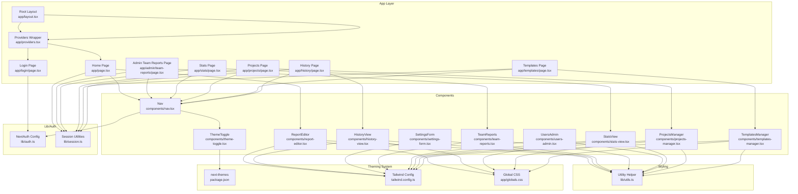

**Diagram sources**
- [layout.tsx:1-36](file://app/layout.tsx#L1-L36)
- [providers.tsx:1-18](file://app/providers.tsx#L1-L18)
- [page.tsx:1-20](file://app/page.tsx#L1-L20)
- [admin/team-reports/page.tsx:1-22](file://app/admin/team-reports/page.tsx#L1-L22)
- [stats/page.tsx:1-21](file://app/stats/page.tsx#L1-L21)
- [projects/page.tsx:1-27](file://app/projects/page.tsx#L1-L27)
- [templates/page.tsx:1-27](file://app/templates/page.tsx#L1-L27)
- [history/page.tsx:1-21](file://app/history/page.tsx#L1-L21)
- [login/page.tsx:1-164](file://app/login/page.tsx#L1-L164)
- [nav.tsx:1-177](file://components/nav.tsx#L1-L177)
- [report-editor.tsx:1-296](file://components/report-editor.tsx#L1-L296)
- [history-view.tsx:1-330](file://components/history-view.tsx#L1-L330)
- [settings-form.tsx:1-368](file://components/settings-form.tsx#L1-L368)
- [team-reports.tsx:1-127](file://components/team-reports.tsx#L1-L127)
- [users-admin.tsx:1-187](file://components/users-admin.tsx#L1-L187)
- [stats-view.tsx:1-258](file://components/stats-view.tsx#L1-L258)
- [projects-manager.tsx:1-343](file://components/projects-manager.tsx#L1-L343)
- [templates-manager.tsx:1-492](file://components/templates-manager.tsx#L1-L492)
- [theme-toggle.tsx:1-103](file://components/theme-toggle.tsx#L1-L103)
- [auth.ts:1-77](file://lib/auth.ts#L1-L77)
- [session.ts:1-56](file://lib/session.ts#L1-L56)
- [utils.ts:1-7](file://lib/utils.ts#L1-L7)
- [tailwind.config.ts:1-26](file://tailwind.config.ts#L1-L26)
- [globals.css:1-44](file://app/globals.css#L1-L44)
- [package.json:25](file://package.json#L25)

**Section sources**
- [layout.tsx:1-36](file://app/layout.tsx#L1-L36)
- [providers.tsx:1-18](file://app/providers.tsx#L1-L18)
- [page.tsx:1-20](file://app/page.tsx#L1-L20)
- [admin/team-reports/page.tsx:1-22](file://app/admin/team-reports/page.tsx#L1-L22)
- [stats/page.tsx:1-21](file://app/stats/page.tsx#L1-L21)
- [projects/page.tsx:1-27](file://app/projects/page.tsx#L1-L27)
- [templates/page.tsx:1-27](file://app/templates/page.tsx#L1-L27)
- [history/page.tsx:1-21](file://app/history/page.tsx#L1-L21)
- [login/page.tsx:1-164](file://app/login/page.tsx#L1-L164)
- [nav.tsx:1-177](file://components/nav.tsx#L1-L177)
- [report-editor.tsx:1-296](file://components/report-editor.tsx#L1-L296)
- [history-view.tsx:1-330](file://components/history-view.tsx#L1-L330)
- [settings-form.tsx:1-368](file://components/settings-form.tsx#L1-L368)
- [team-reports.tsx:1-127](file://components/team-reports.tsx#L1-L127)
- [users-admin.tsx:1-187](file://components/users-admin.tsx#L1-L187)
- [stats-view.tsx:1-258](file://components/stats-view.tsx#L1-L258)
- [projects-manager.tsx:1-343](file://components/projects-manager.tsx#L1-L343)
- [templates-manager.tsx:1-492](file://components/templates-manager.tsx#L1-L492)
- [theme-toggle.tsx:1-103](file://components/theme-toggle.tsx#L1-L103)
- [auth.ts:1-77](file://lib/auth.ts#L1-L77)
- [session.ts:1-56](file://lib/session.ts#L1-L56)
- [utils.ts:1-7](file://lib/utils.ts#L1-L7)
- [tailwind.config.ts:1-26](file://tailwind.config.ts#L1-L26)
- [globals.css:1-44](file://app/globals.css#L1-L44)
- [package.json:25](file://package.json#L25)

## Core Components
- Root layout and providers: Sets global styles, toast notifications, theme provider, and wraps children with NextAuth session provider.
- Navigation: Renders top-level menu items including new Statistics, Projects, and Templates links, admin-only links for ADMIN users, displays current user, and includes ThemeToggle for theme switching.
- Report Editor: Manages date selection, template selection, project filtering, AI polishing, saving, copying, and live markdown editing with theme-aware editor.
- History View: Calendar-based navigation to select dates, automatically loads today's report content on mount, supports inline editing and saving with theme-aware preview.
- Settings Form: Manages GitLab connection, noise regex filtering, project enablement/default branch, and template CRUD with theme-aware forms.
- Team Reports (Admin): Lists users and previews their daily reports for a selected date with theme-aware markdown preview.
- Users Admin (Admin): Creates, updates roles, resets passwords, and deletes users with theme-aware forms.
- Stats View: Displays commit statistics with date range selection, summary cards, type distribution charts, and per-project breakdowns with theme-aware visualizations.
- Projects Manager: Manages GitLab project list, enables/disables projects, sets aliases and default branches, adds/removes projects, and bulk operations with theme-aware tables.
- Templates Manager: Handles Handlebars template editing, preview generation, placeholder reference, and template CRUD operations with theme-aware editors.
- Theme Toggle: Provides three-state theme switching (light → dark → system) with semantic icons and proper hydration handling.
- Login Page: Features the new "极报" brand identity with PNG logo, consistent typography, and rebranded visual design.

**Section sources**
- [layout.tsx:1-36](file://app/layout.tsx#L1-L36)
- [providers.tsx:1-18](file://app/providers.tsx#L1-L18)
- [nav.tsx:1-177](file://components/nav.tsx#L1-L177)
- [report-editor.tsx:1-296](file://components/report-editor.tsx#L1-L296)
- [history-view.tsx:1-330](file://components/history-view.tsx#L1-L330)
- [settings-form.tsx:1-368](file://components/settings-form.tsx#L1-L368)
- [team-reports.tsx:1-127](file://components/team-reports.tsx#L1-L127)
- [users-admin.tsx:1-187](file://components/users-admin.tsx#L1-L187)
- [stats-view.tsx:1-258](file://components/stats-view.tsx#L1-L258)
- [projects-manager.tsx:1-343](file://components/projects-manager.tsx#L1-L343)
- [templates-manager.tsx:1-492](file://components/templates-manager.tsx#L1-L492)
- [theme-toggle.tsx:1-103](file://components/theme-toggle.tsx#L1-L103)
- [login/page.tsx:1-164](file://app/login/page.tsx#L1-L164)

## Architecture Overview
The frontend architecture centers around:
- Shared layout and providers with integrated theme provider for consistent UI and session context.
- Route-level page components that enforce authentication and render domain components with theme awareness.
- Client-side components using React hooks for state and effects, with server utilities for session checks and theme-aware rendering.
- NextAuth for authentication and middleware for route protection.
- Tailwind CSS with comprehensive dark mode theming system using CSS custom properties and next-themes integration.
- Enhanced navigation system supporting new domain-specific components for statistics, project management, template management, and theme switching.
- **Updated** Complete rebranding with "极报" visual identity across all components.

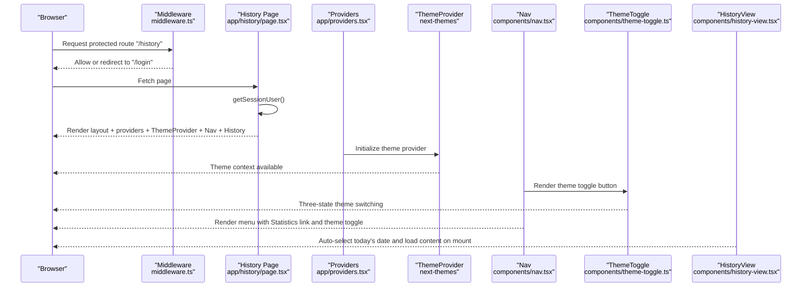

**Diagram sources**
- [middleware.ts:1-10](file://middleware.ts#L1-L10)
- [history/page.tsx:1-21](file://app/history/page.tsx#L1-L21)
- [providers.tsx:1-18](file://app/providers.tsx#L1-L18)
- [nav.tsx:1-177](file://components/nav.tsx#L1-L177)
- [theme-toggle.tsx:1-103](file://components/theme-toggle.tsx#L1-L103)
- [history-view.tsx:158-166](file://components/history-view.tsx#L158-L166)

## Detailed Component Analysis

### Navigation Component
- Responsibilities:
  - Build menu items for member and admin roles including new Statistics, Projects, and Templates links.
  - Highlight active route using pathname comparison with enhanced route matching.
  - Display current username and sign-out action.
  - Integrate ThemeToggle component for user-controlled theme switching.
  - **Updated** Feature the new "极报" brand identity with PNG logo and consistent typography.
- Implementation highlights:
  - Uses Next.js router hooks for pathname and navigation.
  - Conditionally renders admin-only links based on user role.
  - Integrates with NextAuth for sign-out and redirects to login.
  - Enhanced route matching supports nested routes like "/admin/team-reports".
  - Theme toggle positioned in desktop and mobile navigation layouts.
  - **Updated** Brand logo uses PNG format with "极报" text for consistent visual identity.
- Styling and composition:
  - Uses Tailwind utilities for spacing, borders, and color tokens.
  - Utility helper merges classes safely.
  - Theme-aware styling with semantic color classes.
  - **Updated** Consistent brand styling across all navigation elements.

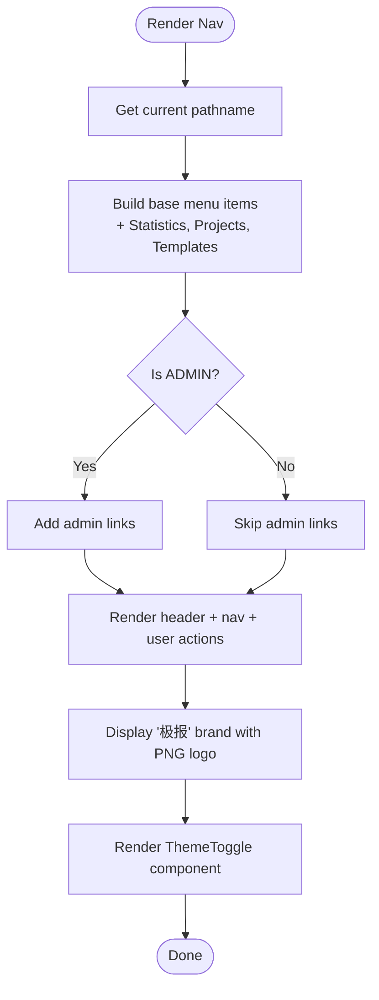

**Diagram sources**
- [nav.tsx:36-55](file://components/nav.tsx#L36-L55)
- [nav.tsx:99](file://components/nav.tsx#L99)
- [nav.tsx:162](file://components/nav.tsx#L162)

**Section sources**
- [nav.tsx:1-177](file://components/nav.tsx#L1-L177)
- [utils.ts:1-7](file://lib/utils.ts#L1-L7)

### Login Page Component
**Updated** Complete visual redesign with new PNG logo and consistent "极报" brand identity.

- Responsibilities:
  - Provide secure authentication interface with credential-based login.
  - Display the new "极报" brand identity with PNG logo and consistent typography.
  - Handle user credentials submission and error feedback.
  - Support password visibility toggle and form validation.
- Implementation highlights:
  - Uses NextAuth credentials provider for authentication.
  - Implements form validation with React state management.
  - Features decorative gradient backgrounds with primary color accents.
  - **Updated** Incorporates new PNG logo with "极报" brand name and subtitle.
  - Responsive design with centered card layout and proper spacing.
  - Toast notifications for authentication errors.
- Visual Design:
  - **Updated** Primary branding with PNG logo (20x20px) featuring rounded corners and subtle shadow.
  - **Updated** "极报" brand name in large, bold typography with tracking adjustment.
  - **Updated** Subtitle "GitLab 日报生成助手" (GitLab Daily Report Generator) for clarity.
  - Decorative gradient circles in primary color with varying opacity for depth.
  - Card-based form layout with proper spacing and shadow effects.
  - **Updated** Consistent color scheme using theme-aware Tailwind classes.
- UX Improvements:
  - **Updated** Immediate brand recognition with prominent logo and brand name.
  - **Updated** Clear visual hierarchy with logo, brand name, and subtitle.
  - **Updated** Consistent styling across all form elements with theme-aware colors.
  - Password visibility toggle with accessible icons.
  - Loading states during authentication attempts.
  - Error handling with user-friendly toast notifications.

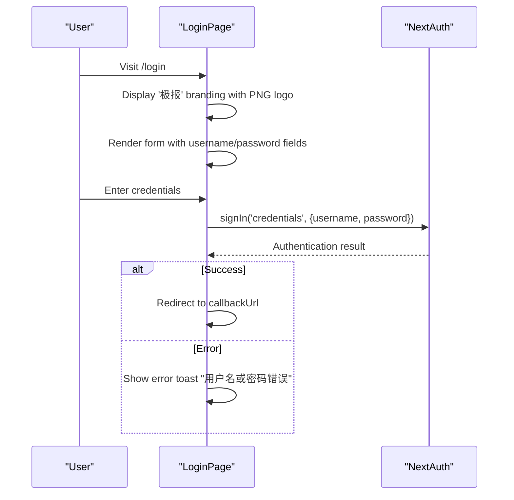

**Diagram sources**
- [login/page.tsx:18-33](file://app/login/page.tsx#L18-L33)
- [login/page.tsx:21-30](file://app/login/page.tsx#L21-L30)

**Section sources**
- [login/page.tsx:1-164](file://app/login/page.tsx#L1-L164)

### History View Component
**Updated** Enhanced with automatic today's date selection and content loading functionality for improved user experience.

- Responsibilities:
  - Calendar grid for month navigation and day selection.
  - Automatically select today's date on component mount and load content.
  - Load monthly summaries, selected day's report, and toggle edit/view modes.
  - Save edited content and reflect updates.
  - Theme-aware rendering with proper color mode detection.
- State management patterns:
  - Month, selected date (initialized to today), content, editing flag, and saving state.
  - Derived sets for quick presence checks.
  - Theme state management with hydration-safe mounting detection.
  - Automatic content loading via useEffect hook on mount.
- UX improvements:
  - **Automatic today's date selection**: `selectedDate` state initialized with today's date (`dayjs().format("YYYY-MM-DD")`) instead of null.
  - **Automatic content loading**: New useEffect hook automatically loads today's report content when component mounts.
  - **Streamlined workflow**: Users no longer need to manually click today's date in the calendar.
  - **Visual indicators**: Today's date is highlighted with a ring border while maintaining selected date distinction.
  - **Edit/save toggling**: Standard edit/save functionality preserved with theme-aware controls.
  - **Theme-aware calendar styling**: Proper contrast in both light and dark modes.
- Lifecycle management:
  - Initial load triggers automatic content loading for today's date.
  - Monthly summaries load when month changes.
  - Content loads when specific dates are selected.
  - Hydration-safe theme detection prevents SSR mismatches.

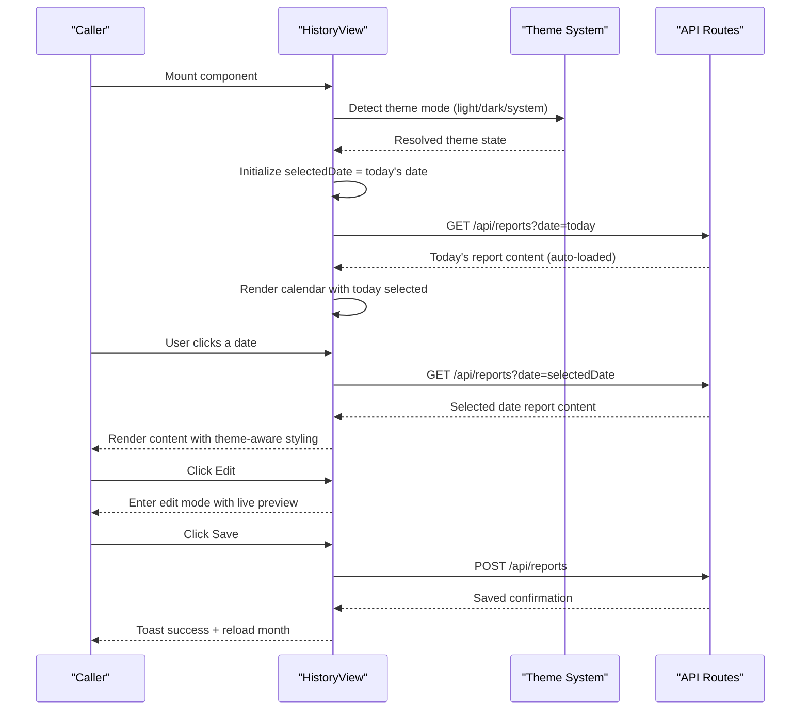

**Diagram sources**
- [history-view.tsx:18-21](file://components/history-view.tsx#L18-L21)
- [history-view.tsx:158-166](file://components/history-view.tsx#L158-L166)
- [history-view.tsx:64-70](file://components/history-view.tsx#L64-L70)
- [reports/route.ts:19-27](file://app/api/reports/route.ts#L19-L27)

**Section sources**
- [history-view.tsx:1-330](file://components/history-view.tsx#L1-L330)
- [history/page.tsx:1-21](file://app/history/page.tsx#L1-L21)
- [reports/route.ts:1-L1-L95:1-95](file://app/api/reports/route.ts#L1-L95)

### Stats View Component
- Responsibilities:
  - Display commit statistics with date range selection (defaults to current week).
  - Show summary cards for total commits and major commit types.
  - Render type distribution charts with percentages and counts.
  - Provide per-project breakdown with expandable/collapsible sections.
  - Handle API communication for fetching statistics data.
  - Render with theme-aware styling using semantic color classes.
- State management patterns:
  - Local state for date range, loading states, and data caching.
  - Form validation for date inputs with user feedback.
  - Controlled components for date inputs with React state.
- Data visualization:
  - Progress bars with color-coded commit types.
  - Percentage calculations with precision control.
  - Expandable project sections with detailed breakdowns.
- UX:
  - Empty state handling when no commits found.
  - Loading states during API requests.
  - Clear visual hierarchy with summary cards and detailed tables.
  - Theme-aware visualizations that adapt to light/dark modes.

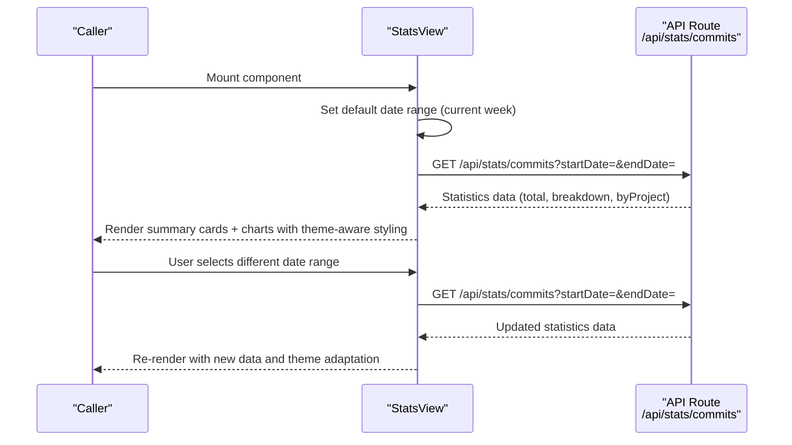

**Diagram sources**
- [stats-view.tsx:44-74](file://components/stats-view.tsx#L44-L74)
- [stats/commits/route.ts:47-128](file://app/api/stats/commits/route.ts#L47-L128)

**Section sources**
- [stats-view.tsx:1-258](file://components/stats-view.tsx#L1-L258)
- [stats/commits/route.ts:1-129](file://app/api/stats/commits/route.ts#L1-L129)

### Projects Manager Component
- Responsibilities:
  - Manage GitLab project list with filtering and sorting capabilities.
  - Enable/disable projects, set aliases, and configure default branches.
  - Add new projects by ID or path, refresh from GitLab, and bulk cleanup.
  - Handle project deletion with confirmation dialogs.
  - Render with theme-aware styling using semantic color classes.
- State management patterns:
  - Comprehensive local state for projects, filters, and UI states.
  - Optimistic UI updates with rollback on API failures.
  - Batch operations with Promise.allSettled for reliability.
  - Real-time state updates for immediate user feedback.
- CRUD operations:
  - Create: Add projects via POST with idOrPath or refreshAll.
  - Read: Load projects via GET with user-scoped filtering.
  - Update: Toggle enable/disable, set alias, and update default branch.
  - Delete: Remove projects with confirmation and cleanup.
- UX:
  - Loading states during async operations.
  - Confirmation dialogs for destructive actions.
  - Searchable project list with multiple filter criteria.
  - Visual indicators for enabled/disabled projects.
  - Theme-aware table styling with proper contrast in both modes.

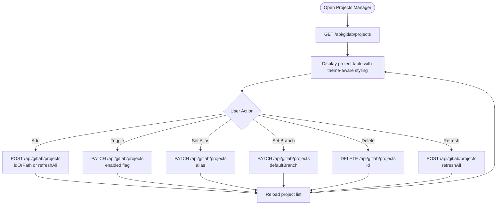

**Diagram sources**
- [projects-manager.tsx:17-164](file://components/projects-manager.tsx#L17-L164)
- [gitlab/projects/route.ts:8-162](file://app/api/gitlab/projects/route.ts#L8-L162)

**Section sources**
- [projects-manager.tsx:1-343](file://components/projects-manager.tsx#L1-L343)
- [gitlab/projects/route.ts:1-163](file://app/api/gitlab/projects/route.ts#L1-L163)

### Templates Manager Component
- Responsibilities:
  - Manage Handlebars templates with CRUD operations.
  - Provide template preview functionality with example data.
  - Offer comprehensive placeholder reference guide.
  - Handle template switching, editing, and saving.
  - Render with theme-aware styling using semantic color classes.
- State management patterns:
  - Complex state management for template selection, editing, and preview.
  - Dirty state tracking with beforeunload protection.
  - Tab-based interface for reference and preview modes.
  - Cursor positioning for seamless template editing.
- Template system:
  - Handlebars syntax with comprehensive placeholder support.
  - Default template with sensible daily report structure.
  - Preview system with realistic commit data simulation.
  - Placeholder groups: basic, conditional, project loops, and commit loops.
- UX:
  - Split-pane layout with template list and editor.
  - Tabbed interface for reference and preview.
  - Real-time preview updates during editing.
  - Visual indicators for default templates and unsaved changes.
  - Theme-aware editor with proper syntax highlighting in both modes.

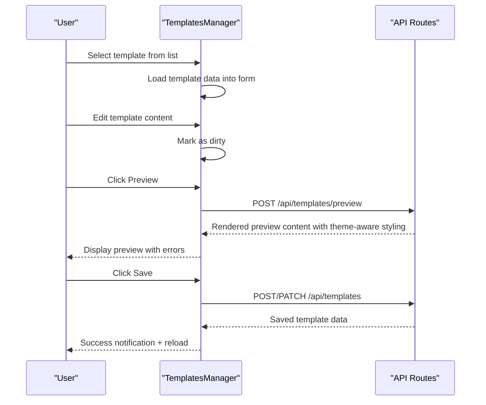

**Diagram sources**
- [templates-manager.tsx:82-244](file://components/templates-manager.tsx#L82-L244)
- [templates/route.ts:7-95](file://app/api/templates/route.ts#L7-L95)
- [templates/preview/route.ts:11-61](file://app/api/templates/preview/route.ts#L11-L61)

**Section sources**
- [templates-manager.tsx:1-492](file://components/templates-manager.tsx#L1-L492)
- [templates/route.ts:1-96](file://app/api/templates/route.ts#L1-L96)
- [templates/preview/route.ts:1-62](file://app/api/templates/preview/route.ts#L1-L62)

### Report Editor Component
- Responsibilities:
  - Manage date, content, templates, projects, and selection state.
  - Load configuration (templates and projects), preselect enabled projects.
  - Generate report content via API, show per-project errors, and mark saved state.
  - Save, copy, and AI polish content.
  - Live markdown editing with a third-party editor component.
  - Theme-aware rendering with proper color mode detection.
- State management patterns:
  - Local state via React hooks for UI state and form data.
  - Memoized derived state for enabled projects.
  - Callbacks extracted with useCallback to stabilize refs for effects and event handlers.
  - Effects orchestrate initial load and conditional generation.
  - Theme state management with hydration-safe mounting detection.
- Validation and feedback:
  - Toast notifications for success/error states.
  - Disabled controls during async operations.
- Lifecycle management:
  - Cleanup and deferred work handled via effect cleanup and setTimeout.
  - Hydration-safe theme detection prevents SSR mismatches.
- Accessibility and UX:
  - Clear labels and disabled states.
  - Live preview mode for immediate feedback.
  - Theme-aware editor with proper contrast and readability.
  - Semantic color classes ensure consistent theming across components.

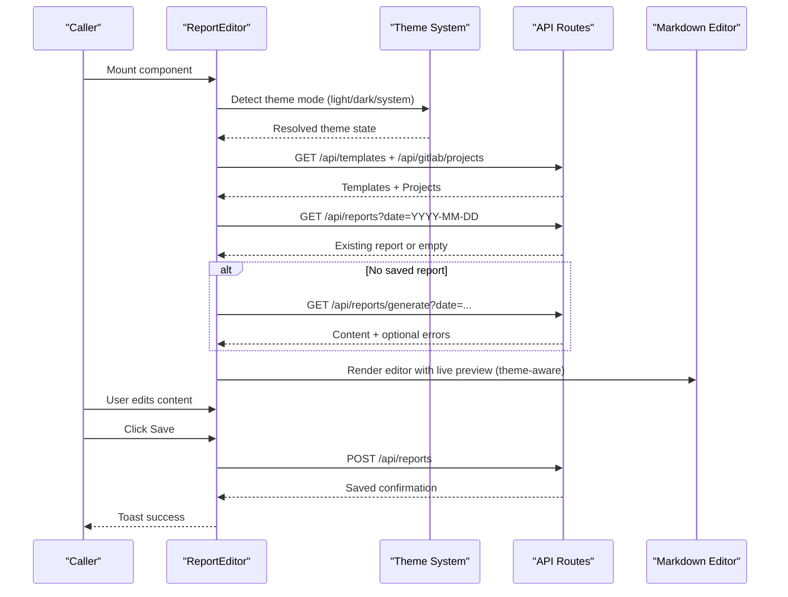

**Diagram sources**
- [report-editor.tsx:19-131](file://components/report-editor.tsx#L19-L131)
- [report-editor.tsx:172-282](file://components/report-editor.tsx#L172-L282)

**Section sources**
- [report-editor.tsx:1-296](file://components/report-editor.tsx#L1-L296)

### Settings Form Component
- Responsibilities:
  - Manage GitLab base URL and token, validate connectivity, and mask token display.
  - Filter settings via regex for commit titles.
  - Enable/disable projects and set default branches.
  - Create, edit, set default, and delete templates.
  - Render with theme-aware styling using semantic color classes.
- State management:
  - Separate state for user profile, projects, templates, filters, and saving flags.
  - Optimistic UI updates with rollback on failure.
- UX:
  - Searchable project list, inline editing, and clear actions with confirmations.
  - Theme-aware form styling with proper contrast and readability.
  - Semantic color classes ensure consistent theming across form elements.

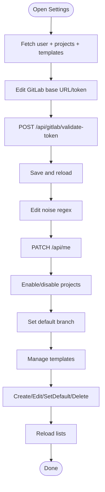

**Diagram sources**
- [settings-form.tsx:33-186](file://components/settings-form.tsx#L33-L186)
- [settings-form.tsx:193-367](file://components/settings-form.tsx#L193-L367)

**Section sources**
- [settings-form.tsx:1-368](file://components/settings-form.tsx#L1-L368)

### Team Reports (Admin) Component
- Responsibilities:
  - Select date and list users with submission status.
  - Preview selected user's report content.
  - Render with theme-aware styling using semantic color classes.
- State management:
  - Date, rows, and active user ID.
  - Theme state management with hydration-safe mounting detection.
- UX:
  - Left panel for user list with submission indicators.
  - Right panel for report preview with theme-aware markdown rendering.
  - Theme-aware styling ensures consistent appearance across both panels.

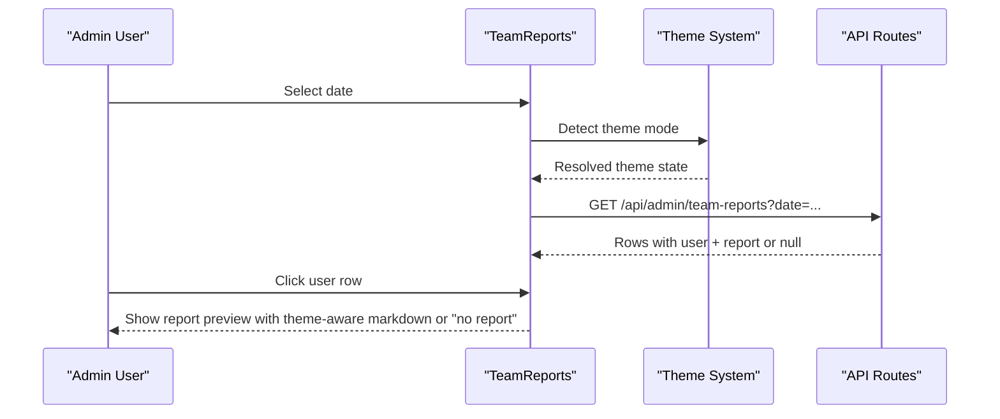

**Diagram sources**
- [team-reports.tsx:23-42](file://components/team-reports.tsx#L23-L42)
- [team-reports.tsx:43-113](file://components/team-reports.tsx#L43-L113)

**Section sources**
- [team-reports.tsx:1-127](file://components/team-reports.tsx#L1-L127)

### Users Admin (Admin) Component
- Responsibilities:
  - Create users with username, display name, password, and role.
  - Reset passwords, change roles, and delete users.
  - Render with theme-aware styling using semantic color classes.
- State management:
  - Users list and form fields for creation.
- UX:
  - Inline role selector and action buttons with confirmations.
  - Theme-aware form styling with proper contrast and readability.

```mermaid
flowchart TD
Start(["Open Users Admin"]) --> Load["GET /api/admin/users"]
Load --> Create["POST /api/admin/users (create)"]
Create --> UpdateRole["PATCH /api/admin/users (role)"]
UpdateRole --> ResetPwd["PATCH /api/admin/users (password)]
ResetPwd --> Delete["DELETE /api/admin/users"]
Delete --> Reload["Reload users list"]
Reload --> End(["Done"])
```

**Diagram sources**
- [users-admin.tsx:16-87](file://components/users-admin.tsx#L16-L87)
- [users-admin.tsx:89-186](file://components/users-admin.tsx#L89-L186)

**Section sources**
- [users-admin.tsx:1-187](file://components/users-admin.tsx#L1-L187)

### Authentication and Route Protection
- NextAuth configuration defines JWT-based sessions, credential provider, and session/user typing.
- Server utilities provide typed session retrieval and enforcement helpers.
- Middleware enforces authentication for protected routes and redirects unauthenticated users to login.

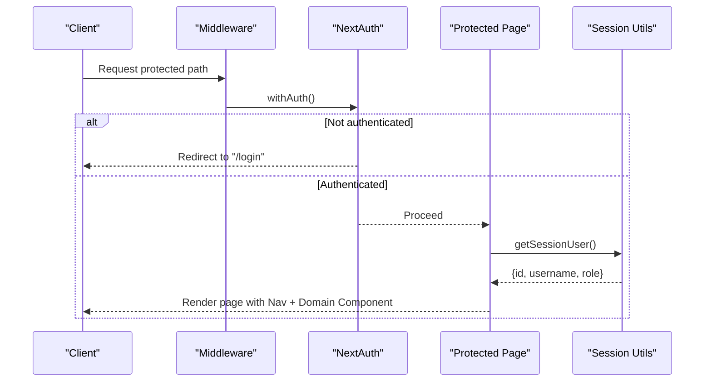

**Diagram sources**
- [middleware.ts:1-10](file://middleware.ts#L1-L10)
- [auth.ts:30-77](file://lib/auth.ts#L30-L77)
- [session.ts:11-37](file://lib/session.ts#L11-L37)
- [page.tsx:8-20](file://app/page.tsx#L8-L20)
- [admin/team-reports/page.tsx:8-21](file://app/admin/team-reports/page.tsx#L8-L21)

**Section sources**
- [auth.ts:1-77](file://lib/auth.ts#L1-L77)
- [session.ts:1-56](file://lib/session.ts#L1-L56)
- [middleware.ts:1-10](file://middleware.ts#L1-L10)
- [page.tsx:1-20](file://app/page.tsx#L1-L20)
- [admin/team-reports/page.tsx:1-22](file://app/admin/team-reports/page.tsx#L1-L22)

## Dark Mode Theming System

### Overview
The application implements a comprehensive dark mode theming system using next-themes integration with CSS custom properties for semantic theming. This system provides automatic theme detection, manual theme switching, and consistent styling across all components with the new "极报" brand identity.

### Implementation Architecture
- **next-themes Provider**: Wraps the application with ThemeProvider that manages theme state and persistence.
- **CSS Custom Properties**: Defines semantic color variables (--background, --foreground, --card, --muted, --border, --primary) for both light and dark modes.
- **Tailwind Integration**: Extends Tailwind theme with CSS variable-based color definitions for seamless integration.
- **Component-Level Theme Detection**: Individual components use useTheme hook to detect and respond to theme changes.

### Theme Provider Configuration
The ThemeProvider is configured with:
- `attribute="class"`: Applies theme classes to the html element
- `defaultTheme="system"`: Defaults to system preference
- `enableSystem`: Allows system theme detection
- `disableTransitionOnChange`: Prevents flashing during theme transitions

### CSS Custom Properties System
The theming system uses semantic CSS custom properties defined in globals.css:
- Light mode values: --background: 250 250 250, --foreground: 17 24 39, etc.
- Dark mode values: --background: 17 24 39, --foreground: 243 244 246, etc.
- Automatic color-scheme switching for proper browser support

### Tailwind Theme Extension
Tailwind is configured to use CSS variables for color definitions:
- Colors extend with rgb(var(--color) / <alpha-value>) syntax
- Supports semantic naming: background, foreground, card, muted, border, primary
- Enables consistent color usage across components

### Theme Toggle Component
The ThemeToggle component provides three-state theme switching:
- Light mode: Sun icon with light theme
- Dark mode: Moon icon with dark theme  
- System mode: Laptop icon following system preference
- Hydration-safe implementation prevents SSR mismatches
- Accessible with proper aria-labels and titles

### Component Integration Patterns
All domain components integrate with the theming system:
- useTheme hook for theme detection
- Hydration-safe mounting detection
- Color mode detection for external components (markdown editor)
- Semantic Tailwind classes for consistent styling
- Proper contrast ratios in both light and dark modes

### Benefits
- **Consistent Experience**: Unified theming across all components and pages with "极报" brand identity
- **User Control**: Manual theme switching with persistent preferences
- **System Integration**: Automatic detection of OS theme preference
- **Accessibility**: Proper contrast ratios and color scheme support
- **Maintainability**: Semantic color system reduces hardcoded colors
- **Performance**: Efficient CSS variable-based theming with minimal overhead

**Section sources**
- [providers.tsx:6-17](file://app/providers.tsx#L6-L17)
- [theme-toggle.tsx:1-103](file://components/theme-toggle.tsx#L1-L103)
- [tailwind.config.ts:9-22](file://tailwind.config.ts#L9-L22)
- [globals.css:5-27](file://app/globals.css#L5-L27)
- [nav.tsx:8](file://components/nav.tsx#L8)
- [report-editor.tsx:36-42](file://components/report-editor.tsx#L36-L42)
- [history-view.tsx:26-32](file://components/history-view.tsx#L26-L32)
- [team-reports.tsx:33-39](file://components/team-reports.tsx#L33-L39)

## Dependency Analysis
- Component dependencies:
  - Pages depend on Nav and domain components including new StatsView, ProjectsManager, TemplatesManager, and ThemeToggle.
  - Domain components depend on shared utilities, Tailwind classes, and theme-aware rendering.
  - Nav depends on NextAuth for user info and sign-out, and ThemeToggle for theme switching.
  - ReportEditor, HistoryView, and TeamReports depend on the markdown editor component with theme-aware rendering.
  - StatsView depends on API route for commit statistics.
  - ProjectsManager depends on API route for GitLab project management.
  - TemplatesManager depends on API routes for template CRUD and preview.
  - ThemeToggle depends on next-themes for theme state management.
  - **Updated** Login page depends on NextAuth for authentication and uses new PNG logo.
- External libraries:
  - NextAuth for authentication and session management.
  - @uiw/react-md-editor for markdown editing and preview with theme-aware rendering.
  - next-themes for comprehensive theme management and state persistence.
  - react-hot-toast for toast notifications with theme-aware styling.
  - dayjs for date utilities.
- Styling:
  - Tailwind CSS configured with CSS variables for theme tokens.
  - CSS custom properties for semantic theming with light/dark mode variants.
  - Utility helper merges classes and resolves conflicts.

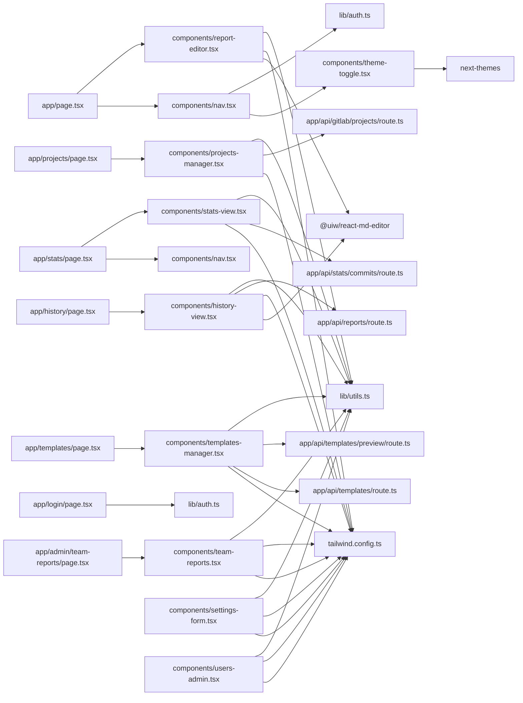

**Diagram sources**
- [page.tsx:1-20](file://app/page.tsx#L1-L20)
- [admin/team-reports/page.tsx:1-22](file://app/admin/team-reports/page.tsx#L1-L22)
- [stats/page.tsx:1-21](file://app/stats/page.tsx#L1-L21)
- [projects/page.tsx:1-27](file://app/projects/page.tsx#L1-L27)
- [templates/page.tsx:1-27](file://app/templates/page.tsx#L1-L27)
- [history/page.tsx:1-21](file://app/history/page.tsx#L1-L21)
- [login/page.tsx:1-164](file://app/login/page.tsx#L1-L164)
- [nav.tsx:1-177](file://components/nav.tsx#L1-L177)
- [report-editor.tsx:1-296](file://components/report-editor.tsx#L1-L296)
- [history-view.tsx:1-330](file://components/history-view.tsx#L1-L330)
- [settings-form.tsx:1-368](file://components/settings-form.tsx#L1-L368)
- [team-reports.tsx:1-127](file://components/team-reports.tsx#L1-L127)
- [users-admin.tsx:1-187](file://components/users-admin.tsx#L1-L187)
- [stats-view.tsx:1-258](file://components/stats-view.tsx#L1-L258)
- [projects-manager.tsx:1-343](file://components/projects-manager.tsx#L1-L343)
- [templates-manager.tsx:1-492](file://components/templates-manager.tsx#L1-L492)
- [theme-toggle.tsx:1-103](file://components/theme-toggle.tsx#L1-L103)
- [auth.ts:1-77](file://lib/auth.ts#L1-L77)
- [utils.ts:1-7](file://lib/utils.ts#L1-L7)
- [tailwind.config.ts:1-26](file://tailwind.config.ts#L1-L26)
- [globals.css:1-44](file://app/globals.css#L1-L44)
- [stats/commits/route.ts:1-129](file://app/api/stats/commits/route.ts#L1-L129)
- [gitlab/projects/route.ts:1-163](file://app/api/gitlab/projects/route.ts#L1-L163)
- [templates/route.ts:1-96](file://app/api/templates/route.ts#L1-L96)
- [templates/preview/route.ts:1-62](file://app/api/templates/preview/route.ts#L1-L62)
- [reports/route.ts:1-95](file://app/api/reports/route.ts#L1-L95)
- [package.json:25](file://package.json#L25)

**Section sources**
- [page.tsx:1-20](file://app/page.tsx#L1-L20)
- [admin/team-reports/page.tsx:1-22](file://app/admin/team-reports/page.tsx#L1-L22)
- [stats/page.tsx:1-21](file://app/stats/page.tsx#L1-L21)
- [projects/page.tsx:1-27](file://app/projects/page.tsx#L1-L27)
- [templates/page.tsx:1-27](file://app/templates/page.tsx#L1-L27)
- [history/page.tsx:1-21](file://app/history/page.tsx#L1-L21)
- [login/page.tsx:1-164](file://app/login/page.tsx#L1-L164)
- [nav.tsx:1-177](file://components/nav.tsx#L1-L177)
- [report-editor.tsx:1-296](file://components/report-editor.tsx#L1-L296)
- [history-view.tsx:1-330](file://components/history-view.tsx#L1-L330)
- [settings-form.tsx:1-368](file://components/settings-form.tsx#L1-L368)
- [team-reports.tsx:1-127](file://components/team-reports.tsx#L1-L127)
- [users-admin.tsx:1-187](file://components/users-admin.tsx#L1-L187)
- [stats-view.tsx:1-258](file://components/stats-view.tsx#L1-L258)
- [projects-manager.tsx:1-343](file://components/projects-manager.tsx#L1-L343)
- [templates-manager.tsx:1-492](file://components/templates-manager.tsx#L1-L492)
- [theme-toggle.tsx:1-103](file://components/theme-toggle.tsx#L1-L103)
- [auth.ts:1-77](file://lib/auth.ts#L1-L77)
- [utils.ts:1-7](file://lib/utils.ts#L1-L7)
- [tailwind.config.ts:1-26](file://tailwind.config.ts#L1-L26)
- [globals.css:1-44](file://app/globals.css#L1-L44)
- [stats/commits/route.ts:1-129](file://app/api/stats/commits/route.ts#L1-L129)
- [gitlab/projects/route.ts:1-163](file://app/api/gitlab/projects/route.ts#L1-L163)
- [templates/route.ts:1-96](file://app/api/templates/route.ts#L1-L96)
- [templates/preview/route.ts:1-62](file://app/api/templates/preview/route.ts#L1-L62)
- [reports/route.ts:1-95](file://app/api/reports/route.ts#L1-L95)
- [package.json:25](file://package.json#L25)

## Performance Considerations
- Client-side rendering and dynamic imports:
  - Markdown editor is loaded dynamically to reduce initial bundle size.
  - Heavy components like StatsView, ProjectsManager, and TemplatesManager are client-only.
  - ThemeToggle uses hydration-safe mounting to prevent SSR mismatches.
  - **Enhanced**: HistoryView benefits from automatic content loading optimization.
  - **Updated** Login page uses optimized PNG logo for fast loading.
- State stability:
  - useCallback used for event handlers and callbacks to prevent unnecessary re-renders.
  - useMemo used for derived data (e.g., enabled projects, filtered projects).
  - Theme state management optimized with hydration detection.
- Async operations:
  - Parallel loading for templates and projects.
  - Disabled controls during async operations to avoid redundant requests.
  - Batch operations with Promise.allSettled for reliable bulk updates.
  - **Enhanced**: Automatic content loading reduces manual API calls.
- Rendering:
  - Conditional rendering for admin-only sections reduces DOM size for members.
  - Grid layouts and virtualization-like techniques (limited by fixed sizes) keep lists manageable.
  - Expandable sections with lazy loading for detailed project breakdowns.
  - Theme-aware rendering minimizes reflows during theme changes.
- Styling:
  - Tailwind's JIT scanning targets app and components directories to minimize CSS.
  - CSS custom properties provide efficient theme switching without style recalculation.
  - Utility helper merges classes efficiently to avoid style conflicts.
  - Semantic color classes reduce style duplication and improve maintainability.

## Troubleshooting Guide
- Authentication issues:
  - Ensure middleware matcher covers protected routes and NextAuth pages are configured correctly.
  - Verify session retrieval helpers return expected user shape.
  - **Updated** Check that login page properly displays PNG logo and "极报" brand name.
- Navigation and route protection:
  - Confirm middleware matcher includes intended paths and redirects to login when missing session.
  - Check that new navigation items (Statistics, Projects, Templates) are properly integrated.
  - **Updated** Verify that navigation component displays consistent "极报" branding.
- Editor and API errors:
  - Check toast messages for explicit error feedback from API responses.
  - Validate that report generation and saving endpoints return expected shapes.
  - For StatsView, ensure GitLab credentials are configured before querying statistics.
  - For ProjectsManager, verify GitLab project access permissions.
  - For TemplatesManager, check Handlebars syntax validity during preview.
  - **Enhanced**: For HistoryView, verify automatic content loading works correctly.
- State synchronization:
  - After save/edit operations, refresh lists or summaries to reflect updates (e.g., reload month after save).
  - For bulk operations, monitor Promise.allSettled results for individual operation outcomes.
  - **Enhanced**: HistoryView state management handles automatic date selection and content loading.
- Styling and responsiveness:
  - Confirm Tailwind content paths include app and components directories.
  - Use responsive utilities consistently (e.g., grid columns) and test across screen sizes.
  - Check that new components properly utilize Tailwind utility classes.
  - **Updated** Verify that new PNG logo loads correctly across different devices and browsers.
- Theme system issues:
  - Verify next-themes is properly installed and configured.
  - Check that CSS custom properties are defined in globals.css.
  - Ensure ThemeProvider wraps the application correctly.
  - Test theme switching functionality across different browsers and devices.
  - Verify semantic color classes are used consistently throughout components.
  - **Enhanced**: HistoryView theme integration works seamlessly with automatic content loading.
  - **Updated** Confirm that "极报" brand styling is consistent across light and dark themes.

**Section sources**
- [middleware.ts:1-10](file://middleware.ts#L1-L10)
- [session.ts:11-37](file://lib/session.ts#L11-L37)
- [report-editor.tsx:67-91](file://components/report-editor.tsx#L67-L91)
- [history-view.tsx:53-73](file://components/history-view.tsx#L53-L73)
- [history-view.tsx:158-166](file://components/history-view.tsx#L158-L166)
- [stats-view.tsx:51-74](file://components/stats-view.tsx#L51-L74)
- [projects-manager.tsx:26-35](file://components/projects-manager.tsx#L26-L35)
- [templates-manager.tsx:162-194](file://components/templates-manager.tsx#L162-L194)
- [tailwind.config.ts:4-7](file://tailwind.config.ts#L4-L7)
- [theme-toggle.tsx:14-21](file://components/theme-toggle.tsx#L14-L21)
- [globals.css:5-27](file://app/globals.css#L5-L27)
- [providers.tsx:8-12](file://app/providers.tsx#L8-L12)
- [login/page.tsx:49-55](file://app/login/page.tsx#L49-L55)
- [nav.tsx:65-68](file://components/nav.tsx#L65-L68)

## Conclusion
The Pingyun Report frontend is structured around a clean layout and providers layer with comprehensive dark mode theming system, robust client-side components for editing, history, settings, admin views, statistics, project management, and template management. The theming system provides seamless light/dark mode switching with semantic color management, ensuring consistent user experience across all components with the new "极报" brand identity. Authentication is enforced via NextAuth and middleware, while Tailwind CSS with CSS custom properties and next-themes integration streamline styling and composition. The components emphasize user experience with live previews, clear feedback, responsive layouts, and proper accessibility support, all enhanced by the comprehensive theming system.

**Recent Enhancement**: The HistoryView component has been significantly improved with automatic today's date selection and content loading functionality, providing users with a streamlined workflow that eliminates manual date selection steps. This enhancement maintains all existing functionality while dramatically improving the user experience for daily report access and editing.

**Updated** The application has undergone a complete rebranding with the "极报" (Jibao) visual identity, featuring a new PNG logo, consistent brand messaging, and unified design language across all user interface elements. The login page now prominently displays the "极报" brand with its new visual identity, while the navigation component consistently reflects the rebranded design throughout the application.

The addition of StatsView, ProjectsManager, TemplatesManager, and the dark mode theming system significantly enhances the system's capabilities for comprehensive development workflow management with modern, accessible, and maintainable frontend architecture.

## Appendices

### Styling Approaches and Composition Patterns
- Tailwind CSS with Dark Mode Theming:
  - Centralized theme tokens via CSS variables (--background, --foreground, --card, --muted, --border, --primary).
  - Semantic color classes replace hardcoded colors for consistent theming.
  - next-themes integration provides automatic theme detection and manual switching.
- Composition patterns:
  - Container components (pages) pass user and minimal props to presentational components.
  - Utility helper merges classes safely to avoid duplicates and conflicts.
  - New components follow consistent styling patterns with card-based layouts and responsive grids.
  - Theme-aware components use useTheme hook for proper color mode detection.
  - **Updated** All components incorporate the new "极报" brand identity with consistent visual design.
- Responsive design:
  - Use of grid and flex utilities with breakpoints to adapt to different screen sizes.
  - Mobile-first approach with hamburger menu for navigation.
  - Adaptive layouts for new components (split-pane for TemplatesManager, expandable sections for StatsView).
  - Theme-aware responsive design ensures proper contrast in both light and dark modes.
  - **Updated** Login page features optimized responsive design for the new branding.
- Accessibility:
  - Semantic HTML and labels; disabled states for buttons during async operations.
  - Proper ARIA attributes for interactive elements.
  - Keyboard navigation support for all interactive components.
  - Color contrast ratios maintained across both light and dark themes.
- Cross-browser compatibility:
  - Modern CSS variables and Tailwind utilities are broadly supported; test critical interactions across browsers.
  - next-themes provides fallbacks for older browsers.
  - CSS custom properties ensure graceful degradation when unsupported.
  - **Updated** PNG logo format ensures broad browser compatibility for the new branding.

**Section sources**
- [tailwind.config.ts:1-26](file://tailwind.config.ts#L1-L26)
- [utils.ts:1-7](file://lib/utils.ts#L1-L7)
- [nav.tsx:20-177](file://components/nav.tsx#L20-L177)
- [report-editor.tsx:172-296](file://components/report-editor.tsx#L172-L296)
- [history-view.tsx:89-330](file://components/history-view.tsx#L89-L330)
- [settings-form.tsx:193-367](file://components/settings-form.tsx#L193-L367)
- [team-reports.tsx:43-127](file://components/team-reports.tsx#L43-L127)
- [users-admin.tsx:89-187](file://components/users-admin.tsx#L89-L187)
- [stats-view.tsx:76-258](file://components/stats-view.tsx#L76-L258)
- [projects-manager.tsx:179-343](file://components/projects-manager.tsx#L179-L343)
- [templates-manager.tsx:276-492](file://components/templates-manager.tsx#L276-L492)
- [theme-toggle.tsx:1-103](file://components/theme-toggle.tsx#L1-L103)
- [globals.css:1-44](file://app/globals.css#L1-L44)
- [login/page.tsx:49-55](file://app/login/page.tsx#L49-L55)

### Component Integration and Customization Patterns
- Integration:
  - Wrap page content with Providers to expose session context and theme provider.
  - Pass user object from server utilities to Nav and conditionally render admin sections.
  - Use dynamic imports for heavy components (e.g., markdown editor, new domain components) to optimize load.
  - Implement proper route protection for new pages (Statistics, Projects, Templates).
  - Integrate ThemeToggle component into navigation for user-controlled theme switching.
  - **Enhanced** HistoryView integrates automatic content loading seamlessly with existing workflow.
  - **Updated** Login page integrates with NextAuth for authentication and displays new "极报" branding.
- Customization:
  - Extend templates and project filtering logic in domain components.
  - Add new admin features by following the UsersAdmin pattern (CRUD + confirmations).
  - Introduce new route protection by adding paths to middleware matcher and enforcing role checks in pages.
  - Customize StatsView data visualization by extending TYPE_META and adding new chart types.
  - Enhance ProjectsManager with additional GitLab integration features.
  - Extend TemplatesManager with advanced Handlebars features and custom helpers.
  - Customize theming by modifying CSS custom properties in globals.css.
  - Extend theme system by adding new semantic color classes to Tailwind config.
  - Implement additional theme-aware components using useTheme hook pattern.
  - **Enhanced** HistoryView enhancement demonstrates best practices for automatic state initialization and content loading.
  - **Updated** All components can be customized to maintain the "极报" brand identity consistently.

**Section sources**
- [providers.tsx:1-18](file://app/providers.tsx#L1-L18)
- [page.tsx:8-20](file://app/page.tsx#L8-L20)
- [admin/team-reports/page.tsx:8-21](file://app/admin/team-reports/page.tsx#L8-L21)
- [stats/page.tsx:8-21](file://app/stats/page.tsx#L8-L21)
- [projects/page.tsx:8-27](file://app/projects/page.tsx#L8-L27)
- [templates/page.tsx:8-27](file://app/templates/page.tsx#L8-L27)
- [history/page.tsx:8-21](file://app/history/page.tsx#L8-L21)
- [login/page.tsx:1-164](file://app/login/page.tsx#L1-L164)
- [report-editor.tsx:9](file://components/report-editor.tsx#L9)
- [users-admin.tsx:33-87](file://components/users-admin.tsx#L33-L87)
- [middleware.ts:7-9](file://middleware.ts#L7-L9)
- [nav.tsx:35-59](file://components/nav.tsx#L35-L59)
- [theme-toggle.tsx:1-103](file://components/theme-toggle.tsx#L1-L103)
- [globals.css:5-27](file://app/globals.css#L5-L27)
- [tailwind.config.ts:9-22](file://tailwind.config.ts#L9-L22)
- [history-view.tsx:18-21](file://components/history-view.tsx#L18-L21)
- [history-view.tsx:158-166](file://components/history-view.tsx#L158-L166)