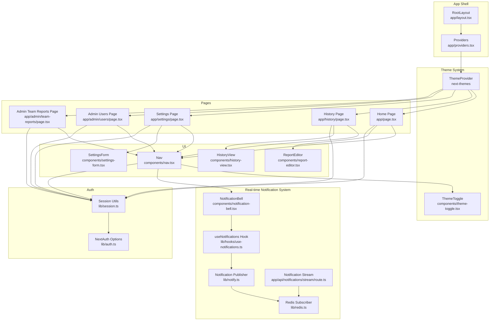
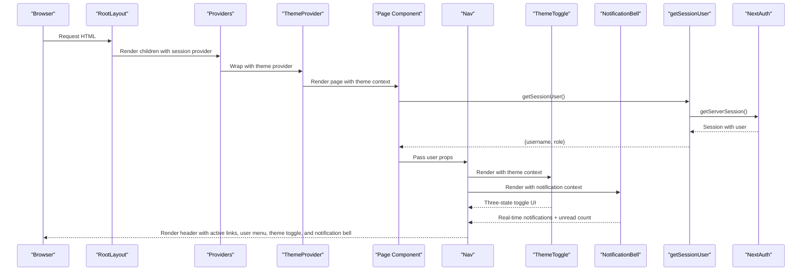
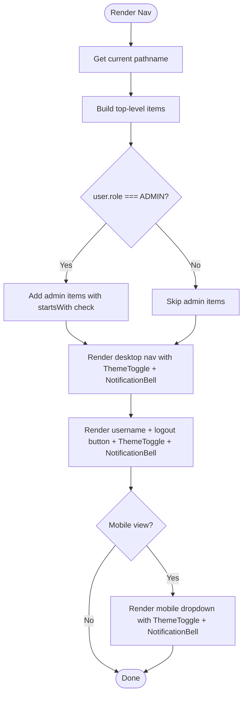
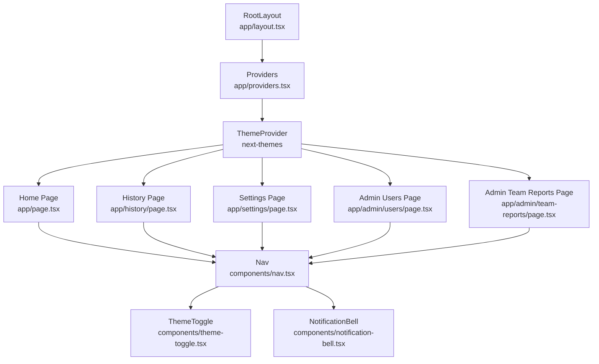
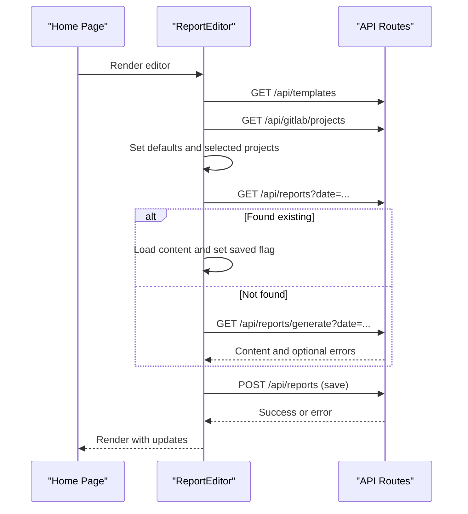
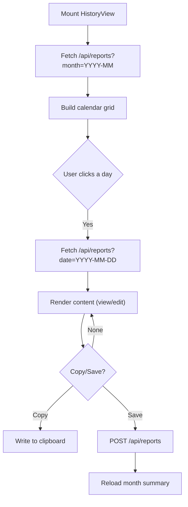
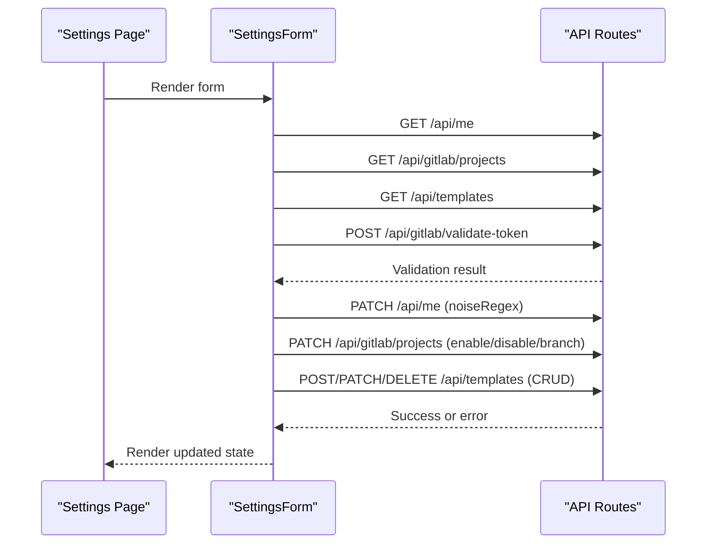
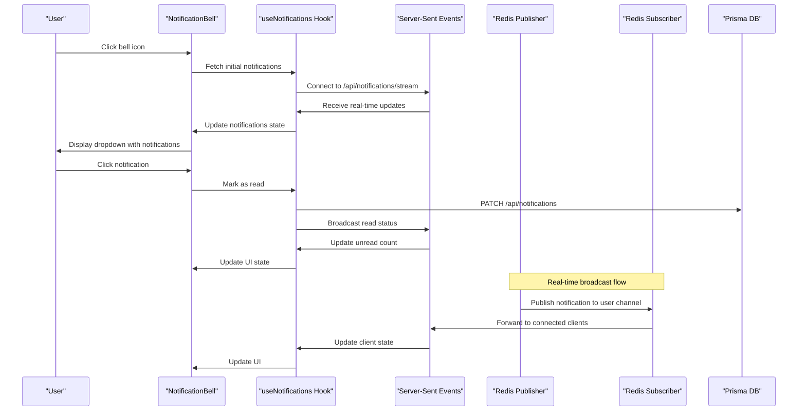
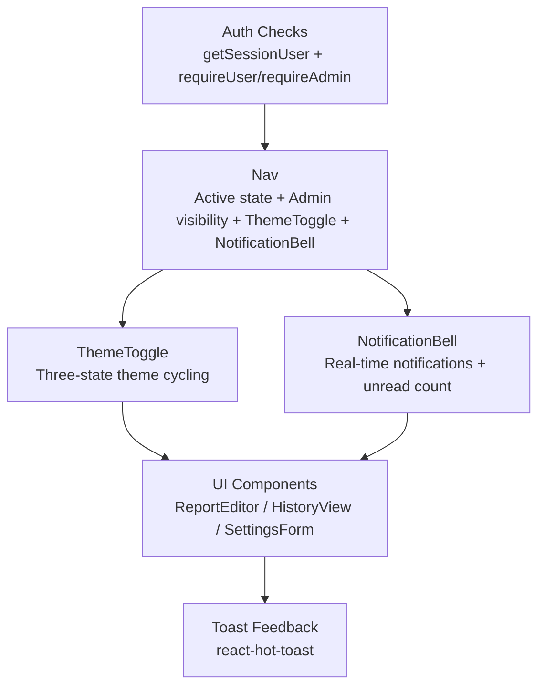
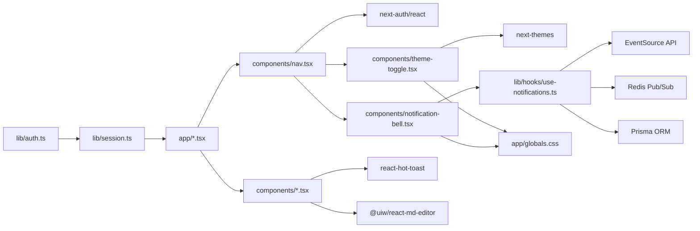

# Navigation and UI Elements

<cite>
**Referenced Files in This Document**
- [nav.tsx](file://components/nav.tsx)
- [notification-bell.tsx](file://components/notification-bell.tsx)
- [theme-toggle.tsx](file://components/theme-toggle.tsx)
- [layout.tsx](file://app/layout.tsx)
- [providers.tsx](file://app/providers.tsx)
- [page.tsx](file://app/page.tsx)
- [history/page.tsx](file://app/history/page.tsx)
- [settings/page.tsx](file://app/settings/page.tsx)
- [admin/users/page.tsx](file://app/admin/users/page.tsx)
- [admin/team-reports/page.tsx](file://app/admin/team-reports/page.tsx)
- [auth.ts](file://lib/auth.ts)
- [session.ts](file://lib/session.ts)
- [report-editor.tsx](file://components/report-editor.tsx)
- [settings-form.tsx](file://components/settings-form.tsx)
- [history-view.tsx](file://components/history-view.tsx)
- [use-notifications.ts](file://lib/hooks/use-notifications.ts)
- [notify.ts](file://lib/notify.ts)
- [redis.ts](file://lib/redis.ts)
- [notifications/route.ts](file://app/api/notifications/route.ts)
- [notifications/stream/route.ts](file://app/api/notifications/stream/route.ts)
- [comments/route.ts](file://app/api/comments/route.ts)
- [likes/route.ts](file://app/api/likes/route.ts)
- [globals.css](file://app/globals.css)
- [tailwind.config.ts](file://tailwind.config.ts)
</cite>

## Update Summary
**Changes Made**
- Updated notification system architecture documentation to reflect the new Redis pub/sub with SSE implementation
- Enhanced real-time notification system documentation with detailed SSE connection management and Redis integration
- Updated performance considerations section to address the benefits of the new real-time architecture
- Added comprehensive documentation for the notification publishing and subscription mechanisms
- Updated troubleshooting guide to include Redis and SSE-specific issues
- Enhanced notification system architecture diagrams to show the complete real-time flow

## Table of Contents
1. [Introduction](#introduction)
2. [Project Structure](#project-structure)
3. [Core Components](#core-components)
4. [Architecture Overview](#architecture-overview)
5. [Detailed Component Analysis](#detailed-component-analysis)
6. [Dependency Analysis](#dependency-analysis)
7. [Performance Considerations](#performance-considerations)
8. [Accessibility and Keyboard Navigation](#accessibility-and-keyboard-navigation)
9. [Styling and Theming](#styling-and-theming)
10. [Troubleshooting Guide](#troubleshooting-guide)
11. [Conclusion](#conclusion)

## Introduction
This document explains the navigation and UI element components of the application. It covers:
- Navigation component structure with route-based active state management, authentication-aware visibility, integrated theme switching, and real-time notification bell
- Layout component's role in page structure, header management, and responsive design patterns
- NotificationBell component implementation with real-time server-sent events and Redis pub/sub integration
- ThemeToggle component implementation with three-state theme cycling (light/dark/system)
- UI element patterns including form controls, buttons, modals, and status indicators
- Accessibility features, keyboard navigation support, and screen reader compatibility
- Styling approaches using Tailwind CSS classes, responsive breakpoints, and dark mode considerations
- Component reusability patterns, prop interfaces, and integration with the authentication system
- Examples of UI customization and theming approaches
- Comprehensive notification system architecture with real-time updates using Redis pub/sub and SSE

## Project Structure
The application follows a Next.js App Router structure with a shared layout and per-page routes. Navigation is centralized in a reusable component with integrated theme switching, notification bell, and injected into pages after authentication checks. UI elements are implemented as client components with consistent styling via Tailwind CSS and CSS variables.

**Diagram sources**
- [layout.tsx:17-35](file://app/layout.tsx#L17-L35)
- [providers.tsx:6-17](file://app/providers.tsx#L6-L17)
- [theme-toggle.tsx:10-102](file://components/theme-toggle.tsx#L10-L102)
- [nav.tsx:8-175](file://components/nav.tsx#L8-L175)
- [notification-bell.tsx:18-132](file://components/notification-bell.tsx#L18-L132)
- [report-editor.tsx:19-296](file://components/report-editor.tsx#L19-L296)
- [history-view.tsx:18-221](file://components/history-view.tsx#L18-L221)
- [settings-form.tsx:33-368](file://components/settings-form.tsx#L33-L368)
- [auth.ts:30-77](file://lib/auth.ts#L30-L77)
- [session.ts:12-37](file://lib/session.ts#L12-L37)
- [use-notifications.ts:15-88](file://lib/hooks/use-notifications.ts#L15-L88)
- [notify.ts:16-24](file://lib/notify.ts#L16-L24)
- [redis.ts:1-17](file://lib/redis.ts#L1-L17)
- [notifications/stream/route.ts:1-65](file://app/api/notifications/stream/route.ts#L1-L65)

**Section sources**
- [layout.tsx:17-35](file://app/layout.tsx#L17-L35)
- [providers.tsx:6-17](file://app/providers.tsx#L6-L17)
- [theme-toggle.tsx:10-102](file://components/theme-toggle.tsx#L10-L102)
- [nav.tsx:8-175](file://components/nav.tsx#L8-L175)
- [notification-bell.tsx:18-132](file://components/notification-bell.tsx#L18-L132)

## Core Components
- Navigation component
  - Purpose: Renders top-level navigation links, admin-only sections for admins, user greeting, logout, integrated theme switching, and real-time notification bell.
  - Active state: Uses the current pathname to highlight the active route or admin subsections.
  - Authentication-aware: Conditionally renders admin links based on user role.
  - Theme integration: Includes ThemeToggle component for three-state theme cycling (light/dark/system).
  - Notification integration: Includes NotificationBell component for real-time notification display with unread count indicator.
  - Props: Accepts a user object with username and role.
  - Styling: Uses Tailwind utilities for spacing, borders, colors, and responsive layout.
- NotificationBell component
  - Purpose: Provides real-time notification display with unread count indicator, dropdown menu for notification list, and navigation to related content.
  - Real-time integration: Uses server-sent events (SSE) with Redis pub/sub for instant notification delivery.
  - Interactive features: Click-to-read marking, mark-all-read functionality, and navigation to related report content.
  - Visual design: Bell icon with red badge for unread count, dropdown with notification list and timestamps.
  - Accessibility: Proper aria-labels and keyboard navigation support.
- ThemeToggle component
  - Purpose: Provides three-state theme switching with automatic cycling between light, dark, and system preferences.
  - Implementation: Uses next-themes hook for theme state management and SSR-safe mounting detection.
  - Icons: Displays sun (light), moon (dark), or laptop (system) based on current theme state.
  - Accessibility: Includes proper aria-labels and title attributes for screen readers.
- Layout and shell
  - RootLayout wraps children with Providers to enable session context and theme provider.
  - Providers inject NextAuth session provider and ThemeProvider for client-side hooks.
- UI elements
  - ReportEditor: Date selector, template dropdown, action buttons, project toggles, errors, and Markdown editor.
  - HistoryView: Month navigation, calendar grid, selection feedback, Markdown editor or rendered view, copy/save actions.
  - SettingsForm: GitLab connection, filtering settings, project enable/disable and branch selection, template management.

**Section sources**
- [nav.tsx:8-175](file://components/nav.tsx#L8-L175)
- [notification-bell.tsx:18-132](file://components/notification-bell.tsx#L18-L132)
- [theme-toggle.tsx:10-102](file://components/theme-toggle.tsx#L10-L102)
- [layout.tsx:17-35](file://app/layout.tsx#L17-L35)
- [providers.tsx:6-17](file://app/providers.tsx#L6-L17)
- [report-editor.tsx:19-296](file://components/report-editor.tsx#L19-L296)
- [history-view.tsx:18-221](file://components/history-view.tsx#L18-L221)
- [settings-form.tsx:33-368](file://components/settings-form.tsx#L33-L368)

## Architecture Overview
The navigation and UI architecture integrates routing, authentication, theme management, real-time notifications, and client-side interactivity:
- Pages fetch the session user and enforce access control before rendering.
- The Nav component receives the user and renders appropriate links with integrated theme switching and notification bell.
- NotificationBell component provides real-time notification display with server-sent events and Redis pub/sub integration.
- ThemeToggle component provides three-state theme cycling with next-themes integration.
- Client components manage local state, fetch data, and render UI patterns with theme-aware and notification-aware components.
- Tailwind CSS and CSS variables provide consistent styling and dark mode support.

**Diagram sources**
- [layout.tsx:17-35](file://app/layout.tsx#L17-L35)
- [providers.tsx:6-17](file://app/providers.tsx#L6-L17)
- [theme-toggle.tsx:10-102](file://components/theme-toggle.tsx#L10-L102)
- [nav.tsx:8-175](file://components/nav.tsx#L8-L175)
- [notification-bell.tsx:18-132](file://components/notification-bell.tsx#L18-L132)
- [session.ts:12-20](file://lib/session.ts#L12-L20)
- [auth.ts:30-77](file://lib/auth.ts#L30-L77)

## Detailed Component Analysis

### Navigation Component
- Route-based active state
  - Compares the current pathname with each item's href to apply an active class.
  - Admin subpaths use startsWith checks to mark parent sections active when inside nested routes.
- User menu and authentication-aware navigation
  - Displays the username and a logout button wired to signOut with a redirect to the login page.
  - Admin-only links are shown conditionally based on user role.
- Theme integration
  - Integrated ThemeToggle component for three-state theme switching (light/dark/system).
  - Desktop layout includes theme toggle in the user menu area.
  - Mobile layout includes theme toggle in the user menu section of the dropdown.
- Notification integration
  - Integrated NotificationBell component for real-time notification display with unread count indicator.
  - Desktop layout includes notification bell in the user menu area alongside theme toggle.
  - Mobile layout includes notification bell in the user menu section of the dropdown.
- Styling and responsiveness
  - Uses container utilities for max width and horizontal padding.
  - Responsive flex layout with gap-based spacing and text sizing.
  - Mobile hamburger menu with dropdown containing theme toggle, notification bell, and user controls.
- Reusability
  - Stateless functional component receiving user via props.
  - Can be composed with any page that provides a user object.

**Diagram sources**
- [nav.tsx:14-175](file://components/nav.tsx#L14-L175)

**Section sources**
- [nav.tsx:14-175](file://components/nav.tsx#L14-L175)

### NotificationBell Component
- Real-time notification system
  - Uses server-sent events (SSE) with EventSource API for instant notification delivery.
  - Integrates with Redis pub/sub for scalable real-time communication.
  - Maintains local state with notifications array and unread count.
- Interactive features
  - Dropdown menu displays notification list with timestamps and read/unread status.
  - Click-to-read marking automatically updates notification state and unread count.
  - Mark-all-read functionality clears all unread notifications.
  - Navigation to related report content when notifications have relatedId.
- Visual design and UX
  - Bell icon with red badge indicator for unread count (caps at 99+).
  - Dropdown positioned absolutely with shadow and scrollable content area.
  - Different styling for read vs unread notifications with subtle background highlighting.
  - Empty state with friendly "暂无通知" (No notifications) message.
- Accessibility features
  - Proper aria-label "通知" (Notifications) for screen reader compatibility.
  - Keyboard navigation support within dropdown menu.
  - Clear visual indicators for unread notifications with small red dot.
- Integration points
  - Used in both desktop and mobile navigation layouts.
  - Accessible via keyboard navigation and screen readers.
  - Seamlessly integrates with existing theme system.

**Section sources**
- [notification-bell.tsx:18-132](file://components/notification-bell.tsx#L18-L132)

### ThemeToggle Component
- Three-state theme cycling
  - Automatically cycles through light → dark → system → light theme states.
  - Maintains current theme state using next-themes hook.
  - Provides visual feedback with different icons for each state.
- SSR-safe implementation
  - Uses mounted state to prevent hydration mismatches during server-side rendering.
  - Renders placeholder div during SSR phase to ensure consistent markup.
- Icon representation
  - Laptop icon (system): Shows current system preference theme.
  - Moon icon (dark): Indicates dark theme is active.
  - Sun icon (light): Indicates light theme is active.
- Accessibility features
  - Proper aria-labels and title attributes for screen reader compatibility.
  - Clear labels indicating current theme state and action.
- Integration points
  - Used in both desktop and mobile navigation layouts.
  - Accessible via keyboard navigation and screen readers.

**Section sources**
- [theme-toggle.tsx:10-102](file://components/theme-toggle.tsx#L10-L102)

### Layout and Header Management
- Root layout
  - Provides global styles and wraps children with Providers.
  - Ensures session context and theme provider are available to client components.
- Theme provider configuration
  - ThemeProvider configured with defaultTheme="system" and enableSystem=true.
  - Uses attribute="class" to apply theme classes to html element.
  - disableTransitionOnChange prevents visual transition during theme switching.
- Header management
  - Pages render Nav immediately under the layout, ensuring consistent header across routes.
  - Main content area uses flexbox to fill remaining viewport height and center content.
  - NotificationBell integrates seamlessly with existing header layout structure.

**Diagram sources**
- [layout.tsx:17-35](file://app/layout.tsx#L17-L35)
- [providers.tsx:6-17](file://app/providers.tsx#L6-L17)
- [nav.tsx:8-175](file://components/nav.tsx#L8-L175)
- [theme-toggle.tsx:10-102](file://components/theme-toggle.tsx#L10-L102)
- [notification-bell.tsx:18-132](file://components/notification-bell.tsx#L18-L132)

**Section sources**
- [layout.tsx:17-35](file://app/layout.tsx#L17-L35)
- [providers.tsx:6-17](file://app/providers.tsx#L6-L17)
- [nav.tsx:8-175](file://components/nav.tsx#L8-L175)

### UI Element Patterns

#### Form Controls
- Inputs and selects
  - Used for date picking, template selection, GitLab base URL, tokens, and regex filters.
  - Consistent border, padding, and text sizing with disabled states and placeholder guidance.
- Checkboxes and toggles
  - Project enable/disable and branch selection with immediate PATCH requests.
- Buttons
  - Action buttons with primary vs muted variants, disabled states, and loading indicators.

#### Buttons
- Variants
  - Primary background/foreground for prominent actions.
  - Muted background for secondary actions.
- States
  - Disabled opacity adjustments and spinner-friendly labels.
- Accessibility
  - Semantic button elements with clear labels and visible focus states via default browser styles.

#### Modals and Dialogs
- No modal component is present in the codebase; dialogs are handled via native prompts and confirmations for template creation/deletion.

#### Status Indicators
- Toast notifications via react-hot-toast for user feedback on save, copy, AI polish, and error scenarios.
- Inline status messages for calendar entries and empty states.
- Notification bell with unread count indicator for real-time notification display.

**Section sources**
- [report-editor.tsx:19-296](file://components/report-editor.tsx#L19-L296)
- [settings-form.tsx:193-368](file://components/settings-form.tsx#L193-L368)
- [history-view.tsx:88-221](file://components/history-view.tsx#L88-L221)

### Report Editor
- State management
  - Tracks date, content, templates, projects, selections, and loading/saving flags.
  - Integrates theme awareness for editor appearance.
- Data fetching
  - Loads templates and projects on mount; generates content for a given date; saves and copies content.
- UI composition
  - Toolbar with date, template, regenerate, AI polish, copy, and save.
  - Project chips with selection feedback.
  - Errors panel for failed project fetches.
  - Markdown editor in live preview mode with theme-aware styling.

**Diagram sources**
- [page.tsx:8-19](file://app/page.tsx#L8-L19)
- [report-editor.tsx:19-296](file://components/report-editor.tsx#L19-L296)

**Section sources**
- [report-editor.tsx:19-296](file://components/report-editor.tsx#L19-L296)

### History View
- Calendar grid
  - Builds a month grid with empty placeholders for preceding days.
  - Highlights days with saved reports and today's date.
- Selection and editing
  - Click a date to load content; switch between rendered Markdown and editable editor.
  - Copy and save actions with toast feedback.
- Responsive layout
  - Two-column layout on medium screens and above, single column on smaller screens.
- Theme integration
  - Uses resolvedTheme from next-themes to determine editor appearance.
  - Mounts component to detect theme state after hydration.

**Diagram sources**
- [history/page.tsx:8-21](file://app/history/page.tsx#L8-L21)
- [history-view.tsx:18-221](file://components/history-view.tsx#L18-L221)

**Section sources**
- [history-view.tsx:18-221](file://components/history-view.tsx#L18-L221)

### Settings Form
- Data loading
  - Loads user, projects, and templates concurrently on mount.
- GitLab connection
  - Validates base URL and token; supports masked token display.
- Filtering and project settings
  - Regex filter persistence; project enable/disable and default branch selection.
- Templates management
  - Create, set default, edit, and delete templates with user prompts and server updates.

**Diagram sources**
- [settings/page.tsx:8-21](file://app/settings/page.tsx#L8-L21)
- [settings-form.tsx:33-368](file://components/settings-form.tsx#L33-L368)

**Section sources**
- [settings-form.tsx:33-368](file://components/settings-form.tsx#L33-L368)

### Real-time Notification System Architecture
**Updated** The notification system now uses Redis pub/sub with SSE instead of polling, providing instant real-time updates across multiple instances.

- Real-time communication
  - Server-sent events (SSE) using EventSource API for bidirectional real-time updates.
  - Redis pub/sub for scalable message distribution across multiple instances.
  - Automatic reconnection on connection failures with heartbeat mechanism.
- Data flow
  - Notifications created via createNotification function with database persistence.
  - Redis publisher broadcasts notifications to subscribed clients using user-specific channels.
  - useNotifications hook manages local state and SSE connection lifecycle.
  - Notification stream endpoint handles SSE connections with proper cleanup.
- User experience
  - Unread count badge on notification bell icon.
  - Latest notifications appear at the top of the dropdown list.
  - Automatic pagination to limit displayed notifications to 30 latest items.
  - Timestamps formatted in human-readable Chinese ("刚刚", "分钟前", "小时前", "天前").
  - Real-time updates without manual refresh or polling overhead.

**Diagram sources**
- [notification-bell.tsx:18-132](file://components/notification-bell.tsx#L18-L132)
- [use-notifications.ts:15-88](file://lib/hooks/use-notifications.ts#L15-L88)
- [notify.ts:16-24](file://lib/notify.ts#L16-L24)
- [redis.ts:1-17](file://lib/redis.ts#L1-L17)
- [notifications/stream/route.ts:1-65](file://app/api/notifications/stream/route.ts#L1-L65)

- Redis pub/sub implementation
  - Single publisher instance for PUBLISH commands using singleton pattern.
  - Separate subscriber instances created per SSE connection due to Redis limitations.
  - User-specific channels using pattern `notifications:{userId}` for isolation.
  - Automatic cleanup of subscriptions on client disconnect.
- SSE connection management
  - Heartbeat mechanism to establish and maintain connections.
  - Automatic reconnection on network failures.
  - Proper cleanup of EventSource instances on component unmount.
- Performance optimizations
  - Connection pooling with Redis client reuse.
  - Efficient notification deduplication and pagination.
  - Minimal payload size with JSON-encoded notifications.
  - Scalable architecture supporting multiple concurrent users.

**Section sources**
- [notification-bell.tsx:18-132](file://components/notification-bell.tsx#L18-L132)
- [use-notifications.ts:15-88](file://lib/hooks/use-notifications.ts#L15-L88)
- [notify.ts:16-24](file://lib/notify.ts#L16-L24)
- [redis.ts:1-17](file://lib/redis.ts#L1-L17)
- [notifications/stream/route.ts:1-65](file://app/api/notifications/stream/route.ts#L1-L65)
- [notifications/route.ts:1-46](file://app/api/notifications/route.ts#L1-L46)

### Conceptual Overview
- Authentication-aware navigation
  - Pages enforce session presence and role checks; Nav reflects user role to show admin sections.
- Route-based active state
  - Active class applied based on exact match or prefix for nested admin routes.
- Theme-aware UI patterns
  - Consistent form controls, button variants, and toast-based feedback across components.
  - ThemeToggle provides seamless theme switching experience.
- Notification-aware UI patterns
  - NotificationBell integrates real-time updates with existing navigation patterns.
  - Unread count badges provide immediate visual feedback for new notifications.
  - Dropdown interface maintains consistency with existing mobile/desktop layouts.
- UI patterns
  - Consistent form controls, button variants, and toast-based feedback across components.

[No sources needed since this diagram shows conceptual workflow, not actual code structure]

[No sources needed since this section doesn't analyze specific source files]

## Dependency Analysis
- Authentication system
  - NextAuth configuration defines JWT-based sessions and user shape.
  - Session utilities provide typed getters and guards for routes and client components.
- Navigation and pages
  - Pages depend on session utilities to enforce access control and pass user to Nav.
  - Nav depends on NextAuth client hooks for sign-out and pathname for active state.
  - Nav integrates ThemeToggle for theme management and NotificationBell for real-time notifications.
- Theme system
  - ThemeProvider from next-themes manages theme state and persistence.
  - ThemeToggle component provides three-state theme cycling with SSR safety.
  - CSS variables in globals.css define theme-specific color values.
- Real-time notification system
  - NotificationBell component depends on useNotifications hook for state management.
  - useNotifications hook uses EventSource for SSE connections and Redis for pub/sub.
  - Redis publisher and subscriber handle real-time communication between instances.
  - Prisma ORM manages notification persistence in the database.
  - Notification creation triggers Redis publish to user-specific channels.
- UI components
  - Client components depend on APIs for data and state; they render UI patterns consistently.
  - Components like ReportEditor and HistoryView integrate theme awareness for editor appearance.
  - NotificationBell integrates with existing UI patterns for consistent user experience.

**Diagram sources**
- [auth.ts:30-77](file://lib/auth.ts#L30-L77)
- [session.ts:12-37](file://lib/session.ts#L12-L37)
- [page.tsx:8-19](file://app/page.tsx#L8-L19)
- [nav.tsx:8-175](file://components/nav.tsx#L8-L175)
- [theme-toggle.tsx:10-102](file://components/theme-toggle.tsx#L10-L102)
- [notification-bell.tsx:18-132](file://components/notification-bell.tsx#L18-L132)
- [report-editor.tsx:19-296](file://components/report-editor.tsx#L19-L296)
- [history-view.tsx:18-221](file://components/history-view.tsx#L18-L221)
- [settings-form.tsx:33-368](file://components/settings-form.tsx#L33-L368)
- [globals.css:5-45](file://app/globals.css#L5-L45)
- [use-notifications.ts:15-88](file://lib/hooks/use-notifications.ts#L15-L88)
- [notify.ts:16-24](file://lib/notify.ts#L16-L24)
- [redis.ts:1-17](file://lib/redis.ts#L1-L17)

**Section sources**
- [auth.ts:30-77](file://lib/auth.ts#L30-L77)
- [session.ts:12-37](file://lib/session.ts#L12-L37)
- [nav.tsx:8-175](file://components/nav.tsx#L8-L175)
- [theme-toggle.tsx:10-102](file://components/theme-toggle.tsx#L10-L102)
- [notification-bell.tsx:18-132](file://components/notification-bell.tsx#L18-L132)
- [report-editor.tsx:19-296](file://components/report-editor.tsx#L19-L296)
- [history-view.tsx:18-221](file://components/history-view.tsx#L18-L221)
- [settings-form.tsx:33-368](file://components/settings-form.tsx#L33-L368)
- [globals.css:5-45](file://app/globals.css#L5-L45)
- [use-notifications.ts:15-88](file://lib/hooks/use-notifications.ts#L15-L88)
- [notify.ts:16-24](file://lib/notify.ts#L16-L24)
- [redis.ts:1-17](file://lib/redis.ts#L1-L17)

## Performance Considerations
- Client component hydration
  - Nav and UI components are client-rendered; keep payload minimal and avoid unnecessary re-renders by using memoization and controlled state.
  - ThemeToggle uses mounted state to prevent hydration issues and optimize SSR performance.
  - NotificationBell uses efficient state management with local caching and SSE for optimal real-time updates.
- API calls
  - Batch concurrent requests where possible (e.g., templates, projects, and user data).
  - Notification system limits displayed notifications to 30 latest items to prevent memory issues.
- Rendering
  - Large lists (projects, templates) are paginated implicitly by filtering and scrolling; consider virtualization for very large datasets.
  - Notification dropdown uses virtualized scrolling for performance with large notification lists.
- Toast usage
  - Keep toast queue manageable; avoid excessive notifications during batch operations.
- Theme switching
  - ThemeToggle uses next-themes with disableTransitionOnChange to prevent visual flicker during theme changes.
  - CSS variables provide efficient theme switching without expensive DOM reflows.
- Real-time notifications
  - SSE connections are automatically managed with reconnection logic and heartbeat mechanism.
  - Redis pub/sub provides scalable real-time communication across multiple instances with connection pooling.
  - Notification system implements rate limiting and pagination to prevent resource exhaustion.
  - Single publisher instance reduces Redis connection overhead while allowing multiple subscribers.
  - User-specific channels ensure efficient message routing without broadcasting to all users.
- Memory management
  - EventSource instances are properly cleaned up on component unmount.
  - Redis subscriber instances are disconnected when clients close the connection.
  - Notification arrays are capped at 30 items to prevent memory leaks.

[No sources needed since this section provides general guidance]

## Accessibility and Keyboard Navigation
- Focus management
  - Buttons and inputs receive default focus styles; ensure interactive elements are reachable via Tab order.
  - ThemeToggle includes proper aria-labels and title attributes for screen reader compatibility.
  - NotificationBell dropdown supports keyboard navigation with arrow keys and Enter/Space activation.
- Labels and semantics
  - Use labels for inputs and clear button text; avoid relying solely on icons.
  - ThemeToggle provides clear labels indicating current theme state and action.
  - NotificationBell includes proper aria-label "通知" (Notifications) for screen reader announcements.
- Screen reader compatibility
  - ThemeToggle includes aria-label and title attributes for screen reader announcements.
  - NotificationBell dropdown announces notification count and provides clear navigation cues.
  - Markdown editors render accessible previews; ensure error messages and status updates are announced.
- Color contrast
  - Primary and muted colors are used for emphasis; verify sufficient contrast in both light and dark modes.
  - CSS variables ensure consistent color contrast across theme changes.
  - Notification unread indicators use high-contrast red color for accessibility.

[No sources needed since this section provides general guidance]

## Styling and Theming
- Tailwind configuration
  - Content scanning targets app and components directories.
  - Theme extends named colors mapped to CSS variables for background, foreground, muted, border, primary, and primary foreground.
  - darkMode: "class" enables CSS class-based dark mode implementation.
- CSS variables and dark mode
  - CSS variables define light and dark palettes with RGB values for consistent theming.
  - Tailwind utilities consume CSS variables for responsive color application.
  - Markdown editor background aligns with theme variables for consistent appearance.
  - Notification bell styling adapts to current theme with consistent color schemes.
- ThemeToggle implementation
  - Three-state theme cycling with automatic state management via next-themes.
  - SSR-safe implementation prevents hydration mismatches during server-side rendering.
  - Visual feedback with different icons for each theme state (sun/moon/laptop).
- NotificationBell styling
  - Bell icon with absolute positioning for unread count badge.
  - Dropdown menu uses shadow-lg and rounded-lg for modern appearance.
  - Unread notifications highlighted with subtle primary/5 background.
  - Responsive design adapts dropdown width and scroll behavior for different screen sizes.
- Responsive design
  - Flex and grid utilities provide responsive layouts; breakpoints adjust for single column on small screens and two-column layout on medium+.
  - Notification dropdown adapts to mobile and desktop screen sizes.
- Button and input styles
  - Consistent border, padding, and rounded corners; disabled states reduce opacity; primary variant uses contrasting foreground.

**Section sources**
- [tailwind.config.ts:3-27](file://tailwind.config.ts#L3-L27)
- [globals.css:5-45](file://app/globals.css#L5-L45)
- [theme-toggle.tsx:10-102](file://components/theme-toggle.tsx#L10-L102)
- [notification-bell.tsx:18-132](file://components/notification-bell.tsx#L18-L132)

## Troubleshooting Guide
- Navigation active state not updating
  - Verify pathname comparisons and ensure startsWith checks are used for nested admin routes.
- Admin links missing
  - Confirm user role is ADMIN and that the session provides role in the session object.
- Session not available on client
  - Ensure Providers wrap the application and that pages fetch session on the server before rendering.
- Toast feedback not appearing
  - Confirm Toaster is rendered in the root layout and that API responses return structured error messages.
- Dark mode colors incorrect
  - Verify CSS variable definitions and that Tailwind utilities reference the extended color palette.
- ThemeToggle not working
  - Ensure ThemeProvider is properly configured in Providers with defaultTheme="system" and enableSystem=true.
  - Check that ThemeToggle is imported and used in navigation components.
  - Verify next-themes dependency is installed and properly configured.
- Hydration warnings with ThemeToggle
  - Confirm mounted state is used to prevent SSR mismatches.
  - Ensure ThemeToggle renders placeholder during SSR phase.
- NotificationBell not displaying notifications
  - Verify SSE connection is established and EventSource is supported by the browser.
  - Check Redis pub/sub connectivity and ensure notification publisher is running.
  - Confirm useNotifications hook is properly imported and initialized.
- Real-time notifications not updating
  - Verify server-sent events endpoint is accessible and returning JSON data.
  - Check browser console for EventSource connection errors.
  - Ensure notification creation API is functioning correctly.
  - Verify Redis server is running and accessible via REDIS_URL environment variable.
  - Check that user-specific channels are properly formatted as `notifications:{userId}`.
- Notification unread count not updating
  - Verify markAsRead and markAllRead functions are properly implemented.
  - Check SSE event handling for unread count updates.
  - Confirm database updates are occurring for read status changes.
- Redis connection issues
  - Verify REDIS_URL environment variable is correctly set.
  - Check Redis server availability and network connectivity.
  - Monitor Redis connection pool usage and ensure proper cleanup.
- SSE connection problems
  - Check network connectivity and firewall settings.
  - Verify CORS headers and Content-Type: text/event-stream.
  - Monitor EventSource connection status and automatic reconnection behavior.
- Performance issues
  - Monitor Redis pub/sub throughput and connection counts.
  - Check notification volume and ensure proper pagination limits.
  - Verify client-side memory usage and EventSource cleanup.

**Section sources**
- [nav.tsx:14-175](file://components/nav.tsx#L14-L175)
- [theme-toggle.tsx:10-102](file://components/theme-toggle.tsx#L10-L102)
- [notification-bell.tsx:18-132](file://components/notification-bell.tsx#L18-L132)
- [auth.ts:58-76](file://lib/auth.ts#L58-L76)
- [session.ts:12-20](file://lib/session.ts#L12-L20)
- [layout.tsx:23](file://app/layout.tsx#L23)
- [globals.css:14-27](file://app/globals.css#L14-L27)
- [providers.tsx:8-16](file://app/providers.tsx#L8-L16)
- [use-notifications.ts:15-88](file://lib/hooks/use-notifications.ts#L15-L88)
- [notify.ts:16-24](file://lib/notify.ts#L16-L24)
- [redis.ts:1-17](file://lib/redis.ts#L1-L17)
- [notifications/stream/route.ts:1-65](file://app/api/notifications/stream/route.ts#L1-L65)

## Conclusion
The navigation and UI system is built around a reusable Nav component with integrated ThemeToggle, NotificationBell, and a consistent layout shell with theme provider. The three-state theme switching (light/dark/system) provides seamless user experience with automated theme management. The new NotificationBell component enhances the application with real-time notification capabilities using server-sent events and Redis pub/sub integration, replacing the previous polling-based approach. 

The notification system now provides instant updates across multiple instances with scalable architecture supporting horizontal scaling. Authentication-aware routing and active-state management are integrated cleanly with Tailwind CSS theming and responsive design. The approach emphasizes reusability, clear feedback, and maintainable styling through CSS variables and utility-first classes, with comprehensive accessibility support for all interactive elements. The branding transition to 'GitDaily' is consistently reflected throughout the application, from navigation headers to login pages and footer branding.

The real-time notification system represents a significant architectural improvement, providing better user experience, reduced server load, and scalable performance characteristics suitable for production deployment.