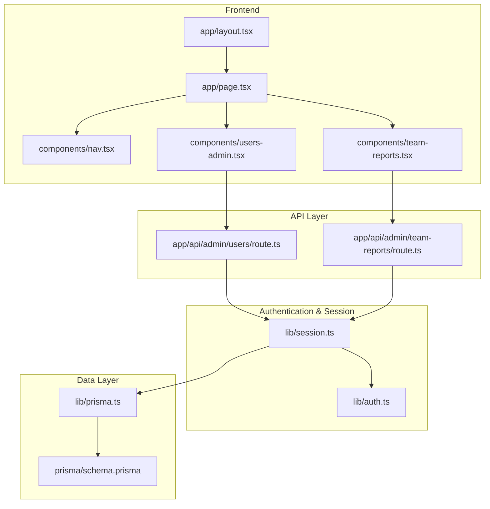
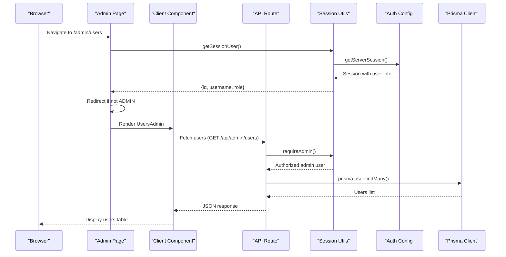
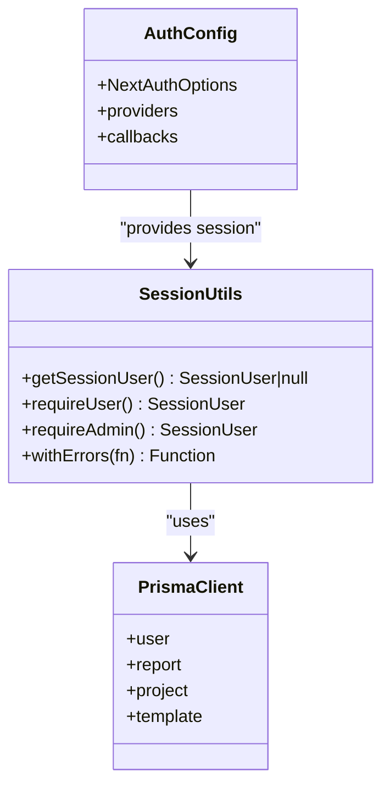
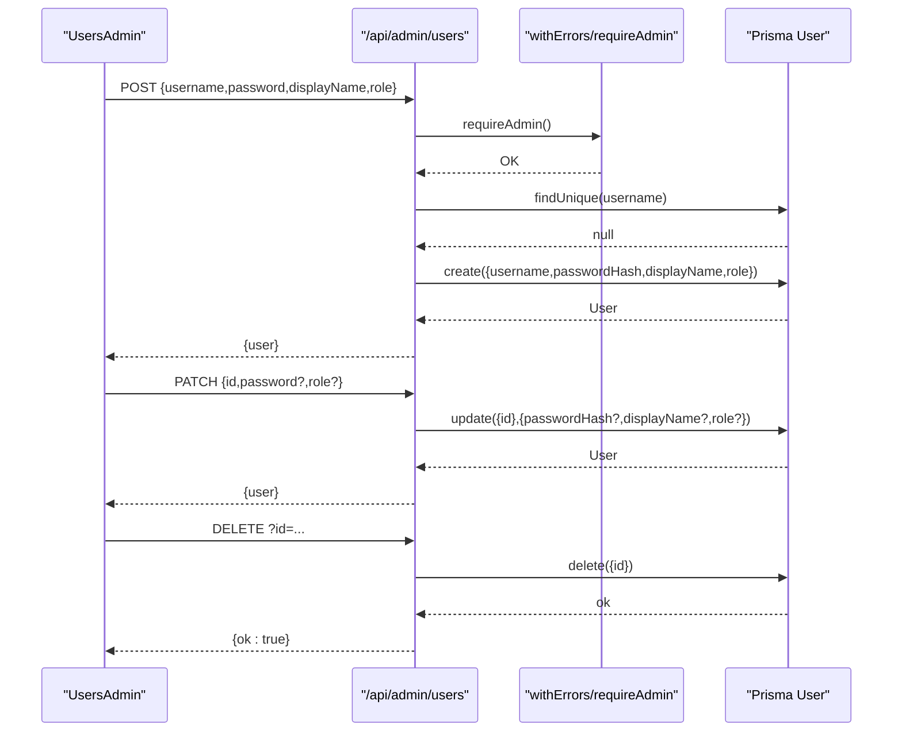
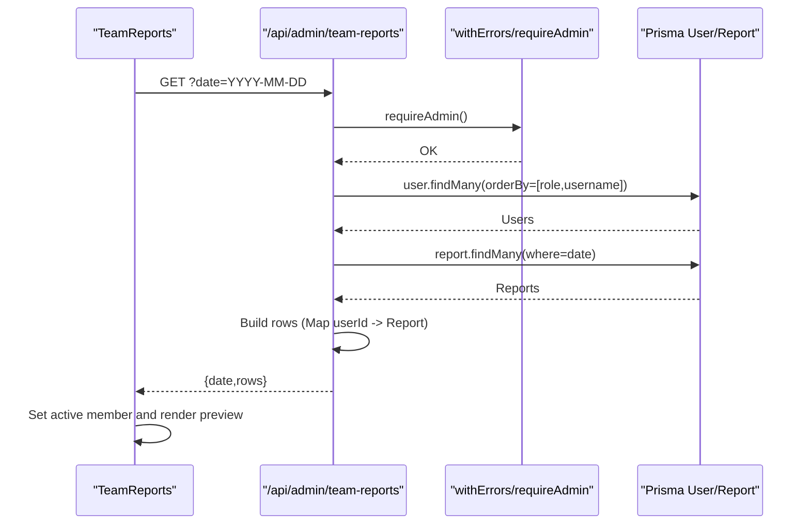
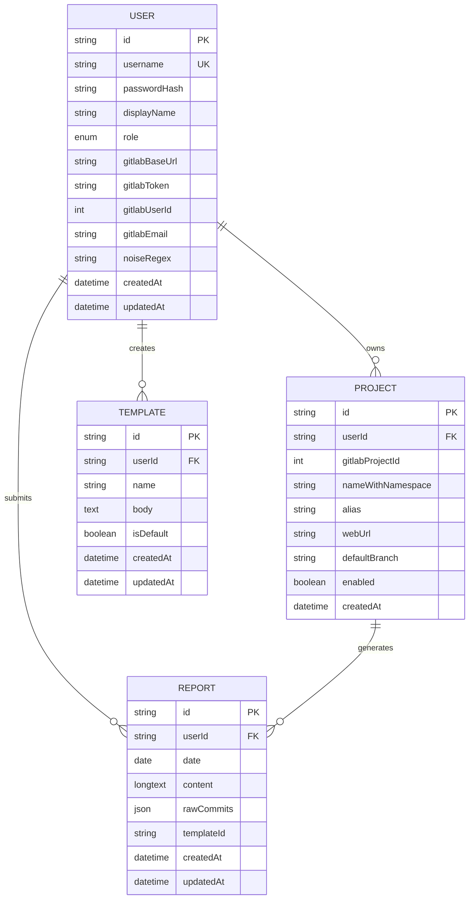
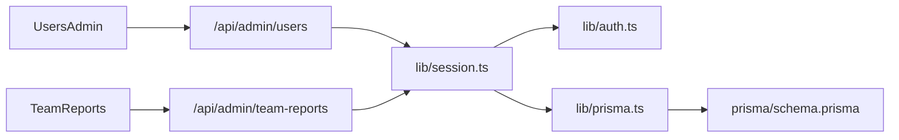

# Project Management Interface

<cite>
**Referenced Files in This Document**
- [app/layout.tsx](file://app/layout.tsx)
- [app/page.tsx](file://app/page.tsx)
- [components/nav.tsx](file://components/nav.tsx)
- [lib/auth.ts](file://lib/auth.ts)
- [lib/prisma.ts](file://lib/prisma.ts)
- [lib/session.ts](file://lib/session.ts)
- [app/admin/users/page.tsx](file://app/admin/users/page.tsx)
- [app/admin/team-reports/page.tsx](file://app/admin/team-reports/page.tsx)
- [app/api/admin/users/route.ts](file://app/api/admin/users/route.ts)
- [app/api/admin/team-reports/route.ts](file://app/api/admin/team-reports/route.ts)
- [components/users-admin.tsx](file://components/users-admin.tsx)
- [components/team-reports.tsx](file://components/team-reports.tsx)
- [prisma/schema.prisma](file://prisma/schema.prisma)
</cite>

## Table of Contents
1. [Introduction](#introduction)
2. [Project Structure](#project-structure)
3. [Core Components](#core-components)
4. [Architecture Overview](#architecture-overview)
5. [Detailed Component Analysis](#detailed-component-analysis)
6. [Dependency Analysis](#dependency-analysis)
7. [Performance Considerations](#performance-considerations)
8. [Troubleshooting Guide](#troubleshooting-guide)
9. [Conclusion](#conclusion)

## Introduction
This document describes the Project Management Interface of the Pingyun Report application, focusing on administrative capabilities for managing users and viewing team reports. The system provides a Next.js-based frontend with server-side authentication, a Prisma ORM data layer, and REST-like API endpoints under the `/api/admin` namespace. Administrators can create, update, and delete users, as well as review daily reports submitted by team members.

## Project Structure
The application follows a conventional Next.js App Router layout with feature-based organization:
- Frontend pages under `app/` define route handlers and page components
- API routes under `app/api/admin/` expose administrative endpoints
- Client components under `components/` encapsulate UI logic
- Authentication and session utilities under `lib/`
- Database schema and migrations under `prisma/`

**Diagram sources**
- [app/layout.tsx:1-31](file://app/layout.tsx#L1-L31)
- [app/page.tsx:1-20](file://app/page.tsx#L1-L20)
- [components/nav.tsx:1-171](file://components/nav.tsx#L1-L171)
- [components/users-admin.tsx:1-187](file://components/users-admin.tsx#L1-L187)
- [components/team-reports.tsx:1-118](file://components/team-reports.tsx#L1-L118)
- [app/api/admin/users/route.ts:1-88](file://app/api/admin/users/route.ts#L1-L88)
- [app/api/admin/team-reports/route.ts:1-34](file://app/api/admin/team-reports/route.ts#L1-L34)
- [lib/auth.ts:1-77](file://lib/auth.ts#L1-L77)
- [lib/session.ts:1-56](file://lib/session.ts#L1-L56)
- [lib/prisma.ts:1-14](file://lib/prisma.ts#L1-L14)
- [prisma/schema.prisma:1-81](file://prisma/schema.prisma#L1-L81)

**Section sources**
- [app/layout.tsx:1-31](file://app/layout.tsx#L1-L31)
- [app/page.tsx:1-20](file://app/page.tsx#L1-L20)
- [components/nav.tsx:1-171](file://components/nav.tsx#L1-L171)
- [lib/auth.ts:1-77](file://lib/auth.ts#L1-L77)
- [lib/session.ts:1-56](file://lib/session.ts#L1-L56)
- [lib/prisma.ts:1-14](file://lib/prisma.ts#L1-L14)
- [prisma/schema.prisma:1-81](file://prisma/schema.prisma#L1-L81)

## Core Components
- Navigation and routing: The navigation bar adapts links based on user role and handles mobile/desktop layouts.
- User management: A client-side form and table manage user creation, role updates, password resets, and deletions via `/api/admin/users`.
- Team reports: A calendar-based selector displays team members and previews their daily reports for a chosen date via `/api/admin/team-reports`.

Key responsibilities:
- Authentication and authorization: JWT-based session management with role checks.
- Data persistence: MySQL via Prisma ORM with typed models for User, Project, Report, and Template.
- API error handling: Centralized wrapper converts exceptions into structured responses.

**Section sources**
- [components/nav.tsx:35-54](file://components/nav.tsx#L35-L54)
- [components/users-admin.tsx:16-87](file://components/users-admin.tsx#L16-L87)
- [components/team-reports.tsx:27-41](file://components/team-reports.tsx#L27-L41)
- [lib/auth.ts:30-77](file://lib/auth.ts#L30-L77)
- [lib/session.ts:11-55](file://lib/session.ts#L11-L55)
- [prisma/schema.prisma:16-80](file://prisma/schema.prisma#L16-L80)

## Architecture Overview
The system enforces role-based access control at both the UI and API layers. Administrators see extended navigation items and can access admin-only pages. API routes validate sessions and roles before performing operations.

**Diagram sources**
- [app/admin/users/page.tsx:8-21](file://app/admin/users/page.tsx#L8-L21)
- [components/users-admin.tsx:23-31](file://components/users-admin.tsx#L23-L31)
- [app/api/admin/users/route.ts:7-22](file://app/api/admin/users/route.ts#L7-L22)
- [lib/session.ts:12-37](file://lib/session.ts#L12-L37)
- [lib/auth.ts:30-77](file://lib/auth.ts#L30-L77)
- [lib/prisma.ts:7-14](file://lib/prisma.ts#L7-L14)

## Detailed Component Analysis

### Authentication and Authorization
- NextAuth configuration defines JWT-based sessions, credential provider, and bcrypt password verification.
- Session utilities provide getters and guards for user and admin access, plus a centralized error handler for API routes.

**Diagram sources**
- [lib/auth.ts:30-77](file://lib/auth.ts#L30-L77)
- [lib/session.ts:11-55](file://lib/session.ts#L11-L55)
- [lib/prisma.ts:7-14](file://lib/prisma.ts#L7-L14)

**Section sources**
- [lib/auth.ts:1-77](file://lib/auth.ts#L1-L77)
- [lib/session.ts:1-56](file://lib/session.ts#L1-L56)
- [lib/prisma.ts:1-14](file://lib/prisma.ts#L1-L14)

### User Management Interface
- Client component manages state for creating new users and displaying a table of existing users.
- Operations:
  - Create: Sends POST with username, password, display name, and role.
  - Update: Patches user fields (role, optional password).
  - Delete: Removes a user by ID.
- Validation: Server validates uniqueness of usernames and enforces field constraints.

**Diagram sources**
- [components/users-admin.tsx:33-87](file://components/users-admin.tsx#L33-L87)
- [app/api/admin/users/route.ts:31-87](file://app/api/admin/users/route.ts#L31-L87)
- [lib/session.ts:39-55](file://lib/session.ts#L39-L55)
- [lib/prisma.ts:7-14](file://lib/prisma.ts#L7-L14)

**Section sources**
- [components/users-admin.tsx:16-187](file://components/users-admin.tsx#L16-L187)
- [app/api/admin/users/route.ts:1-88](file://app/api/admin/users/route.ts#L1-L88)
- [lib/session.ts:39-55](file://lib/session.ts#L39-L55)

### Team Reports Interface
- Client component allows selecting a date and viewing team members' daily reports.
- Data flow:
  - On mount/change, fetches users and their reports for the selected date.
  - Renders a sidebar with member list and a preview panel for the selected member's report.
- API endpoint:
  - Validates date format, retrieves users ordered by role and username, queries reports for the given date, and constructs rows mapping users to their reports.

**Diagram sources**
- [components/team-reports.tsx:27-41](file://components/team-reports.tsx#L27-L41)
- [app/api/admin/team-reports/route.ts:6-33](file://app/api/admin/team-reports/route.ts#L6-L33)
- [lib/session.ts:39-55](file://lib/session.ts#L39-L55)
- [lib/prisma.ts:7-14](file://lib/prisma.ts#L7-L14)

**Section sources**
- [components/team-reports.tsx:1-118](file://components/team-reports.tsx#L1-L118)
- [app/api/admin/team-reports/route.ts:1-34](file://app/api/admin/team-reports/route.ts#L1-L34)

### Database Schema and Relationships
The Prisma schema defines four primary models with relationships:
- User: authentication and profile data, with roles and GitLab integration fields
- Project: user-scoped GitLab project mappings
- Report: daily report entries per user per date
- Template: user-defined report templates

**Diagram sources**
- [prisma/schema.prisma:16-80](file://prisma/schema.prisma#L16-L80)

**Section sources**
- [prisma/schema.prisma:1-81](file://prisma/schema.prisma#L1-L81)

## Dependency Analysis
- UI-to-API coupling: Client components depend on specific API endpoints under `/api/admin`. Changes to endpoint signatures require corresponding UI updates.
- Session and auth coupling: All admin endpoints rely on session utilities for authorization, ensuring consistent enforcement.
- Data access coupling: API routes depend on Prisma client; any schema changes propagate to API logic and client expectations.

**Diagram sources**
- [components/users-admin.tsx:23-31](file://components/users-admin.tsx#L23-L31)
- [components/team-reports.tsx:32-41](file://components/team-reports.tsx#L32-L41)
- [app/api/admin/users/route.ts:7-22](file://app/api/admin/users/route.ts#L7-L22)
- [app/api/admin/team-reports/route.ts:6-33](file://app/api/admin/team-reports/route.ts#L6-L33)
- [lib/session.ts:11-55](file://lib/session.ts#L11-L55)
- [lib/auth.ts:30-77](file://lib/auth.ts#L30-L77)
- [lib/prisma.ts:7-14](file://lib/prisma.ts#L7-L14)
- [prisma/schema.prisma:16-80](file://prisma/schema.prisma#L16-L80)

**Section sources**
- [components/users-admin.tsx:16-87](file://components/users-admin.tsx#L16-L87)
- [components/team-reports.tsx:27-41](file://components/team-reports.tsx#L27-L41)
- [app/api/admin/users/route.ts:1-88](file://app/api/admin/users/route.ts#L1-L88)
- [app/api/admin/team-reports/route.ts:1-34](file://app/api/admin/team-reports/route.ts#L1-L34)
- [lib/session.ts:1-56](file://lib/session.ts#L1-L56)
- [lib/auth.ts:1-77](file://lib/auth.ts#L1-L77)
- [lib/prisma.ts:1-14](file://lib/prisma.ts#L1-L14)
- [prisma/schema.prisma:1-81](file://prisma/schema.prisma#L1-L81)

## Performance Considerations
- API pagination: Current endpoints return full lists without pagination. For large teams, consider adding limit/offset or cursor-based pagination to reduce payload sizes.
- Client-side rendering: Team reports use client-side Markdown preview; ensure large report bodies are handled efficiently and consider debouncing fetches when changing dates.
- Database indexing: Unique constraints on user username and user-project pairs are present; ensure queries leverage these indexes for optimal performance.

## Troubleshooting Guide
Common issues and resolutions:
- Unauthorized access: Ensure the current session has ADMIN role; otherwise, API routes will reject requests with a forbidden response.
- Validation errors: Creating users requires unique usernames and minimum password length; confirm input constraints before submitting.
- Date format errors: Team reports endpoint expects YYYY-MM-DD; invalid formats return bad request responses.
- Network failures: Client components show toast notifications for success/error states; check browser network tab for failed requests.

Operational checks:
- Verify database connectivity and Prisma client initialization.
- Confirm NextAuth configuration and session cookie behavior.
- Review API error logs for unhandled exceptions converted by the error wrapper.

**Section sources**
- [lib/session.ts:22-55](file://lib/session.ts#L22-L55)
- [app/api/admin/users/route.ts:24-39](file://app/api/admin/users/route.ts#L24-L39)
- [app/api/admin/team-reports/route.ts:10-12](file://app/api/admin/team-reports/route.ts#L10-L12)
- [components/users-admin.tsx:33-54](file://components/users-admin.tsx#L33-L54)

## Conclusion
The Project Management Interface provides a focused administrative surface for user lifecycle management and team report oversight. Its architecture cleanly separates concerns across UI components, API routes, session management, and the data layer, enabling straightforward extension and maintenance. Future enhancements could include pagination, improved error surfacing, and audit logging for administrative actions.