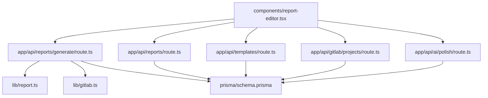
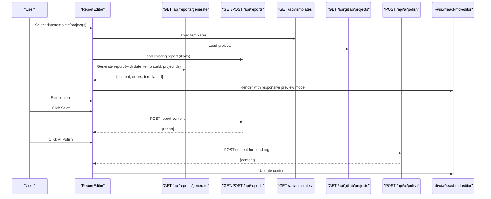
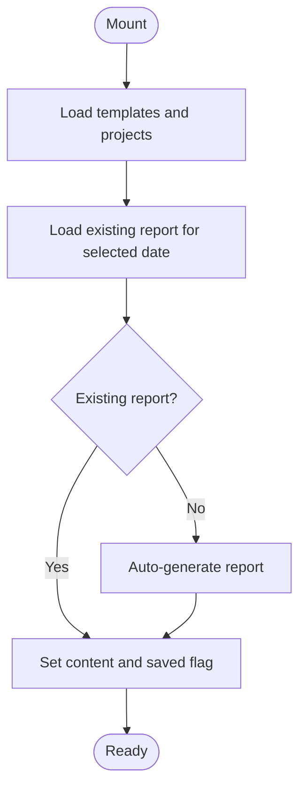
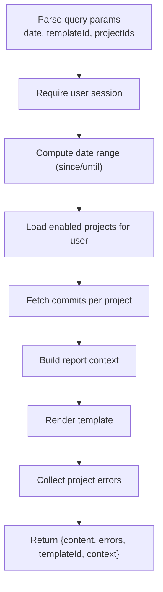
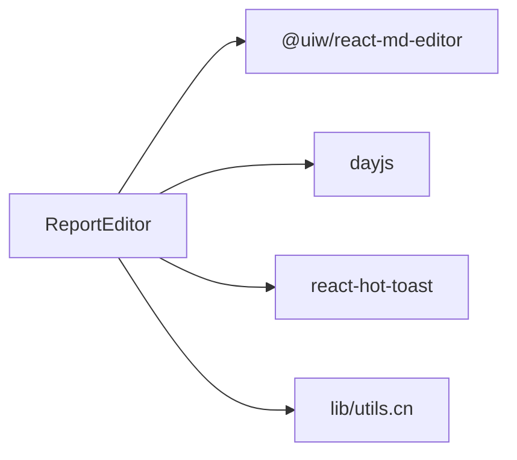

# Report Editor Component

<cite>
**Referenced Files in This Document**
- [report-editor.tsx](file://components/report-editor.tsx)
- [page.tsx](file://app/page.tsx)
- [report.ts](file://lib/report.ts)
- [gitlab.ts](file://lib/gitlab.ts)
- [generate.route.ts](file://app/api/reports/generate/route.ts)
- [reports.route.ts](file://app/api/reports/route.ts)
- [templates.route.ts](file://app/api/templates/route.ts)
- [projects.route.ts](file://app/api/gitlab/projects/route.ts)
- [polish.route.ts](file://app/api/ai/polish/route.ts)
- [settings-form.tsx](file://components/settings-form.tsx)
- [utils.ts](file://lib/utils.ts)
- [schema.prisma](file://prisma/schema.prisma)
</cite>

## Update Summary
**Changes Made**
- Enhanced mobile responsiveness section with automatic preview mode switching
- Updated markdown editor integration section to reflect dynamic preview mode behavior
- Added new section covering mobile-first design patterns and responsive editing experience
- Updated UI composition section to include mobile-specific layout considerations

## Table of Contents
1. [Introduction](#introduction)
2. [Project Structure](#project-structure)
3. [Core Components](#core-components)
4. [Architecture Overview](#architecture-overview)
5. [Detailed Component Analysis](#detailed-component-analysis)
6. [Mobile Responsiveness Enhancement](#mobile-responsiveness-enhancement)
7. [Dependency Analysis](#dependency-analysis)
8. [Performance Considerations](#performance-considerations)
9. [Troubleshooting Guide](#troubleshooting-guide)
10. [Conclusion](#conclusion)
11. [Appendices](#appendices)

## Introduction
This document provides comprehensive documentation for the ReportEditor component, the core UI component responsible for report generation and editing. It covers state management for date selection, template selection, project filtering, and content editing, along with integration patterns for the markdown editor, API integrations for report generation, saving, copying, and AI polishing, project selection with enable/disable functionality and branch information display, error handling, loading states, user feedback mechanisms, lifecycle hooks, dependency management, performance optimizations, and customization patterns.

**Enhanced** The component now features improved mobile responsiveness with automatic preview mode switching based on screen width, providing an optimal editing experience across device sizes.

## Project Structure
The ReportEditor component is located under components and integrates with several backend APIs and shared libraries. The frontend component manages UI state and user interactions, while the backend APIs handle data fetching, report generation, persistence, and AI enhancement.



**Diagram sources**
- [report-editor.tsx:1-296](file://components/report-editor.tsx#L1-L296)
- [generate.route.ts:1-133](file://app/api/reports/generate/route.ts#L1-L133)
- [reports.route.ts:1-90](file://app/api/reports/route.ts#L1-L90)
- [templates.route.ts:1-96](file://app/api/templates/route.ts#L1-L96)
- [projects.route.ts:1-42](file://app/api/gitlab/projects/route.ts#L1-L42)
- [polish.route.ts:1-63](file://app/api/ai/polish/route.ts#L1-L63)
- [report.ts:1-159](file://lib/report.ts#L1-L159)
- [gitlab.ts:1-149](file://lib/gitlab.ts#L1-L149)
- [schema.prisma:1-80](file://prisma/schema.prisma#L1-L80)

**Section sources**
- [report-editor.tsx:1-296](file://components/report-editor.tsx#L1-L296)
- [page.tsx:1-22](file://app/page.tsx#L1-L22)
- [schema.prisma:1-80](file://prisma/schema.prisma#L1-L80)

## Core Components
- ReportEditor: The primary UI component managing date selection, template selection, project filtering, content editing, and actions (generate, save, copy, AI polish).
- Shared utilities: Markdown editor integration, state management, and UI helpers.
- Backend APIs: Report generation, saving, templates, project management, and AI polishing.

Key responsibilities:
- Manage local state for date, content, templates, projects, selections, loading, saving, polishing, errors, and saved status.
- Fetch configuration (templates and projects) and existing reports on mount and date change.
- Generate report content via API with optional template and project filters.
- Persist edited content to the database.
- Provide AI-powered content polishing.
- Display project errors encountered during generation.
- **Enhanced** Automatically switch between edit and live preview modes based on screen width for optimal mobile experience.

**Section sources**
- [report-editor.tsx:19-296](file://components/report-editor.tsx#L19-L296)

## Architecture Overview
The ReportEditor component orchestrates user interactions and API calls. It dynamically loads the markdown editor to provide live preview editing capabilities with responsive behavior. The backend APIs handle GitLab integration, template rendering, report persistence, and AI enhancement.



**Diagram sources**
- [report-editor.tsx:39-174](file://components/report-editor.tsx#L39-L174)
- [generate.route.ts:23-132](file://app/api/reports/generate/route.ts#L23-L132)
- [reports.route.ts:9-76](file://app/api/reports/route.ts#L9-L76)
- [templates.route.ts:7-24](file://app/api/templates/route.ts#L7-L24)
- [projects.route.ts:6-12](file://app/api/gitlab/projects/route.ts#L6-L12)
- [polish.route.ts:10-62](file://app/api/ai/polish/route.ts#L10-L62)

## Detailed Component Analysis

### State Management
The component maintains the following state:
- Date selection: controlled via an HTML date input.
- Content editing: managed by the markdown editor.
- Templates: fetched and selectable from the backend.
- Projects: fetched with enable/disable flags and default branch information.
- Selected projects: a subset of enabled projects used for generation.
- Loading/saving/polishing flags: control UI state and button availability.
- Errors: aggregated from failed project fetches during generation.
- Saved status: indicates whether the current content is persisted.

State initialization and updates:
- Date defaults to today's date.
- Templates and projects are loaded concurrently on mount.
- Existing report content is loaded for the selected date; otherwise, auto-generation occurs.
- Selected projects default to all enabled projects.



**Diagram sources**
- [report-editor.tsx:39-117](file://components/report-editor.tsx#L39-L117)

**Section sources**
- [report-editor.tsx:19-117](file://components/report-editor.tsx#L19-L117)

### Markdown Editor Integration
The component uses a dynamic import of the markdown editor to disable server-side rendering. The editor is configured for responsive preview mode with automatic switching between edit and live preview based on screen width.

**Enhanced** Mobile-first responsive behavior:
- Mobile devices (< 768px): Uses "edit" preview mode for better touch interaction and performance
- Desktop devices (≥ 768px): Uses "live" preview mode for real-time editing experience
- Dynamic width detection ensures optimal user experience across all devices

Key integration points:
- Dynamic import with SSR disabled ensures client-only rendering.
- Responsive preview mode provides optimal editing experience based on device type.
- Fixed height of 420px ensures consistent layout across devices.
- Color mode support for light/dark theme compatibility.

**Section sources**
- [report-editor.tsx:9-296](file://components/report-editor.tsx#L9-L296)

### API Integration Patterns
The component interacts with multiple backend endpoints:

- Report generation:
  - Endpoint: GET /api/reports/generate
  - Parameters: date, templateId (optional), projectIds (optional)
  - Behavior: Fetches commits for selected projects, builds context, renders template, and returns content with potential errors.
  - Error handling: Displays project-specific errors in the UI.

- Report persistence:
  - Endpoint: GET /api/reports (query by date/month)
  - Endpoint: POST /api/reports (create/update)
  - Endpoint: DELETE /api/reports (delete by date)
  - Behavior: Upserts report content and template association.

- Templates:
  - Endpoint: GET /api/templates
  - Behavior: Returns user templates, creates default template if none exist.

- Projects:
  - Endpoint: GET /api/gitlab/projects
  - Endpoint: PATCH /api/gitlab/projects (enable/disable, set default branch)
  - Behavior: Manages project enablement and branch preferences.

- AI Polishing:
  - Endpoint: POST /api/ai/polish
  - Behavior: Sends content to external LLM API for refinement.

**Section sources**
- [report-editor.tsx:67-174](file://components/report-editor.tsx#L67-L174)
- [generate.route.ts:23-132](file://app/api/reports/generate/route.ts#L23-L132)
- [reports.route.ts:9-76](file://app/api/reports/route.ts#L9-L76)
- [templates.route.ts:7-24](file://app/api/templates/route.ts#L7-L24)
- [projects.route.ts:6-41](file://app/api/gitlab/projects/route.ts#L6-L41)
- [polish.route.ts:10-62](file://app/api/ai/polish/route.ts#L10-L62)

### Project Selection Mechanism
The component displays enabled projects and allows toggling inclusion in the report generation. Branch information is shown alongside project names and can be configured in the settings.

- Enabled projects are filtered from the full project list.
- Users can click project buttons to include/exclude them.
- Selected projects are passed to the generation endpoint as a comma-separated list when not equal to all enabled projects.

Integration with settings:
- SettingsForm updates project enablement and default branches via PATCH requests.
- The editor reflects these changes immediately upon reload.

**Section sources**
- [report-editor.tsx:176-296](file://components/report-editor.tsx#L176-L296)
- [settings-form.tsx:109-134](file://components/settings-form.tsx#L109-L134)
- [projects.route.ts:21-41](file://app/api/gitlab/projects/route.ts#L21-L41)

### Error Handling and User Feedback
The component implements robust error handling and user feedback:
- Toast notifications for success/error states across actions (generate, save, copy, polish).
- Dedicated error banner for project fetch failures during generation.
- Loading indicators for long-running operations (generate/save/polish).
- Disabled states for buttons when actions are not applicable.

**Section sources**
- [report-editor.tsx:260-296](file://components/report-editor.tsx#L260-L296)
- [report-editor.tsx:67-174](file://components/report-editor.tsx#L67-L174)

### Lifecycle Hooks and Dependencies
- useEffect for initial configuration loading and date-based report loading.
- useCallback for memoized handlers to prevent unnecessary re-renders.
- useMemo for derived enabled projects to optimize rendering.

Performance considerations:
- Concurrent loading of templates and projects.
- Conditional generation only when needed (today's date vs. existing report).
- Debounced or deferred generation to avoid blocking the UI thread.
- **Enhanced** Responsive preview mode switching reduces unnecessary computations on mobile devices.

**Section sources**
- [report-editor.tsx:93-117](file://components/report-editor.tsx#L93-L117)
- [report-editor.tsx:39-53](file://components/report-editor.tsx#L39-L53)

### Data Flow and Processing Logic
The backend pipeline for report generation:
- Validates query parameters and user session.
- Determines date range based on the selected date.
- Loads user GitLab credentials and filters enabled projects.
- Fetches commits per project within the date range and branch.
- Builds a structured context for templating.
- Renders the template using Handlebars.
- Aggregates project errors and returns content with metadata.



**Diagram sources**
- [generate.route.ts:14-132](file://app/api/reports/generate/route.ts#L14-L132)
- [report.ts:115-144](file://lib/report.ts#L115-L144)
- [gitlab.ts:120-148](file://lib/gitlab.ts#L120-L148)

**Section sources**
- [generate.route.ts:23-132](file://app/api/reports/generate/route.ts#L23-L132)
- [report.ts:115-144](file://lib/report.ts#L115-L144)
- [gitlab.ts:120-148](file://lib/gitlab.ts#L120-L148)

### Class Model for Data Types
The component and backend share several data models that define the shape of state and API payloads.

```mermaid
classDiagram
class Template {
+string id
+string name
+boolean isDefault
}
class Project {
+string id
+string nameWithNamespace
+boolean enabled
+string defaultBranch
}
class ReportContext {
+string date
+ProjectGroup[] projects
+number total
+User user
}
class ProjectGroup {
+string name
+string webUrl
+CleanCommit[] commits
}
class CleanCommit {
+string id
+string short_id
+string title
+string message
+string author_email
+string authored_date
+string web_url
+string type
+string scope
}
class GitLabCommit {
+string id
+string short_id
+string title
+string message
+string author_name
+string author_email
+string authored_date
+string committed_date
+string[] parent_ids
+string web_url
}
class GitLabProject {
+number id
+string name
+string path_with_namespace
+string name_with_namespace
+string default_branch
+string web_url
}
class ReportEditorState {
+string date
+string content
+Template[] templates
+string templateId
+Project[] projects
+string[] selectedProjects
+boolean loading
+boolean saving
+boolean polishing
+{string project; string error}[] errors
+boolean hasSaved
}
```

**Diagram sources**
- [report-editor.tsx:11-19](file://components/report-editor.tsx#L11-L19)
- [report.ts:4-27](file://lib/report.ts#L4-L27)
- [gitlab.ts:14-34](file://lib/gitlab.ts#L14-L34)

**Section sources**
- [report-editor.tsx:11-19](file://components/report-editor.tsx#L11-L19)
- [report.ts:4-27](file://lib/report.ts#L4-L27)
- [gitlab.ts:14-34](file://lib/gitlab.ts#L14-L34)

### UI Composition and Layout
The component organizes controls and content in a responsive layout:
- Top toolbar: date selector, template dropdown, action buttons (generate, AI polish, copy, save).
- Project selection panel: enabled projects with branch indicators and toggle buttons.
- Error banner: aggregated project errors during generation.
- Markdown editor: responsive preview with fixed height and automatic mode switching.

**Enhanced** Mobile-responsive layout considerations:
- Flexible flexbox layout adapts to different screen sizes.
- Responsive breakpoints for optimal spacing and readability.
- Touch-friendly button sizing and spacing for mobile interaction.
- Adaptive preview mode selection based on device capabilities.

Styling utilities:
- Tailwind classes for spacing, borders, and color states.
- cn helper for conditional class merging.

**Section sources**
- [report-editor.tsx:182-296](file://components/report-editor.tsx#L182-L296)
- [utils.ts:4-6](file://lib/utils.ts#L4-L6)

### Integration with Settings and Project Management
Project enablement and branch settings are managed in the settings page and reflected in the editor:
- SettingsForm toggles project enablement and sets default branches.
- Changes propagate to the database and are immediately visible in the editor.
- The editor's project panel shows enabled projects and branch information.

**Section sources**
- [settings-form.tsx:109-134](file://components/settings-form.tsx#L109-L134)
- [projects.route.ts:21-41](file://app/api/gitlab/projects/route.ts#L21-L41)
- [report-editor.tsx:231-296](file://components/report-editor.tsx#L231-L296)

## Mobile Responsiveness Enhancement

### Automatic Preview Mode Switching
The ReportEditor component now features intelligent mobile responsiveness with automatic preview mode switching:

**Desktop Experience (≥ 768px)**:
- Live preview mode provides real-time editing feedback
- Immediate visual updates as users type
- Optimal for detailed content review and editing
- Full markdown rendering capabilities

**Mobile Experience (< 768px)**:
- Edit mode for better touch interaction
- Improved scrolling and navigation performance
- Optimized for single-hand operation
- Reduced computational overhead

### Implementation Details
The responsive behavior is implemented through dynamic width detection:

```javascript
preview={typeof window !== "undefined" && window.innerWidth < 768 ? "edit" : "live"}
```

This approach ensures:
- **Client-side only**: Prevents SSR conflicts by checking `typeof window !== "undefined"`
- **Real-time adaptation**: Responds to viewport changes without page refresh
- **Performance optimization**: Uses edit mode on mobile to reduce rendering overhead
- **User experience**: Provides optimal interaction patterns for each device type

### Design Philosophy
The mobile-first approach prioritizes:
- **Touch interaction**: Larger touch targets and simplified interface
- **Performance**: Reduced computational load on mobile devices
- **Accessibility**: Clear visual feedback and intuitive controls
- **Consistency**: Seamless experience across all device categories

**Section sources**
- [report-editor.tsx:285-296](file://components/report-editor.tsx#L285-L296)

## Dependency Analysis
The component depends on:
- React hooks for state and effects.
- Dynamic import for the markdown editor to avoid SSR.
- External libraries for date handling, UI notifications, and class merging.
- Backend APIs for configuration, generation, persistence, templates, projects, and AI polishing.

External dependencies:
- @uiw/react-md-editor for markdown editing with responsive preview.
- dayjs for date manipulation.
- react-hot-toast for user feedback.
- clsx and tailwind-merge for class composition.



**Diagram sources**
- [report-editor.tsx:3-9](file://components/report-editor.tsx#L3-L9)
- [utils.ts:4-6](file://lib/utils.ts#L4-L6)

**Section sources**
- [report-editor.tsx:3-9](file://components/report-editor.tsx#L3-L9)
- [utils.ts:4-6](file://lib/utils.ts#L4-L6)

## Performance Considerations
- Concurrent loading: Templates and projects are fetched in parallel to reduce initial load time.
- Memoization: Derived values (enabled projects) are computed with useMemo to avoid unnecessary recalculations.
- Conditional generation: Auto-generation is deferred until configuration is loaded and only performed when no existing report exists for the selected date.
- Debounced operations: Generation is triggered after configuration load to prevent race conditions.
- UI responsiveness: Loading states and disabled buttons prevent concurrent operations and improve perceived performance.
- **Enhanced** Mobile optimization: Edit mode on mobile devices reduces computational overhead and improves responsiveness.

## Troubleshooting Guide
Common issues and resolutions:
- No GitLab token configured: The generation endpoint requires user GitLab credentials; configure them in settings.
- Template rendering errors: The renderer wraps errors in the generated content; check template syntax.
- AI polish failures: Ensure LLM API base and key are configured; verify network connectivity.
- Project fetch errors: Review the error banner for specific project failures; check project enablement and branch settings.
- Save failures: Verify content length and date format; ensure the backend responds successfully.
- **Enhanced** Mobile preview issues: If preview mode seems incorrect, ensure the device width is properly detected; check browser compatibility for window.innerWidth property.

**Section sources**
- [generate.route.ts:36-43](file://app/api/reports/generate/route.ts#L36-L43)
- [report.ts:137-144](file://lib/report.ts#L137-L144)
- [polish.route.ts:14-22](file://app/api/ai/polish/route.ts#L14-L22)
- [report-editor.tsx:260-296](file://components/report-editor.tsx#L260-L296)

## Conclusion
The ReportEditor component provides a cohesive, efficient solution for daily report generation and editing. Its state-driven architecture, robust API integrations, and thoughtful UI feedback deliver a smooth user experience. The recent mobile responsiveness enhancements ensure optimal performance and usability across all device types, while the modular design enables easy customization and extension, and the backend pipeline ensures reliable data processing and templating.

## Appendices

### API Definitions

- GET /api/reports/generate
  - Query parameters: date (YYYY-MM-DD), templateId (optional), projectIds (comma-separated, optional)
  - Response: { date, content, templateId, context, errors }
  - Errors: 400 if GitLab credentials missing, 404 if user not found

- GET /api/reports
  - Query parameters: date (YYYY-MM-DD) or month (YYYY-MM)
  - Response: { report } or { reports }

- POST /api/reports
  - Body: { date, content, templateId (optional) }
  - Response: { report }

- DELETE /api/reports
  - Query parameters: date (YYYY-MM-DD)
  - Response: { ok }

- GET /api/templates
  - Response: { templates }

- POST /api/templates
  - Body: { name, body, isDefault (optional) }
  - Response: { template }

- PATCH /api/templates
  - Body: { id, name (optional), body (optional), isDefault (optional) }
  - Response: { template }

- DELETE /api/templates
  - Query parameters: id
  - Response: { ok }

- GET /api/gitlab/projects
  - Response: { projects }

- PATCH /api/gitlab/projects
  - Body: { id, enabled (optional), defaultBranch (optional) }
  - Response: { project }

- POST /api/ai/polish
  - Body: { content, language (optional) }
  - Response: { content }
  - Errors: 400 if LLM API not configured, 502 if LLM returns empty or fails

**Section sources**
- [generate.route.ts:14-132](file://app/api/reports/generate/route.ts#L14-L132)
- [reports.route.ts:9-89](file://app/api/reports/route.ts#L9-L89)
- [templates.route.ts:7-95](file://app/api/templates/route.ts#L7-L95)
- [projects.route.ts:6-41](file://app/api/gitlab/projects/route.ts#L6-L41)
- [polish.route.ts:5-62](file://app/api/ai/polish/route.ts#L5-L62)

### Data Models

- ReportContext
  - date: string
  - projects: ProjectGroup[]
  - total: number
  - user: { displayName: string; email?: string }

- ProjectGroup
  - name: string
  - webUrl?: string
  - commits: CleanCommit[]

- CleanCommit
  - id: string
  - short_id: string
  - title: string
  - message: string
  - author_email: string
  - authored_date: string
  - web_url: string
  - type?: string
  - scope?: string

- GitLabCommit
  - id: string
  - short_id: string
  - title: string
  - message: string
  - author_name: string
  - author_email: string
  - authored_date: string
  - committed_date: string
  - parent_ids: string[]
  - web_url: string

- GitLabProject
  - id: number
  - name: string
  - path_with_namespace: string
  - name_with_namespace: string
  - default_branch: string | null
  - web_url: string

**Section sources**
- [report.ts:22-104](file://lib/report.ts#L22-L104)
- [gitlab.ts:23-21](file://lib/gitlab.ts#L23-L21)

### Customization and Extension Patterns
- Template customization: Add/edit/delete templates via the templates API; default templates are created automatically if none exist.
- Project filtering: Enable/disable projects and set default branches; only enabled projects contribute to report generation.
- AI enhancement: Configure LLM environment variables to enable AI polishing; customize system prompts for desired output style.
- Styling: Extend Tailwind classes and the cn helper to adapt the UI to brand guidelines.
- State expansion: Add new state fields for additional filters or metadata; ensure proper validation and error handling.
- **Enhanced** Mobile customization: Adjust breakpoint thresholds, preview mode behavior, and mobile-specific styling through responsive design patterns.

**Section sources**
- [templates.route.ts:27-95](file://app/api/templates/route.ts#L27-L95)
- [projects.route.ts:15-41](file://app/api/gitlab/projects/route.ts#L15-L41)
- [polish.route.ts:14-30](file://app/api/ai/polish/route.ts#L14-L30)
- [utils.ts:4-6](file://lib/utils.ts#L4-L6)