# Social Interaction System

<cite>
**Referenced Files in This Document**
- [app/api/comments/route.ts](file://app/api/comments/route.ts)
- [app/api/likes/route.ts](file://app/api/likes/route.ts)
- [lib/prisma.ts](file://lib/prisma.ts)
- [components/comment-section.tsx](file://components/comment-section.tsx)
- [components/like-button.tsx](file://components/like-button.tsx)
- [prisma/schema.prisma](file://prisma/schema.prisma)
- [lib/notify.ts](file://lib/notify.ts)
- [app/api/notifications/stream/route.ts](file://app/api/notifications/stream/route.ts)
- [app/api/notifications/route.ts](file://app/api/notifications/route.ts)
- [components/notification-bell.tsx](file://components/notification-bell.tsx)
- [lib/hooks/use-notifications.ts](file://lib/hooks/use-notifications.ts)
- [lib/session.ts](file://lib/session.ts)
- [lib/redis.ts](file://lib/redis.ts)
- [lib/auth.ts](file://lib/auth.ts)
- [components/team/reports-tab.tsx](file://components/team/reports-tab.tsx)
- [app/api/reports/route.ts](file://app/api/reports/route.ts)
</cite>

## Update Summary
**Changes Made**
- Complete architectural transformation from polling-based notifications to Redis pub/sub with SSE real-time messaging
- Added new notification creation utility with Redis publishing capabilities
- Enhanced API endpoints with real-time streaming support
- Updated notification system architecture with improved scalability and performance

## Table of Contents
1. [Introduction](#introduction)
2. [System Architecture](#system-architecture)
3. [Core Social Features](#core-social-features)
4. [Comment System](#comment-system)
5. [Like System](#like-system)
6. [Notification System](#notification-system)
7. [Integration Points](#integration-points)
8. [Data Model](#data-model)
9. [Security and Access Control](#security-and-access-control)
10. [Performance Considerations](#performance-considerations)
11. [Troubleshooting Guide](#troubleshooting-guide)
12. [Conclusion](#conclusion)

## Introduction

The Social Interaction System is a comprehensive feature set designed to enable community engagement, feedback mechanisms, and real-time communication within the PingYun Report platform. This system encompasses three primary social features: commenting on reports, liking/unliking reports, and a sophisticated real-time notification system that alerts users to social activities performed by their colleagues.

The system is built with modern React patterns, server-side rendering capabilities, and real-time communication technologies. It leverages Next.js API routes for backend functionality, Prisma ORM for database operations, and Redis for real-time event streaming through Server-Sent Events (SSE).

**Updated** The notification system has undergone a complete architectural transformation from polling-based to a scalable Redis pub/sub with SSE real-time messaging infrastructure.

## System Architecture

The Social Interaction System follows a layered architecture pattern with clear separation between frontend components, API handlers, and backend services. The notification system now utilizes a sophisticated real-time architecture with Redis pub/sub and SSE streaming.

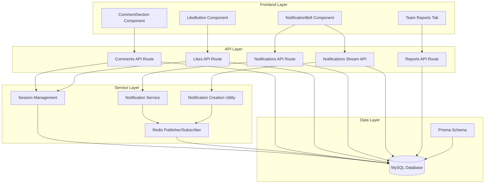

**Diagram sources**
- [components/comment-section.tsx:1-152](file://components/comment-section.tsx#L1-L152)
- [components/like-button.tsx:1-80](file://components/like-button.tsx#L1-L80)
- [components/notification-bell.tsx:1-132](file://components/notification-bell.tsx#L1-L132)
- [app/api/comments/route.ts:1-117](file://app/api/comments/route.ts#L1-L117)
- [app/api/likes/route.ts:1-71](file://app/api/likes/route.ts#L1-L71)
- [app/api/notifications/stream/route.ts:1-65](file://app/api/notifications/stream/route.ts#L1-L65)
- [lib/notify.ts:1-25](file://lib/notify.ts#L1-L25)
- [lib/redis.ts:1-17](file://lib/redis.ts#L1-L17)

## Core Social Features

The system provides three interconnected social features that work together to create a cohesive community experience:

### Feature 1: Real-Time Comments
Users can add, view, and delete comments on daily reports. Comments support rich content with character limits and proper access controls. The system now automatically notifies report owners in real-time via Redis pub/sub and SSE.

### Feature 2: Interactive Likes
Users can express appreciation for reports through a simple like/unlike mechanism with immediate visual feedback and real-time notification capabilities delivered through the SSE infrastructure.

### Feature 3: Live Notifications
Real-time notification system delivers instant updates about social activities through Server-Sent Events, ensuring users stay informed about community interactions. The system now uses Redis pub/sub for scalable, low-latency message distribution.

**Updated** All social features now leverage the new real-time notification infrastructure for immediate user feedback.

**Section sources**
- [app/api/comments/route.ts:1-117](file://app/api/comments/route.ts#L1-L117)
- [app/api/likes/route.ts:1-71](file://app/api/likes/route.ts#L1-L71)
- [lib/notify.ts:1-25](file://lib/notify.ts#L1-L25)

## Comment System

The comment system enables users to engage in discussions about daily reports through a structured commenting mechanism with real-time notification capabilities.

### Backend Implementation

The comment API provides comprehensive CRUD operations with strict access controls and automatic notification generation:

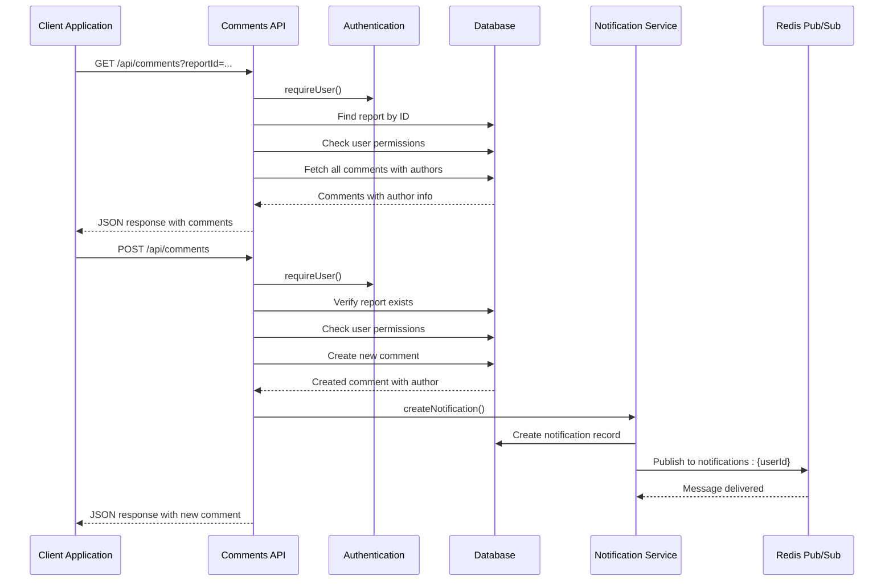

**Diagram sources**
- [app/api/comments/route.ts:7-89](file://app/api/comments/route.ts#L7-L89)
- [lib/session.ts:23-29](file://lib/session.ts#L23-L29)
- [lib/notify.ts:16-24](file://lib/notify.ts#L16-L24)
- [lib/redis.ts:7-16](file://lib/redis.ts#L7-L16)

### Frontend Implementation

The CommentSection component provides a user-friendly interface for managing comments with real-time updates:

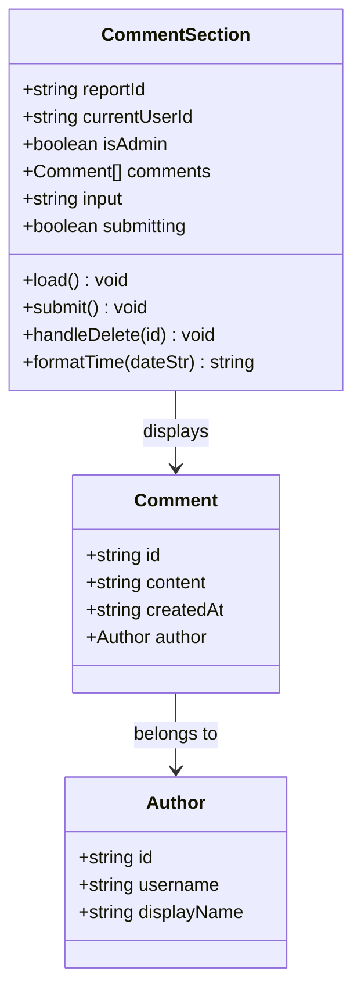

**Diagram sources**
- [components/comment-section.tsx:19-151](file://components/comment-section.tsx#L19-L151)

**Section sources**
- [components/comment-section.tsx:1-152](file://components/comment-section.tsx#L1-L152)
- [app/api/comments/route.ts:1-117](file://app/api/comments/route.ts#L1-L117)

## Like System

The like system allows users to show appreciation for reports through a simple interactive mechanism with real-time notification delivery.

### Backend Implementation

The like API implements a toggle mechanism with automatic notification generation through Redis pub/sub:

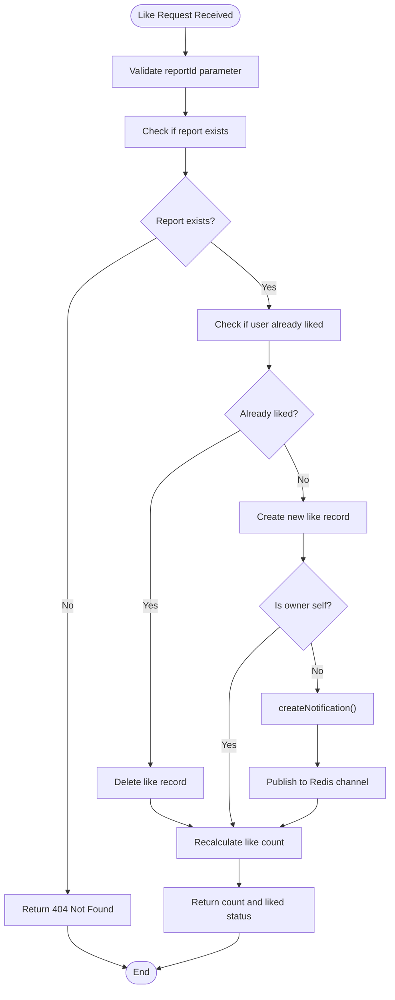

**Diagram sources**
- [app/api/likes/route.ts:28-69](file://app/api/likes/route.ts#L28-L69)
- [lib/notify.ts:16-24](file://lib/notify.ts#L16-L24)
- [lib/redis.ts:7-16](file://lib/redis.ts#L7-L16)

### Frontend Implementation

The LikeButton component provides immediate visual feedback and state management with real-time updates:

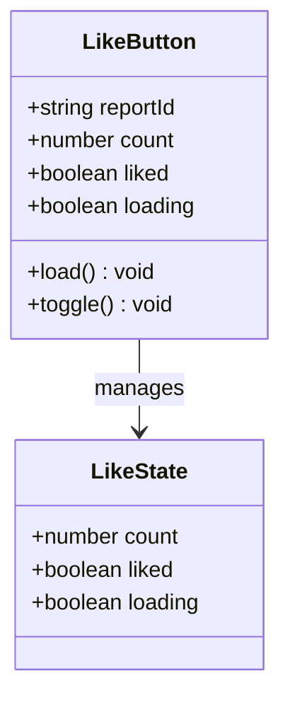

**Diagram sources**
- [components/like-button.tsx:9-80](file://components/like-button.tsx#L9-L80)

**Section sources**
- [components/like-button.tsx:1-80](file://components/like-button.tsx#L1-L80)
- [app/api/likes/route.ts:1-71](file://app/api/likes/route.ts#L1-L71)

## Notification System

The notification system provides real-time updates about social activities through a sophisticated Redis pub/sub with SSE architecture that replaces the previous polling-based approach.

### Architecture Overview

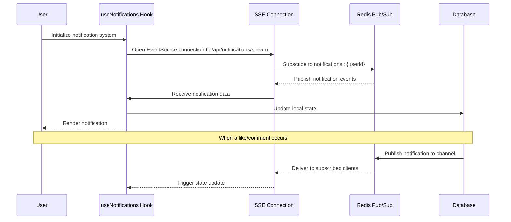

**Diagram sources**
- [lib/hooks/use-notifications.ts:32-62](file://lib/hooks/use-notifications.ts#L32-L62)
- [app/api/notifications/stream/route.ts:13-41](file://app/api/notifications/stream/route.ts#L13-L41)
- [lib/notify.ts:16-24](file://lib/notify.ts#L16-L24)

### Real-Time Communication Flow

The notification system uses a publish-subscribe pattern with Redis for scalable real-time messaging:

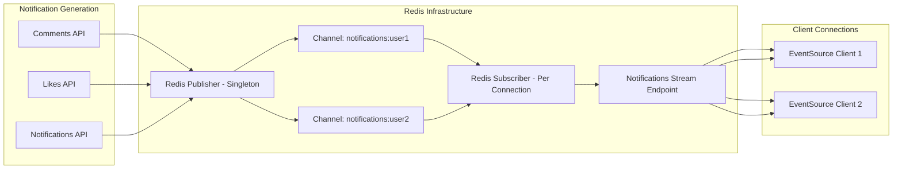

**Diagram sources**
- [lib/notify.ts:16-24](file://lib/notify.ts#L16-L24)
- [lib/redis.ts:7-16](file://lib/redis.ts#L7-L16)
- [app/api/notifications/stream/route.ts:13-41](file://app/api/notifications/stream/route.ts#L13-L41)

### Notification Creation Utility

The new notification creation utility centralizes notification generation and Redis publishing:

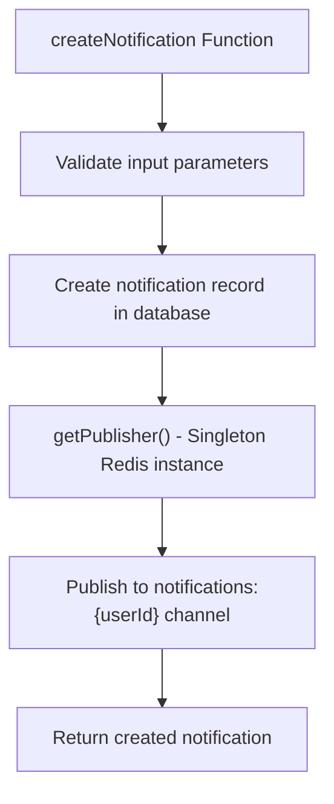

**Diagram sources**
- [lib/notify.ts:16-24](file://lib/notify.ts#L16-L24)

### Redis Connection Management

The system implements efficient Redis connection management with separate publisher and subscriber instances:

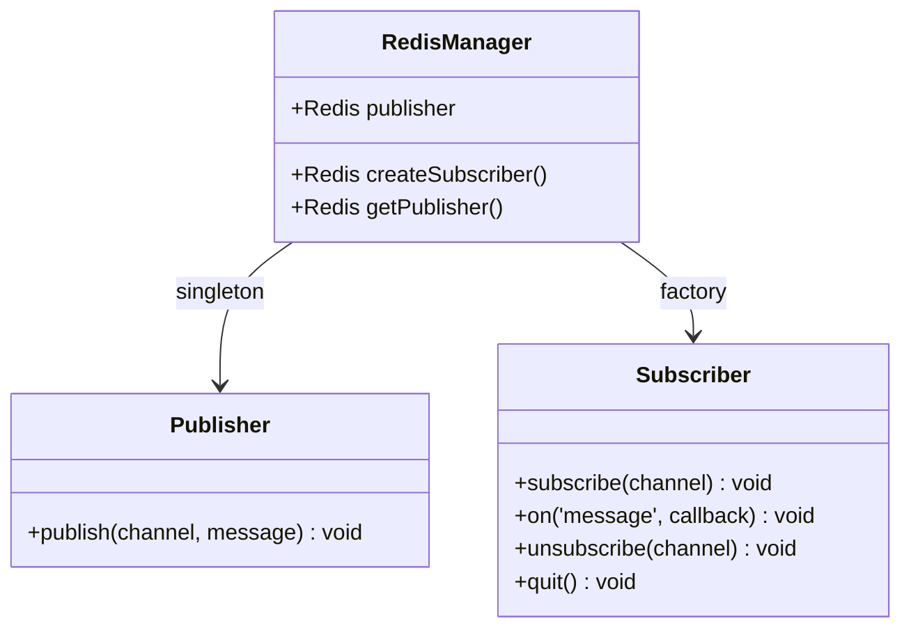

**Diagram sources**
- [lib/redis.ts:7-16](file://lib/redis.ts#L7-L16)

**Updated** The notification system has been completely transformed from polling-based to Redis pub/sub with SSE real-time messaging, providing immediate notification delivery and improved scalability.

**Section sources**
- [lib/hooks/use-notifications.ts:1-88](file://lib/hooks/use-notifications.ts#L1-L88)
- [app/api/notifications/stream/route.ts:1-65](file://app/api/notifications/stream/route.ts#L1-L65)
- [lib/notify.ts:1-25](file://lib/notify.ts#L1-L25)
- [lib/redis.ts:1-17](file://lib/redis.ts#L1-L17)
- [app/api/notifications/route.ts:1-46](file://app/api/notifications/route.ts#L1-L46)

## Integration Points

The social interaction system integrates seamlessly with the broader PingYun Report platform through several key integration points, with enhanced real-time capabilities.

### Team Reports Integration

The system is prominently featured in the team reports interface, allowing managers and team members to engage with each other's work with real-time updates:

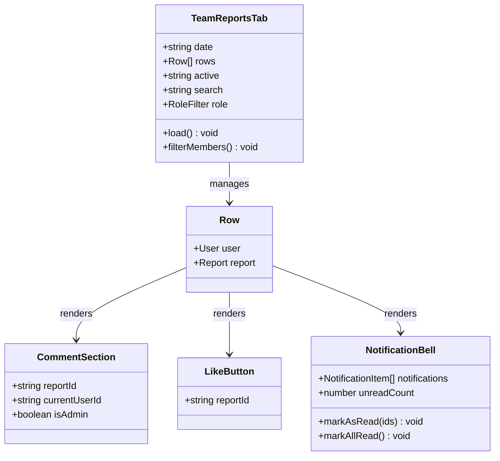

**Diagram sources**
- [components/team/reports-tab.tsx:40-194](file://components/team/reports-tab.tsx#L40-L194)
- [components/notification-bell.tsx:18-132](file://components/notification-bell.tsx#L18-L132)

### Authentication Integration

The system leverages the existing authentication framework for access control, with real-time updates synchronized across authenticated sessions:

**Section sources**
- [components/team/reports-tab.tsx:1-195](file://components/team/reports-tab.tsx#L1-L195)
- [lib/auth.ts:1-77](file://lib/auth.ts#L1-L77)
- [lib/session.ts:1-56](file://lib/session.ts#L1-L56)

## Data Model

The social interaction system relies on a well-designed data model that supports efficient querying and maintains referential integrity, with enhanced notification capabilities.

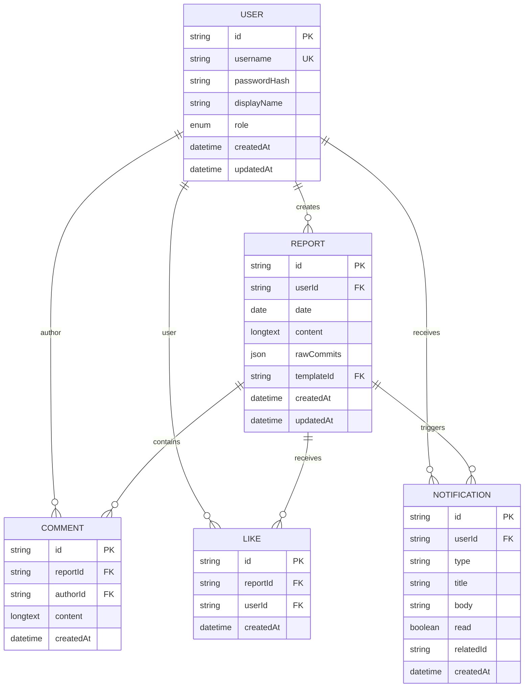

**Diagram sources**
- [prisma/schema.prisma:16-125](file://prisma/schema.prisma#L16-L125)

### Key Relationships

- **User-Report Relationship**: One-to-many relationship enabling users to create multiple reports over time
- **Report-Comment Relationship**: One-to-many relationship supporting threaded discussions with real-time notifications
- **User-Comment/Like Relationship**: Many-to-many relationships through junction tables with notification triggers
- **User-Notification Relationship**: One-to-many relationship for real-time notification delivery via Redis pub/sub

**Updated** The notification relationship now supports real-time delivery through Redis channels, replacing previous polling mechanisms.

**Section sources**
- [prisma/schema.prisma:1-126](file://prisma/schema.prisma#L1-L126)

## Security and Access Control

The system implements comprehensive security measures to protect user data and maintain proper access controls, with enhanced real-time security considerations.

### Authentication Flow

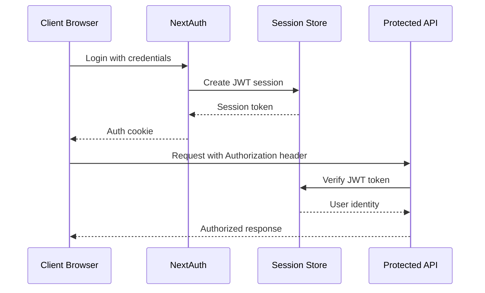

**Diagram sources**
- [lib/auth.ts:40-76](file://lib/auth.ts#L40-L76)
- [lib/session.ts:23-29](file://lib/session.ts#L23-L29)

### Authorization Rules

The system enforces strict authorization rules for all social interactions, with real-time security considerations:

1. **Comment Access Control**: Users can only view comments on reports they own or manage, with real-time updates for authorized users
2. **Comment Deletion**: Only comment authors or administrators can delete comments, with immediate notification to affected users
3. **Like Operations**: Users can like reports they own, with real-time notifications sent to report owners via Redis pub/sub
4. **Admin Privileges**: Administrators have elevated permissions across all social features with real-time synchronization
5. **Notification Security**: SSE connections are authenticated and restricted to individual user channels

**Updated** All authorization checks now integrate with the real-time notification system to ensure secure, user-specific message delivery.

**Section sources**
- [app/api/comments/route.ts:16-26](file://app/api/comments/route.ts#L16-L26)
- [app/api/comments/route.ts:109-112](file://app/api/comments/route.ts#L109-L112)
- [app/api/likes/route.ts:56-66](file://app/api/likes/route.ts#L56-L66)

## Performance Considerations

The social interaction system is designed with performance optimization in mind, utilizing various caching, streaming, and real-time technologies for optimal scalability.

### Database Optimization

- **Indexing Strategy**: Strategic indexing on frequently queried fields (reportId, userId, createdAt, read)
- **Query Optimization**: Efficient joins and selective field retrieval to minimize database load
- **Connection Pooling**: Proper database connection management for optimal resource utilization

### Real-Time Performance

- **EventSource Streaming**: Efficient SSE implementation for real-time notifications with automatic reconnection
- **Redis Pub/Sub**: Scalable publish-subscribe pattern for notification distribution with minimal latency
- **Client-Side Caching**: Local state management to reduce API calls and improve responsiveness
- **Connection Management**: Proper cleanup of SSE connections and Redis subscribers to prevent memory leaks

### Scalability Features

- **Horizontal Scaling**: Stateless API design enabling easy deployment scaling with Redis pub/sub
- **Load Distribution**: Redis-based pub/sub architecture supporting multiple service instances
- **Memory Efficiency**: Singleton publisher pattern reduces Redis connection overhead
- **Network Optimization**: SSE connections are maintained per user for efficient real-time updates

**Updated** The system now leverages Redis pub/sub for scalable real-time messaging, significantly improving performance over previous polling-based approaches.

## Troubleshooting Guide

Common issues and their solutions for the social interaction system, with specific guidance for the new real-time architecture:

### Comment System Issues

**Problem**: Comments not loading
- **Cause**: Network connectivity or authentication issues
- **Solution**: Verify user authentication and network connectivity

**Problem**: Unable to delete comments
- **Cause**: Insufficient permissions (not comment author or admin)
- **Solution**: Ensure user has proper authorization level

### Like System Issues

**Problem**: Like button not responding
- **Cause**: JavaScript errors or network issues
- **Solution**: Check browser console for errors and verify network connectivity

**Problem**: Notifications not appearing
- **Cause**: SSE connection failures or Redis connectivity issues
- **Solution**: Verify Redis service availability and browser SSE support

### Notification System Issues

**Problem**: Real-time notifications not working
- **Cause**: Browser compatibility or network restrictions blocking SSE
- **Solution**: Test in different browsers and verify firewall settings

**Problem**: Notification persistence issues
- **Cause**: Database connectivity problems
- **Solution**: Check database connection and Redis service health

**Problem**: Redis connection errors
- **Cause**: Redis server unavailable or connection pool exhaustion
- **Solution**: Verify Redis service status and connection configuration

**Problem**: Memory leaks in SSE connections
- **Cause**: Improper cleanup of EventSource connections
- **Solution**: Ensure proper cleanup in component unmount and handle connection errors gracefully

**Updated** Added troubleshooting guidance for Redis connectivity and SSE connection management specific to the new real-time architecture.

**Section sources**
- [components/comment-section.tsx:40-72](file://components/comment-section.tsx#L40-L72)
- [components/like-button.tsx:31-50](file://components/like-button.tsx#L31-L50)
- [lib/hooks/use-notifications.ts:32-62](file://lib/hooks/use-notifications.ts#L32-L62)
- [lib/redis.ts:7-16](file://lib/redis.ts#L7-L16)

## Conclusion

The Social Interaction System represents a comprehensive solution for fostering community engagement within the PingYun Report platform. Through its integrated comment, like, and notification systems, the platform enables meaningful collaboration and feedback among team members.

The system's architecture emphasizes scalability, real-time responsiveness, and robust security measures. By leveraging modern technologies like Next.js, Prisma ORM, and Redis pub/sub with SSE, it provides a solid foundation for future enhancements and feature additions.

**Updated** The recent architectural transformation from polling-based to Redis pub/sub with SSE real-time messaging has significantly improved system performance, scalability, and user experience. The new notification system provides immediate, reliable updates while maintaining the system's security and reliability standards.

Key strengths of the system include its real-time notification capabilities, seamless integration with existing platform features, comprehensive access control mechanisms, and efficient Redis-based pub/sub architecture. The modular design ensures maintainability and allows for easy extension of social features as the platform evolves.

Future enhancements could include advanced notification filtering, social analytics, and expanded community features while maintaining the system's performance and security standards. The new real-time architecture provides an excellent foundation for these future improvements.