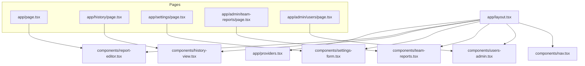
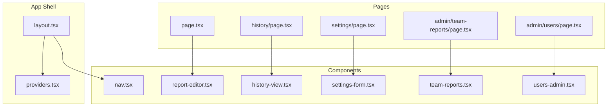
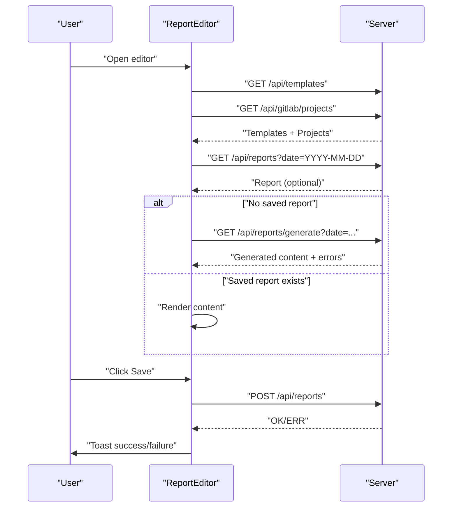
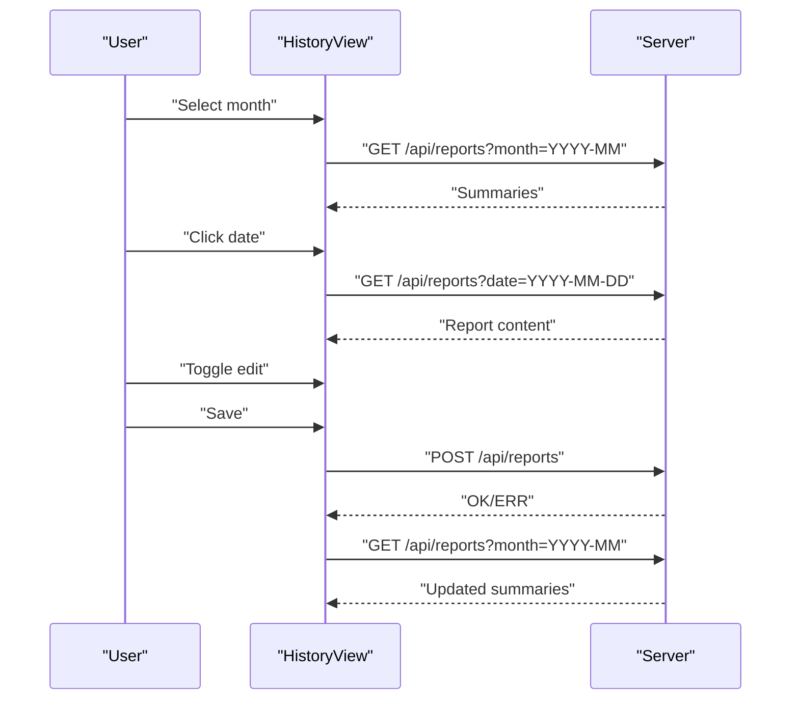
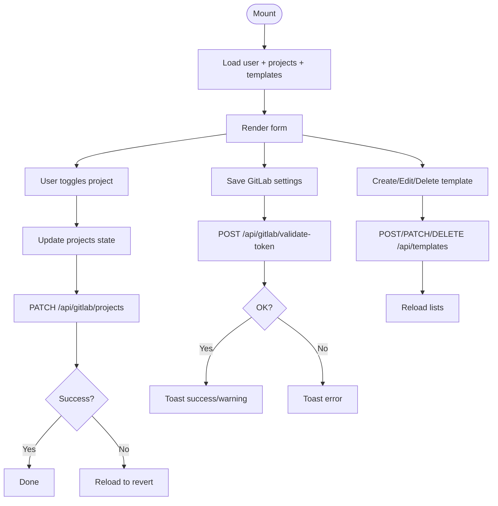
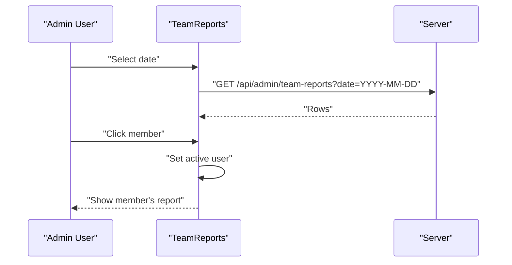
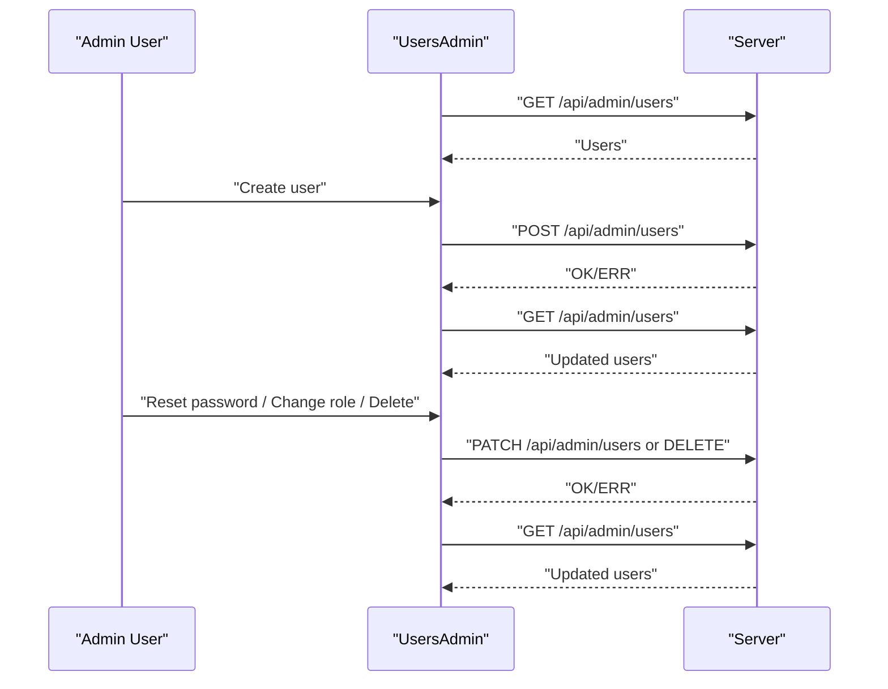
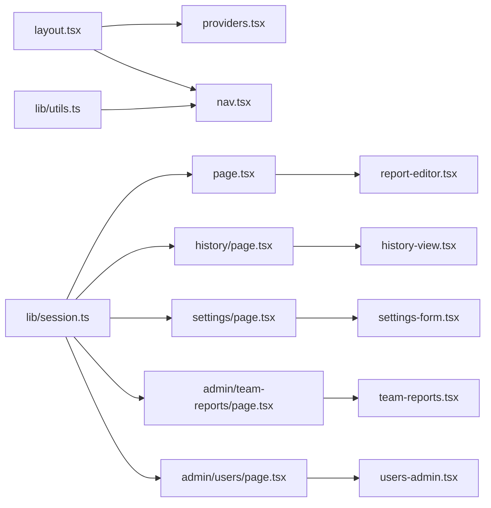

# State Management Patterns

<cite>
**Referenced Files in This Document**
- [app/layout.tsx](file://app/layout.tsx)
- [app/providers.tsx](file://app/providers.tsx)
- [components/report-editor.tsx](file://components/report-editor.tsx)
- [components/history-view.tsx](file://components/history-view.tsx)
- [components/settings-form.tsx](file://components/settings-form.tsx)
- [components/team-reports.tsx](file://components/team-reports.tsx)
- [components/users-admin.tsx](file://components/users-admin.tsx)
- [components/nav.tsx](file://components/nav.tsx)
- [app/page.tsx](file://app/page.tsx)
- [app/history/page.tsx](file://app/history/page.tsx)
- [app/settings/page.tsx](file://app/settings/page.tsx)
- [app/admin/team-reports/page.tsx](file://app/admin/team-reports/page.tsx)
- [app/admin/users/page.tsx](file://app/admin/users/page.tsx)
- [lib/session.ts](file://lib/session.ts)
- [lib/utils.ts](file://lib/utils.ts)
</cite>

## Table of Contents
1. [Introduction](#introduction)
2. [Project Structure](#project-structure)
3. [Core Components](#core-components)
4. [Architecture Overview](#architecture-overview)
5. [Detailed Component Analysis](#detailed-component-analysis)
6. [Dependency Analysis](#dependency-analysis)
7. [Performance Considerations](#performance-considerations)
8. [Troubleshooting Guide](#troubleshooting-guide)
9. [Conclusion](#conclusion)

## Introduction
This document explains the state management patterns used across the frontend components. It covers local component state, shared state via React’s built-in hooks, and integration with external state providers. It also documents component lifecycle (initialization, updates, cleanup), data fetching and caching strategies, optimistic updates, error handling, loading states, user feedback, and performance considerations such as memoization and rendering optimization.

## Project Structure
The frontend follows a Next.js App Router layout with client-side providers and per-page components. Authentication state is provided via a client-side provider, while most UI state is managed locally within components. Shared utilities support styling and lightweight helpers.

**Diagram sources**
- [app/layout.tsx:1-25](file://app/layout.tsx#L1-L25)
- [app/providers.tsx:1-8](file://app/providers.tsx#L1-L8)
- [components/report-editor.tsx:1-284](file://components/report-editor.tsx#L1-L284)
- [components/history-view.tsx:1-208](file://components/history-view.tsx#L1-L208)
- [components/settings-form.tsx:1-368](file://components/settings-form.tsx#L1-L368)
- [components/team-reports.tsx:1-114](file://components/team-reports.tsx#L1-L114)
- [components/users-admin.tsx:1-187](file://components/users-admin.tsx#L1-L187)
- [components/nav.tsx:1-75](file://components/nav.tsx#L1-L75)
- [app/page.tsx:1-20](file://app/page.tsx#L1-L20)
- [app/history/page.tsx:1-21](file://app/history/page.tsx#L1-L21)
- [app/settings/page.tsx:1-21](file://app/settings/page.tsx#L1-L21)
- [app/admin/team-reports/page.tsx:1-22](file://app/admin/team-reports/page.tsx#L1-L22)
- [app/admin/users/page.tsx:1-22](file://app/admin/users/page.tsx#L1-L22)

**Section sources**
- [app/layout.tsx:1-25](file://app/layout.tsx#L1-L25)
- [app/providers.tsx:1-8](file://app/providers.tsx#L1-L8)
- [components/report-editor.tsx:1-284](file://components/report-editor.tsx#L1-L284)
- [components/history-view.tsx:1-208](file://components/history-view.tsx#L1-L208)
- [components/settings-form.tsx:1-368](file://components/settings-form.tsx#L1-L368)
- [components/team-reports.tsx:1-114](file://components/team-reports.tsx#L1-L114)
- [components/users-admin.tsx:1-187](file://components/users-admin.tsx#L1-L187)
- [components/nav.tsx:1-75](file://components/nav.tsx#L1-L75)
- [app/page.tsx:1-20](file://app/page.tsx#L1-L20)
- [app/history/page.tsx:1-21](file://app/history/page.tsx#L1-L21)
- [app/settings/page.tsx:1-21](file://app/settings/page.tsx#L1-L21)
- [app/admin/team-reports/page.tsx:1-22](file://app/admin/team-reports/page.tsx#L1-L22)
- [app/admin/users/page.tsx:1-22](file://app/admin/users/page.tsx#L1-L22)

## Core Components
- Local component state: Each component declares and manages its own state using React hooks (useState, useEffect, useMemo, useCallback).
- Shared state patterns: Minimal cross-component sharing occurs via props and parent-to-child state lifting. There is no centralized state library in use.
- Context usage: Authentication state is provided via a client-side provider wrapping the app shell. Components consume session state via the provider and NextAuth APIs.
- Lifecycle: Initialization via useEffect with empty dependency arrays or dependency-driven updates. Cleanup is minimal; long-lived subscriptions are not present.
- Data fetching: Components fetch data on mount or on state changes using fetch. No explicit caching or optimistic update libraries are used.
- Feedback: User feedback is handled via a toast library integrated at the root layout.

**Section sources**
- [app/providers.tsx:1-8](file://app/providers.tsx#L1-L8)
- [app/layout.tsx:1-25](file://app/layout.tsx#L1-L25)
- [components/report-editor.tsx:1-284](file://components/report-editor.tsx#L1-L284)
- [components/history-view.tsx:1-208](file://components/history-view.tsx#L1-L208)
- [components/settings-form.tsx:1-368](file://components/settings-form.tsx#L1-L368)
- [components/team-reports.tsx:1-114](file://components/team-reports.tsx#L1-L114)
- [components/users-admin.tsx:1-187](file://components/users-admin.tsx#L1-L187)
- [components/nav.tsx:1-75](file://components/nav.tsx#L1-L75)

## Architecture Overview
The state architecture is primarily local with a small amount of shared state via props and a client-side provider for authentication.

**Diagram sources**
- [app/layout.tsx:1-25](file://app/layout.tsx#L1-L25)
- [app/providers.tsx:1-8](file://app/providers.tsx#L1-L8)
- [app/page.tsx:1-20](file://app/page.tsx#L1-L20)
- [app/history/page.tsx:1-21](file://app/history/page.tsx#L1-L21)
- [app/settings/page.tsx:1-21](file://app/settings/page.tsx#L1-L21)
- [app/admin/team-reports/page.tsx:1-22](file://app/admin/team-reports/page.tsx#L1-L22)
- [app/admin/users/page.tsx:1-22](file://app/admin/users/page.tsx#L1-L22)
- [components/report-editor.tsx:1-284](file://components/report-editor.tsx#L1-L284)
- [components/history-view.tsx:1-208](file://components/history-view.tsx#L1-L208)
- [components/settings-form.tsx:1-368](file://components/settings-form.tsx#L1-L368)
- [components/team-reports.tsx:1-114](file://components/team-reports.tsx#L1-L114)
- [components/users-admin.tsx:1-187](file://components/users-admin.tsx#L1-L187)
- [components/nav.tsx:1-75](file://components/nav.tsx#L1-L75)

## Detailed Component Analysis

### Report Editor
- Local state: Manages date, content, templates, selected projects, loading flags, errors, and saved state.
- Lifecycle: Loads configuration on mount; loads existing report for the selected date; auto-generates content if none exists.
- Data fetching: Parallel fetch for templates and projects; subsequent fetch for existing report; generation and AI polishing via POST requests.
- Optimistic updates: None; UI reflects server responses after completion.
- Error handling: Displays errors returned by the backend and shows toast notifications for failures and successes.
- Loading states: Dedicated flags for generation, saving, and polishing; disabled buttons during operations.
- Memoization: Uses useMemo to compute enabled projects and useCallback for async handlers to prevent unnecessary re-renders.

**Diagram sources**
- [components/report-editor.tsx:19-131](file://components/report-editor.tsx#L19-L131)

**Section sources**
- [components/report-editor.tsx:1-284](file://components/report-editor.tsx#L1-L284)

### History View
- Local state: Month, report summaries, selected date, content, editing flag, saving flag.
- Lifecycle: Loads monthly summaries on month change; loads daily content on selection.
- Data fetching: Fetches summaries and individual report content via GET requests; saves via POST.
- Optimistic updates: None; after save, component reloads summaries to reflect changes.
- Error handling: Toasts for failures; renders placeholder when no content.
- Loading states: Saving flag disables save button; calendar grid remains interactive.

**Diagram sources**
- [components/history-view.tsx:13-86](file://components/history-view.tsx#L13-L86)

**Section sources**
- [components/history-view.tsx:1-208](file://components/history-view.tsx#L1-L208)

### Settings Form
- Local state: User profile, GitLab base URL and token, noise regex, projects, templates, filters, and saving flags.
- Lifecycle: Loads initial data on mount; supports real-time toggles with immediate UI updates and subsequent server PATCH/POST/DELETE calls.
- Data fetching: Parallel load for user, projects, and templates; validates token via POST; updates project enablement and default branch via PATCH; manages templates via POST/PATCH/DELETE.
- Optimistic updates: UI updates immediately upon toggle/set actions; on failure, rolls back by reloading data.
- Error handling: Toasts for failures and warnings; prompts for template creation/edit/delete.
- Loading states: Dedicated flags for GitLab save and user save operations.

**Diagram sources**
- [components/settings-form.tsx:33-185](file://components/settings-form.tsx#L33-L185)

**Section sources**
- [components/settings-form.tsx:1-368](file://components/settings-form.tsx#L1-L368)

### Team Reports (Admin)
- Local state: Selected date, rows of users and reports, active user id.
- Lifecycle: Loads team reports for a selected date; clears active selection when data reloads.
- Data fetching: GET /api/admin/team-reports?date=...
- Optimistic updates: None; displays server-provided content.
- Error handling: Renders placeholders when no report is found for a user.

**Diagram sources**
- [components/team-reports.tsx:23-42](file://components/team-reports.tsx#L23-L42)

**Section sources**
- [components/team-reports.tsx:1-114](file://components/team-reports.tsx#L1-L114)

### Users Admin (Admin)
- Local state: Users list, form fields for creating users.
- Lifecycle: Loads users on mount; supports create, reset password, change role, and delete operations.
- Data fetching: GET /api/admin/users; POST/PATCH/DELETE for CRUD operations.
- Optimistic updates: None; reloads user list after successful operations.
- Error handling: Toasts for success/failure; confirm dialog for deletions.

**Diagram sources**
- [components/users-admin.tsx:16-87](file://components/users-admin.tsx#L16-L87)

**Section sources**
- [components/users-admin.tsx:1-187](file://components/users-admin.tsx#L1-L187)

### Navigation
- Consumes session state via NextAuth client hooks and path-based active item highlighting.
- No internal state managed here; relies on routing and authentication provider.

**Section sources**
- [components/nav.tsx:1-75](file://components/nav.tsx#L1-L75)

## Dependency Analysis
- Provider stack: The root layout wraps children with a client-side provider that supplies authentication state to the app.
- Component dependencies: Pages depend on components; components depend on local state and server endpoints. Utilities are used for styling helpers.
- External integrations: NextAuth for session management; react-hot-toast for notifications; @uiw/react-md-editor for Markdown editing (client-only).

**Diagram sources**
- [app/layout.tsx:1-25](file://app/layout.tsx#L1-L25)
- [app/providers.tsx:1-8](file://app/providers.tsx#L1-L8)
- [components/nav.tsx:1-75](file://components/nav.tsx#L1-L75)
- [app/page.tsx:1-20](file://app/page.tsx#L1-L20)
- [app/history/page.tsx:1-21](file://app/history/page.tsx#L1-L21)
- [app/settings/page.tsx:1-21](file://app/settings/page.tsx#L1-L21)
- [app/admin/team-reports/page.tsx:1-22](file://app/admin/team-reports/page.tsx#L1-L22)
- [app/admin/users/page.tsx:1-22](file://app/admin/users/page.tsx#L1-L22)
- [components/report-editor.tsx:1-284](file://components/report-editor.tsx#L1-L284)
- [components/history-view.tsx:1-208](file://components/history-view.tsx#L1-L208)
- [components/settings-form.tsx:1-368](file://components/settings-form.tsx#L1-L368)
- [components/team-reports.tsx:1-114](file://components/team-reports.tsx#L1-L114)
- [components/users-admin.tsx:1-187](file://components/users-admin.tsx#L1-L187)
- [lib/utils.ts:1-7](file://lib/utils.ts#L1-L7)
- [lib/session.ts:1-56](file://lib/session.ts#L1-L56)

**Section sources**
- [app/layout.tsx:1-25](file://app/layout.tsx#L1-L25)
- [app/providers.tsx:1-8](file://app/providers.tsx#L1-L8)
- [components/nav.tsx:1-75](file://components/nav.tsx#L1-L75)
- [lib/utils.ts:1-7](file://lib/utils.ts#L1-L7)
- [lib/session.ts:1-56](file://lib/session.ts#L1-L56)

## Performance Considerations
- Memoization: Components use useMemo to derive derived data (e.g., enabled projects, calendar grid) to avoid recomputation on unrelated renders.
- Callback stability: useCallback is used for async handlers to keep event handlers stable across renders, reducing downstream re-renders.
- Conditional rendering: Dynamic imports for heavy editors defer loading until client-side hydration.
- Avoiding unnecessary re-renders: Prefer stable callbacks and memoized values for props passed to child components.
- Rendering optimization: Keep heavy lists virtualized if they grow; currently, lists are simple and manageable.
- Network efficiency: Components batch related fetches (e.g., templates and projects) to reduce round-trips.

**Section sources**
- [components/report-editor.tsx:34-53](file://components/report-editor.tsx#L34-L53)
- [components/history-view.tsx:21-37](file://components/history-view.tsx#L21-L37)
- [components/settings-form.tsx:187-191](file://components/settings-form.tsx#L187-L191)

## Troubleshooting Guide
- Authentication redirects: Pages check for session presence and redirect unauthenticated users to the login page.
- API error handling: Utility wrapper converts thrown responses into structured JSON responses; components surface user-facing errors via toasts.
- Toast notifications: Integrated at the root layout; ensure toasts are visible and actionable.
- Common pitfalls:
  - Forgetting to handle non-OK responses from fetch; always check response.ok and parse error messages.
  - Not disabling buttons during async operations; leads to duplicate submissions.
  - Updating state optimistically without a rollback strategy; prefer server-driven state and reload on failure.

**Section sources**
- [lib/session.ts:12-29](file://lib/session.ts#L12-L29)
- [lib/session.ts:40-55](file://lib/session.ts#L40-L55)
- [app/layout.tsx:3-20](file://app/layout.tsx#L3-L20)
- [components/report-editor.tsx:81-84](file://components/report-editor.tsx#L81-L84)
- [components/history-view.tsx:62-66](file://components/history-view.tsx#L62-L66)
- [components/settings-form.tsx:77-80](file://components/settings-form.tsx#L77-L80)

## Conclusion
The application employs a straightforward, local-first React state management approach with minimal cross-component sharing. Authentication state is provided globally via a client-side provider, while UI state is encapsulated within components. Data fetching is imperative and explicit, with clear loading and error handling patterns. There is no centralized state library; instead, the code favors simplicity, readability, and predictable control flow. For future scaling, consider adding a state library for shared global state and introducing caching/optimistic updates for improved UX and performance.