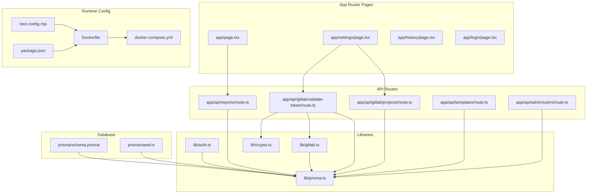
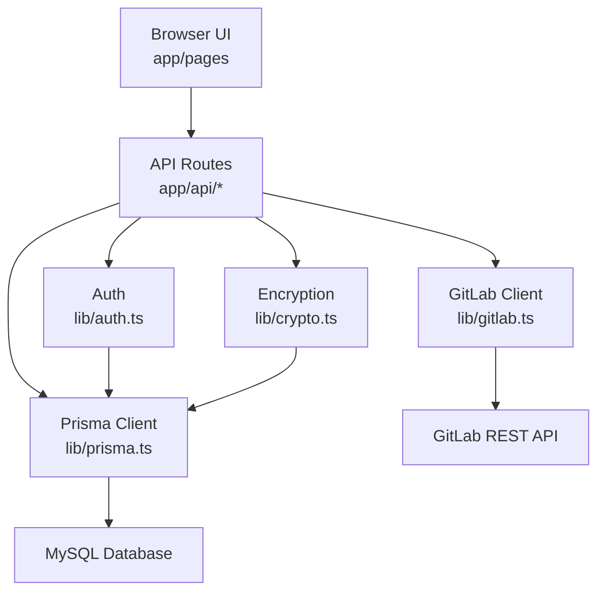
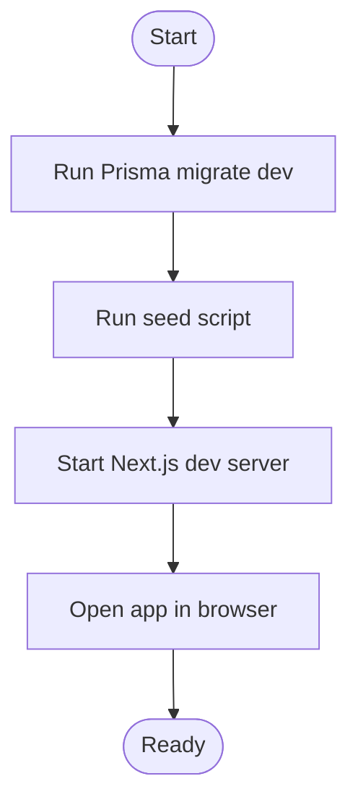
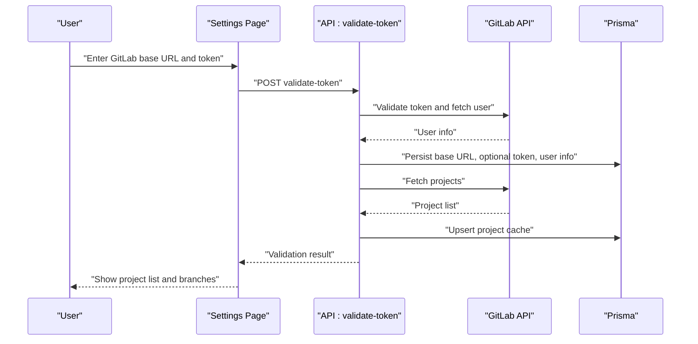
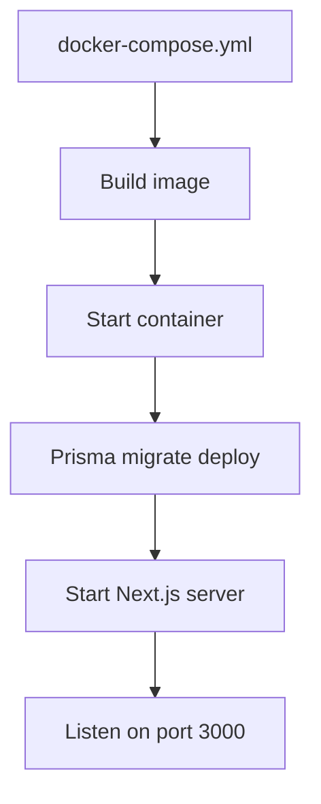
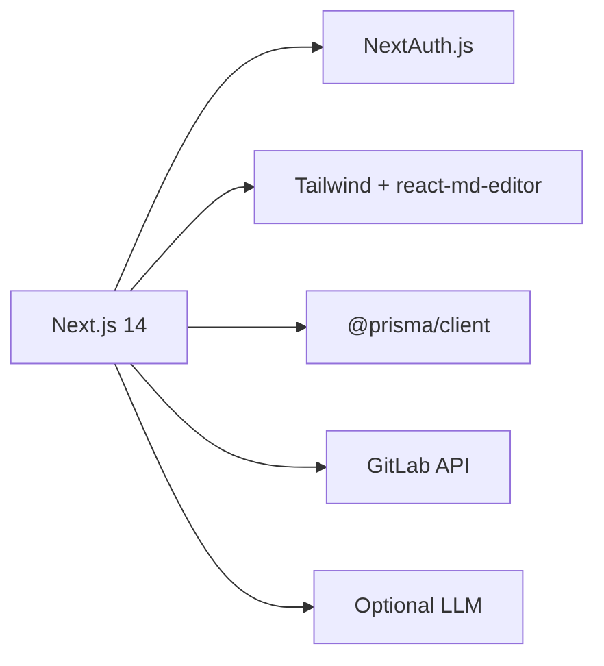

# Getting Started

<cite>
**Referenced Files in This Document**
- [README.md](file://README.md)
- [package.json](file://package.json)
- [docker-compose.yml](file://docker-compose.yml)
- [Dockerfile](file://Dockerfile)
- [prisma/schema.prisma](file://prisma/schema.prisma)
- [prisma/seed.ts](file://prisma/seed.ts)
- [lib/auth.ts](file://lib/auth.ts)
- [lib/crypto.ts](file://lib/crypto.ts)
- [lib/gitlab.ts](file://lib/gitlab.ts)
- [lib/prisma.ts](file://lib/prisma.ts)
- [next.config.mjs](file://next.config.mjs)
- [app/api/gitlab/validate-token/route.ts](file://app/api/gitlab/validate-token/route.ts)
- [app/api/gitlab/projects/route.ts](file://app/api/gitlab/projects/route.ts)
</cite>

## Table of Contents
1. [Introduction](#introduction)
2. [Project Structure](#project-structure)
3. [Core Components](#core-components)
4. [Architecture Overview](#architecture-overview)
5. [Detailed Component Analysis](#detailed-component-analysis)
6. [Dependency Analysis](#dependency-analysis)
7. [Performance Considerations](#performance-considerations)
8. [Troubleshooting Guide](#troubleshooting-guide)
9. [Conclusion](#conclusion)
10. [Appendices](#appendices)

## Introduction
Pingyun Report is a Next.js 14 full-stack application that generates daily reports from self-hosted GitLab commits. It supports multi-user accounts, MySQL persistence, optional AI polish via an OpenAI-compatible LLM, and secure storage of GitLab tokens. This guide walks you through prerequisites, installation, local development, first-time configuration, and production deployment with Docker Compose.

## Project Structure
At a high level, the project consists of:
- Frontend pages under app/ (Next.js App Router)
- API routes under app/api/ (Next.js App Router)
- Shared libraries under lib/
- Database schema and seed logic under prisma/
- Build and runtime configuration files (Dockerfile, docker-compose.yml, next.config.mjs, package.json)

**Diagram sources**
- [next.config.mjs:1-11](file://next.config.mjs#L1-L11)
- [Dockerfile:1-44](file://Dockerfile#L1-L44)
- [docker-compose.yml:1-21](file://docker-compose.yml#L1-L21)
- [package.json:1-47](file://package.json#L1-L47)
- [prisma/schema.prisma:1-80](file://prisma/schema.prisma#L1-L80)
- [prisma/seed.ts:1-63](file://prisma/seed.ts#L1-L63)
- [lib/auth.ts:1-77](file://lib/auth.ts#L1-L77)
- [lib/crypto.ts:1-46](file://lib/crypto.ts#L1-L46)
- [lib/gitlab.ts:1-149](file://lib/gitlab.ts#L1-L149)
- [lib/prisma.ts:1-14](file://lib/prisma.ts#L1-L14)
- [app/api/gitlab/validate-token/route.ts:1-81](file://app/api/gitlab/validate-token/route.ts#L1-L81)
- [app/api/gitlab/projects/route.ts:1-42](file://app/api/gitlab/projects/route.ts#L1-L42)

**Section sources**
- [README.md:1-86](file://README.md#L1-L86)
- [package.json:1-47](file://package.json#L1-L47)
- [next.config.mjs:1-11](file://next.config.mjs#L1-L11)

## Core Components
- Authentication and sessions powered by NextAuth.js with JWT strategy and credentials provider.
- Database ORM via Prisma targeting MySQL with a generated client.
- GitLab integration through server-side route handlers that proxy API calls and securely store tokens.
- Encryption utilities for GitLab personal access tokens at rest.
- Seed script that provisions an initial admin user and default template.

Key implementation references:
- Authentication configuration and JWT/session callbacks
- Encryption/decryption and token masking
- GitLab client helpers for user, projects, and commits
- Prisma client initialization and logging behavior
- Seed script for admin and default template creation

**Section sources**
- [lib/auth.ts:30-77](file://lib/auth.ts#L30-L77)
- [lib/crypto.ts:7-46](file://lib/crypto.ts#L7-L46)
- [lib/gitlab.ts:45-149](file://lib/gitlab.ts#L45-L149)
- [lib/prisma.ts:7-14](file://lib/prisma.ts#L7-L14)
- [prisma/seed.ts:19-53](file://prisma/seed.ts#L19-L53)

## Architecture Overview
The system follows a layered architecture:
- Presentation: Next.js App Router pages and components
- API Layer: Route handlers under app/api/ implementing CRUD and integrations
- Domain Services: Authentication, encryption, GitLab client
- Persistence: Prisma client with MySQL

**Diagram sources**
- [lib/auth.ts:30-77](file://lib/auth.ts#L30-L77)
- [lib/crypto.ts:17-38](file://lib/crypto.ts#L17-L38)
- [lib/gitlab.ts:45-80](file://lib/gitlab.ts#L45-L80)
- [lib/prisma.ts:7-14](file://lib/prisma.ts#L7-L14)
- [prisma/schema.prisma:6-9](file://prisma/schema.prisma#L6-L9)

## Detailed Component Analysis

### Prerequisites
- Node.js 20.x
- pnpm (used by the project scripts)
- MySQL 5.7+ or compatible
- Docker and Docker Compose for production deployment

Verification steps:
- Confirm Node.js and pnpm versions
- Verify MySQL connectivity and database availability
- Ensure Docker daemon is running for production deployment

**Section sources**
- [README.md:14-23](file://README.md#L14-L23)
- [package.json:5-14](file://package.json#L5-L14)
- [docker-compose.yml:1-21](file://docker-compose.yml#L1-L21)

### Step-by-Step Installation
1. Install dependencies
   - Run the package manager install command defined in the project scripts.
2. Prepare environment variables
   - Copy the example environment file and configure required variables.
3. Apply database migrations
   - Run the Prisma migration command to create tables.
4. Seed the database
   - Execute the seed script to create the initial admin user and default template.
5. Start the development server
   - Launch the Next.js dev server.

Verification:
- Access the app at the development port and log in with the seeded admin credentials.

**Section sources**
- [README.md:16-25](file://README.md#L16-L25)
- [package.json:5-14](file://package.json#L5-L14)

### Environment Configuration
Required environment variables (see the project’s documentation):
- DATABASE_URL: MySQL connection string
- NEXTAUTH_URL: External URL of the application
- NEXTAUTH_SECRET: Secret for NextAuth
- ENCRYPTION_KEY: 64-character hex string for encrypting tokens at rest
- LLM_API_BASE / LLM_API_KEY / LLM_MODEL: Optional for AI polish
- ADMIN_USERNAME / ADMIN_PASSWORD / ADMIN_DISPLAY_NAME: Seed-only initial admin

Notes:
- The encryption key must be exactly 64 hex characters.
- The seed script uses ADMIN_* variables to provision the initial admin.

**Section sources**
- [README.md:54-64](file://README.md#L54-L64)
- [lib/crypto.ts:8-15](file://lib/crypto.ts#L8-L15)
- [prisma/seed.ts:20-22](file://prisma/seed.ts#L20-L22)

### Local Development Setup
- Database migration: apply Prisma migrations for the development schema.
- Seeding: run the seed script to create the admin user and default template.
- Development server: start the Next.js dev server.

**Diagram sources**
- [README.md:16-25](file://README.md#L16-L25)
- [package.json:11-14](file://package.json#L11-L14)

**Section sources**
- [README.md:14-25](file://README.md#L14-L25)
- [package.json:11-14](file://package.json#L11-L14)

### First-Time Configuration Workflow
After launching the app:
1. Log in with the seeded admin credentials.
2. Navigate to Settings and configure GitLab:
   - Enter the GitLab base URL.
   - Provide a Personal Access Token with required scopes.
   - Save and validate to persist the base URL and optionally the token.
3. Select projects:
   - The system fetches your project list; select projects you commit to.
   - Optionally set a non-default branch per project.
4. Customize templates:
   - Optionally edit the noise regex and create custom Handlebars templates.

**Diagram sources**
- [app/api/gitlab/validate-token/route.ts:13-80](file://app/api/gitlab/validate-token/route.ts#L13-L80)
- [lib/gitlab.ts:87-111](file://lib/gitlab.ts#L87-L111)
- [lib/crypto.ts:18-38](file://lib/crypto.ts#L18-L38)
- [lib/prisma.ts:7-14](file://lib/prisma.ts#L7-L14)

**Section sources**
- [README.md:27-33](file://README.md#L27-L33)
- [app/api/gitlab/validate-token/route.ts:13-80](file://app/api/gitlab/validate-token/route.ts#L13-L80)
- [app/api/gitlab/projects/route.ts:6-41](file://app/api/gitlab/projects/route.ts#L6-L41)

### Production Deployment with Docker Compose
- Build and start the service using the provided compose file.
- The container applies Prisma migrations on startup and runs the standalone server.
- Configure environment variables via the compose file’s environment block.

**Diagram sources**
- [docker-compose.yml:1-21](file://docker-compose.yml#L1-L21)
- [Dockerfile:43-44](file://Dockerfile#L43-L44)

**Section sources**
- [README.md:46-52](file://README.md#L46-L52)
- [docker-compose.yml:10-20](file://docker-compose.yml#L10-L20)
- [Dockerfile:43-44](file://Dockerfile#L43-L44)

### Security Considerations During Initial Setup
- GitLab tokens are encrypted at rest using AES-256-GCM and never exposed to the browser.
- All GitLab API calls are proxied server-side through route handlers.
- Passwords are stored as bcrypt hashes.
- Rotate the encryption key carefully: re-encrypt existing tokens or require users to re-enter their PAT.

**Section sources**
- [README.md:65-71](file://README.md#L65-L71)
- [lib/crypto.ts:18-38](file://lib/crypto.ts#L18-L38)
- [lib/gitlab.ts:3-4](file://lib/gitlab.ts#L3-L4)

## Dependency Analysis
- Next.js 14 App Router with TypeScript
- Prisma client for MySQL
- NextAuth.js for credentials-based JWT sessions
- GitLab REST API integration via server-side route handlers
- Tailwind CSS and react-md-editor for UI
- Optional OpenAI-compatible LLM for AI polish

**Diagram sources**
- [package.json:16-31](file://package.json#L16-L31)
- [next.config.mjs:1-11](file://next.config.mjs#L1-L11)

**Section sources**
- [package.json:16-45](file://package.json#L16-L45)
- [next.config.mjs:1-11](file://next.config.mjs#L1-L11)

## Performance Considerations
- Use the production-ready standalone output and minimal base image for containerized deployments.
- Keep Prisma client logs scoped to errors in production to reduce overhead.
- Limit pagination and safety caps when fetching GitLab resources to avoid long-running requests.

[No sources needed since this section provides general guidance]

## Troubleshooting Guide
Common setup issues and resolutions:
- Database connection failures
  - Verify DATABASE_URL format and network accessibility.
  - Ensure the database exists and credentials are correct.
- Migration errors
  - Re-run the Prisma migration command and check schema correctness.
- Authentication failures
  - Confirm NEXTAUTH_SECRET length and NEXTAUTH_URL reachability.
  - Ensure bcrypt compatibility and correct credential input.
- Encryption key errors
  - The encryption key must be a 64-character hex string; regenerate if invalid.
- GitLab token validation failures
  - Confirm token scopes and base URL correctness.
  - Check network timeouts and rate limits.
- Docker build or runtime issues
  - Ensure Docker daemon is running and images build successfully.
  - Verify environment variables passed via compose.

Verification steps:
- After setup, log in, validate GitLab configuration, and confirm project list loading.
- Generate a test report and review the history view.

**Section sources**
- [README.md:14-25](file://README.md#L14-L25)
- [README.md:54-64](file://README.md#L54-L64)
- [lib/crypto.ts:8-15](file://lib/crypto.ts#L8-L15)
- [lib/gitlab.ts:58-80](file://lib/gitlab.ts#L58-L80)
- [docker-compose.yml:10-20](file://docker-compose.yml#L10-L20)

## Conclusion
You now have the essentials to install, configure, and run Pingyun Report locally and in production. Complete the first-time configuration by connecting GitLab, selecting projects, and customizing templates. For production, rely on the provided Docker Compose setup and ensure environment variables are correctly configured.

[No sources needed since this section summarizes without analyzing specific files]

## Appendices

### Environment Variables Reference
- DATABASE_URL: MySQL connection string
- NEXTAUTH_URL: External URL of the app
- NEXTAUTH_SECRET: Secret for NextAuth
- ENCRYPTION_KEY: 64-character hex string for token encryption
- LLM_API_BASE / LLM_API_KEY / LLM_MODEL: Optional for AI polish
- ADMIN_USERNAME / ADMIN_PASSWORD / ADMIN_DISPLAY_NAME: Seed-only initial admin

**Section sources**
- [README.md:54-64](file://README.md#L54-L64)
- [docker-compose.yml:10-20](file://docker-compose.yml#L10-L20)