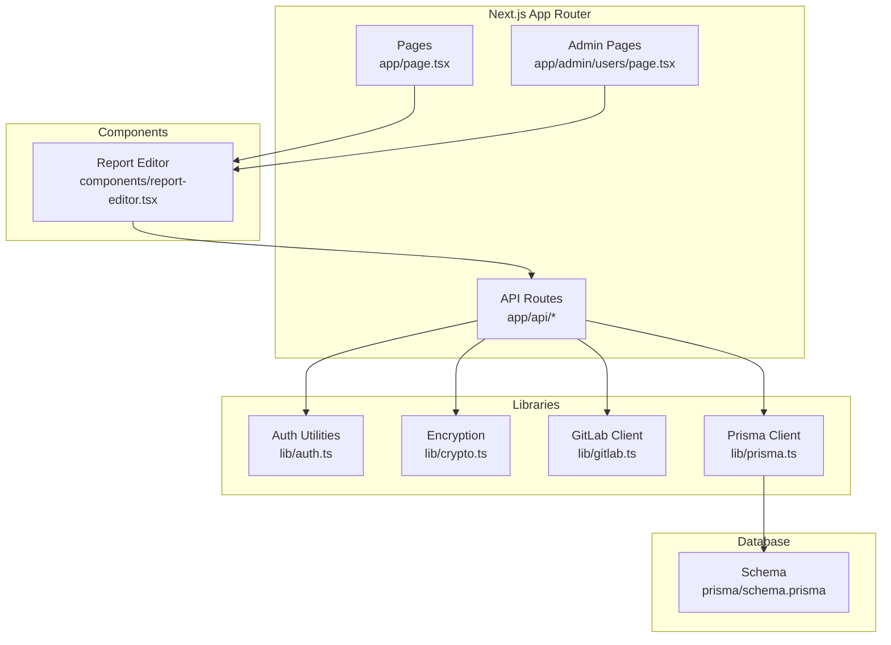
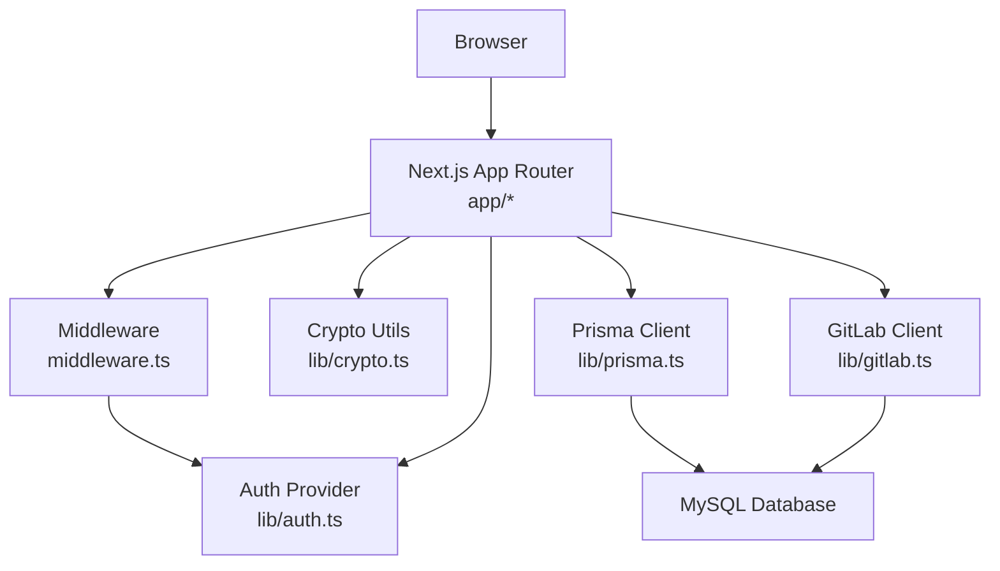
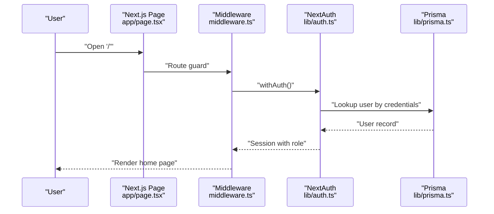
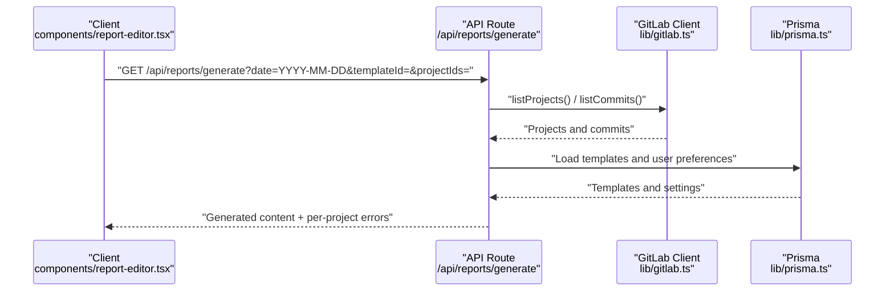
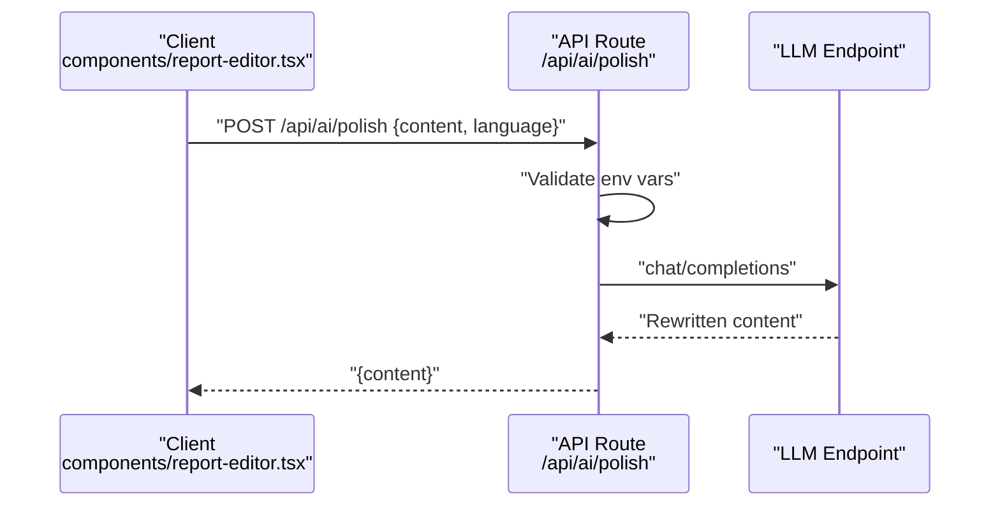
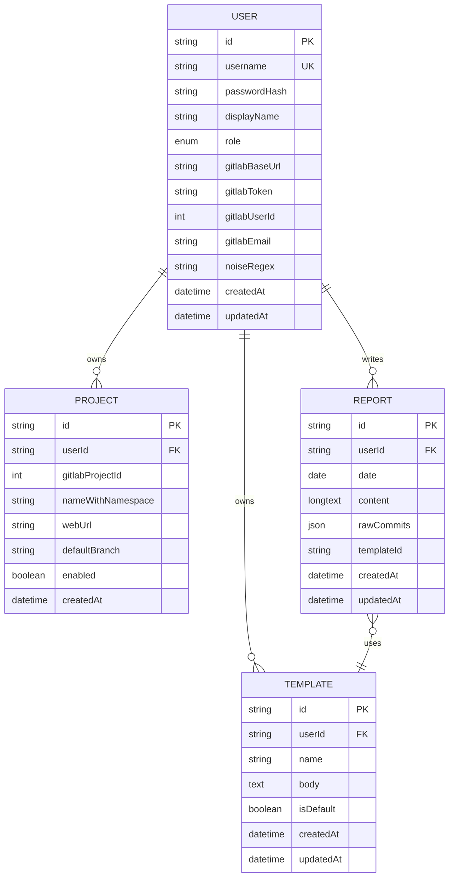
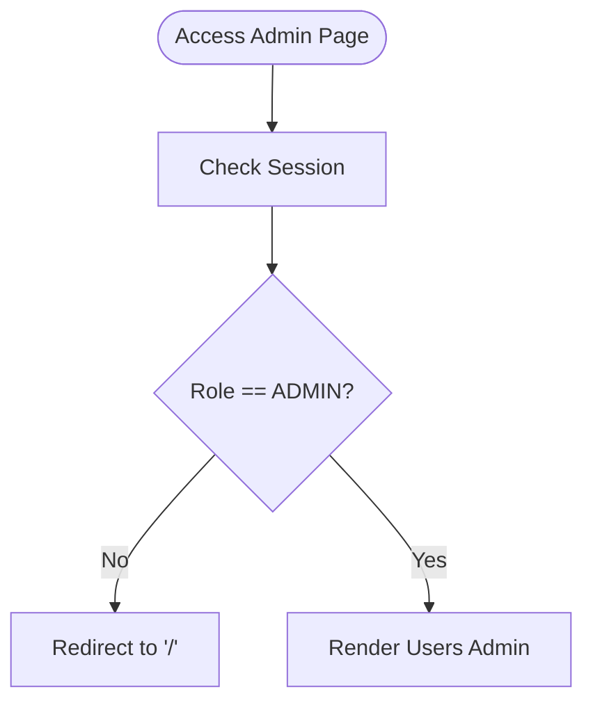
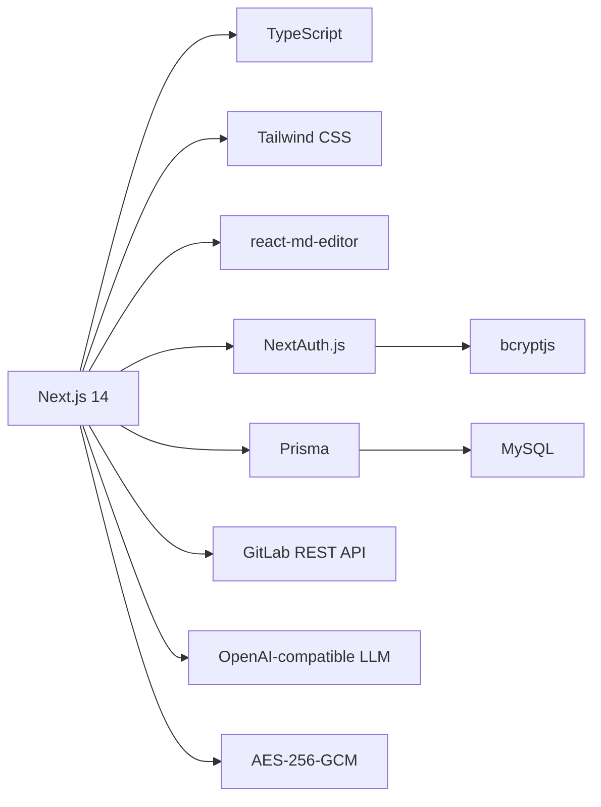

# Project Overview

<cite>
**Referenced Files in This Document**
- [README.md](file://README.md)
- [package.json](file://package.json)
- [prisma/schema.prisma](file://prisma/schema.prisma)
- [lib/gitlab.ts](file://lib/gitlab.ts)
- [lib/auth.ts](file://lib/auth.ts)
- [lib/crypto.ts](file://lib/crypto.ts)
- [lib/prisma.ts](file://lib/prisma.ts)
- [middleware.ts](file://middleware.ts)
- [app/page.tsx](file://app/page.tsx)
- [components/report-editor.tsx](file://components/report-editor.tsx)
- [app/api/ai/polish/route.ts](file://app/api/ai/polish/route.ts)
- [app/admin/users/page.tsx](file://app/admin/users/page.tsx)
</cite>

## Table of Contents
1. [Introduction](#introduction)
2. [Project Structure](#project-structure)
3. [Core Components](#core-components)
4. [Architecture Overview](#architecture-overview)
5. [Detailed Component Analysis](#detailed-component-analysis)
6. [Dependency Analysis](#dependency-analysis)
7. [Performance Considerations](#performance-considerations)
8. [Troubleshooting Guide](#troubleshooting-guide)
9. [Conclusion](#conclusion)

## Introduction
Pingyun Report is a Next.js 14 full-stack application designed to automate daily development reporting for internal engineering teams. It integrates with self-hosted GitLab instances to collect commit activity and transform it into readable, shareable daily reports. The platform supports multi-user collaboration, persistent storage via MySQL, and optional AI-powered content polishing powered by OpenAI-compatible LLMs.

Key benefits for internal development teams:
- Automated reporting: Minimizes manual effort by generating daily summaries directly from GitLab commits.
- Team visibility: Provides a centralized place for daily progress sharing and historical context.
- Customizable templates: Allows teams to define reusable report templates and tailor content to their workflows.
- Secure handling: Encrypts sensitive tokens at rest and routes all GitLab API calls server-side to prevent token exposure.

Target audience:
- Internal development teams seeking streamlined daily reporting workflows.
- Engineering managers requiring quick visibility into team progress.
- Organizations using self-hosted GitLab who need a lightweight, secure reporting companion.

Common use cases:
- Daily standup preparation: Quickly generate a draft report from recent commits and refine with AI polish.
- Historical tracking: Browse previous days’ reports via the calendar view to review progress over time.
- Team compliance: Maintain consistent daily reporting standards across contributors with shared templates and enforced configurations.

## Project Structure
The project follows a Next.js App Router structure with a clear separation between server-side APIs, client-side UI components, and database modeling via Prisma.

High-level structure highlights:
- app/: Next.js App Router pages and API routes
- components/: Reusable React components for UI
- lib/: Shared utilities for authentication, encryption, GitLab integration, and Prisma client initialization
- prisma/: Database schema and seeding logic

**Diagram sources**
- [app/page.tsx:1-20](file://app/page.tsx#L1-L20)
- [components/report-editor.tsx:1-284](file://components/report-editor.tsx#L1-L284)
- [app/admin/users/page.tsx:1-22](file://app/admin/users/page.tsx#L1-L22)
- [lib/auth.ts:1-77](file://lib/auth.ts#L1-L77)
- [lib/crypto.ts:1-46](file://lib/crypto.ts#L1-L46)
- [lib/gitlab.ts:1-149](file://lib/gitlab.ts#L1-L149)
- [lib/prisma.ts:1-14](file://lib/prisma.ts#L1-L14)
- [prisma/schema.prisma:1-80](file://prisma/schema.prisma#L1-L80)

**Section sources**
- [README.md:1-86](file://README.md#L1-L86)
- [package.json:1-47](file://package.json#L1-L47)
- [prisma/schema.prisma:1-80](file://prisma/schema.prisma#L1-L80)

## Core Components
- Multi-user architecture with role-based access control (MEMBER and ADMIN roles) and JWT-based sessions.
- MySQL-backed persistence managed by Prisma ORM with explicit models for users, projects, reports, and templates.
- GitLab integration via a server-side client that validates tokens, lists projects, and fetches commits for a given date range.
- AI polish pipeline that sends content to an OpenAI-compatible LLM endpoint for rewriting and refinement.
- Client-side report editor with Markdown editing, template selection, project filtering, and real-time generation.

**Section sources**
- [lib/auth.ts:1-77](file://lib/auth.ts#L1-L77)
- [lib/crypto.ts:1-46](file://lib/crypto.ts#L1-L46)
- [lib/gitlab.ts:1-149](file://lib/gitlab.ts#L1-L149)
- [app/api/ai/polish/route.ts:1-63](file://app/api/ai/polish/route.ts#L1-L63)
- [components/report-editor.tsx:1-284](file://components/report-editor.tsx#L1-L284)
- [prisma/schema.prisma:16-79](file://prisma/schema.prisma#L16-L79)

## Architecture Overview
The system is built around a client-server split:
- Client-side: Next.js App Router pages and components handle user interactions, form submissions, and rendering.
- Server-side: Route handlers under app/api manage authentication, GitLab integration, report generation, template CRUD, and AI polish.
- Persistence: Prisma connects to MySQL to store user profiles, project mappings, daily reports, and templates.
- Security: GitLab tokens are encrypted at rest and handled exclusively server-side; middleware enforces authentication for protected routes.

**Diagram sources**
- [middleware.ts:1-10](file://middleware.ts#L1-L10)
- [lib/auth.ts:1-77](file://lib/auth.ts#L1-L77)
- [lib/crypto.ts:1-46](file://lib/crypto.ts#L1-L46)
- [lib/gitlab.ts:1-149](file://lib/gitlab.ts#L1-L149)
- [lib/prisma.ts:1-14](file://lib/prisma.ts#L1-L14)
- [prisma/schema.prisma:6-9](file://prisma/schema.prisma#L6-L9)

## Detailed Component Analysis

### Authentication and Authorization
- NextAuth.js with credentials provider and JWT strategy powers user login and session management.
- Role-based access control restricts administrative features to ADMIN users.
- Middleware enforces authentication for protected routes.

**Diagram sources**
- [app/page.tsx:1-20](file://app/page.tsx#L1-L20)
- [middleware.ts:1-10](file://middleware.ts#L1-L10)
- [lib/auth.ts:30-77](file://lib/auth.ts#L30-L77)
- [lib/prisma.ts:1-14](file://lib/prisma.ts#L1-L14)

**Section sources**
- [lib/auth.ts:1-77](file://lib/auth.ts#L1-L77)
- [middleware.ts:1-10](file://middleware.ts#L1-L10)
- [app/page.tsx:1-20](file://app/page.tsx#L1-L20)

### GitLab Integration and Report Generation
- The GitLab client handles token validation, project listing, and commit fetching with pagination and safety caps.
- The report editor orchestrates generation requests, merges template and project selections, and displays errors per project.
- Server-side route handlers coordinate with the GitLab client and Prisma to assemble daily reports.

**Diagram sources**
- [components/report-editor.tsx:67-91](file://components/report-editor.tsx#L67-L91)
- [lib/gitlab.ts:91-149](file://lib/gitlab.ts#L91-L149)
- [lib/prisma.ts:1-14](file://lib/prisma.ts#L1-L14)

**Section sources**
- [lib/gitlab.ts:1-149](file://lib/gitlab.ts#L1-L149)
- [components/report-editor.tsx:1-284](file://components/report-editor.tsx#L1-L284)

### AI Polish Pipeline
- The AI polish endpoint accepts report content and optional language preference, then forwards to an OpenAI-compatible LLM endpoint.
- It enforces environment-based configuration checks and returns polished content or error details.

**Diagram sources**
- [app/api/ai/polish/route.ts:1-63](file://app/api/ai/polish/route.ts#L1-L63)
- [components/report-editor.tsx:142-164](file://components/report-editor.tsx#L142-L164)

**Section sources**
- [app/api/ai/polish/route.ts:1-63](file://app/api/ai/polish/route.ts#L1-L63)
- [components/report-editor.tsx:142-164](file://components/report-editor.tsx#L142-L164)

### Data Model Overview
The schema defines four primary models with relationships and indexes to support multi-user, project-scoped reporting, and template management.

**Diagram sources**
- [prisma/schema.prisma:16-79](file://prisma/schema.prisma#L16-L79)

**Section sources**
- [prisma/schema.prisma:1-80](file://prisma/schema.prisma#L1-L80)

### Administrative Features
- Admin-only routes enable user management and team report visibility.
- The admin user page enforces role-based redirection to protect sensitive operations.

**Diagram sources**
- [app/admin/users/page.tsx:1-22](file://app/admin/users/page.tsx#L1-L22)

**Section sources**
- [app/admin/users/page.tsx:1-22](file://app/admin/users/page.tsx#L1-L22)

## Dependency Analysis
Technology stack summary:
- Frontend framework: Next.js 14 with App Router and TypeScript
- Styling: Tailwind CSS
- Markdown editing: react-md-editor
- Backend: Next.js route handlers
- Authentication: NextAuth.js with credentials provider and JWT sessions
- Database: Prisma ORM with MySQL
- GitLab integration: Server-side REST client
- Optional AI: OpenAI-compatible LLM chat completions
- Security: bcrypt for password hashing, AES-256-GCM for token encryption

**Diagram sources**
- [package.json:16-31](file://package.json#L16-L31)
- [README.md:5-12](file://README.md#L5-L12)

**Section sources**
- [package.json:1-47](file://package.json#L1-L47)
- [README.md:1-86](file://README.md#L1-L86)

## Performance Considerations
- Pagination and safety caps: The GitLab client paginates project and commit listings with a cap to prevent excessive API calls.
- Client-side caching: The report editor caches templates and project lists to reduce redundant network requests.
- Database indexing: Unique and composite indexes on user-date pairs and user-project combinations optimize report and project queries.
- Environment logging: Prisma logs are reduced in production to minimize overhead.

[No sources needed since this section provides general guidance]

## Troubleshooting Guide
Common issues and resolutions:
- Authentication failures: Verify credentials and ensure the user exists with a valid password hash.
- GitLab token errors: Confirm token validity and scope permissions; the system validates tokens server-side and masks them for display.
- AI polish errors: Ensure LLM environment variables are configured; the endpoint returns detailed error messages for misconfiguration or service failures.
- Database connectivity: Confirm DATABASE_URL format and Prisma migration status.

**Section sources**
- [lib/auth.ts:40-56](file://lib/auth.ts#L40-L56)
- [lib/crypto.ts:7-15](file://lib/crypto.ts#L7-L15)
- [app/api/ai/polish/route.ts:14-22](file://app/api/ai/polish/route.ts#L14-L22)
- [lib/gitlab.ts:87-89](file://lib/gitlab.ts#L87-L89)

## Conclusion
Pingyun Report delivers a practical solution for automated daily reporting within internal development teams. By integrating with self-hosted GitLab, securing sensitive data, and offering optional AI polish, it reduces manual overhead while improving team visibility and consistency. Its modular architecture, clear data models, and role-based admin controls make it suitable for organizations seeking a lightweight, secure, and extensible reporting companion.