# Commit Processing and Filtering

<cite>
**Referenced Files in This Document**
- [lib/report.ts](file://lib/report.ts)
- [lib/gitlab.ts](file://lib/gitlab.ts)
- [app/api/reports/generate/route.ts](file://app/api/reports/generate/route.ts)
- [app/api/me/route.ts](file://app/api/me/route.ts)
- [components/settings-form.tsx](file://components/settings-form.tsx)
- [prisma/schema.prisma](file://prisma/schema.prisma)
- [lib/__tests__/report.test.ts](file://lib/__tests__/report.test.ts)
</cite>

## Update Summary
**Changes Made**
- Enhanced conventional commit parsing with support for both Western and fullwidth Unicode punctuation
- Improved commit filtering logic with comprehensive test coverage for edge cases
- Added extensive test suite validating parsing, filtering, and deduplication behaviors
- Updated parsing regex to handle mixed punctuation scenarios

## Table of Contents
1. [Introduction](#introduction)
2. [Project Structure](#project-structure)
3. [Core Components](#core-components)
4. [Architecture Overview](#architecture-overview)
5. [Detailed Component Analysis](#detailed-component-analysis)
6. [Dependency Analysis](#dependency-analysis)
7. [Performance Considerations](#performance-considerations)
8. [Troubleshooting Guide](#troubleshooting-guide)
9. [Conclusion](#conclusion)

## Introduction
This document explains the commit processing and filtering pipeline used to transform GitLab commit data into structured daily reports. It covers enhanced conventional commit parsing with support for both Western and fullwidth Unicode punctuation, comprehensive filtering mechanisms (merge commits, noise patterns, duplicates), deduplication strategies, context building, and the complete processing workflow. It also addresses edge cases and performance considerations for large commit histories.

## Project Structure
The commit processing pipeline spans several modules:
- Data model definitions for GitLab commits and projects
- Enhanced conventional commit parsing with Unicode punctuation support
- Comprehensive filtering logic with test coverage for edge cases
- Context building for report rendering
- API orchestration for fetching commits and generating reports
- User settings for configuring filters and preferences

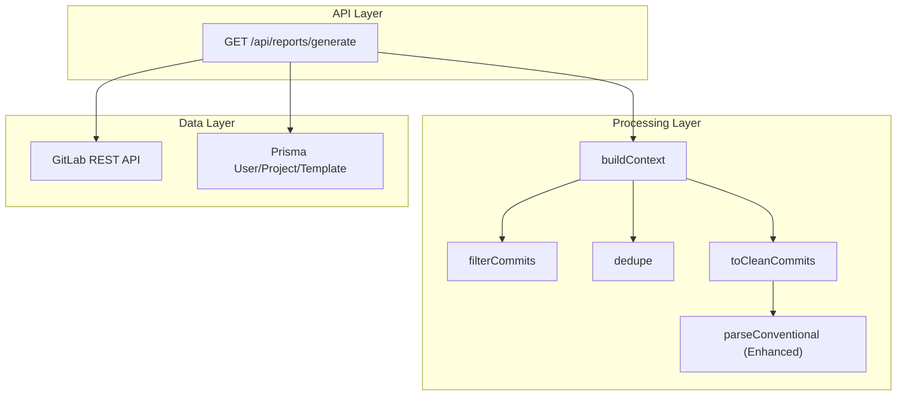

**Diagram sources**
- [app/api/reports/generate/route.ts:23-132](file://app/api/reports/generate/route.ts#L23-L132)
- [lib/report.ts:31-135](file://lib/report.ts#L31-L135)
- [lib/gitlab.ts:120-148](file://lib/gitlab.ts#L120-L148)

**Section sources**
- [lib/report.ts:1-159](file://lib/report.ts#L1-L159)
- [lib/gitlab.ts:1-172](file://lib/gitlab.ts#L1-L172)
- [app/api/reports/generate/route.ts:1-133](file://app/api/reports/generate/route.ts#L1-L133)

## Core Components
- **Enhanced conventional commit parsing**: Extracts type, scope, and subject from commit messages with support for both Western and fullwidth Unicode punctuation.
- **Merge detection**: Identifies merge commits using parent IDs.
- **Comprehensive filtering**: Applies author email filtering, merge commit removal, and noise regex filtering with graceful error handling.
- **Deduplication**: Removes duplicate commits based on normalized type/scope/subject.
- **Context building**: Aggregates filtered and cleaned commits into project groups with totals.
- **Template rendering**: Uses Handlebars to produce final report content.

**Section sources**
- [lib/report.ts:29-105](file://lib/report.ts#L29-L105)
- [lib/report.ts:115-135](file://lib/report.ts#L115-L135)

## Architecture Overview
The system orchestrates commit fetching from GitLab, applies enhanced processing and filtering with comprehensive test coverage, and renders a report using a template. The flow integrates user preferences (author email, noise regex) and project selection.

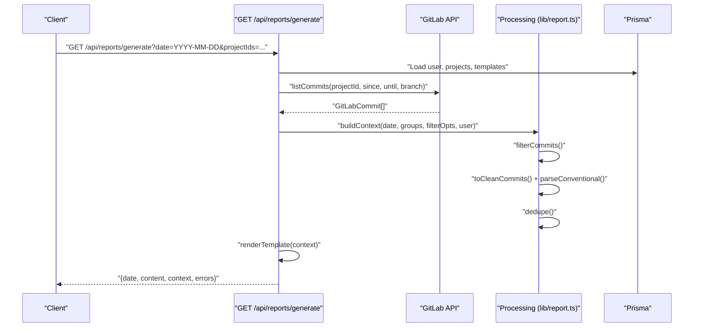

**Diagram sources**
- [app/api/reports/generate/route.ts:23-132](file://app/api/reports/generate/route.ts#L23-L132)
- [lib/report.ts:52-105](file://lib/report.ts#L52-L105)
- [lib/report.ts:115-135](file://lib/report.ts#L115-L135)
- [lib/gitlab.ts:120-148](file://lib/gitlab.ts#L120-L148)

## Detailed Component Analysis

### Enhanced Conventional Commit Parsing
- **Purpose**: Parse the first line of commit messages into type, scope, and subject with comprehensive Unicode support.
- **Pattern**: Supports "type(scope): subject" format with both Western and fullwidth Unicode punctuation.
- **Behavior**: Falls back to treating the entire first line as subject if no match.
- **Unicode Support**: Handles fullwidth parentheses (（）) and fullwidth colon (：) alongside standard ASCII characters.

**Updated** Enhanced with comprehensive Unicode punctuation support for internationalized commit messages

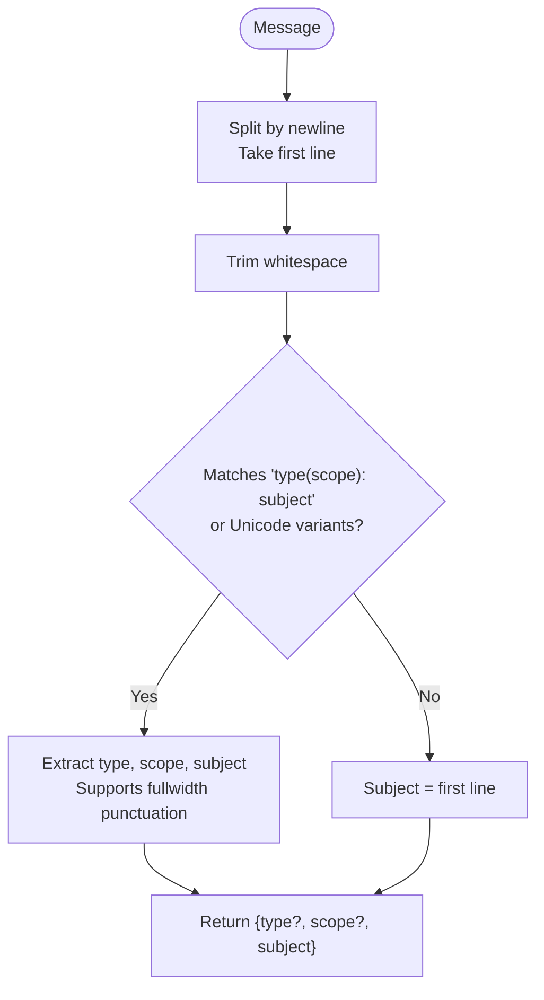

**Diagram sources**
- [lib/report.ts:31-40](file://lib/report.ts#L31-L40)

**Section sources**
- [lib/report.ts:29-40](file://lib/report.ts#L29-L40)
- [lib/__tests__/report.test.ts:19-32](file://lib/__tests__/report.test.ts#L19-L32)

### Merge Commit Detection
- **Purpose**: Identify merge commits by checking parent IDs count.
- **Logic**: A merge commit has more than one parent ID.

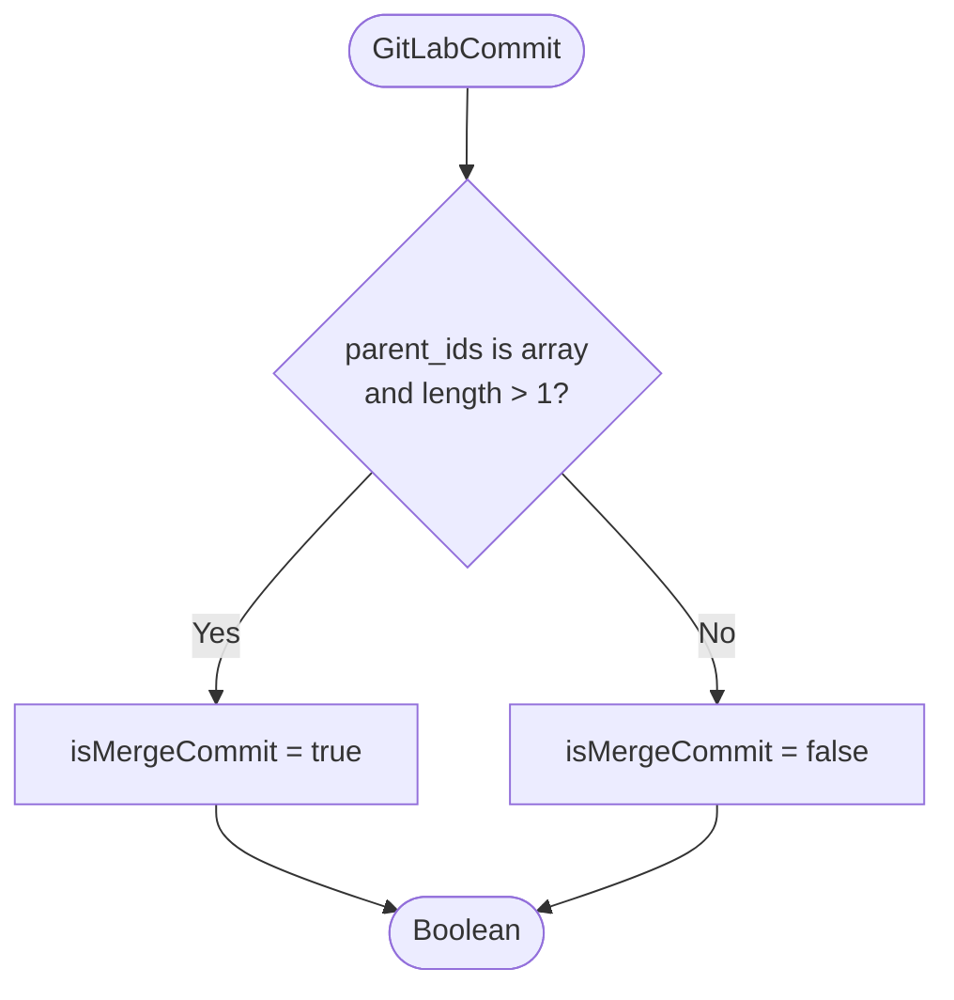

**Diagram sources**
- [lib/report.ts:42-44](file://lib/report.ts#L42-L44)

**Section sources**
- [lib/report.ts:42-44](file://lib/report.ts#L42-L44)

### Comprehensive Filtering Mechanisms
- **Author email filtering**: Optional; restricts commits to a specific author email (case-insensitive).
- **Merge commit removal**: Optional; drops commits with multiple parents.
- **Noise regex filtering**: Optional; ignores commits whose titles match a user-defined regex (case-insensitive). Invalid regex is ignored safely with graceful error handling.
- **Edge case handling**: Comprehensive test coverage for various scenarios including invalid regex patterns.

**Updated** Enhanced with comprehensive test coverage and improved error handling for edge cases

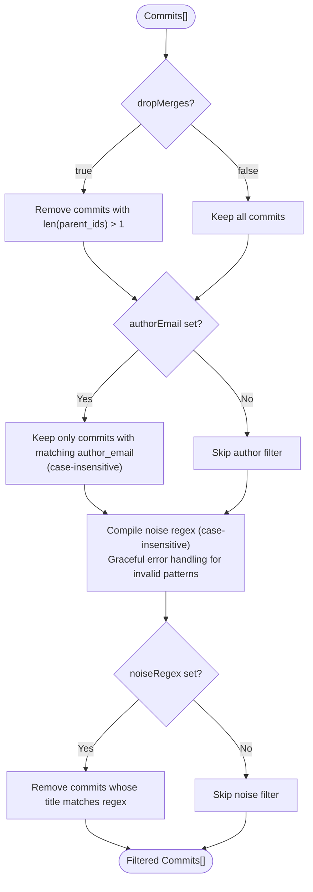

**Diagram sources**
- [lib/report.ts:52-75](file://lib/report.ts#L52-L75)

**Section sources**
- [lib/report.ts:46-75](file://lib/report.ts#L46-L75)
- [lib/__tests__/report.test.ts:68-113](file://lib/__tests__/report.test.ts#L68-L113)

### Deduplication and Conflict Resolution
- **Strategy**: Remove duplicate commits with identical normalized keys.
- **Key composition**: `${type || ""}|${scope || ""}|${title.toLowerCase()}`
- **Resolution**: Keeps the first occurrence of each key.
- **Case sensitivity**: Title comparison is case-insensitive for duplicate detection.

**Updated** Enhanced with comprehensive test coverage for different types, scopes, and case variations

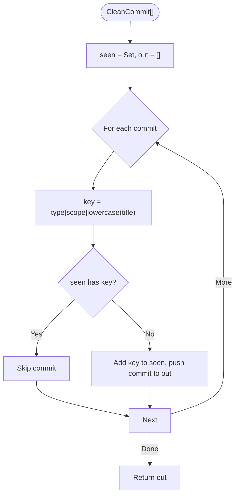

**Diagram sources**
- [lib/report.ts:77-88](file://lib/report.ts#L77-L88)

**Section sources**
- [lib/report.ts:77-88](file://lib/report.ts#L77-L88)
- [lib/__tests__/report.test.ts:132-162](file://lib/__tests__/report.test.ts#L132-L162)

### Context Building Phase
- **Purpose**: Aggregate filtered and cleaned commits into project groups and compute totals.
- **Steps**:
  - Apply filtering per project group.
  - Convert to clean commits with parsed conventional metadata.
  - Deduplicate.
  - Sum counts across projects.
  - Attach user context for rendering.

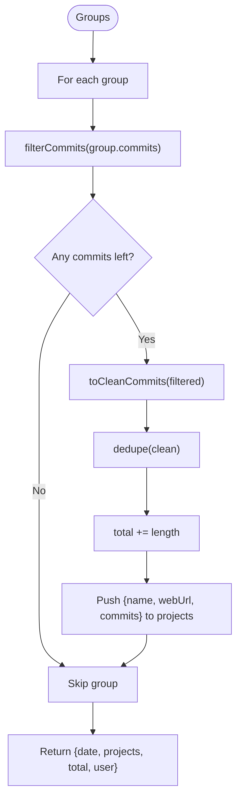

**Diagram sources**
- [lib/report.ts:115-135](file://lib/report.ts#L115-L135)

**Section sources**
- [lib/report.ts:107-135](file://lib/report.ts#L107-L135)

### API Orchestration and Workflow
- **Endpoint**: GET /api/reports/generate
- **Responsibilities**:
  - Parse query parameters (date, templateId, projectIds).
  - Load user preferences (GitLab base URL, token, noise regex, display name).
  - Fetch commits per project with pagination and error handling.
  - Build report context with filtering and deduplication.
  - Render template and return content with errors.

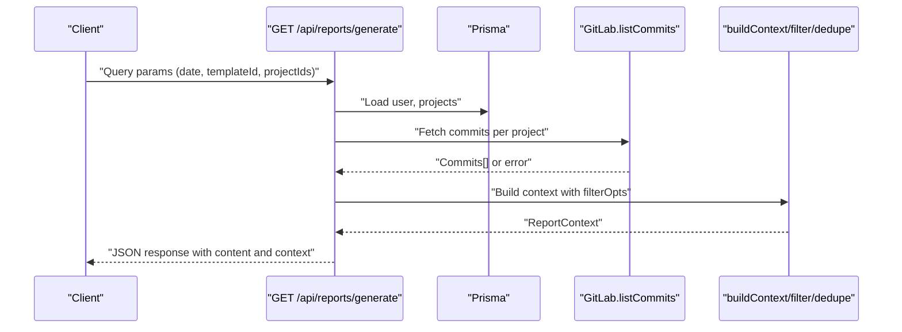

**Diagram sources**
- [app/api/reports/generate/route.ts:23-132](file://app/api/reports/generate/route.ts#L23-L132)
- [lib/report.ts:115-135](file://lib/report.ts#L115-L135)

**Section sources**
- [app/api/reports/generate/route.ts:14-132](file://app/api/reports/generate/route.ts#L14-L132)

### Noise Regex Filtering and Custom Pattern Matching
- **Configuration**: Stored per user in the database under noiseRegex.
- **UI**: Managed in the settings form with a masked preview and save action.
- **Behavior**: Compiled as case-insensitive regex; invalid patterns are ignored safely.
- **Error Handling**: Graceful degradation when regex compilation fails.

**Updated** Enhanced with comprehensive error handling for invalid regex patterns

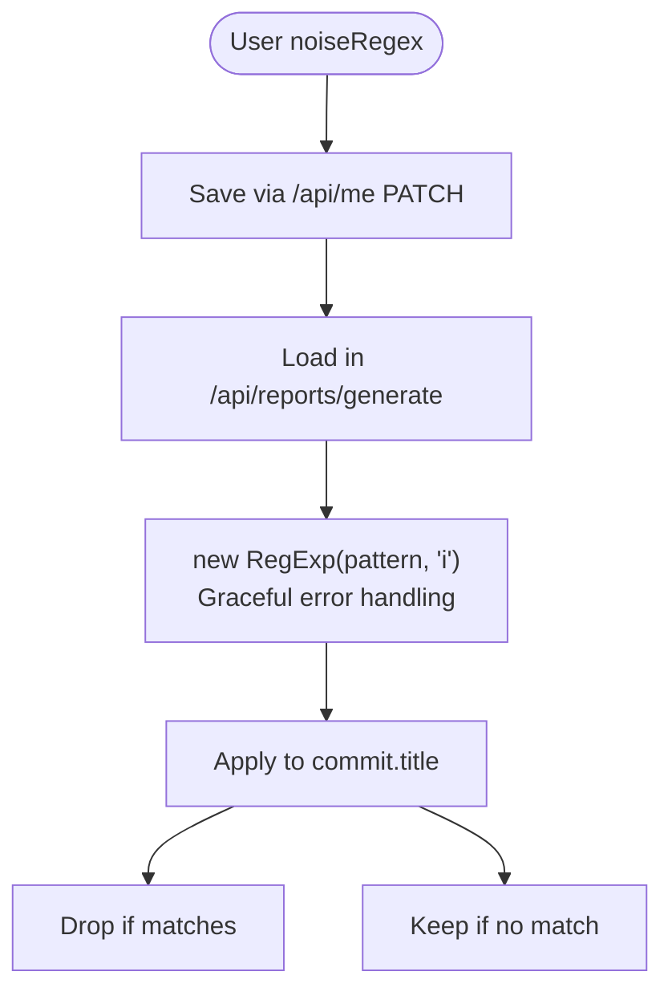

**Diagram sources**
- [app/api/me/route.ts:49-66](file://app/api/me/route.ts#L49-L66)
- [components/settings-form.tsx:241-261](file://components/settings-form.tsx#L241-L261)
- [lib/report.ts:56-74](file://lib/report.ts#L56-L74)

**Section sources**
- [app/api/me/route.ts:49-66](file://app/api/me/route.ts#L49-L66)
- [components/settings-form.tsx:241-261](file://components/settings-form.tsx#L241-L261)
- [lib/report.ts:46-75](file://lib/report.ts#L46-L75)

### Data Models and Relationships
- **GitLabCommit**: Standard commit shape with author, timestamps, parent IDs, and web URL.
- **CleanCommit**: Enhanced with conventional metadata (type, scope) and normalized title.
- **ProjectGroup**: Aggregation of commits per project with optional web URL.
- **ReportContext**: Final context passed to templates including date, projects, totals, and user.

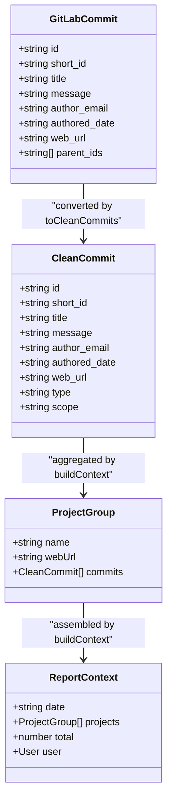

**Diagram sources**
- [lib/gitlab.ts:23-34](file://lib/gitlab.ts#L23-L34)
- [lib/report.ts:4-27](file://lib/report.ts#L4-L27)
- [lib/report.ts:115-135](file://lib/report.ts#L115-L135)

**Section sources**
- [lib/gitlab.ts:23-34](file://lib/gitlab.ts#L23-L34)
- [lib/report.ts:4-27](file://lib/report.ts#L4-L27)

## Dependency Analysis
- **API** depends on Prisma for user/project/template data and on GitLab client for commit retrieval.
- **Processing module** depends on enhanced conventional parsing, comprehensive filtering, deduplication, and context building.
- **Settings module** persists user preferences (noise regex, display name) and exposes them to the API.
- **Testing framework** provides comprehensive coverage for all processing components.

**Updated** Enhanced with comprehensive test coverage for all processing components

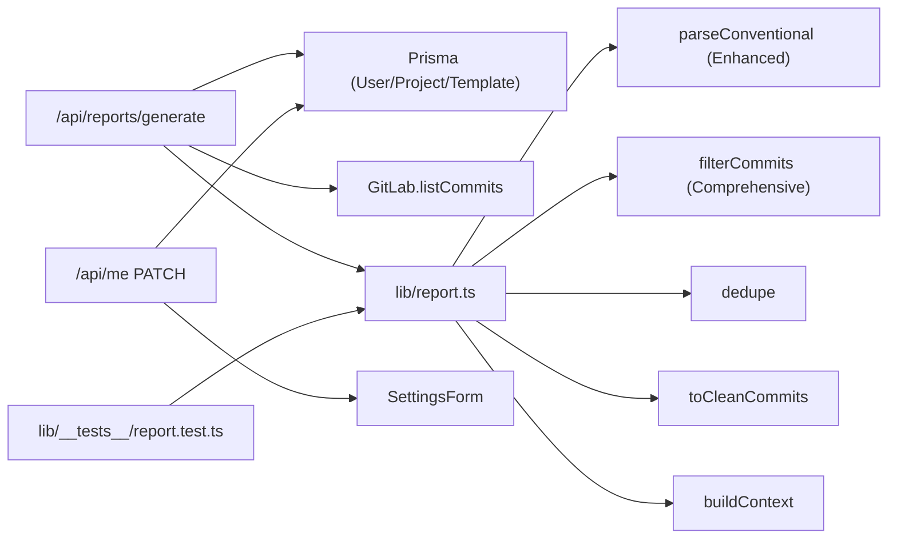

**Diagram sources**
- [app/api/reports/generate/route.ts:36-132](file://app/api/reports/generate/route.ts#L36-L132)
- [lib/report.ts:31-135](file://lib/report.ts#L31-L135)
- [app/api/me/route.ts:54-66](file://app/api/me/route.ts#L54-L66)
- [components/settings-form.tsx:90-107](file://components/settings-form.tsx#L90-L107)
- [lib/__tests__/report.test.ts:1-163](file://lib/__tests__/report.test.ts#L1-L163)

**Section sources**
- [app/api/reports/generate/route.ts:36-132](file://app/api/reports/generate/route.ts#L36-L132)
- [lib/report.ts:31-135](file://lib/report.ts#L31-L135)
- [app/api/me/route.ts:54-66](file://app/api/me/route.ts#L54-L66)
- [components/settings-form.tsx:90-107](file://components/settings-form.tsx#L90-L107)
- [lib/__tests__/report.test.ts:1-163](file://lib/__tests__/report.test.ts#L1-L163)

## Performance Considerations
- **Pagination and limits**: GitLab client paginates with a cap to prevent excessive requests.
- **Filtering early**: Merge and author filters reduce downstream processing volume.
- **Deduplication cost**: Linear in number of commits; keep noise regex efficient to minimize false positives.
- **Regex compilation**: Compile once per request using user-provided pattern; invalid patterns are ignored to avoid runtime exceptions.
- **Memory**: Intermediate arrays grow with commit counts; consider streaming or chunking for very large histories.
- **Unicode processing**: Enhanced parsing handles both ASCII and fullwidth Unicode characters efficiently.

**Updated** Enhanced with Unicode character processing considerations

## Troubleshooting Guide
- **Malformed commits**:
  - Conventional parsing falls back to subject-only when the first line does not match the expected pattern.
  - Enhanced parsing supports both Western and fullwidth Unicode punctuation.
  - Merge commits are detected by parent IDs; ensure parent data is present.
- **Encoding issues**:
  - Commit messages are processed as-is; ensure GitLab API responses are UTF-8 compatible.
  - Enhanced parsing handles fullwidth Unicode characters correctly.
- **Noise regex failures**:
  - Invalid regex patterns are caught and ignored; verify pattern syntax and case-insensitivity.
  - Graceful error handling prevents application crashes on malformed patterns.
- **Large histories**:
  - Pagination caps are enforced; adjust project selection or date ranges to reduce load.
- **Template rendering errors**:
  - Rendering catches exceptions and returns a fallback message; review template syntax.

**Updated** Enhanced with Unicode and error handling considerations

**Section sources**
- [lib/report.ts:31-40](file://lib/report.ts#L31-L40)
- [lib/report.ts:56-62](file://lib/report.ts#L56-L62)
- [lib/report.ts:137-144](file://lib/report.ts#L137-L144)
- [lib/gitlab.ts:91-111](file://lib/gitlab.ts#L91-L111)
- [lib/__tests__/report.test.ts:19-32](file://lib/__tests__/report.test.ts#L19-L32)

## Conclusion
The commit processing pipeline transforms raw GitLab commits into a structured, filtered, and deduplicated report context with comprehensive internationalization support. Enhanced conventional commit parsing supports both Western and fullwidth Unicode punctuation, while comprehensive filtering logic with extensive test coverage ensures reliable operation across diverse scenarios. The context builder organizes data by project and computes totals, enabling flexible template rendering. The system is designed for reliability, with safe defaults for malformed inputs, robust error handling, and graceful degradation for invalid configurations.