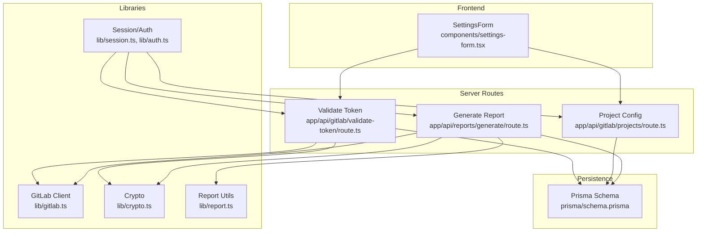
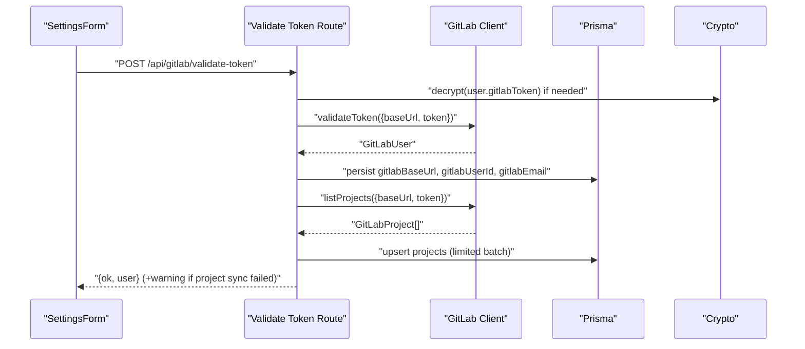
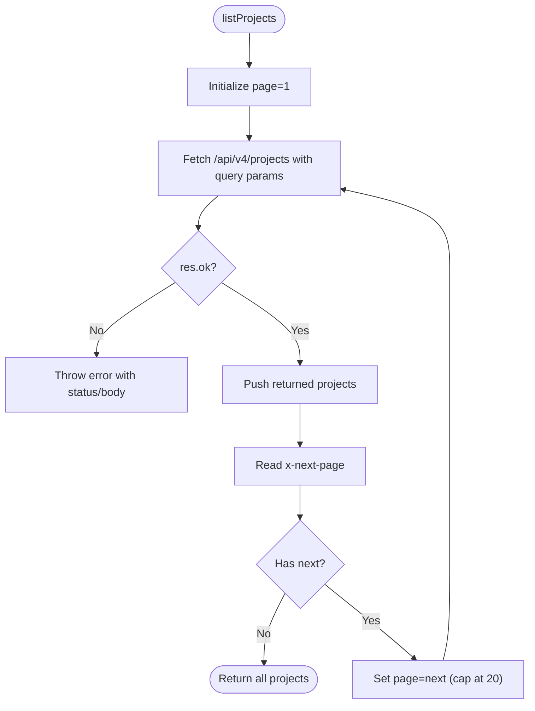
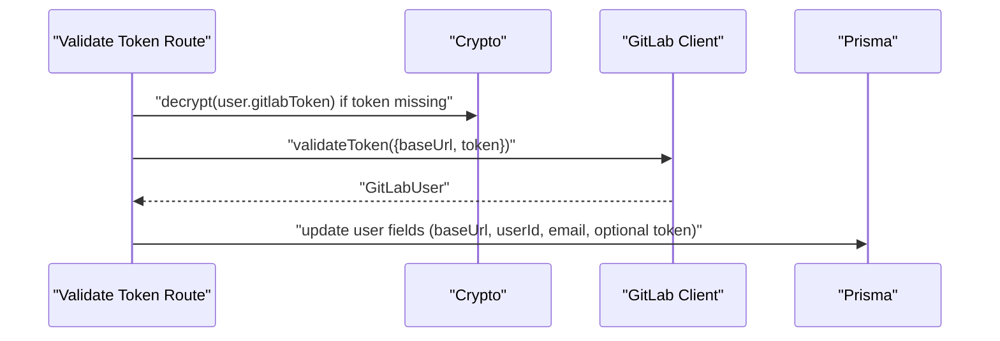
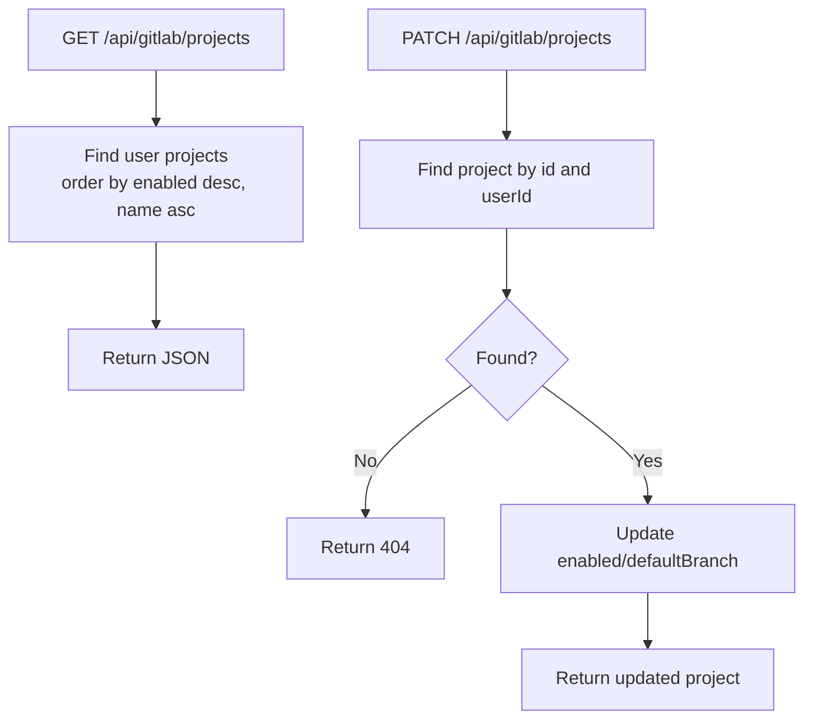
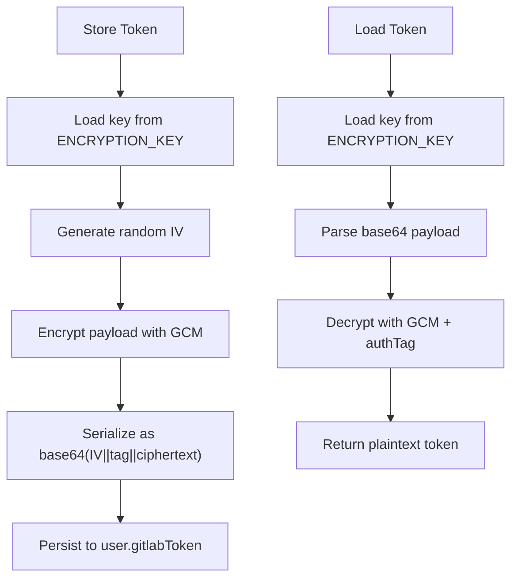
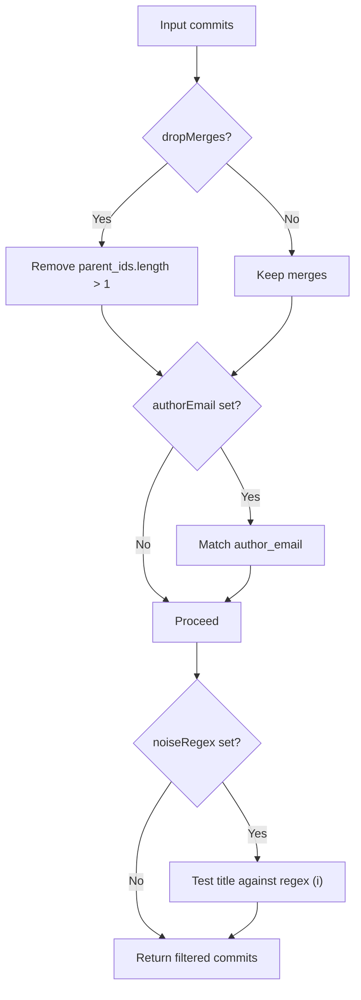
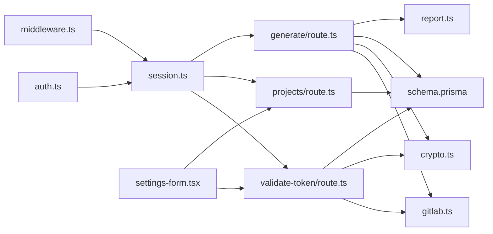

# GitLab Integration

<cite>
**Referenced Files in This Document**
- [gitlab.ts](file://lib/gitlab.ts)
- [validate-token/route.ts](file://app/api/gitlab/validate-token/route.ts)
- [projects/route.ts](file://app/api/gitlab/projects/route.ts)
- [generate/route.ts](file://app/api/reports/generate/route.ts)
- [crypto.ts](file://lib/crypto.ts)
- [session.ts](file://lib/session.ts)
- [auth.ts](file://lib/auth.ts)
- [schema.prisma](file://prisma/schema.prisma)
- [settings-form.tsx](file://components/settings-form.tsx)
- [middleware.ts](file://middleware.ts)
- [report.ts](file://lib/report.ts)
</cite>

## Table of Contents
1. [Introduction](#introduction)
2. [Project Structure](#project-structure)
3. [Core Components](#core-components)
4. [Architecture Overview](#architecture-overview)
5. [Detailed Component Analysis](#detailed-component-analysis)
6. [Dependency Analysis](#dependency-analysis)
7. [Performance Considerations](#performance-considerations)
8. [Troubleshooting Guide](#troubleshooting-guide)
9. [Conclusion](#conclusion)

## Introduction
This document explains the GitLab integration system implemented in the backend and frontend of the application. It covers the server-side GitLab API client, authentication and token management, project configuration, commit fetching workflow, filtering and rendering pipeline, and error handling strategies. It also provides practical guidance on performance and caching considerations for scalable usage across multiple projects.

## Project Structure
The GitLab integration spans several modules:
- Server-side API routes under app/api handle user sessions, token validation, project configuration, and report generation.
- A dedicated GitLab client library encapsulates API calls and pagination.
- Encryption utilities manage secure storage of tokens.
- Prisma schema defines user, project, and report entities.
- Frontend settings form coordinates user actions and displays configuration state.

**Diagram sources**
- [settings-form.tsx:1-368](file://components/settings-form.tsx#L1-L368)
- [validate-token/route.ts:1-81](file://app/api/gitlab/validate-token/route.ts#L1-L81)
- [projects/route.ts:1-42](file://app/api/gitlab/projects/route.ts#L1-L42)
- [generate/route.ts:1-133](file://app/api/reports/generate/route.ts#L1-L133)
- [gitlab.ts:1-149](file://lib/gitlab.ts#L1-L149)
- [crypto.ts:1-46](file://lib/crypto.ts#L1-L46)
- [session.ts:1-56](file://lib/session.ts#L1-L56)
- [auth.ts:1-77](file://lib/auth.ts#L1-L77)
- [report.ts:1-159](file://lib/report.ts#L1-L159)
- [schema.prisma:1-80](file://prisma/schema.prisma#L1-L80)

**Section sources**
- [settings-form.tsx:1-368](file://components/settings-form.tsx#L1-L368)
- [validate-token/route.ts:1-81](file://app/api/gitlab/validate-token/route.ts#L1-L81)
- [projects/route.ts:1-42](file://app/api/gitlab/projects/route.ts#L1-L42)
- [generate/route.ts:1-133](file://app/api/reports/generate/route.ts#L1-L133)
- [gitlab.ts:1-149](file://lib/gitlab.ts#L1-L149)
- [crypto.ts:1-46](file://lib/crypto.ts#L1-L46)
- [session.ts:1-56](file://lib/session.ts#L1-L56)
- [auth.ts:1-77](file://lib/auth.ts#L1-L77)
- [report.ts:1-159](file://lib/report.ts#L1-L159)
- [schema.prisma:1-80](file://prisma/schema.prisma#L1-L80)

## Core Components
- GitLab API client: Provides typed models, a generic fetch wrapper, and functions to validate tokens, enumerate projects, and list commits with pagination and query parameters.
- Token encryption/decryption: AES-256-GCM via environment-backed key for secure storage of GitLab personal access tokens.
- Session and authentication: NextAuth-based JWT session with server-side route guards and error normalization.
- Project configuration: CRUD-like operations to enable/disable projects and set default branches per user.
- Report pipeline: Date-range commit retrieval, filtering, deduplication, conventional commit parsing, and template rendering.

**Section sources**
- [gitlab.ts:1-149](file://lib/gitlab.ts#L1-L149)
- [crypto.ts:1-46](file://lib/crypto.ts#L1-L46)
- [session.ts:1-56](file://lib/session.ts#L1-L56)
- [auth.ts:1-77](file://lib/auth.ts#L1-L77)
- [projects/route.ts:1-42](file://app/api/gitlab/projects/route.ts#L1-L42)
- [report.ts:1-159](file://lib/report.ts#L1-L159)

## Architecture Overview
The integration follows a strict server-side-first model:
- Frontend triggers actions via API routes.
- Routes enforce authentication and authorization.
- Routes call the GitLab client to fetch data.
- Tokens are decrypted server-side for API calls and re-encrypted for persistence.
- Results are persisted or transformed into reports.

**Diagram sources**
- [settings-form.tsx:61-88](file://components/settings-form.tsx#L61-L88)
- [validate-token/route.ts:13-80](file://app/api/gitlab/validate-token/route.ts#L13-L80)
- [gitlab.ts:82-111](file://lib/gitlab.ts#L82-L111)
- [crypto.ts:28-38](file://lib/crypto.ts#L28-L38)
- [schema.prisma:16-49](file://prisma/schema.prisma#L16-L49)

## Detailed Component Analysis

### GitLab API Client
The client exposes:
- Typed models for user, project, and commit resources.
- A generic fetch wrapper that injects PRIVATE-TOKEN, sets Accept, enforces timeouts, and parses JSON.
- Functions to validate tokens, list projects with pagination, and list commits with date range and branch filters.

Key behaviors:
- Pagination is handled via the x-next-page header with a safety cap.
- Query parameters are sanitized to exclude undefined/null/empty values.
- Timeout aborts prevent hanging requests.

**Diagram sources**
- [gitlab.ts:91-111](file://lib/gitlab.ts#L91-L111)

**Section sources**
- [gitlab.ts:1-149](file://lib/gitlab.ts#L1-L149)

### Authentication and Token Management
- Authentication: NextAuth with JWT strategy and credentials provider.
- Authorization: Server routes use requireUser and withErrors wrappers to guard endpoints and normalize errors.
- Token lifecycle:
  - Validation route accepts either an incoming token or uses stored encrypted token.
  - On success, it persists gitlabBaseUrl, gitlabUserId, gitlabEmail, and optionally re-encrypts and stores the token.
  - Report generation decrypts the stored token for API calls.

**Diagram sources**
- [validate-token/route.ts:13-39](file://app/api/gitlab/validate-token/route.ts#L13-L39)
- [crypto.ts:28-38](file://lib/crypto.ts#L28-L38)
- [gitlab.ts:82-89](file://lib/gitlab.ts#L82-L89)

**Section sources**
- [auth.ts:30-77](file://lib/auth.ts#L30-L77)
- [session.ts:11-56](file://lib/session.ts#L11-L56)
- [validate-token/route.ts:1-81](file://app/api/gitlab/validate-token/route.ts#L1-L81)
- [crypto.ts:1-46](file://lib/crypto.ts#L1-L46)

### Commit Fetching Workflow
- Date range: The report route computes since/until timestamps for a given date.
- Project enumeration: Enabled projects are selected per user, optionally filtered by provided IDs.
- Branch filtering: Uses per-project defaultBranch if set; otherwise falls back to API defaults.
- Parallelization: Commits are fetched concurrently across projects.
- Error handling: Individual project failures are captured and reported separately.

**Diagram sources**
- [generate/route.ts:23-133](file://app/api/reports/generate/route.ts#L23-L133)
- [gitlab.ts:120-148](file://lib/gitlab.ts#L120-L148)
- [report.ts:52-105](file://lib/report.ts#L52-L105)

**Section sources**
- [generate/route.ts:1-133](file://app/api/reports/generate/route.ts#L1-L133)
- [report.ts:1-159](file://lib/report.ts#L1-L159)

### Project Configuration System
- Listing projects: Returns user-scoped, enabled-first ordered list.
- Updating projects: Toggle enabled flag and set defaultBranch per project.
- Frontend: SettingsForm displays projects, supports filtering, toggling, and branch editing.

**Diagram sources**
- [projects/route.ts:6-42](file://app/api/gitlab/projects/route.ts#L6-L42)

**Section sources**
- [projects/route.ts:1-42](file://app/api/gitlab/projects/route.ts#L1-L42)
- [settings-form.tsx:187-314](file://components/settings-form.tsx#L187-L314)

### Token Encryption and Decryption
- Algorithm: AES-256-GCM with random 12-byte IV and 16-byte auth tag.
- Storage: Encrypted token payload stored in user record; displayed masked in UI.
- Key requirement: ENCRYPTION_KEY must be a 64-character hex string (32 bytes).

**Diagram sources**
- [crypto.ts:7-45](file://lib/crypto.ts#L7-L45)

**Section sources**
- [crypto.ts:1-46](file://lib/crypto.ts#L1-L46)
- [validate-token/route.ts:37-38](file://app/api/gitlab/validate-token/route.ts#L37-L38)
- [settings-form.tsx:210-225](file://components/settings-form.tsx#L210-L225)

### Filtering and Noise Regex
- Merge commits: Optionally dropped when generating reports.
- Author email: Optional filter to restrict commits to a specific author email.
- Noise regex: Case-insensitive regex applied to commit titles; invalid patterns are ignored.
- Conventional commits: First line parsed into type/scope/subject for grouping and deduplication.

**Diagram sources**
- [report.ts:52-75](file://lib/report.ts#L52-L75)

**Section sources**
- [report.ts:1-159](file://lib/report.ts#L1-L159)

## Dependency Analysis
- Routes depend on:
  - Session utilities for authentication and error normalization.
  - GitLab client for API calls.
  - Crypto for token encryption/decryption.
  - Prisma for persistence.
- Frontend depends on Next.js runtime and interacts with server routes.
- Middleware enforces authentication for protected paths.

**Diagram sources**
- [validate-token/route.ts:1-81](file://app/api/gitlab/validate-token/route.ts#L1-L81)
- [projects/route.ts:1-42](file://app/api/gitlab/projects/route.ts#L1-L42)
- [generate/route.ts:1-133](file://app/api/reports/generate/route.ts#L1-L133)
- [gitlab.ts:1-149](file://lib/gitlab.ts#L1-L149)
- [crypto.ts:1-46](file://lib/crypto.ts#L1-L46)
- [session.ts:1-56](file://lib/session.ts#L1-L56)
- [auth.ts:1-77](file://lib/auth.ts#L1-L77)
- [middleware.ts:1-10](file://middleware.ts#L1-L10)
- [report.ts:1-159](file://lib/report.ts#L1-L159)
- [schema.prisma:1-80](file://prisma/schema.prisma#L1-L80)
- [settings-form.tsx:1-368](file://components/settings-form.tsx#L1-L368)

**Section sources**
- [validate-token/route.ts:1-81](file://app/api/gitlab/validate-token/route.ts#L1-L81)
- [projects/route.ts:1-42](file://app/api/gitlab/projects/route.ts#L1-L42)
- [generate/route.ts:1-133](file://app/api/reports/generate/route.ts#L1-L133)
- [gitlab.ts:1-149](file://lib/gitlab.ts#L1-L149)
- [crypto.ts:1-46](file://lib/crypto.ts#L1-L46)
- [session.ts:1-56](file://lib/session.ts#L1-L56)
- [auth.ts:1-77](file://lib/auth.ts#L1-L77)
- [middleware.ts:1-10](file://middleware.ts#L1-L10)
- [report.ts:1-159](file://lib/report.ts#L1-L159)
- [schema.prisma:1-80](file://prisma/schema.prisma#L1-L80)
- [settings-form.tsx:1-368](file://components/settings-form.tsx#L1-L368)

## Performance Considerations
- Pagination caps: The client limits pagination to a safety cap to avoid excessive API calls.
- Batch project upsert: During token validation, only a limited number of projects are upserted in a single transaction.
- Parallelism: Report generation fetches commits for multiple projects concurrently to reduce total latency.
- Caching: The client sets cache=no-store to bypass browser caches; rely on application-level caching (e.g., storing recent results) if needed.
- Network timeouts: Requests are aborted after a fixed timeout to prevent indefinite waits.

Recommendations:
- Consider implementing a project-level cache keyed by date range and branch to avoid repeated GitLab API calls for the same window.
- For large organizations, consider incremental synchronization of project metadata and last-seen commit timestamps.
- Monitor API rate limits and implement retry/backoff with jitter if integrating with hosted GitLab instances.

**Section sources**
- [gitlab.ts:94-109](file://lib/gitlab.ts#L94-L109)
- [validate-token/route.ts:42-67](file://app/api/gitlab/validate-token/route.ts#L42-L67)
- [generate/route.ts:57-85](file://app/api/reports/generate/route.ts#L57-L85)

## Troubleshooting Guide
Common issues and resolutions:
- Unauthorized or forbidden: Ensure the user is authenticated and authorized; routes return appropriate responses for missing sessions or insufficient roles.
- Invalid or missing token: The validation route requires a token or an existing encrypted token; errors are surfaced with clear messages.
- Project list load failure: The validation route continues and returns a warning alongside success when project cache refresh fails.
- API errors: The GitLab client throws descriptive errors with HTTP status and response body; routes convert them to JSON responses.
- Network issues: Timeouts abort long-running requests; consider retry logic at the caller level if needed.

Operational tips:
- Verify ENCRYPTION_KEY environment variable length and format.
- Confirm GitLab personal access token permissions (read_api and read_repository).
- Check middleware configuration for protected paths.

**Section sources**
- [session.ts:22-56](file://lib/session.ts#L22-L56)
- [validate-token/route.ts:18-39](file://app/api/gitlab/validate-token/route.ts#L18-L39)
- [validate-token/route.ts:68-74](file://app/api/gitlab/validate-token/route.ts#L68-L74)
- [gitlab.ts:71-74](file://lib/gitlab.ts#L71-L74)
- [middleware.ts:3-9](file://middleware.ts#L3-L9)

## Conclusion
The GitLab integration is designed around a robust server-side API client, secure token handling, and a flexible report pipeline. It supports per-user project configuration, branch-specific queries, and configurable filtering for high-quality daily reports. With built-in error handling, timeouts, and pagination safeguards, the system is resilient for production use. Extending caching and incremental synchronization can further improve performance at scale.