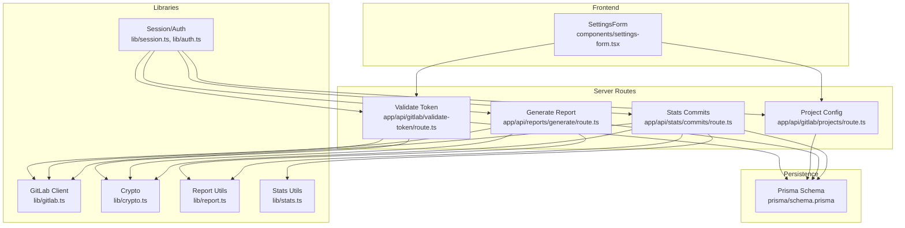
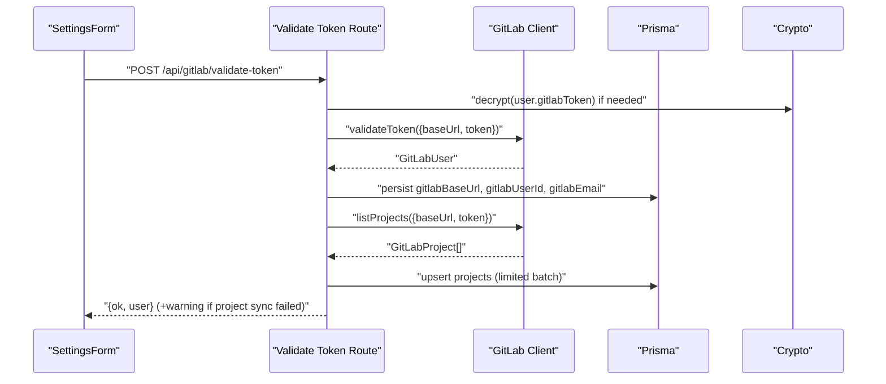
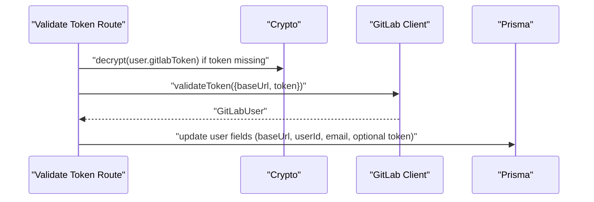
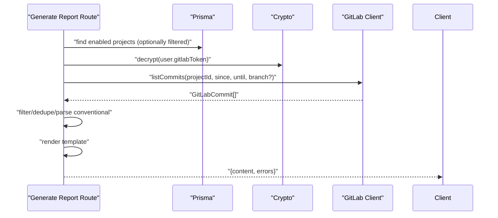
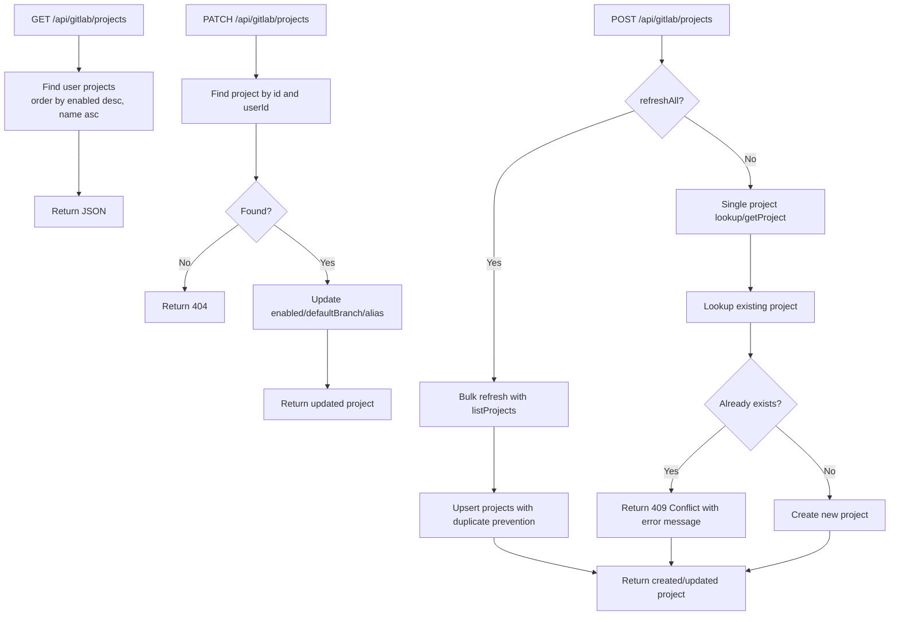
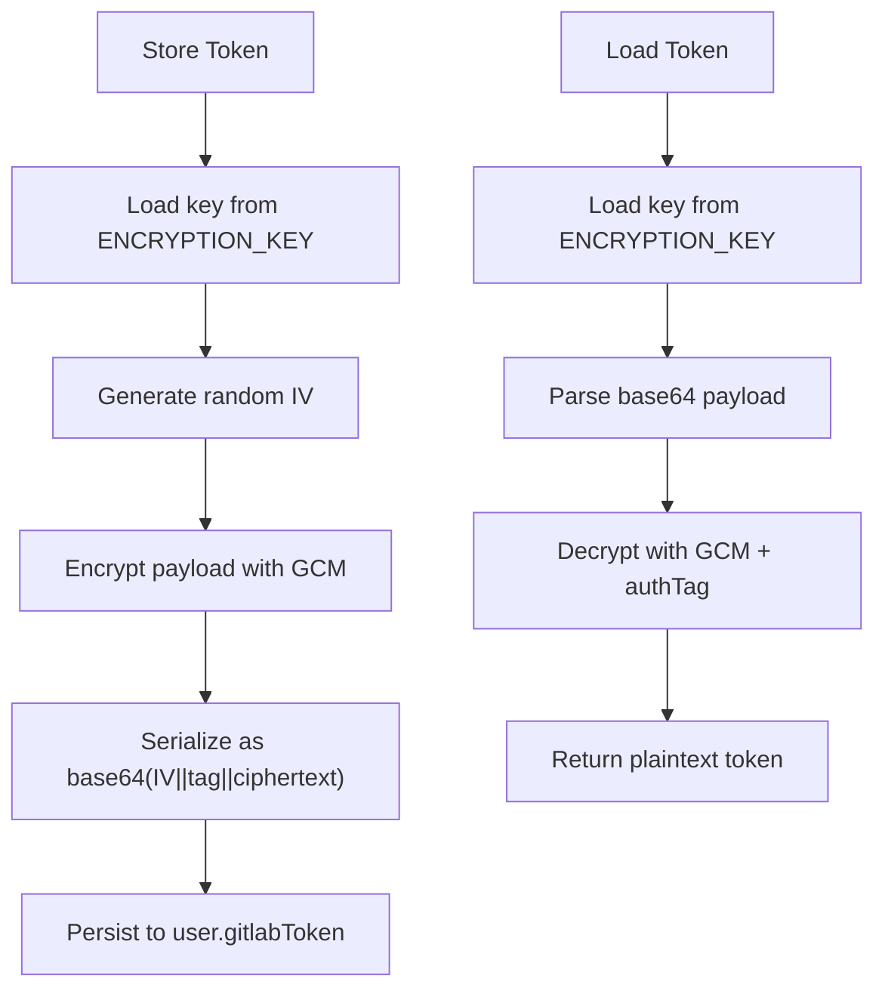
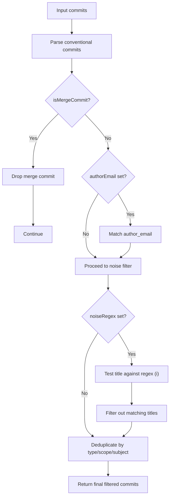
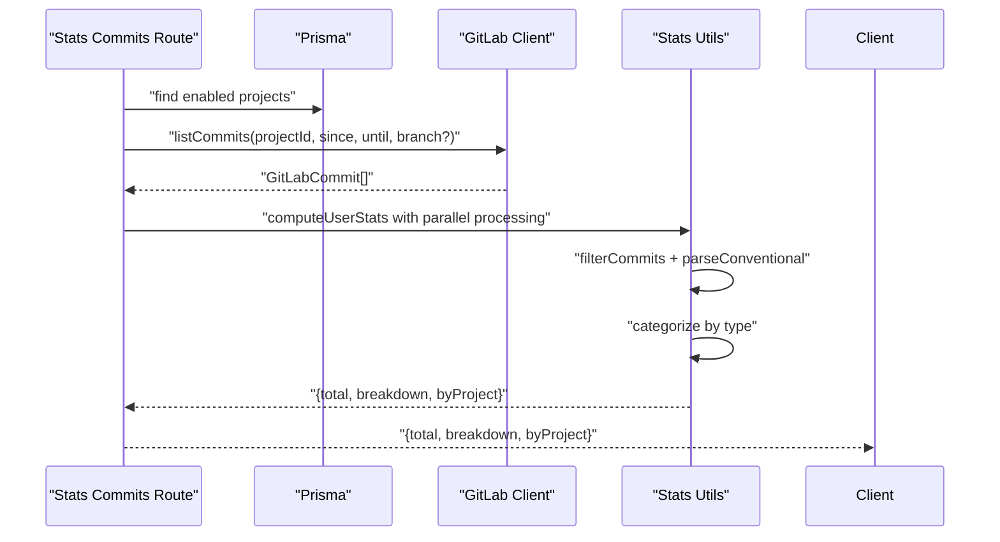
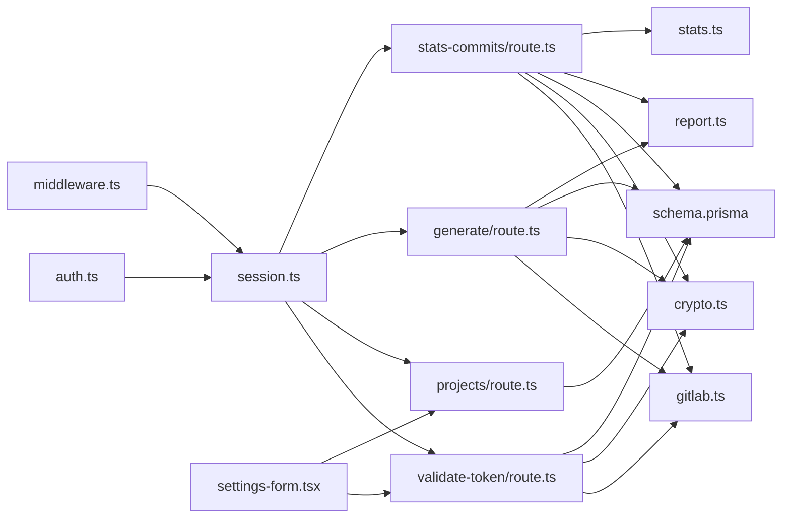

# GitLab Integration

<cite>
**Referenced Files in This Document**
- [gitlab.ts](file://lib/gitlab.ts)
- [validate-token/route.ts](file://app/api/gitlab/validate-token/route.ts)
- [projects/route.ts](file://app/api/gitlab/projects/route.ts)
- [generate/route.ts](file://app/api/reports/generate/route.ts)
- [stats-commits/route.ts](file://app/api/stats/commits/route.ts)
- [crypto.ts](file://lib/crypto.ts)
- [session.ts](file://lib/session.ts)
- [auth.ts](file://lib/auth.ts)
- [schema.prisma](file://prisma/schema.prisma)
- [settings-form.tsx](file://components/settings-form.tsx)
- [middleware.ts](file://middleware.ts)
- [report.ts](file://lib/report.ts)
- [stats.ts](file://lib/stats.ts)
</cite>

## Update Summary
**Changes Made**
- Enhanced project management with duplicate prevention logic to prevent adding existing projects
- Improved error handling for duplicate projects with clear 409 conflict responses
- Maintained defaultBranch field in project operations for backward compatibility
- Enhanced project configuration system with robust duplicate detection
- Improved user experience with clear error messaging for duplicate project additions

## Table of Contents
1. [Introduction](#introduction)
2. [Project Structure](#project-structure)
3. [Core Components](#core-components)
4. [Architecture Overview](#architecture-overview)
5. [Detailed Component Analysis](#detailed-component-analysis)
6. [Enhanced Filtering Pipeline](#enhanced-filtering-pipeline)
7. [Parallel Project Querying](#parallel-project-querying)
8. [Dependency Analysis](#dependency-analysis)
9. [Performance Considerations](#performance-considerations)
10. [Troubleshooting Guide](#troubleshooting-guide)
11. [Conclusion](#conclusion)

## Introduction
This document explains the GitLab integration system implemented in the backend and frontend of the application. It covers the server-side GitLab API client, authentication and token management, project configuration, commit fetching workflow, enhanced filtering and rendering pipeline, and error handling strategies. The system now features improved project management with duplicate prevention logic, enhanced error handling for duplicate projects, and maintains backward compatibility with the defaultBranch field in project operations.

## Project Structure
The GitLab integration spans several modules with enhanced capabilities:
- Server-side API routes under app/api handle user sessions, token validation, project configuration, report generation, and statistics collection.
- A dedicated GitLab client library encapsulates API calls and pagination.
- Encryption utilities manage secure storage of tokens.
- Prisma schema defines user, project, and report entities.
- Frontend settings form coordinates user actions and displays configuration state.
- Enhanced report processing pipeline with conventional commit parsing and merge detection.

**Diagram sources**
- [settings-form.tsx:1-222](file://components/settings-form.tsx#L1-L222)
- [validate-token/route.ts:1-87](file://app/api/gitlab/validate-token/route.ts#L1-L87)
- [projects/route.ts:1-163](file://app/api/gitlab/projects/route.ts#L1-L163)
- [generate/route.ts:1-133](file://app/api/reports/generate/route.ts#L1-L133)
- [stats-commits/route.ts:1-129](file://app/api/stats/commits/route.ts#L1-L129)
- [gitlab.ts:1-172](file://lib/gitlab.ts#L1-L172)
- [crypto.ts:1-46](file://lib/crypto.ts#L1-L46)
- [session.ts:1-56](file://lib/session.ts#L1-L56)
- [auth.ts:1-77](file://lib/auth.ts#L1-L77)
- [report.ts:1-159](file://lib/report.ts#L1-L159)
- [stats.ts:1-144](file://lib/stats.ts#L1-L144)
- [schema.prisma:1-81](file://prisma/schema.prisma#L1-L81)

**Section sources**
- [settings-form.tsx:1-222](file://components/settings-form.tsx#L1-L222)
- [validate-token/route.ts:1-87](file://app/api/gitlab/validate-token/route.ts#L1-L87)
- [projects/route.ts:1-163](file://app/api/gitlab/projects/route.ts#L1-L163)
- [generate/route.ts:1-133](file://app/api/reports/generate/route.ts#L1-L133)
- [stats-commits/route.ts:1-129](file://app/api/stats/commits/route.ts#L1-L129)
- [gitlab.ts:1-172](file://lib/gitlab.ts#L1-L172)
- [crypto.ts:1-46](file://lib/crypto.ts#L1-L46)
- [session.ts:1-56](file://lib/session.ts#L1-L56)
- [auth.ts:1-77](file://lib/auth.ts#L1-L77)
- [report.ts:1-159](file://lib/report.ts#L1-L159)
- [stats.ts:1-144](file://lib/stats.ts#L1-L144)
- [schema.prisma:1-81](file://prisma/schema.prisma#L1-L81)

## Core Components
- **GitLab API client**: Provides typed models, a generic fetch wrapper, and functions to validate tokens, enumerate projects, and list commits with pagination and query parameters.
- **Enhanced filtering pipeline**: Advanced commit filtering with merge commit detection, conventional commit parsing, noise regex filtering, and deduplication.
- **Token encryption/decryption**: AES-256-GCM via environment-backed key for secure storage of GitLab personal access tokens.
- **Session and authentication**: NextAuth-based JWT session with server-side route guards and error normalization.
- **Project configuration**: CRUD-like operations to enable/disable projects and set default branches per user with duplicate prevention logic.
- **Statistics reporting**: Date-range commit retrieval with categorization and breakdown analysis.
- **Parallel processing**: Concurrent project querying using Promise.all for improved performance.

**Section sources**
- [gitlab.ts:1-172](file://lib/gitlab.ts#L1-L172)
- [crypto.ts:1-46](file://lib/crypto.ts#L1-L46)
- [session.ts:1-56](file://lib/session.ts#L1-L56)
- [auth.ts:1-77](file://lib/auth.ts#L1-L77)
- [projects/route.ts:1-163](file://app/api/gitlab/projects/route.ts#L1-L163)
- [report.ts:1-159](file://lib/report.ts#L1-L159)
- [stats-commits/route.ts:1-129](file://app/api/stats/commits/route.ts#L1-L129)

## Architecture Overview
The integration follows a strict server-side-first model with enhanced capabilities:
- Frontend triggers actions via API routes.
- Routes enforce authentication and authorization.
- Routes call the GitLab client to fetch data.
- Tokens are decrypted server-side for API calls and re-encrypted for persistence.
- Enhanced filtering pipeline processes commits with merge detection and conventional parsing.
- Parallel project querying improves performance for multiple project operations.
- Results are persisted or transformed into reports and statistics.

**Diagram sources**
- [settings-form.tsx:54-81](file://components/settings-form.tsx#L54-L81)
- [validate-token/route.ts:13-87](file://app/api/gitlab/validate-token/route.ts#L13-L87)
- [gitlab.ts:95-121](file://lib/gitlab.ts#L95-L121)
- [crypto.ts:28-38](file://lib/crypto.ts#L28-L38)
- [schema.prisma:16-33](file://prisma/schema.prisma#L16-L33)

## Detailed Component Analysis

### GitLab API Client
The client exposes:
- Typed models for user, project, and commit resources.
- A generic fetch wrapper that injects PRIVATE-TOKEN, sets Accept, enforces timeouts, and parses JSON.
- Functions to validate tokens, list projects with pagination, and list commits with date range and branch filters.

Key behaviors:
- Pagination is handled via the x-next-page header with a safety cap.
- Query parameters are sanitized to exclude undefined/null/empty values.
- Timeout aborts prevent hanging requests.
- Enhanced project listing with membership filtering and simple mode.

**Diagram sources**
- [gitlab.ts:95-121](file://lib/gitlab.ts#L95-L121)

**Section sources**
- [gitlab.ts:1-172](file://lib/gitlab.ts#L1-L172)

### Authentication and Token Management
- Authentication: NextAuth with JWT strategy and credentials provider.
- Authorization: Server routes use requireUser and withErrors wrappers to guard endpoints and normalize errors.
- Token lifecycle:
  - Validation route accepts either an incoming token or uses stored encrypted token.
  - On success, it persists gitlabBaseUrl, gitlabUserId, gitlabEmail, and optionally re-encrypts and stores the token.
  - Report generation decrypts the stored token for API calls.

**Diagram sources**
- [validate-token/route.ts:13-45](file://app/api/gitlab/validate-token/route.ts#L13-L45)
- [crypto.ts:28-38](file://lib/crypto.ts#L28-L38)
- [gitlab.ts:91-93](file://lib/gitlab.ts#L91-L93)

**Section sources**
- [auth.ts:30-77](file://lib/auth.ts#L30-L77)
- [session.ts:11-56](file://lib/session.ts#L11-L56)
- [validate-token/route.ts:1-87](file://app/api/gitlab/validate-token/route.ts#L1-L87)
- [crypto.ts:1-46](file://lib/crypto.ts#L1-L46)

### Commit Fetching Workflow
- Date range: The report route computes since/until timestamps for a given date.
- Project enumeration: Enabled projects are selected per user, optionally filtered by provided IDs.
- Branch filtering: Uses per-project defaultBranch if set; otherwise falls back to API defaults.
- Parallelization: Commits are fetched concurrently across projects using Promise.all.
- Error handling: Individual project failures are captured and reported separately.
- Enhanced filtering: Merge commits are detected and filtered out by default.

**Diagram sources**
- [generate/route.ts:23-133](file://app/api/reports/generate/route.ts#L23-L133)
- [gitlab.ts:143-171](file://lib/gitlab.ts#L143-L171)
- [report.ts:52-105](file://lib/report.ts#L52-L105)

**Section sources**
- [generate/route.ts:1-133](file://app/api/reports/generate/route.ts#L1-L133)
- [report.ts:1-159](file://lib/report.ts#L1-L159)

### Project Configuration System
- **Enhanced Duplicate Prevention**: The system now includes robust duplicate prevention logic that checks for existing projects before adding new ones.
- **Improved Error Handling**: Returns clear 409 Conflict responses with descriptive error messages when attempting to add duplicate projects.
- **Maintained Backward Compatibility**: The defaultBranch field remains part of project operations for backward compatibility.
- **Listing projects**: Returns user-scoped, enabled-first ordered list.
- **Updating projects**: Toggle enabled flag and set defaultBranch per project.
- **Adding projects**: Supports both numeric IDs and URL-encoded paths with automatic upsert and duplicate detection.
- **Refreshing projects**: Bulk refresh with membership filtering and simple mode.

**Updated** Enhanced with duplicate prevention logic and improved error handling for better user experience.

**Diagram sources**
- [projects/route.ts:8-46](file://app/api/gitlab/projects/route.ts#L8-L46)
- [projects/route.ts:55-144](file://app/api/gitlab/projects/route.ts#L55-L144)
- [projects/route.ts:124-132](file://app/api/gitlab/projects/route.ts#L124-L132)

**Section sources**
- [projects/route.ts:1-163](file://app/api/gitlab/projects/route.ts#L1-L163)
- [settings-form.tsx:190-222](file://components/settings-form.tsx#L190-L222)

### Token Encryption and Decryption
- Algorithm: AES-256-GCM with random 12-byte IV and 16-byte auth tag.
- Storage: Encrypted token payload stored in user record; displayed masked in UI.
- Key requirement: ENCRYPTION_KEY must be a 64-character hex string (32 bytes).

**Diagram sources**
- [crypto.ts:7-45](file://lib/crypto.ts#L7-L45)

**Section sources**
- [crypto.ts:1-46](file://lib/crypto.ts#L1-L46)
- [validate-token/route.ts:26-45](file://app/api/gitlab/validate-token/route.ts#L26-L45)
- [settings-form.tsx:125-138](file://components/settings-form.tsx#L125-L138)

## Enhanced Filtering Pipeline

### Conventional Commit Parsing
The system now includes sophisticated conventional commit parsing that extracts structured information from commit messages:

- **Pattern matching**: Uses regex `/^(\w+)(?:\(([^)]+)\))?:\s*(.+)$/` to parse type, scope, and subject.
- **Structured extraction**: Returns type, scope, and subject components for grouping and deduplication.
- **Fallback handling**: Falls back to title if conventional format is not detected.

### Merge Commit Detection
Enhanced merge commit identification:
- **Parent count analysis**: Detects merge commits by checking if parent_ids array has more than one entry.
- **Automatic filtering**: Merge commits are filtered out by default in report generation.
- **Configurable behavior**: Can be disabled via dropMerges option.

### Noise Regex Filtering
Advanced noise filtering capabilities:
- **Case-insensitive matching**: Regex patterns are applied with the 'i' flag.
- **Invalid pattern handling**: Invalid regex patterns are caught and ignored gracefully.
- **Title-only filtering**: Applies noise filtering to commit titles only.

### Deduplication Strategy
Intelligent deduplication based on conventional commit structure:
- **Multi-field keys**: Creates unique keys from type|scope|lowercase subject.
- **First-occurrence preservation**: Maintains the first occurrence of duplicate commits.
- **Case-insensitive comparison**: Ensures consistent deduplication regardless of case.

**Diagram sources**
- [report.ts:31-75](file://lib/report.ts#L31-L75)

**Section sources**
- [report.ts:1-159](file://lib/report.ts#L1-L159)

## Parallel Project Querying

### Concurrent Processing Architecture
The system now implements parallel project querying for improved performance:

- **Promise.all utilization**: All project queries execute concurrently using Promise.all.
- **Error isolation**: Individual project failures don't block the entire operation.
- **Aggregate results**: Collects successful results and error information separately.
- **Scalability**: Handles large numbers of projects efficiently without sequential bottlenecks.

### Statistics Collection Enhancement
Enhanced statistics route with parallel processing:
- **Concurrent project analysis**: Processes multiple projects simultaneously.
- **Commit categorization**: Categorizes commits by conventional commit types.
- **Aggregated breakdown**: Provides both project-level and global breakdown statistics.
- **Silent failure handling**: Continues processing even if individual project queries fail.

**Diagram sources**
- [stats-commits/route.ts:47-129](file://app/api/stats/commits/route.ts#L47-L129)
- [gitlab.ts:143-171](file://lib/gitlab.ts#L143-L171)
- [report.ts:52-105](file://lib/report.ts#L52-L105)
- [stats.ts:69-144](file://lib/stats.ts#L69-L144)

**Section sources**
- [generate/route.ts:57-85](file://app/api/reports/generate/route.ts#L57-L85)
- [stats-commits/route.ts:83-122](file://app/api/stats/commits/route.ts#L83-L122)
- [stats.ts:69-144](file://lib/stats.ts#L69-L144)

## Dependency Analysis
- Routes depend on:
  - Session utilities for authentication and error normalization.
  - GitLab client for API calls.
  - Crypto for token encryption/decryption.
  - Prisma for persistence.
  - Report utilities for enhanced filtering and processing.
  - Stats utilities for concurrent statistics computation.
- Frontend depends on Next.js runtime and interacts with server routes.
- Middleware enforces authentication for protected paths.

**Diagram sources**
- [validate-token/route.ts:1-87](file://app/api/gitlab/validate-token/route.ts#L1-L87)
- [projects/route.ts:1-163](file://app/api/gitlab/projects/route.ts#L1-L163)
- [generate/route.ts:1-133](file://app/api/reports/generate/route.ts#L1-L133)
- [stats-commits/route.ts:1-129](file://app/api/stats/commits/route.ts#L1-L129)
- [gitlab.ts:1-172](file://lib/gitlab.ts#L1-L172)
- [crypto.ts:1-46](file://lib/crypto.ts#L1-L46)
- [session.ts:1-56](file://lib/session.ts#L1-L56)
- [auth.ts:1-77](file://lib/auth.ts#L1-L77)
- [middleware.ts:1-10](file://middleware.ts#L1-L10)
- [report.ts:1-159](file://lib/report.ts#L1-L159)
- [stats.ts:1-144](file://lib/stats.ts#L1-L144)
- [schema.prisma:1-81](file://prisma/schema.prisma#L1-L81)
- [settings-form.tsx:1-222](file://components/settings-form.tsx#L1-L222)

**Section sources**
- [validate-token/route.ts:1-87](file://app/api/gitlab/validate-token/route.ts#L1-L87)
- [projects/route.ts:1-163](file://app/api/gitlab/projects/route.ts#L1-L163)
- [generate/route.ts:1-133](file://app/api/reports/generate/route.ts#L1-L133)
- [stats-commits/route.ts:1-129](file://app/api/stats/commits/route.ts#L1-L129)
- [gitlab.ts:1-172](file://lib/gitlab.ts#L1-L172)
- [crypto.ts:1-46](file://lib/crypto.ts#L1-L46)
- [session.ts:1-56](file://lib/session.ts#L1-L56)
- [auth.ts:1-77](file://lib/auth.ts#L1-L77)
- [middleware.ts:1-10](file://middleware.ts#L1-L10)
- [report.ts:1-159](file://lib/report.ts#L1-L159)
- [stats.ts:1-144](file://lib/stats.ts#L1-L144)
- [schema.prisma:1-81](file://prisma/schema.prisma#L1-L81)
- [settings-form.tsx:1-222](file://components/settings-form.tsx#L1-L222)

## Performance Considerations
- **Pagination caps**: The client limits pagination to a safety cap to avoid excessive API calls.
- **Batch project upsert**: During token validation, only a limited number of projects are upserted in a single transaction.
- **Parallelism**: Report generation and statistics collection fetch commits for multiple projects concurrently to reduce total latency.
- **Caching**: The client sets cache=no-store to bypass browser caches; rely on application-level caching (e.g., storing recent results) if needed.
- **Network timeouts**: Requests are aborted after a fixed timeout to prevent indefinite waits.
- **Enhanced filtering efficiency**: Conventional commit parsing and merge detection are optimized for performance.
- **Memory management**: Deduplication uses efficient Set-based lookups for O(1) average-case complexity.
- **Duplicate prevention optimization**: Project existence checks use efficient database queries to minimize duplicate additions.

Recommendations:
- Consider implementing a project-level cache keyed by date range and branch to avoid repeated GitLab API calls for the same window.
- For large organizations, consider incremental synchronization of project metadata and last-seen commit timestamps.
- Monitor API rate limits and implement retry/backoff with jitter if integrating with hosted GitLab instances.
- Implement circuit breaker patterns for GitLab API calls to handle transient failures gracefully.
- The duplicate prevention logic adds minimal overhead as it uses efficient database uniqueness constraints and existence checks.

**Section sources**
- [gitlab.ts:95-121](file://lib/gitlab.ts#L95-L121)
- [validate-token/route.ts:47-81](file://app/api/gitlab/validate-token/route.ts#L47-L81)
- [generate/route.ts:57-85](file://app/api/reports/generate/route.ts#L57-L85)
- [stats-commits/route.ts:83-122](file://app/api/stats/commits/route.ts#L83-L122)
- [projects/route.ts:124-132](file://app/api/gitlab/projects/route.ts#L124-L132)

## Troubleshooting Guide
Common issues and resolutions:
- **Unauthorized or forbidden**: Ensure the user is authenticated and authorized; routes return appropriate responses for missing sessions or insufficient roles.
- **Invalid or missing token**: The validation route requires a token or an existing encrypted token; errors are surfaced with clear messages.
- **Project list load failure**: The validation route continues and returns a warning alongside success when project cache refresh fails.
- **API errors**: The GitLab client throws descriptive errors with HTTP status and response body; routes convert them to JSON responses.
- **Network issues**: Timeouts abort long-running requests; consider retry logic at the caller level if needed.
- **Conventional commit parsing failures**: Invalid commit messages fall back to title-based parsing without affecting overall processing.
- **Merge commit filtering**: If merge commits are appearing unexpectedly, verify the dropMerges setting in filter options.
- **Noise regex issues**: Invalid regex patterns are caught and ignored; check regex syntax if filtering isn't working as expected.
- **Duplicate project errors**: When adding projects, the system returns 409 Conflict with a clear error message if the project already exists.
- **Project already exists**: The system prevents duplicate project additions with clear error messaging to improve user experience.

Operational tips:
- Verify ENCRYPTION_KEY environment variable length and format.
- Confirm GitLab personal access token permissions (read_api and read_repository).
- Check middleware configuration for protected paths.
- Monitor API rate limits and implement appropriate backoff strategies.
- Test conventional commit message formats to ensure proper parsing.
- Use the project management interface to avoid duplicate additions by checking existing projects first.

**Section sources**
- [session.ts:22-56](file://lib/session.ts#L22-L56)
- [validate-token/route.ts:18-27](file://app/api/gitlab/validate-token/route.ts#L18-L27)
- [validate-token/route.ts:75-81](file://app/api/gitlab/validate-token/route.ts#L75-L81)
- [gitlab.ts:75-84](file://lib/gitlab.ts#L75-L84)
- [middleware.ts:3-9](file://middleware.ts#L3-L9)
- [report.ts:56-63](file://lib/report.ts#L56-L63)
- [projects/route.ts:127-131](file://app/api/gitlab/projects/route.ts#L127-L131)

## Conclusion
The GitLab integration has been significantly enhanced with improved project management, duplicate prevention logic, and robust error handling. The system now provides enhanced user experience with clear duplicate detection and conflict resolution, while maintaining backward compatibility with the defaultBranch field in project operations. The system continues to offer robust server-side API client functionality, secure token handling, flexible report pipeline, and efficient statistics collection. With built-in error handling, timeouts, pagination safeguards, and concurrent processing, the system is highly resilient and performant for production use. The enhanced filtering pipeline ensures high-quality daily reports with accurate commit categorization and deduplication. The duplicate prevention logic specifically addresses common user scenarios where duplicate project additions could cause confusion or data integrity issues. Extending caching and incremental synchronization can further improve performance at scale while maintaining the system's reliability and security standards.