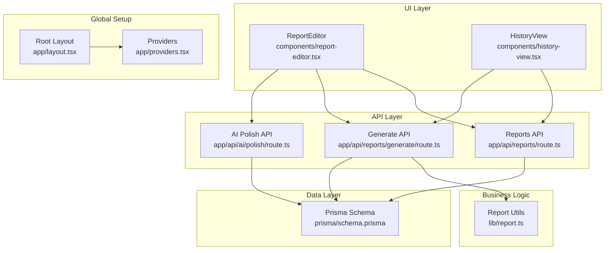
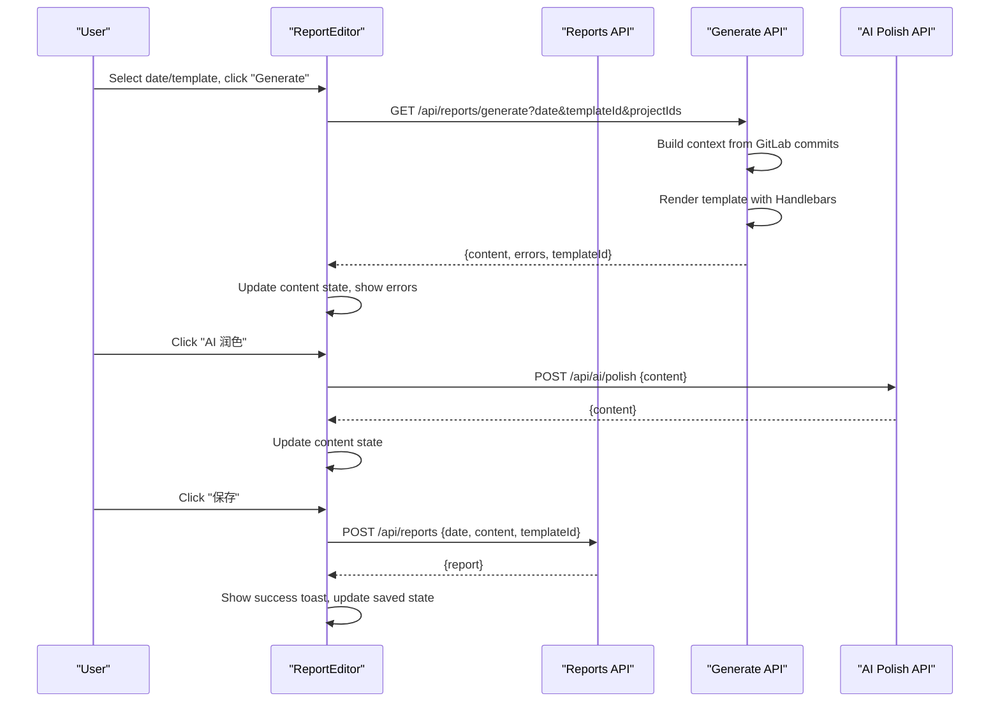
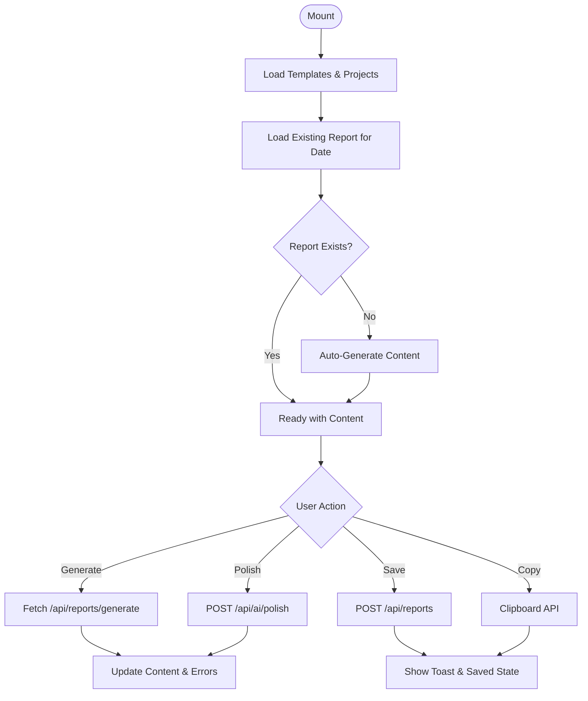
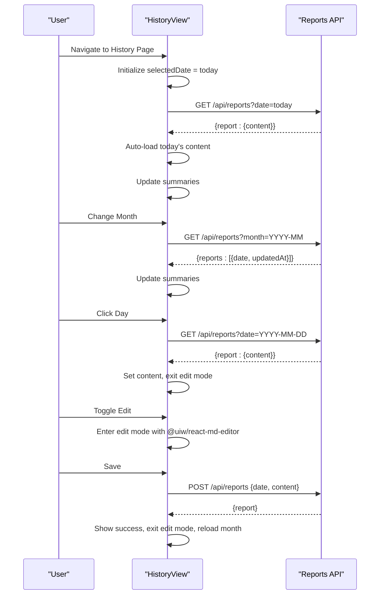
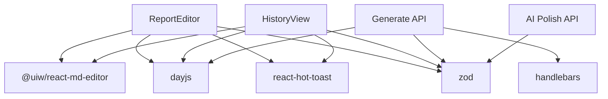

# Report Editor Components

<cite>
**Referenced Files in This Document**
- [report-editor.tsx](file://components/report-editor.tsx)
- [history-view.tsx](file://components/history-view.tsx)
- [page.tsx](file://app/history/page.tsx)
- [route.ts](file://app/api/reports/route.ts)
- [route.ts](file://app/api/reports/generate/route.ts)
- [route.ts](file://app/api/ai/polish/route.ts)
- [report.ts](file://lib/report.ts)
- [schema.prisma](file://prisma/schema.prisma)
- [layout.tsx](file://app/layout.tsx)
- [providers.tsx](file://app/providers.tsx)
- [utils.ts](file://lib/utils.ts)
- [package.json](file://package.json)
</cite>

## Update Summary
**Changes Made**
- Updated HistoryView component documentation to reflect auto-loading functionality for today's date
- Added documentation for automatic date selection and content loading on component mount
- Enhanced component lifecycle documentation with new auto-loading behavior
- Updated state management section to include auto-loading useEffect hook

## Table of Contents
1. [Introduction](#introduction)
2. [Project Structure](#project-structure)
3. [Core Components](#core-components)
4. [Architecture Overview](#architecture-overview)
5. [Detailed Component Analysis](#detailed-component-analysis)
6. [Dependency Analysis](#dependency-analysis)
7. [Performance Considerations](#performance-considerations)
8. [Troubleshooting Guide](#troubleshooting-guide)
9. [Conclusion](#conclusion)
10. [Appendices](#appendices)

## Introduction
This document provides comprehensive documentation for the report editor UI components in the Pingyun Report application. It focuses on the markdown editor implementation using @uiw/react-md-editor, component state management, calendar integration for report history navigation, and integration with backend APIs. It also covers configuration options, toolbar customization, real-time preview, validation feedback, save operations, responsive design, accessibility, and performance optimization strategies for large documents and collaborative editing scenarios.

## Project Structure
The report editor functionality spans several layers:
- UI components: ReportEditor and HistoryView
- API routes: CRUD operations for reports, generation pipeline, and AI polish
- Business logic: Report context building and template rendering
- Data persistence: Prisma schema for Users, Projects, Reports, and Templates
- Global setup: Next.js providers and toast notifications

**Diagram sources**
- [report-editor.tsx:1-284](file://components/report-editor.tsx#L1-L284)
- [history-view.tsx:1-330](file://components/history-view.tsx#L1-L330)
- [route.ts:1-95](file://app/api/reports/route.ts#L1-L95)
- [route.ts:1-133](file://app/api/reports/generate/route.ts#L1-L133)
- [route.ts:1-63](file://app/api/ai/polish/route.ts#L1-L63)
- [report.ts:1-159](file://lib/report.ts#L1-L159)
- [schema.prisma:1-80](file://prisma/schema.prisma#L1-L80)
- [layout.tsx:1-25](file://app/layout.tsx#L1-L25)
- [providers.tsx:1-8](file://app/providers.tsx#L1-L8)

**Section sources**
- [report-editor.tsx:1-284](file://components/report-editor.tsx#L1-L284)
- [history-view.tsx:1-330](file://components/history-view.tsx#L1-L330)
- [route.ts:1-95](file://app/api/reports/route.ts#L1-L95)
- [route.ts:1-133](file://app/api/reports/generate/route.ts#L1-L133)
- [route.ts:1-63](file://app/api/ai/polish/route.ts#L1-L63)
- [report.ts:1-159](file://lib/report.ts#L1-L159)
- [schema.prisma:1-80](file://prisma/schema.prisma#L1-L80)
- [layout.tsx:1-25](file://app/layout.tsx#L1-L25)
- [providers.tsx:1-8](file://app/providers.tsx#L1-L8)

## Core Components
This section explains the two primary components that implement the report editor UI and history navigation.

- ReportEditor: A self-contained editor with date selection, template selection, project filtering, generation, AI polish, copy, and save operations. It integrates @uiw/react-md-editor for live preview editing.
- HistoryView: A calendar-based viewer for report history, allowing month navigation, day selection, and inline editing with @uiw/react-md-editor. **Enhanced with auto-loading functionality for today's date on component mount.**

Key capabilities:
- Real-time markdown preview via @uiw/react-md-editor with live preview mode
- Dynamic configuration loading for templates and projects
- Generation pipeline that fetches GitLab commits and renders templates
- AI-powered content polishing via external LLM API
- Toast-based user feedback for operations and errors
- Responsive layout with Tailwind CSS utilities
- **Automatic date selection and content loading for today's date on component mount**

**Section sources**
- [report-editor.tsx:19-284](file://components/report-editor.tsx#L19-L284)
- [history-view.tsx:13-330](file://components/history-view.tsx#L13-L330)

## Architecture Overview
The report editor follows a client-side UI component pattern with server-side API endpoints. The UI components manage local state for content, selections, and loading indicators, while API routes handle persistence, generation, and AI operations.

**Diagram sources**
- [report-editor.tsx:67-131](file://components/report-editor.tsx#L67-L131)
- [route.ts:23-132](file://app/api/reports/generate/route.ts#L23-L132)
- [route.ts:10-62](file://app/api/ai/polish/route.ts#L10-L62)
- [route.ts:55-76](file://app/api/reports/route.ts#L55-L76)

## Detailed Component Analysis

### ReportEditor Component
The ReportEditor component orchestrates the entire editing experience:
- State management: date, content, templates, selected projects, loading/saving/polishing flags, validation errors, and saved state
- Lifecycle: loads configuration on mount, loads existing report for selected date, auto-generates content if none exists
- Actions: generate report, save content, copy to clipboard, AI polish
- UI composition: date picker, template selector, project chips, action buttons, error banner, and @uiw/react-md-editor with live preview

**Diagram sources**
- [report-editor.tsx:39-107](file://components/report-editor.tsx#L39-L107)
- [route.ts:9-46](file://app/api/reports/route.ts#L9-L46)
- [route.ts:23-132](file://app/api/reports/generate/route.ts#L23-L132)
- [route.ts:10-62](file://app/api/ai/polish/route.ts#L10-L62)

Implementation highlights:
- Markdown editor integration: @uiw/react-md-editor is dynamically imported to avoid SSR issues and configured with live preview and fixed height
- Content synchronization: onChange handler updates local state; save operation persists to backend
- Validation feedback: errors array from generation is displayed as a red banner with project-specific failures
- Save operations: POST to /api/reports with zod validation on the server side
- Calendar integration: date picker drives report loading and generation

**Section sources**
- [report-editor.tsx:19-284](file://components/report-editor.tsx#L19-L284)

### HistoryView Component
The HistoryView component provides a calendar-based interface for browsing historical reports with enhanced auto-loading functionality:
- State management: month navigation, report summaries, selected date, content, edit mode, saving flag
- **Auto-loading: Automatically selects today's date and loads content on component mount**
- Calendar grid: generates a month matrix with empty placeholders for padding
- Actions: load monthly summaries, load daily content, edit/save, copy to clipboard
- UI composition: sidebar calendar grid, main content area with markdown preview or editor

**Updated** Enhanced with automatic date selection and content loading on component mount for improved user experience

**Diagram sources**
- [history-view.tsx:18-31](file://components/history-view.tsx#L18-L31)
- [history-view.tsx:158-166](file://components/history-view.tsx#L158-L166)
- [history-view.tsx:39-86](file://components/history-view.tsx#L39-L86)
- [route.ts:9-46](file://app/api/reports/route.ts#L9-L46)

**Section sources**
- [history-view.tsx:13-330](file://components/history-view.tsx#L13-L330)
- [page.tsx:8-20](file://app/history/page.tsx#L8-L20)

### Markdown Editor Implementation with @uiw/react-md-editor
Both components use @uiw/react-md-editor for markdown editing and preview:
- Live preview mode: preview="live" enables real-time rendering
- Height configuration: fixed heights for consistent UX across components
- Dynamic import: imported with ssr: false to prevent SSR issues
- Color mode: data-color-mode="light" ensures consistent theme rendering
- Controlled state: value and onChange props bind editor content to component state

Customization options:
- Toolbar customization: @uiw/react-md-editor supports customizing toolbar actions; in this codebase, the default toolbar is used
- Preview mode: live preview is enabled; alternatively, preview="markdown" or preview="edit" could be used depending on UX needs
- Height adjustment: configurable via height prop; consider responsive breakpoints for mobile devices
- Theme alignment: data-color-mode="light" aligns with light theme styling

Real-time preview functionality:
- Immediate visual feedback as users type
- Seamless switching between edit and preview modes
- Integration with toast notifications for user feedback

**Section sources**
- [report-editor.tsx:273-280](file://components/report-editor.tsx#L273-L280)
- [history-view.tsx:310-323](file://components/history-view.tsx#L310-L323)

### Component State Management
State management patterns across components:
- Local state: useState for content, selections, flags, and errors
- Memoized computations: useMemo for derived data (e.g., enabled projects)
- **Auto-loading effects: useEffect hooks for initialization and automatic content loading**
- Controlled components: form controls bound to state via onChange handlers
- Error handling: toast notifications for user feedback; server-side validation via zod

**Updated** Added auto-loading useEffect hook for automatic content loading on component mount

Validation feedback:
- Generation errors: displayed as a red banner with project names and error messages
- Save success/error: toast notifications indicate outcome
- AI polish validation: checks for empty content before sending request

Save operations:
- POST /api/reports persists content with optional templateId
- Upsert semantics ensure creation or update based on date and user
- Server-side zod validation prevents malformed requests

**Section sources**
- [report-editor.tsx:29-32](file://components/report-editor.tsx#L29-L32)
- [history-view.tsx:17-31](file://components/history-view.tsx#L17-L31)
- [route.ts:48-76](file://app/api/reports/route.ts#L48-L76)

### Calendar Integration for Report History Navigation
Calendar integration in HistoryView:
- Month navigation: arrow buttons adjust the displayed month
- Grid generation: computes padded grid for month view with null placeholders
- Selection logic: clicking a day loads content and toggles edit mode
- **Auto-selection: Today's date is automatically selected and loaded on component mount**
- Visual indicators: dots for days with saved reports, today highlighting, and selected day styling
- Responsive layout: grid layout adapts to medium screens and above

**Updated** Enhanced with automatic date selection for today's date during component initialization

Date selection behavior:
- Selected date drives content loading and editing
- **Auto-loading effect ensures today's content is loaded immediately upon component mount**
- Edit mode allows inline markdown editing with @uiw/react-md-editor
- Save operations update the selected date's content

**Section sources**
- [history-view.tsx:14-32](file://components/history-view.tsx#L14-L32)
- [history-view.tsx:158-166](file://components/history-view.tsx#L158-L166)
- [history-view.tsx:117-149](file://components/history-view.tsx#L117-L149)

### Component Composition Patterns, Prop Interfaces, and Event Handling
Composition patterns:
- Container components: ReportEditor and HistoryView encapsulate state and orchestrate API calls
- Child components: @uiw/react-md-editor is used directly within containers
- Utility helpers: cn from lib/utils.ts merges Tailwind classes conditionally

Prop interfaces:
- ReportEditor: no incoming props; manages internal state and events
- HistoryView: no incoming props; manages internal state and events
- MDEditor: receives value and onChange props; configured via attributes

Event handling:
- Form events: date change, template selection, project toggles
- Button clicks: generate, save, copy, polish, edit/save
- **Auto-loading effects: useEffect hooks for automatic initialization**
- Calendar interactions: month navigation and day selection

**Updated** Added auto-loading effects to component composition patterns

**Section sources**
- [report-editor.tsx:172-282](file://components/report-editor.tsx#L172-L282)
- [history-view.tsx:88-330](file://components/history-view.tsx#L88-L330)
- [utils.ts:4-6](file://lib/utils.ts#L4-L6)

### Responsive Design Considerations and Accessibility Features
Responsive design:
- Flexbox and grid layouts adapt to screen sizes
- Buttons and inputs use relative sizing and padding for touch targets
- Calendar grid uses grid-cols-7 for desktop and wraps on smaller screens
- Fixed heights for editors provide consistent layout across devices

Accessibility features:
- Semantic HTML: labels, buttons, and inputs with proper roles
- Focus management: interactive elements support keyboard navigation
- Color contrast: Tailwind utilities ensure readable text and sufficient contrast
- Screen reader friendly: aria labels and semantic markup where applicable

**Section sources**
- [report-editor.tsx:172-282](file://components/report-editor.tsx#L172-L282)
- [history-view.tsx:88-330](file://components/history-view.tsx#L88-L330)

### Backend API Integration
API endpoints and their roles:
- GET /api/reports: retrieves report by date, monthly summaries, or recent reports
- POST /api/reports: upserts report content with optional templateId and rawCommits
- DELETE /api/reports: deletes reports by date
- GET /api/reports/generate: builds report context from GitLab commits and renders template
- POST /api/ai/polish: sends content to LLM API for polishing

Data models and relationships:
- User has many Projects, Reports, and Templates
- Project belongs to User and is linked to GitLab project identifiers
- Report belongs to User and stores markdown content and metadata
- Template belongs to User and stores template bodies

**Section sources**
- [route.ts:9-95](file://app/api/reports/route.ts#L9-L95)
- [route.ts:23-132](file://app/api/reports/generate/route.ts#L23-L132)
- [route.ts:10-62](file://app/api/ai/polish/route.ts#L10-L62)
- [schema.prisma:16-79](file://prisma/schema.prisma#L16-L79)

### Examples of Component Usage and Customization
Usage examples:
- ReportEditor: Place within a page to provide a full-featured editor with date selection, template selection, and generation
- HistoryView: Embed in a dedicated history page to browse and edit past reports

**Updated** Enhanced HistoryView usage with auto-loading functionality

Customization options:
- Template selection: choose default or custom templates during generation
- Project filtering: enable/disable projects to include in generation
- Editor appearance: adjust height and preview mode in @uiw/react-md-editor
- Toast notifications: configure positions and styles globally in the root layout
- **Auto-loading behavior: customize initial date selection and auto-loading logic**

Integration with backend:
- Authentication: NextAuth session provider ensures protected routes
- Notifications: react-hot-toast provides global toast notifications
- Dynamic imports: @uiw/react-md-editor is imported dynamically to avoid SSR issues

**Section sources**
- [report-editor.tsx:19-284](file://components/report-editor.tsx#L19-L284)
- [history-view.tsx:13-330](file://components/history-view.tsx#L13-L330)
- [layout.tsx:18-22](file://app/layout.tsx#L18-L22)
- [providers.tsx:5-7](file://app/providers.tsx#L5-L7)

## Dependency Analysis
External dependencies and their roles:
- @uiw/react-md-editor: markdown editor with live preview
- dayjs: date parsing and manipulation
- react-hot-toast: toast notifications
- clsx and tailwind-merge: class merging utilities
- zod: runtime validation for API requests
- handlebars: template rendering engine
- next-auth: session management
- prisma: database client and schema

**Diagram sources**
- [package.json:16-31](file://package.json#L16-L31)
- [report-editor.tsx:3-9](file://components/report-editor.tsx#L3-L9)
- [history-view.tsx:3-9](file://components/history-view.tsx#L3-L9)
- [route.ts:1-12](file://app/api/reports/generate/route.ts#L1-L12)
- [route.ts:5-8](file://app/api/ai/polish/route.ts#L5-L8)

**Section sources**
- [package.json:16-31](file://package.json#L16-L31)
- [report-editor.tsx:3-9](file://components/report-editor.tsx#L3-L9)
- [history-view.tsx:3-9](file://components/history-view.tsx#L3-L9)
- [route.ts:1-12](file://app/api/reports/generate/route.ts#L1-L12)
- [route.ts:5-8](file://app/api/ai/polish/route.ts#L5-L8)

## Performance Considerations
Optimization strategies for large documents and collaborative editing:
- Debounced saves: throttle save operations to reduce API calls
- Virtualized lists: for long histories, consider virtualized grids to improve rendering performance
- Lazy loading: keep @uiw/react-md-editor lazy-loaded to minimize initial bundle size
- Efficient diffs: for collaborative editing, implement a diff-based sync mechanism (e.g., Operational Transformation or Conflict-free Replicated Data Types)
- Caching: cache generated content per date and template to avoid repeated generation
- Pagination: limit the number of reports fetched in history views
- Memoization: useMemo for derived data to prevent unnecessary re-renders
- Image optimization: if markdown includes images, optimize and lazy-load them
- Minimize reflows: batch state updates and avoid frequent DOM mutations
- **Auto-loading optimization: useEffect hooks with proper dependencies prevent unnecessary API calls during component initialization**

## Troubleshooting Guide
Common issues and resolutions:
- SSR rendering errors: ensure @uiw/react-md-editor is imported dynamically with ssr: false
- Authentication failures: verify NextAuth session provider is configured and user is logged in
- API validation errors: check zod schemas and ensure request payloads match expected shapes
- GitLab integration issues: confirm GitLab base URL and token are configured and decrypted correctly
- LLM API errors: verify LLM_API_BASE, LLM_API_KEY, and LLM_MODEL environment variables are set
- Toast notifications not appearing: ensure Toaster is rendered in the root layout
- **Auto-loading issues: verify selectedDate state initialization and useEffect dependencies are correct**

**Updated** Added troubleshooting guidance for auto-loading functionality

**Section sources**
- [report-editor.tsx:9-9](file://components/report-editor.tsx#L9-L9)
- [history-view.tsx:9-9](file://components/history-view.tsx#L9-L9)
- [layout.tsx:20-20](file://app/layout.tsx#L20-L20)
- [providers.tsx:5-7](file://app/providers.tsx#L5-L7)
- [route.ts:38-43](file://app/api/reports/generate/route.ts#L38-L43)
- [route.ts:14-22](file://app/api/ai/polish/route.ts#L14-L22)

## Conclusion
The report editor components provide a robust, user-friendly interface for creating and managing daily reports. They integrate seamlessly with GitLab for content generation, leverage Handlebars for templating, and offer AI-powered content polishing. The components are designed with responsive and accessible UI patterns, and they communicate with well-defined API endpoints backed by Prisma. 

**Enhanced** The HistoryView component now features automatic date selection and content loading for today's date, improving user experience by eliminating manual date selection on initial page load. For production-scale usage, consider implementing collaborative editing features, debounced saves, and caching strategies to enhance performance and user experience.

## Appendices
- Global setup: Providers wrap the application with NextAuth session management; Toaster provides toast notifications
- Utilities: cn function merges Tailwind classes with proper conflict resolution

**Section sources**
- [layout.tsx:18-22](file://app/layout.tsx#L18-L22)
- [providers.tsx:5-7](file://app/providers.tsx#L5-L7)
- [utils.ts:4-6](file://lib/utils.ts#L4-L6)